# 人体膝关节外骨骼助力策略与人机交互的建模与仿真

Longbin Zhang1,2, Yixing Liu1,2, Ruoli Wang1,2,3, Christian Smith4 and Elena M. Gutierrez-Farewik1,2,3\*

1 KTH MoveAbility Lab, Department of Engineering Mechanics, KTH Royal Institute of Technology, Stockholm, Sweden, 2 KTH BioMEx Center, KTH Royal Institute of Technology, Stockholm, Sweden, 3 Department of Women’s and Children’s Health, Karolinska Institutet, Stockholm, Sweden, 4 Robotics, Perception, and Learning Lab, KTH Royal Institute of Technology Stockholm, Sweden

开放获取（OPEN ACCESS）

编辑：Andrej Gams, Institut Jožef Stefan, Slovenia

审稿人：Andrej Olenšek, University Rehabilitation Institute, Slovenia；Suncheol Kwon, National Rehabilitation Center, South Korea

\*通讯作者：Elena M. Gutierrez-Farewik lanie@kth.se

收稿日期：2020 年 10 月 24 日；录用日期：2021 年 2 月 1 日；出版日期：2021 年 3 月 8 日

## 引用格式：

Zhang L, Liu Y, Wang R, Smith C and Gutierrez-Farewik EM (2021) Modeling and Simulation of a Human Knee Exoskeleton’s Assistive Strategies and Interaction. Front. Neurorobot. 15:620928. doi: 10.3389/fnbot.2021.620928

外骨骼越来越广泛地应用于神经损伤后运动障碍患者的康复和日常生活中。本文基于物理系统建立了一个逼真的人体膝关节外骨骼模型，在肌骨建模软件中构建了人机系统，并对基于不同助力策略的人机交互进行了仿真。所开发的人机系统使得计算仿真运动中所涉及的力矩、肌肉冲量、接触力以及交互力成为可能。将建模为旋转执行器、单摆模型和阻尼摆模型的助力策略应用于模拟的正常和快速步态下的膝关节外骨骼。我们发现，基于旋转执行器的助力控制器能够小幅减少使用者所需的膝伸肌生理力矩和肌肉冲量，这表明在开发助力策略时应考虑关节旋转方向。与单摆模型相比，基于阻尼摆模型的控制器在摆动相差异不大，但在站立后期进一步降低了使用者所需的膝屈肌力矩。我们发现的交互力与生理力矩（肌肉冲量是其主要贡献因素）之间的权衡关系，在设计物理外骨骼系统的控制器时应予以考虑。该人机系统在关节和肌肉层面提供的详细信息，有助于康复和运动助力外骨骼的控制器设计优化。

关键词：AnyBody、条件接触单元、阻尼因子、交互力、人机交互

## 1. 引言

外骨骼在神经系统疾病患者（如中风、脊髓损伤、脑瘫和帕金森病）的康复治疗中引起了越来越多的研究兴趣 (Ye et al., 2017; Fournier et al., 2018)。机器人外骨骼是极具前景的辅助/康复设备，能够为肌力缺失人群补充力矩生成，或协助运动功能障碍患者的康复 (Yao et al., 2018; Zhang et al., 2019)。此类外骨骼有望减轻治疗师在康复过程中繁重而单调的体力消耗，使他们能够专注于最小程度的物理交互，以及训练过程中对患者的观察和监督 (Veneman et al., 2007; Li et al., 2018b, 2019)。

外骨骼的机械设计是影响其与使用者交互有效性的重要因素。已有研究设计了一些实验来评估外骨骼的适应性、安全性、效率和舒适度 (Hu et al., 2016; Del Carmen Sanchez-Villamañan et al., 2019)。一项针对具有简单结构和轻量化的被动下肢外骨骼的实验评估对其步态自适应性进行了研究 (Wang et al., 2019)，其作者表明该外骨骼对踝关节运动学的影响最大，而对髋关节运动学的影响最小。Li et al. (2014) 评估了一种配备自适应反步控制器的上肢外骨骼，该控制器用于协助使用者追踪预定义轨迹。他们的实验结果表明，所提出的自适应控制器在追踪重复轨迹时能够提供有效的辅助。Veneman et al. (2007) 设计并评估了一种用于交互式步态康复的下肢外骨骼。他们的评估测量表明，该外骨骼可以跟随或引导患者，但通过外骨骼装置测得的腿部位置/角度对于逆动力学计算而言精度不足。尽管对外骨骼原型进行实验评估非常重要，但在设计过程早期进行生物力学预测仿真可以最大限度地减少原型迭代，并评估一些在实验中难以测量的参数。

大多数外骨骼都是针对其在正常运动期间对用户产生的影响进行评估的（Lenzi et al., 2013; Yan et al., 2015）。Lenzi et al. (2013) 研究了人体对动力髋关节外骨骼作用的运动适应性，该外骨骼在步行过程中提供按标称扭矩曲线一定比例缩减的辅助扭矩。他们的实验结果表明，使用者能够适应这种辅助并从中受益，在髋部和踝部水平上的肌肉激活度均显著降低。Agrawal et al. (2007) 设计了一种无源髋膝外骨骼，并在四名健全人和三名中风患者的行走过程中改变了摆动腿关节的重力辅助水平。他们观察到了患者步态的一些重要改善，例如膝关节和髋关节屈曲角度的增加。外骨骼运动辅助策略的计算建模已被用于分析和估算对用户的作用交互因素。腿部在站立相被建模为倒立摆，而在摆动相被建模为单摆（Singh et al., 2008; Furse, 2010; Bazargan-Lari et al., 2015; Sharbafi et al., 2016）。Sharbafi et al. (2017) 将站立腿的弹簧-质量倒立摆模型与摆动腿的双摆模型相结合，以解释行走过程中类似人类的腿部行为。仿真与实验的对比表明，所提出的模型具有复现站立腿和摆动腿的运动学与动力学行为的能力。Shourijeh et al. (2017) 将辅助扭矩建模为旋转执行器（rotational actuator, RA），并将其应用于髋、膝和踝关节。在包含一到三个关节的几种不同搬箱任务工况中，利用代谢率模型（Umberger, 2010）模拟了代谢能量消耗。其仿真结果表明，采用基于旋转执行器的髋关节辅助时总代谢能量消耗的降低幅度大于膝关节和踝关节辅助。El Zahraa Webhi et al. (2017) 在摆动相膝关节矫形器的双摆模型阻抗控制中，还考虑了阻尼分量。他们的实验结果表明，采用该方法可以显著降低使用者的用力程度。然而，外骨骼在关节和肌肉水平上对用户的影响，包括肌肉激活、生理关节扭矩、关节接触力以及交互力，尚未得到广泛深入的描述。

在对外骨骼运动助力策略进行仿真时，其构件的质量、惯性（转动惯量）和阻尼系数，以及外骨骼与用户之间的交互力，都会对控制方案产生影响。Dembia et al. 利用肌骨系统仿真评估了七种假设的、理想（无质量）的双侧助力设备在负重行走时对肌肉活动和代谢消耗的影响 (Dembia et al., 2017)。在其仿真结果中，助力髋关节屈曲、膝关节屈曲和髋关节外展的设备比助力踝关节跖屈的设备能够实现更多的代谢节省，且助力髋关节外展的设备表现出代谢节省量与设备峰值瞬时正功率的最大比值。尽管他们在仿真中忽略了质量，但这些结果仍可为实验研究人员针对特定关节运动提供指导。此外，仅有少数研究考虑了外骨骼与其使用者之间的交互力 (Li et al., 2018a; Serrancolí et al., 2019; Su et al., 2019)。鉴于外骨骼旨在与穿戴者直接进行物理交互，研究其中涉及的交互力至关重要。确定交互力最直接且准确的方法是研制样机并在实验中测量受力，但由于通常需要进行多次模型设计迭代，这种方法既昂贵又耗时 (Cho et al., 2012)。因此，在评估不同的控制方案时，在考虑外骨骼部件的质量、惯性和阻尼系数的同时对交互力进行预测是非常有益的。

本研究的目标是在带有膝关节外骨骼的虚拟人机系统（human–machine system, HMS）仿真中，评估不同助力策略如何影响用户所需的生理发力以及关节接触力，并研究设备与穿戴者之间的交互力。为了阐明这些目标，本研究采用了三种不同的助力模型，即 RA、单摆模型（simple pendulum model, SPM）和阻尼摆模型（damped pendulum model, DPM），用于在模拟的正常和快速步态中对膝关节处的助力力矩进行建模。通过计算肌骨模型估算了包括肌肉冲量、所需生理力矩、关节接触力和交互力在内的测量指标，并在三种助力策略之间进行了比较。

## 2. 方法

在本文中，我们创建了人体膝关节外骨骼 CAD 模型，随后将其整合到肌骨模型（AnyBody AMMR）中，构建了虚拟 HMS（Figure 1）。本文对正常和快速步态进行了仿真，并对三种不同的膝关节助力力矩以及无助力模式进行了对比。输出的结果参数包括虚拟 HMS 中用户所需的膝关节屈肌和伸肌力矩、关节接触力、肌肉冲量以及交互力。

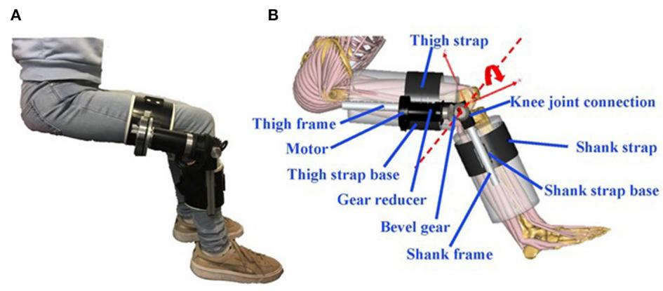  
FIGURE 1 | (A) 膝关节外骨骼原型；(B) 虚拟人机系统（HMS）。

## 2.1. 膝关节外骨骼模型

建立了物理膝关节外骨骼的 CAD（Solidworks）模型（Figure 1），该模型由无刷直流电机（EC 90 flat φ90 mm 90 W；Maxon，德国慕尼黑）、齿轮减速器（Planetary Gearhead GP 52C，Maxon，德国慕尼黑）、用于改变施加扭矩方向的伞齿轮、大腿和小腿绑带袖套、膝关节连接件以及绑带基座组成。外骨骼产生的可变助力扭矩被建模为理想扭矩。外骨骼部件的质量、转动惯量和阻尼均被纳入虚拟 HMS 中。

## 2.2. 肌肉骨骼模型

使用 Twente 下肢模型第 2 版（TLEM2.0）构建了肌肉骨骼模型（AnyBody Modeling System [AMS]）。Carbone et al.（2015）对该模型进行了详细描述。通用模型的质量和身高分别为 66 kg 和 1.75 m。该模型由一个简化的上半身环节（腰部区域、刚性躯干、颈部和头部）和 11 个下肢环节组成：骨盆、大腿、髌骨、小腿、距骨和足部。每个下肢有四个关节；髋关节被建模为三自由度（DOF）球窝关节，膝关节、距小腿关节和距下关节被建模为单自由度铰链。

## 2.3. 人-外骨骼交互模型

为了将人体模型和外骨骼模型组合成虚拟 HMS，定义了机械约束以实现两者之间顺畅的相互作用。外骨骼与人体模型之间的约束被建模为一个具有八个自由度的刚体系统：膝关节旋转轴（RA）一个自由度、伞齿轮一个自由度、连接膝关节内侧三个自由度、连接膝关节外侧两个自由度、连接大腿侧一个自由度以及连接小腿侧一个自由度。这里使用的约束均为“软”关节，允许使用者皮肤与外骨骼之间发生微小的相对运动（Damsgaard et al., 2006）。

## 2.4. 膝关节接触力计算

膝关节接触力（仅受压载荷）计算为由肌肉力、重力、惯性力以及力矩和地面反作用力导致的股骨净载荷。然后，通过在额状面上应用力矩平衡方程 (1) 和力平衡方程 (2)，将总压缩载荷分解为内侧和外侧间室载荷（Seedhom et al., 1972; Richards et al., 2018; Peng et al., 2020），如 Figure 2 所示。

$$
M _ {k a d} + F _ {k c l} \cdot r _ {l} - F _ {k c m} \cdot r _ {m} = 0
$$

$$
F _ {k c} = F _ {k c l} + F _ {k c m}\tag{1}
$$

(2)

其中 $M _ { k a d }$ 为小腿坐标系中的膝关节外展力矩；$F _ { k c l }$ 和 $F _ { k c m }$ 分别为膝关节外侧间室和内侧间室的接触力；$r _ { l }$ 和 $r _ { m }$ 分别为外侧髁和内侧髁的力臂，根据文献报道的髁宽与膝宽之比估算得出（Richards et al., 2018）；$F _ { k c }$ 为额状面内的膝关节总接触力。接触力归一化为体重。

## 2.5. 交互力计算

使用者与外骨骼固定带之间的相互作用通过若干点进行建模（Figure 3），这些点能够将交互力从外骨骼传递至使用者（Rasmussen et al., 2009）。这些接触节点可以提供受压交互（法向）力以及与反作用力成比例的库仑切向交互力，并在肌肉骨骼模型系统中被建模为条件接触单元。在使用者建模腿部的包裹表面（基底对象）上定义了16个节点，并在外骨骼固定带（目标对象）的接触点处定义了对应的16个接触节点。随后，针对每个接触节点在基底对象上定义了一个圆柱形空间。当目标对象位于虚拟圆柱体内时判定发生接触，并通过生成人工“肌肉”来计算两个对象之间的交互力。这些人工“肌肉”可像肌肉骨骼模型中的其他肌肉一样被招募，并参与逆动力学分析。

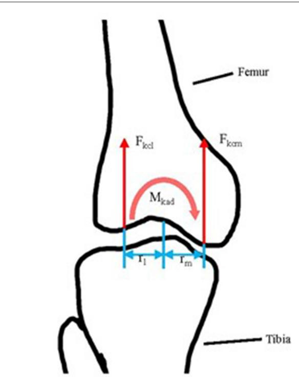  
FIGURE 2 | 额状面内胫股接触力计算示意图。$F _ { k c I }$ 和 $F _ { k c m } { : }$ 分别为外侧和内侧胫股压力；r 和 $r _ { m }$ 分别为外侧髁和内侧髁力臂长度；$M _ { k a d } ;$ ：膝关节外展力矩。

## 2.6. 地面反作用力与力矩的预测

通过在肌肉骨骼模型每只脚下方的25个接触节点处创建接触单元，对地面反作用力和力矩进行预测。在每个接触节点处，包含了五个类肌肉的人工执行器以近似静态库仑摩擦模型；其中一个执行器沿测力台垂直方向对齐并产生法向力，另外两对执行器分别沿测力台的内外侧和前后侧方向对齐，并产生正向或负向摩擦力。地面反作用力与力矩的计算是通过在接触节点引入这些类肌肉的人工执行器，并结合肌肉招募算法共同完成的，该功能由软件提供支持（Fluit et al., 2014; Skals et al., 2017）。

## 2.7. 助力策略

在本研究中，使用三种模型模拟了正常和快速行走期间的辅助策略：RA、SPM 和 DPM。其动机如下：RA 中的刚度与关节偏离中立位的程度成正比，因此它将在摆动期提供最大的辅助力矩，因为此时膝关节屈曲角度最大。此外，小腿在支撑期很大程度上表现为倒立摆，而在摆动期表现为单摆 (Kuo and Donelan, 2010)。添加阻尼元件是因为它们可以辅助肌肉的离心动作。本文中的肌肉骨骼仿真基于逆向动力学方法。外骨骼产生的变化辅助力矩使用“AnyForce”类建模为理想力矩。

## 2.7.1. 旋转执行器模型

建模为 RA 的辅助力矩如公式 (3) 所示

$$
u _ {r} = - K (\theta - \theta_ {r e f})\tag{3}
$$

其中 K 为辅助执行器的拟刚度，θ 为膝关节外骨骼屈曲角，而 $\theta _ { r e f } = 0$ 为处于中立位（即膝关节完全伸直）时的参考角。

对于基于 RA 的控制器，RA 刚度对穿戴者所需的肌肉冲量有影响。进行了敏感性分析以确定在正常和快速步态期间使膝关节屈肌和伸肌产生最小肌肉冲量的“最佳”刚度（补充材料），我们确定该刚度为 4 Nm/rad。基于 RA 的控制器中的该刚度值被应用于辅助外骨骼。

## 2.7.2. 摆模型

在 SPM 和 DPM 中，对于摆动腿，小腿-足-下部外骨骼（外骨骼的下半部分）被建模为绕膝关节旋转的普通单摆；对于支撑腿，小腿-外骨骼被建模为绕踝关节旋转的倒立摆。

单摆模型：在摆动期，建模为受驱动单摆的膝关节动力学 (Ronsse et al., 2010) 可以关于时间 t 表示为公式 (4)：

$$
I _ {c _ {1}} \ddot {\theta} _ {k} (t) = - m _ {c _ {1}} g l _ {c _ {1}} \sin \theta_ {k} (t) + u _ {s} (t)\tag{4}
$$

其中 $I _ { c _ { 1 } }$ 是踝关节处于中立位时小腿-足-下部外骨骼环节绕膝关节的转动惯量（在 AMS 中计算），即忽略由踝关节运动引起的惯性变化；$\theta _ { k } ( t )$ 和 $\ddot { \theta _ { k } } ( t )$ 分别为膝关节角度和角加速度，即小腿相对于大腿的角度和角加速度；$m _ { c _ { 1 } }$ 是小腿-足-下部外骨骼环节的组合质量；$l _ { c _ { 1 } }$ 是膝关节中心与小腿-足-外骨骼摆的质心之间的距离（在摆动期简化为刚体）；g 为重力常数；$u _ { s } ( t )$ 是基于 SPM 的控制器中施加于膝关节的力矩。

在支撑期，建模为倒立摆模型的膝关节动力学 (Simoneau and Corbeil, 2005;

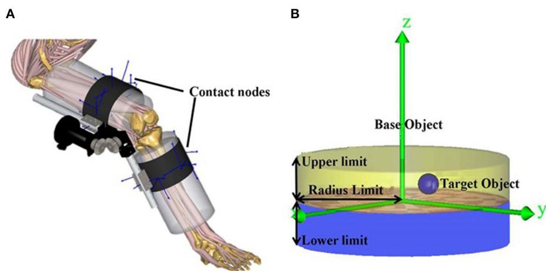  
FIGURE 3 | (A) 固定绑带与使用者之间的接触节点；(B) 接触节点被建模为基础对象（使用者）与目标对象（外骨骼）之间的条件接触单元。下限和上限是基础对象与目标对象之间在法向（z）方向上决定接触的最小和最大距离。半径限制定义了基础对象与目标对象之间在切向（x − y）平面内的距离。建模的条件接触单元通过生成人工“肌肉”来计算两个对象之间的法向和切向相互作用力，这些人工肌肉可以像肌肉骨骼模型中的任何其他肌肉一样被募集。

Sasagawa et al., 2014）关于时间 $t$ 表示为公式 (5)：

$$
I _ {s} \ddot {\theta} _ {a} (t) = T _ {a} - m _ {c _ {2}} g l _ {s} \sin \theta_ {a} (t) + u _ {s} (t)\tag{5}
$$

其中 $I$ 是小腿及下部外骨骼倒立摆绕踝关节的转动惯量，$\theta _ { a } ( t )$ 和 $\ddot { \theta } _ { a } ( t )$ 分别是小腿-外骨骼倒立摆绕踝关节的踝关节角度和角加速度，$m _ { c _ { 2 } }$ 是人体-外骨骼模型减去足部节段后的组合质量，$l _ { s }$ 是踝关节中心与小腿-外骨骼倒立摆质心之间的距离，$T _ { a }$ 是通过逆动力学计算得到的踝关节力矩。

阻尼摆模型：在摆动期，建模为受驱动阻尼摆的膝关节动力学可以表示为公式 (6)：

$$
I _ {c _ {1}} \ddot {\theta} _ {k} (t) = - m _ {c _ {1}} g l _ {c _ {1}} \sin \theta_ {k} (t) - b \dot {\theta} _ {k} (t) + u _ {d} (t)\tag{6}
$$

其中 $b$ 是膝关节黏性阻尼常数，$\dot { \theta } _ { k } ( t )$ 是膝关节角速度（即小腿相对于大腿的角速度），$u _ { d } ( t )$ 是基于 DPM 的控制器施加在膝关节上的力矩。

在支撑期，建模为倒立摆的膝关节动力学可以表示为公式 (7)：

$$
I _ {s} \ddot {\theta} _ {a} (t) = T _ {a} - m _ {c _ {2}} g l _ {s} \sin \theta_ {a} (t) - b \dot {\theta} _ {a} (t) + u _ {d} (t)\tag{7}
$$

其中 $\dot { \theta } _ { a } ( t )$ 是小腿-外骨骼倒立摆绕踝关节的角速度。

施加在膝关节上的力矩由使用者和外骨骼共同提供。由外骨骼提供的助力矩（对于 SPM 为 $u _ { e s } ( t )$，对于 DPM 为 $u _ { e d } ( t )$）在支撑期和摆动期均可表示为施加在膝关节上的总力矩的比例 $a$：$u _ { e s } ( t ) ~ = ~ a \cdot u _ { s } ( t )$

且 $u _ { e d } ( t ) ~ = ~ a \cdot u _ { d } ( t ) ;$ ；其中 a $( 0 ~ \leq ~ a ~ \leq ~ 1 )$ 表示外骨骼助力水平。理论上，助力控制器的稳定性极限应在 a = 1 时达到。然而，在已报道的实验中，当外骨骼助力水平较高时，使用者表达了不适感，例如不需要的高频振荡（Ronsse et al., 2011）。在一项旨在确定在一个步态周期内使膝关节屈肌和伸肌产生最小肌肉冲量的“最佳”助力水平 a 和阻尼因子 b 的敏感性分析中，我们确定对于 SPM 模型（补充材料，Supplementary Material），支撑相期间的最佳助力水平为 a = 0.23，摆动相期间为 a = 0.78。对于 DPM 模型，我们确定支撑相期间，正常行走时的最佳值为 a = 0.33、b = 12.6，快速行走时为 a = 0.33、b = 18.4；摆动相期间，正常行走时的最佳值为 $a = 0 . 7 8 , b = 0 . 3 4$，快速行走时为 $a = 0 . 7 8 , b = 0 . 1$。

## 2.8. 仿真方案

利用软件中提供的运动学数据，对 1.22m/s 的正常速度和 1.49m/s 的快速步态进行了仿真，外骨骼膝关节采用了三种不同的助力模式——基于 RA、基于 SPM 和基于 DPM 的助力——以及带有外骨骼组件附加自重的无助力（NA）模式。通过逆动力学分析计算了肌肉冲量、所需的生理膝关节力矩、关节接触力和交互力，其中肌肉募集和激活通过以肌肉激活度平方和最小化为假设的静态优化来求解（Rasmussen et al., 2001; Damsgaard et al., 2006; Bassani et al., 2017）。肌肉冲量定义为一个步态周期内肌肉力对时间的积分，针对膝屈肌：缝匠肌（SAR）、股二头肌长头（BFL）、半腱肌（ST）、半膜肌（SM）、股薄肌（GRA）、腓肠肌（GAS），以及膝伸肌：

股外侧肌（VL）、股内侧肌（VM）、股中间肌（VI）和股直肌（RF）进行了计算。

## 3. 结果

## 3.1. 肌肉冲量

在没有外骨骼辅助力矩（NA）的情况下，屈膝肌群中的肌肉冲量（一个步态周期内肌肉力对时间的积分）在 GAS 中最高，其次是 BFL、SAR 和 ST，而在 GRA 肌中非常低（Figure 4）。作为时间序列的肌肉活动展示在补充材料（Supplementary Material）中。在伸膝肌群中，肌肉冲量在 RF 肌中最高。在 RA 辅助模式下，与 NA 相比，肌肉冲量在所有屈膝肌中略有增加，但在所有屈膝肌中略有减少。在 SPM 和 DPM 模式下，屈膝肌群中 SAR、BFL、SM 和 ST 的肌肉冲量降低至 NA 模式的约一半，且在 GAS 中略有下降。与 RA 相比，SPM 和 DPM 模式下所有伸膝肌群的肌肉冲量均略有增加，但变化幅度较小。在 DPM 模式下，屈膝肌群和股肌群（vasti）的肌肉冲量略低于 SPM 模式，但 RF 的肌肉冲量略高。

## 3.2. 所需生理膝关节力矩

在没有外骨骼辅助力矩（NA）的情况下，初始触地时需要较小的内部膝关节屈曲力矩，随后在承重反应期需要膝关节伸展力矩，在支撑中期至支撑末期需要膝关节屈曲力矩，在摆动前期需要较小的膝关节伸展力矩，在摆动末期需要较小的膝关节屈曲力矩（Figure 5）。与 NA 模式相比，当外骨骼处于 RA 模式时，用户在承重反应期所需的膝关节伸展力矩略低，在支撑期的其余阶段相对无变化，但在摆动初期和摆动中期所需的膝关节屈曲力矩更高。与 RA 模式相比，在外骨骼处于 SPM 和 DPM 模式时，所需的生理膝关节屈曲和伸展力矩总体上均较低。在 SPM 和 DPM 模式下，支撑中期和支撑末期所需的内部膝关节屈曲力矩降至 RA 模式的约一半，且在整个摆动相期间几乎为零。在摆动前期，SPM 模型需要较小的内部膝关节伸展力矩，而 DPM 模型则需要较小的膝关节屈曲力矩。在摆动相，无论是在正常行走还是快速行走中，SPM 和 DPM 模型所需的膝关节力矩都几乎相同。

## 3.3. 关节接触力

在没有外骨骼辅助力矩（NA）的情况下，在支撑初期，正常行走时的胫股关节压力（接触力）约为体重的 220%，快速行走时约为体重的 300%；随后在支撑末期，正常行走时约为体重的 500%，快速行走时约为体重的 520%（Figure 6）。接触力在内侧和外侧间室之间的分布大致均匀。与 NA 模式相比，接触力在 RA 模式下几乎没有变化。在 SPM 和 DPM 模式下，胫股关节压力在支撑末期较低（约为体重的 100%），在摆动末期接近于零，且在各间室之间分布均匀。

## 3.4. 交互力

在没有外骨骼助力力矩（NA）的情况下，16个接触节点间的最大法向和切向交互力在摆动中期最高，但两者总体上均 $<20\%$ 体重（Figure 7）。与 NA 相比，RA 模式下的交互力几乎没有变化。与 NA 模式相比，在 SPM 和 DPM 模式下，最大切向交互力在摆动早期和中期基本保持不变，但在站立末期明显更高，且在摆动末期几乎翻倍，即在助力力矩补偿最高的阶段。类似地，与 NA 模式相比，SPM 和 DPM 助力模式下的最大法向交互力在摆动早期和中期几乎没有变化，但在站立末期明显更高，在摆动末期增加了一倍以上。在 SPM 和 DPM 模式下，两种行走速度在站立末期均出现了接近 20% 体重的最大切向力和超过 100% 体重的最大法向力。

## 4. 讨论

我们开发了一个完全集成了膝关节外骨骼硬件和控制的虚拟人机系统（Human-Machine System, HMS），并利用它计算了不同助力策略在运动过程中如何影响用户所需的力矩、肌肉冲量、接触力以及交互力。为了展示所开发的虚拟 HMS 的潜在用途，我们专门针对正常步态下的膝关节，并在膝关节处采用了三种常见但概念上不同的助力策略，即 RA、SPM 和 DPM 策略，以确定是否能识别出对用户的任何潜在益处。我们发现，基于 RA 的助力控制器只能小幅度减少用户所需的膝关节伸肌力矩和肌肉冲量。与基于 RA 的控制器相比，基于 SPM 和 DPM 的助力控制器更大程度地减少了用户所需的膝关节屈肌力矩和肌肉冲量，并降低了关节压缩接触力，但交互力更高。这些发现表明，在设计外骨骼控制器时，应考虑关节旋转方向，并且应权衡交互力与生理力矩之间的潜在关系。此外，基于摆的助力策略中的阻尼成分可能会进一步改变对用户的影响。

我们创建的虚拟人机系统（HMS）将所开发的外骨骼与通用的肌肉骨骼模型相结合，以确保利用仿真研究人机交互时的保真度。尽管我们在本研究中并未针对任何特定的患者群体，但图 5 说明了采用基于 DPM 助力策略的膝关节外骨骼如何能够在膝屈肌无力的情况下，帮助患者实现正常乃至快速的步行运动学表现。虚拟 HMS 同样可用于探索其他助力策略和/或物理设计是否能够补偿不同的肌肉无力状况。虚拟 HMS 已多次用于外骨骼的优化设计和控制。Zhou et al. (2017) 通过将肌肉骨骼模型与上肢外骨骼相结合创建了虚拟 HMS。他们评估了两种具有重力补偿能力的被动外骨骼，并

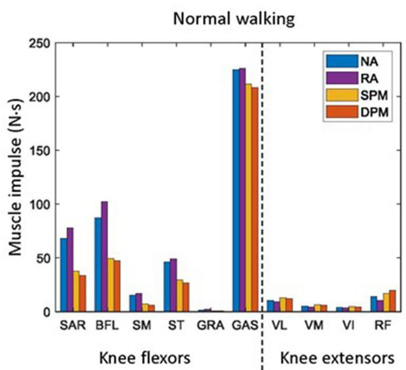

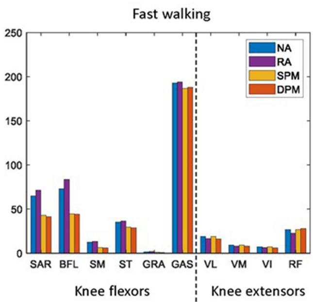  
FIGURE 4 | 用户在正常（左）和快速（右）步行步态周期中，佩戴外骨骼且处于无助力（NA）以及旋转执行器（RA）、简单单摆模型（SPM）和阻尼摆模型（DPM）助力模式下的膝屈肌和伸肌冲量。膝屈肌包括缝匠肌（SAR）、股二头肌长头（BFL）、半腱肌（ST）、半膜肌（SM）、股薄肌（GRA）和腓肠肌（GAS）。膝伸肌包括股外侧肌（VL）、股内侧肌（VM）、股中间肌（VI）和股直肌（RF）。

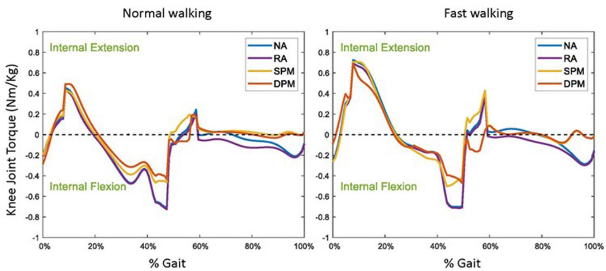  
FIGURE 5 | 用户在正常（左）和快速（右）步行中所需的生理膝关节力矩，佩戴膝关节外骨骼且处于无助力（NA）以及旋转执行器（RA）、简单单摆模型（SPM）和阻尼摆模型（DPM）助力模式下。结果以步态周期的函数表示，0% 为初始足部触地，站立相约为 0–60%，摆动相约为 60–100%（Perry et al., 1992）。

计算了最佳弹簧刚度。然而，他们并未研究不同的助力策略及其对用户的影响。Pan et al. (2015) 通过将 ADAMS 和 Matlab/Simulink 与模糊 PID/PID 算法相结合，仿真了一种新型人-外骨骼系统。他们验证了所提出的策略在外骨骼控制中完成某些日常活动（如平地行走、爬楼梯和下蹲）的有效性。然而，他们同样没有计算用户的用力程度和交互力。近年来，基于仿真的外骨骼及助力策略设计变得越来越普遍。近期由

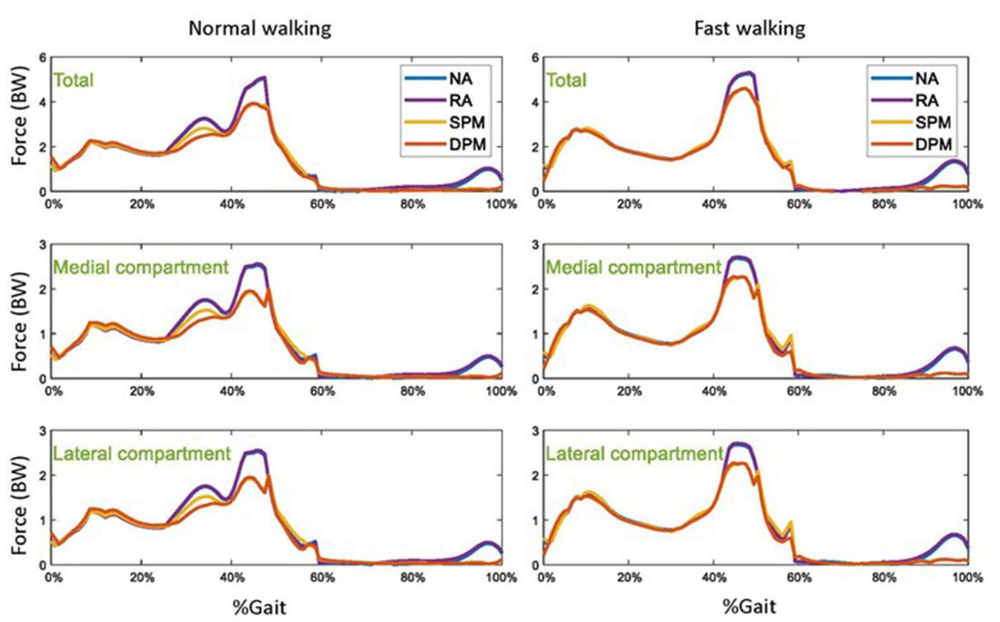  
FIGURE 6 | 正常步态（左）和快速步态（右）行走中，四种不同模式下的胫股总压应力以及膝关节内侧和外侧间室的压应力：无助力（NA）、旋转致动器（RA）助力、单摆模型（SPM）助力以及阻尼摆模型（DPM）助力。结果以步态周期的函数形式展示，0% 代表初始足接触，站立相约为 0–60%，摆动相为 60–100%。

Shourijeh et al. (2017) 描述了施加于髋关节、膝关节或踝关节并建模为 RA 的助力外骨骼力矩，并报告了其对总体代谢能量消耗的影响。Carmichael and Liu (2011) 使用肌肉骨骼模型来评估使用者的力量，并得出结论认为此类信息可用于改进为人类提供物理助力的机器人的控制方案。Agarwal et al. (2011) 分析了肘部外骨骼在四种不同案例场景下的性能，并报告了其对使用者肌肉力和肘部力矩的影响。De Rossi et al. (2011) 在一项实验研究中，使用软硅胶压力传感器阵列测量了穿戴下肢外骨骼的使用者的压力分布。这类研究对于评估人机交互的安全性和舒适性显然很有价值，但实验研究中的方法学局限性使其无法研究人机交互中的其他重要信息，例如关节接触力以及不同助力策略的影响。在本研究中使用虚拟 HMS，对关节和肌肉层面的详细信息以及相互作用力进行了调查与分析。因此，我们提出的虚拟 HMS 填补了已发表文献中的若干研究空白，尤其是在基于仿真的研究领域。

在步态过程中膝关节的示例性研究中，我们发现，与无助力相比，基于摆模型的助力扭矩可以降低对使用者膝屈肌的需求，而基于 RA 的模型则降低了对膝伸肌的需求。由于这些助力类型在概念上存在差异，它们以不同的方式影响了使用者所需的肌肉发力。在初始着地、站立后期和摆动后期，基于 RA 的助力并未补充使用者所需的膝关节屈曲扭矩；膝伸肌的肌肉冲量减小，但膝屈肌冲量增加。这与公式 (3) 中的设计和参数有关；RA 助力提供的扭矩与膝关节角度偏离完全伸直状态的偏差成正比。在步态过程中，最大膝关节屈曲发生在摆动初期至中期，但此时仅需要少量的膝关节伸展扭矩。因此，基于 RA 的模型略微减少了对使用者膝伸肌的需求，但增加了膝屈肌的冲量。然而，RA 助力扭矩并未考虑膝关节的运动方向，从而在摆动初期提供了膝关节伸展助力，阻碍了膝关节屈曲程度的增加。基于 RA 的模型甚至在摆动中期至摆动后期继续提供膝关节伸展助力，而此时实际上需要膝关节屈曲扭矩来减缓膝关节伸展的速率。在初始着地、站立后期和摆动后期，膝关节几乎处于完全伸展状态，因此助力扭矩较低。这表明，助力策略应当考虑所助力关节的运动方向，而不仅仅是相对于参考值的位置偏差，例如摆模型。在示例性研究中，与 RA 模型相比，基于 SPM 或 DPM 的助力使得使用者对膝屈肌的需求更低，但同时也导致了更高的相互作用力。膝屈肌负荷的降低是由于在摆动中期至摆动后期，小腿-足部-下部外骨骼的运动表现非常类似于绕膝关节旋转的刚性摆，其惯性在这种情况下是有利的。在基于摆的助力中加入阻尼分量在摆动相期间几乎没有产生影响，但在站立后期进一步降低了使用者的膝关节屈曲扭矩，此时膝关节刚度增加以稳定上半身，并可能从更高的阻尼系数中获益 (Zhao et al., 2013)。

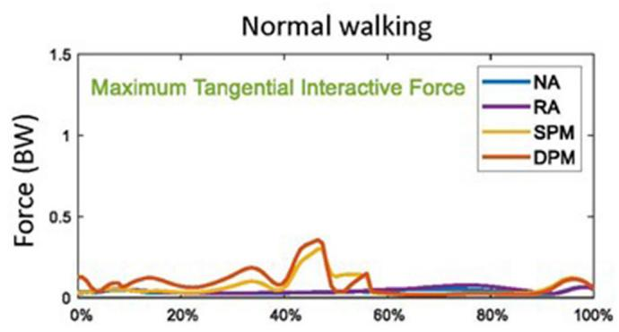

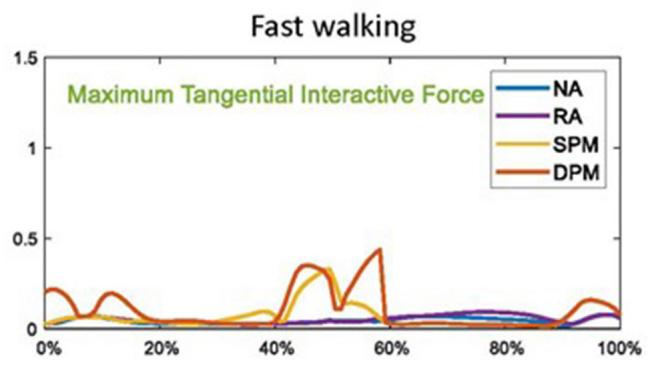

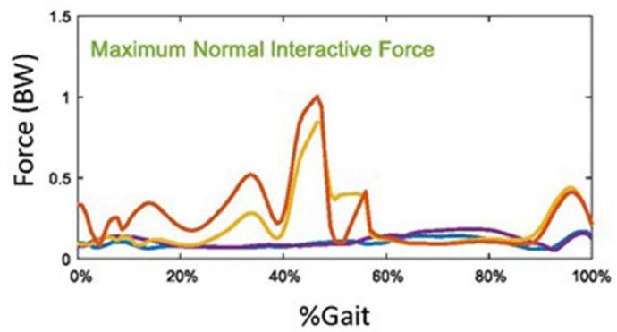

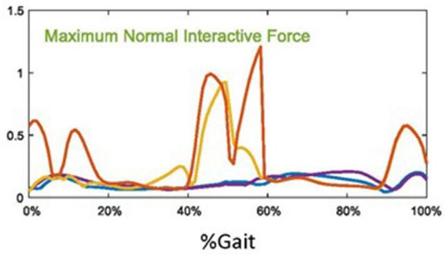  
FIGURE 7 | 在无助力（NA）以及旋转致动器（RA）、单摆模型（SPM）和阻尼摆模型（DPM）助力模式下，正常行走（左）和快速行走（右）时外骨骼绑带与使用者之间的最大切向和法向交互力。结果显示为步态周期的函数，0% 为足部初始着地，站立相约为 0–60%，摆动相为 60–100%。

尽管在 SPM 和 DPM 模式下使用者的肌肉负荷有所降低，但值得注意的是，在该示例研究中，这些基于摆的模型在站立末期和摆动末期时，使用者与外骨骼绑带之间的交互力更高。这些较高的交互力可能会导致使用者产生不适、疼痛或皮肤损伤。在为物理系统设计控制器时，应当权衡并考虑这一因素。当外骨骼向使用者传递助力力矩时，绑缚附着位置可能会产生交互力；当助力力矩最大时，交互力同样预计会达到最高。预测的交互力是通过在计算肌骨模型中生成人工“肌肉”来计算的。这些人工“肌肉”

可以像肌骨模型中的任何其他肌肉一样被募集，并参与逆向动力学分析。Olesen et al. (2014) 采用了类似的方法来计算不同坐姿下使用者与椅子之间的作用力。通过对比预测与实测的交互力，他们发现预测的和实测的交互力在不同坐姿下具有相似的趋势，因此可以用作不同坐姿将如何影响使用者的重要指标。因此，所提出的虚拟 HMS（人机系统）中的交互力可以作为衡量使用者舒适度的重要指标。

在无助力模式的说明性研究中，我们发现在站立后期和摆动后期胫股压力以及缝匠肌和腘绳肌冲量达到最高值。SPM 和 DPM 模式下胫股压力的大幅降低，部分归因于站立后期和摆动后期肌肉冲量的减少。胫股压力在步态分析中常被用作一项指标（Lee and Wang, 2015; Wang et al., 2016; Mannisi et al., 2019），其中较大的胫股受力可能导致膝关节疼痛。Pizzolato et al. (2017) 利用肌电驱动的神经肌肉骨骼模型实时估算了胫股接触力，并将其作为视觉生物反馈变量用于步态修正。Lee and Wang (2015) 报道了一种通过被动下肢外骨骼减轻膝关节受压接触力以获得最佳设计参数的设计理念。因此，在步态分析中估算胫股受力的能力在康复和治疗中具有潜在的应用价值。

本研究存在一些局限性。在此虚拟 HMS 中模拟了三种相对简单且被动的助力策略。小腿-足-下肢外骨骼系统在摆动期被简化为单摆而非双摆运行；摆动期间足部相对于小腿的相对运动可能会导致估算的膝关节力矩与实际膝关节力矩之间存在微小误差。此外，在对交互力进行建模时，未考虑绑带的张力、材质和表面摩擦力，也未考虑使用者大腿和小腿的软组织特性。相反，它们被建模为若干个可在外骨骼与使用者之间传递法向和切向交互力的点。因此，应关注的是交互力的变化趋势而非具体数值大小。最后，计算关节接触力（Jung et al., 2017）和交互力（Olesen, 2008）的计算方法在验证上的难度是有据可查的。因此，本研究旨在通过 HMS 仿真来评估不同助力策略可能如何影响使用者，其结论应在这些局限性的背景下予以考量。

## 5. 结论

在本文中，我们创建了一个完整结合了膝关节外骨骼硬件与肌肉骨骼模型的虚拟 HMS。总体而言，该虚拟 HMS 可用于模拟不同的助力策略，并分析这些不同策略如何影响描述使用者需求与后果的若干参数，包括运动中所涉及的肌肉需求、关节接触力以及人机交互力。利用肌肉骨骼建模环境在关节和肌肉层面提供的详细信息，有助于外骨骼控制器的优化设计。

步态期间膝关节处三种概念不同的助力策略的示例性比较结果表明

## 参考文献

Agarwal, P., Narayanan, M. S., Lee, L.-F., Mendel, F., and Krovi, V. N. (2011). “Simulation-based design of exoskeletons using musculoskeletal analysis,” in ASME 2010 International Design Engineering Technical Conferences and Computers and Information in Engineering Conference (Montreal, QC: American Society of Mechanical Engineers Digital Collection), 1357–1364. doi: 10.1115/DETC2010-28572

Agrawal, S. K., Banala, S. K., Fattah, A., Sangwan, V., Krishnamoorthy, V., Scholz, J. P., et al. (2007). Assessment of motion of a swing leg and gait rehabilitation with a gravity balancing exoskeleton. IEEE Trans. Neural Syst. Rehabil. Eng. 15, 410–420. doi: 10.1109/TNSRE.2007.903930

Bassani, T., Stucovitz, E., Qian, Z., Briguglio, M., and Galbusera, F. (2017). Validation of the anybody full body musculoskeletal mode in computing lumbar spine loads at l4l5 level. J. Biomech. 58, 89–96. doi: 10.1016/i ibiomech 2017.04 025

Bazargan-Lari, Y., Eghtesad, M., Khoogar, A., and Mohammad-Zadeh, A. (2015). Tracking control of a human swing leg as a double-pendulum considering

助力策略中应同时考虑关节位置和旋转方向，且在基于摆动的助力策略中引入阻尼分量可能有助于进一步减少用户在支撑相期间所需的肌肉力量。我们还证明了较高的助力力矩可能会带来更高相互作用力的权衡代价，这在设计控制策略时应予以注意。

## 数据可用性声明

本研究分析了公开可用的数据集。该数据可在以下地址获取：https://anyscript.org/ammr-doc/auto\_ examples/Mocap/plot\_Plug-in-gait\_Simple\_LowerExtremity. html#sphx-glr-auto-examples-mocap-plot-plug-in-gaitsimple-lowerextremity-py。

## 作者贡献

YL 开发了膝关节外骨骼 CAD 模型。LZ 将 CAD 模型整合到肌骨模型中，设计了具体的研究问题，执行了仿真，并起草了手稿。EG-F 和 RW 监督了工作进展，并协助起草和修改了文章。CS 监督了工作进展。所有作者均对本文做出了贡献，并批准了提交的版本。

## 致谢

我们感谢 Promobilia 基金会（Promobilia Foundation，项目编号：18200 和 18014）以及瑞典研究理事会（Swedish Research Council，项目编号：2018-00750 和 2018-04902）的资助。LZ 感谢国家留学基金管理委员会（China Scholarship Council, CSC）的支持。

## 补充材料

本文的补充材料可在以下网址在线获取：https://www.frontiersin.org/articles/10.3389/fnbot. 2021.620928/full#supplementary-material

self-impact joint constraint by feedback linearization method. J. Control Eng. Appl. Inform. 17, 99–110.

Carbone, V., Fluit, R., Pellikaan, P., Van Der Krogt, M., Janssen, D., Damsgaard, M., et al. (2015). Tlem 2.0——用于下肢个体特异性建模的综合肌骨几何数据集. J. Biomech. 48, 734–741. doi: 10.1016/i.ibiomech,2014.12.034

Carmichael, M. G., and Liu, D. (2011). “利用肌骨模型实现身体辅助机器人智能控制的研究”，载于 2011 Annual International Conference of the IEEE Engineering in Medicine and Biology Society (Boston), 8162–8165. doi: 10.1109/IEMBS.2011.60 92013

Cho, K., Kim, Y., Yi, D., Jung, M., and Lee, K. (2012). “两种不同约束条件下人-外骨骼组合模型的分析与评估”，载于 Proceedings of the International Summit on Human Simulation (St. Pete Beach, FL), 23–25.

Damsgaard, M., Rasmussen, J., Christensen, S. T., Surma, E., and De Zee, M (2006). AnyBody 建模系统中的肌骨系统分析. Simul. Model. Pract. Theory 14, 1100–1111. doi: 10.1016/j.simpat.2006.09.001

De Rossi, S. M. M., Vitiello, N., Lenzi, T., Ronsse, R., Koopman, B., Persichetti, A., et al. (2011). 感知下肢外骨骼物理人机接口上的压力分布. Sensors 11, 207–227. doi: 10.3390/s110100207

Del Carmen Sanchez-Villama nan, M., Gonzalez-Vargas, J., Torricelli, D., Moreno, J. C., and Pons, J. L. (2019). 顺应性下肢外骨骼：机械设计原理的全面综述. J. Neuroeng. Rehabil. 16:55. doi: 10.1186/s12984-019-0517-9

Dembia, C. L., Silder, A., Uchida, T. K., Hicks, J. L., and Delp, S. L. (2017). 模拟理想辅助装置以降低负重行走时的代谢消耗. PLoS ONE 12:e0180320. doi: 10.1371/journal.pone.0180320

El Zahraa Webhi, F., Huo, W., Amirat, Y., El Rafei, M., Khalil, M., and Mohammed, S. (2017). “摆动相膝关节矫形器的主动阻抗控制”，载于 2017 International Conference on Rehabilitation Robotics (London). 435–440. doi: 10.1109/ICORR.2017.8009286

Fluit, R., Andersen, M. S., Kolk, S., Verdonschot, N., and Koopman, H. F. (2014). 日常生活各种活动中地面反作用力和力矩的预测. J. Biomech. 47, 2321–2329. doi: 10.1016/j.jbiomech.2014.04.030

Fournier, B. N., Lemaire, E. D., Smith, A. J., and Doumit, M. (2018). 下肢动力外骨骼的建模与仿真. IEEE Trans. Neural Syst. Rehabil. Eng. 26, 1596–1603. doi: 10.1109/TNSRE.2018.2854605

Furse, A. (2010). 低成本摆动相控制机构的研发（硕士学位论文）. Toronto, CA: University of Toronto.

Hu, Y., Li, Z., Li, G., Yuan, P., Yang, C., and Song, R. (2016). 基于感觉-运动融合的机器人手眼系统操作与抓取控制研发. IEEE Trans. Syst. Man Cybern. 47, 1169–1180. doi: 10.1109/TSMC,2016.2560530

Jung, Y., Koo, Y.-J., and Koo, S. (2017). Simultaneous estimation of ground reaction force and knee contact force during walking and squatting. Int. J. Precis. Eng. Manufact. 18, 1263–1268. doi: 10.1007/s12541-017-0148-7

Kuo, A. D., and Donelan, J. M. (2010). Dynamic principles of gait and their clinica implications. Phys. Ther. 90, 157–174. doi: 10.2522/ptj.20090125

Lee, K.-M., and Wang, D. (2015). “Design analysis of a passive weightsupport lower-extremity-exoskeleton with compliant knee-joint,” in 2015 IEEE International Conference on Robotics and Automation (ICRA) (Seattle), 5572-5577. doi: 10.1109/ICRA.2015.7139978

Lenzi, T., Carrozza, M. C., and Agrawal, S. K. (2013). Powered hip exoskeletons can reduce the user’s hip and ankle muscle activations during walking. IEEE Trans. Neural Syst. Rehabil. Eng. 21, 938–948. doi: 10.1109/TNSRE.2013.2248749

Li, Z., Huang, B., Ye, Z., Deng, M., and Yang, C. (2018a). Physical human-robot interaction of a robotic exoskeleton by admittance control. IEEE Trans. Indus. Electron. 65, 9614–9624. doi: 10.1109/TIE.2018.2821649

Li, Z., Li, J., Zhao, S., Yuan, Y., Kang, Y., and Chen, C. P. (2018b). Adaptive neural control of a kinematically redundant exoskeleton robot using brainmachine interfaces. IEEE Trans. Neural Netw. Learn. Syst. 30, 3558–3571. doi: 10.1109/TNNLS.2018.2872595

Li, Z., Su, C.-Y., Li, G., and Su, H. (2014). Fuzzy approximation-based adaptive backstepping control of an exoskeleton for human upper limbs. IEEE Trans. Fuzzy Syst. 23, 555–566. doi: 10.1109/TFUZZ.2014.2317511

Li, Z., Yuan, Y., Luo, L., Su, W., Zhao, K., Xu, C., et al. (2019). Hybrid brain/muscle signals powered wearable walking exoskeleton enhancing motor ability in climbing stairs activity. IEEE Trans. Med. Robot. Bion. 1, 218–227. doi: 10.1109/TMRB.2019.2949865

Mannisi, M., Dell-Isola, A., Andersen, M. S., and Woodburn, J. (2019). Efect of lateral wedged insoles on the knee internal contact forces in medial knee osteoarthritis. Gait Posture 68, 443–448. doi: 10.1016/j.gaitpost.2018. 12.030

Olesen, C. G. (2008). Pilot validation ofa computational seated human model using an instrumented chair (Master's thesis). Aalborg University, Aalborg, Denmark.

Olesen, C. G., de Zee, M., and Rasmussen, J. (2014). Comparison between a computational seated human model and experimental verification data. Appl. Bion. Biomech. 11, 175–183. doi: 10.1155/2014/126736

Pan, D., Gao, F., Miao, Y., and Cao, R. (2015). Co-simulation research of a novel exoskeleton-human robot system on humanoid gaits with fuzzy-pid/pid algorithms. Adv. Eng. Softw. 79, 36–46. doi: 10.1016/j.advengsoft.2014.09.005

Peng, Y., Wong, D. W.-C., Wang, Y., Chen, T. L.-W., Tan, Q., Chen, Z., et al. (2020). Immediate efects ofmedially posted insoles on lower limb joint contact forces in adult acquired flatfoot: a pilot study. Int. I. Environ. Res. Publ. Health 17:2226. doi: 10.3390/ijerph17072226

Perry, J., and Davids, J. R. (1992). Gait analysis: normal and pathological function. J. Pediatr. Orthop. 12:815. doi: 10.1097/01241398-199211000-00023

Pizzolato, C., Reggiani, M., Saxby, D. J., Ceseracciu, E., Modenese, L., and Lloyd, D. G. (2017). Biofeedback for gait retraining based on real-time estimation of tibiofemoral joint contact forces. IEEE Trans. Neural Syst. Rehabil. Eng. 25, 1612–1621. doi: 10.1109/TNSRE.2017.2683488

Rasmussen, J., Damsgaard, M., and Voigt, M. (2001). Muscle recruitment by the min/max criterion-a comparative numerical study. J. Biomech. 34, 409–415. doi: 10.1016/S0021-9290(00)00191-3

Rasmussen, J., Tørholm, S., and de Zee, M. (2009). Computational analysis of the influence of seat pan inclination and friction on muscle activity and spinal joint forces. Int. J. Indus. Ergon. 39, 52–57. doi: 10.1016/j.ergon.2008.07.008

Richards, R. E., Andersen, M. S., Harlaar, J., and Van Den Noort, J. (2018). Relationship between knee joint contact forces and external knee joint moments in patients with medial knee osteoarthritis: efects of gait modifications. Osteoarthr. Cartil. 26, 1203–1214. doi: 10.1016/j.joca.2018.04.011

Ronsse, R., Vitiello, N., Lenzi, T., Van Den Kieboom, J., Carrozza, M. C., and Ijspeert, A. J. (2010). “Adaptive oscillators with human-in-the-loop: proof of concept for assistance and rehabilitation,” in 2010 3rd IEEE RAS & EMBS International Conference on Biomedical Robotics and Biomechatronics (Tokyo), 668–674. doi: 10.1109/BIOROB.2010.5628021

Ronsse, R., Vitiello, N., Lenzi, T., Van Den Kieboom, J., Carrozza, M. C., and Ijspeert, A. J. (2011). Human-robot synchrony: flexible assistance using adaptive oscillators. IEEE Trans. Biomed. Eng. 58, 1001–1012. doi: 10.1109/TBME,2010.2089629

Sasagawa, S., Shinya, M., and Nakazawa, K. (2014). Interjoint dynamic interaction during constrained human quiet standing examined by induced acceleration analysis. J. Neurophysiol. 111, 313–322. doi: 10.1152/jn.01082.2012

Seedhom, B., Longton, E., Wright, V., and Dowson, D. (1972). Dimensions of the knee. radiographic and autopsy study of sizes required by a knee prosthesis. Ann. Rheum. Dis. 31:54. doi: 10.1136/ard.31.1.54

Serrancolí, G., Falisse, A., Dembia, C., Vantilt, J., Tanghe, K., Lefeber, D., et al. (2019). Subject-exoskeleton contact model calibration leads to accurate interaction force predictions. IEEE Trans. Neural Syst. Rehabil. Eng. 27, 1597–1605. doi: 10.1109/TNSRE.2019.2924536

Sharbafi, M. A., Rashty, A. M. N., Rode, C., and Seyfarth, A. (2017). Reconstruction of human swing leg motion with passive biarticular muscle models. Hum. Mov. Sci. 52, 96–107. doi: 10.1016/j.humov.2017.01.008

Sharbafi, M. A., Rode, C., Kurowski, S., Scholz, D., Möckel, R., Radkhah, K., et al. (2016). A new biarticular actuator design facilitates control of leg function in biobiped3. Bioinspir. Biomim. 11:046003. doi: 10.1088/1748-3190/11/4/046003

Shourijeh, M. S., Jung, M., and Damsgaard, M. (2017). “搬箱任务中的代谢能量消耗：关于辅助力矩的参数化研究,” in Wearable Robotics: Challenges and Trends. Biosystems & Biorobotics, eds J. González-Vargas, J. Ibáñez, J. Contreras-Vidal, H. van der Kooij, and J. Pons (Segovia: Springer), 143–148. doi: 10.1007/978-3-319-46532-6\_24

Simoneau, M., and Corbeil, P. (2005). 达到踝关节峰值力矩的时间对平衡稳定边界的影响：一种生物力学模型的实验验证. Exp. Brain Res. 165, 217–228. doi: 10.1007/s00221-005-2290-1

Singh, S., Mukherjee, S., and Sanghi, S. (2008). 自碰撞双摆的研究. J. Sound Vibrat. 318, 1180–1196. doi: 10.1016/j.jsv.2008.05.001

Skals, S., Jung, M. K., Damsgaard, M., and Andersen, M. S. (2017). 运动相关动作中地面反作用力与力矩的预测. Multibody Syst. Dyn. 39, 175–195. doi: 10.1007/s11044-016-9537-4

Su, H., Yang, C., Ferrigno, G., and De Momi, E. (2019). 用于远程微创手术的冗余机器人改进型人机协作控制. IEEE Robot. Autom. Lett. 4, 1447–1453. doi: 10.1109/LRA.2019.2897145

Umberger, B. R. (2010). 人类行走中站立相与摆动相的能量消耗. J. R. Soc. Interface 7, 1329–1340. doi: 10.1098/rsif.2010.0084

Veneman, J., Kruidhof, R., Hekman, E. E. G., Ekkelenkamp, R., van Asseldonk, E., and van der Kooij, H. (2007). 用于交互式步态康复的 LOPES 外骨骼机器人的设计与评估. IEEE Trans. Neural Syst. Rehabil. Eng. 15, 379–386. doi: 10.1109/TNSRE.2007.903919

Wang, D., Lee, K.-M., and Ji, J. (2016). 一种基于步态的具顺应性关节被动承重下肢外骨骼. JEEE Trans, Robot, 32, 933-942 doi: 10.1109/TRO.2016.2572692

Wang, W., Zhang, L., Cai, K., Wang, Z., Zhang, B., and Huang, Q. (2019). 具步态自适应性的穿戴式下肢外骨骼的设计与实验评估. Robotica 37, 2035–2055. doi: 10.1017/S0263574719000663

Yan, T., Cempini, M., Oddo, C. M., and Vitiello, N. (2015). 动力下肢矫形器与外骨骼辅助策略综述. Robot. Auton. Syst. 64, 120–136. doi: 10.1016/j.robot.2014.09.032

Yao, S., Zhuang, Y., Li, Z., and Song, R. (2018). 基于肌电驱动肌肉骨骼模型的踝关节外骨骼自适应导纳控制. Front. Neurorobot. 12:16. doi: 10.3389/fnbot.2018.00016

Ye, W., Li, Z., Yang, C., Chen, F., and Su, C.-Y. (2017). 用于康复训练的动作检测增强型上肢外骨骼机器人控制. Int. J. Human. Robot. 14:1650031. doi: 10.1142/S0219843616500316

Zhang, M., McDaid, A., Veale, A. J., Peng, Y., and Xie, S. Q. (2019). 具有关节空间力分布的并联踝关节康复机器人自适应轨迹跟踪控制. IEEE Access 7, 85812–85820. doi: 10.1109/ACCESS.2019.2925182

Zhao, J., Berns, K., de Souza Baptista, R., and Bó, A. P. L. (2013). “Design of variable-damping control for prosthetic knee based on a simulated biped,” in

2013 IEEE 13th International Conference on Rehabilitation Robotics (ICORR) (Seattle), 1–6. doi: 10.1109/ICORR.2013.6650364

Zhou, L., Li, Y., and Bai, S. (2017). A human-centered design optimization approach for robotic exoskeletons through biomechanical simulation. Robot. Auton. Syst. 91, 337–347. doi: 10.1016/j.robot.2016. 12.012

利益冲突：作者声明，本研究是在不存在任何可能被解释为潜在利益冲突的商业或财务关系的情况下开展的。

版权所有 © 2021 Zhang, Liu, Wang, Smith and Gutierrez-Farewik。这是一篇基于知识共享署名许可（Creative Commons Attribution License, CC BY）条款分发的开放获取文章。在符合公认学术规范的前提下，只要注明原作者和版权所有者，并引用本期刊上的原始出版物，即允许在其他平台上使用、传播或复制。严禁任何不符合这些条款的使用、传播或复制。