# Zhang2023-FrontNeurosci：NMS 驱动 ML 的膝关节外骨骼控制与不确定性量化

> English text extracted from the source PDF; not translated or editorially corrected. Each original PDF page is embedded below as a rendered image so figures, tables, and vector artwork remain visible.

- Source PDF: `Zhang2023-FrontNeurosci：NMS 驱动 ML 的膝关节外骨骼控制与不确定性量化.pdf`
- SHA-256: `0143eabf80b685156a632596c5707c3e2f7243d93fc18b5cb016bb9bda36a38b`
- Pages: 12
- Extraction: Poppler `pdftotext -layout`; page images rendered with `pdftoppm` (max dimension 1400 px, JPEG quality 76).

## Page 1

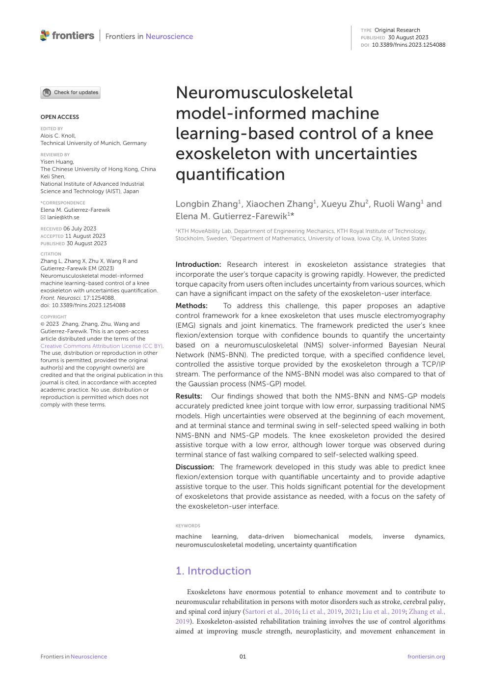

English text extracted from page 1

<pre>
TYPE Original Research
                                                                                                                           PUBLISHED 30 August 2023
                                                                                                                           DOI 10.3389/fnins.2023.1254088

                                                     Neuromusculoskeletal
OPEN ACCESS                                          model-informed machine
                                                     learning-based control of a knee
EDITED BY
Alois C. Knoll,
Technical University of Munich, Germany

REVIEWED BY
Yisen Huang,
                                                     exoskeleton with uncertainties
The Chinese University of Hong Kong, China
Keli Shen,
National Institute of Advanced Industrial
                                                     quantification
Science and Technology (AIST), Japan

*CORRESPONDENCE
                                                     Longbin Zhang1 , Xiaochen Zhang1 , Xueyu Zhu2 , Ruoli Wang1 and
Elena M. Gutierrez-Farewik
   lanie@kth.se                                      Elena M. Gutierrez-Farewik1*
RECEIVED 06 July 2023                                1
                                                       KTH MoveAbility Lab, Department of Engineering Mechanics, KTH Royal Institute of Technology,
ACCEPTED 11 August 2023
                                                     Stockholm, Sweden, 2 Department of Mathematics, University of Iowa, Iowa City, IA, United States
PUBLISHED 30 August 2023

CITATION
Zhang L, Zhang X, Zhu X, Wang R and
Gutierrez-Farewik EM (2023)
                                                     Introduction: Research interest in exoskeleton assistance strategies that
Neuromusculoskeletal model-informed                  incorporate the user’s torque capacity is growing rapidly. However, the predicted
machine learning-based control of a knee             torque capacity from users often includes uncertainty from various sources, which
exoskeleton with uncertainties quantification.
Front. Neurosci. 17:1254088.
                                                     can have a significant impact on the safety of the exoskeleton-user interface.
doi: 10.3389/fnins.2023.1254088                      Methods:      To address this challenge, this paper proposes an adaptive
COPYRIGHT                                            control framework for a knee exoskeleton that uses muscle electromyography
© 2023 Zhang, Zhang, Zhu, Wang and                   (EMG) signals and joint kinematics. The framework predicted the user’s knee
Gutierrez-Farewik. This is an open-access
article distributed under the terms of the           flexion/extension torque with confidence bounds to quantify the uncertainty
Creative Commons Attribution License (CC BY).        based on a neuromusculoskeletal (NMS) solver-informed Bayesian Neural
The use, distribution or reproduction in other       Network (NMS-BNN). The predicted torque, with a specified confidence level,
forums is permitted, provided the original
author(s) and the copyright owner(s) are             controlled the assistive torque provided by the exoskeleton through a TCP/IP
credited and that the original publication in this   stream. The performance of the NMS-BNN model was also compared to that of
journal is cited, in accordance with accepted        the Gaussian process (NMS-GP) model.
academic practice. No use, distribution or
reproduction is permitted which does not             Results: Our findings showed that both the NMS-BNN and NMS-GP models
comply with these terms.                             accurately predicted knee joint torque with low error, surpassing traditional NMS
                                                     models. High uncertainties were observed at the beginning of each movement,
                                                     and at terminal stance and terminal swing in self-selected speed walking in both
                                                     NMS-BNN and NMS-GP models. The knee exoskeleton provided the desired
                                                     assistive torque with a low error, although lower torque was observed during
                                                     terminal stance of fast walking compared to self-selected walking speed.
                                                     Discussion: The framework developed in this study was able to predict knee
                                                     flexion/extension torque with quantifiable uncertainty and to provide adaptive
                                                     assistive torque to the user. This holds significant potential for the development
                                                     of exoskeletons that provide assistance as needed, with a focus on the safety of
                                                     the exoskeleton-user interface.

                                                     KEYWORDS

                                                     machine  learning,    data-driven   biomechanical     models,                  inverse     dynamics,
                                                     neuromusculoskeletal modeling, uncertainty quantification

                                                     1. Introduction
                                                        Exoskeletons have enormous potential to enhance movement and to contribute to
                                                     neuromuscular rehabilitation in persons with motor disorders such as stroke, cerebral palsy,
                                                     and spinal cord injury (Sartori et al., 2016; Li et al., 2019, 2021; Liu et al., 2019; Zhang et al.,
                                                     2019). Exoskeleton-assisted rehabilitation training involves the use of control algorithms
                                                     aimed at improving muscle strength, neuroplasticity, and movement enhancement in

Frontiers in Neuroscience                                                    01                                                               frontiersin.org
</pre>

## Page 2

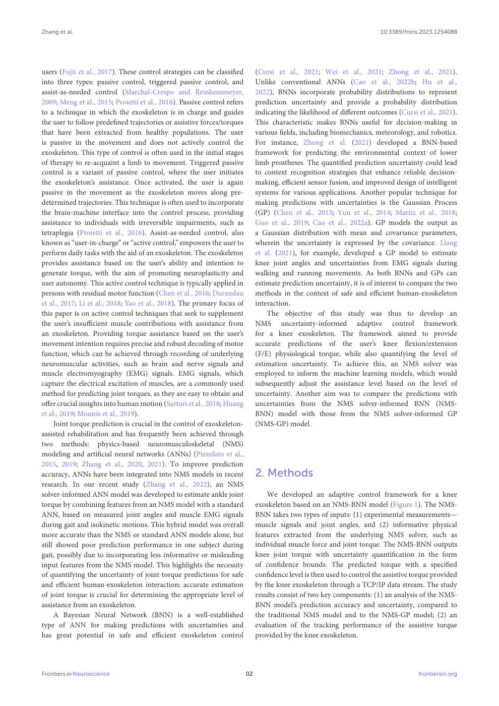

English text extracted from page 2

<pre>
Zhang et al.                                                                                                              10.3389/fnins.2023.1254088

users (Fujii et al., 2017). These control strategies can be classified         (Cursi et al., 2021; Wei et al., 2021; Zhong et al., 2021).
into three types: passive control, triggered passive control, and              Unlike conventional ANNs (Cao et al., 2022b; Hu et al.,
assist-as-needed control (Marchal-Crespo and Reinkensmeyer,                    2022), BNNs incorporate probability distributions to represent
2009; Meng et al., 2015; Proietti et al., 2016). Passive control refers        prediction uncertainty and provide a probability distribution
to a technique in which the exoskeleton is in charge and guides                indicating the likelihood of different outcomes (Cursi et al., 2021).
the user to follow predefined trajectories or assistive forces/torques         This characteristic makes BNNs useful for decision-making in
that have been extracted from healthy populations. The user                    various fields, including biomechanics, meteorology, and robotics.
is passive in the movement and does not actively control the                   For instance, Zhong et al. (2021) developed a BNN-based
exoskeleton. This type of control is often used in the initial stages          framework for predicting the environmental context of lower
of therapy to re-acquaint a limb to movement. Triggered passive                limb prostheses. The quantified prediction uncertainty could lead
control is a variant of passive control, where the user initiates              to context recognition strategies that enhance reliable decision-
the exoskeleton’s assistance. Once activated, the user is again                making, efficient sensor fusion, and improved design of intelligent
passive in the movement as the exoskeleton moves along pre-                    systems for various applications. Another popular technique for
determined trajectories. This technique is often used to incorporate           making predictions with uncertainties is the Gaussian Process
the brain-machine interface into the control process, providing                (GP) (Chen et al., 2013; Yun et al., 2014; Maritz et al., 2018;
assistance to individuals with irreversible impairments, such as               Guo et al., 2019; Cao et al., 2022a). GP models the output as
tetraplegia (Proietti et al., 2016). Assist-as-needed control, also            a Gaussian distribution with mean and covariance parameters,
known as “user-in-charge” or “active control,” empowers the user to            wherein the uncertainty is expressed by the covariance. Liang
perform daily tasks with the aid of an exoskeleton. The exoskeleton            et al. (2021), for example, developed a GP model to estimate
provides assistance based on the user’s ability and intention to               knee joint angles and uncertainties from EMG signals during
generate torque, with the aim of promoting neuroplasticity and                 walking and running movements. As both BNNs and GPs can
user autonomy. This active control technique is typically applied in           estimate prediction uncertainty, it is of interest to compare the two
persons with residual motor function (Chen et al., 2016; Durandau              methods in the context of safe and efficient human-exoskeleton
et al., 2017; Li et al., 2018; Yao et al., 2018). The primary focus of         interaction.
this paper is on active control techniques that seek to supplement                 The objective of this study was thus to develop an
the user’s insufficient muscle contributions with assistance from              NMS uncertainty-informed adaptive control framework
an exoskeleton. Providing torque assistance based on the user’s                for a knee exoskeleton. The framework aimed to provide
movement intention requires precise and robust decoding of motor               accurate predictions of the user’s knee flexion/extension
function, which can be achieved through recording of underlying                (F/E) physiological torque, while also quantifying the level of
neuromuscular activities, such as brain and nerve signals and                  estimation uncertainty. To achieve this, an NMS solver was
muscle electromyography (EMG) signals. EMG signals, which                      employed to inform the machine learning models, which would
capture the electrical excitation of muscles, are a commonly used              subsequently adjust the assistance level based on the level of
method for predicting joint torques, as they are easy to obtain and            uncertainty. Another aim was to compare the predictions with
offer crucial insights into human motion (Sartori et al., 2018; Huang          uncertainties from the NMS solver-informed BNN (NMS-
et al., 2019; Mounis et al., 2019).                                            BNN) model with those from the NMS solver-informed GP
     Joint torque prediction is crucial in the control of exoskeleton-         (NMS-GP) model.
assisted rehabilitation and has frequently been achieved through
two methods: physics-based neuromusculoskeletal (NMS)
modeling and artificial neural networks (ANNs) (Pizzolato et al.,
2015, 2019; Zhang et al., 2020, 2021). To improve prediction
accuracy, ANNs have been integrated into NMS models in recent                  2. Methods
research. In our recent study (Zhang et al., 2022), an NMS
solver-informed ANN model was developed to estimate ankle joint                    We developed an adaptive control framework for a knee
torque by combining features from an NMS model with a standard                 exoskeleton based on an NMS-BNN model (Figure 1). The NMS-
ANN, based on measured joint angles and muscle EMG signals                     BNN takes two types of inputs: (1) experimental measurements—
during gait and isokinetic motions. This hybrid model was overall              muscle signals and joint angles, and (2) informative physical
more accurate than the NMS or standard ANN models alone, but                   features extracted from the underlying NMS solver, such as
still showed poor prediction performance in one subject during                 individual muscle force and joint torque. The NMS-BNN outputs
gait, possibly due to incorporating less informative or misleading             knee joint torque with uncertainty quantification in the form
input features from the NMS model. This highlights the necessity               of confidence bounds. The predicted torque with a specified
of quantifying the uncertainty of joint torque predictions for safe            confidence level is then used to control the assistive torque provided
and efficient human-exoskeleton interaction; accurate estimation               by the knee exoskeleton through a TCP/IP data stream. The study
of joint torque is crucial for determining the appropriate level of            results consist of two key components: (1) an analysis of the NMS-
assistance from an exoskeleton.                                                BNN model’s prediction accuracy and uncertainty, compared to
     A Bayesian Neural Network (BNN) is a well-established                     the traditional NMS model and to the NMS-GP model; (2) an
type of ANN for making predictions with uncertainties and                      evaluation of the tracking performance of the assistive torque
has great potential in safe and efficient exoskeleton control                  provided by the knee exoskeleton.

Frontiers in Neuroscience                                                 02                                                           frontiersin.org
</pre>

## Page 3

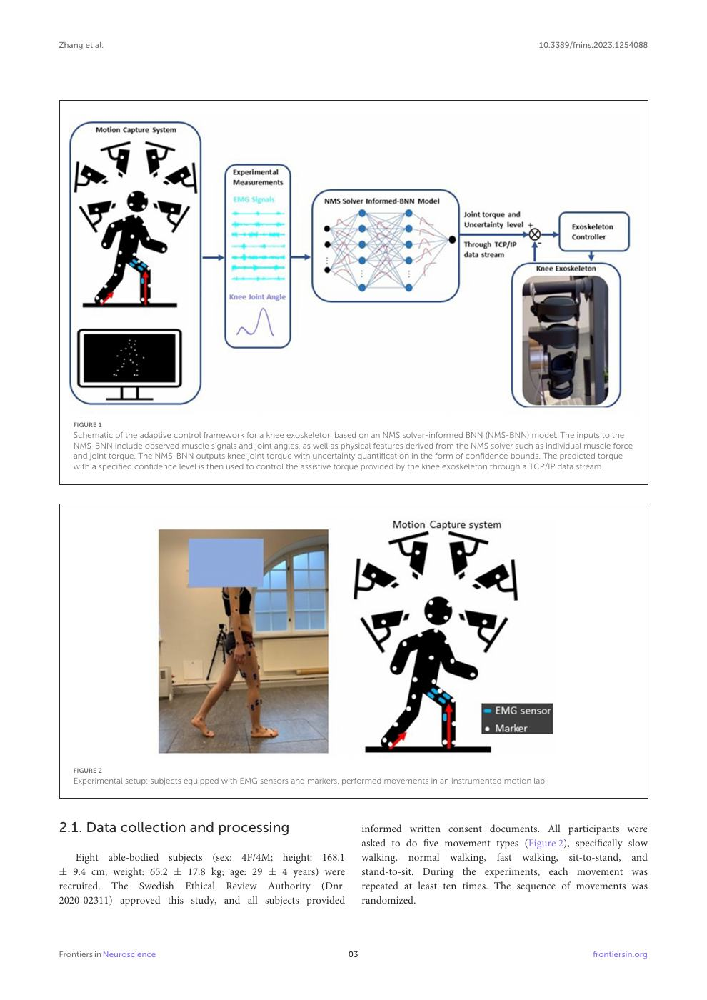

English text extracted from page 3

<pre>
Zhang et al.                                                                                                                10.3389/fnins.2023.1254088

   FIGURE 1
   Schematic of the adaptive control framework for a knee exoskeleton based on an NMS solver-informed BNN (NMS-BNN) model. The inputs to the
   NMS-BNN include observed muscle signals and joint angles, as well as physical features derived from the NMS solver such as individual muscle force
   and joint torque. The NMS-BNN outputs knee joint torque with uncertainty quantification in the form of confidence bounds. The predicted torque
   with a specified confidence level is then used to control the assistive torque provided by the knee exoskeleton through a TCP/IP data stream.

   FIGURE 2
   Experimental setup: subjects equipped with EMG sensors and markers, performed movements in an instrumented motion lab.

2.1. Data collection and processing                                            informed written consent documents. All participants were
                                                                               asked to do five movement types (Figure 2), specifically slow
    Eight able-bodied subjects (sex: 4F/4M; height: 168.1                      walking, normal walking, fast walking, sit-to-stand, and
± 9.4 cm; weight: 65.2 ± 17.8 kg; age: 29 ± 4 years) were                      stand-to-sit. During the experiments, each movement was
recruited. The Swedish Ethical Review Authority (Dnr.                          repeated at least ten times. The sequence of movements was
2020-02311) approved this study, and all subjects provided                     randomized.

Frontiers in Neuroscience                                                 03                                                              frontiersin.org
</pre>

## Page 4

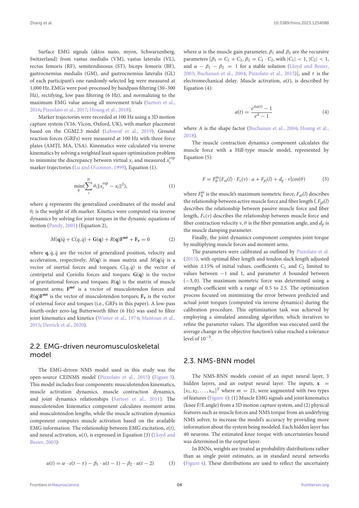

English text extracted from page 4

<pre>
Zhang et al.                                                                                                                10.3389/fnins.2023.1254088

    Surface EMG signals (aktos nano, myon, Schwarzenberg,                   where α is the muscle gain parameter, β1 and β2 are the recursive
Switzerland) from vastus medialis (VM), vastus lateralis (VL),              parameters [β1 = C1 + C2 , β2 = C1 · C2 , with |C1 | &lt; 1, |C2 | &lt; 1,
rectus femoris (RF), semitendinosus (ST), biceps femoris (BF),              and α − β1 − β2 = 1 for a stable solution (Lloyd and Besier,
gastrocnemius medialis (GM), and gastrocnemius lateralis (GL)               2003; Buchanan et al., 2004; Pizzolato et al., 2015)], and τ is the
of each participant’s one randomly-selected leg were measured at            electromechanical delay. Muscle activation, a(t), is described by
1,000 Hz. EMGs were post-processed by bandpass filtering (30–300            Equation (4):
Hz), rectifying, low pass filtering (6 Hz), and normalizing to the
maximum EMG value among all movement trials (Sartori et al.,
2016; Pizzolato et al., 2017; Hoang et al., 2018).                                                             eAu(t) − 1
                                                                                                      a(t) =                                         (4)
    Marker trajectories were recorded at 100 Hz using a 3D motion                                               eA − 1
capture system (V16, Vicon, Oxford, UK), with marker placement
                                                                            where A is the shape factor (Buchanan et al., 2004; Hoang et al.,
based on the CGM2.3 model (Leboeuf et al., 2019). Ground
                                                                            2018).
reaction forces (GRFs) were measured at 100 Hz with three force
                                                                               The muscle contraction dynamics component calculates the
plates (AMTI, MA, USA). Kinematics were calculated via inverse
                                                                            muscle force with a Hill-type muscle model, represented by
kinematics by solving a weighted least square optimization problem
                                                                exp         Equation (5):
to minimize the discrepancy between virtual xi and measured xi
marker trajectories (Lu and O’connor, 1999), Equation (1).

                           N                                                         F = F0m [Fal (l) · Fv (v) · a + Fpl (l) + dp · v]cos(θ )        (5)
                                  exp
                          X
                      min(   θi kxi − xi k2 ),                   (1)
                        q
                            i                                               where F0m is the muscle’s maximum isometric force, Fal (l) describes
                                                                            the relationship between active muscle force and fiber length l, Fpl (l)
where q represents the generalized coordinates of the model and
                                                                            describes the relationship between passive muscle force and fiber
θi is the weight of ith marker. Kinetics were computed via inverse
                                                                            length, Fv (v) describes the relationship between muscle force and
dynamics by solving for joint torques in the dynamic equations of
                                                                            fiber contraction velocity v, θ is the fiber pennation angle, and dp is
motion (Pandy, 2001) (Equation 2),
                                                                            the muscle damping parameter.
          M(q)q̈ + C(q, q̇) + G(q) + R(q)Fmt + Fe = 0            (2)            Finally, the joint dynamics component computes joint torque
                                                                            by multiplying muscle forces and moment arms.
where q, q̇, q̈ are the vector of generalized position, velocity and            The parameters were calibrated as outlined by Pizzolato et al.
acceleration, respectively; M(q) is mass matrix and M(q)q̈ is a             (2015), with optimal fiber length and tendon slack length adjusted
vector of inertial forces and torques; C(q, q̇) is the vector of            within ±15% of initial values, coefficients C1 and C2 limited to
centripetal and Coriolis forces and torques; G(q) is the vector             values between −1 and 1, and parameter A bounded between
of gravitational forces and torques; R(q) is the matrix of muscle           (−3, 0). The maximum isometric force was determined using a
moment arms; Fmt is a vector of musculotendon forces and                    strength coefficient with a range of 0.5 to 2.5. The optimization
R(q)Fmt is the vector of musculotendon torques; Fe is the vector            process focused on minimizing the error between predicted and
of external force and torques (i.e., GRFs in this paper). A low-pass        actual joint torques (computed via inverse dynamics) during the
fourth-order zero-lag Butterworth filter (6 Hz) was used to filter          calibration procedure. This optimization task was achieved by
joint kinematics and kinetics (Winter et al., 1974; Mantoan et al.,         employing a simulated annealing algorithm, which iteratives to
2015; Derrick et al., 2020).                                                refine the parameter values. The algorithm was executed until the
                                                                            average change in the objective function’s value reached a tolerance
                                                                            level of 10−5 .
2.2. EMG-driven neuromusculoskeletal
model
                                                                            2.3. NMS-BNN model
    The EMG-driven NMS model used in this study was the
open-source CEINMS model (Pizzolato et al., 2015) (Figure 3).                     The NMS-BNN models consist of an input neural layer, 3
This model includes four components: musculotendon kinematics,              hidden layers, and an output neural layer. The inputs, x =
muscle activation dynamics, muscle contraction dynamics,                    [x1 , x2 , . . . , xm ]T where m = 21, were augmented with two types
and joint dynamics relationships (Sartori et al., 2011). The                of features (Figure 4): (1) Muscle EMG signals and joint kinematics
musculotendon kinematics component calculates moment arms                   (knee F/E angle) from a 3D motion capture system, and (2) physical
and musculotendon lengths, while the muscle activation dynamics             features such as muscle forces and NMS torque from an underlying
component computes muscle activation based on the available                 NMS solver, to increase the model’s accuracy by providing more
EMG information. The relationship between EMG excitation, e(t),             information about the system being modeled. Each hidden layer has
and neural activation, u(t), is expressed in Equation (3) (Lloyd and        40 neurons. The estimated knee torque with uncertainties bound
Besier, 2003):                                                              was determined in the output layer.
                                                                                  In BNNs, weights are treated as probability distributions rather
                                                                            than as single point estimates, as in standard neural networks
        u(t) = α · e(t − τ ) − β1 · u(t − 1) − β2 · u(t − 2)     (3)        (Figure 4). These distributions are used to reflect the uncertainty

Frontiers in Neuroscience                                              04                                                                 frontiersin.org
</pre>

## Page 5

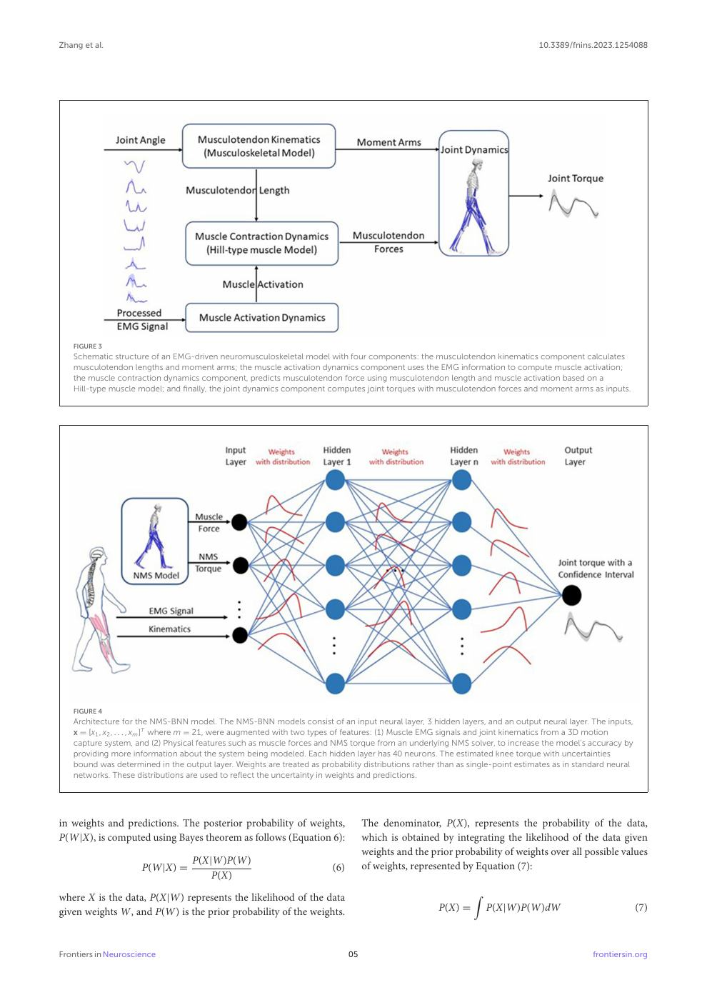

English text extracted from page 5

<pre>
Zhang et al.                                                                                                                   10.3389/fnins.2023.1254088

   FIGURE 3
   Schematic structure of an EMG-driven neuromusculoskeletal model with four components: the musculotendon kinematics component calculates
   musculotendon lengths and moment arms; the muscle activation dynamics component uses the EMG information to compute muscle activation;
   the muscle contraction dynamics component, predicts musculotendon force using musculotendon length and muscle activation based on a
   Hill-type muscle model; and finally, the joint dynamics component computes joint torques with musculotendon forces and moment arms as inputs.

   FIGURE 4
   Architecture for the NMS-BNN model. The NMS-BNN models consist of an input neural layer, 3 hidden layers, and an output neural layer. The inputs,
   x = [x1 , x2 , . . . , xm ]T where m = 21, were augmented with two types of features: (1) Muscle EMG signals and joint kinematics from a 3D motion
   capture system, and (2) Physical features such as muscle forces and NMS torque from an underlying NMS solver, to increase the model’s accuracy by
   providing more information about the system being modeled. Each hidden layer has 40 neurons. The estimated knee torque with uncertainties
   bound was determined in the output layer. Weights are treated as probability distributions rather than as single-point estimates as in standard neural
   networks. These distributions are used to reflect the uncertainty in weights and predictions.

in weights and predictions. The posterior probability of weights,                  The denominator, P(X), represents the probability of the data,
P(W|X), is computed using Bayes theorem as follows (Equation 6):                   which is obtained by integrating the likelihood of the data given
                                                                                   weights and the prior probability of weights over all possible values
                                  P(X|W)P(W)
                     P(W|X) =                                           (6)        of weights, represented by Equation (7):
                                      P(X)

where X is the data, P(X|W) represents the likelihood of the data                                             Z
given weights W, and P(W) is the prior probability of the weights.                                   P(X) =       P(X|W)P(W)dW                              (7)

Frontiers in Neuroscience                                                     05                                                              frontiersin.org
</pre>

## Page 6

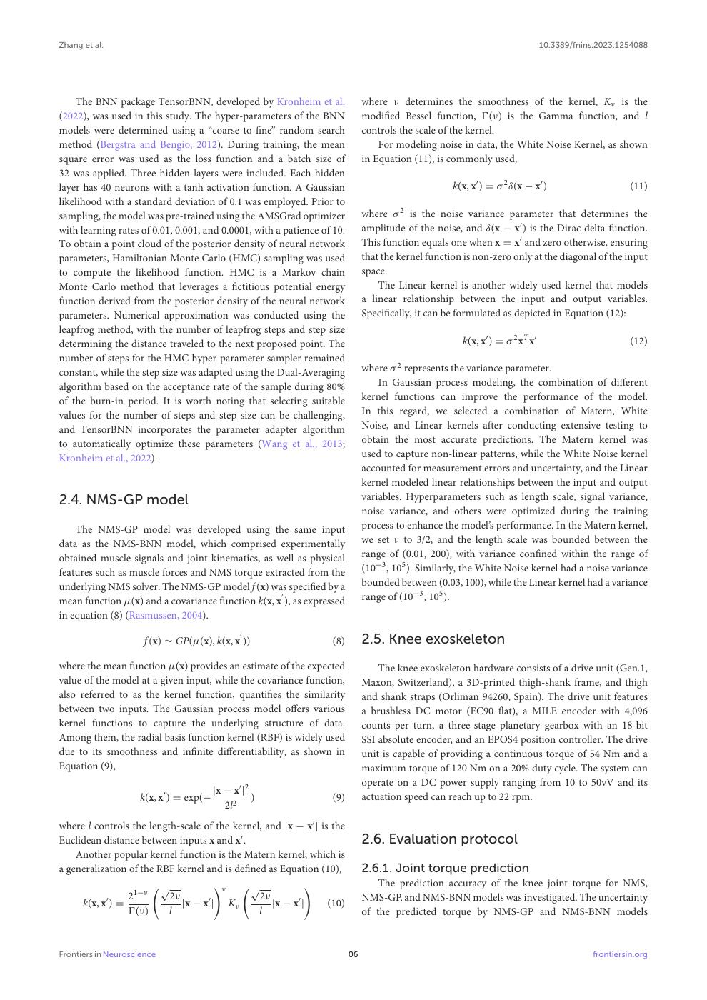

English text extracted from page 6

<pre>
Zhang et al.                                                                                                                          10.3389/fnins.2023.1254088

    The BNN package TensorBNN, developed by Kronheim et al.                           where ν determines the smoothness of the kernel, Kν is the
(2022), was used in this study. The hyper-parameters of the BNN                       modified Bessel function, Ŵ(ν) is the Gamma function, and l
models were determined using a “coarse-to-fine” random search                         controls the scale of the kernel.
method (Bergstra and Bengio, 2012). During training, the mean                             For modeling noise in data, the White Noise Kernel, as shown
square error was used as the loss function and a batch size of                        in Equation (11), is commonly used,
32 was applied. Three hidden layers were included. Each hidden
layer has 40 neurons with a tanh activation function. A Gaussian                                            k(x, x′ ) = σ 2 δ(x − x′ )                      (11)
likelihood with a standard deviation of 0.1 was employed. Prior to
sampling, the model was pre-trained using the AMSGrad optimizer                       where σ 2 is the noise variance parameter that determines the
with learning rates of 0.01, 0.001, and 0.0001, with a patience of 10.                amplitude of the noise, and δ(x − x′ ) is the Dirac delta function.
To obtain a point cloud of the posterior density of neural network                    This function equals one when x = x′ and zero otherwise, ensuring
parameters, Hamiltonian Monte Carlo (HMC) sampling was used                           that the kernel function is non-zero only at the diagonal of the input
to compute the likelihood function. HMC is a Markov chain                             space.
Monte Carlo method that leverages a fictitious potential energy                           The Linear kernel is another widely used kernel that models
function derived from the posterior density of the neural network                     a linear relationship between the input and output variables.
parameters. Numerical approximation was conducted using the                           Specifically, it can be formulated as depicted in Equation (12):
leapfrog method, with the number of leapfrog steps and step size
determining the distance traveled to the next proposed point. The                                             k(x, x′ ) = σ 2 xT x′                         (12)
number of steps for the HMC hyper-parameter sampler remained
constant, while the step size was adapted using the Dual-Averaging                    where σ 2 represents the variance parameter.
algorithm based on the acceptance rate of the sample during 80%                           In Gaussian process modeling, the combination of different
of the burn-in period. It is worth noting that selecting suitable                     kernel functions can improve the performance of the model.
values for the number of steps and step size can be challenging,                      In this regard, we selected a combination of Matern, White
and TensorBNN incorporates the parameter adapter algorithm                            Noise, and Linear kernels after conducting extensive testing to
to automatically optimize these parameters (Wang et al., 2013;                        obtain the most accurate predictions. The Matern kernel was
Kronheim et al., 2022).                                                               used to capture non-linear patterns, while the White Noise kernel
                                                                                      accounted for measurement errors and uncertainty, and the Linear
                                                                                      kernel modeled linear relationships between the input and output
2.4. NMS-GP model                                                                     variables. Hyperparameters such as length scale, signal variance,
                                                                                      noise variance, and others were optimized during the training
    The NMS-GP model was developed using the same input                               process to enhance the model’s performance. In the Matern kernel,
data as the NMS-BNN model, which comprised experimentally                             we set ν to 3/2, and the length scale was bounded between the
obtained muscle signals and joint kinematics, as well as physical                     range of (0.01, 200), with variance confined within the range of
features such as muscle forces and NMS torque extracted from the                      (10−3 , 105 ). Similarly, the White Noise kernel had a noise variance
underlying NMS solver. The NMS-GP model f (x) was specified by a                      bounded between (0.03, 100), while the Linear kernel had a variance
                                                   ′
mean function µ(x) and a covariance function k(x, x ), as expressed                   range of (10−3 , 105 ).
in equation (8) (Rasmussen, 2004).
                                                     ′
                     f (x) ∼ GP(µ(x), k(x, x ))                            (8)        2.5. Knee exoskeleton
where the mean function µ(x) provides an estimate of the expected                         The knee exoskeleton hardware consists of a drive unit (Gen.1,
value of the model at a given input, while the covariance function,                   Maxon, Switzerland), a 3D-printed thigh-shank frame, and thigh
also referred to as the kernel function, quantifies the similarity                    and shank straps (Orliman 94260, Spain). The drive unit features
between two inputs. The Gaussian process model offers various                         a brushless DC motor (EC90 flat), a MILE encoder with 4,096
kernel functions to capture the underlying structure of data.                         counts per turn, a three-stage planetary gearbox with an 18-bit
Among them, the radial basis function kernel (RBF) is widely used                     SSI absolute encoder, and an EPOS4 position controller. The drive
due to its smoothness and infinite differentiability, as shown in                     unit is capable of providing a continuous torque of 54 Nm and a
Equation (9),                                                                         maximum torque of 120 Nm on a 20% duty cycle. The system can
                                                                                      operate on a DC power supply ranging from 10 to 50vV and its
                                        |x − x′ |2
                    k(x, x′ ) = exp(−              )                       (9)        actuation speed can reach up to 22 rpm.
                                           2l2
where l controls the length-scale of the kernel, and |x − x′ | is the
Euclidean distance between inputs x and x′ .                                          2.6. Evaluation protocol
    Another popular kernel function is the Matern kernel, which is
a generalization of the RBF kernel and is defined as Equation (10),                   2.6.1. Joint torque prediction
                            √              !ν            √            !                   The prediction accuracy of the knee joint torque for NMS,
                  21−ν      2ν                            2ν                          NMS-GP, and NMS-BNN models was investigated. The uncertainty
      k(x, x′ ) =              |x − x′ |        Kν           |x − x′ |    (10)
                  Ŵ(ν)      l                             l                           of the predicted torque by NMS-GP and NMS-BNN models

Frontiers in Neuroscience                                                        06                                                               frontiersin.org
</pre>

## Page 7

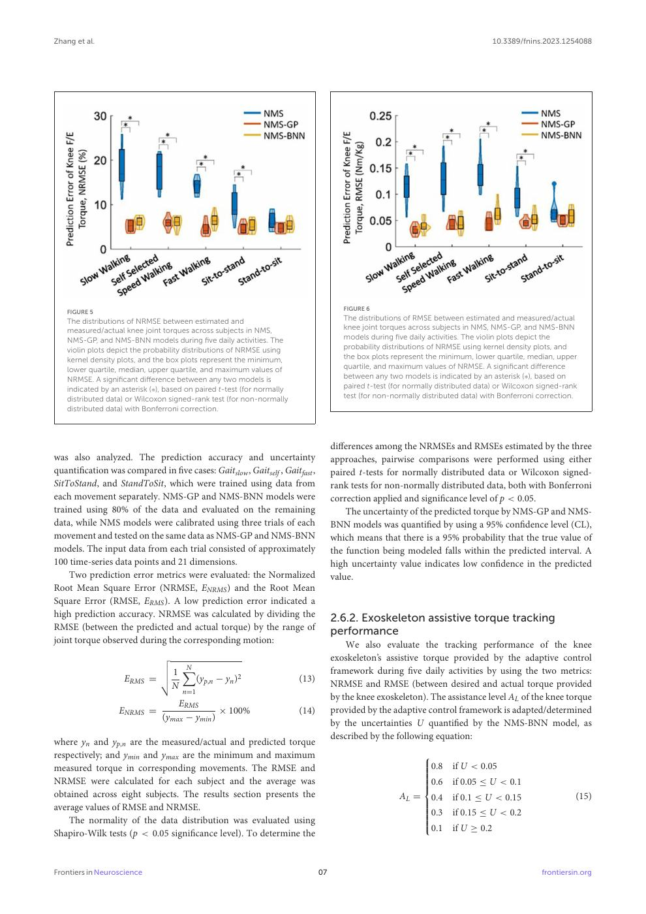

English text extracted from page 7

<pre>
Zhang et al.                                                                                                                      10.3389/fnins.2023.1254088

                                                                                       FIGURE 6
   FIGURE 5
   The distributions of NRMSE between estimated and                                    The distributions of RMSE between estimated and measured/actual
   measured/actual knee joint torques across subjects in NMS,                          knee joint torques across subjects in NMS, NMS-GP, and NMS-BNN
   NMS-GP, and NMS-BNN models during five daily activities. The                         models during five daily activities. The violin plots depict the
   violin plots depict the probability distributions of NRMSE using                    probability distributions of NRMSE using kernel density plots, and
   kernel density plots, and the box plots represent the minimum,                      the box plots represent the minimum, lower quartile, median, upper
   lower quartile, median, upper quartile, and maximum values of                       quartile, and maximum values of NRMSE. A significant difference
   NRMSE. A significant difference between any two models is                            between any two models is indicated by an asterisk (∗), based on
   indicated by an asterisk (∗), based on paired t-test (for normally                  paired t-test (for normally distributed data) or Wilcoxon signed-rank
   distributed data) or Wilcoxon signed-rank test (for non-normally                    test (for non-normally distributed data) with Bonferroni correction.
   distributed data) with Bonferroni correction.

                                                                                    differences among the NRMSEs and RMSEs estimated by the three
was also analyzed. The prediction accuracy and uncertainty                          approaches, pairwise comparisons were performed using either
quantification was compared in five cases: Gaitslow , Gaitself , Gaitfast ,         paired t-tests for normally distributed data or Wilcoxon signed-
SitToStand, and StandToSit, which were trained using data from                      rank tests for non-normally distributed data, both with Bonferroni
each movement separately. NMS-GP and NMS-BNN models were                            correction applied and significance level of p &lt; 0.05.
trained using 80% of the data and evaluated on the remaining                            The uncertainty of the predicted torque by NMS-GP and NMS-
data, while NMS models were calibrated using three trials of each                   BNN models was quantified by using a 95% confidence level (CL),
movement and tested on the same data as NMS-GP and NMS-BNN                          which means that there is a 95% probability that the true value of
models. The input data from each trial consisted of approximately                   the function being modeled falls within the predicted interval. A
100 time-series data points and 21 dimensions.                                      high uncertainty value indicates low confidence in the predicted
    Two prediction error metrics were evaluated: the Normalized                     value.
Root Mean Square Error (NRMSE, ENRMS ) and the Root Mean
Square Error (RMSE, ERMS ). A low prediction error indicated a
high prediction accuracy. NRMSE was calculated by dividing the                      2.6.2. Exoskeleton assistive torque tracking
RMSE (between the predicted and actual torque) by the range of                      performance
joint torque observed during the corresponding motion:
                                                                                        We also evaluate the tracking performance of the knee
                           v                                                        exoskeleton’s assistive torque provided by the adaptive control
                           u1 N
                           u
                               X                                                    framework during five daily activities by using the two metrics:
                    ERMS = t    (yp,n − yn )2                           (13)
                             N                                                      NRMSE and RMSE (between desired and actual torque provided
                                     n=1
                                                                                    by the knee exoskeleton). The assistance level AL of the knee torque
                                   ERMS
                  ENRMS =                     × 100%                    (14)        provided by the adaptive control framework is adapted/determined
                               (ymax − ymin )
                                                                                    by the uncertainties U quantified by the NMS-BNN model, as
                                                                                    described by the following equation:
where yn and yp,n are the measured/actual and predicted torque
respectively; and ymin and ymax are the minimum and maximum                                                   
measured torque in corresponding movements. The RMSE and                                                      
                                                                                                              
                                                                                                               0.8 if U &lt; 0.05
                                                                                                              
NRMSE were calculated for each subject and the average was                                                    
                                                                                                              
                                                                                                              
                                                                                                               0.6 if 0.05 ≤ U &lt; 0.1
obtained across eight subjects. The results section presents the                                       AL =     0.4 if 0.1 ≤ U &lt; 0.15                      (15)
average values of RMSE and NRMSE.                                                                             
                                                                                                              
                                                                                                              
                                                                                                               0.3 if 0.15 ≤ U &lt; 0.2
    The normality of the data distribution was evaluated using
                                                                                                              
                                                                                                              
                                                                                                              
                                                                                                                0.1 if U ≥ 0.2
                                                                                                              
Shapiro-Wilk tests (p &lt; 0.05 significance level). To determine the

Frontiers in Neuroscience                                                      07                                                                frontiersin.org
</pre>

## Page 8

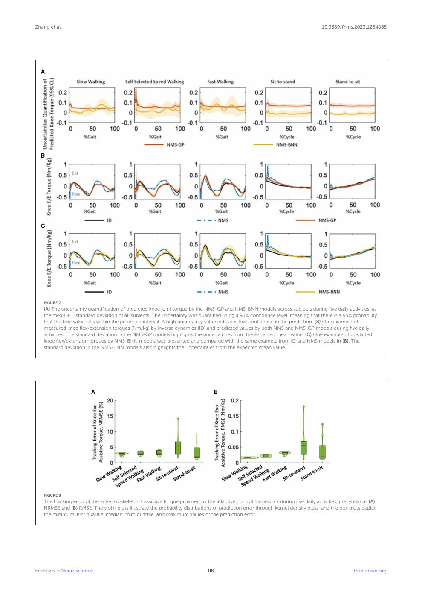

English text extracted from page 8

<pre>
Zhang et al.                                                                                                                      10.3389/fnins.2023.1254088

   FIGURE 7
   (A) The uncertainty quantification of predicted knee joint torque by the NMS-GP and NMS-BNN models across subjects during five daily activities, as
   the mean ± 1 standard deviation of all subjects. The uncertainty was quantified using a 95% confidence level, meaning that there is a 95% probability
   that the true value falls within the predicted interval. A high uncertainty value indicates low confidence in the prediction. (B) One example of
   measured knee flex/extension torques (Nm/kg) by inverse dynamics (ID) and predicted values by both NMS and NMS-GP models during five daily
   activities. The standard deviation in the NMS-GP models highlights the uncertainties from the expected mean value. (C) One example of predicted
   knee flex/extension torques by NMS-BNN models was presented and compared with the same example from ID and NMS models in (B). The
   standard deviation in the NMS-BNN models also highlights the uncertainties from the expected mean value.

   FIGURE 8
   The tracking error of the knee exoskeleton’s assistive torque provided by the adaptive control framework during five daily activities, presented as (A)
   NRMSE and (B) RMSE. The violin plots illustrate the probability distributions of prediction error through kernel density plots, and the box plots depict
   the minimum, first quartile, median, third quartile, and maximum values of the prediction error.

Frontiers in Neuroscience                                                     08                                                                 frontiersin.org
</pre>

## Page 9

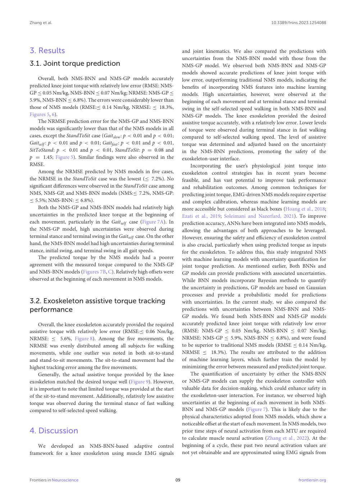

English text extracted from page 9

<pre>
Zhang et al.                                                                                                            10.3389/fnins.2023.1254088

3. Results                                                                   and joint kinematics. We also compared the predictions with
                                                                             uncertainties from the NMS-BNN model with those from the
3.1. Joint torque prediction                                                 NMS-GP model. We observed both NMS-BNN and NMS-GP
                                                                             models showed accurate predictions of knee joint torque with
    Overall, both NMS-BNN and NMS-GP models accurately                       low error, outperforming traditional NMS models, indicating the
predicted knee joint torque with relatively low error (RMSE: NMS-            benefits of incorporating NMS features into machine learning
GP ≤ 0.05 Nm/kg, NMS-BNN ≤ 0.07 Nm/kg; NRMSE: NMS-GP ≤                       models. High uncertainties, however, were observed at the
5.9%, NMS-BNN ≤ 6.8%). The errors were considerably lower than               beginning of each movement and at terminal stance and terminal
those of NMS models (RMSE:≤ 0.14 Nm/kg, NRMSE: ≤ 18.3%,                      swing in the self-selected speed walking in both NMS-BNN and
Figures 5, 6).                                                               NMS-GP models. The knee exoskeleton provided the desired
    The NRMSE prediction error for the NMS-GP and NMS-BNN                    assistive torque accurately, with a relatively low error. Lower levels
models was significantly lower than that of the NMS models in all            of torque were observed during terminal stance in fast walking
cases, except the StandToSit case (Gaitslow : p &lt; 0.01 and p &lt; 0.01;         compared to self-selected walking speed. The level of assistive
Gaitself : p &lt; 0.01 and p &lt; 0.01; Gaitfast : p &lt; 0.01 and p &lt; 0.01,          torque was determined and adjusted based on the uncertainty
SitToStand: p &lt; 0.01 and p &lt; 0.01, StandToSit: p = 0.08 and                  in the NMS-BNN predictions, promoting the safety of the
p = 1.45; Figure 5). Similar findings were also observed in the              exoskeleton-user interface.
RMSE.                                                                             Incorporating the user’s physiological joint torque into
    Among the NRMSE predicted by NMS models in five cases,                   exoskeleton control strategies has in recent years become
the NRMSE in the StandToSit case was the lowest (≤ 7.2%). No                 feasible, and has vast potential to improve task performance
significant differences were observed in the StandToSit case among           and rehabilitation outcomes. Among common techniques for
NMS, NMS-GP, and NMS-BNN models (NMS:≤ 7.2%, NMS-GP:                         predicting joint torque, EMG-driven NMS models require expertise
≤ 5.5%; NMS-BNN: ≤ 6.8%).                                                    and complex calibration, whereas machine learning models are
    Both the NMS-GP and NMS-BNN models had relatively high                   more accessible but considered as black boxes (Hoang et al., 2018;
uncertainties in the predicted knee torque at the beginning of               Ezati et al., 2019; Soleimani and Nazerfard, 2021). To improve
each movement, particularly in the Gaitself case (Figure 7A). In             prediction accuracy, ANNs have been integrated into NMS models,
the NMS-GP model, high uncertainties were observed during                    allowing the advantages of both approaches to be leveraged.
terminal stance and terminal swing in the Gaitself case. On the other        However, ensuring the safety and efficiency of exoskeleton control
hand, the NMS-BNN model had high uncertainties during terminal               is also crucial, particularly when using predicted torque as inputs
stance, initial swing, and terminal swing in all gait speeds.                for the exoskeleton. To address this, this study integrated NMS
    The predicted torque by the NMS models had a poorer                      with machine learning models with uncertainty quantification for
agreement with the measured torque compared to the NMS-GP                    joint torque prediction. As mentioned earlier, Both BNNs and
and NMS-BNN models (Figures 7B, C). Relatively high offsets were             GP models can provide predictions with associated uncertainties.
observed at the beginning of each movement in NMS models.                    While BNN models incorporate Bayesian methods to quantify
                                                                             the uncertainty in predictions, GP models are based on Gaussian
                                                                             processes and provide a probabilistic model for predictions
3.2. Exoskeleton assistive torque tracking                                   with uncertainties. In the current study, we also compared the
performance                                                                  predictions with uncertainties between NMS-BNN and NMS-
                                                                             GP models. We found both NMS-BNN and NMS-GP models
     Overall, the knee exoskeleton accurately provided the required          accurately predicted knee joint torque with relatively low error
assistive torque with relatively low error (RMSE:≤ 0.06 Nm/kg,               (RMSE: NMS-GP ≤ 0.05 Nm/kg, NMS-BNN ≤ 0.07 Nm/kg;
NRMSE: ≤ 5.6%, Figure 8). Among the five movements, the                      NRMSE: NMS-GP ≤ 5.9%, NMS-BNN ≤ 6.8%), and were found
NRMSE was evenly distributed among all subjects for walking                  to be superior to traditional NMS models (RMSE ≤ 0.14 Nm/kg,
movements, while one outlier was noted in both sit-to-stand                  NRMSE ≤ 18.3%). The results are attributed to the addition
and stand-to-sit movements. The sit-to-stand movement had the                of machine learning layers, which further train the model by
highest tracking error among the five movements.                             minimizing the error between measured and predicted joint torque.
     Generally, the actual assistive torque provided by the knee                  The quantification of uncertainty by either the NMS-BNN
exoskeleton matched the desired torque well (Figure 9). However,             or NMS-GP models can supply the exoskeleton controller with
it is important to note that limited torque was provided at the start        valuable data for decision-making, which could enhance safety in
of the sit-to-stand movement. Additionally, relatively low assistive         the exoskeleton-user interaction. For instance, we observed high
torque was observed during the terminal stance of fast walking               uncertainties at the beginning of each movement in both NMS-
compared to self-selected speed walking.                                     BNN and NMS-GP models (Figure 7). This is likely due to the
                                                                             physical characteristics adopted from NMS models, which show a
                                                                             noticeable offset at the start of each movement. In NMS models, two
4. Discussion                                                                prior time steps of neural activation from each MTU are required
                                                                             to calculate muscle neural activation (Zhang et al., 2022). At the
    We developed an NMS-BNN-based adaptive control                           beginning of a cycle, these past two neural activation values are
framework for a knee exoskeleton using muscle EMG signals                    not yet obtainable and are approximated using EMG signals from

Frontiers in Neuroscience                                               09                                                           frontiersin.org
</pre>

## Page 10

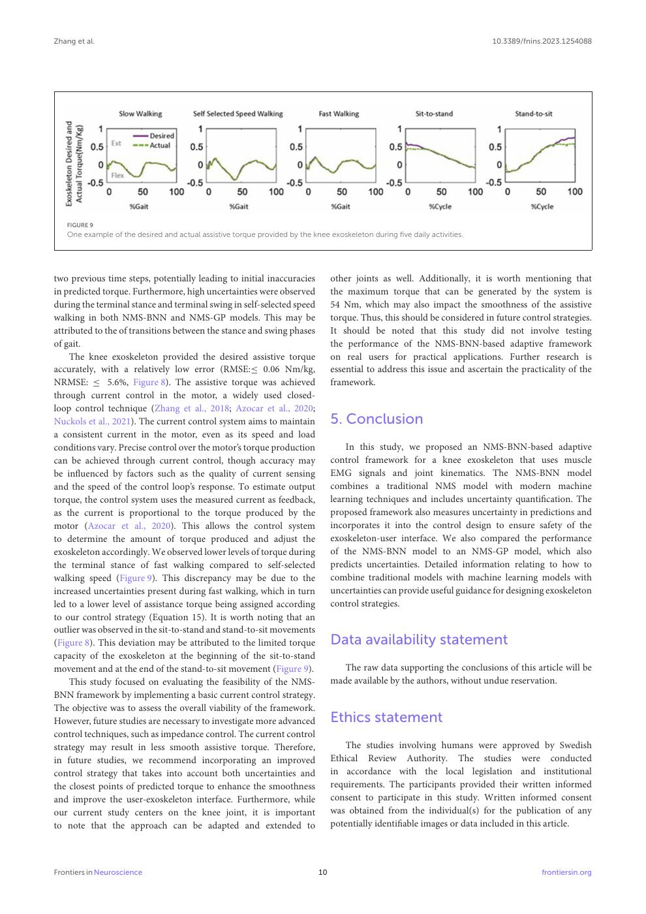

English text extracted from page 10

<pre>
Zhang et al.                                                                                                               10.3389/fnins.2023.1254088

   FIGURE 9
   One example of the desired and actual assistive torque provided by the knee exoskeleton during five daily activities.

two previous time steps, potentially leading to initial inaccuracies             other joints as well. Additionally, it is worth mentioning that
in predicted torque. Furthermore, high uncertainties were observed               the maximum torque that can be generated by the system is
during the terminal stance and terminal swing in self-selected speed             54 Nm, which may also impact the smoothness of the assistive
walking in both NMS-BNN and NMS-GP models. This may be                           torque. Thus, this should be considered in future control strategies.
attributed to the of transitions between the stance and swing phases             It should be noted that this study did not involve testing
of gait.                                                                         the performance of the NMS-BNN-based adaptive framework
    The knee exoskeleton provided the desired assistive torque                   on real users for practical applications. Further research is
accurately, with a relatively low error (RMSE:≤ 0.06 Nm/kg,                      essential to address this issue and ascertain the practicality of the
NRMSE: ≤ 5.6%, Figure 8). The assistive torque was achieved                      framework.
through current control in the motor, a widely used closed-
loop control technique (Zhang et al., 2018; Azocar et al., 2020;
Nuckols et al., 2021). The current control system aims to maintain               5. Conclusion
a consistent current in the motor, even as its speed and load
conditions vary. Precise control over the motor’s torque production                  In this study, we proposed an NMS-BNN-based adaptive
can be achieved through current control, though accuracy may                     control framework for a knee exoskeleton that uses muscle
be influenced by factors such as the quality of current sensing                  EMG signals and joint kinematics. The NMS-BNN model
and the speed of the control loop’s response. To estimate output                 combines a traditional NMS model with modern machine
torque, the control system uses the measured current as feedback,                learning techniques and includes uncertainty quantification. The
as the current is proportional to the torque produced by the                     proposed framework also measures uncertainty in predictions and
motor (Azocar et al., 2020). This allows the control system                      incorporates it into the control design to ensure safety of the
to determine the amount of torque produced and adjust the                        exoskeleton-user interface. We also compared the performance
exoskeleton accordingly. We observed lower levels of torque during               of the NMS-BNN model to an NMS-GP model, which also
the terminal stance of fast walking compared to self-selected                    predicts uncertainties. Detailed information relating to how to
walking speed (Figure 9). This discrepancy may be due to the                     combine traditional models with machine learning models with
increased uncertainties present during fast walking, which in turn               uncertainties can provide useful guidance for designing exoskeleton
led to a lower level of assistance torque being assigned according               control strategies.
to our control strategy (Equation 15). It is worth noting that an
outlier was observed in the sit-to-stand and stand-to-sit movements
(Figure 8). This deviation may be attributed to the limited torque               Data availability statement
capacity of the exoskeleton at the beginning of the sit-to-stand
movement and at the end of the stand-to-sit movement (Figure 9).                    The raw data supporting the conclusions of this article will be
    This study focused on evaluating the feasibility of the NMS-                 made available by the authors, without undue reservation.
BNN framework by implementing a basic current control strategy.
The objective was to assess the overall viability of the framework.
However, future studies are necessary to investigate more advanced               Ethics statement
control techniques, such as impedance control. The current control
strategy may result in less smooth assistive torque. Therefore,                      The studies involving humans were approved by Swedish
in future studies, we recommend incorporating an improved                        Ethical Review Authority. The studies were conducted
control strategy that takes into account both uncertainties and                  in accordance with the local legislation and institutional
the closest points of predicted torque to enhance the smoothness                 requirements. The participants provided their written informed
and improve the user-exoskeleton interface. Furthermore, while                   consent to participate in this study. Written informed consent
our current study centers on the knee joint, it is important                     was obtained from the individual(s) for the publication of any
to note that the approach can be adapted and extended to                         potentially identifiable images or data included in this article.

Frontiers in Neuroscience                                                   10                                                          frontiersin.org
</pre>

## Page 11

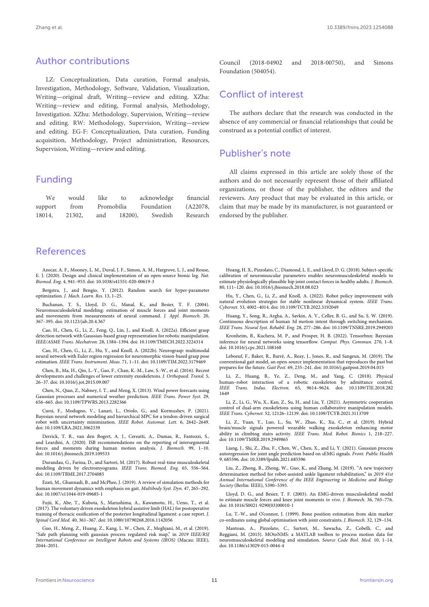

English text extracted from page 11

<pre>
Zhang et al.                                                                                                                                              10.3389/fnins.2023.1254088

Author contributions                                                                               Council (2018-04902                  and       2018-00750),          and       Simons
                                                                                                   Foundation (504054).
   LZ: Conceptualization, Data curation, Formal analysis,
Investigation, Methodology, Software, Validation, Visualization,
Writing—original draft, Writing—review and editing. XZha:                                          Conflict of interest
Writing—review and editing, Formal analysis, Methodology,
Investigation. XZhu: Methodology, Supervision, Writing—review                                          The authors declare that the research was conducted in the
and editing. RW: Methodology, Supervision, Writing—review                                          absence of any commercial or financial relationships that could be
and editing. EG-F: Conceptualization, Data curation, Funding                                       construed as a potential conflict of interest.
acquisition, Methodology, Project administration, Resources,
Supervision, Writing—review and editing.
                                                                                                   Publisher’s note
                                                                                                       All claims expressed in this article are solely those of the
Funding                                                                                            authors and do not necessarily represent those of their affiliated
                                                                                                   organizations, or those of the publisher, the editors and the
   We           would           like  to     acknowledge                       financial           reviewers. Any product that may be evaluated in this article, or
support         from           Promobilia    Foundation                       (A22078,             claim that may be made by its manufacturer, is not guaranteed or
18014,         21302,          and   18200),     Swedish                      Research             endorsed by the publisher.

References
   Azocar, A. F., Mooney, L. M., Duval, J. F., Simon, A. M., Hargrove, L. J., and Rouse,               Hoang, H. X., Pizzolato, C., Diamond, L. E., and Lloyd, D. G. (2018). Subject-specific
E. J. (2020). Design and clinical implementation of an open-source bionic leg. Nat.                calibration of neuromuscular parameters enables neuromusculoskeletal models to
Biomed. Eng. 4, 941–953. doi: 10.1038/s41551-020-00619-3                                           estimate physiologically plausible hip joint contact forces in healthy adults. J. Biomech.
                                                                                                   80, 111–120. doi: 10.1016/j.jbiomech.2018.08.023
   Bergstra, J., and Bengio, Y. (2012). Random search for hyper-parameter
optimization. J. Mach. Learn. Res. 13, 1–25.                                                          Hu, Y., Chen, G., Li, Z., and Knoll, A. (2022). Robot policy improvement with
                                                                                                   natural evolution strategies for stable nonlinear dynamical system. IEEE Trans.
   Buchanan, T. S., Lloyd, D. G., Manal, K., and Besier, T. F. (2004).
                                                                                                   Cybernet. 53, 4002–4014. doi: 10.1109/TCYB.2022.3192049
Neuromusculoskeletal modeling: estimation of muscle forces and joint moments
and movements from measurements of neural command. J. Appl. Biomech. 20,                              Huang, Y., Song, R., Argha, A., Savkin, A. V., Celler, B. G., and Su, S. W. (2019).
367–395. doi: 10.1123/jab.20.4.367                                                                 Continuous description of human 3d motion intent through switching mechanism.
                                                                                                   IEEE Trans. Neural Syst. Rehabil. Eng. 28, 277–286. doi: 10.1109/TNSRE.2019.2949203
   Cao, H., Chen, G., Li, Z., Feng, Q., Lin, J., and Knoll, A. (2022a). Efficient grasp
detection network with Gaussian-based grasp representation for robotic manipulation.                  Kronheim, B., Kuchera, M. P., and Prosper, H. B. (2022). Tensorbnn: Bayesian
IEEE/ASME Trans. Mechatron. 28, 1384–1394. doi: 10.1109/TMECH.2022.3224314                         inference for neural networks using tensorflow. Comput. Phys. Commun. 270, 1–8.
                                                                                                   doi: 10.1016/j.cpc.2021.108168
    Cao, H., Chen, G., Li, Z., Hu, Y., and Knoll, A. (2022b). Neurograsp: multimodal
neural network with Euler region regression for neuromorphic vision-based grasp pose                  Leboeuf, F., Baker, R., Barré, A., Reay, J., Jones, R., and Sangeux, M. (2019). The
estimation. IEEE Trans. Instrument. Meas. 71, 1–11. doi: 10.1109/TIM.2022.3179469                  conventional gait model, an open-source implementation that reproduces the past but
                                                                                                   prepares for the future. Gait Post. 69, 235–241. doi: 10.1016/j.gaitpost.2019.04.015
   Chen, B., Ma, H., Qin, L.-Y., Gao, F., Chan, K.-M., Law, S.-W., et al. (2016). Recent
developments and challenges of lower extremity exoskeletons. J. Orthopaed. Transl. 5,                 Li, Z., Huang, B., Ye, Z., Deng, M., and Yang, C. (2018). Physical
26–37. doi: 10.1016/j.jot.2015.09.007                                                              human–robot interaction of a robotic exoskeleton by admittance control.
                                                                                                   IEEE Trans. Indus. Electron. 65, 9614–9624. doi: 10.1109/TIE.2018.282
   Chen, N., Qian, Z., Nabney, I. T., and Meng, X. (2013). Wind power forecasts using
                                                                                                   1649
Gaussian processes and numerical weather prediction. IEEE Trans. Power Syst. 29,
656–665. doi: 10.1109/TPWRS.2013.2282366                                                              Li, Z., Li, G., Wu, X., Kan, Z., Su, H., and Liu, Y. (2021). Asymmetric cooperation
                                                                                                   control of dual-arm exoskeletons using human collaborative manipulation models.
   Cursi, F., Modugno, V., Lanari, L., Oriolo, G., and Kormushev, P. (2021).
                                                                                                   IEEE Trans. Cybernet. 52, 12126–12139. doi: 10.1109/TCYB.2021.3113709
Bayesian neural network modeling and hierarchical MPC for a tendon-driven surgical
robot with uncertainty minimization. IEEE Robot. Automat. Lett. 6, 2642–2649.                         Li, Z., Yuan, Y., Luo, L., Su, W., Zhao, K., Xu, C., et al. (2019). Hybrid
doi: 10.1109/LRA.2021.3062339                                                                      brain/muscle signals powered wearable walking exoskeleton enhancing motor
                                                                                                   ability in climbing stairs activity. IEEE Trans. Med. Robot. Bionics 1, 218–227.
   Derrick, T. R., van den Bogert, A. J., Cereatti, A., Dumas, R., Fantozzi, S.,
                                                                                                   doi: 10.1109/TMRB.2019.2949865
and Leardini, A. (2020). ISB recommendations on the reporting of intersegmental
forces and moments during human motion analysis. J. Biomech. 99, 1–10.                                 Liang, J., Shi, Z., Zhu, F., Chen, W., Chen, X., and Li, Y. (2021). Gaussian process
doi: 10.1016/j.jbiomech.2019.109533                                                                autoregression for joint angle prediction based on sEMG signals. Front. Public Health
                                                                                                   9, 685596. doi: 10.3389/fpubh.2021.685596
   Durandau, G., Farina, D., and Sartori, M. (2017). Robust real-time musculoskeletal
modeling driven by electromyograms. IEEE Trans. Biomed. Eng. 65, 556–564.                             Liu, Z., Zhong, B., Zhong, W., Guo, K., and Zhang, M. (2019). “A new trajectory
doi: 10.1109/TBME.2017.2704085                                                                     determination method for robot-assisted ankle ligament rehabilitation,” in 2019 41st
                                                                                                   Annual International Conference of the IEEE Engineering in Medicine and Biology
   Ezati, M., Ghannadi, B., and McPhee, J. (2019). A review of simulation methods for
                                                                                                   Society (Berlin: IEEE), 5390–5393.
human movement dynamics with emphasis on gait. Multibody Syst. Dyn. 47, 265–292.
doi: 10.1007/s11044-019-09685-1                                                                       Lloyd, D. G., and Besier, T. F. (2003). An EMG-driven musculoskeletal model
                                                                                                   to estimate muscle forces and knee joint moments in vivo. J. Biomech. 36, 765–776.
    Fujii, K., Abe, T., Kubota, S., Marushima, A., Kawamoto, H., Ueno, T., et al.
                                                                                                   doi: 10.1016/S0021-9290(03)00010-1
(2017). The voluntary driven exoskeleton hybrid assistive limb (HAL) for postoperative
training of thoracic ossification of the posterior longitudinal ligament: a case report. J.           Lu, T.-W., and O’connor, J. (1999). Bone position estimation from skin marker
Spinal Cord Med. 40, 361–367. doi: 10.1080/10790268.2016.1142056                                   co-ordinates using global optimisation with joint constraints. J. Biomech. 32, 129–134.
   Guo, H., Meng, Z., Huang, Z., Kang, L. W., Chen, Z., Meghjani, M., et al. (2019).                  Mantoan, A., Pizzolato, C., Sartori, M., Sawacha, Z., Cobelli, C., and
“Safe path planning with gaussian process regulated risk map,” in 2019 IEEE/RSJ                    Reggiani, M. (2015). MOtoNMS: a MATLAB toolbox to process motion data for
International Conference on Intelligent Robots and Systems (IROS) (Macau: IEEE),                   neuromusculoskeletal modeling and simulation. Source Code Biol. Med. 10, 1–14.
2044–2051.                                                                                         doi: 10.1186/s13029-015-0044-4

Frontiers in Neuroscience                                                                     11                                                                           frontiersin.org
</pre>

## Page 12

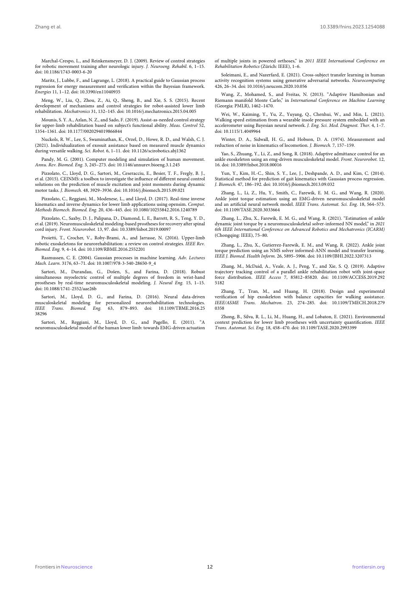

English text extracted from page 12

<pre>
Zhang et al.                                                                                                                                            10.3389/fnins.2023.1254088

   Marchal-Crespo, L., and Reinkensmeyer, D. J. (2009). Review of control strategies               of multiple joints in powered orthoses,” in 2011 IEEE International Conference on
for robotic movement training after neurologic injury. J. Neuroeng. Rehabil. 6, 1–15.              Rehabilitation Robotics (Zürich: IEEE), 1–6.
doi: 10.1186/1743-0003-6-20
                                                                                                      Soleimani, E., and Nazerfard, E. (2021). Cross-subject transfer learning in human
   Maritz, J., Lubbe, F., and Lagrange, L. (2018). A practical guide to Gaussian process           activity recognition systems using generative adversarial networks. Neurocomputing
regression for energy measurement and verification within the Bayesian framework.                  426, 26–34. doi: 10.1016/j.neucom.2020.10.056
Energies 11, 1–12. doi: 10.3390/en11040935
                                                                                                      Wang, Z., Mohamed, S., and Freitas, N. (2013). “Adaptive Hamiltonian and
   Meng, W., Liu, Q., Zhou, Z., Ai, Q., Sheng, B., and Xie, S. S. (2015). Recent                   Riemann manifold Monte Carlo,” in International Conference on Machine Learning
development of mechanisms and control strategies for robot-assisted lower limb                     (Georgia: PMLR), 1462–1470.
rehabilitation. Mechatronics 31, 132–145. doi: 10.1016/j.mechatronics.2015.04.005
                                                                                                      Wei, W., Kaiming, Y., Yu, Z., Yuyang, Q., Chenhui, W., and Min, L. (2021).
   Mounis, S. Y. A., Azlan, N. Z., and Sado, F. (2019). Assist-as-needed control strategy          Walking speed estimation from a wearable insole pressure system embedded with an
for upper-limb rehabilitation based on subject’s functional ability. Meas. Control 52,             accelerometer using Bayesian neural network. J. Eng. Sci. Med. Diagnost. Ther. 4, 1–7.
1354–1361. doi: 10.1177/0020294019866844                                                           doi: 10.1115/1.4049964
   Nuckols, R. W., Lee, S., Swaminathan, K., Orzel, D., Howe, R. D., and Walsh, C. J.                 Winter, D. A., Sidwall, H. G., and Hobson, D. A. (1974). Measurement and
(2021). Individualization of exosuit assistance based on measured muscle dynamics                  reduction of noise in kinematics of locomotion. J. Biomech. 7, 157–159.
during versatile walking. Sci. Robot. 6, 1–11. doi: 10.1126/scirobotics.abj1362
                                                                                                      Yao, S., Zhuang, Y., Li, Z., and Song, R. (2018). Adaptive admittance control for an
  Pandy, M. G. (2001). Computer modeling and simulation of human movement.                         ankle exoskeleton using an emg-driven musculoskeletal model. Front. Neurorobot. 12,
Annu. Rev. Biomed. Eng. 3, 245–273. doi: 10.1146/annurev.bioeng.3.1.245                            16. doi: 10.3389/fnbot.2018.00016
    Pizzolato, C., Lloyd, D. G., Sartori, M., Ceseracciu, E., Besier, T. F., Fregly, B. J.,            Yun, Y., Kim, H.-C., Shin, S. Y., Lee, J., Deshpande, A. D., and Kim, C. (2014).
et al. (2015). CEINMS: a toolbox to investigate the influence of different neural control          Statistical method for prediction of gait kinematics with Gaussian process regression.
solutions on the prediction of muscle excitation and joint moments during dynamic                  J. Biomech. 47, 186–192. doi: 10.1016/j.jbiomech.2013.09.032
motor tasks. J. Biomech. 48, 3929–3936. doi: 10.1016/j.jbiomech.2015.09.021
                                                                                                      Zhang, L., Li, Z., Hu, Y., Smith, C., Farewik, E. M. G., and Wang, R. (2020).
   Pizzolato, C., Reggiani, M., Modenese, L., and Lloyd, D. (2017). Real-time inverse              Ankle joint torque estimation using an EMG-driven neuromusculoskeletal model
kinematics and inverse dynamics for lower limb applications using opensim. Comput.                 and an artificial neural network model. IEEE Trans. Automat. Sci. Eng. 18, 564–573.
Methods Biomech. Biomed. Eng. 20, 436–445. doi: 10.1080/10255842.2016.1240789                      doi: 10.1109/TASE.2020.3033664
    Pizzolato, C., Saxby, D. J., Palipana, D., Diamond, L. E., Barrett, R. S., Teng, Y. D.,           Zhang, L., Zhu, X., Farewik, E. M. G., and Wang, R. (2021). “Estimation of ankle
et al. (2019). Neuromusculoskeletal modeling-based prostheses for recovery after spinal            dynamic joint torque by a neuromusculoskeletal solver-informed NN model,” in 2021
cord injury. Front. Neurorobot. 13, 97. doi: 10.3389/fnbot.2019.00097                              6th IEEE International Conference on Advanced Robotics and Mechatronics (ICARM)
                                                                                                   (Chongqing: IEEE), 75–80.
   Proietti, T., Crocher, V., Roby-Brami, A., and Jarrasse, N. (2016). Upper-limb
robotic exoskeletons for neurorehabilitation: a review on control strategies. IEEE Rev.               Zhang, L., Zhu, X., Gutierrez-Farewik, E. M., and Wang, R. (2022). Ankle joint
Biomed. Eng. 9, 4–14. doi: 10.1109/RBME.2016.2552201                                               torque prediction using an NMS solver informed-ANN model and transfer learning.
  Rasmussen, C. E. (2004). Gaussian processes in machine learning. Adv. Lectures                   IEEE J. Biomed. Health Inform. 26, 5895–5906. doi: 10.1109/JBHI.2022.3207313
Mach. Learn. 3176, 63–71. doi: 10.1007/978-3-540-28650-9_4
                                                                                                       Zhang, M., McDaid, A., Veale, A. J., Peng, Y., and Xie, S. Q. (2019). Adaptive
   Sartori, M., Durandau, G., Došen, S., and Farina, D. (2018). Robust                             trajectory tracking control of a parallel ankle rehabilitation robot with joint-space
simultaneous myoelectric control of multiple degrees of freedom in wrist-hand                      force distribution. IEEE Access 7, 85812–85820. doi: 10.1109/ACCESS.2019.292
prostheses by real-time neuromusculoskeletal modeling. J. Neural Eng. 15, 1–15.                    5182
doi: 10.1088/1741-2552/aae26b
                                                                                                      Zhang, T., Tran, M., and Huang, H. (2018). Design and experimental
   Sartori, M., Lloyd, D. G., and Farina, D. (2016). Neural data-driven                            verification of hip exoskeleton with balance capacities for walking assistance.
musculoskeletal modeling for personalized neurorehabilitation technologies.                        IEEE/ASME Trans. Mechatron. 23, 274–285. doi: 10.1109/TMECH.2018.279
IEEE Trans. Biomed. Eng. 63, 879–893. doi: 10.1109/TBME.2016.25                                    0358
38296
                                                                                                      Zhong, B., Silva, R. L., Li, M., Huang, H., and Lobaton, E. (2021). Environmental
   Sartori, M., Reggiani, M., Lloyd, D. G., and Pagello, E. (2011). “A                             context prediction for lower limb prostheses with uncertainty quantification. IEEE
neuromusculoskeletal model of the human lower limb: towards EMG-driven actuation                   Trans. Automat. Sci. Eng. 18, 458–470. doi: 10.1109/TASE.2020.2993399

Frontiers in Neuroscience                                                                     12                                                                         frontiersin.org
</pre>

