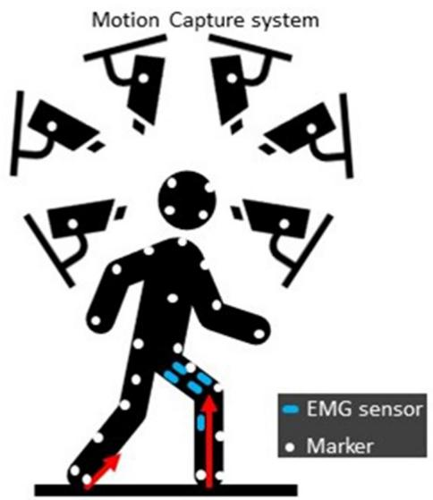
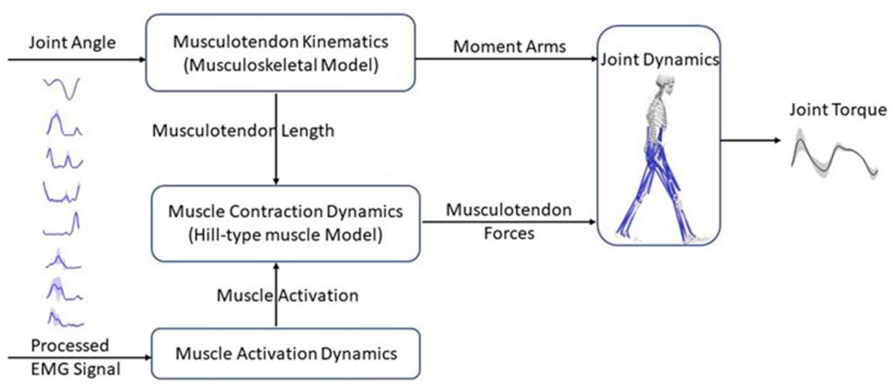
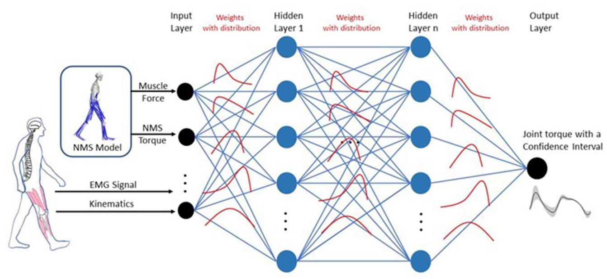
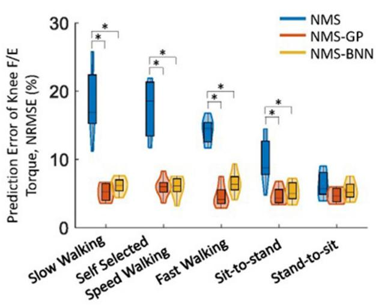
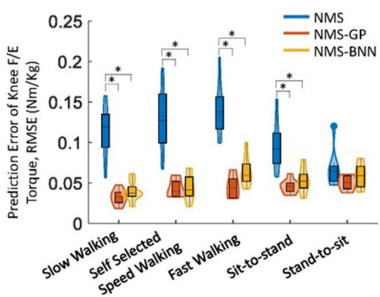
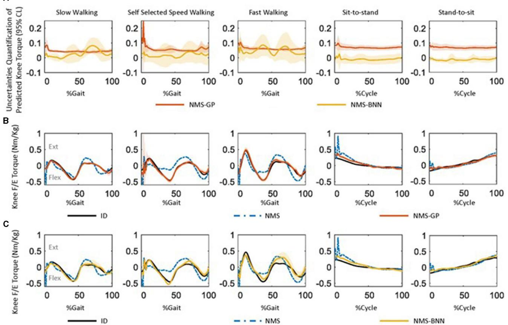
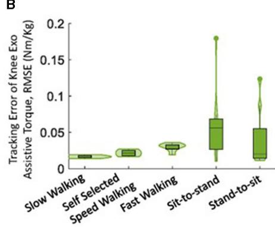
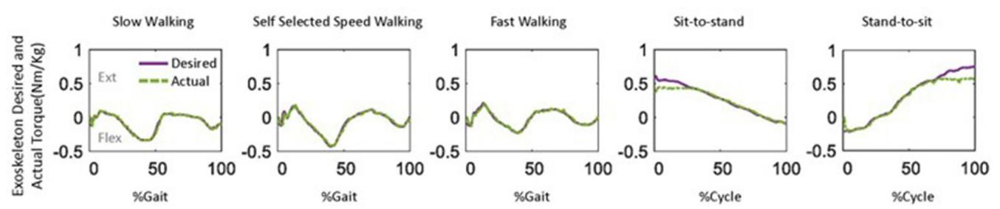

Check for updates

## 开放获取

Alois C. Knoll, Technical University of Munich, Germany

Yisen Huang, The Chinese University of Hong Kong, China Keli Shen, National Institute of Advanced Industrial Science and Technology (AIST), Japan

Elena M. Gutierrez-Farewik lanie@kth.se

收稿日期 2023年7月6日 接受日期 2023年8月11日 出版日期 2023年8月30日

引用格式 Zhang L, Zhang X, Zhu X, Wang R and Gutierrez-Farewik EM (2023) Neuromusculoskeletal model-informed machine learning-based control of a knee exoskeleton with uncertainties quantification. Front. Neurosci. doi: 10.3389/fnins.2023.1254088

## 版权

© 2023 Zhang, Zhang, Zhu, Wang and Gutierrez-Farewik. 这是一篇根据知识共享署名许可（CC BY）条款分发的开放获取文章。在遵守公认学术规范的前提下，只要注明原作者和版权所有者，并引用本期刊上的原始出版物，即允许在其他平台上使用、分发或复制。任何不符合这些条款的使用、分发或复制均不被允许。

# 结合神经肌肉骨骼模型与机器学习并包含不确定性量化的膝关节外骨骼控制

Longbin Zhang1, Xiaochen Zhang1, Xueyu Zhu2, Ruoli Wang1 and Elena M. Gutierrez-Farewik1\*

1KTH MoveAbility Lab, Department of Engineering Mechanics, KTH Royal Institute of Technology, Stockholm, Sweden, 2Department of Mathematics, University of Iowa, Iowa City, IA, United States

引言：结合用户力矩能力的外骨骼辅助策略正受到迅速增长的研究关注。然而，对用户力矩能力的预测往往包含来自多方面的不确定性，这可能对外骨骼-用户交互接口的安全性产生重大影响。

方法：为应对这一挑战，本文提出了一种利用肌肉肌电（EMG）信号和关节运动学的膝关节外骨骼自适应控制框架。该框架基于融入神经肌肉骨骼（NMS）求解器信息的贝叶斯神经网络（NMS-BNN），预测带有置信区间的用户膝关节屈曲/伸展力矩以量化不确定性。具有指定置信水平的预测力矩通过 TCP/IP 数据流控制外骨骼提供的辅助力矩。此外，本文还将 NMS-BNN 模型的性能与高斯过程（NMS-GP）模型进行了对比。

结果：我们的研究结果表明，NMS-BNN 和 NMS-GP 模型均能以低误差准确预测膝关节力矩，优于传统 NMS 模型。在 NMS-BNN 和 NMS-GP 模型中，均在每个动作开始时，以及自选速度行走时的站立末期（terminal stance）和摆动末期（terminal swing）观察到较高的不确定性。膝关节外骨骼能够以低误差提供所需的辅助力矩，尽管与自选行走速度相比，在快速行走的站立末期观察到了较低的力矩。

讨论：本研究开发的框架能够预测具有可量化不确定性的膝关节屈曲/伸展力矩，并为用户提供自适应辅助力矩。这对于开发按需提供辅助（assistance-as-needed）的外骨骼具有重要潜力，并重点关注外骨骼-用户界面的安全性。

##

机器学习，数据驱动生物力学模型，逆动力学，神经肌骨骼建模，不确定性量化

## 1. 引言

外骨骼在增强运动能力以及促进中风、脑瘫和脊髓损伤等运动障碍患者的神经肌肉康复方面具有巨大的潜力（Sartori et al., 2016; Li et al., 2019, 2021; Liu et al., 2019; Zhang et al., 2019）。外骨骼辅助康复训练涉及使用控制算法，旨在改善使用者的肌肉力量、神经可塑性并增强运动能力（Fujii et al., 2017）。这些控制策略可分为三类：被动控制、触发式被动控制和按需辅助控制（Marchal-Crespo and Reinkensmeyer, 2009; Meng et al., 2015; Proietti et al., 2016）。被动控制是指一种由外骨骼主导，引导使用者遵循从健康人群中提取的预定义轨迹或辅助力/力矩的技术。使用者在运动中处于被动状态，并不主动控制外骨骼。这种类型的控制通常用于治疗初期，以使肢体重新适应运动。触发式被动控制是被动控制的一种变体，由使用者触发外骨骼的辅助。一旦激活，随着外骨骼沿预定轨迹运动，使用者在运动中再次处于被动状态。该技术通常用于将脑机接口（brain-machine interface）融入控制过程中，为四肢瘫痪等患有不可逆损伤的个体提供辅助（Proietti et al., 2016）。按需辅助控制，也称为“使用者主导”或“主动控制”，使用户能够在特定外骨骼的辅助下执行日常任务。外骨骼根据使用者产生力矩的能力和意图提供辅助，旨在促进神经可塑性和使用者的自主性。这种主动控制技术通常应用于具有残余运动功能的人群（Chen et al., 2016; Durandau et al., 2017; Li et al., 2018; Yao et al., 2018）。本文的核心重点是主动控制技术，该技术旨在通过外骨骼的辅助来弥补使用者自身肌肉出力的不足。基于使用者的运动意图提供力矩辅助需要对运动功能进行精确且鲁棒的解码，这可以通过记录潜在的神经肌肉活动来实现，例如脑和神经信号以及肌电图（EMG）信号。EMG 信号捕获肌肉的电兴奋，是预测关节力矩的常用方法，因为它们易于获取并能为人体运动提供关键的见解（Sartori et al., 2018; Huang et al., 2019; Mounis et al., 2019）。

关节力矩预测在外骨骼辅助康复控制中至关重要，通常通过两种方法实现：基于物理的神经肌肉骨骼（neuromusculoskeletal, NMS）建模和人工神经网络（artificial neural networks, ANNs）（Pizzolato et al., 2015, 2019; Zhang et al., 2020, 2021）。为提高预测精度，近期的研究已将 ANN 集成到 NMS 模型中。在我们最近的研究中（Zhang et al., 2022），开发了一种由 NMS 求解器启发的 ANN（NMS solver-informed ANN）模型，该模型基于步态和等速运动期间测量的关节角度和肌肉肌电（EMG）信号，通过将 NMS 模型的特征与标准 ANN 相结合来估算踝关节力矩。该混合模型总体上比单独的 NMS 或标准 ANN 模型更为准确，但在步态过程中对一名受试者的预测性能仍然较差，这可能是由于引入了来自 NMS 模型的信息量较少或具有误导性的输入特征。这凸显了为了实现安全且高效的人机外骨骼交互，量化关节力矩预测不确定性的必要性；准确估算关节力矩对于确定外骨骼的适度助力水平至关重要。

贝叶斯神经网络（Bayesian Neural Network, BNN）是一种成熟的、用于进行带不确定性预测的 ANN 类型，在安全且高效的外骨骼控制中具有巨大潜力（Cursi et al., 2021; Wei et al., 2021; Zhong et al., 2021）。与传统 ANN（Cao et al., 2022b; Hu et al., 2022）不同，BNN 引入概率分布来表示预测不确定性，并提供指示不同结果可能性的概率分布（Cursi et al., 2021）。这一特性使得 BNN 在包括生物力学、气象学和机器人技术在内的各个领域的决策中非常有用。例如，Zhong et al. (2021) 开发了一个基于 BNN 的框架，用于预测下肢假肢的环境上下文。量化后的预测不确定性可带来情境识别策略，从而增强可靠决策、实现高效传感器融合，并改进针对各种应用的智能系统设计。另一种用于进行带不确定性预测的常用技术是高斯过程（Gaussian Process, GP）（Chen et al., 2013; Yun et al., 2014; Maritz et al., 2018; Guo et al., 2019; Cao et al., 2022a）。GP 将输出建模为带有均值和协方差参数的高斯分布，其中不确定性由协方差表示。例如，Liang et al. (2021) 开发了一个 GP 模型，用于在行走和跑步运动中根据 EMG 信号估算膝关节角度及其不确定性。由于 BNN 和 GP 均能估算预测不确定性，在安全且高效的人机外骨骼交互背景下对这两种方法进行比较具有重要意义。

因此，本研究的目标是开发一种基于神经肌肉骨骼（NMS）不确定性信息的膝关节外骨骼自适应控制框架。该框架旨在准确预测用户的膝关节屈曲/伸展（F/E）生理力矩，同时量化估计的不确定性水平。为实现这一目标，采用 NMS 求解器为机器学习模型提供信息，随后模型根据不确定性水平调节助力水平。另一个目标是将 NMS 求解器指导的 BNN（NMS-BNN）模型与 NMS 求解器指导的 GP（NMS-GP）模型所预测的结果及不确定性进行比较。

## 2. 方法

我们基于 NMS-BNN 模型开发了一种膝关节外骨骼自适应控制框架（Figure 1）。NMS-BNN 接收两类输入：（1）实验测量数据——肌肉信号和关节角度，以及（2）从底层 NMS 求解器提取的信息物理特征，如单块肌肉力和关节力矩。NMS-BNN 输出以置信界限形式进行不确定性量化的膝关节力矩。随后，具有指定置信水平的预测力矩通过 TCP/IP 数据流用于控制膝关节外骨骼提供的助力力矩。本研究结果包含两个关键组成部分：（1）与传统 NMS 模型和 NMS-GP 模型相比，分析 NMS-BNN 模型的预测精度和不确定性；（2）评估膝关节外骨骼所提供助力力矩的跟踪性能。

  
基于 NMS 求解器指导的 BNN（NMS-BNN）模型的膝关节外骨骼自适应控制框架示意图。NMS-BNN 的输入包括观测到的肌肉信号和关节角度，以及源自 NMS 求解器的物理特征（如单块肌肉力和关节力矩）。NMS-BNN 输出以置信界限形式进行不确定性量化的膝关节力矩。随后，具有指定置信水平的预测力矩通过 TCP/IP 数据流用于控制膝关节外骨骼提供的助力力矩。

  
实验装置：受试者佩戴 EMG 传感器和标记点，在配备测试仪器的运动实验室中进行运动

## 2.1. 数据采集与处理

招募了八名健全受试者（性别：4女/4男；身高：168.1 9.4 cm；体重：65.2 17.8 kg；年龄：29 4岁）。本研究获得了瑞典伦理审查局（Swedish Ethical Review Authority，Dnr. 2020-02311）的批准，所有受试者均签署了知情同意书。所有参与者被要求完成五种运动类型（Figure 2），具体包括慢速行走、正常行走、快速行走、坐起和下坐。在实验过程中，每种动作至少重复十次。运动的顺序是随机的。

使用 1,000 Hz 的采样率采集了每位参与者随机选择的一侧腿部的股内侧肌（vastus medialis, VM）、股外侧肌（vastus lateralis, VL）、股直肌（rectus femoris, RF）、半腱肌（semitendinosus, ST）、股二头肌（biceps femoris, BF）、腓肠肌内侧头（gastrocnemius medialis, GM）和腓肠肌外侧头（gastrocnemius lateralis, GL）的表面肌电（sEMG）信号（aktos nano, myon, Schwarzenberg, Switzerland）。EMG 信号通过带通滤波（30–300 Hz）、整流、低通滤波（6 Hz）进行后处理，并归一化为所有运动试验中的最大 EMG 值（Sartori et al., 2016; Pizzolato et al., 2017; Hoang et al., 2018）。

使用三维动作捕捉系统（V16, Vicon, Oxford, UK）以 100 Hz 的频率记录标记点轨迹，标记点粘贴方案基于 CGM2.3 模型（Leboeuf et al., 2019）。地面反作用力（ground reaction forces, GRFs）通过三块测力台（AMTI, MA, USA）以 100 Hz 记录。运动学通过逆运动学计算得出，即通过求解一个加权最小二乘优化问题以最小化虚拟标记点 $x _ { i }$ 与测量标记点 $x _ { i } ^ { e x p }$ 轨迹之间的差异（Lu and O’connor, 1999），如公式 (1) 所示。

$$
\min _ {q} (\sum_ {i} ^ {N} \theta_ {i} \| x _ {i} ^ {e x p} - x _ {i} \| ^ {2}),\tag{1}
$$

其中 q 表示模型的广义坐标，$\theta _ { i }$ 为第 i 个标记点的权重。动力学通过逆动力学计算，即在动态运动方程中求解关节力矩（Pandy, 2001）（公式 2），

$$
M (\mathbf {q}) \ddot {q} + C (q, \dot {q}) + \mathbf {G} (\mathbf {q}) + R (\mathbf {q}) \mathbf {F} ^ {\mathbf {m t}} + \mathbf {F _ {e}} = 0\tag{2}
$$

式中，${ \bf q } , \dot { q } , \ddot { q }$ 分别为广义位置、速度和加速度向量；$M ( \mathbf { q } )$ 为质量矩阵，$M ( \mathbf { q } ) \ddot { q }$ 为惯性力和力矩向量；$C ( q , \dot { q } )$ 为向心力与科里奥利力及力矩向量；$\mathbf { G } ( \mathbf { q } )$ 为重力及力矩向量；$R ( \mathbf { q } )$ 为肌肉力臂矩阵；$\mathbf { F } ^ { \mathbf { m t } }$ 为肌腱力向量，$R ( \mathbf { q } ) \mathbf { F } ^ { \mathbf { m t } }$ 为肌腱力矩向量；$\mathbf { F _ { e } }$ 为外力和外力矩向量（即本文中的 GRFs）。采用低通四阶零滞后巴特沃斯滤波器（6 Hz）对关节运动学和动力学数据进行滤波（Winter et al., 1974; Mantoan et al., 2015; Derrick et al., 2020）。

## 2.2. EMG驱动的神经肌肉骨骼模型

本研究使用的 EMG 驱动 NMS 模型为开源 CEINMS 模型（Pizzolato et al., 2015）（Figure 3）。该模型包括四个组成部分：肌腱运动学、肌肉激活动力学、肌肉收缩动力学以及关节动力学关系（Sartori et al., 2011）。肌腱运动学部分计算力臂和肌腱长度，而肌肉激活动力学部分则根据可获得的 EMG 信息计算肌肉激活度。EMG 兴奋 $e(t)$ 与神经激活 $u(t)$ 之间的关系如公式 (3) 所示（Lloyd and Besier, 2003）：

$$
u (t) = \alpha \cdot e (t - \tau) - \beta_ {1} \cdot u (t - 1) - \beta_ {2} \cdot u (t - 2)\tag{3}
$$

式中，α 为肌肉增益参数，$\beta _ { 1 }$ 和 $\beta _ { 2 }$ 为递推参数 $[ \beta _ { 1 } = C _ { 1 } + C _ { 2 } , \beta _ { 2 } = C _ { 1 } \cdot C _ { 2 } ,$ 其中 $| C _ { 1 } | < 1 , | C _ { 2 } | < 1 ,$ 且为了获得稳定解需满足 $\alpha - \beta _ { 1 } - \beta _ { 2 } = 1$ (Lloyd and Besier, 2003; Buchanan et al., 2004; Pizzolato et al., 2015)]，τ 为机电延迟。肌肉激活度 $a(t)$ 由公式 (4) 描述：

$$
a (t) = \frac {e ^ {A u (t)} - 1}{e ^ {A} - 1}\tag{4}
$$

式中，A 为形状因子（Buchanan et al., 2004; Hoang et al., 2018）。

肌肉收缩动力学部分使用 Hill 型肌肉模型计算肌肉力，如公式 (5) 所示：

$$
F = F _ {0} ^ {m} [ F _ {a l} (l) \cdot F _ {\nu} (\nu) \cdot a + F _ {p l} (l) + d _ {p} \cdot \nu ] c o s (\theta)\tag{5}
$$

其中 $F _ { 0 } ^ { m }$ 为肌肉的最大等长肌力，$F _ { a l } ( l )$ 描述主动肌力与肌纤维长度 $l$ 之间的关系，$F _ { p l } ( l )$ 描述被动肌力与肌纤维长度之间的关系，$F _ { \nu } ( \nu )$ 描述肌力与肌纤维收缩速度 $\nu$ 之间的关系，$\theta$ 为肌纤维羽状角，而 $d _ { p }$ 为肌肉阻尼参数。

最后，关节动力学模块通过将肌力与力臂相乘来计算关节力矩。

参数校准按照 Pizzolato et al. (2015) 概述的方法进行，最佳肌纤维长度和肌腱松弛长度在初始值的 15% 范围内调整，系数 $C _ { 1 }$ 和 $C _ { 2 }$ 限制在 1 到 1 之间的值，参数 A 的取值范围限定在 $( - 3 , 0 )$ 之间。最大等长肌力使用范围为 0.5 至 2.5 的强度系数来确定。优化过程侧重于在校准过程中最小化预测关节力矩与实际关节力矩（通过逆动力学计算得出）之间的误差。该优化任务通过采用模拟退火算法来实现，该算法通过迭代来微调参数值。该算法持续运行，直至目标函数值的平均变化达到 $1 0 ^ { - 5 }$ 的容差水平。

## 2.3. NMS-BNN 模型

NMS-BNN 模型由一个输入神经层、3 个隐藏层和一个输出神经层组成。输入为 $\begin{array} { r l } { \mathbf { x } } & { { } = } \end{array}$ $[ x _ { 1 } , x _ { 2 } , \ldots , x _ { m } ] ^ { T }$（其中 $m = 2 1$），并通过两类特征进行了增强（Figure 4）：(1) 来自 3D 动作捕捉系统的肌肉肌电（EMG）信号和关节运动学参数（膝关节屈曲/伸展（F/E）角度），以及 (2) 来自底层 NMS 求解器的物理特征（如肌力和 NMS 力矩），旨在通过提供更多有关被建模系统的信​​息来提高模型的准确性。每个隐藏层包含 40 个神经元。输出层确定带有不确定性界的膝关节估计力矩。

在 BNN 中，权重被视为概率分布，而非如标准神经网络中那样作为单点估计（Figure 4）。这些分布用于反映权重和预测中的不确定性。权重的后验概率 $P ( W | X )$ 使用贝叶斯定理计算如下（Equation 6）：

  
肌电（EMG）驱动的神经肌肉骨骼模型原理结构，包含四个组件：肌腱运动学组件计算肌腱长度和力臂；肌肉激活力学组件利用 EMG 信息计算肌肉激活度；肌肉收缩动力学组件基于 Hill 型肌肉模型，利用肌腱长度和肌肉激活度预测肌腱力；最后，关节动力学组件以肌腱力和力臂为输入计算关节力矩

  
NMS-BNN 模型架构。NMS-BNN 模型由一个输入神经层、3 个隐藏层和一个输出神经层组成。输入 $\mathbf { x } = [ x _ { 1 } , x _ { 2 } , \ldots , x _ { m } ] ^ { T }$（其中 $m = 2 1$）通过两类特征进行了增强：(1) 来自 3D 动作捕捉系统的肌肉 EMG 信号和关节运动学，以及 (2) 来自底层 NMS 求解器的物理特征（如肌肉力和 NMS 力矩），通过提供更多关于被建模系统的信息来提高模型的精度。每个隐藏层具有 40 个神经元。输出层确定了带有不确定性边界的估计膝关节力矩。与标准神经网络中的单点估计不同，这里的权重被视为概率分布。这些分布用于反映权重和预测中的不确定性

$$
P (W | X) = \frac {P (X | W) P (W)}{P (X)}\tag{6}
$$

其中 X 为数据，P(X W) 表示在给定权重 W 时数据的似然，P(W) 为权重的先验概率。

分母 P(X) 表示数据的概率，它是通过对所有可能的权重值积分给定权重下的数据似然与权重的先验概率得到的，由公式 (7) 表示：

$$
P (X) = \int P (X | W) P (W) d W\tag{7}
$$

本研究使用了由 Kronheim et al. (2022) 开发的 BNN（贝叶斯神经网络）软件包 TensorBNN。BNN 模型的超参数使用“由粗到细”的随机搜索方法（Bergstra and Bengio, 2012）确定。在训练过程中，采用均方误差作为损失函数，批大小（batch size）设置为 32。模型包含三个隐藏层，每个隐藏层有 40 个神经元，并采用 tanh 激活函数。采用了标准差为 0.1 的高斯似然。在采样之前，模型使用 AMSGrad 优化器进行预训练，学习率分别为 0.01、0.001 和 0.0001，耐心度（patience）设为 10。为获取神经网络参数后验密度的点云，采用哈密顿蒙特卡洛（Hamiltonian Monte Carlo, HMC）采样来计算似然函数。HMC 是一种马尔可夫链蒙特卡洛方法，它利用了从神经网络参数后验密度导出的虚拟势能函数。数值近似采用蛙跳积分法（leapfrog method），蛙跳步数和步长决定了移动到下一个提议点的距离。HMC 超参数采样器的步数保持恒定，而步长则在预热期（burn-in period）的前 80% 期间，基于样本的接受率使用对偶平均（Dual-Averaging）算法进行自适应调整。值得注意的是，为步数和步长选择合适的值可能具有挑战性，而 TensorBNN 结合了参数自适应算法来自动优化这些参数（Wang et al., 2013; Kronheim et al., 2022）。

## 2.4. NMS-GP 模型

NMS-GP 模型使用与 NMS-BNN 模型相同的输入数据进行开发，包括通过实验获得的肌肉信号和关节运动学数据，以及从底层 NMS 求解器中提取的肌力和 NMS 力矩等物理特征。NMS-GP 模型 $f(\mathbf{x})$ 由均值函数 $\mu(\mathbf{x})$ 和协方差函数 $k ( \mathbf { x } , \mathbf { x ^ { ' } } )$ 指定，如公式 (8) 所示（Rasmussen, 2004）。

$$
f (\mathbf {x}) \sim G P (\mu (\mathbf {x}), k (\mathbf {x}, \mathbf {x} ^ {\prime}))\tag{8}
$$

其中均值函数 $\mu(\mathbf{x})$ 提供了模型在给定输入下的期望值估计，而协方差函数（亦称核函数）则用于量化两个输入之间的相似性。高斯过程模型提供了多种核函数以捕捉数据的潜在结构。其中，径向基函数（Radial Basis Function, RBF）核因其平滑性和无限可微性而被广泛使用，如公式 (9) 所示，

$$
k (\mathbf {x}, \mathbf {x} ^ {\prime}) = \exp (- \frac {| \mathbf {x} - \mathbf {x} ^ {\prime} | ^ {2}}{2 l ^ {2}})\tag{9}
$$

其中 $l$ 控制核函数的长度尺度（length-scale），而 $| { \bf x } - { \bf x } ^ { \prime } |$ 是输入 $\mathbf{x}$ 与 $\mathbf{x}^\prime$ 之间的欧氏距离。

另一种常用的核函数是 Matern 核，它是 RBF 核的推广，定义如公式 (10) 所示，

$$
k (\mathbf {x}, \mathbf {x} ^ {\prime}) = \frac {2 ^ {1 - \nu}}{\Gamma (\nu)} \left(\frac {\sqrt {2 \nu}}{l} | \mathbf {x} - \mathbf {x} ^ {\prime} |\right) ^ {\nu} K _ {\nu} \left(\frac {\sqrt {2 \nu}}{l} | \mathbf {x} - \mathbf {x} ^ {\prime} |\right)\tag{10}
$$

其中 $\nu$ 决定了核的平滑度，$K _ { \nu }$ 是修正贝塞尔函数（modified Bessel function），$\Gamma(\nu)$ 是伽马函数（Gamma function），而 $l$ 控制核的尺度。

为了对数据中的噪声进行建模，通常使用如公式 (11) 所示的白噪声核（White Noise Kernel），

$$
k (\mathbf {x}, \mathbf {x} ^ {\prime}) = \sigma^ {2} \delta (\mathbf {x} - \mathbf {x} ^ {\prime})\tag{11}
$$

其中 $\sigma ^ { 2 }$ 是决定噪声幅度的噪声方差参数，$\delta ( { \bf x } - { \bf x } ^ { \prime } )$ 是狄拉克 $\delta$ 函数（Dirac delta function）。当 $\mathbf { x } = \mathbf { x } ^ { \prime }$ 时该函数等于 1，否则为 0，从而确保核函数仅在输入空间的对角线上非零。

线性核（Linear kernel）是另一种广泛使用的核函数，用于对输入和输出变量之间的线性关系进行建模。具体而言，它可以表示为公式 (12) 所示：

$$
k (\mathbf {x}, \mathbf {x} ^ {\prime}) = \sigma^ {2} \mathbf {x} ^ {T} \mathbf {x} ^ {\prime}\tag{12}
$$

其中 $\sigma ^ { 2 }$ 表示方差参数。

在高斯过程建模中，不同核函数的组合可以提升模型的性能。在此方面，经过广泛测试后，我们选择了 Matern、白噪声和线性核的组合，以获得最准确的预测结果。Matern 核用于捕捉非线性模式，白噪声核用于考虑测量误差和不确定性，而线性核则对输入和输出变量之间的线性关系进行建模。在训练过程中，对特征长度尺度（length scale）、信号方差（signal variance）、噪声方差（noise variance）等超参数进行了优化，以增强模型性能。在 Matern 核中，我们将 $\nu$ 设置为 3/2，长度尺度限制在 (0.01, 200) 范围内，方差限制在 $( 1 0 ^ { - 3 }$ , 105) 范围内。类似地，白噪声核的噪声方差限制在 (0.03, 100) 之间，而线性核的方差范围为 $( 1 0 ^ { - 3 }$ , 105)。

## 2.5. 膝关节外骨骼

膝关节外骨骼硬件由一个驱动单元（Gen.1, Maxon, Switzerland）、一个 3D 打印的大腿-小腿支架以及大腿和小腿绑带（Orliman 94260, Spain）组成。驱动单元配有无刷直流电机（EC90 flat）、每转 4,096 个计数的 MILE 编码器、带有 18 位 SSI 绝对值编码器的三级行星齿轮箱以及 EPOS4 位置控制器。该驱动单元能够提供 54 Nm 的持续扭矩，并在 20% 占空比下提供 120 Nm 的最大扭矩。系统可在 10 至 50 V 的直流电源下工作，其驱动速度最高可达 22 rpm。

## 2.6. 评估方案

## 2.6.1. 关节扭矩预测

研究了 NMS、NMS-GP 和 NMS-BNN 模型的膝关节扭矩预测精度。还分析了 NMS-GP 和 NMS-BNN 模型预测扭矩的不确定性。在五种情况下对预测精度和不确定性量化进行了比较：$G a i t _ { s l o w } , G a i t _ { s e l f } , G a i t _ { f a s t } ,$ SitToStand 和 StandToSit，它们分别使用来自各项运动的数据进行训练。NMS-GP 和 NMS-BNN 模型使用 80% 的数据进行训练并在剩余数据上进行评估，而 NMS 模型使用每项运动的三次试验数据进行校准，并在与 NMS-GP 和 NMS-BNN 模型相同的数据上进行测试。每次试验的输入数据由约 100 个时间序列数据点和 21 个维度组成。

  
在五种日常活动中，NMS、NMS-GP 和 NMS-BNN 模型在所有受试者中估计与测量/实际膝关节扭矩之间 NRMSE 的分布。小提琴图使用核密度图展示了 NRMSE 的概率分布，箱线图代表了 NRMSE 的最小值、下四分位数、中位数、上四分位数和最大值。任意两个模型之间的显著性差异通过星号（*）表示，基于配对 t 检验（针对正态分布数据）或带有 Bonferroni 校正的 Wilcoxon 符号秩检验（针对非正态分布数据）。

评估了两个预测误差指标：归一化均方根误差（Normalized Root Mean Square Error, NRMSE, E ）和均方根误差（Root Mean Square Error, RMSE, ERMS）。较低的预测误差表明较高的预测精度。NRMSE 是通过将（预测扭矩与实际扭矩之间的）RMSE 除以相应运动期间观察到的关节扭矩范围计算得出的：

$$
E _ {R M S} = \sqrt {\frac {1}{N} \sum_ {n = 1} ^ {N} (y _ {p , n} - y _ {n}) ^ {2}}\tag{13}
$$

$$
E _ {N R M S} = \frac {E _ {R M S}}{(y _ {m a x} - y _ {m i n})} \times 100\tag{14}
$$

其中 $y _ { n }$ 和 $y _ { P } , n$ 分别为测量/实际力矩和预测力矩；$y _ { m i n }$ 和 $y _ { m a x }$ 为相应运动中测量的最小和最大力矩。计算了每位受试者的 RMSE 和 NRMSE，并在八位受试者之间求取了平均值。结果部分展示了 RMSE 和 NRMSE 的平均值。

使用 Shapiro-Wilk 检验（显著性水平 $p < 0 . 0 5$）评估了数据分布的正态性。为了确定三种方法估计的 NRMSE 和 RMSE 之间的差异，对正态分布数据采用配对 t 检验，对非正态分布数据采用 Wilcoxon 符号秩检验进行两两比较，两者均应用了 Bonferroni 校正，显著性水平为 $\dot { p } < 0 . 0 5$。

  
五种日常活动中 NMS、NMS-GP 和 NMS-BNN 模型在所有受试者中估计与测量/实际膝关节力矩之间的 RMSE 分布。小提琴图使用核密度图描绘了 NRMSE 的概率分布，箱线图表示 NRMSE 的最小值、下四分位数、中位数、上四分位数和最大值。基于配对 t 检验（针对正态分布数据）或经 Bonferroni 校正的 Wilcoxon 符号秩检验（针对非正态分布数据），任意两个模型之间的显著差异用星号（*）表示。

NMS-GP 和 NMS-BNN 模型预测力矩的不确定性通过使用 95% 置信水平（CL）进行量化，这意味着被建模函数的真实值落在预测区间内的概率为 95%。较高的不确定性值表明对预测值的置信度较低。

## 2.6.2. 外骨骼助力力矩跟踪性能

我们还通过使用两个指标评估了自适应控制框架在五种日常活动中提供的膝关节外骨骼助力力矩的跟踪性能：NRMSE 和 RMSE（膝关节外骨骼提供的期望力矩与实际力矩之间）。自适应控制框架提供的膝关节力矩助力水平 $A _ { L }$ 由 NMS-BNN 模型量化的不确定性 U 进行自适应调整/确定，如下式所述：

$$
A _ {L} = \left\{ \begin{array}{l l} 0. 8 & \text { if } U <   0. 0 5 \\ 0. 6 & \text { if } 0. 0 5 \leq U <   0. 1 \\ 0. 4 & \text { if } 0. 1 \leq U <   0. 1 5 \\ 0. 3 & \text { if } 0. 1 5 \leq U <   0. 2 \\ 0. 1 & \text { if } U \geq 0. 2 \end{array} \right.\tag{15}
$$

A  
(A) 在五种日常活动中，所有受试者通过 NMS-GP 和 NMS-BNN 模型预测的膝关节力矩的不确定性量化，表示为所有受试者的均值 ± 1 个标准差。不确定性采用 95% 置信水平进行量化，这意味着真实值落在预测区间内的概率为 95%。较高的不确定性值表明对预测的置信度较低。(B) 在五种日常活动中，通过逆向动力学（ID）测量的膝关节屈/伸力矩（Nm/kg）以及由 NMS 和 NMS-GP 模型预测值的示例。NMS-GP 模型中的标准差突出了相对于期望均值的不确定性。(C) 展示了 NMS-BNN 模型预测膝关节屈/伸力矩的一个示例，并与 (B) 中来自 ID 和 NMS 模型的相同示例进行了比较。NMS-BNN 模型中的标准差同样突出了相对于期望均值的不确定性。  
A  

B  
  
在五种日常活动中，由自适应控制框架提供的膝关节外骨骼助力矩的跟踪误差，分别展示为 (A) NRMSE 和 (B) RMSE。小提琴图通过核密度图展示了预测误差的概率分布，箱线图描绘了预测误差的最小值、第一四分位数、中位数、第三四分位数和最大值。

## 3. 结果

## 3.1. 关节力矩预测

总体而言，NMS-BNN 和 NMS-GP 模型均以相对较低的误差准确预测了膝关节力矩（RMSE：NMS-$\mathrm { G P } \leq 0 . 0 5 \mathrm { N m / k g } ,$ $\mathrm { N M S - B N N } \leq 0 . 0 7$ Nm/kg；NRMSE：NMS-GP 5.9%，$\mathrm { N M S - B N N } \leq 6 . 8 \% )$。这些误差显著低于 NMS 模型（RMSE：0.14 Nm/kg，$\mathrm { N R M S E } \colon \leq \ 1 8 . 3 \% .$ 图 5、6）。

除 StandToSit（站到坐）情况外，在所有情况下，NMS-GP 和 NMS-BNN 模型的 NRMSE 预测误差均显著低于 NMS 模型（$G a i t _ { s l o w } \colon p < 0 . 0 1$ 且 $p < 0 . 0 1 ;$ $G a i t _ { s e l f } \colon p < 0 . 0 1$ 且 $p \ < \ 0 . 0 1 ; G a i t _ { f a s t } \colon p \ < \ 0 . 0 1$ 且 $\mathit { p } \prec \ : 0 . 0 1$ ，SitToStand：$\textit { p } < \ 0 . 0 1$ 且 $\textit { p } < \ 0 . 0 1$ ，StandToSit：$p \ = \ 0 . 0 8$ 且 $\begin{array} { r } { p \ = \ 1 . 4 5 ; } \end{array}$ 图 5）。在 RMSE 中也观察到了类似的结果。

在 NMS 模型预测的五种情况的 NRMSE 中，StandToSit 情况下的 NRMSE 最低（7.2%）。在 StandToSit 情况下，NMS、NMS-GP 和 NMS-BNN 模型之间未观察到显著差异（NMS：7.2%，NMS-GP：$\leq 5 . 5 \% ; \mathrm { N M S - B N N } ; \leq 6 . 8 \% )$。

NMS-GP 和 NMS-BNN 模型在每次动作开始时预测的膝关节力矩均表现出相对较高的不确定性，尤其是在 $G a i t _ { s e l f }$ 情况下（Figure 7A）。在 NMS-GP 模型中，在 $G a i t _ { s e l f }$ 动作的站立末期和摆动末期观察到了高不确定性。另一方面，NMS-BNN 模型在所有步速下的站立末期、摆动初期和摆动末期均具有高不确定性。

与 NMS-GP 和 NMS-BNN 模型相比，NMS 模型预测的力矩与测量力矩的一致性较差（Figures 7B, C）。在 NMS 模型中，每次动作开始时均观察到相对较高的偏差。

## 3.2. 外骨骼辅助力矩跟踪性能

总体而言，膝关节外骨骼准确地提供了所需的辅助力矩，且误差相对较低（RMSE: 0.06 Nm/kg, $\mathrm { { N R M S E } \colon \leq \quad 5 . 6 \% }$ ，Figure 8）。在五种动作中，行走动作的 NRMSE 在所有受试者中分布均匀，而在从坐到站和从站到坐动作中均观察到一个异常值。在五种动作中，从坐到站动作的跟踪误差最高。

通常，膝关节外骨骼提供的实际辅助力矩与期望力矩匹配良好（Figure 9）。然而，需要指出的是，在从坐到站动作开始时提供的力矩有限。此外，与自选速度行走相比，在快速行走的站立末期观察到了相对较低的辅助力矩。

## 4. 讨论

我们利用肌肉 EMG 信号和关节运动学，为膝关节外骨骼开发了一种基于 NMS-BNN 的自适应控制框架。我们还将 NMS-BNN 模型带不确定性的预测结果与 NMS-GP 模型的预测结果进行了比较。我们观察到 NMS-BNN 和 NMS-GP 模型均展现出对膝关节力矩的准确预测且误差较低，优于传统 NMS 模型，这表明将 NMS 特征融入机器学习模型的优势。然而，在 NMS-BNN 和 NMS-GP 模型中，均在每次动作开始时以及自选速度行走的站立末期和摆动末期观察到了高不确定性。膝关节外骨骼准确地提供了期望的辅助力矩，且误差相对较低。与自选行走速度相比，在快速行走的站立末期观察到了较低水平的力矩。辅助力矩的水平是根据 NMS-BNN 预测中的不确定性进行确定和调整的，从而提升了外骨骼-用户交互界面的安全性。

将用户的生理关节力矩融入外骨骼控制策略近年来已成为可能，并且在提高任务表现和康复效果方面具有巨大潜力。在常见的关节力矩预测技术中，肌电驱动的神经肌肉骨骼（EMG-driven NMS）模型需要专业知识和复杂的校准，而机器学习模型更易于使用，但被视为黑盒（Hoang et al., 2018; Ezati et al., 2019; Soleimani and Nazerfard, 2021）。为了提高预测精度，人工神经网络（ANN）已被集成到 NMS 模型中，从而能够充分利用这两种方法的优势。然而，确保外骨骼控制的安全性和效率也至关重要，特别是在使用预测力矩作为外骨骼输入时。为此，本研究将 NMS 与具备不确定性量化的机器学习模型相结合，用于关节力矩预测。如前所述，贝叶斯神经网络（BNN）和高斯过程（GP）模型均可提供带有相关不确定性的预测。BNN 模型结合了贝叶斯方法来量化预测中的不确定性，而 GP 模型则基于高斯过程，为带不确定性的预测提供了概率模型。在本研究中，我们还比较了 NMS-BNN 与 NMS-GP 模型之间带有不确定性的预测结果。我们发现 NMS-BNN 和 NMS-GP 模型均能以相对较低的误差准确预测膝关节力矩（RMSE：NMS $\cdot \mathrm { G P } ~ \leq ~ 0 . 0 5$ Nm/kg，NMS-BNN $\le ~ 0 . 0 7$ Nm/kg；NRMSE：$\mathrm { { N M S - G P } \leq 5 . 9 \% }$，NMS-BNN 6.8%），并且优于传统的 NMS 模型 $( \mathrm { R M S E } \leq 0 . 1 4 ~ \mathrm { N m / k g } ,$ NRMSE 18.3%）。该结果归因于机器学习层的加入，其通过最小化实测关节力矩与预测关节力矩之间的误差对模型进行了进一步训练。

NMS-BNN 或 NMS-GP 模型对不确定性的量化可为外骨骼控制器提供有价值的决策数据，从而增强外骨骼与用户交互的安全性。例如，我们在 NMS-BNN 和 NMS-GP 模型中均观察到每次运动开始时都存在较高的不确定性（Figure 7）。这可能是由于继承自 NMS 模型的物理特性所致，该特性在每次运动开始时都会表现出明显的偏移。在 NMS 模型中，计算肌肉神经激活需要来自每个肌肉肌腱单元（MTU）前两个时间步的神经激活（Zhang et al., 2022）。在一个周期的开始阶段，由于过去的这两个神经激活值尚不可获取，因此使用前两个时间步的 EMG 信号进行近似，这可能会导致预测力矩的初始不准确。此外，在自选速度行走过程中，NMS-BNN 和 NMS-GP 模型在站立末期和摆动末期均观察到了较高的不确定性。这可能归因于步态中站立相与摆动相之间的转换。

  
膝关节外骨骼在五种日常活动中提供的期望助力力矩与实际助力力矩示例。

膝关节外骨骼能够准确地提供期望的助力力矩，且误差相对较低（RMSE: 0.06 Nm/kg，NRMSE: 5.6%，Figure 8）。助力力矩是通过电机中的电流控制实现的，这是一种广泛应用的闭环控制技术（Zhang et al., 2018；Azocar et al., 2020；Nuckols et al., 2021）。电流控制系统旨在即使电机的速度和负载条件发生变化时，也能在电机中保持恒定的电流。通过电流控制可以实现对电机力矩输出的精确控制，尽管精度可能会受到电流传感质量和控制回路响应速度等因素的影响。为了估计输出力矩，控制系统使用测得的电流作为反馈，因为电流与电机产生的力矩成正比（Azocar et al., 2020）。这使得控制系统能够确定产生的力矩大小，并相应地调节外骨骼。我们观察到，与自选行走速度相比，快速行走的支撑末期力矩水平较低（Figure 9）。这种差异可能是由于快速行走期间存在的不确定性增加，进而导致根据我们的控制策略（Equation 15）分配了较低水平的助力力矩。值得注意的是，在坐立和立坐转换动作中观察到了一个异常值（Figure 8）。该偏差可能是由于外骨骼在坐立动作开始时和立坐动作结束时的力矩能力有限所致（Figure 9）。

本研究侧重于通过实施基础的电流控制策略来评估 NMS-BNN 框架的可行性。其目的是评估该框架的整体可行性。然而，未来的研究有必要探讨更先进的控制技术，例如阻抗控制。当前的电流控制策略可能会导致助力扭矩不够平滑。因此，在未来的研究中，我们建议采用一种改进的控制策略，同时考虑不确定性以及预测扭矩的最近点，以增强平滑度并改善用户-外骨骼交互界面。此外，尽管我们目前的研究聚焦于膝关节，但值得注意的是，该方法同样可以调整并扩展到其他关节。另外值得一提的是，该系统能够产生的最大扭矩为 54 Nm，这可能也会影响助力扭矩的平滑度。因此，在未来的控制策略中应考虑这一点。需要指出的是，本研究并未在真实用户身上测试基于 NMS-BNN 的自适应框架在实际应用中的性能。为解决这一问题并确定该框架的实用性，进一步的研究是必不可少的。

## 5. 结论

在本研究中，我们提出了一种基于 NMS-BNN 的膝关节外骨骼自适应控制框架，该框架利用肌肉肌电（EMG）信号和关节运动学。NMS-BNN 模型将传统的神经肌肉骨骼（NMS）模型与现代机器学习技术相结合，并包含了不确定性量化。所提出的框架还可以度量预测中的不确定性，并将其纳入控制设计中，以确保外骨骼-用户界面的安全性。我们还将 NMS-BNN 模型的性能与同样能够预测不确定性的 NMS-GP 模型进行了比较。有关如何将传统模型与带不确定性的机器学习模型相结合的详细信息，可为设计外骨骼控制策略提供有益的指导。

## 数据可用性声明

支持本文结论的原始数据将由作者毫无保留地提供。

## 伦理声明

涉及人类受试者的研究已获得瑞典伦理审查署（Swedish Ethical Review Authority）的批准。这些研究是按照当地法规和机构要求开展的。参与者提供了参与本研究的书面知情同意书。对于本文中包含的任何可能识别个人身份的图像或数据，均已获得当事人的书面知情同意。

## 作者贡献

LZ：概念构思（Conceptualization）、数据整理（Data curation）、形式分析（Formal analysis）、调查研究（Investigation）、方法学（Methodology）、软件（Software）、验证（Validation）、可视化（Visualization）、撰写——初稿（Writing—original draft）、撰写——审阅与编辑（Writing—review and editing）。XZha：撰写——审阅与编辑（Writing—review and editing）、形式分析（Formal analysis）、方法学（Methodology）、调查研究（Investigation）。XZhu：方法学（Methodology）、指导监督（Supervision）、撰写——审阅与编辑（Writing—review and editing）。RW：方法学（Methodology）、指导监督（Supervision）、撰写——审阅与编辑（Writing—review and editing）。EG-F：概念构思（Conceptualization）、数据整理（Data curation）、资金获取（Funding acquisition）、方法学（Methodology）、项目管理（Project administration）、资源提供（Resources）、指导监督（Supervision）、撰写——审阅与编辑（Writing—review and editing）。

## 资助

我们衷心感谢 Promobilia Foundation（A22078、18014、21302 和 18200）、Swedish Research 的资助支持。

Azocar, A. F., Mooney, L. M., Duval, J. F., Simon, A. M., Hargrove, L. J., and Rouse, E. J. (2020). Design and clinical implementation of an open-source bionic leg. Nat. Biomed. Eng. 4, 941–953. doi: 10.1038/s41551-020-00619-3

Bergstra, J., and Bengio, Y. (2012). Random search for hyper-parameter optimization. J. Mach. Learn. Res. 13, 1–25.

## 参考文献

Buchanan, T. S., Lloyd, D. G., Manal, K., and Besier, T. F. (2004). Neuromusculoskeletal modeling: estimation of muscle forces and joint moments and movements from measurements of neural command. J. Appl. Biomech. 20, 367–395. doi: 10.1123/jab.20.4.367

Cao, H., Chen, G., Li, Z., Feng, Q., Lin, J., and Knoll, A. (2022a). Eficient grasp detection network with Gaussian-based grasp representation for robotic manipulation IEEE/ASME Trans. Mechatron. 28, 1384–1394. doi: 10.1109/TMECH.2022.3224314

Cao, H., Chen, G., Li, Z., Hu, Y., and Knoll, A. (2022b). Neurograsp: multimodal neural network with Euler region regression for neuromorphic vision-based grasp pose estimation. IEEE Trans. Instrument. Meas. 71, 1–11. doi: 10.1109/TIM.2022.3179469

Chen, B., Ma, H., Qin, L.-Y., Gao, F., Chan, K.-M., Law, S.-W., et al. (2016). Recent developments and challenges of lower extremity exoskeletons. J. Orthopaed. Transl. 5, 26–37. doi: 10.1016/j.jot.2015.09.007

本文中表达的所有主张仅代表作者个人观点，并不一定代表其附属机构、出版商、编辑及审稿人的观点。本文中可能评估的任何产品，或其制造商可能提出的任何声明，均未获得出版商的保证或认可。

Chen, N., Qian, Z., Nabney, I. T., and Meng, X. (2013). Wind power forecasts using Gaussian processes and numerical weather prediction. IEEE Trans. Power Syst. 29, 656–665. doi: 10.1109/TPWRS.2013.2282366

Cursi, F., Modugno, V., Lanari, L., Oriolo, G., and Kormushev, P. (2021). Bavesian neural network modeling and hierarchical MPC for a tendon-driven surgical robot with uncertainty minimization. IEEE Robot. Automat. Lett. 6, 2642-2649 doi: 10.1109/LRA.2021.3062339

Derrick, T. R., van den Bogert, A. J., Cereatti, A., Dumas, R., Fantozzi, S., and Leardini, A. (2020). ISB recommendations on the reporting of intersegmental forces and moments during human motion analysis. J. Biomech. 99, 1-10 doi: 10.1016/j.jbiomech.2019.109533

Durandau, G., Farina, D., and Sartori, M. (2017). Robust real-time musculoskeletal modeling driven by electromyograms. IEEE Trans. Biomed. Eng. 65, 556–564. doi: 10.1109/TBME.2017.2704085

Ezati, M., Ghannadi, B., and McPhee, J. (2019). A review of simulation methods for human movement dynamics with emphasis on gait. Multibody Syst. Dyn. 47, 265–292 doi: 10.1007/s11044-019-09685-1

## 出版者说明

Fujii, K., Abe, T., Kubota, S., Marushima, A., Kawamoto, H., Ueno, T., et al. (2017). The voluntary driven exoskeleton hybrid assistive limb (HAL) for postoperative training of thoracic ossification of the posterior longitudinal ligament: a case report. J. Spinal Cord Med. 40, 361–367. doi: 10.1080/10790268.2016.1142056

Council (2018-04902 和 2018-00750)，以及 Simons Foundation (504054)。

Guo, H., Meng, Z., Huang, Z., Kang, L. W., Chen, Z., Meghjani, M., et al. (2019) “Safe path planning with gaussian process regulated risk map,” in 2019 IEEE/RSJ International Conference on Intelligent Robots and Systems (IROS) (Macau: IEEE), 2044–2051.

作者声明，本研究是在没有任何可能被解释为潜在利益冲突的商业或财务关系的情况下进行的。

## 利益冲突

Hoang, H. X., Pizzolato, C., Diamond, L. E., and Lloyd, D. G. (2018). Subject-specific calibration of neuromuscular parameters enables neuromusculoskeletal models to estimate physiologically plausible hip joint contact forces in healthy adults. J. Biomech. 80, 111–120. doi: 10.1016/i.ibiomech.2018.08.023

Hu, Y., Chen, G., Li, Z., and Knoll, A. (2022). Robot policy improvement with natural evolution strategies for stable nonlinear dynamical system. IEEE Trans Cybernet. 53, 4002-4014. doi: 10.1109/TCYB.2022.3192049

Huang, Y., Song, R., Argha, A., Savkin, A. V., Celler, B. G., and Su, S. W. (2019). Continuous description of human 3d motion intent through switching mechanism. IEEE Trans. Neural Syst. Rehabil. Eng. 28, 277–286. doi: 10.1109/TNSRE.2019.2949203

Kronheim, B., Kuchera, M. P., and Prosper, H. B. (2022). Tensorbnn: Bayesian inference for neural networks using tensorflow. Comput. Phys. Commun. 270, 1–8. doi: 10.1016/j.cpc.2021.108168

Leboeuf, F., Baker, R., Barré, A., Reay, J., Jones, R., and Sangeux, M. (2019). The conventional gait model, an open-source implementation that reproduces the past but prepares for the future. Gait Post. 69, 235–241. doi: 10.1016/j.gaitpost.2019.04.015

Li, Z., Huang, B., Ye, Z., Deng, M., and Yang, C. (2018). Physical human-robot interaction of a robotic exoskeleton by admittance control IEEE Trans. Indus. Electron. 65, 9614–9624. doi: 10.1109/TIE.2018.282 1649

Li, Z., Li, G., Wu, X., Kan, Z., Su, H., and Liu, Y. (2021). Asymmetric cooperation control of dual-arm exoskeletons using human collaborative manipulation models. IEEE Trans. Cybern., 52, 12126–12139. doi: 10.1109/TCYB.2021.3113709

Li, Z., Yuan, Y., Luo, L., Su, W., Zhao, K., Xu, C., et al. (2019). Hybrid brain/muscle signals powered wearable walking exoskeleton enhancing motor ability in climbing stairs activity. IEEE Trans. Med. Robot. Bionics 1, 218-227. doi: 10.1109/TMRB.2019.2949865

Liang, J., Shi, Z., Zhu, F., Chen, W., Chen, X., and Li, Y. (2021). Gaussian process autoregression for joint angle prediction based on sEMG signals. Front. Public Health 9, 685596. doi: 10.3389/fpubh.2021.685596

Liu, Z., Zhong, B., Zhong, W., Guo, K., and Zhang, M. (2019). “A new trajectory determination method for robot-assisted ankle ligament rehabilitation," in 2019 41st Annual International Conference of the IEEE Engineering in Medicine and Biology Society (Berlin: IEEE), 5390–5393.

Lloyd, D. G., and Besier, T. F. (2003). An EMG-driven musculoskeletal model to estimate muscle forces and knee joint moments in vivo. J. Biomech. 36, 765–776. doi: 10.1016/S0021-9290(03)00010-1

Lu, T.-W., and O’connor, J. (1999). Bone position estimation from skin marker co-ordinates using global optimisation with joint constraints. J. Biomech. 32, 129–134.

Mantoan, A., Pizzolato, C., Sartori, M., Sawacha, Z., Cobelli, C., and Reggiani, M. (2015). MOtoNMS: a MATLAB toolbox to process motion data for neuromusculoskeletal modeling and simulation. Source Code Biol. Med. 10. 1-14 doi: 10.1186/s13029-015-0044-4

Marchal-Crespo, L., and Reinkensmeyer, D. J. (2009). Review of control strategies for robotic movement training after neurologic injury. J. Neuroeng. Rehabil. 6, 1–15. doi: 10.1186/1743-0003-6-20

Maritz, J., Lubbe, F., and Lagrange, L. (2018). A practical guide to Gaussian process regression for energy measurement and verification within the Bayesian framework. Energies 11, 1–12. doi: 10.3390/en11040935

Meng, W., Liu, Q., Zhou, Z., Ai, Q., Sheng, B., and Xie, S. S. (2015). Recent development of mechanisms and control strategies for robot-assisted lower limb rehabilitation. Mechatronics 31, 132–145. doi: 10.1016/j.mechatronics.2015.04.005

Mounis, S. Y. A., Azlan, N. Z., and Sado, F. (2019). Assist-as-needed control strategy for upper-limb rehabilitation based on subject’s functional ability. Meas. Control 52, 1354–1361. doi: 10.1177/0020294019866844

Nuckols, R. W., Lee, S., Swaminathan, K., Orzel, D., Howe, R. D., and Walsh, C. J (2021). Individualization of exosuit assistance based on measured muscle dynamics during versatile walking. Sci. Robot. 6, 1–11. doi: 10.1126/scirobotics.abj1362

Pandy, M. G. (2001). Computer modeling and simulation of human movement. Annu. Rev. Biomed. Eng. 3, 245–273. doi: 10.1146/annurev.bioeng.3.1.245

Pizzolato, C., Lloyd, D. G., Sartori, M., Ceseracciu, E., Besier, T. F., Fregly, B. J. et al. (2015). CEINMS：用于研究动态运动任务期间不同神经控制方案对肌肉兴奋和关节力矩预测影响的工具箱 (CEINMS: a toolbox to investigate the influence of different neural control solutions on the prediction of muscle excitation and joint moments during dynamic motor tasks). I. Biomech. 48, 3929–3936. doi: 10.1016/i.jbiomech.2015.09.021

Pizzolato, C., Reggiani, M., Modenese, L., and Lloyd, D. (2017). 基于 OpenSim 的下肢应用实时逆运动学与逆动力学 (Real-time inverse kinematics and inverse dynamics for lower limb applications using opensim). Comput. Methods Biomech. Biomed. Eng. 20, 436–445. doi: 10.1080/10255842.2016.1240789

Pizzolato, C., Saxby, D. J., Palipana, D., Diamond, L. E., Barrett, R. S., Teng, Y. D., et al. (2019). 用于脊髓损伤后康复的基于神经肌肉骨骼建模的假肢 (Neuromusculoskeletal modeling-based prostheses for recovery after spinal cord injury). Front. Neurorobot. 13, 97. doi: 10.3389/fnbot.2019.00097

Proietti, T., Crocher, V., Roby-Brami, A., and Jarrasse, N. (2016). 用于神经康复的上肢机器人外骨骼：控制策略综述 (Upper-limb robotic exoskeletons for neurorehabilitation: a review on control strategies). IEEE Rev. Biomed. Eng. 9, 4–14. doi: 10.1109/RBME.2016.2552201

Rasmussen, C. E. (2004). 机器学习中的高斯过程 (Gaussian processes in machine learning). Adv. Lectures Mach. Learn. 3176, 63-71. doi: 10.1007/978-3-540-28650-94

Sartori, M., Durandau, G., Došen, S., and Farina, D. (2018). 通过实时神经肌肉骨骼建模实现腕手假肢多自由度的鲁棒同步肌电控制 (Robust simultaneous myoelectric control of multiple degrees of freedom in wrist-hand prostheses by real-time neuromusculoskeletal modeling). J. Neural Eng. 15, 1–15. doi: 10.1088/1741-2552/aae26b

Sartori, M., Lloyd, D. G., and Farina, D. (2016). 用于个性化神经康复技术的神经数据驱动肌肉骨骼建模 (Neural data-driven musculoskeletal modeling for personalized neurorehabilitation technologies). IEEE Trans. Biomed. Eng. 63, 879–893. doi: 10.1109/TBME.2016.25 38296

Sartori, M., Reggiani, M., Lloyd, D. G., and Pagello, E. (2011). “人体下肢神经肌肉骨骼模型：迈向动力矫形器中多关节的 EMG 驱动驱动 (A neuromusculoskeletal model of the human lower limb: towards EMG-driven actuation

of multiple joints in powered orthoses),” in 2011 IEEE International Conference on Rehabilitation Robotics (Zürich: IEEE), 1–6.

Soleimani, E., and Nazerfard, E. (2021). 人体活动识别系统中利用生成对抗网络的跨受试者迁移学习 (Cross-subject transfer learning in human activity recognition systems using generative adversarial networks). Neurocomputing 426, 26–34. doi: 10.1016/j.neucom.2020.10.056

Wang, Z., Mohamed, S., and Freitas, N. (2013). “自适应哈密顿与黎曼流形蒙特卡罗 (Adaptive Hamiltonian and Riemann manifold Monte Carlo),” in International Conference on Machine Learning (Georgia: PMLR), 1462–1470.

Wei, W., Kaiming, Y., Yu, Z., Yuyang, Q., Chenhui, W., and Min, L. (2021). 基于贝叶斯神经网络并利用集成加速度计的穿戴式鞋垫压力系统进行步行速度估计 (Walking speed estimation from a wearable insole pressure system embedded with an accelerometer using Bayesian neural network). J. Eng. Sci. Med. Diagnost. Ther. 4, 1–7. doi: 10.1115/1.4049964

Winter, D. A., Sidwall, H. G., and Hobson, D. A. (1974). 运动运动学中噪声的测量与降低 (Measurement and reduction of noise in kinematics of locomotion). I. Biomech. 7, 157–159

Yao, S., Zhuang, Y., Li, Z., and Song, R. (2018). 基于 EMG 驱动肌肉骨骼模型的踝关节外骨骼自适应导纳控制 (Adaptive admittance control for an ankle exoskeleton using an emg-driven musculoskeletal model). Front. Neurorobot. 12, 16. doi: 10.3389/fnbot,2018.00016

Yun, Y., Kim, H.-C., Shin, S. Y., Lee, J., Deshpande, A. D., and Kim, C. (2014). Statistical method for prediction of gait kinematics with Gaussian process regression. J. Biomech. 47, 186–192. doi: 10.1016/j.jbiomech.2013.09.032

Zhang, L., Li, Z., Hu, Y., Smith, C., Farewik, E. M. G., and Wang, R. (2020). Ankle joint torque estimation using an EMG-driven neuromusculoskeletal model and an artificial neural network model. IEEE Trans. Automat. Sci. Eng. 18, 564–573. doi: 10.1109/TASE.2020.3033664

Zhang, L., Zhu, X., Farewik, E. M. G., and Wang, R. (2021). “Estimation of ankle dynamic joint torque bv a neuromusculoskeletal solver-informed NN model," in 2021 6th IEEE International Conference on Advanced Robotics and Mechatronics (ICARM) (Chongqing: IEEE), 75–80.

Zhang, L., Zhu, X., Gutierrez-Farewik, E. M., and Wang, R. (2022). Ankle joint torque prediction using an NMS solver informed-ANN model and transfer learning. IEEE J. Biomed. Health Inform. 26, 5895–5906. doi: 10.1109/JBHI.2022.3207313

Zhang, M., McDaid, A., Veale, A. J., Peng, Y., and Xie, S. Q. (2019). Adaptive trajectory tracking control of a parallel ankle rehabilitation robot with joint-space force distribution. IEEE Access 7, 85812-85820. doi: 10.1109/ACCESS.2019.292 5182

Zhang, T., Tran, M., and Huang, H. (2018). Design and experimental verification of hip exoskeleton with balance capacities for walking assistance. IEEE/ASME Trans. Mechatron. 23, 274–285. doi: 10.1109/TMECH.2018.279 0358

Zhong, B., Silva, R. L., Li, M., Huang, H., and Lobaton, E. (2021). Environmental context prediction for lower limb prostheses with uncertainty quantification. IEEE Trans. Automat. Sci. Eng. 18, 458–470. doi: 10.1109/TASE.2020.2993399