# Zhang2021-KTH：可穿戴外骨骼设计的生物力学参数估计博士论文

> English text extracted from the source PDF; not translated or editorially corrected. Each original PDF page is embedded below as a rendered image so figures, tables, and vector artwork remain visible.

- Source PDF: `Zhang2021-KTH：可穿戴外骨骼设计的生物力学参数估计博士论文.pdf`
- SHA-256: `51d4ab69973358c67bf99d6738de1648912ece97cf8ea86ad9ada88b8fe4c387`
- Pages: 52
- Extraction: Poppler `pdftotext -layout`; page images rendered with `pdftoppm` (max dimension 1400 px, JPEG quality 76).

## Page 1

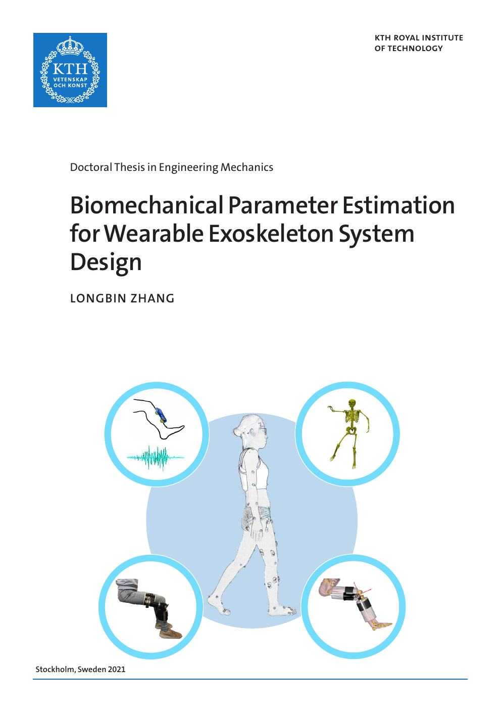

English text extracted from page 1

<pre>
kth royal institute
                                                   of technology

        Doctoral Thesis in Engineering Mechanics

        Biomechanical Parameter Estimation
        for Wearable Exoskeleton System
        Design
        LONGBIN ZHANG

Stockholm, Sweden 2021
</pre>

## Page 2

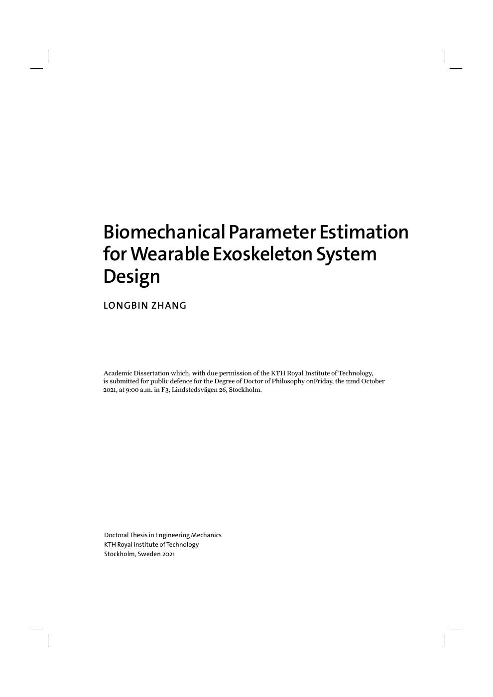

English text extracted from page 2

<pre>
Biomechanical Parameter Estimation
for Wearable Exoskeleton System
Design
LONGBIN ZHANG

Academic Dissertation which, with due permission of the KTH Royal Institute of Technology,
is submitted for public defence for the Degree of Doctor of Philosophy onFriday, the 22nd October
2021, at 9:00 a.m. in F3, Lindstedsvägen 26, Stockholm.

Doctoral Thesis in Engineering Mechanics
KTH Royal Institute of Technology
Stockholm, Sweden 2021
</pre>

## Page 3

English text extracted from page 3

<pre>
© Longbin Zhang

ISBN 978-91-8040-021-3
TRITA-SCI-FOU 2021:38

Printed by: Universitetsservice US-AB, Sweden 2021
</pre>

## Page 4

English text extracted from page 4

<pre>
To my parents

           iii
</pre>

## Page 5

English text extracted from page 5

<pre>
iv
</pre>

## Page 6

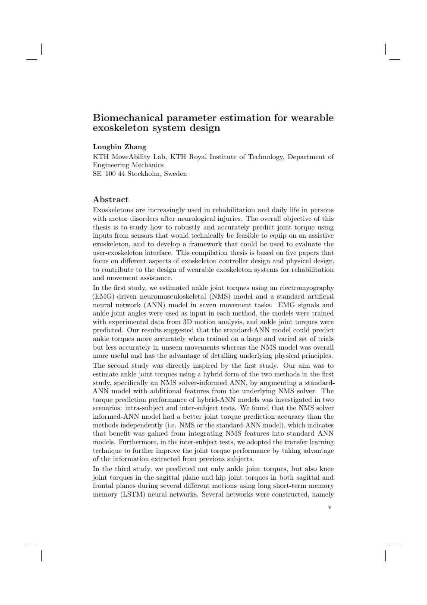

English text extracted from page 6

<pre>
Biomechanical parameter estimation for wearable
exoskeleton system design
Longbin Zhang
KTH MoveAbility Lab, KTH Royal Institute of Technology, Department of
Engineering Mechanics
SE–100 44 Stockholm, Sweden

Abstract
Exoskeletons are increasingly used in rehabilitation and daily life in persons
with motor disorders after neurological injuries. The overall objective of this
thesis is to study how to robustly and accurately predict joint torque using
inputs from sensors that would technically be feasible to equip on an assistive
exoskeleton, and to develop a framework that could be used to evaluate the
user-exoskeleton interface. This compilation thesis is based on five papers that
focus on different aspects of exoskeleton controller design and physical design,
to contribute to the design of wearable exoskeleton systems for rehabilitation
and movement assistance.
In the first study, we estimated ankle joint torques using an electromyography
(EMG)-driven neuromusculoskeletal (NMS) model and a standard artificial
neural network (ANN) model in seven movement tasks. EMG signals and
ankle joint angles were used as input in each method, the models were trained
with experimental data from 3D motion analysis, and ankle joint torques were
predicted. Our results suggested that the standard-ANN model could predict
ankle torques more accurately when trained on a large and varied set of trials
but less accurately in unseen movements whereas the NMS model was overall
more useful and has the advantage of detailing underlying physical principles.
The second study was directly inspired by the first study. Our aim was to
estimate ankle joint torques using a hybrid form of the two methods in the first
study, specifically an NMS solver-informed ANN, by augmenting a standard-
ANN model with additional features from the underlying NMS solver. The
torque prediction performance of hybrid-ANN models was investigated in two
scenarios: intra-subject and inter-subject tests. We found that the NMS solver
informed-ANN model had a better joint torque prediction accuracy than the
methods independently (i.e. NMS or the standard-ANN model), which indicates
that benefit was gained from integrating NMS features into standard ANN
models. Furthermore, in the inter-subject tests, we adopted the transfer learning
technique to further improve the joint torque performance by taking advantage
of the information extracted from previous subjects.
In the third study, we predicted not only ankle joint torques, but also knee
joint torques in the sagittal plane and hip joint torques in both sagittal and
frontal planes during several different motions using long short-term memory
memory (LSTM) neural networks. Several networks were constructed, namely
                                                                              v
</pre>

## Page 7

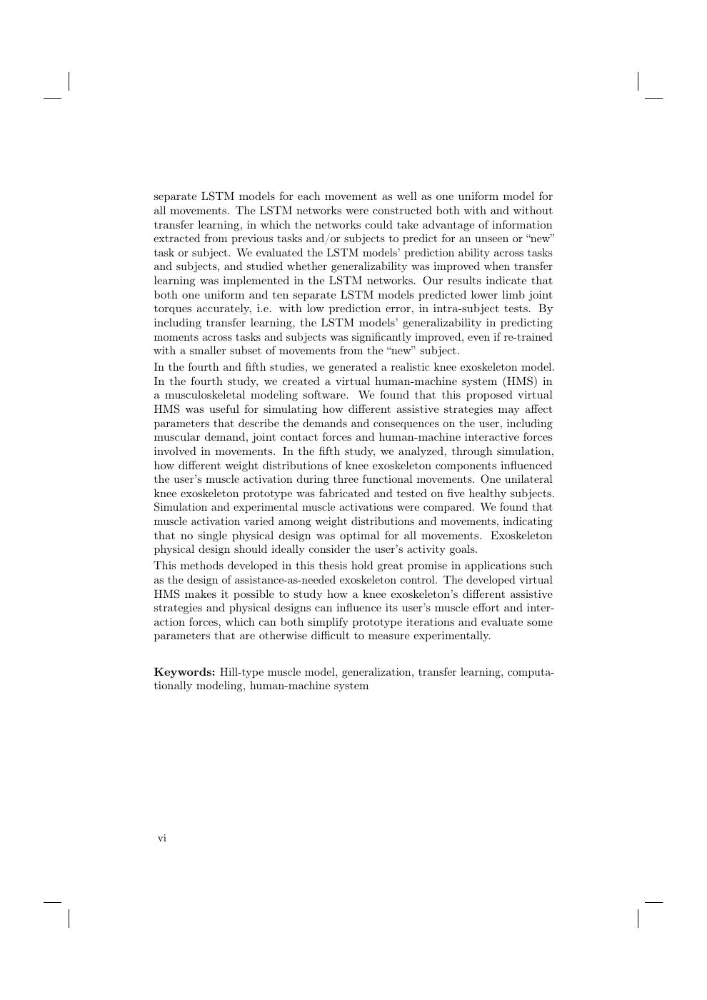

English text extracted from page 7

<pre>
separate LSTM models for each movement as well as one uniform model for
all movements. The LSTM networks were constructed both with and without
transfer learning, in which the networks could take advantage of information
extracted from previous tasks and/or subjects to predict for an unseen or “new”
task or subject. We evaluated the LSTM models’ prediction ability across tasks
and subjects, and studied whether generalizability was improved when transfer
learning was implemented in the LSTM networks. Our results indicate that
both one uniform and ten separate LSTM models predicted lower limb joint
torques accurately, i.e. with low prediction error, in intra-subject tests. By
including transfer learning, the LSTM models’ generalizability in predicting
moments across tasks and subjects was significantly improved, even if re-trained
with a smaller subset of movements from the “new” subject.
In the fourth and fifth studies, we generated a realistic knee exoskeleton model.
In the fourth study, we created a virtual human-machine system (HMS) in
a musculoskeletal modeling software. We found that this proposed virtual
HMS was useful for simulating how different assistive strategies may affect
parameters that describe the demands and consequences on the user, including
muscular demand, joint contact forces and human-machine interactive forces
involved in movements. In the fifth study, we analyzed, through simulation,
how different weight distributions of knee exoskeleton components influenced
the user’s muscle activation during three functional movements. One unilateral
knee exoskeleton prototype was fabricated and tested on five healthy subjects.
Simulation and experimental muscle activations were compared. We found that
muscle activation varied among weight distributions and movements, indicating
that no single physical design was optimal for all movements. Exoskeleton
physical design should ideally consider the user’s activity goals.
This methods developed in this thesis hold great promise in applications such
as the design of assistance-as-needed exoskeleton control. The developed virtual
HMS makes it possible to study how a knee exoskeleton’s different assistive
strategies and physical designs can influence its user’s muscle effort and inter-
action forces, which can both simplify prototype iterations and evaluate some
parameters that are otherwise difficult to measure experimentally.

Keywords: Hill-type muscle model, generalization, transfer learning, computa-
tionally modeling, human-machine system

vi
</pre>

## Page 8

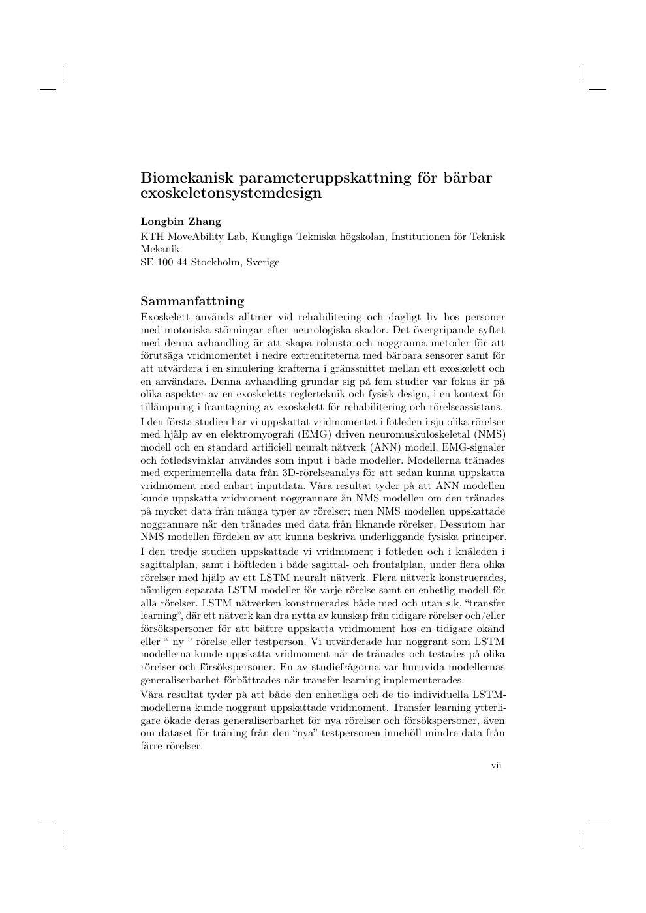

English text extracted from page 8

<pre>
Biomekanisk parameteruppskattning för bärbar
exoskeletonsystemdesign
Longbin Zhang
KTH MoveAbility Lab, Kungliga Tekniska högskolan, Institutionen för Teknisk
Mekanik
SE-100 44 Stockholm, Sverige

Sammanfattning
Exoskelett används alltmer vid rehabilitering och dagligt liv hos personer
med motoriska störningar efter neurologiska skador. Det övergripande syftet
med denna avhandling är att skapa robusta och noggranna metoder för att
förutsäga vridmomentet i nedre extremiteterna med bärbara sensorer samt för
att utvärdera i en simulering krafterna i gränssnittet mellan ett exoskelett och
en användare. Denna avhandling grundar sig på fem studier var fokus är på
olika aspekter av en exoskeletts reglerteknik och fysisk design, i en kontext för
tillämpning i framtagning av exoskelett för rehabilitering och rörelseassistans.
I den första studien har vi uppskattat vridmomentet i fotleden i sju olika rörelser
med hjälp av en elektromyografi (EMG) driven neuromuskuloskeletal (NMS)
modell och en standard artificiell neuralt nätverk (ANN) modell. EMG-signaler
och fotledsvinklar användes som input i både modeller. Modellerna tränades
med experimentella data från 3D-rörelseanalys för att sedan kunna uppskatta
vridmoment med enbart inputdata. Våra resultat tyder på att ANN modellen
kunde uppskatta vridmoment noggrannare än NMS modellen om den tränades
på mycket data från många typer av rörelser; men NMS modellen uppskattade
noggrannare när den tränades med data från liknande rörelser. Dessutom har
NMS modellen fördelen av att kunna beskriva underliggande fysiska principer.
I den tredje studien uppskattade vi vridmoment i fotleden och i knäleden i
sagittalplan, samt i höftleden i både sagittal- och frontalplan, under flera olika
rörelser med hjälp av ett LSTM neuralt nätverk. Flera nätverk konstruerades,
nämligen separata LSTM modeller för varje rörelse samt en enhetlig modell för
alla rörelser. LSTM nätverken konstruerades både med och utan s.k. “transfer
learning”, där ett nätverk kan dra nytta av kunskap från tidigare rörelser och/eller
försökspersoner för att bättre uppskatta vridmoment hos en tidigare okänd
eller “ ny ” rörelse eller testperson. Vi utvärderade hur noggrant som LSTM
modellerna kunde uppskatta vridmoment när de tränades och testades på olika
rörelser och försökspersoner. En av studiefrågorna var huruvida modellernas
generaliserbarhet förbättrades när transfer learning implementerades.
Våra resultat tyder på att både den enhetliga och de tio individuella LSTM-
modellerna kunde noggrant uppskattade vridmoment. Transfer learning ytterli-
gare ökade deras generaliserbarhet för nya rörelser och försökspersoner, även
om dataset för träning från den “nya” testpersonen innehöll mindre data från
färre rörelser.
                                                                                vii
</pre>

## Page 9

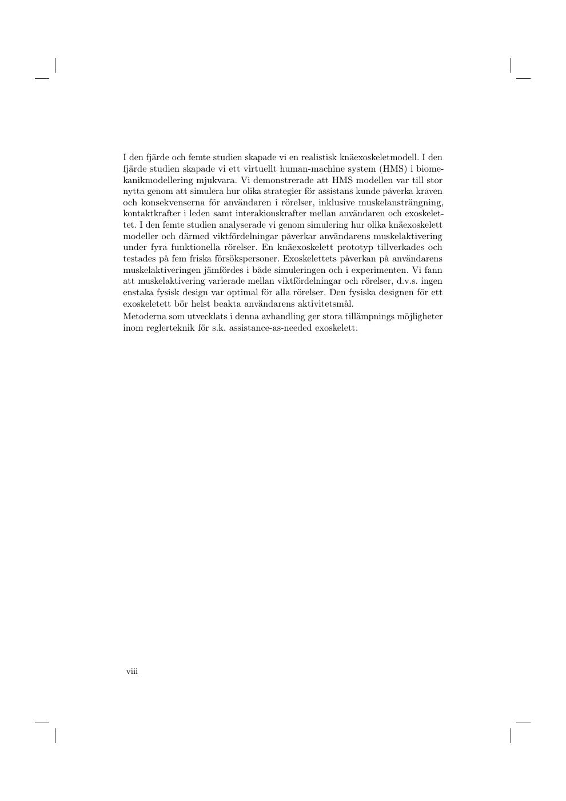

English text extracted from page 9

<pre>
I den fjärde och femte studien skapade vi en realistisk knäexoskeletmodell. I den
fjärde studien skapade vi ett virtuellt human-machine system (HMS) i biome-
kanikmodellering mjukvara. Vi demonstrerade att HMS modellen var till stor
nytta genom att simulera hur olika strategier för assistans kunde påverka kraven
och konsekvenserna för användaren i rörelser, inklusive muskelansträngning,
kontaktkrafter i leden samt interakionskrafter mellan användaren och exoskelet-
tet. I den femte studien analyserade vi genom simulering hur olika knäexoskelett
modeller och därmed viktfördelningar påverkar användarens muskelaktivering
under fyra funktionella rörelser. En knäexoskelett prototyp tillverkades och
testades på fem friska försökspersoner. Exoskelettets påverkan på användarens
muskelaktiveringen jämfördes i både simuleringen och i experimenten. Vi fann
att muskelaktivering varierade mellan viktfördelningar och rörelser, d.v.s. ingen
enstaka fysisk design var optimal för alla rörelser. Den fysiska designen för ett
exoskeletett bör helst beakta användarens aktivitetsmål.
Metoderna som utvecklats i denna avhandling ger stora tillämpnings möjligheter
inom reglerteknik för s.k. assistance-as-needed exoskelett.

viii
</pre>

## Page 10

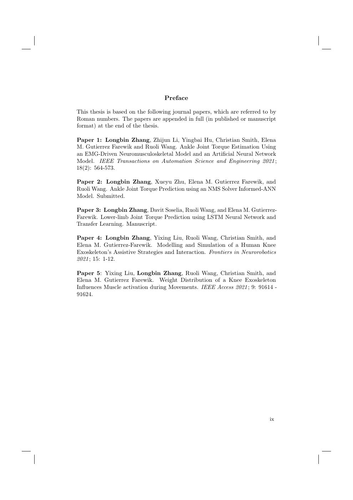

English text extracted from page 10

<pre>
Preface

This thesis is based on the following journal papers, which are referred to by
Roman numbers. The papers are appended in full (in published or manuscript
format) at the end of the thesis.

Paper 1: Longbin Zhang, Zhijun Li, Yingbai Hu, Christian Smith, Elena
M. Gutierrez Farewik and Ruoli Wang. Ankle Joint Torque Estimation Using
an EMG-Driven Neuromusculoskeletal Model and an Artificial Neural Network
Model. IEEE Transactions on Automation Science and Engineering 2021 ;
18(2): 564-573.

Paper 2: Longbin Zhang, Xueyu Zhu, Elena M. Gutierrez Farewik, and
Ruoli Wang. Ankle Joint Torque Prediction using an NMS Solver Informed-ANN
Model. Submitted.

Paper 3: Longbin Zhang, Davit Soselia, Ruoli Wang, and Elena M. Gutierrez-
Farewik. Lower-limb Joint Torque Prediction using LSTM Neural Network and
Transfer Learning. Manuscript.

Paper 4: Longbin Zhang, Yixing Liu, Ruoli Wang, Christian Smith, and
Elena M. Gutierrez-Farewik. Modelling and Simulation of a Human Knee
Exoskeleton’s Assistive Strategies and Interaction. Frontiers in Neurorobotics
2021 ; 15: 1-12.

Paper 5: Yixing Liu, Longbin Zhang, Ruoli Wang, Christian Smith, and
Elena M. Gutierrez Farewik. Weight Distribution of a Knee Exoskeleton
Influences Muscle activation during Movements. IEEE Access 2021 ; 9: 91614 -
91624.

                                                                           ix
</pre>

## Page 11

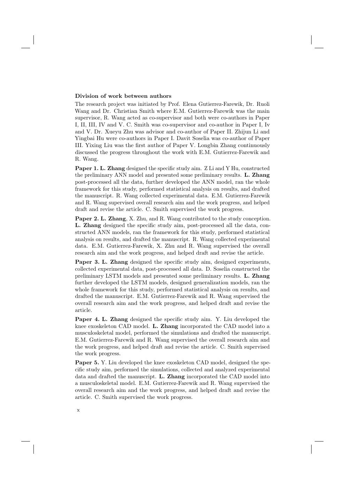

English text extracted from page 11

<pre>
Division of work between authors
The research project was initiated by Prof. Elena Gutierrez-Farewik, Dr. Ruoli
Wang and Dr. Christian Smith where E.M. Gutierrez-Farewik was the main
supervisor, R. Wang acted as co-supervisor and both were co-authors in Paper
I, II, III, IV and V. C. Smith was co-supervisor and co-author in Paper I, Iv
and V. Dr. Xueyu Zhu was advisor and co-author of Paper II. Zhijun Li and
Yingbai Hu were co-authors in Paper I. Davit Soselia was co-author of Paper
III. Yixing Liu was the first author of Paper V. Longbin Zhang continuously
discussed the progress throughout the work with E.M. Gutierrez-Farewik and
R. Wang.
Paper 1. L. Zhang designed the specific study aim. Z Li and Y Hu, constructed
the preliminary ANN model and presented some preliminary results. L. Zhang
post-processed all the data, further developed the ANN model, ran the whole
framework for this study, performed statistical analysis on results, and drafted
the manuscript. R. Wang collected experimental data. E.M. Gutierrez-Farewik
and R. Wang supervised overall research aim and the work progress, and helped
draft and revise the article. C. Smith supervised the work progress.
Paper 2. L. Zhang, X. Zhu, and R. Wang contributed to the study conception.
L. Zhang designed the specific study aim, post-processed all the data, con-
structed ANN models, ran the framework for this study, performed statistical
analysis on results, and drafted the manuscript. R. Wang collected experimental
data. E.M. Gutierrez-Farewik, X. Zhu and R. Wang supervised the overall
research aim and the work progress, and helped draft and revise the article.
Paper 3. L. Zhang designed the specific study aim, designed experiments,
collected experimental data, post-processed all data. D. Soselia constructed the
preliminary LSTM models and presented some preliminary results. L. Zhang
further developed the LSTM models, designed generalization models, ran the
whole framework for this study, performed statistical analysis on results, and
drafted the manuscript. E.M. Gutierrez-Farewik and R. Wang supervised the
overall research aim and the work progress, and helped draft and revise the
article.
Paper 4. L. Zhang designed the specific study aim. Y. Liu developed the
knee exoskeleton CAD model. L. Zhang incorporated the CAD model into a
musculoskeletal model, performed the simulations and drafted the manuscript.
E.M. Gutierrez-Farewik and R. Wang supervised the overall research aim and
the work progress, and helped draft and revise the article. C. Smith supervised
the work progress.
Paper 5. Y. Liu developed the knee exoskeleton CAD model, designed the spe-
cific study aim, performed the simulations, collected and analyzed experimental
data and drafted the manuscript. L. Zhang incorporated the CAD model into
a musculoskeletal model. E.M. Gutierrez-Farewik and R. Wang supervised the
overall research aim and the work progress, and helped draft and revise the
article. C. Smith supervised the work progress.

x
</pre>

## Page 12

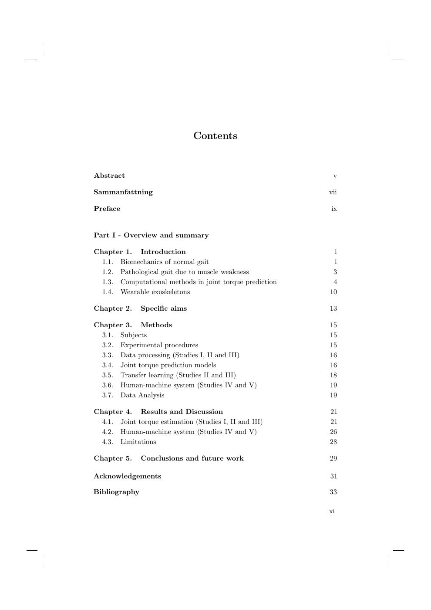

English text extracted from page 12

<pre>
Contents

Abstract                                                   v

Sammanfattning                                            vii

Preface                                                   ix

Part I - Overview and summary

Chapter 1. Introduction                                    1
  1.1. Biomechanics of normal gait                         1
  1.2. Pathological gait due to muscle weakness            3
  1.3. Computational methods in joint torque prediction    4
  1.4. Wearable exoskeletons                              10

Chapter 2.     Specific aims                              13

Chapter 3. Methods                                        15
  3.1. Subjects                                           15
  3.2. Experimental procedures                            15
  3.3. Data processing (Studies I, II and III)            16
  3.4. Joint torque prediction models                     16
  3.5. Transfer learning (Studies II and III)             18
  3.6. Human-machine system (Studies IV and V)            19
  3.7. Data Analysis                                      19

Chapter 4. Results and Discussion                         21
  4.1. Joint torque estimation (Studies I, II and III)    21
  4.2. Human-machine system (Studies IV and V)            26
  4.3. Limitations                                        28

Chapter 5.     Conclusions and future work                29

Acknowledgements                                          31

Bibliography                                              33

                                                          xi
</pre>

## Page 13

English text extracted from page 13

<pre>
[No extractable text on this page; see the embedded page image.]
</pre>

## Page 14

English text extracted from page 14

<pre>
Part I

Overview and summary
</pre>

## Page 15

English text extracted from page 15

<pre>
[No extractable text on this page; see the embedded page image.]
</pre>

## Page 16

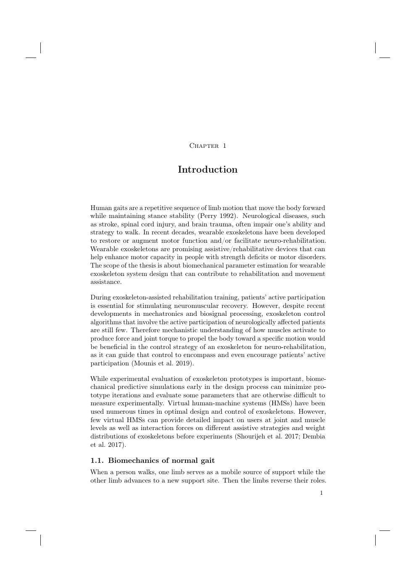

English text extracted from page 16

<pre>
Chapter 1

                               Introduction

Human gaits are a repetitive sequence of limb motion that move the body forward
while maintaining stance stability (Perry 1992). Neurological diseases, such
as stroke, spinal cord injury, and brain trauma, often impair one’s ability and
strategy to walk. In recent decades, wearable exoskeletons have been developed
to restore or augment motor function and/or facilitate neuro-rehabilitation.
Wearable exoskeletons are promising assistive/rehabilitative devices that can
help enhance motor capacity in people with strength deficits or motor disorders.
The scope of the thesis is about biomechanical parameter estimation for wearable
exoskeleton system design that can contribute to rehabilitation and movement
assistance.

During exoskeleton-assisted rehabilitation training, patients’ active participation
is essential for stimulating neuromuscular recovery. However, despite recent
developments in mechatronics and biosignal processing, exoskeleton control
algorithms that involve the active participation of neurologically affected patients
are still few. Therefore mechanistic understanding of how muscles activate to
produce force and joint torque to propel the body toward a specific motion would
be beneficial in the control strategy of an exoskeleton for neuro-rehabilitation,
as it can guide that control to encompass and even encourage patients’ active
participation (Mounis et al. 2019).

While experimental evaluation of exoskeleton prototypes is important, biome-
chanical predictive simulations early in the design process can minimize pro-
totype iterations and evaluate some parameters that are otherwise difficult to
measure experimentally. Virtual human-machine systems (HMSs) have been
used numerous times in optimal design and control of exoskeletons. However,
few virtual HMSs can provide detailed impact on users at joint and muscle
levels as well as interaction forces on different assistive strategies and weight
distributions of exoskeletons before experiments (Shourijeh et al. 2017; Dembia
et al. 2017).

1.1. Biomechanics of normal gait
When a person walks, one limb serves as a mobile source of support while the
other limb advances to a new support site. Then the limbs reverse their roles.
                                                                                 1
</pre>

## Page 17

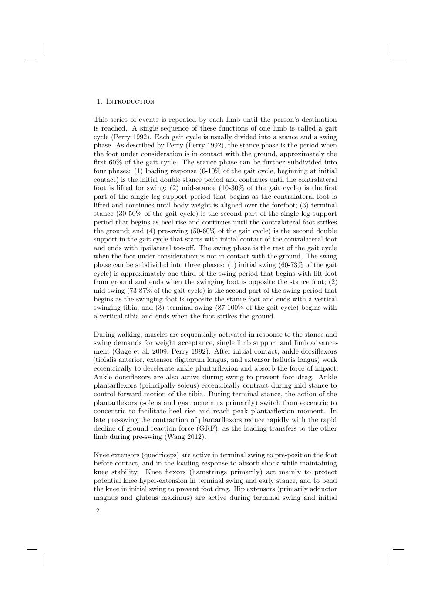

English text extracted from page 17

<pre>
1. Introduction

This series of events is repeated by each limb until the person’s destination
is reached. A single sequence of these functions of one limb is called a gait
cycle (Perry 1992). Each gait cycle is usually divided into a stance and a swing
phase. As described by Perry (Perry 1992), the stance phase is the period when
the foot under consideration is in contact with the ground, approximately the
first 60% of the gait cycle. The stance phase can be further subdivided into
four phases: (1) loading response (0-10% of the gait cycle, beginning at initial
contact) is the initial double stance period and continues until the contralateral
foot is lifted for swing; (2) mid-stance (10-30% of the gait cycle) is the first
part of the single-leg support period that begins as the contralateral foot is
lifted and continues until body weight is aligned over the forefoot; (3) terminal
stance (30-50% of the gait cycle) is the second part of the single-leg support
period that begins as heel rise and continues until the contralateral foot strikes
the ground; and (4) pre-swing (50-60% of the gait cycle) is the second double
support in the gait cycle that starts with initial contact of the contralateral foot
and ends with ipsilateral toe-off. The swing phase is the rest of the gait cycle
when the foot under consideration is not in contact with the ground. The swing
phase can be subdivided into three phases: (1) initial swing (60-73% of the gait
cycle) is approximately one-third of the swing period that begins with lift foot
from ground and ends when the swinging foot is opposite the stance foot; (2)
mid-swing (73-87% of the gait cycle) is the second part of the swing period that
begins as the swinging foot is opposite the stance foot and ends with a vertical
swinging tibia; and (3) terminal-swing (87-100% of the gait cycle) begins with
a vertical tibia and ends when the foot strikes the ground.

During walking, muscles are sequentially activated in response to the stance and
swing demands for weight acceptance, single limb support and limb advance-
ment (Gage et al. 2009; Perry 1992). After initial contact, ankle dorsiflexors
(tibialis anterior, extensor digitorum longus, and extensor hallucis longus) work
eccentrically to decelerate ankle plantarflexion and absorb the force of impact.
Ankle dorsiflexors are also active during swing to prevent foot drag. Ankle
plantarflexors (principally soleus) eccentrically contract during mid-stance to
control forward motion of the tibia. During terminal stance, the action of the
plantarflexors (soleus and gastrocnemius primarily) switch from eccentric to
concentric to facilitate heel rise and reach peak plantarflexion moment. In
late pre-swing the contraction of plantarflexors reduce rapidly with the rapid
decline of ground reaction force (GRF), as the loading transfers to the other
limb during pre-swing (Wang 2012).

Knee extensors (quadriceps) are active in terminal swing to pre-position the foot
before contact, and in the loading response to absorb shock while maintaining
knee stability. Knee flexors (hamstrings primarily) act mainly to protect
potential knee hyper-extension in terminal swing and early stance, and to bend
the knee in initial swing to prevent foot drag. Hip extensors (primarily adductor
magnus and gluteus maximus) are active during terminal swing and initial
 2
</pre>

## Page 18

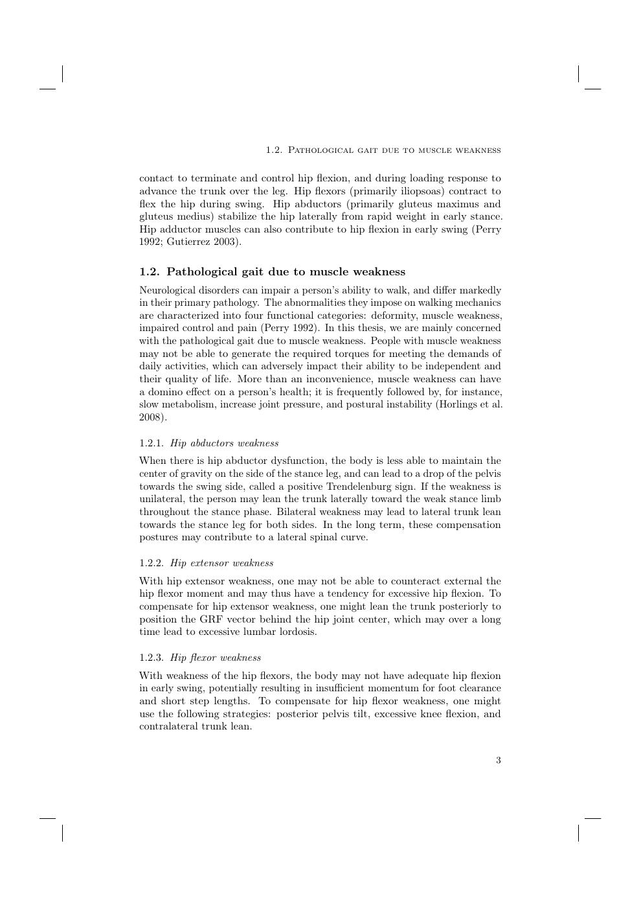

English text extracted from page 18

<pre>
1.2. Pathological gait due to muscle weakness

contact to terminate and control hip flexion, and during loading response to
advance the trunk over the leg. Hip flexors (primarily iliopsoas) contract to
flex the hip during swing. Hip abductors (primarily gluteus maximus and
gluteus medius) stabilize the hip laterally from rapid weight in early stance.
Hip adductor muscles can also contribute to hip flexion in early swing (Perry
1992; Gutierrez 2003).

1.2. Pathological gait due to muscle weakness
Neurological disorders can impair a person’s ability to walk, and differ markedly
in their primary pathology. The abnormalities they impose on walking mechanics
are characterized into four functional categories: deformity, muscle weakness,
impaired control and pain (Perry 1992). In this thesis, we are mainly concerned
with the pathological gait due to muscle weakness. People with muscle weakness
may not be able to generate the required torques for meeting the demands of
daily activities, which can adversely impact their ability to be independent and
their quality of life. More than an inconvenience, muscle weakness can have
a domino effect on a person’s health; it is frequently followed by, for instance,
slow metabolism, increase joint pressure, and postural instability (Horlings et al.
2008).

1.2.1. Hip abductors weakness
When there is hip abductor dysfunction, the body is less able to maintain the
center of gravity on the side of the stance leg, and can lead to a drop of the pelvis
towards the swing side, called a positive Trendelenburg sign. If the weakness is
unilateral, the person may lean the trunk laterally toward the weak stance limb
throughout the stance phase. Bilateral weakness may lead to lateral trunk lean
towards the stance leg for both sides. In the long term, these compensation
postures may contribute to a lateral spinal curve.

1.2.2. Hip extensor weakness
With hip extensor weakness, one may not be able to counteract external the
hip flexor moment and may thus have a tendency for excessive hip flexion. To
compensate for hip extensor weakness, one might lean the trunk posteriorly to
position the GRF vector behind the hip joint center, which may over a long
time lead to excessive lumbar lordosis.

1.2.3. Hip flexor weakness
With weakness of the hip flexors, the body may not have adequate hip flexion
in early swing, potentially resulting in insufficient momentum for foot clearance
and short step lengths. To compensate for hip flexor weakness, one might
use the following strategies: posterior pelvis tilt, excessive knee flexion, and
contralateral trunk lean.

                                                                                   3
</pre>

## Page 19

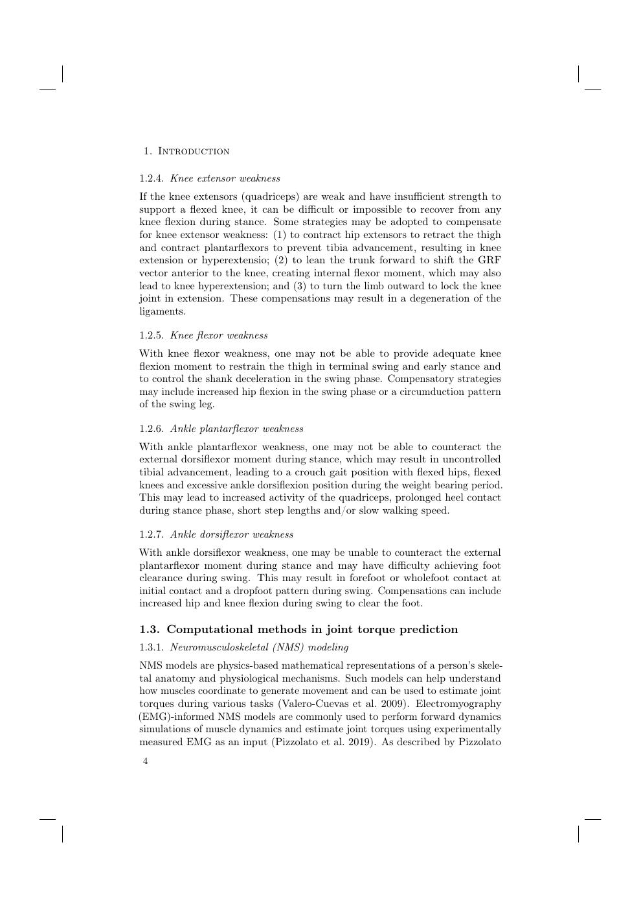

English text extracted from page 19

<pre>
1. Introduction

1.2.4. Knee extensor weakness
If the knee extensors (quadriceps) are weak and have insufficient strength to
support a flexed knee, it can be difficult or impossible to recover from any
knee flexion during stance. Some strategies may be adopted to compensate
for knee extensor weakness: (1) to contract hip extensors to retract the thigh
and contract plantarflexors to prevent tibia advancement, resulting in knee
extension or hyperextensio; (2) to lean the trunk forward to shift the GRF
vector anterior to the knee, creating internal flexor moment, which may also
lead to knee hyperextension; and (3) to turn the limb outward to lock the knee
joint in extension. These compensations may result in a degeneration of the
ligaments.

1.2.5. Knee flexor weakness
With knee flexor weakness, one may not be able to provide adequate knee
flexion moment to restrain the thigh in terminal swing and early stance and
to control the shank deceleration in the swing phase. Compensatory strategies
may include increased hip flexion in the swing phase or a circumduction pattern
of the swing leg.

1.2.6. Ankle plantarflexor weakness
With ankle plantarflexor weakness, one may not be able to counteract the
external dorsiflexor moment during stance, which may result in uncontrolled
tibial advancement, leading to a crouch gait position with flexed hips, flexed
knees and excessive ankle dorsiflexion position during the weight bearing period.
This may lead to increased activity of the quadriceps, prolonged heel contact
during stance phase, short step lengths and/or slow walking speed.

1.2.7. Ankle dorsiflexor weakness
With ankle dorsiflexor weakness, one may be unable to counteract the external
plantarflexor moment during stance and may have difficulty achieving foot
clearance during swing. This may result in forefoot or wholefoot contact at
initial contact and a dropfoot pattern during swing. Compensations can include
increased hip and knee flexion during swing to clear the foot.

1.3. Computational methods in joint torque prediction
1.3.1. Neuromusculoskeletal (NMS) modeling
NMS models are physics-based mathematical representations of a person’s skele-
tal anatomy and physiological mechanisms. Such models can help understand
how muscles coordinate to generate movement and can be used to estimate joint
torques during various tasks (Valero-Cuevas et al. 2009). Electromyography
(EMG)-informed NMS models are commonly used to perform forward dynamics
simulations of muscle dynamics and estimate joint torques using experimentally
measured EMG as an input (Pizzolato et al. 2019). As described by Pizzolato
 4
</pre>

## Page 20

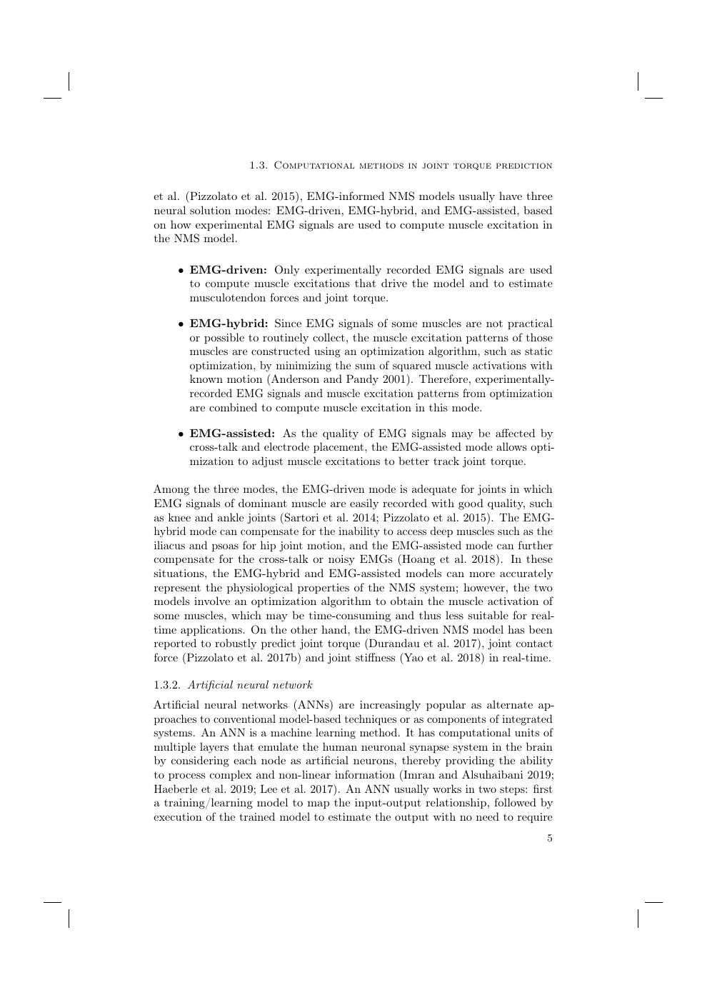

English text extracted from page 20

<pre>
1.3. Computational methods in joint torque prediction

et al. (Pizzolato et al. 2015), EMG-informed NMS models usually have three
neural solution modes: EMG-driven, EMG-hybrid, and EMG-assisted, based
on how experimental EMG signals are used to compute muscle excitation in
the NMS model.

     • EMG-driven: Only experimentally recorded EMG signals are used
       to compute muscle excitations that drive the model and to estimate
       musculotendon forces and joint torque.

     • EMG-hybrid: Since EMG signals of some muscles are not practical
       or possible to routinely collect, the muscle excitation patterns of those
       muscles are constructed using an optimization algorithm, such as static
       optimization, by minimizing the sum of squared muscle activations with
       known motion (Anderson and Pandy 2001). Therefore, experimentally-
       recorded EMG signals and muscle excitation patterns from optimization
       are combined to compute muscle excitation in this mode.

     • EMG-assisted: As the quality of EMG signals may be affected by
       cross-talk and electrode placement, the EMG-assisted mode allows opti-
       mization to adjust muscle excitations to better track joint torque.

Among the three modes, the EMG-driven mode is adequate for joints in which
EMG signals of dominant muscle are easily recorded with good quality, such
as knee and ankle joints (Sartori et al. 2014; Pizzolato et al. 2015). The EMG-
hybrid mode can compensate for the inability to access deep muscles such as the
iliacus and psoas for hip joint motion, and the EMG-assisted mode can further
compensate for the cross-talk or noisy EMGs (Hoang et al. 2018). In these
situations, the EMG-hybrid and EMG-assisted models can more accurately
represent the physiological properties of the NMS system; however, the two
models involve an optimization algorithm to obtain the muscle activation of
some muscles, which may be time-consuming and thus less suitable for real-
time applications. On the other hand, the EMG-driven NMS model has been
reported to robustly predict joint torque (Durandau et al. 2017), joint contact
force (Pizzolato et al. 2017b) and joint stiffness (Yao et al. 2018) in real-time.

1.3.2. Artificial neural network
Artificial neural networks (ANNs) are increasingly popular as alternate ap-
proaches to conventional model-based techniques or as components of integrated
systems. An ANN is a machine learning method. It has computational units of
multiple layers that emulate the human neuronal synapse system in the brain
by considering each node as artificial neurons, thereby providing the ability
to process complex and non-linear information (Imran and Alsuhaibani 2019;
Haeberle et al. 2019; Lee et al. 2017). An ANN usually works in two steps: first
a training/learning model to map the input-output relationship, followed by
execution of the trained model to estimate the output with no need to require
                                                                                5
</pre>

## Page 21

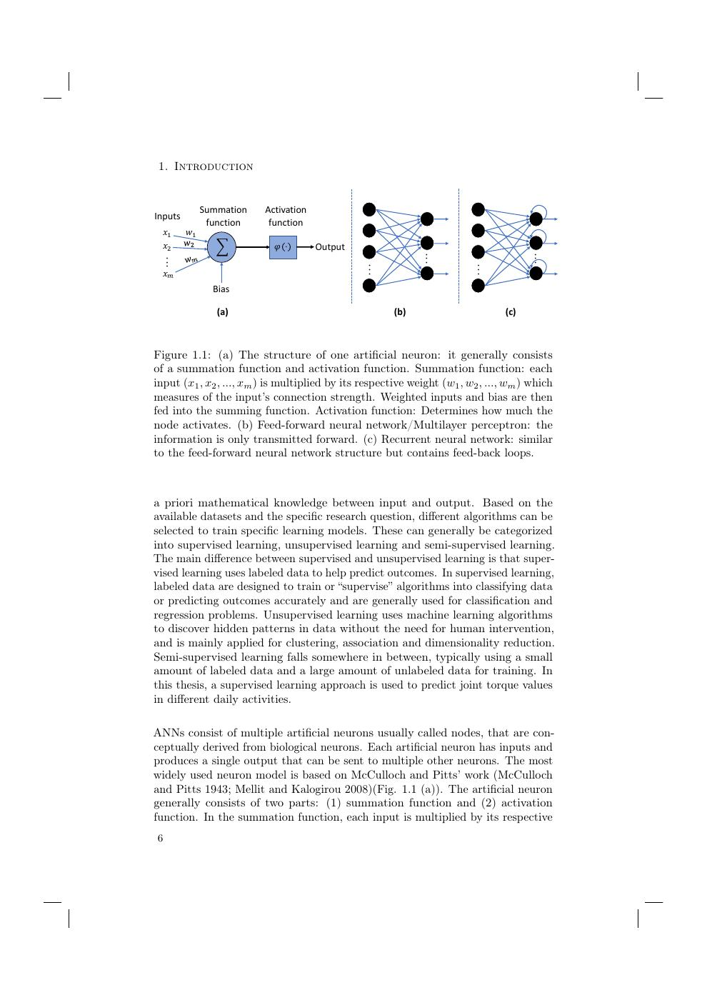

English text extracted from page 21

<pre>
1. Introduction

               Summation   Activation
Inputs
                function    function
  𝑥1      𝑤1
  𝑥2              ෍          𝜑 ⋅        Output
    ...                                                       ...                      ...
  𝑥𝑚                                             ...                      ...

                 Bias

                  (a)                                  (b)                       (c)

Figure 1.1: (a) The structure of one artificial neuron: it generally consists
of a summation function and activation function. Summation function: each
input (x1 , x2 , ..., xm ) is multiplied by its respective weight (w1 , w2 , ..., wm ) which
measures of the input’s connection strength. Weighted inputs and bias are then
fed into the summing function. Activation function: Determines how much the
node activates. (b) Feed-forward neural network/Multilayer perceptron: the
information is only transmitted forward. (c) Recurrent neural network: similar
to the feed-forward neural network structure but contains feed-back loops.

a priori mathematical knowledge between input and output. Based on the
available datasets and the specific research question, different algorithms can be
selected to train specific learning models. These can generally be categorized
into supervised learning, unsupervised learning and semi-supervised learning.
The main difference between supervised and unsupervised learning is that super-
vised learning uses labeled data to help predict outcomes. In supervised learning,
labeled data are designed to train or “supervise” algorithms into classifying data
or predicting outcomes accurately and are generally used for classification and
regression problems. Unsupervised learning uses machine learning algorithms
to discover hidden patterns in data without the need for human intervention,
and is mainly applied for clustering, association and dimensionality reduction.
Semi-supervised learning falls somewhere in between, typically using a small
amount of labeled data and a large amount of unlabeled data for training. In
this thesis, a supervised learning approach is used to predict joint torque values
in different daily activities.

ANNs consist of multiple artificial neurons usually called nodes, that are con-
ceptually derived from biological neurons. Each artificial neuron has inputs and
produces a single output that can be sent to multiple other neurons. The most
widely used neuron model is based on McCulloch and Pitts’ work (McCulloch
and Pitts 1943; Mellit and Kalogirou 2008)(Fig. 1.1 (a)). The artificial neuron
generally consists of two parts: (1) summation function and (2) activation
function. In the summation function, each input is multiplied by its respective
6
</pre>

## Page 22

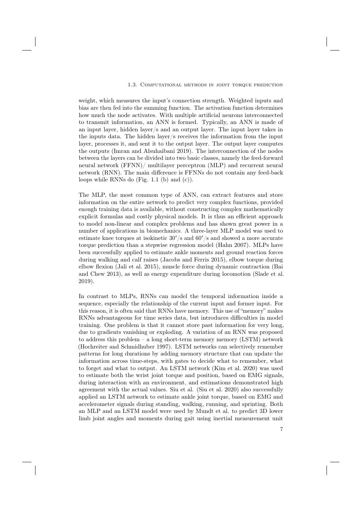

English text extracted from page 22

<pre>
1.3. Computational methods in joint torque prediction

weight, which measures the input’s connection strength. Weighted inputs and
bias are then fed into the summing function. The activation function determines
how much the node activates. With multiple artificial neurons interconnected
to transmit information, an ANN is formed. Typically, an ANN is made of
an input layer, hidden layer/s and an output layer. The input layer takes in
the inputs data. The hidden layer/s receives the information from the input
layer, processes it, and sent it to the output layer. The output layer computes
the outputs (Imran and Alsuhaibani 2019). The interconnection of the nodes
between the layers can be divided into two basic classes, namely the feed-forward
neural network (FFNN)/ multilayer perceptron (MLP) and recurrent neural
network (RNN). The main difference is FFNNs do not contain any feed-back
loops while RNNs do (Fig. 1.1 (b) and (c)).

The MLP, the most common type of ANN, can extract features and store
information on the entire network to predict very complex functions, provided
enough training data is available, without constructing complex mathematically
explicit formulas and costly physical models. It is thus an efficient approach
to model non-linear and complex problems and has shown great power in a
number of applications in biomechanics. A three-layer MLP model was used to
estimate knee torques at isokinetic 30°/s and 60°/s and showed a more accurate
torque prediction than a stepwise regression model (Hahn 2007). MLPs have
been successfully applied to estimate ankle moments and ground reaction forces
during walking and calf raises (Jacobs and Ferris 2015), elbow torque during
elbow flexion (Jali et al. 2015), muscle force during dynamic contraction (Bai
and Chew 2013), as well as energy expenditure during locomotion (Slade et al.
2019).

In contrast to MLPs, RNNs can model the temporal information inside a
sequence, especially the relationship of the current input and former input. For
this reason, it is often said that RNNs have memory. This use of “memory” makes
RNNs advantageous for time series data, but introduces difficulties in model
training. One problem is that it cannot store past information for very long,
due to gradients vanishing or exploding. A variation of an RNN was proposed
to address this problem – a long short-term memory memory (LSTM) network
(Hochreiter and Schmidhuber 1997). LSTM networks can selectively remember
patterns for long durations by adding memory structure that can update the
information across time-steps, with gates to decide what to remember, what
to forget and what to output. An LSTM network (Kim et al. 2020) was used
to estimate both the wrist joint torque and position, based on EMG signals,
during interaction with an environment, and estimations demonstrated high
agreement with the actual values. Siu et al. (Siu et al. 2020) also successfully
applied an LSTM network to estimate ankle joint torque, based on EMG and
accelerometer signals during standing, walking, running, and sprinting. Both
an MLP and an LSTM model were used by Mundt et al. to predict 3D lower
limb joint angles and moments during gait using inertial measurement unit
                                                                               7
</pre>

## Page 23

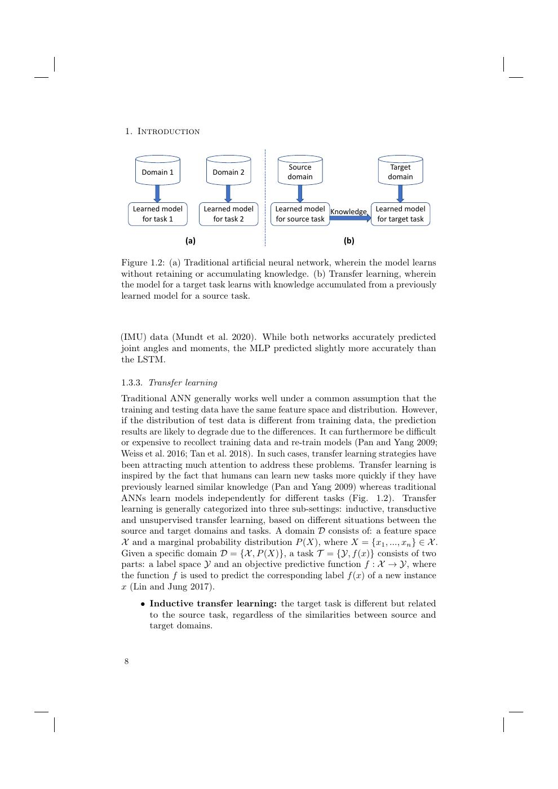

English text extracted from page 23

<pre>
1. Introduction

                                             Source                     Target
      Domain 1              Domain 2
                                             domain                    domain

    Learned model         Learned model   Learned model Knowledge   Learned model
       for task 1            for task 2   for source task           for target task

                    (a)                                    (b)

Figure 1.2: (a) Traditional artificial neural network, wherein the model learns
without retaining or accumulating knowledge. (b) Transfer learning, wherein
the model for a target task learns with knowledge accumulated from a previously
learned model for a source task.

(IMU) data (Mundt et al. 2020). While both networks accurately predicted
joint angles and moments, the MLP predicted slightly more accurately than
the LSTM.

1.3.3. Transfer learning
Traditional ANN generally works well under a common assumption that the
training and testing data have the same feature space and distribution. However,
if the distribution of test data is different from training data, the prediction
results are likely to degrade due to the differences. It can furthermore be difficult
or expensive to recollect training data and re-train models (Pan and Yang 2009;
Weiss et al. 2016; Tan et al. 2018). In such cases, transfer learning strategies have
been attracting much attention to address these problems. Transfer learning is
inspired by the fact that humans can learn new tasks more quickly if they have
previously learned similar knowledge (Pan and Yang 2009) whereas traditional
ANNs learn models independently for different tasks (Fig. 1.2). Transfer
learning is generally categorized into three sub-settings: inductive, transductive
and unsupervised transfer learning, based on different situations between the
source and target domains and tasks. A domain D consists of: a feature space
X and a marginal probability distribution P (X), where X = {x1 , ..., xn } ∈ X .
Given a specific domain D = {X , P (X)}, a task T = {Y, f (x)} consists of two
parts: a label space Y and an objective predictive function f : X → Y, where
the function f is used to predict the corresponding label f (x) of a new instance
x (Lin and Jung 2017).
     • Inductive transfer learning: the target task is different but related
       to the source task, regardless of the similarities between source and
       target domains.

8
</pre>

## Page 24

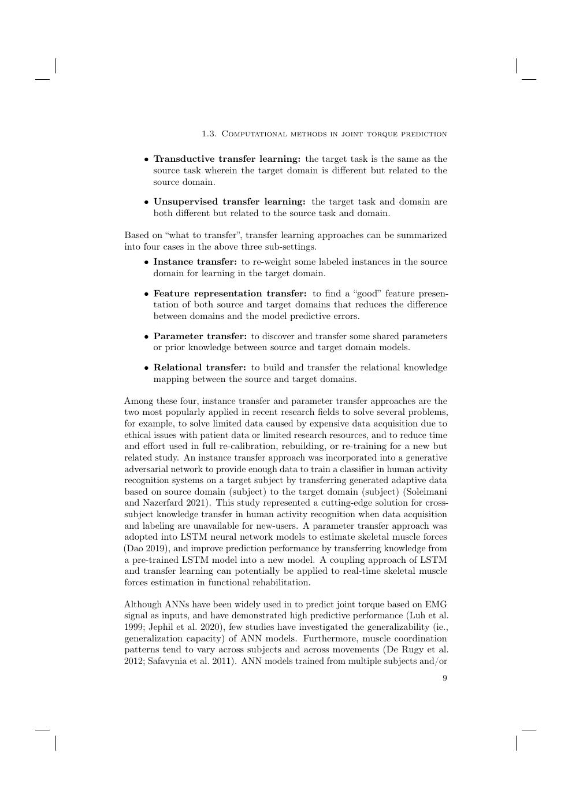

English text extracted from page 24

<pre>
1.3. Computational methods in joint torque prediction

     • Transductive transfer learning: the target task is the same as the
       source task wherein the target domain is different but related to the
       source domain.

     • Unsupervised transfer learning: the target task and domain are
       both different but related to the source task and domain.

Based on “what to transfer”, transfer learning approaches can be summarized
into four cases in the above three sub-settings.
     • Instance transfer: to re-weight some labeled instances in the source
       domain for learning in the target domain.

     • Feature representation transfer: to find a “good” feature presen-
       tation of both source and target domains that reduces the difference
       between domains and the model predictive errors.

     • Parameter transfer: to discover and transfer some shared parameters
       or prior knowledge between source and target domain models.

     • Relational transfer: to build and transfer the relational knowledge
       mapping between the source and target domains.

Among these four, instance transfer and parameter transfer approaches are the
two most popularly applied in recent research fields to solve several problems,
for example, to solve limited data caused by expensive data acquisition due to
ethical issues with patient data or limited research resources, and to reduce time
and effort used in full re-calibration, rebuilding, or re-training for a new but
related study. An instance transfer approach was incorporated into a generative
adversarial network to provide enough data to train a classifier in human activity
recognition systems on a target subject by transferring generated adaptive data
based on source domain (subject) to the target domain (subject) (Soleimani
and Nazerfard 2021). This study represented a cutting-edge solution for cross-
subject knowledge transfer in human activity recognition when data acquisition
and labeling are unavailable for new-users. A parameter transfer approach was
adopted into LSTM neural network models to estimate skeletal muscle forces
(Dao 2019), and improve prediction performance by transferring knowledge from
a pre-trained LSTM model into a new model. A coupling approach of LSTM
and transfer learning can potentially be applied to real-time skeletal muscle
forces estimation in functional rehabilitation.

Although ANNs have been widely used in to predict joint torque based on EMG
signal as inputs, and have demonstrated high predictive performance (Luh et al.
1999; Jephil et al. 2020), few studies have investigated the generalizability (ie.,
generalization capacity) of ANN models. Furthermore, muscle coordination
patterns tend to vary across subjects and across movements (De Rugy et al.
2012; Safavynia et al. 2011). ANN models trained from multiple subjects and/or
                                                                                 9
</pre>

## Page 25

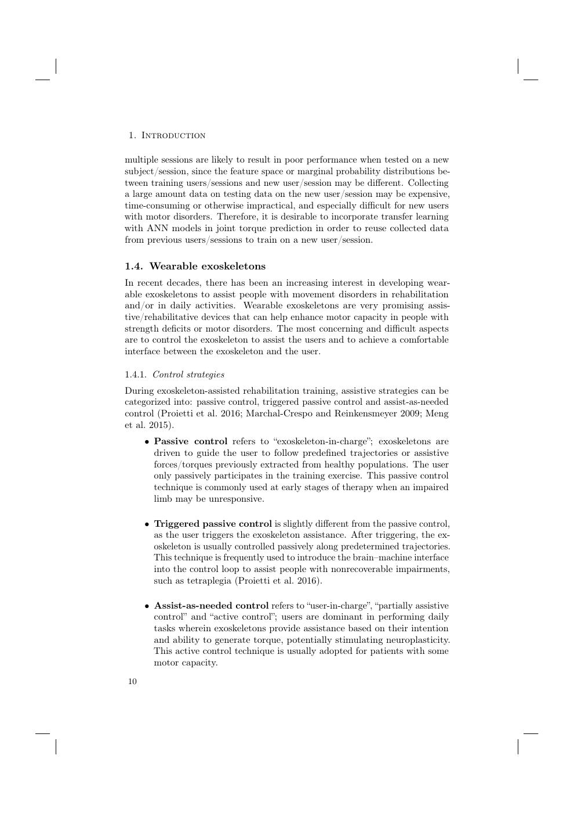

English text extracted from page 25

<pre>
1. Introduction

multiple sessions are likely to result in poor performance when tested on a new
subject/session, since the feature space or marginal probability distributions be-
tween training users/sessions and new user/session may be different. Collecting
a large amount data on testing data on the new user/session may be expensive,
time-consuming or otherwise impractical, and especially difficult for new users
with motor disorders. Therefore, it is desirable to incorporate transfer learning
with ANN models in joint torque prediction in order to reuse collected data
from previous users/sessions to train on a new user/session.

1.4. Wearable exoskeletons
In recent decades, there has been an increasing interest in developing wear-
able exoskeletons to assist people with movement disorders in rehabilitation
and/or in daily activities. Wearable exoskeletons are very promising assis-
tive/rehabilitative devices that can help enhance motor capacity in people with
strength deficits or motor disorders. The most concerning and difficult aspects
are to control the exoskeleton to assist the users and to achieve a comfortable
interface between the exoskeleton and the user.

1.4.1. Control strategies
During exoskeleton-assisted rehabilitation training, assistive strategies can be
categorized into: passive control, triggered passive control and assist-as-needed
control (Proietti et al. 2016; Marchal-Crespo and Reinkensmeyer 2009; Meng
et al. 2015).
     • Passive control refers to “exoskeleton-in-charge”; exoskeletons are
       driven to guide the user to follow predefined trajectories or assistive
       forces/torques previously extracted from healthy populations. The user
       only passively participates in the training exercise. This passive control
       technique is commonly used at early stages of therapy when an impaired
       limb may be unresponsive.

     • Triggered passive control is slightly different from the passive control,
       as the user triggers the exoskeleton assistance. After triggering, the ex-
       oskeleton is usually controlled passively along predetermined trajectories.
       This technique is frequently used to introduce the brain–machine interface
       into the control loop to assist people with nonrecoverable impairments,
       such as tetraplegia (Proietti et al. 2016).

     • Assist-as-needed control refers to “user-in-charge”, “partially assistive
       control” and “active control”; users are dominant in performing daily
       tasks wherein exoskeletons provide assistance based on their intention
       and ability to generate torque, potentially stimulating neuroplasticity.
       This active control technique is usually adopted for patients with some
       motor capacity.
10
</pre>

## Page 26

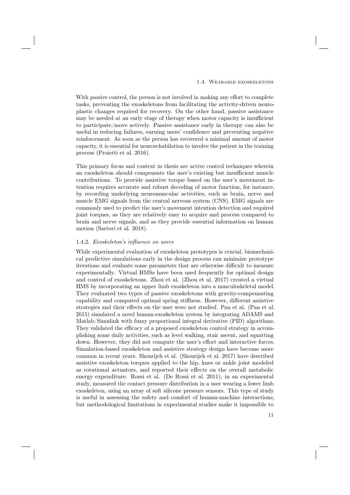

English text extracted from page 26

<pre>
1.4. Wearable exoskeletons

With passive control, the person is not involved in making any effort to complete
tasks, preventing the exoskeletons from facilitating the activity-driven neuro-
plastic changes required for recovery. On the other hand, passive assistance
may be needed at an early stage of therapy when motor capacity is insufficient
to participate/move actively. Passive assistance early in therapy can also be
useful in reducing failures, earning users’ confidence and preventing negative
reinforcement. As soon as the person has recovered a minimal amount of motor
capacity, it is essential for neurorehabilation to involve the patient in the training
process (Proietti et al. 2016).

This primary focus and context in thesis are active control techniques wherein
an exoskeleton should compensate the user’s existing but insufficient muscle
contributions. To provide assistive torque based on the user’s movement in-
tention requires accurate and robust decoding of motor function, for instance,
by recording underlying neuromuscular activities, such as brain, nerve and
muscle EMG signals from the central nervous system (CNS). EMG signals are
commonly used to predict the user’s movement intention detection and required
joint torques, as they are relatively easy to acquire and process compared to
brain and nerve signals, and as they provide essential information on human
motion (Sartori et al. 2018).

1.4.2. Exoskeleton’s influence on users
While experimental evaluation of exoskeleton prototypes is crucial, biomechani-
cal predictive simulations early in the design process can minimize prototype
iterations and evaluate some parameters that are otherwise difficult to measure
experimentally. Virtual HMSs have been used frequently for optimal design
and control of exoskeletons. Zhou et al. (Zhou et al. 2017) created a virtual
HMS by incorporating an upper limb exoskeleton into a musculoskeletal model.
They evaluated two types of passive exoskeletons with gravity-compensating
capability and computed optimal spring stiffness. However, different assistive
strategies and their effects on the user were not studied. Pan et al. (Pan et al.
2015) simulated a novel human-exoskeleton system by integrating ADAMS and
Matlab/Simulink with fuzzy proportional integral derivative (PID) algorithms.
They validated the efficacy of a proposed exoskeleton control strategy in accom-
plishing some daily activities, such as level walking, stair ascent, and squatting
down. However, they did not compute the user’s effort and interactive forces.
Simulation-based exoskeleton and assistive strategy design have become more
common in recent years. Shourijeh et al. (Shourijeh et al. 2017) have described
assistive exoskeleton torques applied to the hip, knee or ankle joint modeled
as rotational actuators, and reported their effects on the overall metabolic
energy expenditure. Rossi et al. (De Rossi et al. 2011), in an experimental
study, measured the contact pressure distribution in a user wearing a lower limb
exoskeleton, using an array of soft silicone pressure sensors. This type of study
is useful in assessing the safety and comfort of human-machine interactions,
but methodological limitations in experimental studies make it impossible to
                                                                                   11
</pre>

## Page 27

English text extracted from page 27

<pre>
1. Introduction

study other important information in the human-machine interaction, such as
joint contact force and the effects of different assistive strategies. In addition,
limited research has been conducted on how different weight distributions of
knee exoskeleton components can affect efficacy or comfort. Therefore, it is
useful to create a virtual HMS to study how different assistive strategies and
weight distributions of exoskeletons affect users before conducting experiments.

12
</pre>

## Page 28

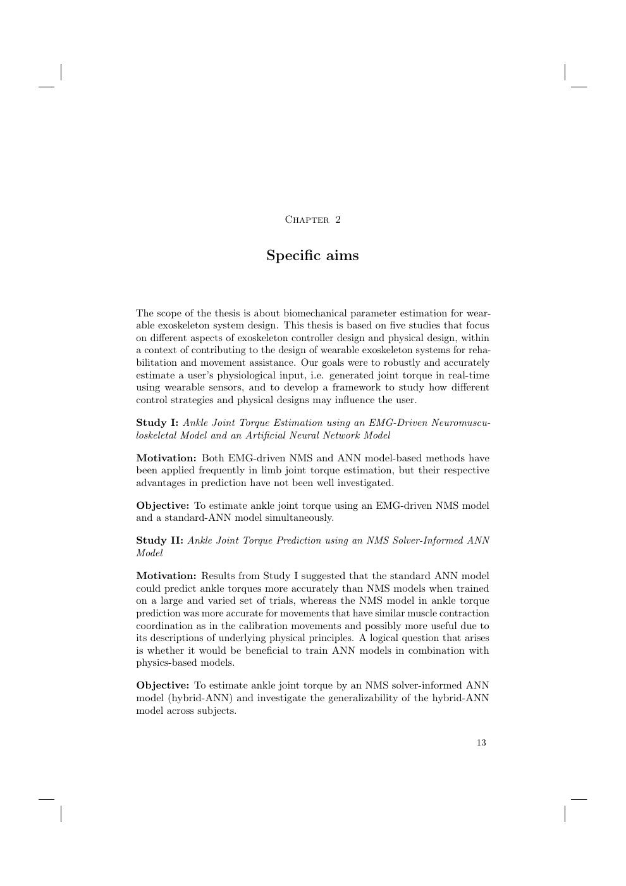

English text extracted from page 28

<pre>
Chapter 2

                              Specific aims

The scope of the thesis is about biomechanical parameter estimation for wear-
able exoskeleton system design. This thesis is based on five studies that focus
on different aspects of exoskeleton controller design and physical design, within
a context of contributing to the design of wearable exoskeleton systems for reha-
bilitation and movement assistance. Our goals were to robustly and accurately
estimate a user’s physiological input, i.e. generated joint torque in real-time
using wearable sensors, and to develop a framework to study how different
control strategies and physical designs may influence the user.

Study I: Ankle Joint Torque Estimation using an EMG-Driven Neuromuscu-
loskeletal Model and an Artificial Neural Network Model

Motivation: Both EMG-driven NMS and ANN model-based methods have
been applied frequently in limb joint torque estimation, but their respective
advantages in prediction have not been well investigated.

Objective: To estimate ankle joint torque using an EMG-driven NMS model
and a standard-ANN model simultaneously.

Study II: Ankle Joint Torque Prediction using an NMS Solver-Informed ANN
Model

Motivation: Results from Study I suggested that the standard ANN model
could predict ankle torques more accurately than NMS models when trained
on a large and varied set of trials, whereas the NMS model in ankle torque
prediction was more accurate for movements that have similar muscle contraction
coordination as in the calibration movements and possibly more useful due to
its descriptions of underlying physical principles. A logical question that arises
is whether it would be beneficial to train ANN models in combination with
physics-based models.

Objective: To estimate ankle joint torque by an NMS solver-informed ANN
model (hybrid-ANN) and investigate the generalizability of the hybrid-ANN
model across subjects.

                                                                               13
</pre>

## Page 29

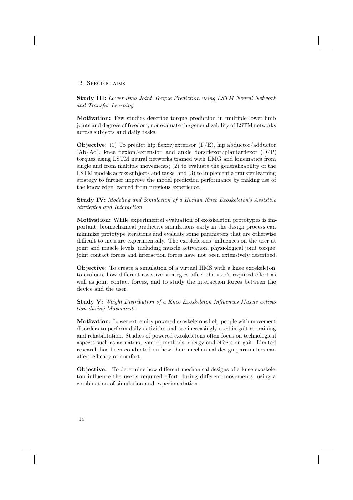

English text extracted from page 29

<pre>
2. Specific aims

Study III: Lower-limb Joint Torque Prediction using LSTM Neural Network
and Transfer Learning

Motivation: Few studies describe torque prediction in multiple lower-limb
joints and degrees of freedom, nor evaluate the generalizability of LSTM networks
across subjects and daily tasks.

Objective: (1) To predict hip flexor/extensor (F/E), hip abductor/adductor
(Ab/Ad), knee flexion/extension and ankle dorsiflexor/plantarflexor (D/P)
torques using LSTM neural networks trained with EMG and kinematics from
single and from multiple movements; (2) to evaluate the generalizability of the
LSTM models across subjects and tasks, and (3) to implement a transfer learning
strategy to further improve the model prediction performance by making use of
the knowledge learned from previous experience.

Study IV: Modeling and Simulation of a Human Knee Exoskeleton’s Assistive
Strategies and Interaction

Motivation: While experimental evaluation of exoskeleton prototypes is im-
portant, biomechanical predictive simulations early in the design process can
minimize prototype iterations and evaluate some parameters that are otherwise
difficult to measure experimentally. The exoskeletons’ influences on the user at
joint and muscle levels, including muscle activation, physiological joint torque,
joint contact forces and interaction forces have not been extensively described.

Objective: To create a simulation of a virtual HMS with a knee exoskeleton,
to evaluate how different assistive strategies affect the user’s required effort as
well as joint contact forces, and to study the interaction forces between the
device and the user.

Study V: Weight Distribution of a Knee Exoskeleton Influences Muscle activa-
tion during Movements

Motivation: Lower extremity powered exoskeletons help people with movement
disorders to perform daily activities and are increasingly used in gait re-training
and rehabilitation. Studies of powered exoskeletons often focus on technological
aspects such as actuators, control methods, energy and effects on gait. Limited
research has been conducted on how their mechanical design parameters can
affect efficacy or comfort.

Objective: To determine how different mechanical designs of a knee exoskele-
ton influence the user’s required effort during different movements, using a
combination of simulation and experimentation.

 14
</pre>

## Page 30

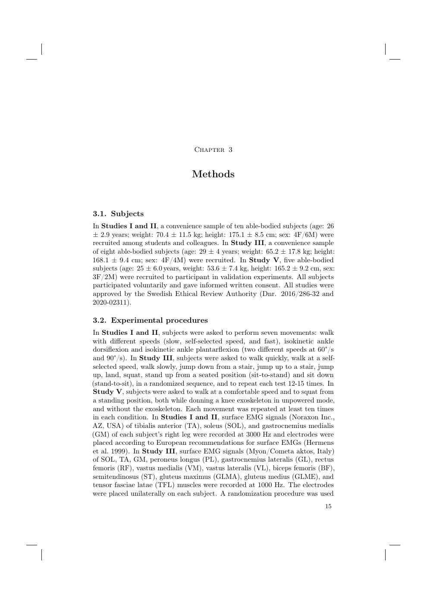

English text extracted from page 30

<pre>
Chapter 3

                                 Methods

3.1. Subjects
In Studies I and II, a convenience sample of ten able-bodied subjects (age: 26
± 2.9 years; weight: 70.4 ± 11.5 kg; height: 175.1 ± 8.5 cm; sex: 4F/6M) were
recruited among students and colleagues. In Study III, a convenience sample
of eight able-bodied subjects (age: 29 ± 4 years; weight: 65.2 ± 17.8 kg; height:
168.1 ± 9.4 cm; sex: 4F/4M) were recruited. In Study V, five able-bodied
subjects (age: 25 ± 6.0 years, weight: 53.6 ± 7.4 kg, height: 165.2 ± 9.2 cm, sex:
3F/2M) were recruited to participant in validation experiments. All subjects
participated voluntarily and gave informed written consent. All studies were
approved by the Swedish Ethical Review Authority (Dnr. 2016/286-32 and
2020-02311).

3.2. Experimental procedures
In Studies I and II, subjects were asked to perform seven movements: walk
with different speeds (slow, self-selected speed, and fast), isokinetic ankle
dorsiflexion and isokinetic ankle plantarflexion (two different speeds at 60°/s
and 90°/s). In Study III, subjects were asked to walk quickly, walk at a self-
selected speed, walk slowly, jump down from a stair, jump up to a stair, jump
up, land, squat, stand up from a seated position (sit-to-stand) and sit down
(stand-to-sit), in a randomized sequence, and to repeat each test 12-15 times. In
Study V, subjects were asked to walk at a comfortable speed and to squat from
a standing position, both while donning a knee exoskeleton in unpowered mode,
and without the exoskeleton. Each movement was repeated at least ten times
in each condition. In Studies I and II, surface EMG signals (Noraxon Inc.,
AZ, USA) of tibialis anterior (TA), soleus (SOL), and gastrocnemius medialis
(GM) of each subject’s right leg were recorded at 3000 Hz and electrodes were
placed according to European recommendations for surface EMGs (Hermens
et al. 1999). In Study III, surface EMG signals (Myon/Cometa aktos, Italy)
of SOL, TA, GM, peroneus longus (PL), gastrocnemius lateralis (GL), rectus
femoris (RF), vastus medialis (VM), vastus lateralis (VL), biceps femoris (BF),
semitendinosus (ST), gluteus maximus (GLMA), gluteus medius (GLME), and
tensor fasciae latae (TFL) muscles were recorded at 1000 Hz. The electrodes
were placed unilaterally on each subject. A randomization procedure was used
                                                                              15
</pre>

## Page 31

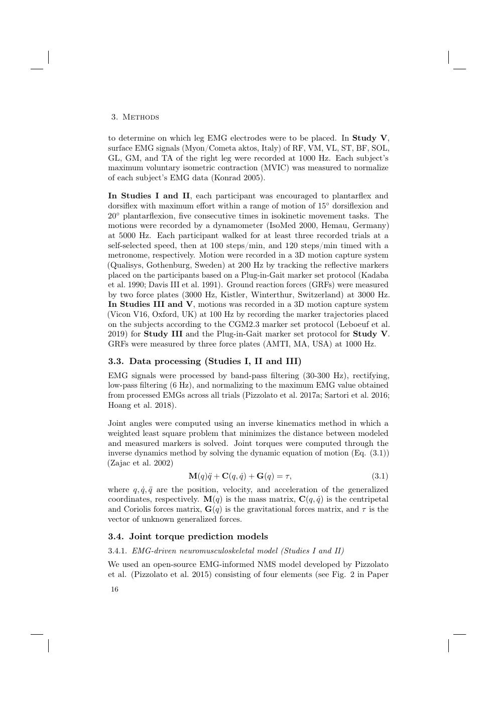

English text extracted from page 31

<pre>
3. Methods

to determine on which leg EMG electrodes were to be placed. In Study V,
surface EMG signals (Myon/Cometa aktos, Italy) of RF, VM, VL, ST, BF, SOL,
GL, GM, and TA of the right leg were recorded at 1000 Hz. Each subject’s
maximum voluntary isometric contraction (MVIC) was measured to normalize
of each subject’s EMG data (Konrad 2005).

In Studies I and II, each participant was encouraged to plantarflex and
dorsiflex with maximum effort within a range of motion of 15◦ dorsiflexion and
20◦ plantarflexion, five consecutive times in isokinetic movement tasks. The
motions were recorded by a dynamometer (IsoMed 2000, Hemau, Germany)
at 5000 Hz. Each participant walked for at least three recorded trials at a
self-selected speed, then at 100 steps/min, and 120 steps/min timed with a
metronome, respectively. Motion were recorded in a 3D motion capture system
(Qualisys, Gothenburg, Sweden) at 200 Hz by tracking the reflective markers
placed on the participants based on a Plug-in-Gait marker set protocol (Kadaba
et al. 1990; Davis III et al. 1991). Ground reaction forces (GRFs) were measured
by two force plates (3000 Hz, Kistler, Winterthur, Switzerland) at 3000 Hz.
In Studies III and V, motions was recorded in a 3D motion capture system
(Vicon V16, Oxford, UK) at 100 Hz by recording the marker trajectories placed
on the subjects according to the CGM2.3 marker set protocol (Leboeuf et al.
2019) for Study III and the Plug-in-Gait marker set protocol for Study V.
GRFs were measured by three force plates (AMTI, MA, USA) at 1000 Hz.

3.3. Data processing (Studies I, II and III)
EMG signals were processed by band-pass filtering (30-300 Hz), rectifying,
low-pass filtering (6 Hz), and normalizing to the maximum EMG value obtained
from processed EMGs across all trials (Pizzolato et al. 2017a; Sartori et al. 2016;
Hoang et al. 2018).

Joint angles were computed using an inverse kinematics method in which a
weighted least square problem that minimizes the distance between modeled
and measured markers is solved. Joint torques were computed through the
inverse dynamics method by solving the dynamic equation of motion (Eq. (3.1))
(Zajac et al. 2002)
                       M(q)q̈ + C(q, q̇) + G(q) = τ,                         (3.1)
where q, q̇, q̈ are the position, velocity, and acceleration of the generalized
coordinates, respectively. M(q) is the mass matrix, C(q, q̇) is the centripetal
and Coriolis forces matrix, G(q) is the gravitational forces matrix, and τ is the
vector of unknown generalized forces.

3.4. Joint torque prediction models
3.4.1. EMG-driven neuromusculoskeletal model (Studies I and II)
We used an open-source EMG-informed NMS model developed by Pizzolato
et al. (Pizzolato et al. 2015) consisting of four elements (see Fig. 2 in Paper
 16
</pre>

## Page 32

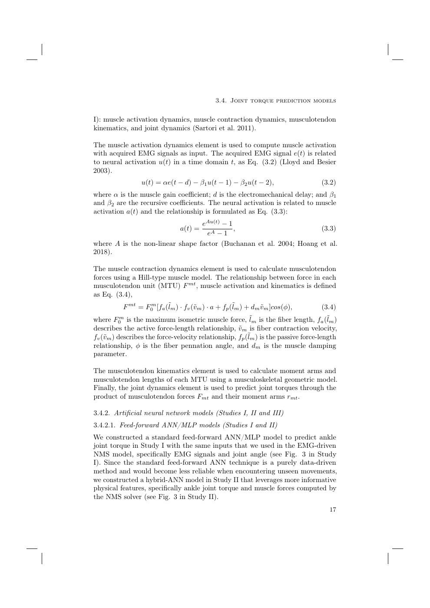

English text extracted from page 32

<pre>
3.4. Joint torque prediction models

I): muscle activation dynamics, muscle contraction dynamics, musculotendon
kinematics, and joint dynamics (Sartori et al. 2011).

The muscle activation dynamics element is used to compute muscle activation
with acquired EMG signals as input. The acquired EMG signal e(t) is related
to neural activation u(t) in a time domain t, as Eq. (3.2) (Lloyd and Besier
2003).
                 u(t) = αe(t − d) − β1 u(t − 1) − β2 u(t − 2),                      (3.2)
where α is the muscle gain coefficient; d is the electromechanical delay; and β1
and β2 are the recursive coefficients. The neural activation is related to muscle
activation a(t) and the relationship is formulated as Eq. (3.3):
                                 eAu(t) − 1
                                a(t) =      ,                       (3.3)
                                   eA − 1
where A is the non-linear shape factor (Buchanan et al. 2004; Hoang et al.
2018).

The muscle contraction dynamics element is used to calculate musculotendon
forces using a Hill-type muscle model. The relationship between force in each
musculotendon unit (MTU) F mt , muscle activation and kinematics is defined
as Eq. (3.4),
          F mt = F0m [fa (˜lm ) · fv (ṽm ) · a + fp (˜lm ) + dm ṽm ]cos(φ),       (3.4)
where F0m is the maximum isometric muscle force, ˜lm is the fiber length, fa (˜lm )
describes the active force-length relationship, ṽm is fiber contraction velocity,
fv (ṽm ) describes the force-velocity relationship, fp (˜lm ) is the passive force-length
relationship, φ is the fiber pennation angle, and dm is the muscle damping
parameter.

The musculotendon kinematics element is used to calculate moment arms and
musculotendon lengths of each MTU using a musculoskeletal geometric model.
Finally, the joint dynamics element is used to predict joint torques through the
product of musculotendon forces Fmt and their moment arms rmt .

3.4.2. Artificial neural network models (Studies I, II and III)
3.4.2.1. Feed-forward ANN/MLP models (Studies I and II)
We constructed a standard feed-forward ANN/MLP model to predict ankle
joint torque in Study I with the same inputs that we used in the EMG-driven
NMS model, specifically EMG signals and joint angle (see Fig. 3 in Study
I). Since the standard feed-forward ANN technique is a purely data-driven
method and would become less reliable when encountering unseen movements,
we constructed a hybrid-ANN model in Study II that leverages more informative
physical features, specifically ankle joint torque and muscle forces computed by
the NMS solver (see Fig. 3 in Study II).
                                                                                       17
</pre>

## Page 33

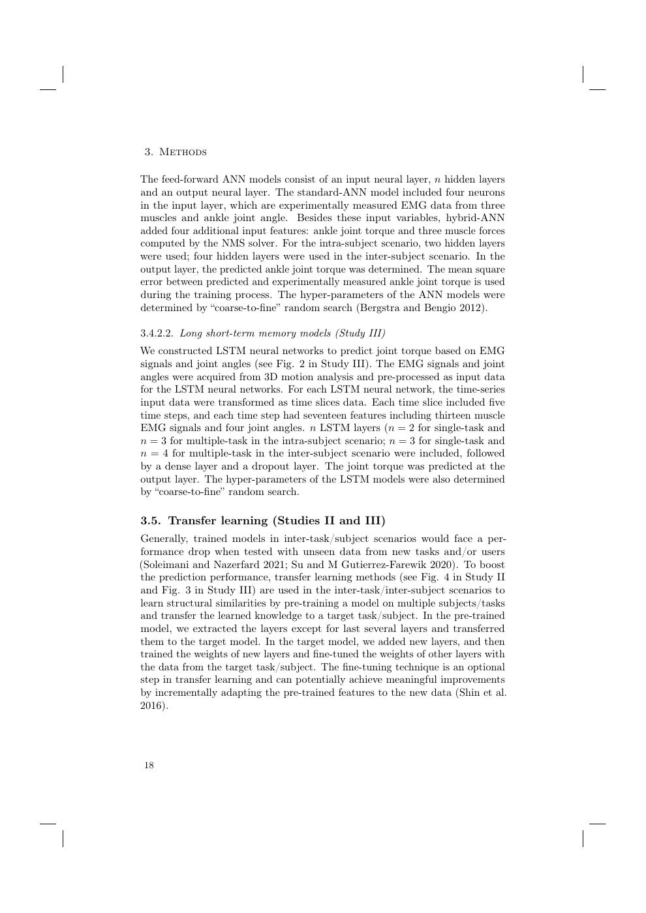

English text extracted from page 33

<pre>
3. Methods

The feed-forward ANN models consist of an input neural layer, n hidden layers
and an output neural layer. The standard-ANN model included four neurons
in the input layer, which are experimentally measured EMG data from three
muscles and ankle joint angle. Besides these input variables, hybrid-ANN
added four additional input features: ankle joint torque and three muscle forces
computed by the NMS solver. For the intra-subject scenario, two hidden layers
were used; four hidden layers were used in the inter-subject scenario. In the
output layer, the predicted ankle joint torque was determined. The mean square
error between predicted and experimentally measured ankle joint torque is used
during the training process. The hyper-parameters of the ANN models were
determined by “coarse-to-fine” random search (Bergstra and Bengio 2012).

3.4.2.2. Long short-term memory models (Study III)
We constructed LSTM neural networks to predict joint torque based on EMG
signals and joint angles (see Fig. 2 in Study III). The EMG signals and joint
angles were acquired from 3D motion analysis and pre-processed as input data
for the LSTM neural networks. For each LSTM neural network, the time-series
input data were transformed as time slices data. Each time slice included five
time steps, and each time step had seventeen features including thirteen muscle
EMG signals and four joint angles. n LSTM layers (n = 2 for single-task and
n = 3 for multiple-task in the intra-subject scenario; n = 3 for single-task and
n = 4 for multiple-task in the inter-subject scenario were included, followed
by a dense layer and a dropout layer. The joint torque was predicted at the
output layer. The hyper-parameters of the LSTM models were also determined
by “coarse-to-fine” random search.

3.5. Transfer learning (Studies II and III)
Generally, trained models in inter-task/subject scenarios would face a per-
formance drop when tested with unseen data from new tasks and/or users
(Soleimani and Nazerfard 2021; Su and M Gutierrez-Farewik 2020). To boost
the prediction performance, transfer learning methods (see Fig. 4 in Study II
and Fig. 3 in Study III) are used in the inter-task/inter-subject scenarios to
learn structural similarities by pre-training a model on multiple subjects/tasks
and transfer the learned knowledge to a target task/subject. In the pre-trained
model, we extracted the layers except for last several layers and transferred
them to the target model. In the target model, we added new layers, and then
trained the weights of new layers and fine-tuned the weights of other layers with
the data from the target task/subject. The fine-tuning technique is an optional
step in transfer learning and can potentially achieve meaningful improvements
by incrementally adapting the pre-trained features to the new data (Shin et al.
2016).

 18
</pre>

## Page 34

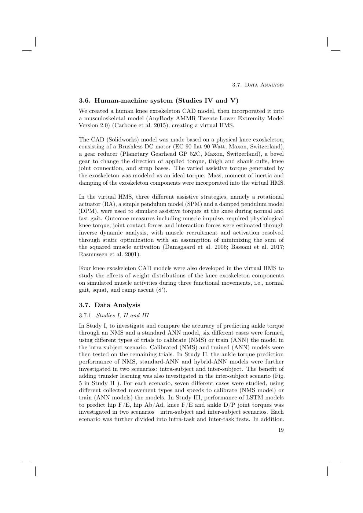

English text extracted from page 34

<pre>
3.7. Data Analysis

3.6. Human-machine system (Studies IV and V)
We created a human knee exoskeleton CAD model, then incorporated it into
a musculoskeletal model (AnyBody AMMR Twente Lower Extremity Model
Version 2.0) (Carbone et al. 2015), creating a virtual HMS.

The CAD (Solidworks) model was made based on a physical knee exoskeleton,
consisting of a Brushless DC motor (EC 90 flat 90 Watt, Maxon, Switzerland),
a gear reducer (Planetary Gearhead GP 52C, Maxon, Switzerland), a bevel
gear to change the direction of applied torque, thigh and shank cuffs, knee
joint connection, and strap bases. The varied assistive torque generated by
the exoskeleton was modeled as an ideal torque. Mass, moment of inertia and
damping of the exoskeleton components were incorporated into the virtual HMS.

In the virtual HMS, three different assistive strategies, namely a rotational
actuator (RA), a simple pendulum model (SPM) and a damped pendulum model
(DPM), were used to simulate assistive torques at the knee during normal and
fast gait. Outcome measures including muscle impulse, required physiological
knee torque, joint contact forces and interaction forces were estimated through
inverse dynamic analysis, with muscle recruitment and activation resolved
through static optimization with an assumption of minimizing the sum of
the squared muscle activation (Damsgaard et al. 2006; Bassani et al. 2017;
Rasmussen et al. 2001).

Four knee exoskeleton CAD models were also developed in the virtual HMS to
study the effects of weight distributions of the knee exoskeleton components
on simulated muscle activities during three functional movements, i.e., normal
gait, squat, and ramp ascent (8°).

3.7. Data Analysis
3.7.1. Studies I, II and III
In Study I, to investigate and compare the accuracy of predicting ankle torque
through an NMS and a standard ANN model, six different cases were formed,
using different types of trials to calibrate (NMS) or train (ANN) the model in
the intra-subject scenario. Calibrated (NMS) and trained (ANN) models were
then tested on the remaining trials. In Study II, the ankle torque prediction
performance of NMS, standard-ANN and hybrid-ANN models were further
investigated in two scenarios: intra-subject and inter-subject. The benefit of
adding transfer learning was also investigated in the inter-subject scenario (Fig.
5 in Study II ). For each scenario, seven different cases were studied, using
different collected movement types and speeds to calibrate (NMS model) or
train (ANN models) the models. In Study III, performance of LSTM models
to predict hip F/E, hip Ab/Ad, knee F/E and ankle D/P joint torques was
investigated in two scenarios—intra-subject and inter-subject scenarios. Each
scenario was further divided into intra-task and inter-task tests. In addition,
                                                                               19
</pre>

## Page 35

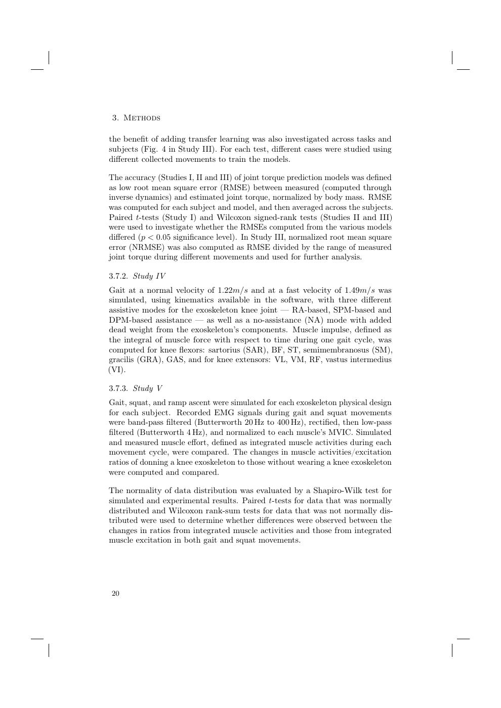

English text extracted from page 35

<pre>
3. Methods

the benefit of adding transfer learning was also investigated across tasks and
subjects (Fig. 4 in Study III). For each test, different cases were studied using
different collected movements to train the models.

The accuracy (Studies I, II and III) of joint torque prediction models was defined
as low root mean square error (RMSE) between measured (computed through
inverse dynamics) and estimated joint torque, normalized by body mass. RMSE
was computed for each subject and model, and then averaged across the subjects.
Paired t-tests (Study I) and Wilcoxon signed-rank tests (Studies II and III)
were used to investigate whether the RMSEs computed from the various models
differed (p &lt; 0.05 significance level). In Study III, normalized root mean square
error (NRMSE) was also computed as RMSE divided by the range of measured
joint torque during different movements and used for further analysis.

3.7.2. Study IV
Gait at a normal velocity of 1.22m/s and at a fast velocity of 1.49m/s was
simulated, using kinematics available in the software, with three different
assistive modes for the exoskeleton knee joint — RA-based, SPM-based and
DPM-based assistance — as well as a no-assistance (NA) mode with added
dead weight from the exoskeleton’s components. Muscle impulse, defined as
the integral of muscle force with respect to time during one gait cycle, was
computed for knee flexors: sartorius (SAR), BF, ST, semimembranosus (SM),
gracilis (GRA), GAS, and for knee extensors: VL, VM, RF, vastus intermedius
(VI).

3.7.3. Study V
Gait, squat, and ramp ascent were simulated for each exoskeleton physical design
for each subject. Recorded EMG signals during gait and squat movements
were band-pass filtered (Butterworth 20 Hz to 400 Hz), rectified, then low-pass
filtered (Butterworth 4 Hz), and normalized to each muscle’s MVIC. Simulated
and measured muscle effort, defined as integrated muscle activities during each
movement cycle, were compared. The changes in muscle activities/excitation
ratios of donning a knee exoskeleton to those without wearing a knee exoskeleton
were computed and compared.

The normality of data distribution was evaluated by a Shapiro-Wilk test for
simulated and experimental results. Paired t-tests for data that was normally
distributed and Wilcoxon rank-sum tests for data that was not normally dis-
tributed were used to determine whether differences were observed between the
changes in ratios from integrated muscle activities and those from integrated
muscle excitation in both gait and squat movements.

20
</pre>

## Page 36

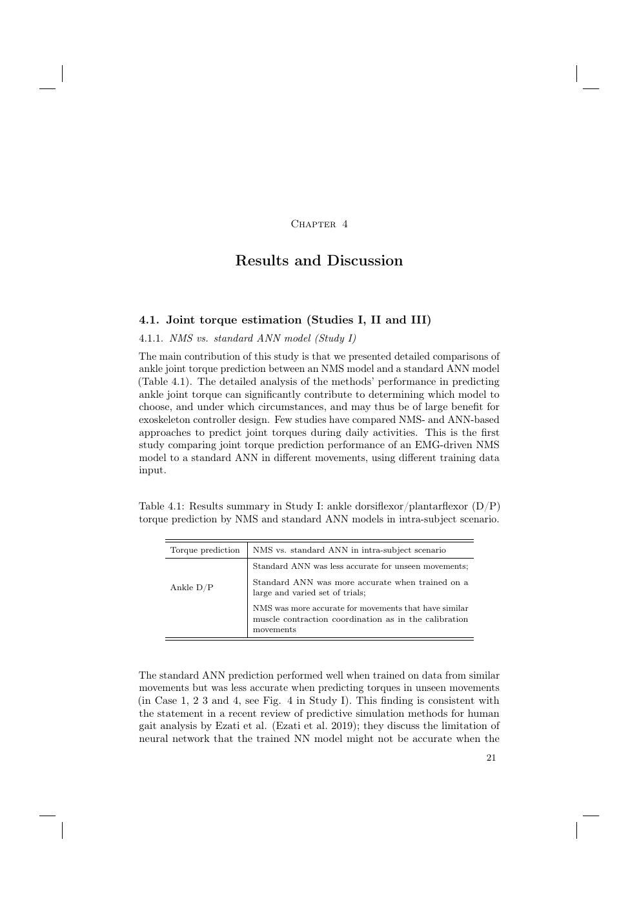

English text extracted from page 36

<pre>
Chapter 4

                      Results and Discussion

4.1. Joint torque estimation (Studies I, II and III)
4.1.1. NMS vs. standard ANN model (Study I)
The main contribution of this study is that we presented detailed comparisons of
ankle joint torque prediction between an NMS model and a standard ANN model
(Table 4.1). The detailed analysis of the methods’ performance in predicting
ankle joint torque can significantly contribute to determining which model to
choose, and under which circumstances, and may thus be of large benefit for
exoskeleton controller design. Few studies have compared NMS- and ANN-based
approaches to predict joint torques during daily activities. This is the first
study comparing joint torque prediction performance of an EMG-driven NMS
model to a standard ANN in different movements, using different training data
input.

Table 4.1: Results summary in Study I: ankle dorsiflexor/plantarflexor (D/P)
torque prediction by NMS and standard ANN models in intra-subject scenario.

       Torque prediction   NMS vs. standard ANN in intra-subject scenario
                           Standard ANN was less accurate for unseen movements;
                           Standard ANN was more accurate when trained on a
       Ankle D/P
                           large and varied set of trials;
                           NMS was more accurate for movements that have similar
                           muscle contraction coordination as in the calibration
                           movements

The standard ANN prediction performed well when trained on data from similar
movements but was less accurate when predicting torques in unseen movements
(in Case 1, 2 3 and 4, see Fig. 4 in Study I). This finding is consistent with
the statement in a recent review of predictive simulation methods for human
gait analysis by Ezati et al. (Ezati et al. 2019); they discuss the limitation of
neural network that the trained NN model might not be accurate when the
                                                                                   21
</pre>

## Page 37

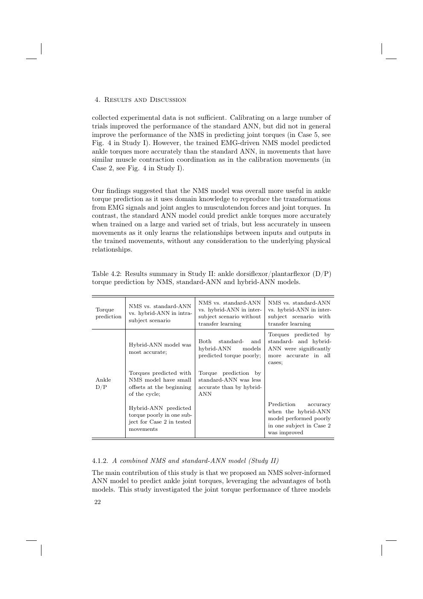

English text extracted from page 37

<pre>
4. Results and Discussion

collected experimental data is not sufficient. Calibrating on a large number of
trials improved the performance of the standard ANN, but did not in general
improve the performance of the NMS in predicting joint torques (in Case 5, see
Fig. 4 in Study I). However, the trained EMG-driven NMS model predicted
ankle torques more accurately than the standard ANN, in movements that have
similar muscle contraction coordination as in the calibration movements (in
Case 2, see Fig. 4 in Study I).

Our findings suggested that the NMS model was overall more useful in ankle
torque prediction as it uses domain knowledge to reproduce the transformations
from EMG signals and joint angles to musculotendon forces and joint torques. In
contrast, the standard ANN model could predict ankle torques more accurately
when trained on a large and varied set of trials, but less accurately in unseen
movements as it only learns the relationships between inputs and outputs in
the trained movements, without any consideration to the underlying physical
relationships.

Table 4.2: Results summary in Study II: ankle dorsiflexor/plantarflexor (D/P)
torque prediction by NMS, standard-ANN and hybrid-ANN models.

                                          NMS vs. standard-ANN       NMS vs. standard-ANN
              NMS vs. standard-ANN
 Torque                                   vs. hybrid-ANN in inter-   vs. hybrid-ANN in inter-
              vs. hybrid-ANN in intra-
 prediction                               subject scenario without   subject scenario with
              subject scenario
                                          transfer learning          transfer learning
                                                                     Torques predicted by
                                          Both standard- and         standard- and hybrid-
              Hybrid-ANN model was
                                          hybrid-ANN       models    ANN were significantly
              most accurate;
                                          predicted torque poorly;   more accurate in all
                                                                     cases;
              Torques predicted with      Torque prediction by
 Ankle        NMS model have small        standard-ANN was less
 D/P          offsets at the beginning    accurate than by hybrid-
              of the cycle;               ANN
                                                                     Prediction      accuracy
              Hybrid-ANN predicted
                                                                     when the hybrid-ANN
              torque poorly in one sub-
                                                                     model performed poorly
              ject for Case 2 in tested
                                                                     in one subject in Case 2
              movements
                                                                     was improved

4.1.2. A combined NMS and standard-ANN model (Study II)
The main contribution of this study is that we proposed an NMS solver-informed
ANN model to predict ankle joint torques, leveraging the advantages of both
models. This study investigated the joint torque performance of three models
22
</pre>

## Page 38

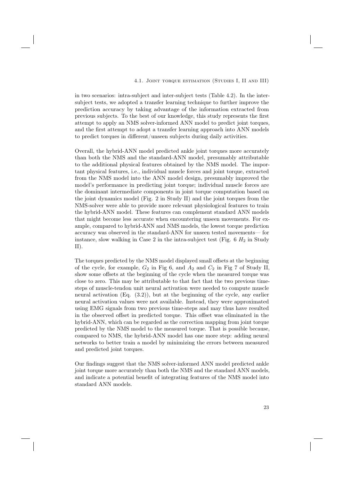

English text extracted from page 38

<pre>
4.1. Joint torque estimation (Studies I, II and III)

in two scenarios: intra-subject and inter-subject tests (Table 4.2). In the inter-
subject tests, we adopted a transfer learning technique to further improve the
prediction accuracy by taking advantage of the information extracted from
previous subjects. To the best of our knowledge, this study represents the first
attempt to apply an NMS solver-informed ANN model to predict joint torques,
and the first attempt to adopt a transfer learning approach into ANN models
to predict torques in different/unseen subjects during daily activities.

Overall, the hybrid-ANN model predicted ankle joint torques more accurately
than both the NMS and the standard-ANN model, presumably attributable
to the additional physical features obtained by the NMS model. The impor-
tant physical features, i.e., individual muscle forces and joint torque, extracted
from the NMS model into the ANN model design, presumably improved the
model’s performance in predicting joint torque; individual muscle forces are
the dominant intermediate components in joint torque computation based on
the joint dynamics model (Fig. 2 in Study II) and the joint torques from the
NMS-solver were able to provide more relevant physiological features to train
the hybrid-ANN model. These features can complement standard ANN models
that might become less accurate when encountering unseen movements. For ex-
ample, compared to hybrid-ANN and NMS models, the lowest torque prediction
accuracy was observed in the standard-ANN for unseen tested movements— for
instance, slow walking in Case 2 in the intra-subject test (Fig. 6 H2 in Study
II).

The torques predicted by the NMS model displayed small offsets at the beginning
of the cycle, for example, G2 in Fig 6, and A2 and C2 in Fig 7 of Study II,
show some offsets at the beginning of the cycle when the measured torque was
close to zero. This may be attributable to that fact that the two previous time-
steps of muscle-tendon unit neural activation were needed to compute muscle
neural activation (Eq. (3.2)), but at the beginning of the cycle, any earlier
neural activation values were not available. Instead, they were approximated
using EMG signals from two previous time-steps and may thus have resulted
in the observed offset in predicted torque. This offset was eliminated in the
hybrid-ANN, which can be regarded as the correction mapping from joint torque
predicted by the NMS model to the measured torque. That is possible because,
compared to NMS, the hybrid-ANN model has one more step: adding neural
networks to better train a model by minimizing the errors between measured
and predicted joint torques.

Our findings suggest that the NMS solver-informed ANN model predicted ankle
joint torque more accurately than both the NMS and the standard ANN models,
and indicate a potential benefit of integrating features of the NMS model into
standard ANN models.

                                                                               23
</pre>

## Page 39

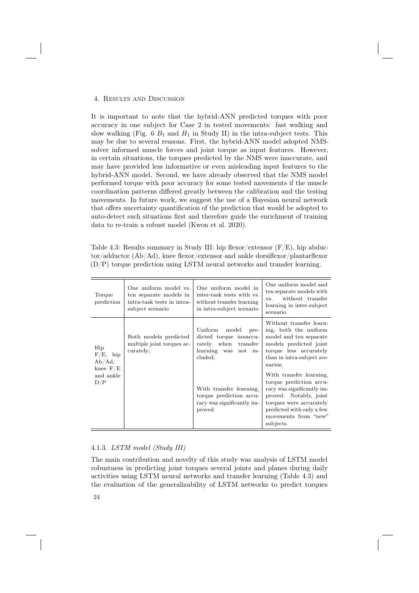

English text extracted from page 39

<pre>
4. Results and Discussion

It is important to note that the hybrid-ANN predicted torques with poor
accuracy in one subject for Case 2 in tested movements: fast walking and
slow walking (Fig. 6 B1 and H1 in Study II) in the intra-subject tests. This
may be due to several reasons. First, the hybrid-ANN model adopted NMS-
solver informed muscle forces and joint torque as input features. However,
in certain situations, the torques predicted by the NMS were inaccurate, and
may have provided less informative or even misleading input features to the
hybrid-ANN model. Second, we have already observed that the NMS model
performed torque with poor accuracy for some tested movements if the muscle
coordination patterns differed greatly between the calibration and the testing
movements. In future work, we suggest the use of a Bayesian neural network
that offers uncertainty quantification of the prediction that would be adopted to
auto-detect such situations first and therefore guide the enrichment of training
data to re-train a robust model (Kwon et al. 2020).

Table 4.3: Results summary in Study III: hip flexor/extensor (F/E), hip abduc-
tor/adductor (Ab/Ad), knee flexor/extensor and ankle dorsiflexor/plantarflexor
(D/P) torque prediction using LSTM neural networks and transfer learning.

                                                                        One uniform model and
              One uniform model vs.        One uniform model in
                                                                        ten separate models with
 Torque       ten separate models in       inter-task tests with vs.
                                                                        vs.    without transfer
 prediction   intra-task tests in intra-   without transfer learning
                                                                        learning in inter-subject
              subject scenario             in intra-subject scenario
                                                                        scenario
                                                                        Without transfer learn-
                                           Uniform model pre-           ing, both the uniform
              Both models predicted        dicted torque innaccu-       model and ten separate
              multiple joint torques ac-   rately when transfer         models predicted joint
 Hip
              curately;                    learning was not in-         torque less accurately
 F/E, hip
                                           cluded;                      than in intra-subject sce-
 Ab/Ad,
                                                                        narios;
 knee F/E
 and ankle                                                              With transfer learning,
 D/P                                                                    torque prediction accu-
                                           With transfer learning,      racy was significantly im-
                                           torque prediction accu-      proved. Notably, joint
                                           racy was significantly im-   torques were accurately
                                           proved                       predicted with only a few
                                                                        movements from “new”
                                                                        subjects.

4.1.3. LSTM model (Study III)
The main contribution and novelty of this study was analysis of LSTM model
robustness in predicting joint torques several joints and planes during daily
activities using LSTM neural networks and transfer learning (Table 4.3) and
the evaluation of the generalizability of LSTM networks to predict torques
 24
</pre>

## Page 40

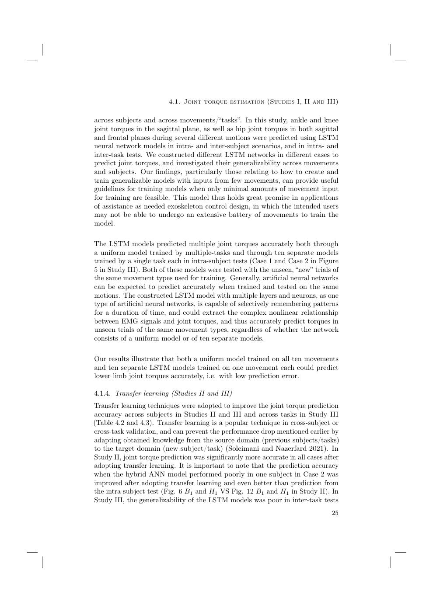

English text extracted from page 40

<pre>
4.1. Joint torque estimation (Studies I, II and III)

across subjects and across movements/“tasks”. In this study, ankle and knee
joint torques in the sagittal plane, as well as hip joint torques in both sagittal
and frontal planes during several different motions were predicted using LSTM
neural network models in intra- and inter-subject scenarios, and in intra- and
inter-task tests. We constructed different LSTM networks in different cases to
predict joint torques, and investigated their generalizability across movements
and subjects. Our findings, particularly those relating to how to create and
train generalizable models with inputs from few movements, can provide useful
guidelines for training models when only minimal amounts of movement input
for training are feasible. This model thus holds great promise in applications
of assistance-as-needed exoskeleton control design, in which the intended users
may not be able to undergo an extensive battery of movements to train the
model.

The LSTM models predicted multiple joint torques accurately both through
a uniform model trained by multiple-tasks and through ten separate models
trained by a single task each in intra-subject tests (Case 1 and Case 2 in Figure
5 in Study III). Both of these models were tested with the unseen, “new” trials of
the same movement types used for training. Generally, artificial neural networks
can be expected to predict accurately when trained and tested on the same
motions. The constructed LSTM model with multiple layers and neurons, as one
type of artificial neural networks, is capable of selectively remembering patterns
for a duration of time, and could extract the complex nonlinear relationship
between EMG signals and joint torques, and thus accurately predict torques in
unseen trials of the same movement types, regardless of whether the network
consists of a uniform model or of ten separate models.

Our results illustrate that both a uniform model trained on all ten movements
and ten separate LSTM models trained on one movement each could predict
lower limb joint torques accurately, i.e. with low prediction error.

4.1.4. Transfer learning (Studies II and III)
Transfer learning techniques were adopted to improve the joint torque prediction
accuracy across subjects in Studies II and III and across tasks in Study III
(Table 4.2 and 4.3). Transfer learning is a popular technique in cross-subject or
cross-task validation, and can prevent the performance drop mentioned earlier by
adapting obtained knowledge from the source domain (previous subjects/tasks)
to the target domain (new subject/task) (Soleimani and Nazerfard 2021). In
Study II, joint torque prediction was significantly more accurate in all cases after
adopting transfer learning. It is important to note that the prediction accuracy
when the hybrid-ANN model performed poorly in one subject in Case 2 was
improved after adopting transfer learning and even better than prediction from
the intra-subject test (Fig. 6 B1 and H1 VS Fig. 12 B1 and H1 in Study II). In
Study III, the generalizability of the LSTM models was poor in inter-task tests
                                                                                 25
</pre>

## Page 41

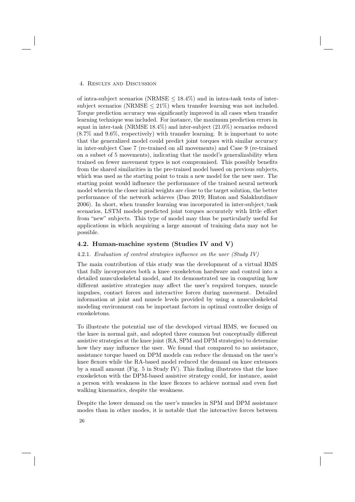

English text extracted from page 41

<pre>
4. Results and Discussion

of intra-subject scenarios (NRMSE ≤ 18.4%) and in intra-task tests of inter-
subject scenarios (NRMSE ≤ 21%) when transfer learning was not included.
Torque prediction accuracy was significantly improved in all cases when transfer
learning technique was included. For instance, the maximum prediction errors in
squat in inter-task (NRMSE 18.4%) and inter-subject (21.0%) scenarios reduced
(8.7% and 9.6%, respectively) with transfer learning. It is important to note
that the generalized model could predict joint torques with similar accuracy
in inter-subject Case 7 (re-trained on all movements) and Case 9 (re-trained
on a subset of 5 movements), indicating that the model’s generalizability when
trained on fewer movement types is not compromised. This possibly benefits
from the shared similarities in the pre-trained model based on previous subjects,
which was used as the starting point to train a new model for the new user. The
starting point would influence the performance of the trained neural network
model wherein the closer initial weights are close to the target solution, the better
performance of the network achieves (Dao 2019; Hinton and Salakhutdinov
2006). In short, when transfer learning was incorporated in inter-subject/task
scenarios, LSTM models predicted joint torques accurately with little effort
from “new” subjects. This type of model may thus be particularly useful for
applications in which acquiring a large amount of training data may not be
possible.

4.2. Human-machine system (Studies IV and V)
4.2.1. Evaluation of control strategies influence on the user (Study IV)
The main contribution of this study was the development of a virtual HMS
that fully incorporates both a knee exoskeleton hardware and control into a
detailed musculoskeletal model, and its demonstrated use in computing how
different assistive strategies may affect the user’s required torques, muscle
impulses, contact forces and interactive forces during movement. Detailed
information at joint and muscle levels provided by using a musculoskeletal
modeling environment can be important factors in optimal controller design of
exoskeletons.

To illustrate the potential use of the developed virtual HMS, we focused on
the knee in normal gait, and adopted three common but conceptually different
assistive strategies at the knee joint (RA, SPM and DPM strategies) to determine
how they may influence the user. We found that compared to no assistance,
assistance torque based on DPM models can reduce the demand on the user’s
knee flexors while the RA-based model reduced the demand on knee extensors
by a small amount (Fig. 5 in Study IV). This finding illustrates that the knee
exoskeleton with the DPM-based assistive strategy could, for instance, assist
a person with weakness in the knee flexors to achieve normal and even fast
walking kinematics, despite the weakness.

Despite the lower demand on the user’s muscles in SPM and DPM assistance
modes than in other modes, it is notable that the interactive forces between
 26
</pre>

## Page 42

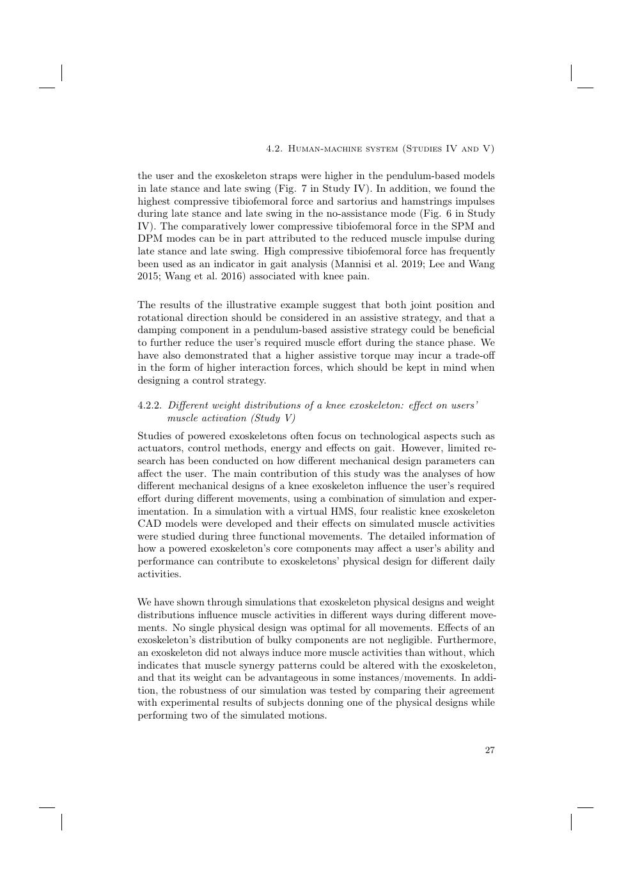

English text extracted from page 42

<pre>
4.2. Human-machine system (Studies IV and V)

the user and the exoskeleton straps were higher in the pendulum-based models
in late stance and late swing (Fig. 7 in Study IV). In addition, we found the
highest compressive tibiofemoral force and sartorius and hamstrings impulses
during late stance and late swing in the no-assistance mode (Fig. 6 in Study
IV). The comparatively lower compressive tibiofemoral force in the SPM and
DPM modes can be in part attributed to the reduced muscle impulse during
late stance and late swing. High compressive tibiofemoral force has frequently
been used as an indicator in gait analysis (Mannisi et al. 2019; Lee and Wang
2015; Wang et al. 2016) associated with knee pain.

The results of the illustrative example suggest that both joint position and
rotational direction should be considered in an assistive strategy, and that a
damping component in a pendulum-based assistive strategy could be beneficial
to further reduce the user’s required muscle effort during the stance phase. We
have also demonstrated that a higher assistive torque may incur a trade-off
in the form of higher interaction forces, which should be kept in mind when
designing a control strategy.

4.2.2. Different weight distributions of a knee exoskeleton: effect on users’
       muscle activation (Study V)
Studies of powered exoskeletons often focus on technological aspects such as
actuators, control methods, energy and effects on gait. However, limited re-
search has been conducted on how different mechanical design parameters can
affect the user. The main contribution of this study was the analyses of how
different mechanical designs of a knee exoskeleton influence the user’s required
effort during different movements, using a combination of simulation and exper-
imentation. In a simulation with a virtual HMS, four realistic knee exoskeleton
CAD models were developed and their effects on simulated muscle activities
were studied during three functional movements. The detailed information of
how a powered exoskeleton’s core components may affect a user’s ability and
performance can contribute to exoskeletons’ physical design for different daily
activities.

We have shown through simulations that exoskeleton physical designs and weight
distributions influence muscle activities in different ways during different move-
ments. No single physical design was optimal for all movements. Effects of an
exoskeleton’s distribution of bulky components are not negligible. Furthermore,
an exoskeleton did not always induce more muscle activities than without, which
indicates that muscle synergy patterns could be altered with the exoskeleton,
and that its weight can be advantageous in some instances/movements. In addi-
tion, the robustness of our simulation was tested by comparing their agreement
with experimental results of subjects donning one of the physical designs while
performing two of the simulated motions.

                                                                                27
</pre>

## Page 43

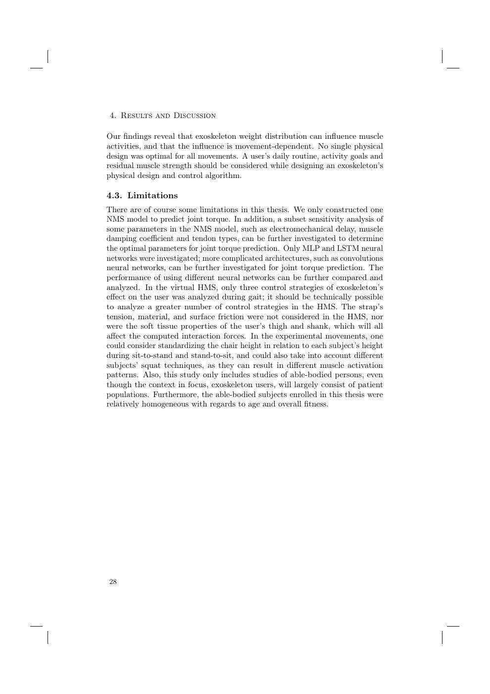

English text extracted from page 43

<pre>
4. Results and Discussion

Our findings reveal that exoskeleton weight distribution can influence muscle
activities, and that the influence is movement-dependent. No single physical
design was optimal for all movements. A user’s daily routine, activity goals and
residual muscle strength should be considered while designing an exoskeleton’s
physical design and control algorithm.

4.3. Limitations
There are of course some limitations in this thesis. We only constructed one
NMS model to predict joint torque. In addition, a subset sensitivity analysis of
some parameters in the NMS model, such as electromechanical delay, muscle
damping coefficient and tendon types, can be further investigated to determine
the optimal parameters for joint torque prediction. Only MLP and LSTM neural
networks were investigated; more complicated architectures, such as convolutions
neural networks, can be further investigated for joint torque prediction. The
performance of using different neural networks can be further compared and
analyzed. In the virtual HMS, only three control strategies of exoskeleton’s
effect on the user was analyzed during gait; it should be technically possible
to analyze a greater number of control strategies in the HMS. The strap’s
tension, material, and surface friction were not considered in the HMS, nor
were the soft tissue properties of the user’s thigh and shank, which will all
affect the computed interaction forces. In the experimental movements, one
could consider standardizing the chair height in relation to each subject’s height
during sit-to-stand and stand-to-sit, and could also take into account different
subjects’ squat techniques, as they can result in different muscle activation
patterns. Also, this study only includes studies of able-bodied persons, even
though the context in focus, exoskeleton users, will largely consist of patient
populations. Furthermore, the able-bodied subjects enrolled in this thesis were
relatively homogeneous with regards to age and overall fitness.

28
</pre>

## Page 44

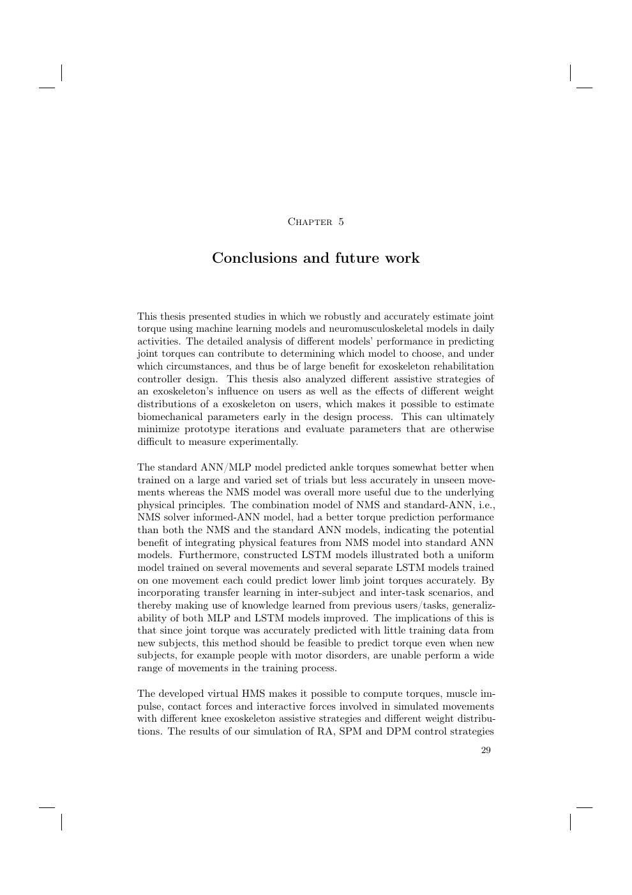

English text extracted from page 44

<pre>
Chapter 5

                 Conclusions and future work

This thesis presented studies in which we robustly and accurately estimate joint
torque using machine learning models and neuromusculoskeletal models in daily
activities. The detailed analysis of different models’ performance in predicting
joint torques can contribute to determining which model to choose, and under
which circumstances, and thus be of large benefit for exoskeleton rehabilitation
controller design. This thesis also analyzed different assistive strategies of
an exoskeleton’s influence on users as well as the effects of different weight
distributions of a exoskeleton on users, which makes it possible to estimate
biomechanical parameters early in the design process. This can ultimately
minimize prototype iterations and evaluate parameters that are otherwise
difficult to measure experimentally.

The standard ANN/MLP model predicted ankle torques somewhat better when
trained on a large and varied set of trials but less accurately in unseen move-
ments whereas the NMS model was overall more useful due to the underlying
physical principles. The combination model of NMS and standard-ANN, i.e.,
NMS solver informed-ANN model, had a better torque prediction performance
than both the NMS and the standard ANN models, indicating the potential
benefit of integrating physical features from NMS model into standard ANN
models. Furthermore, constructed LSTM models illustrated both a uniform
model trained on several movements and several separate LSTM models trained
on one movement each could predict lower limb joint torques accurately. By
incorporating transfer learning in inter-subject and inter-task scenarios, and
thereby making use of knowledge learned from previous users/tasks, generaliz-
ability of both MLP and LSTM models improved. The implications of this is
that since joint torque was accurately predicted with little training data from
new subjects, this method should be feasible to predict torque even when new
subjects, for example people with motor disorders, are unable perform a wide
range of movements in the training process.

The developed virtual HMS makes it possible to compute torques, muscle im-
pulse, contact forces and interactive forces involved in simulated movements
with different knee exoskeleton assistive strategies and different weight distribu-
tions. The results of our simulation of RA, SPM and DPM control strategies
                                                                               29
</pre>

## Page 45

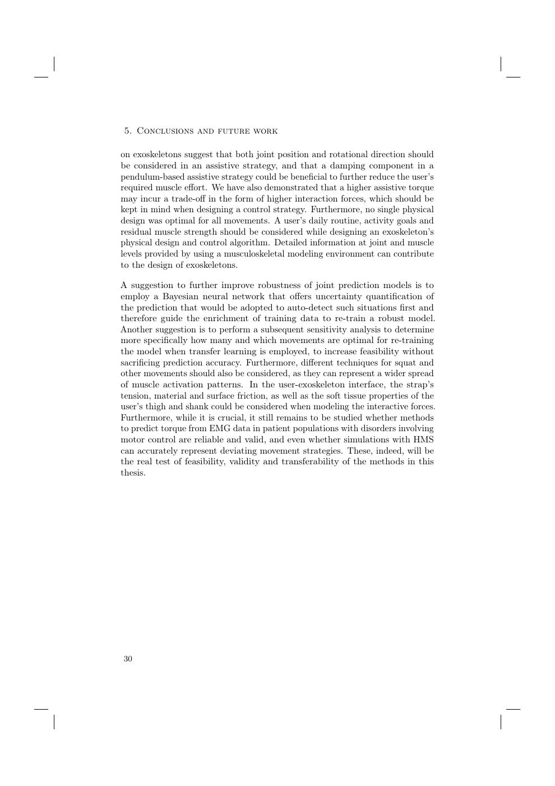

English text extracted from page 45

<pre>
5. Conclusions and future work

on exoskeletons suggest that both joint position and rotational direction should
be considered in an assistive strategy, and that a damping component in a
pendulum-based assistive strategy could be beneficial to further reduce the user’s
required muscle effort. We have also demonstrated that a higher assistive torque
may incur a trade-off in the form of higher interaction forces, which should be
kept in mind when designing a control strategy. Furthermore, no single physical
design was optimal for all movements. A user’s daily routine, activity goals and
residual muscle strength should be considered while designing an exoskeleton’s
physical design and control algorithm. Detailed information at joint and muscle
levels provided by using a musculoskeletal modeling environment can contribute
to the design of exoskeletons.

A suggestion to further improve robustness of joint prediction models is to
employ a Bayesian neural network that offers uncertainty quantification of
the prediction that would be adopted to auto-detect such situations first and
therefore guide the enrichment of training data to re-train a robust model.
Another suggestion is to perform a subsequent sensitivity analysis to determine
more specifically how many and which movements are optimal for re-training
the model when transfer learning is employed, to increase feasibility without
sacrificing prediction accuracy. Furthermore, different techniques for squat and
other movements should also be considered, as they can represent a wider spread
of muscle activation patterns. In the user-exoskeleton interface, the strap’s
tension, material and surface friction, as well as the soft tissue properties of the
user’s thigh and shank could be considered when modeling the interactive forces.
Furthermore, while it is crucial, it still remains to be studied whether methods
to predict torque from EMG data in patient populations with disorders involving
motor control are reliable and valid, and even whether simulations with HMS
can accurately represent deviating movement strategies. These, indeed, will be
the real test of feasibility, validity and transferability of the methods in this
thesis.

30
</pre>

## Page 46

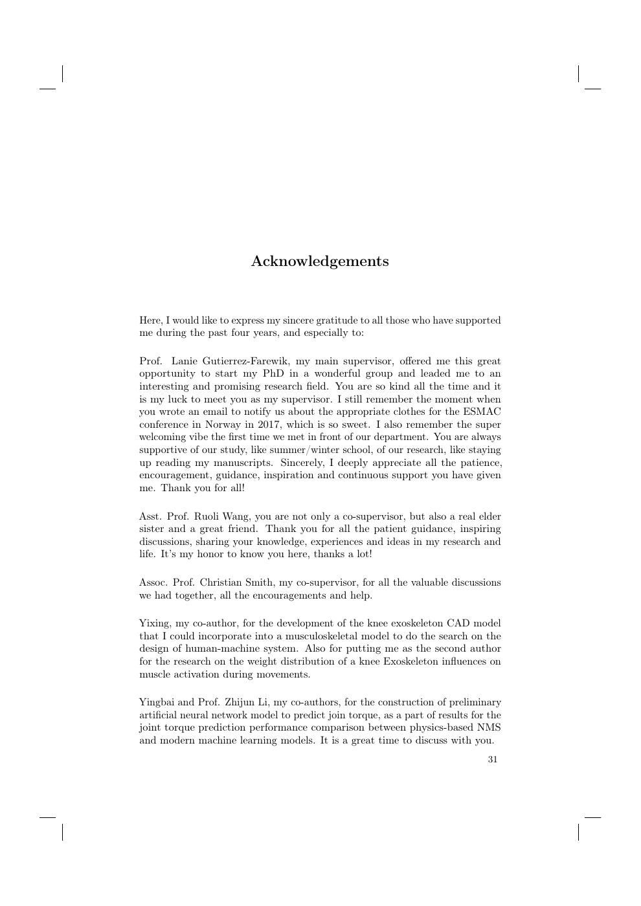

English text extracted from page 46

<pre>
Acknowledgements

Here, I would like to express my sincere gratitude to all those who have supported
me during the past four years, and especially to:

Prof. Lanie Gutierrez-Farewik, my main supervisor, offered me this great
opportunity to start my PhD in a wonderful group and leaded me to an
interesting and promising research field. You are so kind all the time and it
is my luck to meet you as my supervisor. I still remember the moment when
you wrote an email to notify us about the appropriate clothes for the ESMAC
conference in Norway in 2017, which is so sweet. I also remember the super
welcoming vibe the first time we met in front of our department. You are always
supportive of our study, like summer/winter school, of our research, like staying
up reading my manuscripts. Sincerely, I deeply appreciate all the patience,
encouragement, guidance, inspiration and continuous support you have given
me. Thank you for all!

Asst. Prof. Ruoli Wang, you are not only a co-supervisor, but also a real elder
sister and a great friend. Thank you for all the patient guidance, inspiring
discussions, sharing your knowledge, experiences and ideas in my research and
life. It’s my honor to know you here, thanks a lot!

Assoc. Prof. Christian Smith, my co-supervisor, for all the valuable discussions
we had together, all the encouragements and help.

Yixing, my co-author, for the development of the knee exoskeleton CAD model
that I could incorporate into a musculoskeletal model to do the search on the
design of human-machine system. Also for putting me as the second author
for the research on the weight distribution of a knee Exoskeleton influences on
muscle activation during movements.

Yingbai and Prof. Zhijun Li, my co-authors, for the construction of preliminary
artificial neural network model to predict join torque, as a part of results for the
joint torque prediction performance comparison between physics-based NMS
and modern machine learning models. It is a great time to discuss with you.
                                                                                31
</pre>

## Page 47

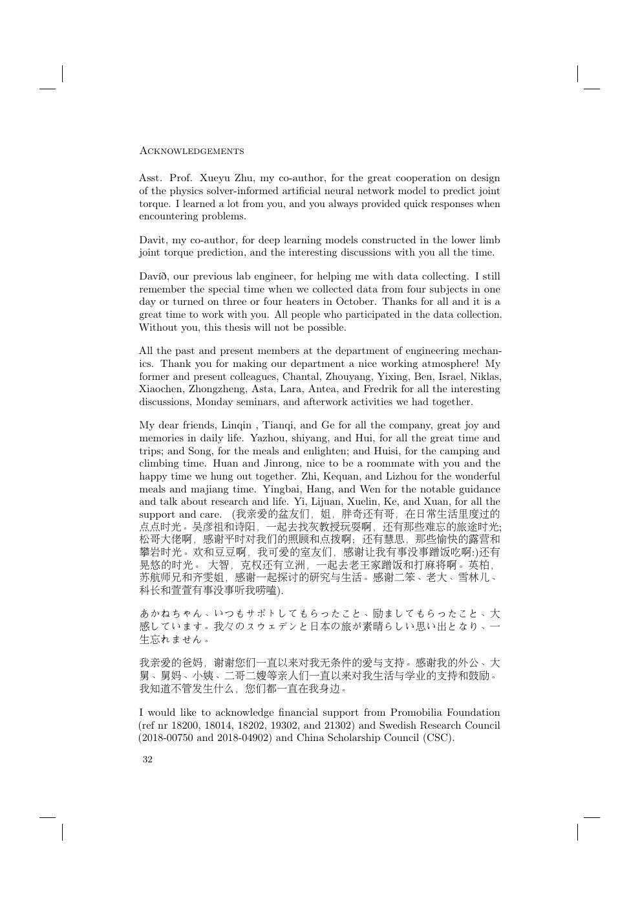

English text extracted from page 47

<pre>
Acknowledgements

Asst. Prof. Xueyu Zhu, my co-author, for the great cooperation on design
of the physics solver-informed artificial neural network model to predict joint
torque. I learned a lot from you, and you always provided quick responses when
encountering problems.

Davit, my co-author, for deep learning models constructed in the lower limb
joint torque prediction, and the interesting discussions with you all the time.

Davíð, our previous lab engineer, for helping me with data collecting. I still
remember the special time when we collected data from four subjects in one
day or turned on three or four heaters in October. Thanks for all and it is a
great time to work with you. All people who participated in the data collection.
Without you, this thesis will not be possible.

All the past and present members at the department of engineering mechan-
ics. Thank you for making our department a nice working atmosphere! My
former and present colleagues, Chantal, Zhouyang, Yixing, Ben, Israel, Niklas,
Xiaochen, Zhongzheng, Asta, Lara, Antea, and Fredrik for all the interesting
discussions, Monday seminars, and afterwork activities we had together.

My dear friends, Linqin , Tianqi, and Ge for all the company, great joy and
memories in daily life. Yazhou, shiyang, and Hui, for all the great time and
trips; and Song, for the meals and enlighten; and Huisi, for the camping and
climbing time. Huan and Jinrong, nice to be a roommate with you and the
happy time we hung out together. Zhi, Kequan, and Lizhou for the wonderful
meals and majiang time. Yingbai, Hang, and Wen for the notable guidance
and talk about research and life. Yi, Lijuan, Xuelin, Ke, and Xuan, for all the
support and care. (我亲爱的盆友们，姐，胖奇还有哥，在日常生活里度过的
点点时光。吴彦祖和诗阳，一起去找灰教授玩耍啊，还有那些难忘的旅途时光;
松哥大佬啊，感谢平时对我们的照顾和点拨啊；还有慧思，那些愉快的露营和
攀岩时光。欢和豆豆啊，我可爱的室友们，感谢让我有事没事蹭饭吃啊:)还有
晃悠的时光。 大智，克权还有立洲，一起去老王家蹭饭和打麻将啊。英柏，
苏航师兄和齐雯姐，感谢一起探讨的研究与生活。感谢二笨、老大、雪林儿、
科长和萱萱有事没事听我唠嗑).

あかねちゃん、いつもサポトしてもらったこと、励ましてもらったこと、大
感しています。我々のスウェデンと日本の旅が素晴らしい思い出となり、一
生忘れません。

我亲爱的爸妈，谢谢您们一直以来对我无条件的爱与支持。感谢我的外公、大
舅、舅妈、小姨、二哥二嫂等亲人们一直以来对我生活与学业的支持和鼓励。
我知道不管发生什么，您们都一直在我身边。

I would like to acknowledge financial support from Promobilia Foundation
(ref nr 18200, 18014, 18202, 19302, and 21302) and Swedish Research Council
(2018-00750 and 2018-04902) and China Scholarship Council (CSC).

32
</pre>

## Page 48

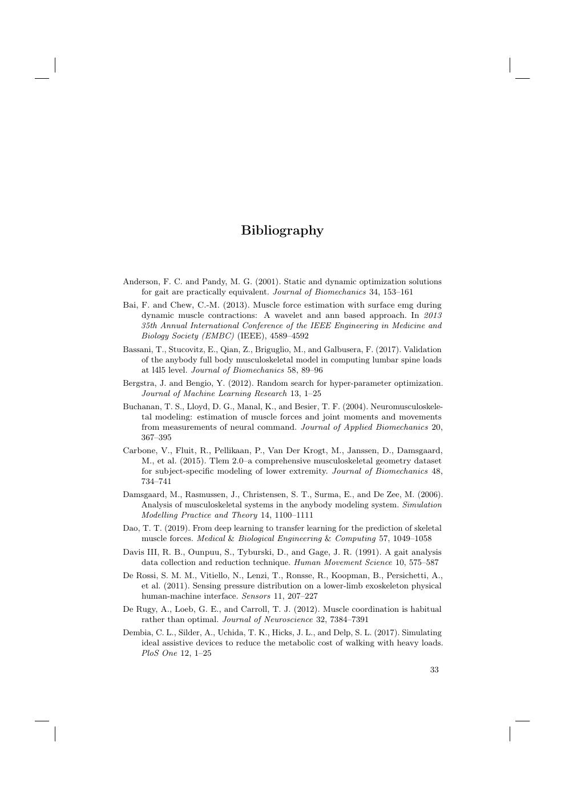

English text extracted from page 48

<pre>
Bibliography

Anderson, F. C. and Pandy, M. G. (2001). Static and dynamic optimization solutions
    for gait are practically equivalent. Journal of Biomechanics 34, 153–161
Bai, F. and Chew, C.-M. (2013). Muscle force estimation with surface emg during
     dynamic muscle contractions: A wavelet and ann based approach. In 2013
     35th Annual International Conference of the IEEE Engineering in Medicine and
     Biology Society (EMBC) (IEEE), 4589–4592
Bassani, T., Stucovitz, E., Qian, Z., Briguglio, M., and Galbusera, F. (2017). Validation
    of the anybody full body musculoskeletal model in computing lumbar spine loads
    at l4l5 level. Journal of Biomechanics 58, 89–96
Bergstra, J. and Bengio, Y. (2012). Random search for hyper-parameter optimization.
    Journal of Machine Learning Research 13, 1–25
Buchanan, T. S., Lloyd, D. G., Manal, K., and Besier, T. F. (2004). Neuromusculoskele-
    tal modeling: estimation of muscle forces and joint moments and movements
    from measurements of neural command. Journal of Applied Biomechanics 20,
    367–395
Carbone, V., Fluit, R., Pellikaan, P., Van Der Krogt, M., Janssen, D., Damsgaard,
    M., et al. (2015). Tlem 2.0–a comprehensive musculoskeletal geometry dataset
    for subject-specific modeling of lower extremity. Journal of Biomechanics 48,
    734–741
Damsgaard, M., Rasmussen, J., Christensen, S. T., Surma, E., and De Zee, M. (2006).
   Analysis of musculoskeletal systems in the anybody modeling system. Simulation
   Modelling Practice and Theory 14, 1100–1111
Dao, T. T. (2019). From deep learning to transfer learning for the prediction of skeletal
     muscle forces. Medical &amp; Biological Engineering &amp; Computing 57, 1049–1058
Davis III, R. B., Ounpuu, S., Tyburski, D., and Gage, J. R. (1991). A gait analysis
    data collection and reduction technique. Human Movement Science 10, 575–587
De Rossi, S. M. M., Vitiello, N., Lenzi, T., Ronsse, R., Koopman, B., Persichetti, A.,
    et al. (2011). Sensing pressure distribution on a lower-limb exoskeleton physical
    human-machine interface. Sensors 11, 207–227
De Rugy, A., Loeb, G. E., and Carroll, T. J. (2012). Muscle coordination is habitual
    rather than optimal. Journal of Neuroscience 32, 7384–7391
Dembia, C. L., Silder, A., Uchida, T. K., Hicks, J. L., and Delp, S. L. (2017). Simulating
   ideal assistive devices to reduce the metabolic cost of walking with heavy loads.
   PloS One 12, 1–25

                                                                                      33
</pre>

## Page 49

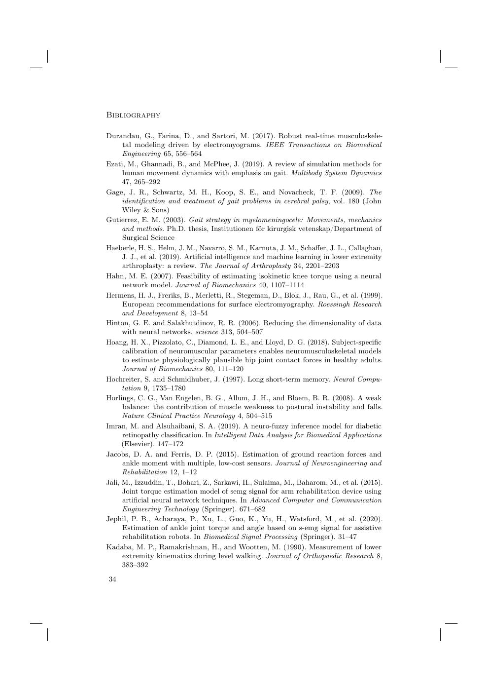

English text extracted from page 49

<pre>
Bibliography

Durandau, G., Farina, D., and Sartori, M. (2017). Robust real-time musculoskele-
      tal modeling driven by electromyograms. IEEE Transactions on Biomedical
      Engineering 65, 556–564
Ezati, M., Ghannadi, B., and McPhee, J. (2019). A review of simulation methods for
      human movement dynamics with emphasis on gait. Multibody System Dynamics
      47, 265–292
Gage, J. R., Schwartz, M. H., Koop, S. E., and Novacheck, T. F. (2009). The
      identification and treatment of gait problems in cerebral palsy, vol. 180 (John
      Wiley &amp; Sons)
Gutierrez, E. M. (2003). Gait strategy in myelomeningocele: Movements, mechanics
      and methods. Ph.D. thesis, Institutionen för kirurgisk vetenskap/Department of
      Surgical Science
Haeberle, H. S., Helm, J. M., Navarro, S. M., Karnuta, J. M., Schaffer, J. L., Callaghan,
      J. J., et al. (2019). Artificial intelligence and machine learning in lower extremity
      arthroplasty: a review. The Journal of Arthroplasty 34, 2201–2203
Hahn, M. E. (2007). Feasibility of estimating isokinetic knee torque using a neural
      network model. Journal of Biomechanics 40, 1107–1114
Hermens, H. J., Freriks, B., Merletti, R., Stegeman, D., Blok, J., Rau, G., et al. (1999).
      European recommendations for surface electromyography. Roessingh Research
      and Development 8, 13–54
Hinton, G. E. and Salakhutdinov, R. R. (2006). Reducing the dimensionality of data
      with neural networks. science 313, 504–507
Hoang, H. X., Pizzolato, C., Diamond, L. E., and Lloyd, D. G. (2018). Subject-specific
      calibration of neuromuscular parameters enables neuromusculoskeletal models
      to estimate physiologically plausible hip joint contact forces in healthy adults.
      Journal of Biomechanics 80, 111–120
Hochreiter, S. and Schmidhuber, J. (1997). Long short-term memory. Neural Compu-
      tation 9, 1735–1780
Horlings, C. G., Van Engelen, B. G., Allum, J. H., and Bloem, B. R. (2008). A weak
      balance: the contribution of muscle weakness to postural instability and falls.
      Nature Clinical Practice Neurology 4, 504–515
Imran, M. and Alsuhaibani, S. A. (2019). A neuro-fuzzy inference model for diabetic
      retinopathy classification. In Intelligent Data Analysis for Biomedical Applications
      (Elsevier). 147–172
Jacobs, D. A. and Ferris, D. P. (2015). Estimation of ground reaction forces and
      ankle moment with multiple, low-cost sensors. Journal of Neuroengineering and
      Rehabilitation 12, 1–12
Jali, M., Izzuddin, T., Bohari, Z., Sarkawi, H., Sulaima, M., Baharom, M., et al. (2015).
      Joint torque estimation model of semg signal for arm rehabilitation device using
      artificial neural network techniques. In Advanced Computer and Communication
      Engineering Technology (Springer). 671–682
Jephil, P. B., Acharaya, P., Xu, L., Guo, K., Yu, H., Watsford, M., et al. (2020).
      Estimation of ankle joint torque and angle based on s-emg signal for assistive
      rehabilitation robots. In Biomedical Signal Processing (Springer). 31–47
Kadaba, M. P., Ramakrishnan, H., and Wootten, M. (1990). Measurement of lower
      extremity kinematics during level walking. Journal of Orthopaedic Research 8,
      383–392

34
</pre>

## Page 50

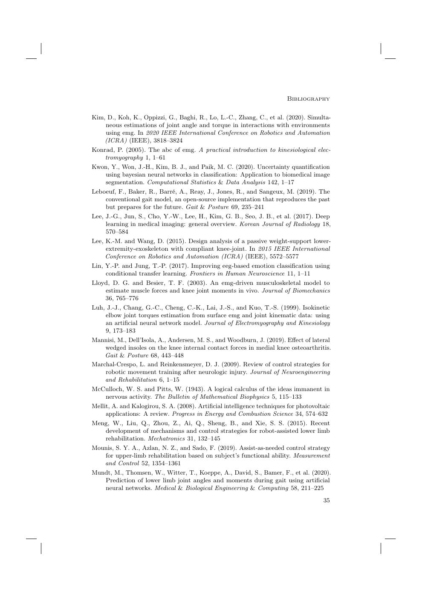

English text extracted from page 50

<pre>
Bibliography

Kim, D., Koh, K., Oppizzi, G., Baghi, R., Lo, L.-C., Zhang, C., et al. (2020). Simulta-
     neous estimations of joint angle and torque in interactions with environments
     using emg. In 2020 IEEE International Conference on Robotics and Automation
     (ICRA) (IEEE), 3818–3824
Konrad, P. (2005). The abc of emg. A practical introduction to kinesiological elec-
     tromyography 1, 1–61
Kwon, Y., Won, J.-H., Kim, B. J., and Paik, M. C. (2020). Uncertainty quantification
     using bayesian neural networks in classification: Application to biomedical image
     segmentation. Computational Statistics &amp; Data Analysis 142, 1–17
Leboeuf, F., Baker, R., Barré, A., Reay, J., Jones, R., and Sangeux, M. (2019). The
     conventional gait model, an open-source implementation that reproduces the past
     but prepares for the future. Gait &amp; Posture 69, 235–241
Lee, J.-G., Jun, S., Cho, Y.-W., Lee, H., Kim, G. B., Seo, J. B., et al. (2017). Deep
     learning in medical imaging: general overview. Korean Journal of Radiology 18,
     570–584
Lee, K.-M. and Wang, D. (2015). Design analysis of a passive weight-support lower-
     extremity-exoskeleton with compliant knee-joint. In 2015 IEEE International
     Conference on Robotics and Automation (ICRA) (IEEE), 5572–5577
Lin, Y.-P. and Jung, T.-P. (2017). Improving eeg-based emotion classification using
     conditional transfer learning. Frontiers in Human Neuroscience 11, 1–11
Lloyd, D. G. and Besier, T. F. (2003). An emg-driven musculoskeletal model to
     estimate muscle forces and knee joint moments in vivo. Journal of Biomechanics
     36, 765–776
Luh, J.-J., Chang, G.-C., Cheng, C.-K., Lai, J.-S., and Kuo, T.-S. (1999). Isokinetic
     elbow joint torques estimation from surface emg and joint kinematic data: using
     an artificial neural network model. Journal of Electromyography and Kinesiology
     9, 173–183
Mannisi, M., Dell’Isola, A., Andersen, M. S., and Woodburn, J. (2019). Effect of lateral
     wedged insoles on the knee internal contact forces in medial knee osteoarthritis.
     Gait &amp; Posture 68, 443–448
Marchal-Crespo, L. and Reinkensmeyer, D. J. (2009). Review of control strategies for
     robotic movement training after neurologic injury. Journal of Neuroengineering
     and Rehabilitation 6, 1–15
McCulloch, W. S. and Pitts, W. (1943). A logical calculus of the ideas immanent in
     nervous activity. The Bulletin of Mathematical Biophysics 5, 115–133
Mellit, A. and Kalogirou, S. A. (2008). Artificial intelligence techniques for photovoltaic
     applications: A review. Progress in Energy and Combustion Science 34, 574–632
Meng, W., Liu, Q., Zhou, Z., Ai, Q., Sheng, B., and Xie, S. S. (2015). Recent
     development of mechanisms and control strategies for robot-assisted lower limb
     rehabilitation. Mechatronics 31, 132–145
Mounis, S. Y. A., Azlan, N. Z., and Sado, F. (2019). Assist-as-needed control strategy
     for upper-limb rehabilitation based on subject’s functional ability. Measurement
     and Control 52, 1354–1361
Mundt, M., Thomsen, W., Witter, T., Koeppe, A., David, S., Bamer, F., et al. (2020).
     Prediction of lower limb joint angles and moments during gait using artificial
     neural networks. Medical &amp; Biological Engineering &amp; Computing 58, 211–225

                                                                                        35
</pre>

## Page 51

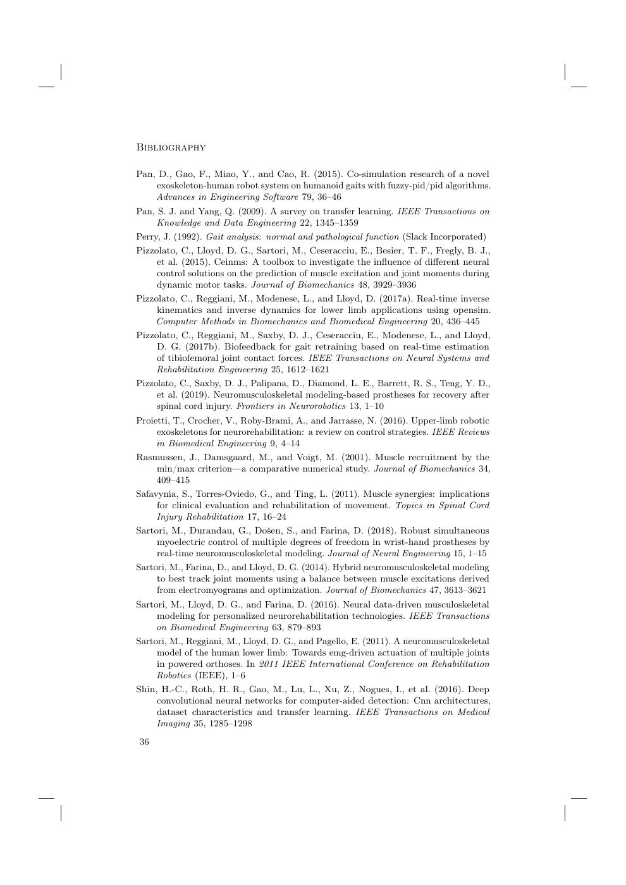

English text extracted from page 51

<pre>
Bibliography

Pan, D., Gao, F., Miao, Y., and Cao, R. (2015). Co-simulation research of a novel
    exoskeleton-human robot system on humanoid gaits with fuzzy-pid/pid algorithms.
    Advances in Engineering Software 79, 36–46
Pan, S. J. and Yang, Q. (2009). A survey on transfer learning. IEEE Transactions on
    Knowledge and Data Engineering 22, 1345–1359
Perry, J. (1992). Gait analysis: normal and pathological function (Slack Incorporated)
Pizzolato, C., Lloyd, D. G., Sartori, M., Ceseracciu, E., Besier, T. F., Fregly, B. J.,
     et al. (2015). Ceinms: A toolbox to investigate the influence of different neural
     control solutions on the prediction of muscle excitation and joint moments during
     dynamic motor tasks. Journal of Biomechanics 48, 3929–3936
Pizzolato, C., Reggiani, M., Modenese, L., and Lloyd, D. (2017a). Real-time inverse
     kinematics and inverse dynamics for lower limb applications using opensim.
    Computer Methods in Biomechanics and Biomedical Engineering 20, 436–445
Pizzolato, C., Reggiani, M., Saxby, D. J., Ceseracciu, E., Modenese, L., and Lloyd,
     D. G. (2017b). Biofeedback for gait retraining based on real-time estimation
     of tibiofemoral joint contact forces. IEEE Transactions on Neural Systems and
    Rehabilitation Engineering 25, 1612–1621
Pizzolato, C., Saxby, D. J., Palipana, D., Diamond, L. E., Barrett, R. S., Teng, Y. D.,
     et al. (2019). Neuromusculoskeletal modeling-based prostheses for recovery after
     spinal cord injury. Frontiers in Neurorobotics 13, 1–10
Proietti, T., Crocher, V., Roby-Brami, A., and Jarrasse, N. (2016). Upper-limb robotic
     exoskeletons for neurorehabilitation: a review on control strategies. IEEE Reviews
     in Biomedical Engineering 9, 4–14
Rasmussen, J., Damsgaard, M., and Voigt, M. (2001). Muscle recruitment by the
    min/max criterion—a comparative numerical study. Journal of Biomechanics 34,
    409–415
Safavynia, S., Torres-Oviedo, G., and Ting, L. (2011). Muscle synergies: implications
     for clinical evaluation and rehabilitation of movement. Topics in Spinal Cord
     Injury Rehabilitation 17, 16–24
Sartori, M., Durandau, G., Došen, S., and Farina, D. (2018). Robust simultaneous
     myoelectric control of multiple degrees of freedom in wrist-hand prostheses by
     real-time neuromusculoskeletal modeling. Journal of Neural Engineering 15, 1–15
Sartori, M., Farina, D., and Lloyd, D. G. (2014). Hybrid neuromusculoskeletal modeling
     to best track joint moments using a balance between muscle excitations derived
     from electromyograms and optimization. Journal of Biomechanics 47, 3613–3621
Sartori, M., Lloyd, D. G., and Farina, D. (2016). Neural data-driven musculoskeletal
     modeling for personalized neurorehabilitation technologies. IEEE Transactions
     on Biomedical Engineering 63, 879–893
Sartori, M., Reggiani, M., Lloyd, D. G., and Pagello, E. (2011). A neuromusculoskeletal
     model of the human lower limb: Towards emg-driven actuation of multiple joints
     in powered orthoses. In 2011 IEEE International Conference on Rehabilitation
     Robotics (IEEE), 1–6
Shin, H.-C., Roth, H. R., Gao, M., Lu, L., Xu, Z., Nogues, I., et al. (2016). Deep
     convolutional neural networks for computer-aided detection: Cnn architectures,
     dataset characteristics and transfer learning. IEEE Transactions on Medical
    Imaging 35, 1285–1298

36
</pre>

## Page 52

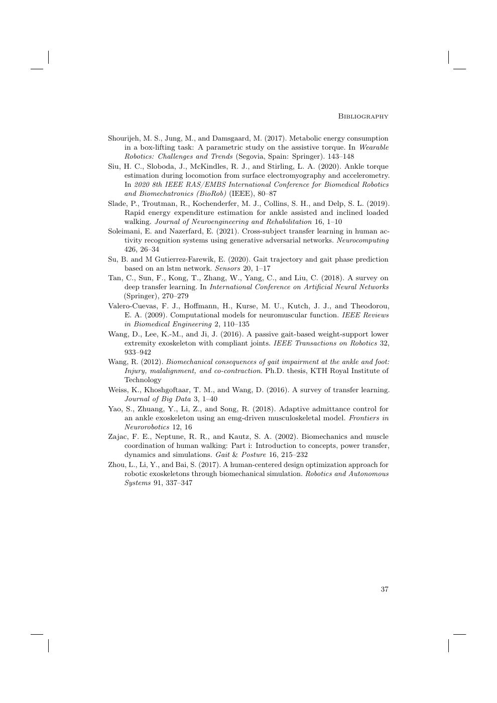

English text extracted from page 52

<pre>
Bibliography

Shourijeh, M. S., Jung, M., and Damsgaard, M. (2017). Metabolic energy consumption
     in a box-lifting task: A parametric study on the assistive torque. In Wearable
     Robotics: Challenges and Trends (Segovia, Spain: Springer). 143–148
Siu, H. C., Sloboda, J., McKindles, R. J., and Stirling, L. A. (2020). Ankle torque
     estimation during locomotion from surface electromyography and accelerometry.
     In 2020 8th IEEE RAS/EMBS International Conference for Biomedical Robotics
     and Biomechatronics (BioRob) (IEEE), 80–87
Slade, P., Troutman, R., Kochenderfer, M. J., Collins, S. H., and Delp, S. L. (2019).
     Rapid energy expenditure estimation for ankle assisted and inclined loaded
     walking. Journal of Neuroengineering and Rehabilitation 16, 1–10
Soleimani, E. and Nazerfard, E. (2021). Cross-subject transfer learning in human ac-
     tivity recognition systems using generative adversarial networks. Neurocomputing
     426, 26–34
Su, B. and M Gutierrez-Farewik, E. (2020). Gait trajectory and gait phase prediction
     based on an lstm network. Sensors 20, 1–17
Tan, C., Sun, F., Kong, T., Zhang, W., Yang, C., and Liu, C. (2018). A survey on
     deep transfer learning. In International Conference on Artificial Neural Networks
     (Springer), 270–279
Valero-Cuevas, F. J., Hoffmann, H., Kurse, M. U., Kutch, J. J., and Theodorou,
     E. A. (2009). Computational models for neuromuscular function. IEEE Reviews
     in Biomedical Engineering 2, 110–135
Wang, D., Lee, K.-M., and Ji, J. (2016). A passive gait-based weight-support lower
     extremity exoskeleton with compliant joints. IEEE Transactions on Robotics 32,
     933–942
Wang, R. (2012). Biomechanical consequences of gait impairment at the ankle and foot:
     Injury, malalignment, and co-contraction. Ph.D. thesis, KTH Royal Institute of
     Technology
Weiss, K., Khoshgoftaar, T. M., and Wang, D. (2016). A survey of transfer learning.
     Journal of Big Data 3, 1–40
Yao, S., Zhuang, Y., Li, Z., and Song, R. (2018). Adaptive admittance control for
     an ankle exoskeleton using an emg-driven musculoskeletal model. Frontiers in
     Neurorobotics 12, 16
Zajac, F. E., Neptune, R. R., and Kautz, S. A. (2002). Biomechanics and muscle
     coordination of human walking: Part i: Introduction to concepts, power transfer,
     dynamics and simulations. Gait &amp; Posture 16, 215–232
Zhou, L., Li, Y., and Bai, S. (2017). A human-centered design optimization approach for
     robotic exoskeletons through biomechanical simulation. Robotics and Autonomous
     Systems 91, 337–347

                                                                                    37
</pre>

