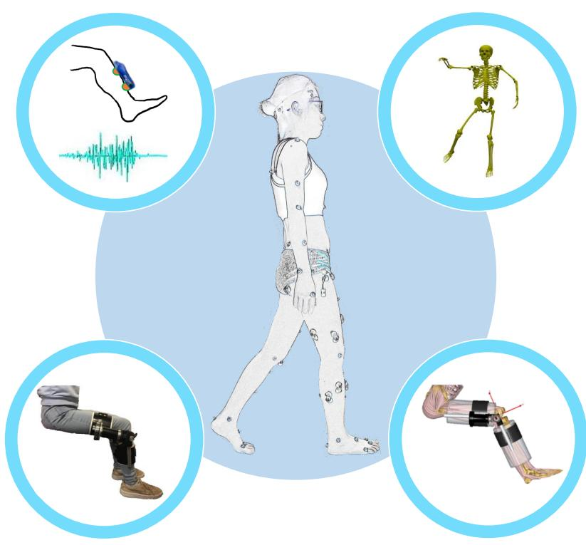
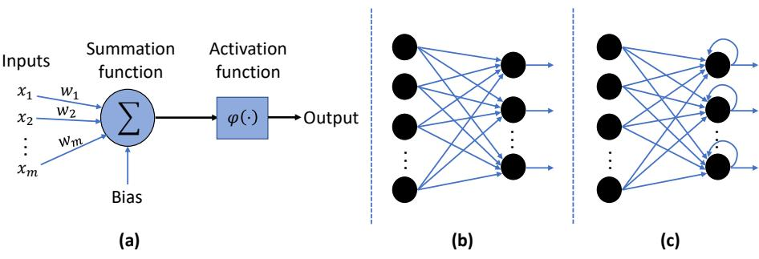
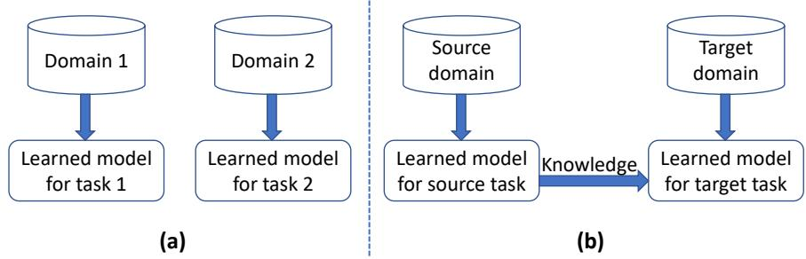

工程力学博士学位论文

# 用于穿戴式外骨骼系统设计的生物力学参数估计

LONGBIN ZHANG

  
Stockholm, Sweden 2021

# 用于穿戴式外骨骼系统设计的生物力学参数估计

LONGBIN ZHANG

经KTH Royal Institute of Technology（瑞典皇家理工学院）正式许可，谨定于2021年10月22日星期五上午9:00在斯德哥尔摩 Lindstedsvägen 26 教室 F3 举行博士学位公开答辩会。

© Longbin Zhang

谨以此书献给我的父母

# 用于穿戴式外骨骼系统设计的生物力学参数估计

Longbin Zhang

KTH MoveAbility Lab, KTH Royal Institute of Technology, Department of Engineering Mechanics SE–100 44 Stockholm, Sweden SE-100 44 Stockholm, Sweden

## 摘要

外骨骼正越来越多地应用于神经损伤后运动功能障碍患者的康复和日常生活中。本论文的总体目标是研究如何利用在技术上可行且适用于助力外骨骼装备的传感器输入，鲁棒且准确地预测关节力矩，并建立一个可用于评估用户-外骨骼交互界面的框架。本汇编式论文基于五篇论文展开，分别针对外骨骼控制器设计和物理设计的不同方面，旨在为用于康复和运动助力的穿戴式外骨骼系统设计做出贡献。

在第一项研究中，我们在七种运动任务中，使用肌电图（electromyography, EMG）驱动的神经肌肉骨骼（neuromusculoskeletal, NMS）模型和标准人工神经网络（artificial neural network, ANN）模型估算了踝关节力矩。两种方法均以肌电信号和踝关节角度作为输入，利用来自三维运动分析的实验数据对模型进行训练，并对踝关节力矩进行了预测。我们的结果表明，当在大规模且多样化的试验集上进行训练时，标准 ANN 模型能够更准确地预测踝关节力矩，但在未见过的运动中预测精度较低；而 NMS 模型总体上更具实用性，并且具有能够详述潜在物理机制的优势。第二项研究直接受第一项研究的启发。我们的目标是使用第一项研究中两种方法的混合形式，具体而言即 NMS 求解器引导的 ANN（NMS solver-informed ANN），通过引入底层 NMS 求解器的额外特征来增强标准 ANN 模型，从而估算踝关节力矩。我们在受试者内（intra-subject）和受试者间（inter-subject）测试两种场景下考察了混合 ANN 模型的力矩预测性能。我们发现，NMS 求解器引导的 ANN 模型的关节力矩预测精度优于单独使用任一方法（即单独的 NMS 或标准 ANN 模型），这表明将 NMS 特征集成到标准 ANN 模型中带来了性能提升。此外，在受试者间测试中，我们采用了迁移学习技术，通过利用从先前受试者中提取的信息进一步提高了关节力矩的预测性能。

在第三项研究中，我们使用长短期记忆（long short-term memory, LSTM）神经网络，不仅预测了多种不同运动过程中的踝关节力矩，还预测了矢状面的膝关节力矩以及矢状面和额状面的髋关节力矩。我们构建了若干个网络，即针对每种运动的独立 LSTM 模型，以及适用于所有运动的统一模型。LSTM 网络的构建分别采用了和未采用迁移学习，其中网络可以利用从先前任务和/或受试者中提取的信息，对未见过的或“新”任务或受试者进行预测。我们评估了 LSTM 模型跨任务和跨受试者的预测能力，并研究了在 LSTM 网络中引入迁移学习是否提高了其泛化能力。我们的结果表明，在受试者内测试中，一个统一模型和十个独立 LSTM 模型均能准确预测下肢关节力矩（即预测误差较低）。通过引入迁移学习，即使仅使用来自“新”受试者的较小子集运动数据进行重新训练，LSTM 模型在跨任务和跨受试者预测力矩时的泛化能力也得到了显著提高。

在第四和第五项研究中，我们构建了一个逼真的膝关节外骨骼模型。在第四项研究中，我们在肌肉骨骼建模软件中创建了一个虚拟人机系统（human-machine system, HMS）。我们发现，该虚拟 HMS 有助于模拟不同的辅助策略如何影响描述使用者需求和后果的参数，包括运动中所涉及的肌肉需求、关节接触力以及人机交互力。在第五项研究中，我们通过仿真分析了膝关节外骨骼各部件的不同重量分布如何在三种功能性运动中影响使用者的肌肉激活。我们制作了一台单侧膝关节外骨骼样机，并在五名健康受试者身上进行了测试。对比了仿真和实验测得的肌肉激活情况。我们发现肌肉激活随着重量分布和运动类型的不同而变化，这表明没有任何单一的物理设计适用于所有运动。外骨骼的物理设计在理想情况下应考虑使用者的活动目标。

本论文中开发的方法在按需辅助（assistance-as-needed）外骨骼控制设计等应用中具有广阔的前景。所开发的虚拟 HMS 使得研究膝关节外骨骼的不同辅助策略和物理设计如何影响使用者的肌肉做功和交互力成为可能，这既能简化样机迭代，又能评估一些在实验中难以测量的参数。

关键词：Hill型肌肉模型（Hill-type muscle model）、泛化（generalization）、迁移学习（transfer learning）、计算建模（computationally modeling）、人机系统（human-machine system）

# 可穿戴外骨骼系统设计的生物力学参数估计

Longbin Zhang

KTH MoveAbility Lab, Kungliga Tekniska högskolan（瑞典皇家理工学院）, Institutionen för Teknisk Mekanik（工程力学系）

SE-100 44 Stockholm, Sverige

## 摘要

外骨骼越来越多地应用于神经损伤后运动障碍患者的康复和日常生活中。本学位论文的总体目标是建立鲁棒且精确的方法，利用可穿戴传感器预测下肢关节力矩，并在仿真中评估外骨骼与使用者之间的界面相互作用力。本论文基于五项研究，在用于康复和运动辅助外骨骼开发的背景下，重点关注外骨骼控制技术和物理设计的不同方面。

在第一项研究中，我们利用肌电图（electromyography, EMG）驱动的神经肌肉骨骼（neuromusculoskeletal, NMS）模型和标准人工神经网络（artificial neural network, ANN）模型，估算了七种不同运动中的踝关节力矩。EMG 信号和踝关节角度被用作两种模型的输入。模型使用来自 3D 运动分析的实验数据进行训练，以便随后仅基于输入数据即可估算力矩。我们的结果表明，如果在包含多种运动类型的大量数据上进行训练，ANN 模型估算力矩的准确度高于 NMS 模型；但当使用来自相似运动的数据进行训练时，NMS 模型的估算更为准确。此外，NMS 模型具有能够描述底层物理原理的优势。在第三项研究中，我们利用 LSTM 神经网络估算了多种不同运动中矢状面的踝关节和膝关节力矩，以及矢状面和额状面的髋关节力矩。我们构建了多个网络，即针对每种运动的独立 LSTM 模型以及适用于所有运动的统一模型。构建 LSTM 网络时分别采用了和未采用所谓的“迁移学习”（transfer learning），在迁移学习中，网络可以利用来自先前运动和/或受试者的知识，以更好地估算先前未知或“新”运动或测试受试者的力矩。我们评估了 LSTM 模型在不同运动和受试者上进行训练和测试时估算力矩的准确性。研究问题之一是应用迁移学习后模型的泛化能力是否得到提升。

我们的结果表明，统一模型和十个单独的 LSTM 模型均能够准确估算力矩。迁移学习进一步提高了它们对新运动和新受试者的泛化能力，即使来自“新”受试者的训练数据集仅包含来自较少运动的较少数据。

在第四项和第五项研究中，我们构建了一个逼真的膝关节外骨骼模型。在第四项研究中，我们在生物力学建模软件中构建了一个虚拟人机系统（human-machine system, HMS）。我们通过模拟不同助力策略如何影响用户在运动中的需求和后果（包括肌肉用力程度、关节接触力以及用户与外骨骼之间的交互力），证明了 HMS 模型具有重要应用价值。在第五项研究中，我们通过仿真分析了不同膝关节外骨骼模型及其重量分布对用户在四种功能性动作中肌肉激活的影响。我们制作了一个膝关节外骨骼原型，并在五名健康受试者身上进行了测试。在仿真和实验中均对比了外骨骼对用户肌肉激活的影响。我们发现肌肉激活因重量分布和动作模式而异，即没有任何单一的物理设计对所有动作都是最优的。外骨骼的物理设计最好能兼顾用户的活动目标。

本学位论文中开发的方法在所谓的“按需助力”（assistance-as-needed）外骨骼控制工程领域具有广阔的应用前景。

## 前言

本学位论文基于以下期刊论文，正文中以罗马数字进行引用。论文全文（已发表版本或手稿格式）附于本论文末尾。

Paper 1: Longbin Zhang, Zhijun Li, Yingbai Hu, Christian Smith, Elena M. Gutierrez Farewik and Ruoli Wang. Ankle Joint Torque Estimation Using an EMG-Driven Neuromusculoskeletal Model and an Artificial Neural Network Model. IEEE Transactions on Automation Science and Engineering 2021 ; 18(2): 564-573.

Paper 2: Longbin Zhang, Xueyu Zhu, Elena M. Gutierrez Farewik, and Ruoli Wang. Ankle Joint Torque Prediction using an NMS Solver Informed-ANN Model. Submitted.

Paper 3: Longbin Zhang, Davit Soselia, Ruoli Wang, and Elena M. Gutierrez-Farewik. Lower-limb Joint Torque Prediction using LSTM Neural Network and Transfer Learning. Manuscript.

Paper 4: Longbin Zhang, Yixing Liu, Ruoli Wang, Christian Smith, and Elena M. Gutierrez-Farewik. Modelling and Simulation of a Human Knee Exoskeleton’s Assistive Strategies and Interaction. Frontiers in Neurorobotics 2021 ; 15: 1-12.

Paper 5: Yixing Liu, Longbin Zhang, Ruoli Wang, Christian Smith, and Elena M. Gutierrez Farewik. Weight Distribution of a Knee Exoskeleton Influences Muscle activation during Movements. IEEE Access 2021 ; 9: 91614 - 91624.

## 作者分工

该研究项目由 Prof. Elena Gutierrez-Farewik、Dr. Ruol Wang 和 Dr. Christian Smith 发起，其中 E.M. Gutierrez-Farewik 担任主导师，R. Wang 担任副导师，两人均为论文 I、II、III、IV 和 V 的共同作者。C. Smith 担任副导师，并为论文 I、IV 和 V 的共同作者。Dr. Xueyu Zhu 为论文 II 的顾问兼共同作者。Zhijun Li 和 Yingbai Hu 为论文 I 的共同作者。Davit Soselia 为论文 III 的共同作者。Yixing Liu 为论文 V 的第一作者。在整个研究过程中，Longbin Zhang 与 E.M. Gutierrez-Farewik 以及 R. Wang 持续就研究进展进行了探讨。

论文 1。L. Zhang 设计了具体的研究目标。Z Li 与 Y Hu 构建了初步的 ANN 模型并展示了部分初步结果。L. Zhang 对所有数据进行了后处理，进一步开发了 ANN 模型，运行了本研究的整体框架，对结果进行了统计分析，并起草了手稿。R. Wang 采集了实验数据。E.M. Gutierrez-Farewik 和 R. Wang 指导了整体研究目标和工作进展，并协助起草与修改了论文。C. Smith 监督了工作进展。

论文 2。L. Zhang、X. Zhu 和 R. Wang 共同参与了研究构想。L. Zhang 设计了具体的研究目标，对所有数据进行了后处理，构建了 ANN 模型，运行了本研究的框架，对结果进行了统计分析，并起草了手稿。R. Wang 采集了实验数据。E.M. Gutierrez-Farewik、X. Zhu 和 R. Wang 指导了整体研究目标和工作进展，并协助起草与修改了论文。

论文 3。L. Zhang 设计了具体的研究目标，设计了实验，采集了实验数据，并对所有数据进行了后处理。D. Soselia 构建了初步的 LSTM 模型并展示了部分初步结果。L. Zhang 进一步开发了 LSTM 模型，设计了泛化模型，运行了本研究的整体框架，对结果进行了统计分析，并起草了手稿。E.M. Gutierrez-Farewik 和 R. Wang 指导了整体研究目标和工作进展，并协助起草与修改了论文。

论文 4。L. Zhang 设计了具体的研究目标。Y. Liu 开发了膝关节外骨骼 CAD 模型。L. Zhang 将 CAD 模型整合进肌骨模型中，执行了仿真模拟并起草了手稿。E.M. Gutierrez-Farewik 和 R. Wang 指导了整体研究目标和工作进展，并协助起草与修改了论文。C. Smith 监督了工作进展。

论文 5。Y. Liu 开发了膝关节外骨骼 CAD 模型，设计了具体的研究目标，执行了仿真模拟，采集并分析了实验数据，并起草了手稿。L. Zhang 将 CAD 模型整合进肌骨模型中。E.M. Gutierrez-Farewik 和 R. Wang 指导了整体研究目标和工作进展，并协助起草与修改了论文。C. Smith 监督了工作进展。

## 目录

摘要
瑞典语摘要（Sammanfattning）
前言
第一部分 - 概述与总结
第1章 引言
1.1. 正常步态的生物力学
1.2. 肌肉无力导致的病理步态
1.3. 关节力矩预测的计算方法
1.4. 可穿戴外骨骼
第2章 研究目标
第3章 方法
3.1. 受试者
3.2. 实验步骤
3.3. 数据处理（研究 I、II 和 III）
3.4. 关节力矩预测模型
3.5. 迁移学习（研究 II 和 III）
3.6. 人机系统（研究 IV 和 V）
3.7. 数据分析
第4章 结果与讨论
4.1. 关节力矩估计（研究 I、II 和 III）
4.2. 人机系统（研究 IV 和 V）
4.3. 局限性
第5章 结论与未来工作
致谢
参考文献

第一部分

概述与总结

## 第1章

# 引言

人类步态是一系列重复的肢体动作，在保持站立稳定性的同时推动身体向前移动（Perry 1992）。脑卒中（中风）、脊髓损伤和脑创伤等神经系统疾病常常会损害个体的行走能力和行走策略。近几十年来，可穿戴外骨骼的发展旨在恢复或增强运动功能和/或促进神经康复。可穿戴外骨骼是极具前景的辅助/康复设备，可帮助肌力缺陷或运动障碍患者提升运动能力。本论文的研究范畴在于面向可穿戴外骨骼系统设计的生物力学参数估计，从而为康复与运动辅助提供支持。

在外骨骼辅助康复训练过程中，患者的主动参与对于刺激神经肌肉恢复至关重要。然而，尽管机电一体化和生物信号处理近期取得了发展，但涉及神经受损患者主动参与的外骨骼控制算法仍然较少。因此，从机制上理解肌肉如何被激活以产生力和关节力矩并推动身体产生特定运动，将对外骨骼在神经康复中的控制策略大有裨益，因为这可以指导控制系统兼顾甚至鼓励患者的主动参与（Mounis et al. 2019）。

虽然外骨骼原型的实验评估十分重要，但在设计早期的生物力学预测模拟能够最大程度减少原型迭代，并评估一些在实验中难以测量的参数。虚拟人机系统（human-machine systems, HMSs）已多次应用于外骨骼的优化设计与控制中。然而，在开展实验之前，很少有虚拟 HMS 能够针对不同的外骨骼辅助策略和重量分布，提供在关节和肌肉层面对用户的详细影响以及交互力信息（Shourijeh et al. 2017; Dembia et al. 2017）。

## 1.1. 正常步态的生物力学

当一个人行走时，一侧下肢作为移动的支撑来源，而另一侧下肢向前推进至新的支撑点。随后，双肢角色互换。

## 1. 引言

这一系列动作由每侧下肢重复进行，直至到达目的地。单侧下肢完成这些功能的一个完整序列被称为步态周期（gait cycle）（Perry 1992）。每个步态周期通常分为支撑相（stance phase）和摆动相（swing phase）。正如 Perry（Perry 1992）所述，支撑相是指所观察的足部与地面接触的时期，大约占步态周期的前 60%。支撑相可进一步细分为四个阶段：(1) 承重反应期（loading response，占步态周期的 0-10%，始于初始触地）是最初的双支撑期，持续至对侧足抬起开始摆动；(2) 支撑中期（mid-stance，占步态周期的 10-30%）是单腿支撑期的第一部分，始于对侧足抬起，持续至体重对齐在前足上方；(3) 支撑末期（terminal stance，占步态周期的 30-50%）是单腿支撑期的第二部分，始于足跟抬起，持续至对侧足着地；以及 (4) 摆动前期（pre-swing，占步态周期的 50-60%）是步态周期中的第二个双支撑期，始于对侧足的初始触地，结束于同侧足尖离地。摆动相是步态周期的其余部分，在此期间所观察的足部不与地面接触。摆动相可细分为三个阶段：(1) 摆动初期（initial swing，占步态周期的 60-73%）约占摆动期的三分之一，始于足部离开地面，结束于摆动足与支撑足并排相对；(2) 摆动中期（mid-swing，占步态周期的 73-87%）是摆动期的第二部分，始于摆动足与支撑足相对，结束于摆动侧胫骨垂直；以及 (3) 摆动末期（terminal-swing，占步态周期的 87-100%）始于胫骨垂直，结束于足部着地。

在行走过程中，肌肉会根据支撑相和摆动相在承重、单腿支撑以及肢体推进方面的需求而依次被激活（Gage et al. 2009; Perry 1992）。在初始着地后，踝背屈肌（胫骨前肌、趾长伸肌和拇长伸肌）进行离心收缩以减缓踝关节跖屈并吸收冲击力。踝背屈肌在摆动相也处于活跃状态，以防止足下垂拖地。踝跖屈肌（主要是比目鱼肌）在支撑中期进行离心收缩，以控制胫骨的前向运动。在支撑末期，跖屈肌（主要是比目鱼肌和腓肠肌）的作用由离心收缩转变为向心收缩，以促进足跟抬起并达到峰值跖屈力矩。在摆动前期末，随着负荷在摆动前期转移至对侧肢体，地面反作用力（GRF）迅速下降，跖屈肌的收缩也随之迅速减弱（Wang 2012）。

膝伸肌（股四头肌）在摆动末期活跃，以便在着地前预先调整足部位置，并在承重反应期活跃以吸收震动并维持膝关节的稳定性。膝屈肌（主要是腘绳肌）的主要作用是防止摆动末期和支撑早期可能出现的膝过伸，并在摆动初期屈曲膝关节以防止足部拖地。髋伸肌（主要是大收肌和臀大肌）在摆动末期和初始着地时活跃，以终止并控制髋关节屈曲，并在承重反应期促使躯干在下肢上方前移。髋屈肌（主要是髂腰肌）通过收缩在摆动相使髋关节屈曲。髋外展肌（主要是臀大肌和臀中肌）在支撑早期通过对抗快速承重来稳定髋关节外侧。髋内收肌群在摆动早期也有助于髋关节的屈曲（Perry 1992; Gutierrez 2003）。

## 1.2. 肌肉无力导致的病理步态

神经系统疾病会损害个体的行走能力，且它们在原发病理上存在显著差异。这些疾病对行走力学机制造成的异常被归纳为四个功能类别：畸形、肌肉无力、控制受损和疼痛（Perry 1992）。在本论文中，我们主要关注由肌肉无力引起的病理步态。肌肉无力的人群可能无法产生满足日常生活活动所需的力矩，这会对他们的独立生活能力和生活质量产生不利影响。肌肉无力不仅带来不便，还会对个体的健康产生多米诺骨牌效应；例如，它常常继发代谢减缓、关节压力增加和姿势不稳定等问题（Horlings et al. 2008）。

## 1.2.1. 髋外展肌无力

当存在髋外展肌功能障碍时，人体较难将重心维持在支撑腿一侧，可能导致骨盆向摆动侧下沉，这被称为特伦德伦伯格征（Trendelenburg sign）阳性。如果无力为单侧，患者可能会在整个支撑相期间将躯干向无力的支撑肢侧方倾斜。双侧无力则可能导致躯干向两侧的支撑腿交替侧向倾斜。长此以往，这些代偿姿势可能会诱发脊柱侧凸。

## 1.2.2. 髋伸肌无力

在髋伸肌无力的情况下，机体可能无法抵抗外在的髋屈曲力矩，从而可能出现过度髋屈曲的倾向。为了代偿髋伸肌无力，患者可能会将躯干向后倾斜，使地面反作用力（GRF）矢量位于髋关节中心后方，长此以往可能导致腰椎过度前凸。

## 1.2.3. 髋屈肌无力

在髋屈肌无力的情况下，机体在摆动初期可能缺乏足够的髋屈曲，从而可能导致足部廓清（foot clearance）动量不足以及步长缩短。为了代偿髋屈肌无力，患者可能会采取以下策略：骨盆后倾、膝关节过度屈曲以及躯干向对侧倾斜。

## 1. 引言

## 1.2.4. 膝伸肌无力

如果膝伸肌（股四头肌）无力且力量不足以支撑屈曲的膝关节，在支撑相期间从任何膝屈曲状态恢复都将变得困难甚至不可能。可采取以下策略来代偿膝伸肌无力：(1) 收缩髋伸肌以拉回大腿，并收缩跖屈肌以阻止胫骨前移，从而导致膝关节伸展或过伸；(2) 躯干前倾以使 GRF 矢量前移至膝关节前方，产生内屈力矩，这也可能导致膝过伸；(3) 下肢外旋以将膝关节锁定在伸展位。这些代偿可能会导致韧带退变。

## 1.2.5. 膝屈肌无力

在膝屈肌无力的情况下，机体可能无法提供足够的膝屈曲力矩在摆动末期和支撑初期约束大腿，并控制摆动相中小腿的减速。代偿策略可能包括在摆动相增加髋屈曲，或摆动腿呈划圈步态模式。

## 1.2.6. 踝跖屈肌无力

在踝跖屈肌无力的情况下，机体可能无法抵抗支撑相期间的外在背屈力矩，这可能导致胫骨不受控制地前移，进而在负重期间导致髋屈曲、膝屈曲和过度踝背屈的蹲伏步态（crouch gait）姿势。这可能导致股四头肌活动增加、支撑相足跟触地时间延长、步长缩短和/或步行速度减慢。

## 1.2.7. 踝背屈肌无力

当踝关节背屈肌无力时，个体可能无法在支撑相抵抗外部跖屈力矩，并且在摆动相可能难以实现足部廓清（foot clearance）。这可能导致在初始着地时表现为前足或全足着地，并在摆动相呈现足下垂（dropfoot）步态。代偿机制可包括在摆动相增加髋关节和膝关节的屈曲以实现足部廓清。

## 1.3. 关节力矩预测中的计算方法

## 1.3.1. 神经肌肉骨骼（NMS）建模

NMS（神经肌肉骨骼）模型是基于物理的人体骨骼解剖结构与生理机制的数学表征。此类模型有助于理解肌肉如何协调以产生运动，并可用于估计各种任务期间的关节力矩（Valero-Cuevas et al. 2009）。肌电图（EMG）知情的 NMS 模型通常用于执行肌肉动力学的前向动力学仿真，并使用实验测量的 EMG 作为输入来估计关节力矩（Pizzolato et al. 2019）。如 Pizzolato 等人（Pizzolato et al. 2015）所述，根据在 NMS 模型中如何利用实验 EMG 信号计算肌肉兴奋度，EMG 知情的 NMS 模型通常具有三种神经求解模式：EMG 驱动（EMG-driven）、EMG 混合（EMG-hybrid）和 EMG 辅助（EMG-assisted）。

• EMG 驱动（EMG-driven）：仅使用实验记录的 EMG 信号来计算驱动模型的肌肉兴奋度，并估计肌腱复合体受力与关节力矩。

• EMG 混合（EMG-hybrid）：由于某些肌肉的 EMG 信号在常规情况下不便于或无法采集，这些肌肉的肌肉兴奋模式通过优化算法（例如静态优化，在已知运动下最小化肌肉激活度的平方和）来构建（Anderson and Pandy 2001）。因此，在该模式下，实验记录的 EMG 信号与来自优化的肌肉兴奋模式相结合以计算肌肉兴奋度。

• EMG 辅助（EMG-assisted）：由于 EMG 信号的质量可能会受到肌电串扰（cross-talk）和电极放置位置的影响，EMG 辅助模式允许优化算法调整肌肉兴奋度，以更好地追踪关节力矩。

在这三种模式中，肌电驱动（EMG-driven）模式适用于能够轻松记录到高质量主要肌肉肌电信号的关节，如膝关节和踝关节（Sartori et al. 2014; Pizzolato et al. 2015）。肌电混合（EMG-hybrid）模式可以弥补无法获取深层肌肉（如用于髋关节运动的髂肌和腰肌）信号的不足，而肌电辅助（EMG-assisted）模式则可以进一步补偿肌电信号串扰或噪声（Hoang et al. 2018）。在这些情况下，肌电混合和肌电辅助模型可以更准确地表征神经肌肉骨骼（NMS）系统的生理特性；然而，这两种模型涉及利用优化算法来获取某些肌肉的肌肉激活度，这可能非常耗时，因此不太适合实时应用。另一方面，据报道，肌电驱动 NMS 模型能够实时且鲁棒地预测关节力矩（Durandau et al. 2017）、关节接触力（Pizzolato et al. 2017b）和关节刚度（Yao et al. 2018）。

## 1.3.2. 人工神经网络

人工神经网络（ANN）作为传统基于模型的方法的替代方案或作为集成系统的组成部分，正变得越来越流行。ANN 是一种机器学习方法。它具有多层计算单元，通过将每个节点视为人工神经元来模拟人脑中的神经元突触系统，从而具备处理复杂和非线性信息的能力（Imran and Alsuhaibani 2019; Haeberle et al. 2019; Lee et al. 2017）。ANN 通常分两步工作：首先通过训练/学习模型来映射输入-输出关系，随后运行训练好的模型以估算输出，而无需

## 1. 引言

  
Figure 1.1: (a) 单个人工神经元的结构：通常由求和函数和激活函数组成。求和函数：每个输入 $( x _ { 1 } , x _ { 2 } , . . . , x _ { m } )$ 乘以其对应的权重 $( w _ { 1 } , w _ { 2 } , . . . , w _ { m } )$，该权重用于衡量输入的连接强度。然后将加权输入和偏置输入到求和函数中。激活函数：决定节点的激活程度。(b) 前馈神经网络/多层感知机：信息仅向前传递。(c) 循环神经网络：类似于前馈神经网络结构，但包含反馈环路。

输入与输出之间的先验数学知识。根据可用的数据集和具体的研究问题，可以选择不同的算法来训练特定的学习模型。这些算法通常可分为监督学习（supervised learning）、无监督学习（unsupervised learning）和半监督学习（semi-supervised learning）。监督学习与无监督学习的主要区别在于，监督学习使用带标签的数据来帮助预测结果。在监督学习中，带标签的数据旨在训练或“监督”算法准确分类数据或预测结果，通常用于分类和回归问题。无监督学习则使用机器学习算法在无需人工干预的情况下发现数据中的隐藏模式，主要应用于聚类、关联规则和降维。半监督学习则介于两者之间，通常使用少量有标签数据和大量无标签数据进行训练。在本论文中，采用监督学习方法来预测不同日常活动中的关节力矩值。

人工神经网络（ANN）由多个通常被称为节点的人工神经元组成，其概念源自生物神经元。每个神经元接收输入并产生单个输出，该输出可发送至多个其他神经元。应用最广泛的神经元模型基于 McCulloch 和 Pitts 的研究（McCulloch and Pitts 1943; Mellit and Kalogirou 2008）（Fig. 1.1 (a)）。人工神经元通常由两部分组成：(1) 求和函数和 (2) 激活函数。在求和函数中，每个输入都乘以其对应的

## 1.3. 关节力矩预测中的计算方法

权重，该权重衡量输入的连接强度。随后，加权输入和偏置被送入求和函数。激活函数决定节点的激活程度。通过将多个相互连接的人工神经元用于传输信息，便构成了 ANN。通常，ANN 由输入层、隐藏层 $/ \mathrm { s }$ 和输出层构成。输入层接收输入数据。隐藏层 $/ \mathrm { s }$ 接收来自输入层的信息，对其进行处理，并将其发送至输出层。输出层计算最终输出（Imran and Alsuhaibani 2019）。层与层之间的节点互连可分为两类基本形式，即前馈神经网络（FFNN）/多层感知机（MLP）和循环神经网络（RNN）。它们的主要区别在于 FFNN 不包含任何反馈回路，而 RNN 则包含反馈回路（Fig. 1.1 (b) 和 (c)）。

MLP（多层感知机）是最常见的人工神经网络（ANN）类型，只要有足够的训练数据，它就可以提取特征并在整个网络中存储信息以预测非常复杂的函数，而无需构建复杂的显式数学公式和成本高昂的物理模型。因此，它是对非线性和复杂问题进行建模的一种有效方法，并在生物力学的众多应用中展现出了强大的能力。一个三层 MLP 模型被用于估计在等速 30°/s 和 $6 0 ^ { \circ } /$ /s 下的膝关节力矩，并显示出比逐步回归模型更准确的力矩预测结果（Hahn 2007）。MLP 已成功应用于估计行走和提踵过程中的踝关节力矩及地面反作用力（Jacobs and Ferris 2015）、屈肘过程中的肘关节力矩（Jali et al. 2015）、动态收缩过程中的肌肉力量（Ba and Chew 2013），以及运动过程中的能量消耗（Slade et al. 2019）。

与 MLP 相比，RNN（循环神经网络）可以对序列内的时序信息进行建模，尤其是当前输入与先前输入之间的关系。出于这个原因，人们常说 RNN 具有记忆功能。这种“记忆”的使用使得 RNN 在处理时间序列数据时具有优势，但也给模型训练带来了困难。其中一个问题是，由于梯度消失或爆炸，它无法长期存储过去的信息。为了解决这个问题，人们提出了一种 RNN 的变体——长短期记忆（LSTM）网络（Hochreiter and Schmidhuber 1997）。LSTM 网络通过添加可以在不同时间步之间更新信息的记忆结构，并利用门控机制来决定记住什么、遗忘什么以及输出什么，从而能够长久地选择性记住模式。有研究利用 LSTM 网络（Kim et al. 2020）在与环境交互的过程中根据 EMG（肌电）信号估计腕关节力矩和位置，估计结果与实际值表现出高度一致性。Siu 等人（Siu et al. 2020）也成功应用 LSTM 网络，根据站立、行走、跑步和冲刺期间的 EMG 和加速度计信号来估计踝关节力矩。Mundt 等人同时使用 MLP 和 LSTM 模型，利用惯性测量单元

## 1. 引言

  
Figure 1.2: (a) 传统人工神经网络，其中模型在学习时不保留或积累知识。(b) 迁移学习，其中目标任务的模型利用先前针对源任务学习的模型所积累的知识来进行学习。

（IMU）数据预测步态过程中的三维下肢关节角度和力矩（Mundt et al. 2020）。虽然两种网络都能准确预测关节角度和力矩，但 MLP 的预测精度略高于 LSTM。

## 1.3.3. 迁移学习

传统的 ANN（人工神经网络）通常在训练数据和测试数据具有相同特征空间和分布的常见假设下表现良好。然而，如果测试数据的分布与训练数据不同，预测结果很可能会因这些差异而下降。此外，重新收集训练数据并重新训练模型可能是困难或昂贵的（Pan and Yang 2009; Weiss et al. 2016; Tan et al. 2018）。在这种情况下，迁移学习策略在解决这些问题方面引起了广泛关注。迁移学习的灵感来源于人类如果在先前学习过相似知识，就能更快地学习新任务这一事实（Pan and Yang 2009），而传统的 ANN 则是针对不同任务独立地学习模型（Fig. 1.2）。根据源域与目标域及任务之间的不同情况，迁移学习通常分为三种子设定：归纳迁移学习、直推式迁移学习和无监督迁移学习。一个领域 $\mathcal{D}$ 由以下部分组成：特征空间 $\mathcal{X}$ 和边缘概率分布 $P(X)$，其中 $X = \{ x _ { 1 } , . . . , x _ { n } \} \in { \mathcal { X } }$。给定一个特定领域 $\mathcal { D } = \{ \mathcal { X } , P ( X ) \}$，一个任务 $\mathcal { T } = \{ \mathcal { V } , f ( x ) \}$ 包含两部分：标签空间 $\mathcal{Y}$ 和目标预测函数 $f : \mathcal { X }  \mathcal { Y } _ { : }$，其中函数 $f$ 用于预测新实例 $x$ 的对应标签 $f(x)$（Lin and Jung 2017）。

• 归纳迁移学习（Inductive transfer learning）：目标任务与源任务不同但相关，无论源域与目标域之间是否存在相似性。

## 1.3. 关节力矩（joint torque）预测中的计算方法

• 直推式迁移学习（Transductive transfer learning）：目标任务与源任务相同，而目标域与源域不同但相关。

• 无监督迁移学习（Unsupervised transfer learning）：目标任务和目标域均与源任务和源域不同但相关。

基于“迁移什么（what to transfer）”，迁移学习方法在上述三种子设定中可以归纳为四种情况：

• 实例迁移（Instance transfer）：对源域中的部分有标签实例重新赋权，以用于目标域的学习。

• 特征表示迁移（Feature representation transfer）：寻找源域和目标域的“良好”特征表示，以减小领域间的差异和模型的预测误差。

• 参数迁移（Parameter transfer）：发现并迁移源域模型与目标域模型之间共享的部分参数或先验知识。

• 关系迁移（Relational transfer）：构建并迁移源域与目标域之间的关系知识映射。

在这四种方法中，样本迁移（instance transfer）和参数迁移（parameter transfer）方法是近年来研究领域中最常用于解决若干问题的两种方法，例如解决因患者数据的伦理问题或研究资源有限导致数据采集昂贵而造成的数据受限问题，以及减少针对新的但相关的研究所需的完全重新校准、重建或重新训练的时间和精力。通过将基于源域（受试者）生成的自适应数据迁移到目标域（受试者），一种样本迁移方法被结合到生成对抗网络中，从而为人体活动识别系统中目标受试者的分类器训练提供足够的数据 (Soleiman and Nazerfard 2021)。该研究代表了在无法获取新用户数据并对其进行标注时，人体活动识别中跨受试者知识迁移的前沿解决方案。参数迁移方法被应用于 LSTM 神经网络模型中以估计骨骼肌力量 (Dao 2019)，并通过将知识从预训练的 LSTM 模型迁移到新模型中来提高预测性能。LSTM 与迁移学习相结合的方法有望应用于功能康复中的实时骨骼肌力量估计。

尽管人工神经网络（ANNs）已被广泛用于基于肌电（EMG）信号输入预测关节力矩，并表现出较高的预测性能 (Luh et al. 1999; Jephil et al. 2020)，但很少有研究探讨 ANN 模型的泛化性（即泛化能力）。此外，肌肉协调模式在不同受试者和不同运动之间往往存在差异 (De Rugy et al. 2012; Safavynia et al. 2011)。由多个受试者和/或

## 1. 引言

多个会话训练的 ANN 模型在新的受试者/会话上进行测试时可能会导致较差的性能，因为训练用户/会话与新用户/会话之间的特征空间或边际概率分布可能不同。为新用户/会话采集大量测试数据可能是昂贵、耗时或在其他方面不切实际的，对于患有运动障碍的新用户而言尤其困难。因此，在关节力矩预测中将迁移学习与 ANN 模型相结合是非常有必要的，以便重用从先前用户/会话中采集的数据来针对新用户/会话进行训练。

## 1.4. 可穿戴外骨骼

近几十年来，人们对开发可穿戴外骨骼以协助运动障碍患者进行康复和/或开展日常活动的兴趣日益浓厚。可穿戴外骨骼是非常有前景的辅助/康复设备，能够帮助力量缺陷或运动障碍患者增强运动能力。最受关注且难度最大的方面在于控制外骨骼以辅助用户，以及在外骨骼与用户之间实现舒适的人机交互界面。

## 1.4.1. 控制策略

在外骨骼辅助康复训练中，辅助策略可分为：被动控制（passive control）、触发式被动控制（triggered passive control）以及按需辅助控制（assist-as-needed control）(Proietti et al. 2016; Marchal-Crespo and Reinkensmeyer 2009; Meng et al. 2015)。

• 被动控制是指“外骨骼主导”；外骨骼被驱动以引导使用者遵循预定义的轨迹或先前从健康人群中提取的辅助力/力矩。使用者仅被动地参与训练运动。这种被动控制技术通常用于治疗早期，此时受损肢体可能没有反应。

• 触发式被动控制与被动控制略有不同，它是由使用者来触发外骨骼的辅助。触发后，外骨骼通常沿着预定轨迹进行被动控制。该技术常用于将脑机接口（brain–machine interface）引入控制回路，以辅助患有不可逆损伤（如四肢瘫痪）的人群 (Proietti et al. 2016)。

• 按需辅助控制是指“使用者主导”、“部分辅助控制”和“主动控制”；使用者在执行日常任务时处于主导地位，外骨骼根据其意图和产生力矩的能力提供辅助，从而潜在地刺激神经可塑性。这种主动控制技术通常适用于具有一定运动能力的患者。

## 1.4. 可穿戴外骨骼

在被动控制下，患者没有付出任何努力去完成任务，这阻碍了外骨骼促进康复所需的活动驱动型神经可塑性变化。另一方面，在运动能力不足以主动参与/运动的治疗早期，被动辅助可能是必要的。在治疗早期进行被动辅助也有助于减少失败、赢得使用者的信心并防止负强化。一旦患者恢复了最低限度的运动能力，让患者参与到训练过程中对于神经康复来说至关重要 (Proietti et al. 2016)。

本学位论文的主要重点和研究背景是主动控制技术，在该技术中，外骨骼应当补偿使用者已有但不足的肌肉力量贡献。为了根据使用者的运动意图提供辅助力矩，需要对运动功能进行准确且鲁棒的解码，例如通过记录来自中枢神经系统（central nervous system, CNS）的潜在神经肌肉活动（如大脑、神经和肌肉的 EMG 信号）。EMG 信号常用于检测预测使用者的运动意图和所需的关节力矩，因为与脑信号和神经信号相比，它们相对更容易采集和处理，并且能够提供有关人体运动的关键信息 (Sartori et al. 2018)。

## 1.4.2. 外骨骼对使用者的影响

虽然外骨骼原型的实验评估至关重要，但在设计过程早期的生物力学预测模拟可以最大程度地减少原型迭代次数，并评估一些在实验中难以测量的参数。虚拟人机系统（HMS）已频繁用于外骨骼的优化设计与控制。Zhou等人（Zhou et al. 2017）通过将上肢外骨骼整合到肌骨模型中创建了一个虚拟HMS。他们评估了两种具有重力补偿能力的被动外骨骼，并计算了最佳弹簧刚度。然而，他们并没有研究不同的助力策略及其对用户的影响。Pan等人（Pan et al. 2015）通过将 ADAMS 和 Matlab/Simulink 与模糊比例-积分-微分（PID）算法相集成，模拟了一种新型的人-外骨骼系统。他们验证了所提出的外骨骼控制策略在完成某些日常活动（如平地行走、爬楼梯和深蹲）中的有效性。然而，他们并没有计算用户的发力程度和交互力。近年来，基于模拟的外骨骼和助力策略设计变得越来越普遍。Shourijeh等人（Shourijeh et al. 2017）描述了施加在髋关节、膝关节或踝关节上建模为旋转执行器的外骨骼助力力矩，并报告了它们对整体代谢能量消耗的影响。Rossi等人（De Rossi et al. 2011）在一项实验研究中，使用柔性硅胶压力传感器阵列测量了穿戴下肢外骨骼用户的接触压力分布。这类研究有助于评估人机交互的安全性和舒适度，但实验研究中的方法学局限性使得无法

## 1. 引言

研究人机交互中的其他重要信息，例如关节接触力和不同助力策略的影响。此外，关于膝关节外骨骼各部件的不同重量分布如何影响有效性或舒适度的研究还很有限。因此，在进行实验之前，建立一个虚拟HMS来研究外骨骼的不同助力策略和重量分布如何影响用户是非常有益的。

## 第2章

## 具体目标

本论文的研究范围是面向可穿戴外骨骼系统设计的生物力学参数估计。本论文基于五项研究，这些研究侧重于外骨骼控制器设计和物理设计的不同方面，旨在为康复和运动助力可穿戴外骨骼系统的设计做出贡献。我们的目标是使用可穿戴传感器稳健且准确地实时估计用户的生理输入（即产生的关节力矩），并建立一个框架来研究不同的控制策略和物理设计可能对用户产生的影响。

研究 I：基于肌电驱动神经肌肉骨骼模型与人工神经网络模型的踝关节力矩估计

动机：基于肌电（EMG）驱动的神经肌肉骨骼（NMS）模型和基于人工神经网络（ANN）模型的方法已被频繁应用于肢体关节力矩估计，但它们各自在预测方面的优势尚未得到深入研究。

目标：同时使用肌电驱动的 NMS 模型和标准 ANN 模型来估计踝关节力矩。

研究 II：基于融合 NMS 求解器信息的 ANN 模型的踝关节力矩预测

动机：研究 I 的结果表明，当在大量且多样化的试验集上进行训练时，标准 ANN 模型比 NMS 模型能更准确地预测踝关节力矩；而 NMS 模型在与校准动作具有相似肌肉收缩协同的动作中，踝关节力矩预测更为准确，且由于其描述了潜在的物理原理，可能更具实用价值。随之而来的一个合乎逻辑的问题是，将 ANN 模型与基于物理的模型相结合进行训练是否会带来增益。

目标：通过融合 NMS 求解器信息的 ANN 模型（hybrid-ANN）来估计踝关节力矩，并探究该 hybrid-ANN 模型在跨受试者时的泛化能力。

## 2. 具体目标

研究 III：基于 LSTM 神经网络与迁移学习的下肢关节力矩预测

动机：鲜有研究涉及多个下肢关节及自由度的力矩预测，也未评估长短期记忆（LSTM）网络在跨受试者和日常任务中的泛化能力。

目标：(1) 利用由单项动作和多项动作的 EMG 及运动学数据训练的 LSTM 神经网络，预测髋关节屈曲/伸展（F/E）、髋关节外展/内收（Ab/Ad）、膝关节屈曲/伸展以及踝关节背屈/跖屈（D/P）力矩；(2) 评估 LSTM 模型跨受试者和任务的泛化能力；(3) 实施迁移学习策略，通过利用从以往经验中学到的知识进一步提高模型的预测性能。

研究 IV：人体膝关节外骨骼助力策略与人机交互的建模与仿真

动机：尽管对外骨骼样机进行实验评估至关重要，但在设计初期进行生物力学预测仿真可以最大限度减少样机迭代，并评估一些在实验中难以测量的参数。外骨骼在关节和肌肉层面对使用者的影响（包括肌肉激活度、生理关节力矩、关节接触力及人机交互力）尚未得到充分描述。

目标：构建带有膝关节外骨骼的虚拟 HMS 仿真，评估不同助力策略如何影响使用者所需的努力程度以及关节接触力，并研究设备与使用者之间的交互力。

研究 V：膝关节外骨骼的重量分布对运动过程中肌肉激活度的影响

研究背景：下肢动力外骨骼有助于运动障碍人群进行日常活动，并越来越多地应用于步态再训练和康复治疗中。动力外骨骼的研究通常聚焦于执行器、控制方法、能量消耗以及对步态的影响等技术层面。而关于其机械设计参数如何影响有效性或舒适性的研究相对有限。

研究目的：结合仿真与实验，确定膝关节外骨骼的不同机械设计如何影响用户在不同运动过程中所需的用力程度。

## 第3章

## 方法

## 3.1. 受试者

在研究 I 和 II 中，通过便利抽样从学生和同事中招募了十名健全受试者（年龄：26 $\pm \ 2 . 9$ 岁；体重：$7 0 . 4 \pm 1 1 . 5$ kg；身高：$1 7 5 . 1 \pm 8 . 5$ cm；性别：$4 \mathrm { F } / 6 \mathrm { M } )$。在研究 III 中，招募了八名健全受试者的便利样本（年龄：$2 9 \pm 4$ 岁；体重：$6 5 . 2 \pm 1 7 . 8$ kg；身高：$1 6 8 . 1 \pm 9 . 4$ cm；性别：$\mathrm { 4 F / 4 M ) }$。在研究 V 中，招募了五名健全受试者 $( \mathrm { a g e } \colon 2 5 \pm 6 . 0 \mathrm { y e a r s }$，体重：$5 3 . 6 \pm 7 . 4$ kg，身高：$1 6 5 . 2 \pm 9 . 2$ cm，性别：$\mathrm { 3 F / 2 M ) }$ 参与验证实验。所有受试者均自愿参与并签署了书面知情同意书。所有研究均已获得 Swedish Ethical Review Authority（瑞典伦理审查局）的批准（批件号：Dnr. 2016/286-32 和 2020-02311）。

## 3.2. 实验步骤

在研究 I 和 II 中，受试者被要求完成七种动作：以不同速度行走（慢速、自选速度和快速）、等速踝关节背屈和等速踝关节跖屈（$6 0 ^ { \circ } / \mathrm { s }$ 和 $9 0 ^ { \circ } / \mathrm { s }$ 两种不同速度）。在研究 III 中，受试者被要求以随机顺序进行快走、自选速度行走、慢走、从台阶跳下、跳上台阶、向上跳起、着地、深蹲、从坐姿站起（从坐到站）以及坐下（从站到坐），每项测试重复 12-15 次。在研究 V 中，受试者被要求在穿戴处于无动力模式的膝关节外骨骼以及不穿戴外骨骼的情况下，以舒适速度行走并从站立姿势进行深蹲。在每种条件下，每个动作至少重复十次。在研究 I 和 II 中，以 3000 Hz 采集了每位受试者右腿胫骨前肌（TA）、比目鱼肌（SOL）和腓肠肌内侧头（GM）的表面肌电信号（surface EMG）（Noraxon Inc., AZ, USA），且电极放置遵循欧洲表面肌电推荐标准（Hermens et al. 1999）。在研究 III 中，以 1000 Hz 采集了 SOL、TA、GM、腓骨长肌（PL）、腓肠肌外侧头（GL）、股直肌（RF）、股内侧肌（VM）、股外侧肌（VL）、股二头肌（BF）、半腱肌（ST）、臀大肌（GLMA）、臀中肌（GLME）以及阔筋膜张肌（TFL）的表面肌电信号（Myon/Cometa aktos, Italy）。电极单侧放置于每位受试者身上。采用随机化程序

## 3. 方法 (Methods)

来确定 EMG 电极放置在哪一侧腿上。在研究 V 中，以 1000 Hz 采集了右腿 RF、VM、VL、ST、BF、SOL、GL、GM 和 TA 的表面肌电信号（Myon/Cometa aktos, Italy）。测量了每位受试者的最大自主等长收缩（MVIC），以用于受试者 EMG 数据的归一化（Konrad 2005）。

在研究 I 和 II 中，每位受试者在等速运动任务中均被要求以最大努力在背屈 $1 5 ^ { \circ }$ 到跖屈 $2 0 ^ { \circ }$ 的关节活动范围内连续完成五次跖屈与背屈。运动过程由测力计（IsoMed 2000, Hemau, Germany）以 5000 Hz 进行记录。每位受试者以自选速度完成至少三次记录试次，随后在节拍器定拍下分别以 100 步/分和 120 步/分的速度行走。通过基于 Plug-in-Gait 标记点集协议（Kadaba et al. 1990; Davis III et al. 1991）放置在受试者身上的反光标记点，使用 3D 动作捕捉系统（Qualisys, Gothenburg, Sweden）以 200 Hz 记录运动。地面反作用力（GRFs）由两块测力板（3000 Hz, Kistler, Winterthur, Switzerland）以 3000 Hz 进行测量。在研究 III 和 V 中，根据研究 III 的 CGM2.3 标记点集协议（Leboeuf et al. 2019）和研究 V 的 Plug-in-Gait 标记点集协议，通过 3D 动作捕捉系统（Vicon V16, Oxford, UK）以 100 Hz 记录受试者身上的标记点轨迹。GRFs 由三块测力板（AMTI, MA, USA）以 1000 Hz 进行测量。

## 3.3. 数据处理（研究 I、II 和 III）

肌电（EMG）信号的处理流程包括：带通滤波（30-300 Hz）、整流、低通滤波（6 Hz），以及基于所有试次处理后 EMG 中获得的最大 EMG 值进行归一化（Pizzolato et al. 2017a; Sartori et al. 2016; Hoang et al. 2018）。

关节角度通过逆运动学方法计算，该方法求解使模型标记点与实测标记点之间距离最小化的加权最小二乘问题。关节力矩通过求解动力学运动方程（公式 (3.1)）的逆动力学方法进行计算（Zajac et al. 2002）

$$
\mathbf {M} (q) \ddot {q} + \mathbf {C} (q, \dot {q}) + \mathbf {G} (q) = \tau ,\tag{3.1}
$$

式中，$q , \dot { q } , \ddot { q }$ 分别是广义坐标的位置、速度和加速度。$\mathbf { M } ( q )$ 是质量矩阵，${ \bf C } ( { q } , \dot { { q } } )$ 是向心力和科里奥利力矩阵，$\mathbf { G } ( q )$ 是重力矩阵，$\tau$ 是未知广义力向量。

## 3.4. 关节力矩预测模型

## 3.4.1. 肌电驱动的神经肌肉骨骼模型（研究 I 和 II）

我们使用了 Pizzolato 等人开发的一个开源肌电信息神经肌肉骨骼（NMS）模型（Pizzolato et al. 2015），该模型由四个要素组成（见论文

I 中的图 2）：肌肉激活动力学、肌肉收缩动力学、肌腱运动学和关节动力学（Sartori et al. 2011）。

肌肉激活动力学要素用于在以采集的 EMG 信号为输入的情况下计算肌肉激活度。采集的 EMG 信号 $e ( t )$ 在时域 $t$ 内与神经激活度 $u ( t )$ 相关，如公式 (3.2) 所示（Lloyd and Besier 2003）。

$$
u (t) = \alpha e (t - d) - \beta_ {1} u (t - 1) - \beta_ {2} u (t - 2),\tag{3.2}
$$

其中 $\alpha$ 为肌肉增益系数；$d$ 为机电延迟；$\beta _ { 1 }$ 和 $\beta _ { 2 }$ 为递归系数。神经激活与肌肉激活 $a ( t )$ 相关，其关系表示为公式 (3.3)：

$$
a (t) = \frac {e ^ {A u (t)} - 1}{e ^ {A} - 1},\tag{3.3}
$$

其中 $A$ 为非线性形状因子（Buchanan et al. 2004；Hoang et al. 2018）。

肌肉收缩动力学模块用于利用 Hill 型（Hill-type）肌肉模型计算肌肉肌腱力。每个肌肉肌腱单元（musculotendon unit, MTU）中的力 $F ^ { m t }$、肌肉激活与运动学之间的关系定义为公式 (3.4)，

$$
F ^ {m t} = F _ {0} ^ {m} [ f _ {a} (\tilde {l} _ {m}) \cdot f _ {v} (\tilde {v} _ {m}) \cdot a + f _ {p} (\tilde {l} _ {m}) + d _ {m} \tilde {v} _ {m} ] c o s (\phi),\tag{3.4}
$$

其中 $F _ { 0 } ^ { m }$ 为最大等长肌力，$\tilde { l } _ { m }$ 为肌纤维长度，$f _ { a } ( \tilde { l } _ { m } )$ 描述主动力-长度关系，$\tilde { v } _ { m }$ 为肌纤维收缩速度，$f _ { v } ( \tilde { v } _ { m } )$ 描述力-速度关系，$f _ { p } ( \tilde { l } _ { m } )$ 为被动力-长度关系，$\phi$ 为肌纤维羽状角，$d _ { m }$ 为肌肉阻尼参数。

肌肉肌腱运动学模块用于利用肌肉骨骼几何模型计算每个 MTU 的力臂和肌肉肌腱长度。最后，关节动力学模块通过肌肉肌腱力 $F ^ { m t }$ 与其力臂 $r _ { m t }$ 的乘积来预测关节力矩。

## 3.4.2. 人工神经网络模型（研究 I、II 和 III）

## 3.4.2.1. 前馈 ANN/MLP 模型（研究 I 和 II）

我们在研究 I 中构建了一个标准前馈 ANN/MLP 模型来预测踝关节力矩，所采用的输入与我们在肌电驱动（EMG-driven）NMS 模型中使用的相同，具体为肌电信号（EMG signals）和关节角度（参见研究 I 中的 Fig. 3）。由于标准前馈 ANN 技术是一种纯数据驱动的方法，在遇到未见过的动作时可靠性会降低，因此我们在研究 II 中构建了一个混合 ANN（hybrid-ANN）模型，该模型利用了包含更多信息的物理特征，具体为由 NMS 求解器计算出的踝关节力矩和肌力（参见研究 II 中的 Fig. 3）。

## 3. 方法

前馈人工神经网络（feed-forward ANN）模型由一个输入神经层、$n$ 个隐藏层和一个输出神经层组成。标准 ANN（standard-ANN）模型的输入层包含四个神经元，分别为实验测量的三块肌肉的 EMG 数据以及踝关节角度。除这些输入变量外，混合 ANN（hybrid-ANN）还增加了四个额外的输入特征：踝关节力矩以及由 NMS 求解器计算出的三块肌肉的肌力。对于受试者内（intra-subject）场景，使用了两个隐藏层；在受试者间（inter-subject）场景中，则使用了四个隐藏层。在输出层确定预测的踝关节力矩。训练过程中采用预测踝关节力矩与实验测量踝关节力矩之间的均方误差。ANN 模型的超参数通过“由粗到细”（coarse-to-fine）的随机搜索确定（Bergstra and Bengio 2012）。

## 3.4.2.2. 长短期记忆模型 (Study III)

我们构建了 LSTM 神经网络以基于 EMG 信号和关节角度预测关节力矩（参见 Study III 中的 Fig. 2）。EMG 信号和关节角度通过 3D 运动分析获取，并经预处理作为 LSTM 神经网络的输入数据。对于每个 LSTM 神经网络，时间序列输入数据被转换为时间片数据。每个时间片包含五个时间步长，每个时间步长包含 17 个特征，包括 13 块肌肉的 EMG 信号和 4 个关节角度。模型包含 $n$ 个 LSTM 层（在受试者内场景中，单任务 $n = 2$，多任务 $n = 3$；在受试者间场景中，单任务 $n = 3$，多任务 $n = 4$），随后是一个全连接层（dense layer）和一个 dropout 层。在输出层预测关节力矩。LSTM 模型的超参数同样通过“由粗到细”的随机搜索确定。

## 3.5. 迁移学习 (Studies II and III)

通常，在跨任务/受试者场景中训练的模型在针对来自新任务和/或新用户的未见数据进行测试时，会面临性能下降（Soleimani and Nazerfard 2021; Su and M Gutierrez-Farewik 2020）。为了提升预测性能，在跨任务/跨受试者场景中采用了迁移学习方法（参见 Study II 中的 Fig. 4 和 Study III 中的 Fig. 3），通过在多个受试者/任务上预训练模型以学习结构相似性，并将学到的知识迁移到目标任务/受试者。在预训练模型中，我们提取了除最后几层之外的各层并迁移至目标模型。在目标模型中，我们添加了新层，然后使用来自目标任务/受试者的数据训练新层的权重并微调其他层的权重。微调技术是迁移学习中的一个可选步骤，可以通过将预训练特征逐步适应新数据来潜在地实现显著改进（Shin et al. 2016）。

## 3.6. 人机系统 (Studies IV and V)

我们创建了人体膝关节外骨骼的 CAD 模型，随后将其整合到一个肌肉骨骼模型（AnyBody AMMR Twente Lower Extremity Model Version 2.0）（Carbone et al. 2015）中，从而构建了一个虚拟人机系统（HMS，human-machine system）。

该 CAD（Solidworks）模型基于实体膝关节外骨骼构建，包括无刷直流电机（EC 90 flat 90 Watt, Maxon, Switzerland）、齿轮减速器（Planetary Gearhead GP 52C, Maxon, Switzerland）、用于改变施加扭矩方向的伞齿轮、大腿和小腿袖套、膝关节连接件以及绑带基座。外骨骼产生的变化辅助扭矩被建模为理想扭矩。外骨骼各部件的质量、转动惯量和阻尼均被纳入该虚拟 HMS 中。

在虚拟 HMS 中，采用了三种不同的辅助策略，即旋转执行器（RA，rotational actuator）、单摆模型（SPM，simple pendulum model）和阻尼摆模型（DPM，damped pendulum model），来模拟正常步态和快速步态期间膝关节处的辅助扭矩。通过逆动力学分析估算了包括肌肉力冲量、所需的生理膝关节扭矩、关节接触力和相互作用力在内的结果测量指标，并通过以肌肉激活度平方和最小化为假设的静态优化来求解肌肉招募和激活（Damsgaard et al. 2006; Bassani et al. 2017; Rasmussen et al. 2001）。

在虚拟 HMS 中还建立了四个膝关节外骨骼 CAD 模型，以研究在三种功能性运动（即正常步态、深蹲和斜坡上升（8°））中膝关节外骨骼各部件的重量分布对模拟肌肉活动的影响。

## 3.7. 数据分析

## 3.7.1. 研究 I、II 和 III

在研究 I 中，为了探究和比较通过 NMS 和标准 ANN 模型预测踝关节扭矩的准确性，在受试者内部（intra-subject）场景下，使用不同类型的试验构建了六种不同的工况，以对模型进行校准（NMS）或训练（ANN）。随后在剩余的试验上对校准后的（NMS）和训练后的（ANN）模型进行测试。在研究 II 中，进一步在受试者内部和受试者间（inter-subject）两种场景下研究了 NMS、标准 ANN 和混合 ANN 模型的踝关节扭矩预测性能。此外，还在受试者间场景下研究了引入迁移学习的益处（研究 II 中的 Fig. 5）。对于每种场景，研究了七种不同的工况，利用采集的不同运动类型和速度来校准（NMS 模型）或训练（ANN 模型）这些模型。在研究 III 中，在受试者内部和受试者间两种场景下研究了 LSTM 模型预测髋关节 F/E、髋关节 $\mathrm { A b / A d } .$、膝关节 F/E 和踝关节 D/P 关节扭矩的性能。每种场景进一步细分为任务内部（intra-task）和跨任务（inter-task）测试。此外，

## 3. 方法

还研究了跨任务和跨受试者引入迁移学习的益处（研究 III 中的 Fig. 4）。对于每项测试，使用采集的不同运动来训练模型，从而研究了不同的工况。

关节力矩预测模型的准确性（研究 I、II 和 III）被定义为实测关节力矩（通过逆向动力学计算得出）与估计关节力矩之间按体重归一化后的低均方根误差（RMSE）。对每位受试者和每个模型分别计算 RMSE，然后在所有受试者间取平均值。使用配对 t 检验（研究 I）和 Wilcoxon 符号秩检验（研究 II 和 III）来探究不同模型计算出的 RMSE 是否存在差异（显著性水平 p < 0.05）。在研究 III 中，还计算了归一化均方根误差（NRMSE），即 RMSE 除以不同运动过程中实测关节力矩的变化范围，并用于进一步分析。

## 3.7.2. 研究 IV

利用软件中提供的运动学数据，模拟了正常步速（1.22m/s）和快速步速（1.49m/s）下的步态，外骨骼膝关节采用三种不同的助力模式——基于 RA 的助力、基于 SPM 的助力和基于 DPM 的助力——以及增加了外骨骼部件自重的无助力（NA）模式。肌肉冲量定义为一个步态周期内肌肉力量对时间的积分，分别针对膝屈肌：缝匠肌（SAR）、BF、ST、半膜肌（SM）、股薄肌（GRA）、GAS，以及膝伸肌：VL、VM、RF、股中间肌（VI）进行了计算。

## 3.7.3. 研究 V

针对每位受试者的每种外骨骼物理设计，分别模拟了步态、深蹲和斜坡上升。步态和深蹲运动期间记录的 EMG 信号经过带通滤波（Butterworth 20 Hz 至 400 Hz）、整流，然后进行低通滤波（Butterworth 4 Hz），并根据各肌肉的 MVIC 进行归一化。对模拟和实测的肌肉做功（定义为每个运动周期内的肌肉积分活动）进行了比较。计算并比较了佩戴膝关节外骨骼与未佩戴膝关节外骨骼相比的肌肉活动/兴奋比例变化。

通过 Shapiro-Wilk 检验评估了模拟和实验结果的数据分布正态性。对于正态分布的数据采用配对 t 检验，对于非正态分布的数据采用 Wilcoxon 秩和检验，以确定在步态和深蹲运动中，肌肉积分活动的比率变化与肌肉积分兴奋的比率变化之间是否存在差异。

## 结果与讨论

## 4.1. 关节力矩估计（研究 I、II 和 III）

## 4.1.1. NMS 与标准 ANN 模型的比较（研究 I）

本研究的主要贡献在于，我们对神经肌肉骨骼（NMS）模型与标准人工神经网络（ANN）模型在踝关节力矩预测方面的表现进行了详细比较（Table 4.1）。对各方法在预测踝关节力矩方面性能的详细分析，能够显著有助于确定在何种情况下选择何种模型，从而对外骨骼控制器的设计大有裨益。鲜有研究对日常活动中预测关节力矩的基于 NMS 和基于 ANN 的方法进行比较。这是首项在不同动作中使用不同训练数据输入、比较肌电（EMG）驱动的 NMS 模型与标准 ANN 关节力矩预测性能的研究。

Table 4.1: 研究 I 结果总结：主体内（intra-subject）场景下 NMS 与标准 ANN 模型对踝关节背屈/跖屈（D/P）力矩的预测。

<table><tr><td>力矩预测</td><td>主体内场景下的 NMS 与标准 ANN 对比</td></tr><tr><td>踝关节 D/P</td><td>标准 ANN 对未见动作的准确性较低；在大量且多样化的试验集上训练时，标准 ANN 更准确；对于与校准动作具有相似肌肉收缩协调模式的动作，NMS 更准确</td></tr></table>

当使用来自相似动作的数据进行训练时，标准 ANN 预测表现良好，但在预测未见动作的力矩时准确性较低（在 Case 1、2、3 和 4 中，见研究 I 中的 Fig. 4）。这一发现与 Ezati 等人（Ezati et al. 2019）最近关于人体步态分析预测仿真方法的综述中的论述一致；他们讨论了神经网络的局限性，即当

## 4. 结果与讨论

采集的实验数据不足时，训练好的 NN 模型可能不够准确。在大量试验上进行校准提升了标准 ANN 的性能，但总体上并未提升 NMS 预测关节力矩的性能（在 Case 5 中，见研究 I 中的 Fig. 4）。然而，在与校准动作具有相似肌肉收缩协调模式的动作中（在 Case 2 中，见研究 I 中的 Fig. 4），训练好的 EMG 驱动 NMS 模型预测踝关节力矩比标准 ANN 更准确。

我们的研究结果表明，NMS 模型在踝关节力矩预测方面总体上更为实用，因为它利用领域知识来再现从 EMG 信号和关节角度到肌肉肌腱力及关节力矩的转换过程。相比之下，标准 ANN 模型在大量且多样化的试验集上训练时能够更准确地预测踝关节力矩，但在未见动作中准确性较低，因为它仅学习了训练动作中输入与输出之间的关系，而完全未考虑潜在的物理关系。

Table 4.2: 研究 II 结果总结：NMS、标准 ANN 和混合 ANN（hybrid-ANN）模型对踝关节背屈/跖屈（D/P）力矩的预测。

<table><tr><td>力矩预测</td><td>受试者内场景中的 NMS 与 standard-ANN 与 hybrid-ANN 对比</td><td>无迁移学习的跨受试者场景中的 NMS 与 standard-ANN 与 hybrid-ANN 对比</td><td>采用迁移学习的跨受试者场景中的 NMS 与 standard-ANN 与 hybrid-ANN 对比</td></tr><tr><td>踝关节 D/P</td><td>Hybrid-ANN 模型的准确度最高；NMS 模型预测的力矩在周期开始时存在微小偏移；在测试动作的情形 2 中，hybrid-ANN 对一名受试者的力矩预测表现较差</td><td>Standard-ANN 和 hybrid-ANN 模型预测力矩的表现均较差；standard-ANN 的力矩预测精度低于 hybrid-ANN</td><td>在所有情况下，standard-ANN 和 hybrid-ANN 预测的力矩准确度均显著提高；hybrid-ANN 模型在情形 2 中对一名受试者表现较差时的预测精度得到了改善</td></tr></table>

## 4.1.2. NMS 与 standard-ANN 结合模型（研究 II）

本研究的主要贡献在于，我们提出了一种基于 NMS（神经肌肉骨骼）求解器信息的 ANN 模型来预测踝关节力矩，充分利用了两种模型的优势。本研究在两种场景下考察了三种模型的关节力矩预测性能：受试者内和跨受试者测试（Table 4.2）。在跨受试者测试中，我们采用迁移学习技术，利用从先前受试者中提取的信息来进一步提高预测准确度。据我们所知，这项研究代表了首次尝试应用受 NMS 求解器启发的 ANN 模型来预测关节力矩，也是首次尝试将迁移学习方法引入 ANN 模型以预测日常活动期间不同/未见受试者的力矩。

总体而言，hybrid-ANN 模型对踝关节力矩的预测准确度高于 NMS 和 standard-ANN 模型，这大概归因于 NMS 模型所获取的额外物理特征。从 NMS 模型中提取的重要物理特征（即单块肌肉力与关节力矩）融入到 ANN 模型设计中，据推测改善了该模型在预测关节力矩方面的性能；基于关节动力学模型（研究 II 中的 Fig. 2），单块肌肉力是关节力矩计算中占主导地位的中间变量，并且来自 NMS 求解器的关节力矩能够提供更多相关的生理特征来训练 hybrid-ANN 模型。这些特征可以对 standard-ANN 模型进行补充，后者在遇到未见过的运动时准确度可能会下降。例如，与 hybrid-ANN 和 NMS 模型相比，在未见过的测试运动中观察到 standard-ANN 的力矩预测准确度最低——例如受试者内测试情形 2 中的慢速行走（研究 II 中的 Fig. 6 $H _ { 2 }$）。

NMS 模型预测的力矩在周期开始时表现出较小的偏移，例如在研究 II 的图 6 中的 $G _ { 2 }$ 以及图 $^ { 7 }$ 中的 $A _ { 2 }$ 和 $C _ { 2 }$，当实测力矩接近于零时，在周期开始处显示出一定的偏移。这可能是由于计算肌肉神经激活度需要前两个时间步的肌腱单位神经激活度（公式 (3.2)），但在周期开始时，任何更早的神经激活度值都是不可获取的。相反，它们是使用前两个时间步的 EMG 信号进行近似的，因此可能导致了观察到的预测力矩偏移。这种偏移在混合人工神经网络（hybrid-ANN）中被消除了，这可以看作是从 NMS 模型预测的关节力矩到实测力矩的校正映射。这是可行的，因为与 NMS 相比，hybrid-ANN 模型多了一个步骤：添加神经网络，通过最小化实测关节力矩与预测关节力矩之间的误差来更好地训练模型。

我们的研究结果表明，由 NMS 求解器指导的 ANN 模型比 NMS 和标准 ANN 模型都能更准确地预测踝关节力矩，并表明了将 NMS 模型的特征整合到标准 ANN 模型中的潜在优势。

## 4. 结果与讨论

需要注意的是，在受试者内部测试中，hybrid-ANN 对测试动作中情况 2（Case 2）的一名受试者的力矩预测准确度较差：即快速行走和慢速行走（研究 II 中的图 6 $B _ { 1 }$ 和 $H _ { 1 }$）。这可能是由于几个原因造成的。首先，hybrid-ANN 模型采用了由 NMS 求解器指导的肌肉力和关节力矩作为输入特征。然而，在某些情况下，NMS 预测的力矩不准确，可能向 hybrid-ANN 模型提供了信息量较少甚至具有误导性的输入特征。其次，我们已经观察到，如果校准动作和测试动作之间的肌肉协同模式差异很大，NMS 模型在某些测试动作中的力矩预测准确度就会较差。在未来的工作中，我们建议使用能够提供预测不确定性量化的贝叶斯神经网络（Bayesian neural network），首先采用它来自动检测此类情况，从而指导训练数据的扩充以重新训练出一个鲁棒的模型 (Kwon et al. 2020)。

Table 4.3: 研究 III 结果汇总：使用 LSTM 神经网络和迁移学习进行髋关节屈/伸肌（F/E）、髋关节外展/内收肌（Ab/Ad）、膝关节屈/伸肌以及踝关节背屈/跖屈肌（D/P）力矩预测。

<table><tr><td>力矩预测</td><td>受试者内场景下任务内测试中的单一统一模型与十个独立模型对比</td><td>受试者内场景下任务间测试中采用与未采用迁移学习的单一统一模型对比</td><td>跨受试者场景下采用与未采用迁移学习的单一统一模型及十个独立模型对比</td></tr><tr><td>髋关节 F/E、髋关节 Ab/Ad、膝关节 F/E 和踝关节 D/P</td><td>两种模型均能准确预测多个关节的力矩；</td><td>未引入迁移学习时，统一模型力矩预测不准确；引入迁移学习后，力矩预测精度显著提高</td><td>未采用迁移学习时，统一模型和十个独立模型预测关节力矩的精度均低于受试者内场景；引入迁移学习后，力矩预测精度显著提高。值得注意的是，仅利用来自“新”受试者的少数动作，即可准确预测关节力矩。</td></tr></table>

## 4.1.3. LSTM 模型（研究 III）

本研究的主要贡献和创新点在于利用 LSTM 神经网络和迁移学习（Table 4.3）分析了 LSTM 模型在日常活动中预测多个关节及平面的关节力矩时的鲁棒性，并评估了 LSTM 网络在跨受试者和跨动作/“任务”预测力矩时的泛化能力。在本研究中，我们在受试者内和跨受试者场景以及任务内和跨任务测试中，利用 LSTM 神经网络模型预测了数种不同运动过程中矢状面的踝关节和膝关节力矩，以及矢状面和额状面的髋关节力矩。我们在不同情况下构建了不同的 LSTM 网络来预测关节力矩，并研究了它们跨动作和跨受试者的泛化能力。我们的研究结果，特别是关于如何利用少量动作输入创建和训练具有泛化能力模型的成果，可为在仅有极少量运动输入可用于训练的情况下提供实用的模型训练指导。因此，该模型在按需辅助外骨骼控制设计的应用中具有广阔的前景，因为在这些应用中，目标用户可能无法进行大量的动作测试来训练模型。

在受试者内测试中（研究 III 中 Figure 5 的 Case 1 和 Case 2），无论是通过多任务训练的统一模型，还是通过每个单独任务训练的十个独立模型，LSTM 模型均能准确预测多个关节力矩。这两种模型均使用与训练时相同运动类型但未见过的“新”试验数据进行了测试。通常，当在相同运动上进行训练和测试时，人工神经网络（artificial neural networks）有望实现准确预测。作为人工神经网络的一种，所构建的具有多层和多个神经元的 LSTM 模型能够在一段时间内选择性地记忆模式，并能够提取 EMG 信号与关节力矩之间复杂的非线性关系，从而在相同运动类型的未见试验中准确预测力矩，无论网络是由统一模型还是由十个独立模型组成。

我们的结果表明，在所有十种运动上训练的统一模型以及在每种运动上分别训练的十个独立 LSTM 模型，均能准确预测下肢关节力矩，即具有较低的预测误差。

## 4.1.4. 迁移学习（研究 II 和 III）

在研究 II 和 III 中采用迁移学习技术来提高跨受试者的关节力矩预测精度，并在研究 III 中提高跨任务的预测精度（Table 4.2 和 4.3）。迁移学习是跨受试者或跨任务验证中的常用技术，它可以通过将从源域（先前的受试者/任务）获得的知识迁移适应到目标域（新的受试者/任务），从而防止前面提到的性能下降（Soleimani and Nazerfard 2021）。在研究 $\operatorname { I I }$ 中，采用迁移学习后，所有情况下的关节力矩预测均显著更加准确。值得注意的是，在 Case 2 中 hybrid-ANN 模型在某一名受试者身上表现较差时的预测精度在采用迁移学习后得到了改善，甚至优于受试者内测试的预测结果（研究 II 中的 Fig. 6 $B _ { 1 }$ 和 $H _ { 1 }$ 对比 Fig. 12 $B _ { 1 }$ 和 $H _ { 1 }$）。在研究 III 中，LSTM 模型在跨任务测试中的泛化能力较差

## 4. 结果与讨论

在未引入迁移学习时，跨任务受试者内场景 $( \mathrm { N R M S E } \leq 1 8 . 4 \% )$ 以及任务内受试者间场景 $\left( \mathrm { N R M S E } \leq 2 1 \% \right)$ 的预测误差。当引入迁移学习技术后，所有情况下的力矩预测精度均得到了显著提升。例如，在深蹲动作中，跨任务场景（NRMSE 18.4%）和跨受试者场景（21.0%）的最大预测误差在使用迁移学习后分别降低至 8.7% 和 9.6%。值得注意的是，泛化模型在跨受试者案例 7（在所有动作上重新训练）和案例 9（在 5 种动作的子集上重新训练）中预测关节力矩的精度相近，这表明当在较少动作类型上进行训练时，模型的泛化能力并未受到影响。这可能得益于基于先前受试者建立的预训练模型中共享的相似性，该模型被用作针对新用户训练新模型的起点。这一起点会影响已训练神经网络模型的性能，初始权重越接近目标解，网络所获得的性能就越好 (Dao 2019; Hinton and Salakhutdinov 2006)。简而言之，当在跨受试者/跨任务场景中结合迁移学习时，LSTM 模型仅需来自“新”受试者的极少数据/努力即可准确预测关节力矩。因此，此类模型对于可能无法获取大量训练数据的应用场景尤其有用。

## 4.2. 人机系统（研究 IV 与 V）

## 4.2.1. 控制策略对用户影响的评估（研究 IV）

本研究的主要贡献在于开发了一个虚拟人机系统（HMS），该系统将膝关节外骨骼硬件和控制策略完全整合到一个精细的肌肉骨骼模型中，并展示了其在计算运动过程中不同助力策略如何影响用户所需的力矩、肌肉冲量、接触力及交互力方面的应用。利用肌肉骨骼建模环境提供的关节和肌肉层面的详细信息，可以作为外骨骼优化控制器设计中的重要因素。

为了说明所开发的虚拟人机系统（HMS）的潜在用途，我们聚焦于正常步态下的膝关节，并在膝关节处采用了三种常见但概念不同的助力策略（RA、SPM 和 DPM 策略），以确定它们可能对用户产生的影响。我们发现，与无助力相比，基于 DPM 模型的助力力矩可以降低对用户膝屈肌的需求，而基于 RA 的模型则略微降低了对膝伸肌的需求（研究 IV 中的图 5）。这一发现表明，采用基于 DPM 的助力策略的膝关节外骨骼，例如能够帮助膝屈肌无力的人在存在肌无力的情况下实现正常乃至快速行走的运动学表现。

尽管在 SPM 和 DPM 助力模式下对使用者肌肉的需求低于其他模式，但值得注意的是，在支撑后期和摆动后期，基于摆的模型中使用者与外骨骼绑带之间的交互力更高（Study IV 中的 Fig. 7）。此外，我们发现在无助力模式下的支撑后期和摆动后期，胫股关节压力（compressive tibiofemoral force）以及缝匠肌和腘绳肌的冲量达到最高（Study IV 中的 Fig. 6）。SPM 和 DPM 模式下相对较低的胫股关节压力，部分可归因于支撑后期和摆动后期肌肉冲量的减少。较高的胫股关节压力常作为与膝关节疼痛相关的步态分析指标（Mannisi et al. 2019; Lee and Wang 2015; Wang et al. 2016）。

这一示例的结果表明，在助力策略中应同时考虑关节位置和旋转方向，并且在基于摆的助力策略中引入阻尼分量可能有助于进一步减少使用者在支撑相所需的肌肉用力。我们还证明了更高的助力力矩可能会以产生更大的交互力为代价，在设计控制策略时应将这一权衡牢记在心。

## 4.2.2. 膝关节外骨骼的不同重量分布：对使用者肌肉激活的影响（Study V）

动力外骨骼的研究通常侧重于技术层面，如执行器、控制方法、能量消耗以及对步态的影响。然而，关于不同机械设计参数如何影响使用者的研究还很有限。本研究的主要贡献在于结合仿真与实验，分析了膝关节外骨骼的不同机械设计如何在不同运动过程中影响使用者所需的用力。在基于虚拟人体肌肉骨骼系统（HMS）的仿真中，建立了四种逼真的膝关节外骨骼 CAD 模型，并研究了它们在三种功能性动作中对模拟肌肉活动的影响。关于动力外骨骼核心部件如何影响使用者能力和表现的详细信息，可为针对不同日常活动的外骨骼物理设计提供参考。

我们通过仿真表明，在不同运动过程中，外骨骼的物理结构设计和重量分布会以不同方式影响肌肉活动。没有任何单一的物理设计适用于所有运动。外骨骼庞大组件分布的影响是不可忽略的。此外，佩戴外骨骼并不总是比未佩戴时诱发更多的肌肉活动，这表明肌肉协同（muscle synergy）模式可能会因外骨骼而改变，且外骨骼的重量在某些情况/运动中可能具有优势。此外，通过将仿真结果与受试者佩戴其中一种物理设计执行两项仿真动作的实验结果进行一致性比较，检验了我们仿真的鲁棒性。

## 4. 结果与讨论

我们的研究结果表明，外骨骼的重量分布会影响肌肉活动，且该影响取决于运动类型。没有任何单一的物理设计对所有运动都是最优的。在设计外骨骼的物理构型和控制算法时，应综合考虑用户的日常生活习惯、活动目标以及残余肌力。

## 4.3. 局限性

当然，本论文存在一些局限性。我们仅构建了一个 NMS 模型来预测关节力矩。此外，可进一步对 NMS 模型中的某些参数（如机电延迟、肌肉阻尼系数和肌腱类型）进行子集敏感性分析，以确定关节力矩预测的最优参数。本研究仅探讨了 MLP 和 LSTM 神经网络；针对关节力矩预测，可进一步研究更复杂的架构，如卷积神经网络（convolutional neural networks）。可以进一步对比和分析使用不同神经网络的性能。在虚拟 HMS 中，仅分析了步态过程中外骨骼对用户产生影响的三种控制策略；在技术上，在 HMS 中分析更多数量的控制策略是可行的。HMS 中未考虑绑带的张力、材料及表面摩擦力，也未考虑用户大腿和小腿的软组织特性，而这些均会影响计算出的相互作用力。在实验动作中，可以考虑在坐起（sit-to-stand）和坐下（stand-to-sit）过程中根据每位受试者的身高标准化座椅高度，同时也可以考虑不同受试者的深蹲技巧，因为这可能导致不同的肌肉激活模式。此外，本研究仅纳入了针对健全人群的试验，尽管所关注的核心场景——外骨骼使用者——在很大程度上由患者群体构成。再者，本论文招募的健全受试者在年龄和整体健康体能状况方面相对同质。

# 结论与未来工作

本学位论文展示了在日常活动中利用机器学习模型和神经肌肉骨骼（NMS）模型稳健且准确地估计关节力矩的研究。对不同模型在预测关节力矩方面性能的详细分析，有助于确定在何种情况下选择何种模型，从而对外骨骼康复控制器的设计大有裨益。本论文还分析了外骨骼的不同助力策略对用户的影响，以及外骨骼的不同重量分布对用户的影响，使得在设计过程早期估计生物力学参数成为可能。这最终可以最大限度地减少原型迭代次数，并对其他在实验中难以测量的参数进行评估。

标准 ANN/MLP 模型在基于大量且多样化的试验集进行训练时，对踝关节力矩的预测效果略好，但在未见过的运动中准确性较低；而由于其底层的物理原理，NMS 模型总体上更具实用价值。NMS 与标准 ANN 的组合模型（即 NMS 求解器先验 ANN 模型）在力矩预测性能上优于 NMS 和标准 ANN 模型，这表明将 NMS 模型的物理特征融入标准 ANN 模型具有潜在优势。此外，所构建的 LSTM 模型表明，无论是基于多种运动训练的统一模型，还是分别基于单一运动训练的多个独立 LSTM 模型，均能准确预测下肢关节力矩。通过在跨受试者和跨任务场景中引入迁移学习，从而利用从以往用户/任务中学到的知识，MLP 和 LSTM 模型的泛化能力均得到了提升。这其中的意义在于，由于仅使用来自新受试者的少量训练数据即可准确预测关节力矩，因此即使新受试者（例如运动障碍人群）在训练过程中无法完成大范围的运动，该方法在预测力矩方面依然切实可行。

所开发的虚拟 HMS（人机系统）使得计算不同膝关节外骨骼助力策略和不同重量分布下的模拟运动中所涉及的力矩、肌肉冲量、接触力以及交互力成为可能。我们对 RA、SPM 和 DPM 控制策略的仿真结果

## 5. 结论与未来工作

关于外骨骼的研究表明，在助力策略中应同时考虑关节位置和旋转方向，且在基于钟摆的助力策略中引入阻尼分量可能有助于进一步减少用户所需的肌肉发力。我们还证明了较高的助力力矩可能会以产生更大的相互作用力为代价，在设计控制策略时应牢记这一权衡。此外，没有任何单一的物理设计能够对所有动作都是最优的。在设计外骨骼的物理构型和控制算法时，应充分考虑用户的日常生活习惯、活动目标以及残余肌力。利用肌肉骨骼建模环境所提供的关节和肌肉层面的详细信息，能够为外骨骼的设计提供有力支持。

进一步提高关节预测模型鲁棒性的一项建议是采用贝叶斯神经网络（Bayesian neural network），该网络能够提供预测的不确定性量化，从而优先自动检测此类情况，并指导丰富训练数据以重新训练出鲁棒的模型。另一项建议是进行后续的敏感性分析，以在使用迁移学习（transfer learning）时更具体地确定重新训练模型所需的最优动作数量和种类，从而在不牺牲预测精度的前提下提高可行性。此外，还应考虑深蹲及其他动作的不同执行技巧，因为它们能够代表更广泛的肌肉激活模式。在用户-外骨骼界面方面，在对相互作用力建模时，可以考虑绑带的张力、材料和表面摩擦力，以及用户大腿和小腿的软组织特性。此外，尽管至关重要，但在涉及运动控制障碍的患者群体中，利用 EMG 数据预测力矩的方法是否可靠和有效，乃至利用 HMS 进行的仿真是否能够准确表征异常运动策略，仍有待深入研究。这无疑将是对本论文所提方法的可行性、有效性和可迁移性的真正检验。

## 致谢

在此，谨向在过去的四年中所有给予我支持的人表示由衷的感谢，尤其是：

我的主导师 Lanie Gutierrez-Farewik 教授，为我提供了在一个优秀的课题组攻读博士学位的绝佳机会，并引领我进入了一个既有趣又充满前景的研究领域。您一直以来都如此亲切和善，能成为您的学生是我的幸运。我还记得2017年在挪威参加 ESMAC 会议时，您特意发邮件提醒我们注意适宜着装，真是太贴心了。我也依然记得我们第一次在系楼前见面时，您给予我的无比热情的氛围。您一直非常支持我们的学业（比如暑期/冬季学校）和研究（比如熬夜审阅我的论文手稿）。衷心感谢您给予我的所有耐心、鼓励、指导、启发和持续的支持。感谢您所做的一切！

Ruoli Wang 助理教授，您不仅是一位副导师，更是一位亲切的大姐姐和挚友。感谢您在我的科研与生活中给予的所有耐心指导、启发性的讨论，以及分享的知识、经验与想法。在这里能认识您是我的荣幸，非常感谢！

我的副导师 Christian Smith 副教授，感谢我们共同进行的所有宝贵讨论，以及您给予的所有鼓励与帮助。

我的共同作者 Yixing，感谢你开发了膝关节外骨骼的 CAD 模型，使我能够将其整合到肌肉骨骼模型中以开展人机系统设计方面的研究。也感谢你在关于膝关节外骨骼重量分布对运动过程中肌肉激活影响的研究中将我列为第二作者。

我的共同作者 Yingbai 和 Zhijun Li 教授，感谢你们构建了用于预测关节力矩的初步人工神经网络模型，该模型构成了基于物理的 NMS 与现代机器学习模型之间关节力矩预测性能对比结果的一部分。与你们的讨论是一段美好的时光。

## 致谢

我的共同作者 Xueyu Zhu 助理教授，感谢我们在设计用于预测关节力矩的融合物理求解器的人工神经网络模型方面的出色合作。我从您身上学到了很多，遇到问题时您也总是能迅速给予回复。

我的共同作者 Davit，感谢你在下肢关节力矩预测中构建的深度学习模型，以及一直以来与你进行的有趣讨论。

我们前实验室工程师 Davíð，感谢你协助我进行数据采集。我还记得我们在一天内采集了四名受试者的数据，或者在十月份开了三四台取暖器的那段特别时光。感谢你所做的一切，与你共事是一段非常愉快的经历。感谢所有参与数据采集的志愿者们。没有你们，这篇论文将无法完成。

感谢工程力学系所有过去和现在的成员。感谢大家为我们系营造了良好的工作氛围！感谢我以前和现在的同事们，Chantal、Zhouyang、Yixing、Ben、Israel、Niklas、Xiaochen、Zhongzheng、Asta、Lara、Antea 和 Fredrik，感谢我们一起度过的所有有趣的讨论、周一研讨会以及下班后的活动。

感谢我亲爱的朋友们，Linqin、Tianqi 和 Ge 在日常生活中的陪伴、莫大的快乐与回忆。感谢 Yazhou、Shiyang 和 Hui 一起度过的美好时光与旅行；感谢 Song 的美食与点拨；感谢 Huisi 一起度过的露营与攀岩时光。Huan 和 Jinrong，很高兴能和你们成为室友，还有我们一起闲逛的快乐时光。感谢 Zhi、Kequan 和 Lizhou 一起享受的美味佳肴与麻将时光。感谢 Yingbai、Hang 和 Wen 给予的重要指导以及关于科研和生活的畅谈。感谢 Yi、Lijuan、Xuelin、Ke 和 Xuan 给予的所有支持与关心。（我亲爱的盆友们，姐，胖奇还有哥，在日常生活里度过的 点点时光。吴彦祖和诗阳，一起去找灰教授玩耍啊，还有那些难忘的旅途时光; 松哥大佬啊，感谢平时对我们的照顾和点拨啊；还有慧思，那些愉快的露营和 攀岩时光。欢和豆豆啊，我可爱的室友们，感谢让我有事没事蹭饭吃啊:)还有 晃悠的时光。 大智，克权还有立洲，一起去老王家蹭饭和打麻将啊。英柏， 苏航师兄和齐雯姐，感谢一起探讨的研究与生活。感谢二笨、老大、雪林儿、 科长和萱萱有事没事听我唠嗑）。

茜酱（Akane），衷心感谢你一直以来的支持与鼓励。我们在瑞典和日本的旅行成为了美好的回忆，我将终生难忘。

我亲爱的爸妈，谢谢您们一直以来对我无条件的爱与支持。感谢我的外公、大舅、舅妈、小姨、二哥二嫂等亲人们一直以来对我生活与学业的支持和鼓励。我知道不管发生什么，您们都一直在我身边。

谨此致谢 Promobilia Foundation（参考编号 18200、18014、18202、19302 和 21302）、Swedish Research Council（2018-00750 和 2018-04902）以及国家留学基金管理委员会（China Scholarship Council, CSC）的资助支持。

## 参考文献

Anderson, F. C. and Pandy, M. G. (2001). Static and dynamic optimization solutions for gait are practically equivalent. Journal of Biomechanics 34, 153–161

Bai, F. and Chew, C.-M. (2013). Muscle force estimation with surface emg during dynamic muscle contractions: A wavelet and ann based approach. In 2013 35th Annual International Conference of the IEEE Engineering in Medicine and Biology Society (EMBC) (IEEE), 4589–4592

Bassani, T., Stucovitz, E., Qian, Z., Briguglio, M., and Galbusera, F. (2017). Validation of the anybody full body musculoskeletal model in computing lumbar spine loads at l4l5 level. Journal of Biomechanics 58, 89–96

Bergstra, J. and Bengio, Y. (2012). Random search for hyper-parameter optimization. Journal of Machine Learning Research 13, 1–25

Buchanan, T. S., Lloyd, D. G., Manal, K., and Besier, T. F. (2004). Neuromusculoskeletal modeling: estimation of muscle forces and joint moments and movements from measurements of neural command. Journal of Applied Biomechanics 20, 367–395

Carbone, V., Fluit, R., Pellikaan, P., Van Der Krogt, M., Janssen, D., Damsgaard, M., et al. (2015). Tlem 2.0–a comprehensive musculoskeletal geometry dataset for subject-specific modeling of lower extremity. Journal of Biomechanics 48, 734–741

Damsgaard, M., Rasmussen, J., Christensen, S. T., Surma, E., and De Zee, M. (2006). AnyBody 建模系统中肌肉骨骼系统的分析（Analysis of musculoskeletal systems in the anybody modeling system）. Simulation Modelling Practice and Theory 14, 1100–1111

Dao, T. T. (2019). 从深度学习到迁移学习用于骨骼肌力的预测（From deep learning to transfer learning for the prediction of skeleta muscle forces）. Medical & Biological Engineering & Computing 57, 1049–1058

Davis III, R. B., Ounpuu, S., Tyburski, D., and Gage, J. R. (1991). 一种步态分析数据采集与约简技术（A gait analysis data collection and reduction technique）. Human Movement Science 10, 575–587

De Rossi, S. M. M., Vitiello, N., Lenzi, T., Ronsse, R., Koopman, B., Persichetti, A., et al. (2011). 下肢外骨骼物理人机界面上的压力分布感知（Sensing pressure distribution on a lower-limb exoskeleton physica human-machine interface）. Sensors 11, 207–227

De Rugy, A., Loeb, G. E., and Carroll, T. J. (2012). 肌肉协调是习惯性的而非最优的（Muscle coordination is habitua rather than optimal）. Journal of Neuroscience 32, 7384–7391

Dembia, C. L., Silder, A., Uchida, T. K., Hicks, J. L., and Delp, S. L. (2017). 模拟理想辅助装置以减少重负荷行走的代谢消耗（Simulating ideal assistive devices to reduce the metabolic cost of walking with heavy loads）. PloS One 12, 1–25

Durandau, G., Farina, D., and Sartori, M. (2017). 肌电图驱动的鲁棒实时肌肉骨骼建模（Robust real-time musculoskeletal modeling driven by electromyograms）. IEEE Transactions on Biomedical Engineering 65, 556–564

Ezati, M., Ghannadi, B., and McPhee, J. (2019). 重点关注步态的人体运动动力学仿真方法综述（A review of simulation methods for human movement dynamics with emphasis on gait）. Multibody System Dynamics 47, 265–292

Gage, J. R., Schwartz, M. H., Koop, S. E., and Novacheck, T. F. (2009). 脑瘫步态问题的识别与治疗（The identification and treatment of gait problems in cerebral palsy）, vol. 180 (John Wiley & Sons)

Gutierrez, E. M. (2003). 脊髓脊膜膨出中的步态策略：运动、力学与方法（Gait strategy in myelomeningocele: Movements, mechanics and methods）. Ph.D. thesis, Institutionen för kirurgisk vetenskap/Department of Surgical Science

Haeberle, H. S., Helm, J. M., Navarro, S. M., Karnuta, J. M., Schafer, J. L., Callaghan, J. J., et al. (2019). 人工智能与机器学习在下肢关节置换术中的应用综述（Artificial intelligence and machine learning in lower extremity arthroplasty: a review）. The Journal of Arthroplasty 34, 2201–2203

Hahn, M. E. (2007). 利用神经网络模型估计等速膝关节力矩的可行性（Feasibility of estimating isokinetic knee torque using a neura network model）. Journal of Biomechanics 40, 1107–1114

Hermens, H. J., Freriks, B., Merletti, R., Stegeman, D., Blok, J., Rau, G., et al. (1999). 表面肌电图的欧洲建议（European recommendations for surface electromyography）. Roessingh Research and Development 8, 13–54

Hinton, G. E. and Salakhutdinov, R. R. (2006). 用神经网络降低数据维度（Reducing the dimensionality of data with neural networks）. science 313, 504–507

Hoang, H. X., Pizzolato, C., Diamond, L. E., and Lloyd, D. G. (2018). 神经肌肉参数的受试者特异性校准使神经肌肉骨骼模型能够估计健康成年人生理上合理的髋关节接触力（Subject-specific calibration of neuromuscular parameters enables neuromusculoskeletal models to estimate physiologically plausible hip joint contact forces in healthy adults）. Journal of Biomechanics 80, 111–120

Hochreiter, S. and Schmidhuber, J. (1997). 长短期记忆（Long short-term memory）. Neural Computation 9, 1735–1780

Horlings, C. G., Van Engelen, B. G., Allum, J. H., 与 Bloem, B. R. (2008). 脆弱的平衡：肌肉无力对姿势不稳和跌倒的影响（A weak balance: the contribution of muscle weakness to postural instability and falls）. Nature Clinical Practice Neurology 4, 504–515

Imran, M. 与 Alsuhaibani, S. A. (2019). 用于糖尿病视网膜病变分类的神经模糊推理模型（A neuro-fuzzy inference model for diabetic retinopathy classification）. 载于 Intelligent Data Analysis for Biomedical Applications (Elsevier). 147–172

Jacobs, D. A. 与 Ferris, D. P. (2015). 利用多个低成本传感器估计地面反作用力和踝关节力矩（Estimation of ground reaction forces and ankle moment with multiple, low-cost sensors）. Journal of Neuroengineering and Rehabilitation 12, 1–12

Jali, M., Izzuddin, T., Bohari, Z., Sarkawi, H., Sulaima, M., Baharom, M. 等 (2015). 基于人工神经网络技术的手臂康复设备 sEMG 信号关节力矩估计模型（Joint torque estimation model of semg signal for arm rehabilitation device using artificial neural network techniques）. 载于 Advanced Computer and Communication Engineering Technology (Springer). 671–682

Jephil, P. B., Acharaya, P., Xu, L., Guo, K., Yu, H., Watsford, M. 等 (2020). 基于 s-EMG 信号的辅助康复机器人踝关节力矩和角度估计（Estimation of ankle joint torque and angle based on s-emg signal for assistive rehabilitation robots）. 载于 Biomedical Signal Processing (Springer). 31–47

Kadaba, M. P., Ramakrishnan, H., 与 Wootten, M. (1990). 平地行走期间下肢运动学的测量（Measurement of lower extremity kinematics during level walking）. Journal of Orthopaedic Research 8, 383–392

Kim, D., Koh, K., Oppizzi, G., Baghi, R., Lo, L.-C., Zhang, C. 等 (2020). 基于 EMG 的环境交互中关节角度与力矩的同时估计（Simultaneous estimations of joint angle and torque in interactions with environments using emg）. 载于 2020 IEEE International Conference on Robotics and Automation (ICRA) (IEEE), 3818–3824

Konrad, P. (2005). EMG 入门：运动学肌电图实用介绍（The abc of emg. A practical introduction to kinesiological electromyography） 1, 1–61

Kwon, Y., Won, J.-H., Kim, B. J., 与 Paik, M. C. (2020). 分类中使用贝叶斯神经网络的不确定性量化：在生物医学图像分割中的应用（Uncertainty quantification using bayesian neural networks in classification: Application to biomedical image segmentation）. Computational Statistics & Data Analysis 142, 1–17

Leboeuf, F., Baker, R., Barré, A., Reay, J., Jones, R., 与 Sangeux, M. (2019). 传统步态模型：一个重现过去但为未来做准备的开源实现（The conventional gait model, an open-source implementation that reproduces the past but prepares for the future）. Gait & Posture 69, 235–241

Lee, J.-G., Jun, S., Cho, Y.-W., Lee, H., Kim, G. B., Seo, J. B. 等 (2017). 医学影像中的深度学习：总体概述（Deep learning in medical imaging: general overview）. Korean Journal of Radiology 18, 570–584

Lee, K.-M. 与 Wang, D. (2015). 具有顺应性膝关节的无源承重下肢外骨骼的设计分析（Design analysis of a passive weight-support lowerextremity-exoskeleton with compliant knee-joint）. 载于 2015 IEEE International Conference on Robotics and Automation (ICRA) (IEEE), 5572–5577

Lin, Y.-P. 与 Jung, T.-P. (2017). 利用条件迁移学习改进基于 EEG 的情绪分类（Improving eeg-based emotion classification using conditional transfer learning）. Frontiers in Human Neuroscience 11, 1–11

Lloyd, D. G. 与 Besier, T. F. (2003). 用于体内肌肉力量和膝关节力矩估计的 EMG 驱动肌肉骨骼模型（An emg-driven musculoskeletal model to estimate muscle forces and knee joint moments in vivo）. Journal of Biomechanics 36, 765–776

Luh, J.-J., Chang, G.-C., Cheng, C.-K., Lai, J.-S., and Kuo, T.-S. (1999). 基于表面肌电与关节运动学数据估计等速肘关节力矩：使用人工神经网络模型. Journal of Electromyography and Kinesiology 9, 173–183

Mannisi, M., Dell’Isola, A., Andersen, M. S., and Woodburn, J. (2019). 外侧楔形鞋垫对内侧膝骨关节炎患者膝关节内部接触力的影响. Gait & Posture 68, 443–448

Marchal-Crespo, L. and Reinkensmeyer, D. J. (2009). 神经损伤后机器人辅助运动训练控制策略综述. Journal of Neuroengineering and Rehabilitation 6, 1–15

McCulloch, W. S. and Pitts, W. (1943). 神经活动中内在思想的逻辑演算. The Bulletin of Mathematical Biophysics 5, 115–133

Mellit, A. and Kalogirou, S. A. (2008). 用于光伏应用的人工智能技术：综述. Progress in Energy and Combustion Science 34, 574–632

Meng, W., Liu, Q., Zhou, Z., Ai, Q., Sheng, B., and Xie, S. S. (2015). 机器人辅助下肢康复的机构与控制策略最新进展. Mechatronics 31, 132–145

Mounis, S. Y. A., Azlan, N. Z., and Sado, F. (2019). 基于受试者功能能力的按需辅助上肢康复控制策略. Measurement and Control 52, 1354–1361

Mundt, M., Thomsen, W., Witter, T., Koeppe, A., David, S., Bamer, F., et al. (2020). 使用人工神经网络预测步态过程中的下肢关节角度和力矩. Medical & Biological Engineering & Computing 58, 211–225

Pan, D., Gao, F., Miao, Y., and Cao, R. (2015). 基于模糊PID/PID算法的新型仿人步态外骨骼-人机器人系统联合仿真研究. Advances in Engineering Software 79, 36–46

Pan, S. J. and Yang, Q. (2009). 迁移学习综述. IEEE Transactions on Knowledge and Data Engineering 22, 1345–1359

Perry, J. (1992). 步态分析：正常与病理功能 (Gait analysis: normal and pathological function) (Slack Incorporated)

Pizzolato, C., Lloyd, D. G., Sartori, M., Ceseracciu, E., Besier, T. F., Fregly, B. J., et al. (2015). CEINMS：用于研究不同神经控制方案对动态运动任务中肌肉兴奋与关节力矩预测影响的工具箱. Journal of Biomechanics 48, 3929–3936

Pizzolato, C., Reggiani, M., Modenese, L., and Lloyd, D. (2017a). 基于OpenSim的下肢应用实时逆运动学与逆动力学. Computer Methods in Biomechanics and Biomedical Engineering 20, 436–445

Pizzolato, C., Reggiani, M., Saxby, D. J., Ceseracciu, E., Modenese, L., and Lloyd, D. G. (2017b). 基于胫股关节接触力实时估计的步态再训练生物反馈. IEEE Transactions on Neural Systems and Rehabilitation Engineering 25, 1612–1621

Pizzolato, C., Saxby, D. J., Palipana, D., Diamond, L. E., Barrett, R. S., Teng, Y. D., et al. (2019). Neuromusculoskeletal modeling-based prostheses for recovery after spinal cord injury. Frontiers in Neurorobotics 13, 1–10

Proietti, T., Crocher, V., Roby-Brami, A., and Jarrasse, N. (2016). Upper-limb robotic exoskeletons for neurorehabilitation: a review on control strategies. IEEE Reviews in Biomedical Engineering 9, 4–14

Rasmussen, J., Damsgaard, M., and Voigt, M. (2001). Muscle recruitment by the min/max criterion—a comparative numerical study. Journal of Biomechanics 34, 409–415

Safavynia, S., Torres-Oviedo, G., and Ting, L. (2011). Muscle synergies: implications for clinical evaluation and rehabilitation of movement. Topics in Spinal Cord Injury Rehabilitation 17, 16–24

Sartori, M., Durandau, G., Došen, S., and Farina, D. (2018). Robust simultaneous myoelectric control of multiple degrees of freedom in wrist-hand prostheses by real-time neuromusculoskeletal modeling. Journal of Neural Engineering 15, 1–15

Sartori, M., Farina, D., and Lloyd, D. G. (2014). Hybrid neuromusculoskeletal modeling to best track joint moments using a balance between muscle excitations derived from electromyograms and optimization. Journal of Biomechanics 47, 3613–3621

Sartori, M., Lloyd, D. G., and Farina, D. (2016). Neural data-driven musculoskeletal modeling for personalized neurorehabilitation technologies. IEEE Transactions on Biomedical Engineering 63, 879–893

Sartori, M., Reggiani, M., Lloyd, D. G., and Pagello, E. (2011). A neuromusculoskeleta model of the human lower limb: Towards emg-driven actuation of multiple joints in powered orthoses. In 2011 IEEE International Conference on Rehabilitation Robotics (IEEE), 1–6

Shin, H.-C., Roth, H. R., Gao, M., Lu, L., Xu, Z., Nogues, I., et al. (2016). Deep convolutional neural networks for computer-aided detection: Cnn architectures, dataset characteristics and transfer learning. IEEE Transactions on Medical Imaging 35, 1285–1298

Shourijeh, M. S., Jung, M., and Damsgaard, M. (2017). Metabolic energy consumption in a box-lifting task: A parametric study on the assistive torque. In Wearable Robotics: Challenges and Trends (Segovia, Spain: Springer). 143–148

Siu, H. C., Sloboda, J., McKindles, R. J., and Stirling, L. A. (2020). Ankle torque estimation during locomotion from surface electromyography and accelerometry. In 2020 8th IEEE RAS/EMBS International Conference for Biomedical Robotics and Biomechatronics (BioRob) (IEEE), 80–87

Slade, P., Troutman, R., Kochenderfer, M. J., Collins, S. H., and Delp, S. L. (2019). Rapid energy expenditure estimation for ankle assisted and inclined loaded walking. Journal of Neuroengineering and Rehabilitation 16, 1–10

Soleimani, E. and Nazerfard, E. (2021). Cross-subject transfer learning in human activity recognition systems using generative adversarial networks. Neurocomputing 426, 26–34

Su, B. and M Gutierrez-Farewik, E. (2020). Gait trajectory and gait phase prediction based on an lstm network. Sensors 20, 1–17

Tan, C., Sun, F., Kong, T., Zhang, W., Yang, C., and Liu, C. (2018). A survey on deep transfer learning. In International Conference on Artificial Neural Networks (Springer), 270–279

Valero-Cuevas, F. J., Hofmann, H., Kurse, M. U., Kutch, J. J., and Theodorou, E. A. (2009). Computational models for neuromuscular function. IEEE Reviews in Biomedical Engineering 2, 110–135

Wang, D., Lee, K.-M., and Ji, J. (2016). A passive gait-based weight-support lower extremity exoskeleton with compliant joints. IEEE Transactions on Robotics 32, 933–942

Wang, R. (2012). Biomechanical consequences of gait impairment at the ankle and foot: Injury, malalignment, and co-contraction. Ph.D. thesis, KTH Royal Institute of Technology

Weiss, K., Khoshgoftaar, T. M., and Wang, D. (2016). A survey of transfer learning. Journal of Big Data 3, 1–40

Yao, S., Zhuang, Y., Li, Z., and Song, R. (2018). Adaptive admittance control for an ankle exoskeleton using an emg-driven musculoskeletal model. Frontiers in Neurorobotics 12, 16

Zajac, F. E., Neptune, R. R., and Kautz, S. A. (2002). Biomechanics and muscle coordination of human walking: Part i: Introduction to concepts, power transfer, dynamics and simulations. Gait & Posture 16, 215–232

Zhou, L., Li, Y., and Bai, S. (2017). A human-centered design optimization approach for robotic exoskeletons through biomechanical simulation. Robotics and Autonomous Systems 91, 337–347