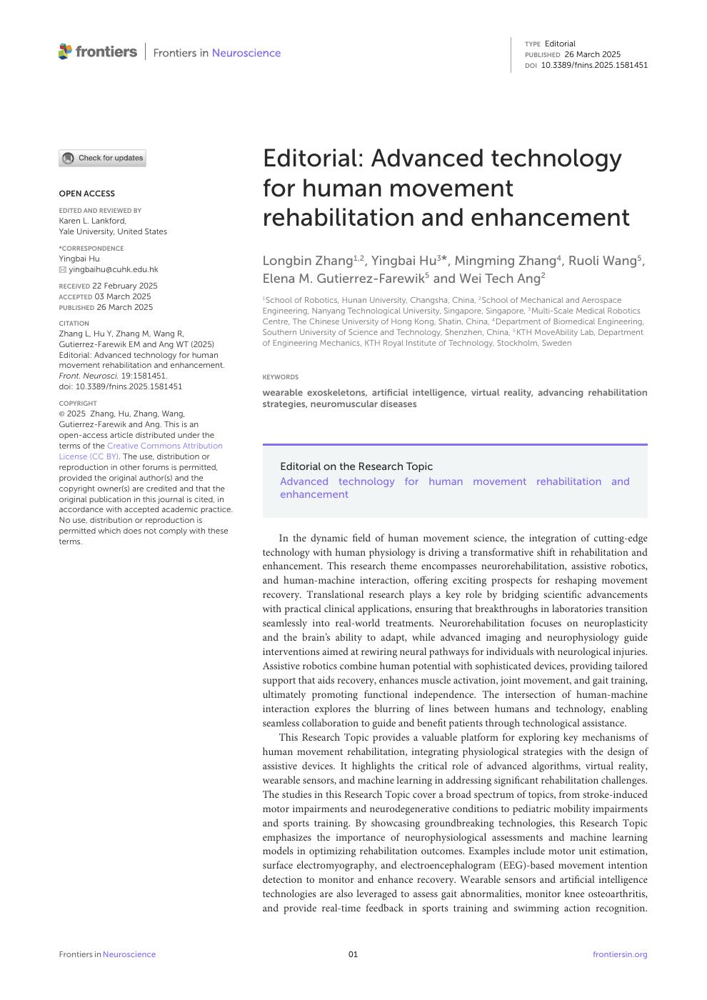
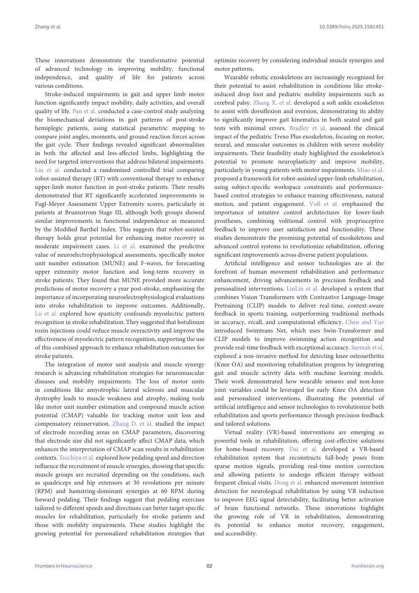
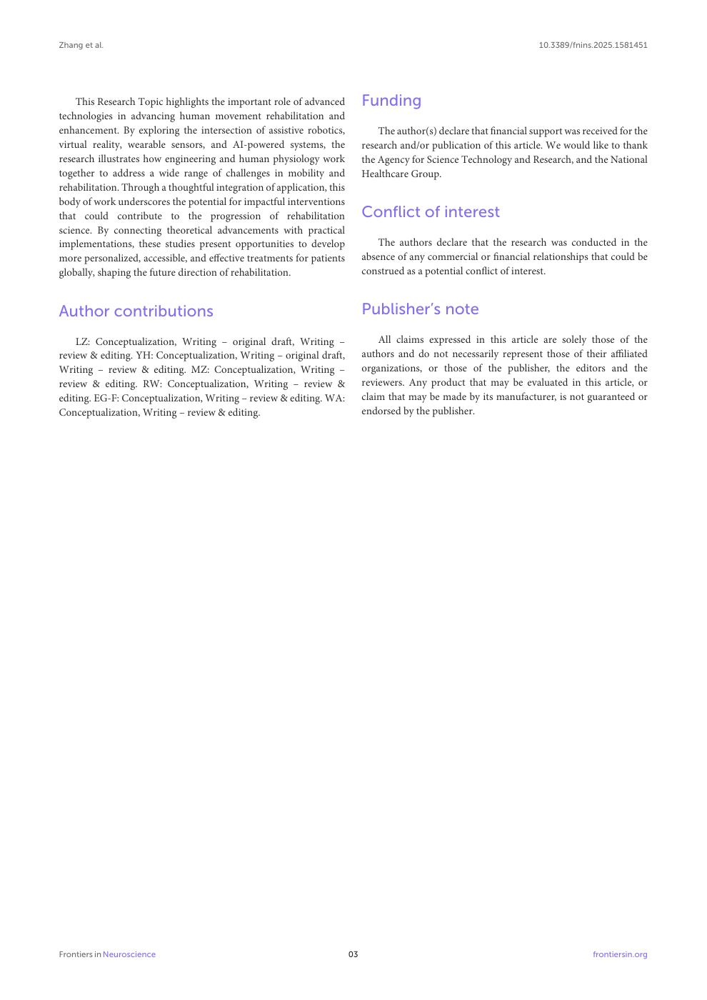

# Zhang2025-FrontNeurosci：运动康复与增强技术专题社论

> English text extracted from the source PDF; not translated or editorially corrected. Each original PDF page is embedded below as a rendered image so figures, tables, and vector artwork remain visible.

- Source PDF: `Zhang2025-FrontNeurosci：运动康复与增强技术专题社论.pdf`
- SHA-256: `f7ffe6b533e64aaf952ca2cdfbfd6adbe9e285ee45c42ddb6c3604c3ba916cac`
- Pages: 3
- Extraction: Poppler `pdftotext -layout`; page images rendered with `pdftoppm` (max dimension 1400 px, JPEG quality 76).

## Page 1

English text extracted from page 1

<pre>
TYPE Editorial
                                                                                                                        PUBLISHED 26 March 2025
                                                                                                                        DOI 10.3389/fnins.2025.1581451

                                                    Editorial: Advanced technology
OPEN ACCESS                                         for human movement
                                                    rehabilitation and enhancement
EDITED AND REVIEWED BY
Karen L. Lankford,
Yale University, United States

*CORRESPONDENCE
Yingbai Hu                                          Longbin Zhang1,2 , Yingbai Hu3*, Mingming Zhang4 , Ruoli Wang5 ,
   yingbaihu@cuhk.edu.hk

RECEIVED 22 February 2025
                                                    Elena M. Gutierrez-Farewik5 and Wei Tech Ang2
ACCEPTED 03 March 2025                              1
                                                     School of Robotics, Hunan University, Changsha, China, 2 School of Mechanical and Aerospace
PUBLISHED 26 March 2025
                                                    Engineering, Nanyang Technological University, Singapore, Singapore, 3 Multi-Scale Medical Robotics
CITATION                                            Centre, The Chinese University of Hong Kong, Shatin, China, 4 Department of Biomedical Engineering,
Zhang L, Hu Y, Zhang M, Wang R,                     Southern University of Science and Technology, Shenzhen, China, 5 KTH MoveAbility Lab, Department
Gutierrez-Farewik EM and Ang WT (2025)              of Engineering Mechanics, KTH Royal Institute of Technology, Stockholm, Sweden
Editorial: Advanced technology for human
movement rehabilitation and enhancement.
Front. Neurosci. 19:1581451.                        KEYWORDS
doi: 10.3389/fnins.2025.1581451
                                                    wearable exoskeletons, artificial intelligence, virtual reality, advancing rehabilitation
COPYRIGHT                                           strategies, neuromuscular diseases
© 2025 Zhang, Hu, Zhang, Wang,
Gutierrez-Farewik and Ang. This is an
open-access article distributed under the
terms of the Creative Commons Attribution
License (CC BY). The use, distribution or
reproduction in other forums is permitted,              Editorial on the Research Topic
provided the original author(s) and the                 Advanced technology for human movement rehabilitation and
copyright owner(s) are credited and that the
original publication in this journal is cited, in
                                                        enhancement
accordance with accepted academic practice.
No use, distribution or reproduction is
permitted which does not comply with these
terms.                                                  In the dynamic field of human movement science, the integration of cutting-edge
                                                    technology with human physiology is driving a transformative shift in rehabilitation and
                                                    enhancement. This research theme encompasses neurorehabilitation, assistive robotics,
                                                    and human-machine interaction, offering exciting prospects for reshaping movement
                                                    recovery. Translational research plays a key role by bridging scientific advancements
                                                    with practical clinical applications, ensuring that breakthroughs in laboratories transition
                                                    seamlessly into real-world treatments. Neurorehabilitation focuses on neuroplasticity
                                                    and the brain’s ability to adapt, while advanced imaging and neurophysiology guide
                                                    interventions aimed at rewiring neural pathways for individuals with neurological injuries.
                                                    Assistive robotics combine human potential with sophisticated devices, providing tailored
                                                    support that aids recovery, enhances muscle activation, joint movement, and gait training,
                                                    ultimately promoting functional independence. The intersection of human-machine
                                                    interaction explores the blurring of lines between humans and technology, enabling
                                                    seamless collaboration to guide and benefit patients through technological assistance.
                                                        This Research Topic provides a valuable platform for exploring key mechanisms of
                                                    human movement rehabilitation, integrating physiological strategies with the design of
                                                    assistive devices. It highlights the critical role of advanced algorithms, virtual reality,
                                                    wearable sensors, and machine learning in addressing significant rehabilitation challenges.
                                                    The studies in this Research Topic cover a broad spectrum of topics, from stroke-induced
                                                    motor impairments and neurodegenerative conditions to pediatric mobility impairments
                                                    and sports training. By showcasing groundbreaking technologies, this Research Topic
                                                    emphasizes the importance of neurophysiological assessments and machine learning
                                                    models in optimizing rehabilitation outcomes. Examples include motor unit estimation,
                                                    surface electromyography, and electroencephalogram (EEG)-based movement intention
                                                    detection to monitor and enhance recovery. Wearable sensors and artificial intelligence
                                                    technologies are also leveraged to assess gait abnormalities, monitor knee osteoarthritis,
                                                    and provide real-time feedback in sports training and swimming action recognition.

Frontiers in Neuroscience                                                 01                                                             frontiersin.org
</pre>

## Page 2

English text extracted from page 2

<pre>
Zhang et al.                                                                                                            10.3389/fnins.2025.1581451

These innovations demonstrate the transformative potential                    optimize recovery by considering individual muscle synergies and
of advanced technology in improving mobility, functional                      motor patterns.
independence, and quality of life for patients across                              Wearable robotic exoskeletons are increasingly recognized for
various conditions.                                                           their potential to assist rehabilitation in conditions like stroke-
     Stroke-induced impairments in gait and upper limb motor                  induced drop foot and pediatric mobility impairments such as
function significantly impact mobility, daily activities, and overall         cerebral palsy. Zhang X. et al. developed a soft ankle exoskeleton
quality of life. Pan et al. conducted a case-control study analyzing          to assist with dorsiflexion and eversion, demonstrating its ability
the biomechanical deviations in gait patterns of post-stroke                  to significantly improve gait kinematics in both seated and gait
hemiplegic patients, using statistical parametric mapping to                  tests with minimal errors. Bradley et al. assessed the clinical
compare joint angles, moments, and ground reaction forces across              impact of the pediatric Trexo Plus exoskeleton, focusing on motor,
the gait cycle. Their findings revealed significant abnormalities             neural, and muscular outcomes in children with severe mobility
in both the affected and less-affected limbs, highlighting the                impairments. Their feasibility study highlighted the exoskeleton’s
need for targeted interventions that address bilateral impairments.           potential to promote neuroplasticity and improve mobility,
Liu et al. conducted a randomized controlled trial comparing                  particularly in young patients with motor impairments. Miao et al.
robot-assisted therapy (RT) with conventional therapy to enhance              proposed a framework for robot-assisted upper-limb rehabilitation,
upper-limb motor function in post-stroke patients. Their results              using subject-specific workspace constraints and performance-
demonstrated that RT significantly accelerated improvements in                based control strategies to enhance training effectiveness, natural
Fugl-Meyer Assessment Upper Extremity scores, particularly in                 motion, and patient engagement. Voß et al. emphasized the
patients at Brunnstrom Stage III, although both groups showed                 importance of intuitive control architectures for lower-limb
similar improvements in functional independence as measured                   prostheses, combining volitional control with proprioceptive
by the Modified Barthel Index. This suggests that robot-assisted              feedback to improve user satisfaction and functionality. These
therapy holds great potential for enhancing motor recovery in                 studies demonstrate the promising potential of exoskeletons and
moderate impairment cases. Li et al. examined the predictive                  advanced control systems to revolutionize rehabilitation, offering
value of neuroelectrophysiological assessments, specifically motor            significant improvements across diverse patient populations.
unit number estimation (MUNE) and F-waves, for forecasting                         Artificial intelligence and sensor technologies are at the
upper extremity motor function and long-term recovery in                      forefront of human movement rehabilitation and performance
stroke patients. They found that MUNE provided more accurate                  enhancement, driving advancements in precision feedback and
predictions of motor recovery a year post-stroke, emphasizing the             personalized interventions. LinLin et al. developed a system that
importance of incorporating neuroelectrophysiological evaluations             combines Vision Transformers with Contrastive Language-Image
into stroke rehabilitation to improve outcomes. Additionally,                 Pretraining (CLIP) models to deliver real-time, context-aware
Lu et al. explored how spasticity confounds myoelectric pattern               feedback in sports training, outperforming traditional methods
recognition in stroke rehabilitation. They suggested that botulinum           in accuracy, recall, and computational efficiency. Chen and Yue
toxin injections could reduce muscle overactivity and improve the             introduced Swimtrans Net, which uses Swin-Transformer and
effectiveness of myoelectric pattern recognition, supporting the use          CLIP models to improve swimming action recognition and
of this combined approach to enhance rehabilitation outcomes for              provide real-time feedback with exceptional accuracy. Sarmah et al.
stroke patients.                                                              explored a non-invasive method for detecting knee osteoarthritis
     The integration of motor unit analysis and muscle synergy                (Knee OA) and monitoring rehabilitation progress by integrating
research is advancing rehabilitation strategies for neuromuscular             gait and muscle activity data with machine learning models.
diseases and mobility impairments. The loss of motor units                    Their work demonstrated how wearable sensors and non-knee
in conditions like amyotrophic lateral sclerosis and muscular                 joint variables could be leveraged for early Knee OA detection
dystrophy leads to muscle weakness and atrophy, making tools                  and personalized interventions, illustrating the potential of
like motor unit number estimation and compound muscle action                  artificial intelligence and sensor technologies to revolutionize both
potential (CMAP) valuable for tracking motor unit loss and                    rehabilitation and sports performance through precision feedback
compensatory reinnervation. Zhang D. et al. studied the impact                and tailored solutions.
of electrode recording areas on CMAP parameters, discovering                       Virtual reality (VR)-based interventions are emerging as
that electrode size did not significantly affect CMAP data, which             powerful tools in rehabilitation, offering cost-effective solutions
enhances the interpretation of CMAP scan results in rehabilitation            for home-based recovery. Dai et al. developed a VR-based
contexts. Tsuchiya et al. explored how pedaling speed and direction           rehabilitation system that reconstructs full-body poses from
influence the recruitment of muscle synergies, showing that specific          sparse motion signals, providing real-time motion correction
muscle groups are recruited depending on the conditions, such                 and allowing patients to undergo efficient therapy without
as quadriceps and hip extensors at 30 revolutions per minute                  frequent clinical visits. Dong et al. enhanced movement intention
(RPM) and hamstring-dominant synergies at 60 RPM during                       detection for neurological rehabilitation by using VR induction
forward pedaling. Their findings suggest that pedaling exercises              to improve EEG signal detectability, facilitating better activation
tailored to different speeds and directions can better target specific        of brain functional networks. These innovations highlight
muscles for rehabilitation, particularly for stroke patients and              the growing role of VR in rehabilitation, demonstrating
those with mobility impairments. These studies highlight the                  its potential to enhance motor recovery, engagement,
growing potential for personalized rehabilitation strategies that             and accessibility.

Frontiers in Neuroscience                                                02                                                          frontiersin.org
</pre>

## Page 3

English text extracted from page 3

<pre>
Zhang et al.                                                                                                           10.3389/fnins.2025.1581451

    This Research Topic highlights the important role of advanced            Funding
technologies in advancing human movement rehabilitation and
enhancement. By exploring the intersection of assistive robotics,                The author(s) declare that financial support was received for the
virtual reality, wearable sensors, and AI-powered systems, the               research and/or publication of this article. We would like to thank
research illustrates how engineering and human physiology work               the Agency for Science Technology and Research, and the National
together to address a wide range of challenges in mobility and               Healthcare Group.
rehabilitation. Through a thoughtful integration of application, this
body of work underscores the potential for impactful interventions
that could contribute to the progression of rehabilitation                   Conflict of interest
science. By connecting theoretical advancements with practical
implementations, these studies present opportunities to develop                  The authors declare that the research was conducted in the
more personalized, accessible, and effective treatments for patients         absence of any commercial or financial relationships that could be
globally, shaping the future direction of rehabilitation.                    construed as a potential conflict of interest.

Author contributions                                                         Publisher’s note
    LZ: Conceptualization, Writing – original draft, Writing –                   All claims expressed in this article are solely those of the
review &amp; editing. YH: Conceptualization, Writing – original draft,           authors and do not necessarily represent those of their affiliated
Writing – review &amp; editing. MZ: Conceptualization, Writing –                 organizations, or those of the publisher, the editors and the
review &amp; editing. RW: Conceptualization, Writing – review &amp;                  reviewers. Any product that may be evaluated in this article, or
editing. EG-F: Conceptualization, Writing – review &amp; editing. WA:            claim that may be made by its manufacturer, is not guaranteed or
Conceptualization, Writing – review &amp; editing.                               endorsed by the publisher.

Frontiers in Neuroscience                                               03                                                          frontiersin.org
</pre>

