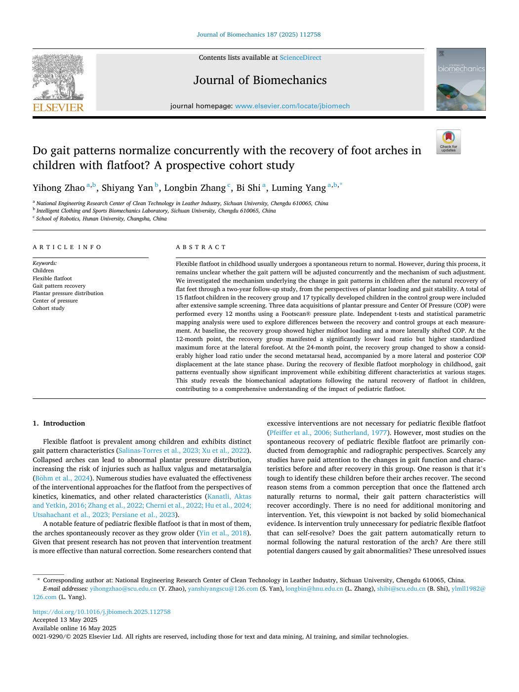
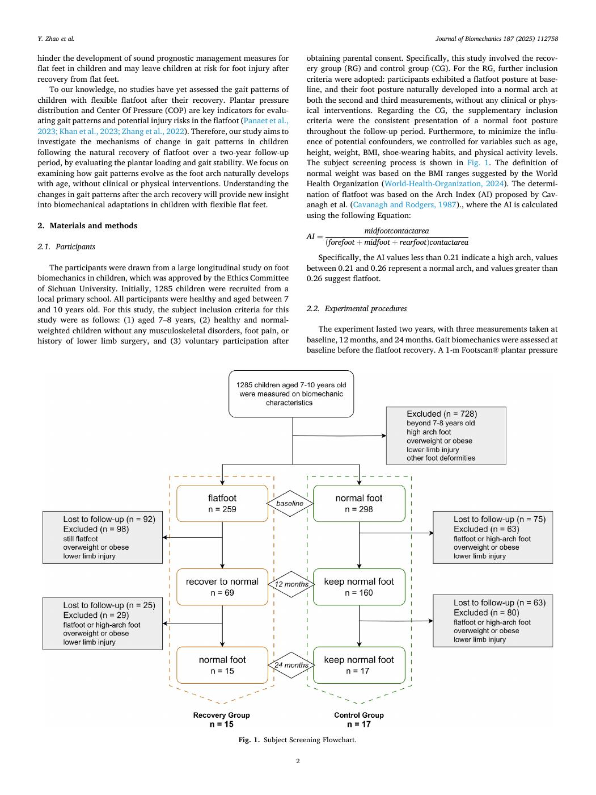
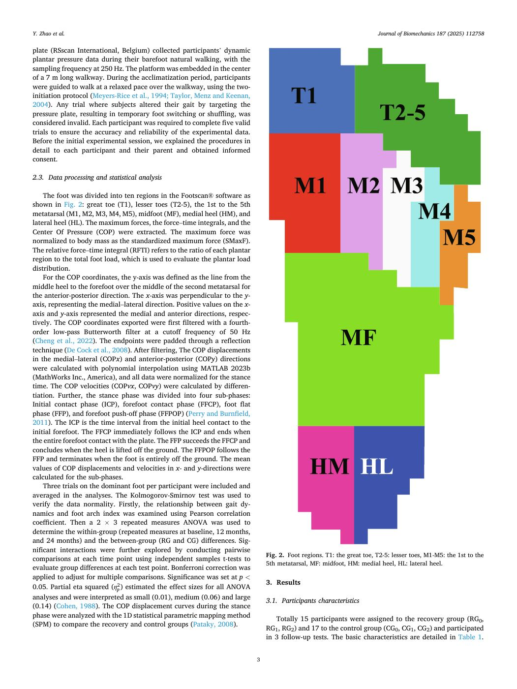
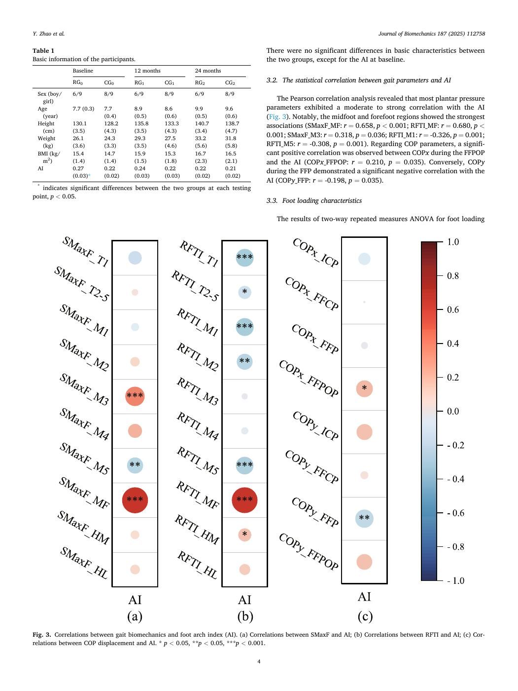
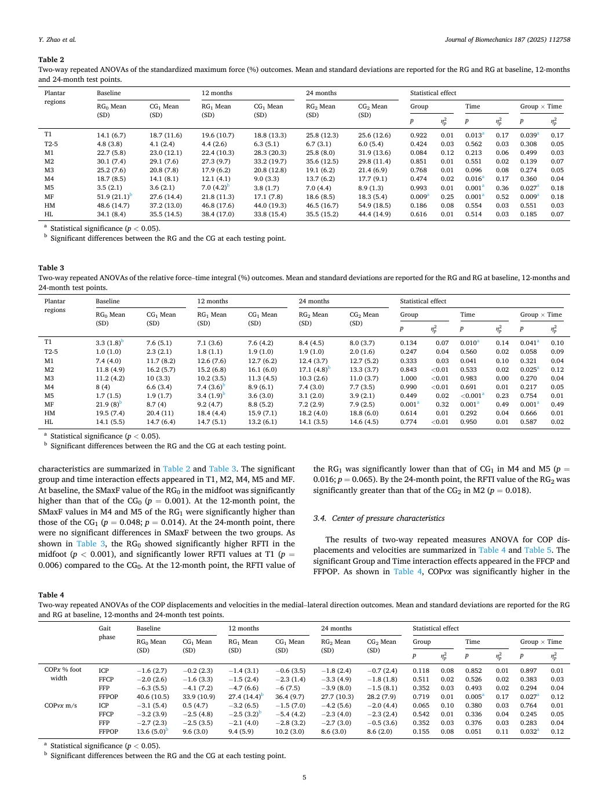
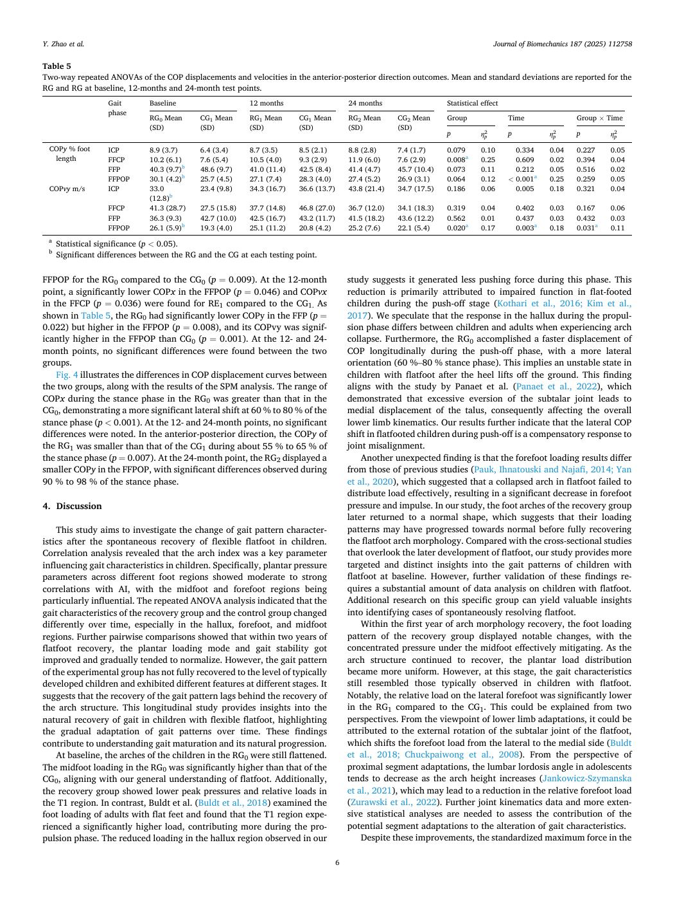
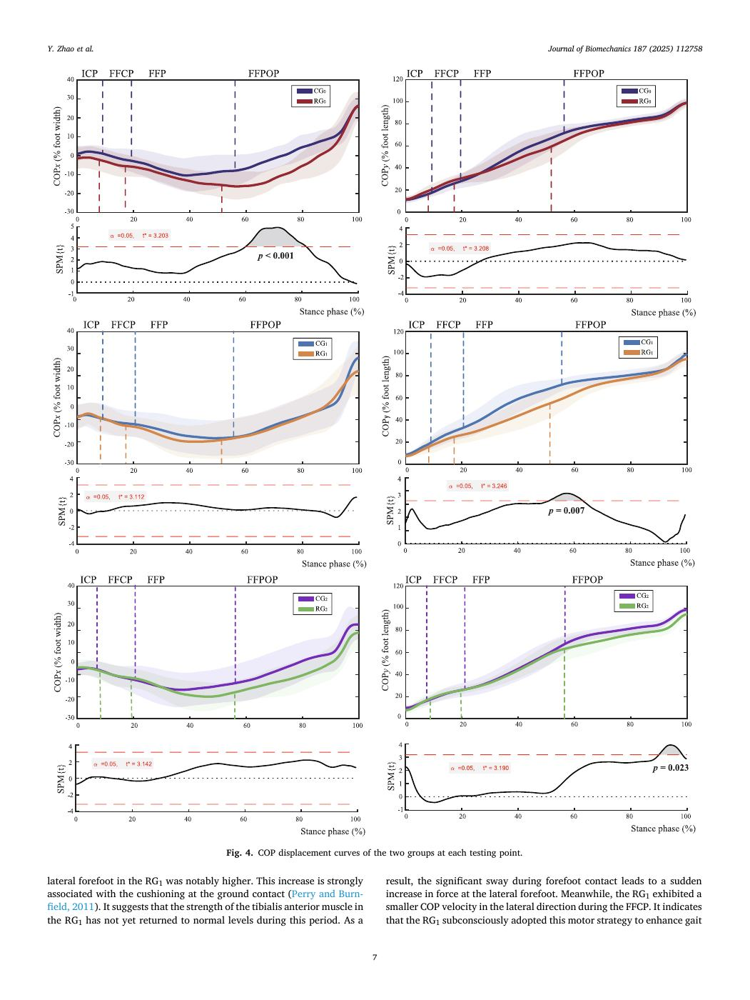
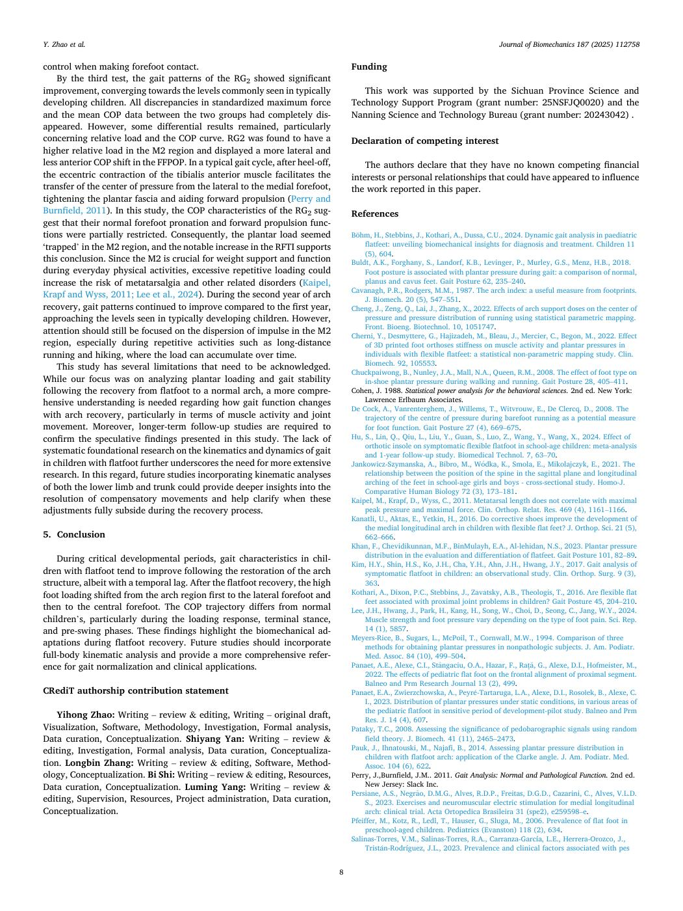
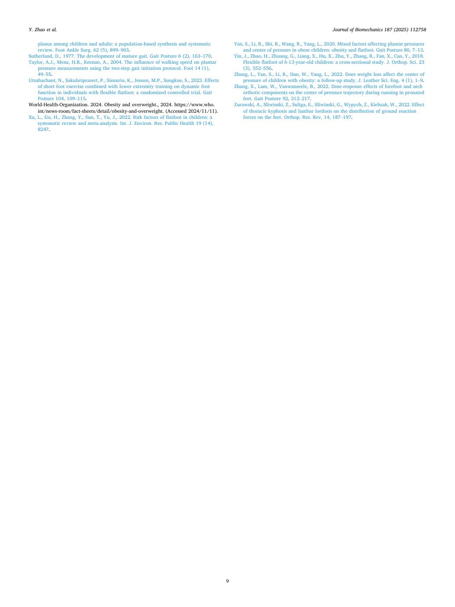

# Zhang2025-JBiomech：扁平足儿童足弓与步态同步恢复的前瞻性队列研究

> English text extracted from the source PDF; not translated or editorially corrected. Each original PDF page is embedded below as a rendered image so figures, tables, and vector artwork remain visible.

- Source PDF: `Zhang2025-JBiomech：扁平足儿童足弓与步态同步恢复的前瞻性队列研究.pdf`
- SHA-256: `557f614f60f44d1f82a85f36ce182524aec885eab18c4c07c16a3b05eaa442ff`
- Pages: 9
- Extraction: Poppler `pdftotext -layout`; page images rendered with `pdftoppm` (max dimension 1400 px, JPEG quality 76).

## Page 1

English text extracted from page 1

<pre>
Journal of Biomechanics 187 (2025) 112758

                                                                    Contents lists available at ScienceDirect

                                                                 Journal of Biomechanics
                                                        journal homepage: www.elsevier.com/locate/jbiomech

Do gait patterns normalize concurrently with the recovery of foot arches in
children with flatfoot? A prospective cohort study
Yihong Zhao a,b , Shiyang Yan b , Longbin Zhang c , Bi Shi a , Luming Yang a,b,*
a
  National Engineering Research Center of Clean Technology in Leather Industry, Sichuan University, Chengdu 610065, China
b
  Intelligent Clothing and Sports Biomechanics Laboratory, Sichuan University, Chengdu 610065, China
c
  School of Robotics, Hunan University, Changsha, China

A R T I C L E I N F O                                     A B S T R A C T

Keywords:                                                 Flexible flatfoot in childhood usually undergoes a spontaneous return to normal. However, during this process, it
Children                                                  remains unclear whether the gait pattern will be adjusted concurrently and the mechanism of such adjustment.
Flexible flatfoot                                         We investigated the mechanism underlying the change in gait patterns in children after the natural recovery of
Gait pattern recovery
                                                          flat feet through a two-year follow-up study, from the perspectives of plantar loading and gait stability. A total of
Plantar pressure distribution
Center of pressure
                                                          15 flatfoot children in the recovery group and 17 typically developed children in the control group were included
Cohort study                                              after extensive sample screening. Three data acquisitions of plantar pressure and Center Of Pressure (COP) were
                                                          performed every 12 months using a Footscan® pressure plate. Independent t-tests and statistical parametric
                                                          mapping analysis were used to explore differences between the recovery and control groups at each measure­
                                                          ment. At baseline, the recovery group showed higher midfoot loading and a more laterally shifted COP. At the
                                                          12-month point, the recovery group manifested a significantly lower load ratio but higher standardized
                                                          maximum force at the lateral forefoot. At the 24-month point, the recovery group changed to show a consid­
                                                          erably higher load ratio under the second metatarsal head, accompanied by a more lateral and posterior COP
                                                          displacement at the late stance phase. During the recovery of flexible flatfoot morphology in childhood, gait
                                                          patterns eventually show significant improvement while exhibiting different characteristics at various stages.
                                                          This study reveals the biomechanical adaptations following the natural recovery of flatfoot in children,
                                                          contributing to a comprehensive understanding of the impact of pediatric flatfoot.

1. Introduction                                                                                excessive interventions are not necessary for pediatric flexible flatfoot
                                                                                               (Pfeiffer et al., 2006; Sutherland, 1977). However, most studies on the
    Flexible flatfoot is prevalent among children and exhibits distinct                        spontaneous recovery of pediatric flexible flatfoot are primarily con­
gait pattern characteristics (Salinas-Torres et al., 2023; Xu et al., 2022).                   ducted from demographic and radiographic perspectives. Scarcely any
Collapsed arches can lead to abnormal plantar pressure distribution,                           studies have paid attention to the changes in gait function and charac­
increasing the risk of injuries such as hallux valgus and metatarsalgia                        teristics before and after recovery in this group. One reason is that it’s
(Böhm et al., 2024). Numerous studies have evaluated the effectiveness                        tough to identify these children before their arches recover. The second
of the interventional approaches for the flatfoot from the perspectives of                     reason stems from a common perception that once the flattened arch
kinetics, kinematics, and other related characteristics (Kanatli, Aktas                        naturally returns to normal, their gait pattern characteristics will
and Yetkin, 2016; Zhang et al., 2022; Cherni et al., 2022; Hu et al., 2024;                    recover accordingly. There is no need for additional monitoring and
Utsahachant et al., 2023; Persiane et al., 2023).                                              intervention. Yet, this viewpoint is not backed by solid biomechanical
    A notable feature of pediatric flexible flatfoot is that in most of them,                  evidence. Is intervention truly unnecessary for pediatric flexible flatfoot
the arches spontaneously recover as they grow older (Yin et al., 2018).                        that can self-resolve? Does the gait pattern automatically return to
Given that present research has not proven that intervention treatment                         normal following the natural restoration of the arch? Are there still
is more effective than natural correction. Some researchers contend that                       potential dangers caused by gait abnormalities? These unresolved issues

 * Corresponding author at: National Engineering Research Center of Clean Technology in Leather Industry, Sichuan University, Chengdu 610065, China.
   E-mail addresses: yihongzhao@scu.edu.cn (Y. Zhao), yanshiyangscu@126.com (S. Yan), longbin@hnu.edu.cn (L. Zhang), shibi@scu.edu.cn (B. Shi), ylmll1982@
126.com (L. Yang).

https://doi.org/10.1016/j.jbiomech.2025.112758
Accepted 13 May 2025
Available online 16 May 2025
0021-9290/© 2025 Elsevier Ltd. All rights are reserved, including those for text and data mining, AI training, and similar technologies.
</pre>

## Page 2

English text extracted from page 2

<pre>
Y. Zhao et al.                                                                                                              Journal of Biomechanics 187 (2025) 112758

hinder the development of sound prognostic management measures for                   obtaining parental consent. Specifically, this study involved the recov­
flat feet in children and may leave children at risk for foot injury after           ery group (RG) and control group (CG). For the RG, further inclusion
recovery from flat feet.                                                             criteria were adopted: participants exhibited a flatfoot posture at base­
    To our knowledge, no studies have yet assessed the gait patterns of              line, and their foot posture naturally developed into a normal arch at
children with flexible flatfoot after their recovery. Plantar pressure               both the second and third measurements, without any clinical or phys­
distribution and Center Of Pressure (COP) are key indicators for evalu­              ical interventions. Regarding the CG, the supplementary inclusion
ating gait patterns and potential injury risks in the flatfoot (Panaet et al.,       criteria were the consistent presentation of a normal foot posture
2023; Khan et al., 2023; Zhang et al., 2022). Therefore, our study aims to           throughout the follow-up period. Furthermore, to minimize the influ­
investigate the mechanisms of change in gait patterns in children                    ence of potential confounders, we controlled for variables such as age,
following the natural recovery of flatfoot over a two-year follow-up                 height, weight, BMI, shoe-wearing habits, and physical activity levels.
period, by evaluating the plantar loading and gait stability. We focus on            The subject screening process is shown in Fig. 1. The definition of
examining how gait patterns evolve as the foot arch naturally develops               normal weight was based on the BMI ranges suggested by the World
with age, without clinical or physical interventions. Understanding the              Health Organization (World-Health-Organization, 2024). The determi­
changes in gait patterns after the arch recovery will provide new insight            nation of flatfoot was based on the Arch Index (AI) proposed by Cav­
into biomechanical adaptations in children with flexible flat feet.                  anagh et al. (Cavanagh and Rodgers, 1987)., where the AI is calculated
                                                                                     using the following Equation:
2. Materials and methods
                                                                                                        midfootcontactarea
                                                                                     AI =
                                                                                            (forefoot + midfoot + rearfoot)contactarea
2.1. Participants
                                                                                        Specifically, the AI values less than 0.21 indicate a high arch, values
    The participants were drawn from a large longitudinal study on foot              between 0.21 and 0.26 represent a normal arch, and values greater than
biomechanics in children, which was approved by the Ethics Committee                 0.26 suggest flatfoot.
of Sichuan University. Initially, 1285 children were recruited from a
local primary school. All participants were healthy and aged between 7
and 10 years old. For this study, the subject inclusion criteria for this            2.2. Experimental procedures
study were as follows: (1) aged 7–8 years, (2) healthy and normal-
weighted children without any musculoskeletal disorders, foot pain, or                  The experiment lasted two years, with three measurements taken at
history of lower limb surgery, and (3) voluntary participation after                 baseline, 12 months, and 24 months. Gait biomechanics were assessed at
                                                                                     baseline before the flatfoot recovery. A 1-m Footscan® plantar pressure

                                                              Fig. 1. Subject Screening Flowchart.

                                                                                 2
</pre>

## Page 3

English text extracted from page 3

<pre>
Y. Zhao et al.                                                                                                             Journal of Biomechanics 187 (2025) 112758

plate (RSscan International, Belgium) collected participants’ dynamic
plantar pressure data during their barefoot natural walking, with the
sampling frequency at 250 Hz. The platform was embedded in the center
of a 7 m long walkway. During the acclimatization period, participants
were guided to walk at a relaxed pace over the walkway, using the two-
initiation protocol (Meyers-Rice et al., 1994; Taylor, Menz and Keenan,
2004). Any trial where subjects altered their gait by targeting the
pressure plate, resulting in temporary foot switching or shuffling, was
considered invalid. Each participant was required to complete five valid
trials to ensure the accuracy and reliability of the experimental data.
Before the initial experimental session, we explained the procedures in
detail to each participant and their parent and obtained informed
consent.

2.3. Data processing and statistical analysis

    The foot was divided into ten regions in the Footscan® software as
shown in Fig. 2: great toe (T1), lesser toes (T2-5), the 1st to the 5th
metatarsal (M1, M2, M3, M4, M5), midfoot (MF), medial heel (HM), and
lateral heel (HL). The maximum forces, the force–time integrals, and the
Center Of Pressure (COP) were extracted. The maximum force was
normalized to body mass as the standardized maximum force (SMaxF).
The relative force–time integral (RFTI) refers to the ratio of each plantar
region to the total foot load, which is used to evaluate the plantar load
distribution.
    For the COP coordinates, the y-axis was defined as the line from the
middle heel to the forefoot over the middle of the second metatarsal for
the anterior-posterior direction. The x-axis was perpendicular to the y-
axis, representing the medial–lateral direction. Positive values on the x-
axis and y-axis represented the medial and anterior directions, respec­
tively. The COP coordinates exported were first filtered with a fourth-
order low-pass Butterworth filter at a cutoff frequency of 50 Hz
(Cheng et al., 2022). The endpoints were padded through a reflection
technique (De Cock et al., 2008). After filtering, The COP displacements
in the medial–lateral (COPx) and anterior-posterior (COPy) directions
were calculated with polynomial interpolation using MATLAB 2023b
(MathWorks Inc., America), and all data were normalized for the stance
time. The COP velocities (COPvx, COPvy) were calculated by differen­
tiation. Further, the stance phase was divided into four sub-phases:
Initial contact phase (ICP), forefoot contact phase (FFCP), foot flat
phase (FFP), and forefoot push-off phase (FFPOP) (Perry and Burnfield,
2011). The ICP is the time interval from the initial heel contact to the
initial forefoot. The FFCP immediately follows the ICP and ends when
the entire forefoot contact with the plate. The FFP succeeds the FFCP and
concludes when the heel is lifted off the ground. The FFPOP follows the
FFP and terminates when the foot is entirely off the ground. The mean
values of COP displacements and velocities in x- and y-directions were
calculated for the sub-phases.
    Three trials on the dominant foot per participant were included and
averaged in the analyses. The Kolmogorov-Smirnov test was used to
verify the data normality. Firstly, the relationship between gait dy­
namics and foot arch index was examined using Pearson correlation
coefficient. Then a 2 × 3 repeated measures ANOVA was used to
determine the within-group (repeated measures at baseline, 12 months,
and 24 months) and the between-group (RG and CG) differences. Sig­
nificant interactions were further explored by conducting pairwise
                                                                                  Fig. 2. Foot regions. T1: the great toe, T2-5: lesser toes, M1-M5: the 1st to the
comparisons at each time point using independent samples t-tests to
                                                                                  5th metatarsal, MF: midfoot, HM: medial heel, HL: lateral heel.
evaluate group differences at each test point. Bonferroni correction was
applied to adjust for multiple comparisons. Significance was set at p &lt;
                                                                                  3. Results
0.05. Partial eta squared (η2p ) estimated the effect sizes for all ANOVA
analyses and were interpreted as small (0.01), medium (0.06) and large
                                                                                  3.1. Participants characteristics
(0.14) (Cohen, 1988). The COP displacement curves during the stance
phase were analyzed with the 1D statistical parametric mapping method
                                                                                     Totally 15 participants were assigned to the recovery group (RG0,
(SPM) to compare the recovery and control groups (Pataky, 2008).
                                                                                  RG1, RG2) and 17 to the control group (CG0, CG1, CG2) and participated
                                                                                  in 3 follow-up tests. The basic characteristics are detailed in Table 1.

                                                                              3
</pre>

## Page 4

English text extracted from page 4

<pre>
Y. Zhao et al.                                                                                                            Journal of Biomechanics 187 (2025) 112758

Table 1                                                                             There were no significant differences in basic characteristics between
Basic information of the participants.                                              the two groups, except for the AI at baseline.
                 Baseline             12 months            24 months

                 RG0         CG0      RG1         CG1      RG2         CG2          3.2. The statistical correlation between gait parameters and AI
  Sex (boy/      6/9         8/9      6/9         8/9      6/9         8/9
    girl)                                                                               The Pearson correlation analysis revealed that most plantar pressure
  Age            7.7 (0.3)   7.7      8.9         8.6      9.9         9.6          parameters exhibited a moderate to strong correlation with the AI
    (year)                   (0.4)    (0.5)       (0.6)    (0.5)       (0.6)        (Fig. 3). Notably, the midfoot and forefoot regions showed the strongest
  Height         130.1       128.2    135.8       133.3    140.7       138.7        associations (SMaxF_MF: r = 0.658, p &lt; 0.001; RFTI_MF: r = 0.680, p &lt;
    (cm)         (3.5)       (4.3)    (3.5)       (4.3)    (3.4)       (4.7)
  Weight         26.1        24.3     29.3        27.5     33.2        31.8
                                                                                    0.001; SMaxF_M3: r = 0.318, p = 0.036; RFTI_M1: r = -0.326, p = 0.001;
    (kg)         (3.6)       (3.3)    (3.5)       (4.6)    (5.6)       (5.8)        RFTI_M5: r = -0.308, p = 0.001). Regarding COP parameters, a signifi­
  BMI (kg/       15.4        14.7     15.9        15.3     16.7        16.5         cant positive correlation was observed between COPx during the FFPOP
    m2)          (1.4)       (1.4)    (1.5)       (1.8)    (2.3)       (2.1)        and the AI (COPx_FFPOP: r = 0.210, p = 0.035). Conversely, COPy
  AI             0.27        0.22     0.24        0.22     0.22        0.21
                                                                                    during the FFP demonstrated a significant negative correlation with the
                 (0.03)*     (0.02)   (0.03)      (0.03)   (0.02)      (0.02)
                                                                                    AI (COPy_FFP: r = -0.198, p = 0.035).
  *
   indicates significant differences between the two groups at each testing
point, p &lt; 0.05.
                                                                                    3.3. Foot loading characteristics

                                                                                       The results of two-way repeated measures ANOVA for foot loading

Fig. 3. Correlations between gait biomechanics and foot arch index (AI). (a) Correlations between SMaxF and AI; (b) Correlations between RFTI and AI; (c) Cor­
relations between COP displacement and AI. * p &lt; 0.05, **p &lt; 0.05, ***p &lt; 0.001.

                                                                                4
</pre>

## Page 5

English text extracted from page 5

<pre>
Y. Zhao et al.                                                                                                                                             Journal of Biomechanics 187 (2025) 112758

Table 2
Two-way repeated ANOVAs of the standardized maximum force (%) outcomes. Mean and standard deviations are reported for the RG and RG at baseline, 12-months
and 24-month test points.
  Plantar           Baseline                               12 months                               24 months                              Statistical effect
  regions
                    RG0 Mean           CG1 Mean            RG1 Mean           CG1 Mean             RG2 Mean           CG2 Mean            Group                     Time               Group × Time
                    (SD)               (SD)                (SD)               (SD)                 (SD)               (SD)
                                                                                                                                          p              η2p        p           η2p    p        η2p
  T1                14.1 (6.7)         18.7 (11.6)         19.6 (10.7)        18.8 (13.3)          25.8 (12.3)        25.6 (12.6)         0.922          0.01       0.013   a
                                                                                                                                                                                0.17   0.039a
                                                                                                                                                                                                0.17
  T2-5              4.8 (3.8)          4.1 (2.4)           4.4 (2.6)          6.3 (5.1)            6.7 (3.1)          6.0 (5.4)           0.424          0.03       0.562       0.03   0.308    0.05
  M1                22.7 (5.8)         23.0 (12.1)         22.4 (10.3)        28.3 (20.3)          25.8 (8.0)         31.9 (13.6)         0.084          0.12       0.213       0.06   0.499    0.03
  M2                30.1 (7.4)         29.1 (7.6)          27.3 (9.7)         33.2 (19.7)          35.6 (12.5)        29.8 (11.4)         0.851          0.01       0.551       0.02   0.139    0.07
  M3                25.2 (7.6)         20.8 (7.8)          17.9 (6.2)         20.8 (12.8)          19.1 (6.2)         21.4 (6.9)          0.768          0.01       0.096       0.08   0.274    0.05
  M4                18.7 (8.5)         14.1 (8.1)          12.1 (4.1)         9.0 (3.3)            13.7 (6.2)         17.7 (9.1)          0.474          0.02       0.016a      0.17   0.360    0.04
  M5                3.5 (2.1)          3.6 (2.1)           7.0 (4.2)b         3.8 (1.7)            7.0 (4.4)          8.9 (1.3)           0.993          0.01       0.001a      0.36   0.027a   0.18
  MF                51.9 (21.1)b       27.6 (14.4)         21.8 (11.3)        17.1 (7.8)           18.6 (8.5)         18.3 (5.4)          0.009a         0.25       0.001a      0.52   0.009a   0.18
  HM                48.6 (14.7)        37.2 (13.0)         46.8 (17.6)        44.0 (19.3)          46.5 (16.7)        54.9 (18.5)         0.186          0.08       0.554       0.03   0.551    0.03
  HL                34.1 (8.4)         35.5 (14.5)         38.4 (17.0)        33.8 (15.4)          35.5 (15.2)        44.4 (14.9)         0.616          0.01       0.514       0.03   0.185    0.07
  a
      Statistical significance (p &lt; 0.05).
  b
      Significant differences between the RG and the CG at each testing point.

Table 3
Two-way repeated ANOVAs of the relative force–time integral (%) outcomes. Mean and standard deviations are reported for the RG and RG at baseline, 12-months and
24-month test points.
  Plantar          Baseline                              12 months                           24 months                                Statistical effect
  regions
                   RG0 Mean           CG1 Mean           RG1 Mean           CG1 Mean         RG2 Mean            CG2 Mean             Group                     Time                   Group × Time
                   (SD)               (SD)               (SD)               (SD)             (SD)                (SD)
                                                                                                                                      p            η2p          p               η2p    p        η2p
  T1               3.3 (1.8)   b
                                      7.6 (5.1)          7.1 (3.6)          7.6 (4.2)        8.4 (4.5)           8.0 (3.7)            0.134         0.07        0.010   a
                                                                                                                                                                                0.14   0.041a
                                                                                                                                                                                                0.10
  T2-5             1.0 (1.0)          2.3 (2.1)          1.8 (1.1)          1.9 (1.0)        1.9 (1.0)           2.0 (1.6)            0.247         0.04        0.560           0.02   0.058    0.09
  M1               7.4 (4.0)          11.7 (8.2)         12.6 (7.6)         12.7 (6.2)       12.4 (3.7)          12.7 (5.2)           0.333         0.03        0.041           0.10   0.321    0.04
  M2               11.8 (4.9)         16.2 (5.7)         15.2 (6.8)         16.1 (6.0)       17.1 (4.8)b         13.3 (3.7)           0.843        &lt;0.01        0.533           0.02   0.025a   0.12
  M3               11.2 (4.2)         10 (3.3)           10.2 (3.5)         11.3 (4.5)       10.3 (2.6)          11.0 (3.7)           1.000        &lt;0.01        0.983           0.00   0.270    0.04
  M4               8 (4)              6.6 (3.4)          7.4 (3.6)b         8.9 (6.1)        7.4 (3.0)           7.7 (3.5)            0.990        &lt;0.01        0.691           0.01   0.217    0.05
  M5               1.7 (1.5)          1.9 (1.7)          3.4 (1.9)b         3.6 (3.0)        3.1 (2.0)           3.9 (2.1)            0.449         0.02        &lt;0.001a         0.23   0.754    0.01
  MF               21.9 (8)b          8.7 (4)            9.2 (4.7)          8.8 (5.2)        7.2 (2.9)           7.9 (2.5)            0.001a        0.32        0.001a          0.49   0.001a   0.49
  HM               19.5 (7.4)         20.4 (11)          18.4 (4.4)         15.9 (7.1)       18.2 (4.0)          18.8 (6.0)           0.614         0.01        0.292           0.04   0.666    0.01
  HL               14.1 (5.5)         14.7 (6.4)         14.7 (5.1)         13.2 (6.1)       14.1 (3.5)          14.6 (4.5)           0.774        &lt;0.01        0.950           0.01   0.587    0.02
  a
      Statistical significance (p &lt; 0.05).
  b
      Significant differences between the RG and the CG at each testing point.

characteristics are summarized in Table 2 and Table 3. The significant                               the RG1 was significantly lower than that of CG1 in M4 and M5 (p =
group and time interaction effects appeared in T1, M2, M4, M5 and MF.                                0.016; p = 0.065). By the 24-month point, the RFTI value of the RG2 was
At baseline, the SMaxF value of the RG0 in the midfoot was significantly                             significantly greater than that of the CG2 in M2 (p = 0.018).
higher than that of the CG0 (p = 0.001). At the 12-month point, the
SMaxF values in M4 and M5 of the RG1 were significantly higher than
                                                                                                     3.4. Center of pressure characteristics
those of the CG1 (p = 0.048; p = 0.014). At the 24-month point, there
were no significant differences in SMaxF between the two groups. As
                                                                                                        The results of two-way repeated measures ANOVA for COP dis­
shown in Table 3, the RG0 showed significantly higher RFTI in the
                                                                                                     placements and velocities are summarized in Table 4 and Table 5. The
midfoot (p &lt; 0.001), and significantly lower RFTI values at T1 (p =
                                                                                                     significant Group and Time interaction effects appeared in the FFCP and
0.006) compared to the CG0. At the 12-month point, the RFTI value of
                                                                                                     FFPOP. As shown in Table 4, COPvx was significantly higher in the

Table 4
Two-way repeated ANOVAs of the COP displacements and velocities in the medial–lateral direction outcomes. Mean and standard deviations are reported for the RG
and RG at baseline, 12-months and 24-month test points.
                    Gait           Baseline                           12 months                         24 months                         Statistical effect
                    phase
                                   RG0 Mean          CG1 Mean         RG1 Mean       CG1 Mean           RG2 Mean        CG2 Mean          Group                     Time               Group × Time
                                   (SD)              (SD)             (SD)           (SD)               (SD)            (SD)
                                                                                                                                          p              η2p        p           η2p    p        η2p
  COPx % foot       ICP            − 1.6 (2.7)       − 0.2 (2.3)      − 1.4 (3.1)    − 0.6 (3.5)        − 1.8 (2.4)     − 0.7 (2.4)       0.118          0.08       0.852       0.01   0.897    0.01
   width            FFCP           − 2.0 (2.6)       − 1.6 (3.3)      − 1.5 (2.4)    − 2.3 (1.4)        − 3.3 (4.9)     − 1.8 (1.8)       0.511          0.02       0.526       0.02   0.383    0.03
                    FFP            − 6.3 (5.5)       − 4.1 (7.2)      − 4.7 (6.6)    − 6 (7.5)          − 3.9 (8.0)     − 1.5 (8.1)       0.352          0.03       0.493       0.02   0.294    0.04
                    FFPOP          40.6 (10.5)       33.9 (10.9)      27.4 (14.4)b   36.4 (9.7)         27.7 (10.3)     28.2 (7.9)        0.719          0.01       0.005a      0.17   0.027a   0.12
  COPvx m/s         ICP            − 3.1 (5.4)       0.5 (4.7)        − 3.2 (6.5)    − 1.5 (7.0)        − 4.2 (5.6)     − 2.0 (4.4)       0.065          0.10       0.380       0.03   0.764    0.01
                    FFCP           − 3.2 (3.9)       − 2.5 (4.8)      − 2.5 (3.2)b   − 5.4 (4.2)        − 2.3 (4.0)     − 2.3 (2.4)       0.542          0.01       0.336       0.04   0.245    0.05
                    FFP            − 2.7 (2.3)       − 2.5 (3.5)      − 2.1 (4.0)    − 2.8 (3.2)        − 2.7 (3.0)     − 0.5 (3.6)       0.352          0.03       0.376       0.03   0.283    0.04
                    FFPOP          13.6 (5.0)b       9.6 (3.0)        9.4 (5.9)      10.2 (3.0)         8.6 (3.0)       8.6 (2.0)         0.155          0.08       0.051       0.11   0.032a   0.12
  a
      Statistical significance (p &lt; 0.05).
  b
      Significant differences between the RG and the CG at each testing point.

                                                                                              5
</pre>

## Page 6

English text extracted from page 6

<pre>
Y. Zhao et al.                                                                                                                          Journal of Biomechanics 187 (2025) 112758

Table 5
Two-way repeated ANOVAs of the COP displacements and velocities in the anterior-posterior direction outcomes. Mean and standard deviations are reported for the
RG and RG at baseline, 12-months and 24-month test points.
                    Gait       Baseline                    12 months                       24 months                   Statistical effect
                    phase
                               RG0 Mean      CG1 Mean      RG1 Mean      CG1 Mean          RG2 Mean      CG2 Mean      Group                Time                Group × Time
                               (SD)          (SD)          (SD)          (SD)              (SD)          (SD)
                                                                                                                       p          η2p       p            η2p    p         η2p
  COPy % foot       ICP        8.9 (3.7)     6.4 (3.4)     8.7 (3.5)     8.5 (2.1)         8.8 (2.8)     7.4 (1.7)     0.079      0.10        0.334      0.04   0.227     0.05
   length           FFCP       10.2 (6.1)    7.6 (5.4)     10.5 (4.0)    9.3 (2.9)         11.9 (6.0)    7.6 (2.9)     0.008a     0.25        0.609      0.02   0.394     0.04
                    FFP        40.3 (9.7)b   48.6 (9.7)    41.0 (11.4)   42.5 (8.4)        41.4 (4.7)    45.7 (10.4)   0.073      0.11        0.212      0.05   0.516     0.02
                    FFPOP      30.1 (4.2)b   25.7 (4.5)    27.1 (7.4)    28.3 (4.0)        27.4 (5.2)    26.9 (3.1)    0.064      0.12      &lt; 0.001a     0.25   0.259     0.05
  COPvy m/s         ICP        33.0          23.4 (9.8)    34.3 (16.7)   36.6 (13.7)       43.8 (21.4)   34.7 (17.5)   0.186      0.06        0.005      0.18   0.321     0.04
                               (12.8)b
                    FFCP       41.3 (28.7)   27.5 (15.8)   37.7 (14.8)   46.8 (27.0)       36.7 (12.0)   34.1 (18.3)   0.319      0.04          0.402    0.03   0.167     0.06
                    FFP        36.3 (9.3)    42.7 (10.0)   42.5 (16.7)   43.2 (11.7)       41.5 (18.2)   43.6 (12.2)   0.562      0.01          0.437    0.03   0.432     0.03
                    FFPOP      26.1 (5.9)b   19.3 (4.0)    25.1 (11.2)   20.8 (4.2)        25.2 (7.6)    22.1 (5.4)    0.020a     0.17          0.003a   0.18   0.031a    0.11
  a
      Statistical significance (p &lt; 0.05).
  b
      Significant differences between the RG and the CG at each testing point.

FFPOP for the RG0 compared to the CG0 (p = 0.009). At the 12-month                         study suggests it generated less pushing force during this phase. This
point, a significantly lower COPx in the FFPOP (p = 0.046) and COPvx                       reduction is primarily attributed to impaired function in flat-footed
in the FFCP (p = 0.036) were found for RE1 compared to the CG1. As                         children during the push-off stage (Kothari et al., 2016; Kim et al.,
shown in Table 5, the RG0 had significantly lower COPy in the FFP (p =                     2017). We speculate that the response in the hallux during the propul­
0.022) but higher in the FFPOP (p = 0.008), and its COPvy was signif­                      sion phase differs between children and adults when experiencing arch
icantly higher in the FFPOP than CG0 (p = 0.001). At the 12- and 24-                       collapse. Furthermore, the RG0 accomplished a faster displacement of
month points, no significant differences were found between the two                        COP longitudinally during the push-off phase, with a more lateral
groups.                                                                                    orientation (60 %–80 % stance phase). This implies an unstable state in
    Fig. 4 illustrates the differences in COP displacement curves between                  children with flatfoot after the heel lifts off the ground. This finding
the two groups, along with the results of the SPM analysis. The range of                   aligns with the study by Panaet et al. (Panaet et al., 2022), which
COPx during the stance phase in the RG0 was greater than that in the                       demonstrated that excessive eversion of the subtalar joint leads to
CG0, demonstrating a more significant lateral shift at 60 % to 80 % of the                 medial displacement of the talus, consequently affecting the overall
stance phase (p &lt; 0.001). At the 12- and 24-month points, no significant                   lower limb kinematics. Our results further indicate that the lateral COP
differences were noted. In the anterior-posterior direction, the COPy of                   shift in flatfooted children during push-off is a compensatory response to
the RG1 was smaller than that of the CG1 during about 55 % to 65 % of                      joint misalignment.
the stance phase (p = 0.007). At the 24-month point, the RG2 displayed a                        Another unexpected finding is that the forefoot loading results differ
smaller COPy in the FFPOP, with significant differences observed during                    from those of previous studies (Pauk, Ihnatouski and Najafi, 2014; Yan
90 % to 98 % of the stance phase.                                                          et al., 2020), which suggested that a collapsed arch in flatfoot failed to
                                                                                           distribute load effectively, resulting in a significant decrease in forefoot
4. Discussion                                                                              pressure and impulse. In our study, the foot arches of the recovery group
                                                                                           later returned to a normal shape, which suggests that their loading
    This study aims to investigate the change of gait pattern character­                   patterns may have progressed towards normal before fully recovering
istics after the spontaneous recovery of flexible flatfoot in children.                    the flatfoot arch morphology. Compared with the cross-sectional studies
Correlation analysis revealed that the arch index was a key parameter                      that overlook the later development of flatfoot, our study provides more
influencing gait characteristics in children. Specifically, plantar pressure               targeted and distinct insights into the gait patterns of children with
parameters across different foot regions showed moderate to strong                         flatfoot at baseline. However, further validation of these findings re­
correlations with AI, with the midfoot and forefoot regions being                          quires a substantial amount of data analysis on children with flatfoot.
particularly influential. The repeated ANOVA analysis indicated that the                   Additional research on this specific group can yield valuable insights
gait characteristics of the recovery group and the control group changed                   into identifying cases of spontaneously resolving flatfoot.
differently over time, especially in the hallux, forefoot, and midfoot                          Within the first year of arch morphology recovery, the foot loading
regions. Further pairwise comparisons showed that within two years of                      pattern of the recovery group displayed notable changes, with the
flatfoot recovery, the plantar loading mode and gait stability got                         concentrated pressure under the midfoot effectively mitigating. As the
improved and gradually tended to normalize. However, the gait pattern                      arch structure continued to recover, the plantar load distribution
of the experimental group has not fully recovered to the level of typically                became more uniform. However, at this stage, the gait characteristics
developed children and exhibited different features at different stages. It                still resembled those typically observed in children with flatfoot.
suggests that the recovery of the gait pattern lags behind the recovery of                 Notably, the relative load on the lateral forefoot was significantly lower
the arch structure. This longitudinal study provides insights into the                     in the RG1 compared to the CG1. This could be explained from two
natural recovery of gait in children with flexible flatfoot, highlighting                  perspectives. From the viewpoint of lower limb adaptations, it could be
the gradual adaptation of gait patterns over time. These findings                          attributed to the external rotation of the subtalar joint of the flatfoot,
contribute to understanding gait maturation and its natural progression.                   which shifts the forefoot load from the lateral to the medial side (Buldt
    At baseline, the arches of the children in the RG0 were still flattened.               et al., 2018; Chuckpaiwong et al., 2008). From the perspective of
The midfoot loading in the RG0 was significantly higher than that of the                   proximal segment adaptations, the lumbar lordosis angle in adolescents
CG0, aligning with our general understanding of flatfoot. Additionally,                    tends to decrease as the arch height increases (Jankowicz-Szymanska
the recovery group showed lower peak pressures and relative loads in                       et al., 2021), which may lead to a reduction in the relative forefoot load
the T1 region. In contrast, Buldt et al. (Buldt et al., 2018) examined the                 (Zurawski et al., 2022). Further joint kinematics data and more exten­
foot loading of adults with flat feet and found that the T1 region expe­                   sive statistical analyses are needed to assess the contribution of the
rienced a significantly higher load, contributing more during the pro­                     potential segment adaptations to the alteration of gait characteristics.
pulsion phase. The reduced loading in the hallux region observed in our                         Despite these improvements, the standardized maximum force in the

                                                                                       6
</pre>

## Page 7

English text extracted from page 7

<pre>
Y. Zhao et al.                                                                                                             Journal of Biomechanics 187 (2025) 112758

                                            Fig. 4. COP displacement curves of the two groups at each testing point.

lateral forefoot in the RG1 was notably higher. This increase is strongly            result, the significant sway during forefoot contact leads to a sudden
associated with the cushioning at the ground contact (Perry and Burn­                increase in force at the lateral forefoot. Meanwhile, the RG1 exhibited a
field, 2011). It suggests that the strength of the tibialis anterior muscle in       smaller COP velocity in the lateral direction during the FFCP. It indicates
the RG1 has not yet returned to normal levels during this period. As a               that the RG1 subconsciously adopted this motor strategy to enhance gait

                                                                                 7
</pre>

## Page 8

English text extracted from page 8

<pre>
Y. Zhao et al.                                                                                                                        Journal of Biomechanics 187 (2025) 112758

control when making forefoot contact.                                                Funding
    By the third test, the gait patterns of the RG2 showed significant
improvement, converging towards the levels commonly seen in typically                   This work was supported by the Sichuan Province Science and
developing children. All discrepancies in standardized maximum force                 Technology Support Program (grant number: 25NSFJQ0020) and the
and the mean COP data between the two groups had completely dis­                     Nanning Science and Technology Bureau (grant number: 20243042) .
appeared. However, some differential results remained, particularly
concerning relative load and the COP curve. RG2 was found to have a                  Declaration of competing interest
higher relative load in the M2 region and displayed a more lateral and
less anterior COP shift in the FFPOP. In a typical gait cycle, after heel-off,           The authors declare that they have no known competing financial
the eccentric contraction of the tibialis anterior muscle facilitates the            interests or personal relationships that could have appeared to influence
transfer of the center of pressure from the lateral to the medial forefoot,          the work reported in this paper.
tightening the plantar fascia and aiding forward propulsion (Perry and
Burnfield, 2011). In this study, the COP characteristics of the RG2 sug­             References
gest that their normal forefoot pronation and forward propulsion func­
tions were partially restricted. Consequently, the plantar load seemed               Böhm, H., Stebbins, J., Kothari, A., Dussa, C.U., 2024. Dynamic gait analysis in paediatric
‘trapped’ in the M2 region, and the notable increase in the RFTI supports                 flatfeet: unveiling biomechanical insights for diagnosis and treatment. Children 11
                                                                                          (5), 604.
this conclusion. Since the M2 is crucial for weight support and function             Buldt, A.K., Forghany, S., Landorf, K.B., Levinger, P., Murley, G.S., Menz, H.B., 2018.
during everyday physical activities, excessive repetitive loading could                   Foot posture is associated with plantar pressure during gait: a comparison of normal,
increase the risk of metatarsalgia and other related disorders (Kaipel,                   planus and cavus feet. Gait Posture 62, 235–240.
                                                                                     Cavanagh, P.R., Rodgers, M.M., 1987. The arch index: a useful measure from footprints.
Krapf and Wyss, 2011; Lee et al., 2024). During the second year of arch                   J. Biomech. 20 (5), 547–551.
recovery, gait patterns continued to improve compared to the first year,             Cheng, J., Zeng, Q., Lai, J., Zhang, X., 2022. Effects of arch support doses on the center of
approaching the levels seen in typically developing children. However,                    pressure and pressure distribution of running using statistical parametric mapping.
                                                                                          Front. Bioeng. Biotechnol. 10, 1051747.
attention should still be focused on the dispersion of impulse in the M2
                                                                                     Cherni, Y., Desmyttere, G., Hajizadeh, M., Bleau, J., Mercier, C., Begon, M., 2022. Effect
region, especially during repetitive activities such as long-distance                     of 3D printed foot orthoses stiffness on muscle activity and plantar pressures in
running and hiking, where the load can accumulate over time.                              individuals with flexible flatfeet: a statistical non-parametric mapping study. Clin.
                                                                                          Biomech. 92, 105553.
    This study has several limitations that need to be acknowledged.
                                                                                     Chuckpaiwong, B., Nunley, J.A., Mall, N.A., Queen, R.M., 2008. The effect of foot type on
While our focus was on analyzing plantar loading and gait stability                       in-shoe plantar pressure during walking and running. Gait Posture 28, 405–411.
following the recovery from flatfoot to a normal arch, a more compre­                Cohen, J. 1988. Statistical power analysis for the behavioral sciences. 2nd ed. New York:
hensive understanding is needed regarding how gait function changes                       Lawrence Erlbaum Associates.
                                                                                     De Cock, A., Vanrenterghem, J., Willems, T., Witvrouw, E., De Clercq, D., 2008. The
with arch recovery, particularly in terms of muscle activity and joint                    trajectory of the centre of pressure during barefoot running as a potential measure
movement. Moreover, longer-term follow-up studies are required to                         for foot function. Gait Posture 27 (4), 669–675.
confirm the speculative findings presented in this study. The lack of                Hu, S., Lin, Q., Qiu, L., Liu, Y., Guan, S., Luo, Z., Wang, Y., Wang, X., 2024. Effect of
                                                                                          orthotic insole on symptomatic flexible flatfoot in school-age children: meta-analysis
systematic foundational research on the kinematics and dynamics of gait                   and 1-year follow-up study. Biomedical Technol. 7, 63–70.
in children with flatfoot further underscores the need for more extensive            Jankowicz-Szymanska, A., Bibro, M., Wódka, K., Smola, E., Mikolajczyk, E., 2021. The
research. In this regard, future studies incorporating kinematic analyses                 relationship between the position of the spine in the sagittal plane and longitudinal
                                                                                          arching of the feet in school-age girls and boys - cross-sectional study. Homo-J.
of both the lower limb and trunk could provide deeper insights into the                   Comparative Human Biology 72 (3), 173–181.
resolution of compensatory movements and help clarify when these                     Kaipel, M., Krapf, D., Wyss, C., 2011. Metatarsal length does not correlate with maximal
adjustments fully subside during the recovery process.                                    peak pressure and maximal force. Clin. Orthop. Relat. Res. 469 (4), 1161–1166.
                                                                                     Kanatli, U., Aktas, E., Yetkin, H., 2016. Do corrective shoes improve the development of
                                                                                          the medial longitudinal arch in children with flexible flat feet? J. Orthop. Sci. 21 (5),
5. Conclusion                                                                             662–666.
                                                                                     Khan, F., Chevidikunnan, M.F., BinMulayh, E.A., Al-lehidan, N.S., 2023. Plantar pressure
                                                                                          distribution in the evaluation and differentiation of flatfeet. Gait Posture 101, 82–89.
    During critical developmental periods, gait characteristics in chil­
                                                                                     Kim, H.Y., Shin, H.S., Ko, J.H., Cha, Y.H., Ahn, J.H., Hwang, J.Y., 2017. Gait analysis of
dren with flatfoot tend to improve following the restoration of the arch                  symptomatic flatfoot in children: an observational study. Clin. Orthop. Surg. 9 (3),
structure, albeit with a temporal lag. After the flatfoot recovery, the high              363.
foot loading shifted from the arch region first to the lateral forefoot and          Kothari, A., Dixon, P.C., Stebbins, J., Zavatsky, A.B., Theologis, T., 2016. Are flexible flat
                                                                                          feet associated with proximal joint problems in children? Gait Posture 45, 204–210.
then to the central forefoot. The COP trajectory differs from normal                 Lee, J.H., Hwang, J., Park, H., Kang, H., Song, W., Choi, D., Seong, C., Jang, W.Y., 2024.
children’s, particularly during the loading response, terminal stance,                    Muscle strength and foot pressure vary depending on the type of foot pain. Sci. Rep.
and pre-swing phases. These findings highlight the biomechanical ad­                      14 (1), 5857.
                                                                                     Meyers-Rice, B., Sugars, L., McPoil, T., Cornwall, M.W., 1994. Comparison of three
aptations during flatfoot recovery. Future studies should incorporate                     methods for obtaining plantar pressures in nonpathologic subjects. J. Am. Podiatr.
full-body kinematic analysis and provide a more comprehensive refer­                      Med. Assoc. 84 (10), 499–504.
ence for gait normalization and clinical applications.                               Panaet, A.E., Alexe, C.I., Stângaciu, O.A., Hazar, F., Rață, G., Alexe, D.I., Hofmeister, M.,
                                                                                          2022. The effects of pediatric flat foot on the frontal alignment of proximal segment.
                                                                                          Balneo and Prm Research Journal 13 (2), 499.
CRediT authorship contribution statement                                             Panaet, E.A., Zwierzchowska, A., Peyré-Tartaruga, L.A., Alexe, D.I., Rosołek, B., Alexe, C.
                                                                                          I., 2023. Distribution of plantar pressures under static conditions, in various areas of
                                                                                          the pediatric flatfoot in sensitive period of development-pilot study. Balneo and Prm
    Yihong Zhao: Writing – review &amp; editing, Writing – original draft,
                                                                                          Res. J. 14 (4), 607.
Visualization, Software, Methodology, Investigation, Formal analysis,                Pataky, T.C., 2008. Assessing the significance of pedobarographic signals using random
Data curation, Conceptualization. Shiyang Yan: Writing – review &amp;                         field theory. J. Biomech. 41 (11), 2465–2473.
                                                                                     Pauk, J., Ihnatouski, M., Najafi, B., 2014. Assessing plantar pressure distribution in
editing, Investigation, Formal analysis, Data curation, Conceptualiza­
                                                                                          children with flatfoot arch: application of the Clarke angle. J. Am. Podiatr. Med.
tion. Longbin Zhang: Writing – review &amp; editing, Software, Method­                        Assoc. 104 (6), 622.
ology, Conceptualization. Bi Shi: Writing – review &amp; editing, Resources,             Perry, J.,Burnfield, J.M.. 2011. Gait Analysis: Normal and Pathological Function. 2nd ed.
Data curation, Conceptualization. Luming Yang: Writing – review &amp;                         New Jersey: Slack Inc.
                                                                                     Persiane, A.S., Negrão, D.M.G., Alves, R.D.P., Freitas, D.G.D., Cazarini, C., Alves, V.L.D.
editing, Supervision, Resources, Project administration, Data curation,                   S., 2023. Exercises and neuromuscular electric stimulation for medial longitudinal
Conceptualization.                                                                        arch: clinical trial. Acta Ortopedica Brasileira 31 (spe2), e259598–e.
                                                                                     Pfeiffer, M., Kotz, R., Ledl, T., Hauser, G., Sluga, M., 2006. Prevalence of flat foot in
                                                                                          preschool-aged children. Pediatrics (Evanston) 118 (2), 634.
                                                                                     Salinas-Torres, V.M., Salinas-Torres, R.A., Carranza-García, L.E., Herrera-Orozco, J.,
                                                                                          Tristán-Rodríguez, J.L., 2023. Prevalence and clinical factors associated with pes

                                                                                 8
</pre>

## Page 9

English text extracted from page 9

<pre>
Y. Zhao et al.                                                                                                                                     Journal of Biomechanics 187 (2025) 112758

    planus among children and adults: a population-based synthesis and systematic                  Yan, S., Li, R., Shi, B., Wang, R., Yang, L., 2020. Mixed factors affecting plantar pressures
    review. Foot Ankle Surg. 62 (5), 899–903.                                                          and center of pressure in obese children: obesity and flatfoot. Gait Posture 80, 7–13.
Sutherland, D., 1977. The development of mature gait. Gait Posture 6 (2), 163–170.                 Yin, J., Zhao, H., Zhuang, G., Liang, X., Hu, X., Zhu, Y., Zhang, R., Fan, X., Cao, Y., 2018.
Taylor, A.J., Menz, H.B., Keenan, A., 2004. The influence of walking speed on plantar                  Flexible flatfoot of 6-13-year-old children: a cross-sectional study. J. Orthop. Sci. 23
    pressure measurements using the two-step gait initiation protocol. Foot 14 (1),                    (3), 552–556.
    49–55.                                                                                         Zhang, L., Yan, S., Li, R., Dan, W., Yang, L., 2022. Does weight loss affect the center of
Utsahachant, N., Sakulsriprasert, P., Sinsurin, K., Jensen, M.P., Sungkue, S., 2023. Effects           pressure of children with obesity: a follow-up study. J. Leather Sci. Eng. 4 (1), 1–9.
    of short foot exercise combined with lower extremity training on dynamic foot                  Zhang, X., Lam, W., Vanwanseele, B., 2022. Dose-response effects of forefoot and arch
    function in individuals with flexible flatfoot: a randomized controlled trial. Gait                orthotic components on the center of pressure trajectory during running in pronated
    Posture 104, 109–115.                                                                              feet. Gait Posture 92, 212–217.
World-Health-Organization. 2024. Obesity and overweight., 2024. https://www.who.                   Zurawski, A., Sliwinski, Z., Suliga, E., Sliwinski, G., Wypych, Z., Kiebzak, W., 2022. Effect
    int/news-room/fact-sheets/detail/obesity-and-overweight. (Accessed 2024/11/11).                    of thoracic kyphosis and lumbar lordosis on the distribution of ground reaction
Xu, L., Gu, H., Zhang, Y., Sun, T., Yu, J., 2022. Risk factors of flatfoot in children: a              forces on the feet. Orthop. Res. Rev. 14, 187–197.
    systematic review and meta-analysis. Int. J. Environ. Res. Public Health 19 (14),
    8247.

                                                                                               9
</pre>

