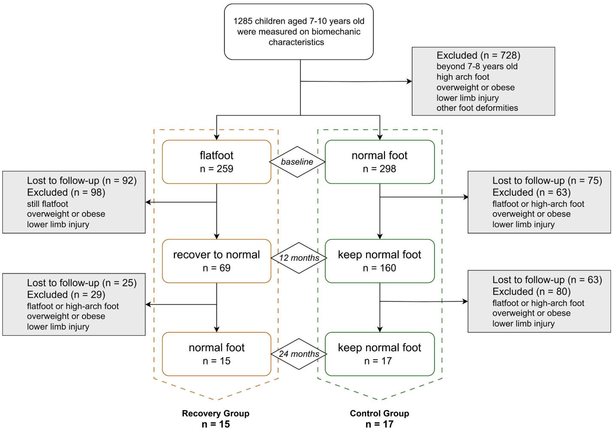
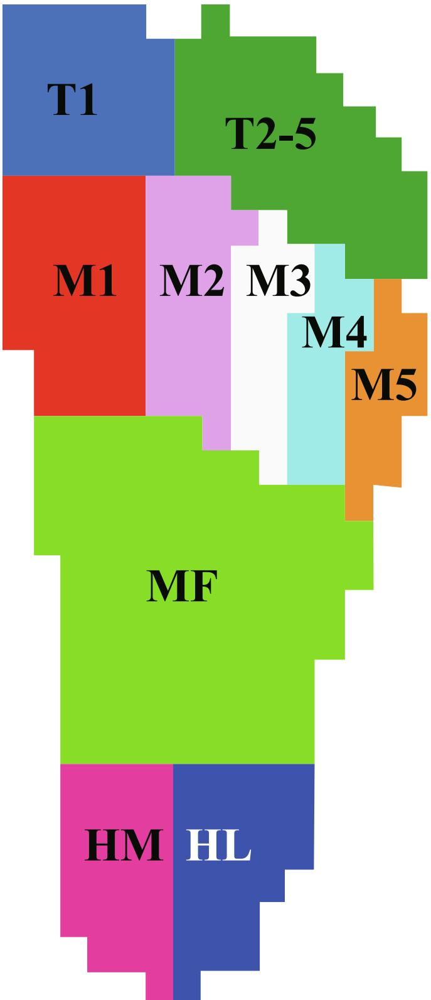
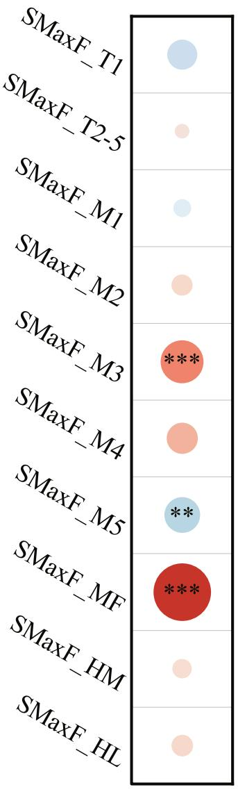
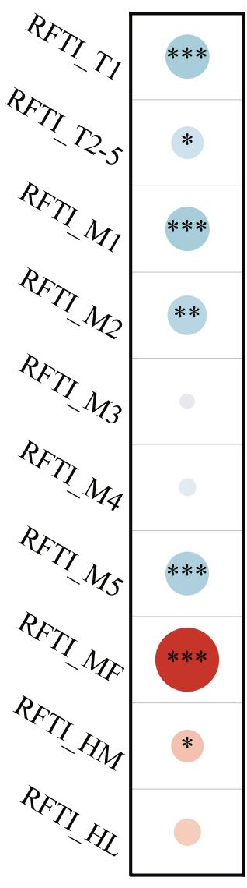
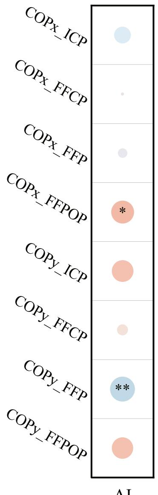
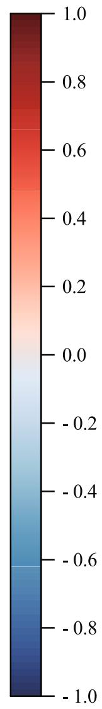
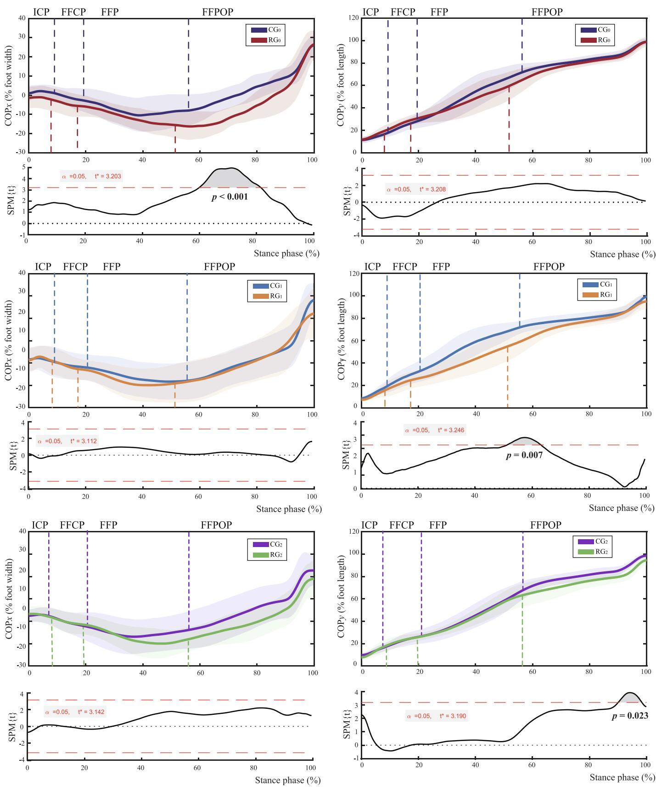

# Do gait patterns normalize concurrently with the recovery of foot arches in children with flatfoot? A prospective cohort study

Yihong Zhao a,b, Shiyang Yan b, Longbin Zhang c, Bi Shi a, Luming Yang a,b,\*

a National Engineering Research Center of Clean Technology in Leather Industry, Sichuan University, Chengdu 610065, China

b Intelligent Clothing and Sports Biomechanics Laboratory, Sichuan University, Chengdu 610065, China

c School of Robotics, Hunan University, Changsha, China

## A R T I C L E I N F O

Keywords: Children Flexible flatfoot Gait pattern recovery Plantar pressure distribution Center of pressure Cohort study

## A B S T R A C T

Flexible flatfoot in childhood usually undergoes a spontaneous return to normal. However, during this process, it remains unclear whether the gait pattern will be adjusted concurrently and the mechanism of such adjustment. We investigated the mechanism underlying the change in gait patterns in children after the natural recovery of flat feet through a two-year follow-up study, from the perspectives of plantar loading and gait stability. A total of 15 flatfoot children in the recovery group and 17 typically developed children in the control group were included after extensive sample screening. Three data acquisitions of plantar pressure and Center Of Pressure (COP) were performed every 12 months using a Footscan® pressure plate. Independent t-tests and statistical parametric mapping analysis were used to explore differences between the recovery and control groups at each measure ment. At baseline, the recovery group showed higher midfoot loading and a more laterally shifted COP. At the 12-month point, the recovery group manifested a significantly lower load ratio but higher standardized maximum force at the lateral forefoot. At the 24-month point, the recovery group changed to show a considerably higher load ratio under the second metatarsal head, accompanied by a more lateral and posterior COP displacement at the late stance phase. During the recovery of flexible flatfoot morphology in childhood, gait patterns eventually show significant improvement while exhibiting different characteristics at various stages. This study reveals the biomechanical adaptations following the natural recovery of flatfoot in children, contributing to a comprehensive understanding of the impact of pediatric flatfoot.

## 1. Introduction

Flexible flatfoot is prevalent among children and exhibits distinct gait pattern characteristics (Salinas-Torres et al., 2023; Xu et al., 2022). Collapsed arches can lead to abnormal plantar pressure distribution, increasing the risk of injuries such as hallux valgus and metatarsalgia (Bohm ¨ et al., 2024). Numerous studies have evaluated the effectiveness of the interventional approaches for the flatfoot from the perspectives of kinetics, kinematics, and other related characteristics (Kanatli, Aktas and Yetkin, 2016; Zhang et al., 2022; Cherni et al., 2022; Hu et al., 2024; Utsahachant et al., 2023; Persiane et al., 2023).

A notable feature of pediatric flexible flatfoot is that in most of them, the arches spontaneously recover as they grow older (Yin et al., 2018). Given that present research has not proven that intervention treatment is more effective than natural correction. Some researchers contend that excessive interventions are not necessary for pediatric flexible flatfoot (Pfeiffer et al., 2006; Sutherland, 1977). However, most studies on the spontaneous recovery of pediatric flexible flatfoot are primarily conducted from demographic and radiographic perspectives. Scarcely any studies have paid attention to the changes in gait function and characteristics before and after recovery in this group. One reason is that it’s tough to identify these children before their arches recover. The second reason stems from a common perception that once the flattened arch naturally returns to normal, their gait pattern characteristics will recover accordingly. There is no need for additional monitoring and intervention. Yet, this viewpoint is not backed by solid biomechanical evidence. Is intervention truly unnecessary for pediatric flexible flatfoot that can self-resolve? Does the gait pattern automatically return to normal following the natural restoration of the arch? Are there still potential dangers caused by gait abnormalities? These unresolved issues hinder the development of sound prognostic management measures for flat feet in children and may leave children at risk for foot injury after recovery from flat feet.

To our knowledge, no studies have yet assessed the gait patterns of children with flexible flatfoot after their recovery. Plantar pressure distribution and Center Of Pressure (COP) are key indicators for evalu ating gait patterns and potential injury risks in the flatfoot (Panaet et al., 2023; Khan et al., 2023; Zhang et al., 2022). Therefore, our study aims to investigate the mechanisms of change in gait patterns in children following the natural recovery of flatfoot over a two-year follow-up period, by evaluating the plantar loading and gait stability. We focus on examining how gait patterns evolve as the foot arch naturally develops with age, without clinical or physical interventions. Understanding the changes in gait patterns after the arch recovery will provide new insight into biomechanical adaptations in children with flexible flat feet.

## 2. Materials and methods

## 2.1. Participants

The participants were drawn from a large longitudinal study on foot biomechanics in children, which was approved by the Ethics Committee of Sichuan University. Initially, 1285 children were recruited from a local primary school. All participants were healthy and aged between 7 and 10 years old. For this study, the subject inclusion criteria for this study were as follows: (1) aged 7–8 years, (2) healthy and normal weighted children without any musculoskeletal disorders, foot pain, or history of lower limb surgery, and (3) voluntary participation after obtaining parental consent. Specifically, this study involved the recovery group (RG) and control group (CG). For the RG, further inclusion criteria were adopted: participants exhibited a flatfoot posture at baseline, and their foot posture naturally developed into a normal arch at both the second and third measurements, without any clinical or physical interventions. Regarding the CG, the supplementary inclusion criteria were the consistent presentation of a normal foot posture throughout the follow-up period. Furthermore, to minimize the influ ence of potential confounders, we controlled for variables such as age, height, weight, BMI, shoe-wearing habits, and physical activity levels. The subject screening process is shown in Fig. 1. The definition of normal weight was based on the BMI ranges suggested by the World Health Organization (World-Health-Organization, 2024). The determination of flatfoot was based on the Arch Index (AI) proposed by Cavanagh et al. (Cavanagh and Rodgers, 1987)., where the AI is calculated using the following Equation:

$$
A I = \frac {\text { midfootcontactarea }}{(\text { forefoot } + \text { midfoot } + \text { rearfoot }) \text { contactarea }}
$$

Specifically, the AI values less than 0.21 indicate a high arch, values between 0.21 and 0.26 represent a normal arch, and values greater than 0.26 suggest flatfoot.

## 2.2. Experimental procedures

The experiment lasted two years, with three measurements taken at baseline, 12 months, and 24 months. Gait biomechanics were assessed at baseline before the flatfoot recovery. A 1-m Footscan® plantar pressure plate (RSscan International, Belgium) collected participants’ dynamic plantar pressure data during their barefoot natural walking, with the sampling frequency at 250 Hz. The platform was embedded in the center of a 7 m long walkway. During the acclimatization period, participants were guided to walk at a relaxed pace over the walkway, using the twoinitiation protocol (Meyers-Rice et al., 1994; Taylor, Menz and Keenan, 2004). Any trial where subjects altered their gait by targeting the pressure plate, resulting in temporary foot switching or shuffling, was considered invalid. Each participant was required to complete five valid trials to ensure the accuracy and reliability of the experimental data. Before the initial experimental session, we explained the procedures in detail to each participant and their parent and obtained informed consent.

  
Fig. 1. Subject Screening Flowchart.

## 2.3. Data processing and statistical analysis

The foot was divided into ten regions in the Footscan® software as shown in Fig. 2: great toe (T1), lesser toes (T2-5), the 1st to the 5th metatarsal (M1, M2, M3, M4, M5), midfoot (MF), medial heel (HM), and lateral heel (HL). The maximum forces, the force–time integrals, and the Center Of Pressure (COP) were extracted. The maximum force was normalized to body mass as the standardized maximum force (SMaxF). The relative force–time integral (RFTI) refers to the ratio of each plantar region to the total foot load, which is used to evaluate the plantar load distribution.

For the COP coordinates, the y-axis was defined as the line from the middle heel to the forefoot over the middle of the second metatarsal for the anterior-posterior direction. The x-axis was perpendicular to the yaxis, representing the medial–lateral direction. Positive values on the xaxis and y-axis represented the medial and anterior directions, respectively. The COP coordinates exported were first filtered with a fourth order low-pass Butterworth filter at a cutoff frequency of 50 Hz (Cheng et al., 2022). The endpoints were padded through a reflection technique (De Cock et al., 2008). After filtering, The COP displacements in the medial–lateral (COPx) and anterior-posterior (COPy) directions were calculated with polynomial interpolation using MATLAB 2023b (MathWorks Inc., America), and all data were normalized for the stance time. The COP velocities (COPvx, COPvy) were calculated by differentiation. Further, the stance phase was divided into four sub-phases: Initial contact phase (ICP), forefoot contact phase (FFCP), foot flat phase (FFP), and forefoot push-off phase (FFPOP) (Perry and Burnfield, 2011). The ICP is the time interval from the initial heel contact to the initial forefoot. The FFCP immediately follows the ICP and ends when the entire forefoot contact with the plate. The FFP succeeds the FFCP and concludes when the heel is lifted off the ground. The FFPOP follows the FFP and terminates when the foot is entirely off the ground. The mean values of COP displacements and velocities in x- and y-directions were calculated for the sub-phases.

Three trials on the dominant foot per participant were included and averaged in the analyses. The Kolmogorov-Smirnov test was used to verify the data normality. Firstly, the relationship between gait dynamics and foot arch index was examined using Pearson correlation coefficient. Then $\textbf { a } 2 \times \textbf { 3 }$ repeated measures ANOVA was used to determine the within-group (repeated measures at baseline, 12 months, and 24 months) and the between-group (RG and CG) differences. Significant interactions were further explored by conducting pairwise comparisons at each time point using independent samples t-tests to evaluate group differences at each test point. Bonferroni correction was applied to adjust for multiple comparisons. Significance was set at $p <$ 0.05. Partial eta squared $( \eta _ { p } ^ { 2 } )$ estimated the effect sizes for all ANOVA analyses and were interpreted as small (0.01), medium (0.06) and large (0.14) (Cohen, 1988). The COP displacement curves during the stance phase were analyzed with the 1D statistical parametric mapping method (SPM) to compare the recovery and control groups (Pataky, 2008).

  
Fig. 2. Foot regions. T1: the great toe, T2-5: lesser toes, M1-M5: the 1st to the 5th metatarsal, MF: midfoot, HM: medial heel, HL: lateral heel.

## 3. Results

## 3.1. Participants characteristics

Totally 15 participants were assigned to the recovery group $( \operatorname { R G } _ { 0 } ,$ $\mathrm { R G } _ { 1 } , \mathrm { R G } _ { 2 } )$ and 17 to the control group $( \mathrm { C G } _ { 0 } , \mathrm { C G } _ { 1 } , \mathrm { C G } _ { 2 } )$ and participated in 3 follow-up tests. The basic characteristics are detailed in Table 1.

Table 1  
AI  
Basic information of the participants.

<table><tr><td rowspan="2"></td><td colspan="2">Baseline</td><td colspan="2">12 months</td><td colspan="2">24 months</td></tr><tr><td> $RG_0$ </td><td> $CG_0$ </td><td> $RG_1$ </td><td> $CG_1$ </td><td> $RG_2$ </td><td> $CG_2$ </td></tr><tr><td>Sex (boy/girl)</td><td>6/9</td><td>8/9</td><td>6/9</td><td>8/9</td><td>6/9</td><td>8/9</td></tr><tr><td>Age(year)</td><td>7.7 (0.3)</td><td>7.7(0.4)</td><td>8.9(0.5)</td><td>8.6(0.6)</td><td>9.9(0.5)</td><td>9.6(0.6)</td></tr><tr><td>Height(cm)</td><td>130.1(3.5)</td><td>128.2(4.3)</td><td>135.8(3.5)</td><td>133.3(4.3)</td><td>140.7(3.4)</td><td>138.7(4.7)</td></tr><tr><td>Weight(kg)</td><td>26.1(3.6)</td><td>24.3(3.3)</td><td>29.3(3.5)</td><td>27.5(4.6)</td><td>33.2(5.6)</td><td>31.8(5.8)</td></tr><tr><td>BMI (kg/ $m^2$ )</td><td>15.4(1.4)</td><td>14.7(1.4)</td><td>15.9(1.5)</td><td>15.3(1.8)</td><td>16.7(2.3)</td><td>16.5(2.1)</td></tr><tr><td>AI</td><td>0.27(0.03)*</td><td>0.22(0.02)</td><td>0.24(0.03)</td><td>0.22(0.03)</td><td>0.22(0.02)</td><td>0.21(0.02)</td></tr></table>

indicates significant differences between the two groups at each testing point, p < 0.05.

There were no significant differences in basic characteristics between the two groups, except for the AI at baseline.

The Pearson correlation analysis revealed that most plantar pressure parameters exhibited a moderate to strong correlation with the AI (Fig. 3). Notably, the midfoot and forefoot regions showed the strongest associations (SMaxF\_MF: r = 0.658, p < 0.001; RFTI\_MF: r = 0.680, p < 0.001; SMaxF\_M3: r = 0.318, p = 0.036; RFTI\_M1: r = -0.326, p = 0.001; RFTI\_M5: r = -0.308, p = 0.001). Regarding COP parameters, a signifi cant positive correlation was observed between COPx during the FFPOP and the AI (COPx\_FFPOP: r = 0.210, p = 0.035). Conversely, COPy during the FFP demonstrated a significant negative correlation with the AI (COPy\_FFP: r = -0.198, p = 0.035).

## 3.2. The statistical correlation between gait parameters and AI

AI  
(a)  
(b)  

The results of two-way repeated measures ANOVA for foot loading

## 3.3. Foot loading characteristics

  
(c)  
Fig. 3. Correlations between gait biomechanics and foot arch index (AI). (a) Correlations between SMaxF and AI; (b) Correlations between RFTI and AI; (c) Correlations between COP displacement and $\mathrm { A I . ~ } ^ { * } p < 0 . 0 5 , ^ { * * } p < 0 . 0 5 , ^ { * * * } p < 0 . 0 0 1$

Two-way repeated ANOVAs of the standardized maximum force (%) outcomes. Mean and standard deviations are reported for the RG and RG at baseline, 12-months and 24-month test points.

<table><tr><td rowspan="3">Plantar regions</td><td colspan="2">Baseline</td><td colspan="2">12 months</td><td colspan="2">24 months</td><td colspan="6">Statistical effect</td></tr><tr><td rowspan="2"> $RG_0$  Mean (SD)</td><td rowspan="2"> $CG_1$  Mean (SD)</td><td rowspan="2"> $RG_1$  Mean (SD)</td><td rowspan="2"> $CG_1$  Mean (SD)</td><td rowspan="2"> $RG_2$  Mean (SD)</td><td rowspan="2"> $CG_2$  Mean (SD)</td><td colspan="2">Group</td><td colspan="2">Time</td><td colspan="2">Group × Time</td></tr><tr><td>p</td><td> $\eta_p^2$ </td><td>p</td><td> $\eta_p^2$ </td><td>p</td><td> $\eta_p^2$ </td></tr><tr><td>T1</td><td>14.1 (6.7)</td><td>18.7 (11.6)</td><td>19.6 (10.7)</td><td>18.8 (13.3)</td><td>25.8 (12.3)</td><td>25.6 (12.6)</td><td>0.922</td><td>0.01</td><td> $0.013^a$ </td><td>0.17</td><td> $0.039^a$ </td><td>0.17</td></tr><tr><td>T2-5</td><td>4.8 (3.8)</td><td>4.1 (2.4)</td><td>4.4 (2.6)</td><td>6.3 (5.1)</td><td>6.7 (3.1)</td><td>6.0 (5.4)</td><td>0.424</td><td>0.03</td><td>0.562</td><td>0.03</td><td>0.308</td><td>0.05</td></tr><tr><td>M1</td><td>22.7 (5.8)</td><td>23.0 (12.1)</td><td>22.4 (10.3)</td><td>28.3 (20.3)</td><td>25.8 (8.0)</td><td>31.9 (13.6)</td><td>0.084</td><td>0.12</td><td>0.213</td><td>0.06</td><td>0.499</td><td>0.03</td></tr><tr><td>M2</td><td>30.1 (7.4)</td><td>29.1 (7.6)</td><td>27.3 (9.7)</td><td>33.2 (19.7)</td><td>35.6 (12.5)</td><td>29.8 (11.4)</td><td>0.851</td><td>0.01</td><td>0.551</td><td>0.02</td><td>0.139</td><td>0.07</td></tr><tr><td>M3</td><td>25.2 (7.6)</td><td>20.8 (7.8)</td><td>17.9 (6.2)</td><td>20.8 (12.8)</td><td>19.1 (6.2)</td><td>21.4 (6.9)</td><td>0.768</td><td>0.01</td><td>0.096</td><td>0.08</td><td>0.274</td><td>0.05</td></tr><tr><td>M4</td><td>18.7 (8.5)</td><td>14.1 (8.1)</td><td>12.1 (4.1)</td><td>9.0 (3.3)</td><td>13.7 (6.2)</td><td>17.7 (9.1)</td><td>0.474</td><td>0.02</td><td> $0.016^a$ </td><td>0.17</td><td>0.360</td><td>0.04</td></tr><tr><td>M5</td><td>3.5 (2.1)</td><td>3.6 (2.1)</td><td> $7.0 (4.2)^b$ </td><td>3.8 (1.7)</td><td>7.0 (4.4)</td><td>8.9 (1.3)</td><td>0.993</td><td>0.01</td><td> $0.001^a$ </td><td>0.36</td><td> $0.027^a$ </td><td>0.18</td></tr><tr><td>MF</td><td> $51.9 (21.1)^b$ </td><td>27.6 (14.4)</td><td>21.8 (11.3)</td><td>17.1 (7.8)</td><td>18.6 (8.5)</td><td>18.3 (5.4)</td><td> $0.009^a$ </td><td>0.25</td><td> $0.001^a$ </td><td>0.52</td><td> $0.009^a$ </td><td>0.18</td></tr><tr><td>HM</td><td>48.6 (14.7)</td><td>37.2 (13.0)</td><td>46.8 (17.6)</td><td>44.0 (19.3)</td><td>46.5 (16.7)</td><td>54.9 (18.5)</td><td>0.186</td><td>0.08</td><td>0.554</td><td>0.03</td><td>0.551</td><td>0.03</td></tr><tr><td>HL</td><td>34.1 (8.4)</td><td>35.5 (14.5)</td><td>38.4 (17.0)</td><td>33.8 (15.4)</td><td>35.5 (15.2)</td><td>44.4 (14.9)</td><td>0.616</td><td>0.01</td><td>0.514</td><td>0.03</td><td>0.185</td><td>0.07</td></tr></table>

a Statistical significance (p < 0.05).  
b Significant differences between the RG and the CG at each testing point.

Two-way repeated ANOVAs of the relative force–time integral (%) outcomes. Mean and standard deviations are reported for the RG and RG at baseline, 12-months and 24-month test points.

<table><tr><td rowspan="3">Plantar regions</td><td colspan="2">Baseline</td><td colspan="2">12 months</td><td colspan="2">24 months</td><td colspan="6">Statistical effect</td></tr><tr><td rowspan="2"> $RG_0$ Mean (SD)</td><td rowspan="2"> $CG_1$ Mean (SD)</td><td rowspan="2"> $RG_1$ Mean (SD)</td><td rowspan="2"> $CG_1$ Mean (SD)</td><td rowspan="2"> $RG_2$ Mean (SD)</td><td rowspan="2"> $CG_2$ Mean (SD)</td><td colspan="2">Group</td><td colspan="2">Time</td><td colspan="2">Group × Time</td></tr><tr><td>p</td><td> $\eta_p^2$ </td><td>p</td><td> $\eta_p^2$ </td><td>p</td><td> $\eta_p^2$ </td></tr><tr><td>T1</td><td> $3.3 (1.8)^b$ </td><td>7.6 (5.1)</td><td>7.1 (3.6)</td><td>7.6 (4.2)</td><td>8.4 (4.5)</td><td>8.0 (3.7)</td><td>0.134</td><td>0.07</td><td> $0.010^a$ </td><td>0.14</td><td> $0.041^a$ </td><td>0.10</td></tr><tr><td>T2-5</td><td>1.0 (1.0)</td><td>2.3 (2.1)</td><td>1.8 (1.1)</td><td>1.9 (1.0)</td><td>1.9 (1.0)</td><td>2.0 (1.6)</td><td>0.247</td><td>0.04</td><td>0.560</td><td>0.02</td><td>0.058</td><td>0.09</td></tr><tr><td>M1</td><td>7.4 (4.0)</td><td>11.7 (8.2)</td><td>12.6 (7.6)</td><td>12.7 (6.2)</td><td>12.4 (3.7)</td><td>12.7 (5.2)</td><td>0.333</td><td>0.03</td><td>0.041</td><td>0.10</td><td>0.321</td><td>0.04</td></tr><tr><td>M2</td><td>11.8 (4.9)</td><td>16.2 (5.7)</td><td>15.2 (6.8)</td><td>16.1 (6.0)</td><td> $17.1 (4.8)^b$ </td><td>13.3 (3.7)</td><td>0.843</td><td>&lt;0.01</td><td>0.533</td><td>0.02</td><td> $0.025^a$ </td><td>0.12</td></tr><tr><td>M3</td><td>11.2 (4.2)</td><td>10 (3.3)</td><td>10.2 (3.5)</td><td>11.3 (4.5)</td><td>10.3 (2.6)</td><td>11.0 (3.7)</td><td>1.000</td><td>&lt;0.01</td><td>0.983</td><td>0.00</td><td>0.270</td><td>0.04</td></tr><tr><td>M4</td><td>8 (4)</td><td>6.6 (3.4)</td><td> $7.4 (3.6)^b$ </td><td>8.9 (6.1)</td><td>7.4 (3.0)</td><td>7.7 (3.5)</td><td>0.990</td><td>&lt;0.01</td><td>0.691</td><td>0.01</td><td>0.217</td><td>0.05</td></tr><tr><td>M5</td><td>1.7 (1.5)</td><td>1.9 (1.7)</td><td> $3.4 (1.9)^b$ </td><td>3.6 (3.0)</td><td>3.1 (2.0)</td><td>3.9 (2.1)</td><td>0.449</td><td>0.02</td><td> $<0.001^a$ </td><td>0.23</td><td>0.754</td><td>0.01</td></tr><tr><td>MF</td><td> $21.9 (8)^b$ </td><td>8.7 (4)</td><td>9.2 (4.7)</td><td>8.8 (5.2)</td><td>7.2 (2.9)</td><td>7.9 (2.5)</td><td> $0.001^a$ </td><td>0.32</td><td> $0.001^a$ </td><td>0.49</td><td> $0.001^a$ </td><td>0.49</td></tr><tr><td>HM</td><td>19.5 (7.4)</td><td>20.4 (11)</td><td>18.4 (4.4)</td><td>15.9 (7.1)</td><td>18.2 (4.0)</td><td>18.8 (6.0)</td><td>0.614</td><td>0.01</td><td>0.292</td><td>0.04</td><td>0.666</td><td>0.01</td></tr><tr><td>HL</td><td>14.1 (5.5)</td><td>14.7 (6.4)</td><td>14.7 (5.1)</td><td>13.2 (6.1)</td><td>14.1 (3.5)</td><td>14.6 (4.5)</td><td>0.774</td><td>&lt;0.01</td><td>0.950</td><td>0.01</td><td>0.587</td><td>0.02</td></tr></table>

a Statistical significance (p < 0.05).  
b Significant differences between the RG and the CG at each testing point.

characteristics are summarized in Table 2 and Table 3. The significant group and time interaction effects appeared in T1, M2, M4, M5 and MF. At baseline, the SMaxF value of the RG0 in the midfoot was significantly higher than that of the $\mathrm { C G } _ { 0 } ~ ( p = 0 . 0 0 1 )$ ). At the 12-month point, the SMaxF values in M4 and M5 of the $\mathsf { R G } _ { 1 }$ were significantly higher than those of the $\mathrm { C G } _ { 1 } \left( p = 0 . 0 4 8 ; p = 0 . 0 1 4 \right)$ . At the 24-month point, there were no significant differences in SMaxF between the two groups. As shown in Table 3, the $\operatorname { R G } _ { 0 }$ showed significantly higher RFTI in the midfoot $( p < 0 . 0 0 1 )$ , and significantly lower RFTI values at T1 $( p =$ 0.006) compared to the $\operatorname { C G } .$ At the 12-month point, the RFTI value of the $\mathsf { R G } _ { 1 }$ was significantly lower than that of $\mathbf { C G } _ { 1 }$ in M4 and M5 $( p =$ $0 . 0 1 6 ; p = 0 . 0 6 5 )$ . By the 24-month point, the RFTI value of the $\mathsf { R G } _ { 2 }$ was significantly greater than that of the $\mathrm { C G } _ { 2 }$ in M2 $( p = 0 . 0 1 8 )$

## 3.4. Center of pressure characteristics

The results of two-way repeated measures ANOVA for COP displacements and velocities are summarized in Table 4 and Table 5. The significant Group and Time interaction effects appeared in the FFCP and FFPOP. As shown in Table 4, COPvx was significantly higher in the

Two-way repeated ANOVAs of the COP displacements and velocities in the medial–lateral direction outcomes. Mean and standard deviations are reported for the RG and RG at baseline, 12-months and 24-month test points.

<table><tr><td rowspan="3"></td><td rowspan="3">Gait phase</td><td colspan="2">Baseline</td><td colspan="2">12 months</td><td colspan="2">24 months</td><td colspan="6">Statistical effect</td></tr><tr><td rowspan="2"> $RG_0$ Mean (SD)</td><td rowspan="2"> $CG_1$ Mean (SD)</td><td rowspan="2"> $RG_1$ Mean (SD)</td><td rowspan="2"> $CG_1$ Mean (SD)</td><td rowspan="2"> $RG_2$ Mean (SD)</td><td rowspan="2"> $CG_2$ Mean (SD)</td><td colspan="2">Group</td><td colspan="2">Time</td><td colspan="2">Group × Time</td></tr><tr><td>p</td><td> $\eta_p^2$ </td><td>p</td><td> $\eta_p^2$ </td><td>p</td><td> $\eta_p^2$ </td></tr><tr><td rowspan="4">COPx % foot width</td><td>ICP</td><td>-1.6 (2.7)</td><td>-0.2 (2.3)</td><td>-1.4 (3.1)</td><td>-0.6 (3.5)</td><td>-1.8 (2.4)</td><td>-0.7 (2.4)</td><td>0.118</td><td>0.08</td><td>0.852</td><td>0.01</td><td>0.897</td><td>0.01</td></tr><tr><td>FFCP</td><td>-2.0 (2.6)</td><td>-1.6 (3.3)</td><td>-1.5 (2.4)</td><td>-2.3 (1.4)</td><td>-3.3 (4.9)</td><td>-1.8 (1.8)</td><td>0.511</td><td>0.02</td><td>0.526</td><td>0.02</td><td>0.383</td><td>0.03</td></tr><tr><td>FFP</td><td>-6.3 (5.5)</td><td>-4.1 (7.2)</td><td>-4.7 (6.6)</td><td>-6 (7.5)</td><td>-3.9 (8.0)</td><td>-1.5 (8.1)</td><td>0.352</td><td>0.03</td><td>0.493</td><td>0.02</td><td>0.294</td><td>0.04</td></tr><tr><td>FFPOP</td><td>40.6 (10.5)</td><td>33.9 (10.9)</td><td> $27.4 (14.4)^b$ </td><td>36.4 (9.7)</td><td>27.7 (10.3)</td><td>28.2 (7.9)</td><td>0.719</td><td>0.01</td><td> $0.005^a$ </td><td>0.17</td><td> $0.027^a$ </td><td>0.12</td></tr><tr><td rowspan="4">COPvx m/s</td><td>ICP</td><td>-3.1 (5.4)</td><td>0.5 (4.7)</td><td>-3.2 (6.5)</td><td>-1.5 (7.0)</td><td>-4.2 (5.6)</td><td>-2.0 (4.4)</td><td>0.065</td><td>0.10</td><td>0.380</td><td>0.03</td><td>0.764</td><td>0.01</td></tr><tr><td>FFCP</td><td>-3.2 (3.9)</td><td>-2.5 (4.8)</td><td> $-2.5 (3.2)^b$ </td><td>-5.4 (4.2)</td><td>-2.3 (4.0)</td><td>-2.3 (2.4)</td><td>0.542</td><td>0.01</td><td>0.336</td><td>0.04</td><td>0.245</td><td>0.05</td></tr><tr><td>FFP</td><td>-2.7 (2.3)</td><td>-2.5 (3.5)</td><td>-2.1 (4.0)</td><td>-2.8 (3.2)</td><td>-2.7 (3.0)</td><td>-0.5 (3.6)</td><td>0.352</td><td>0.03</td><td>0.376</td><td>0.03</td><td>0.283</td><td>0.04</td></tr><tr><td>FFPOP</td><td> $13.6 (5.0)^b$ </td><td>9.6 (3.0)</td><td>9.4 (5.9)</td><td>10.2 (3.0)</td><td>8.6 (3.0)</td><td>8.6 (2.0)</td><td>0.155</td><td>0.08</td><td>0.051</td><td>0.11</td><td> $0.032^a$ </td><td>0.12</td></tr></table>

a Statistical significance (p < 0.05).  
b Significant differences between the RG and the CG at each testing point.

Table 5  
Two-way repeated ANOVAs of the COP displacements and velocities in the anterior-posterior direction outcomes. Mean and standard deviations are reported for the RG and RG at baseline, 12-months and 24-month test points.

<table><tr><td rowspan="3"></td><td rowspan="3">Gait phase</td><td colspan="2">Baseline</td><td colspan="2">12 months</td><td colspan="2">24 months</td><td colspan="6">Statistical effect</td></tr><tr><td rowspan="2"> $RG_0$  Mean (SD)</td><td rowspan="2"> $CG_1$  Mean (SD)</td><td rowspan="2"> $RG_1$  Mean (SD)</td><td rowspan="2"> $CG_1$  Mean (SD)</td><td rowspan="2"> $RG_2$  Mean (SD)</td><td rowspan="2"> $CG_2$  Mean (SD)</td><td colspan="2">Group</td><td colspan="2">Time</td><td colspan="2">Group × Time</td></tr><tr><td>p</td><td> $\eta_p^2$ </td><td>p</td><td> $\eta_p^2$ </td><td>p</td><td> $\eta_p^2$ </td></tr><tr><td rowspan="4">COPy % foot length</td><td>ICP</td><td>8.9 (3.7)</td><td>6.4 (3.4)</td><td>8.7 (3.5)</td><td>8.5 (2.1)</td><td>8.8 (2.8)</td><td>7.4 (1.7)</td><td>0.079</td><td>0.10</td><td>0.334</td><td>0.04</td><td>0.227</td><td>0.05</td></tr><tr><td>FFCP</td><td>10.2 (6.1)</td><td>7.6 (5.4)</td><td>10.5 (4.0)</td><td>9.3 (2.9)</td><td>11.9 (6.0)</td><td>7.6 (2.9)</td><td> $0.008^a$ </td><td>0.25</td><td>0.609</td><td>0.02</td><td>0.394</td><td>0.04</td></tr><tr><td>FFP</td><td> $40.3 (9.7)^b$ </td><td>48.6 (9.7)</td><td>41.0 (11.4)</td><td>42.5 (8.4)</td><td>41.4 (4.7)</td><td>45.7 (10.4)</td><td>0.073</td><td>0.11</td><td>0.212</td><td>0.05</td><td>0.516</td><td>0.02</td></tr><tr><td>FFPOP</td><td> $30.1 (4.2)^b$ </td><td>25.7 (4.5)</td><td>27.1 (7.4)</td><td>28.3 (4.0)</td><td>27.4 (5.2)</td><td>26.9 (3.1)</td><td>0.064</td><td>0.12</td><td>&lt; 0.001a</td><td>0.25</td><td>0.259</td><td>0.05</td></tr><tr><td rowspan="4">COPvy m/s</td><td>ICP</td><td>33.0 (12.8) $^b$ </td><td>23.4 (9.8)</td><td>34.3 (16.7)</td><td>36.6 (13.7)</td><td>43.8 (21.4)</td><td>34.7 (17.5)</td><td>0.186</td><td>0.06</td><td>0.005</td><td>0.18</td><td>0.321</td><td>0.04</td></tr><tr><td>FFCP</td><td>41.3 (28.7)</td><td>27.5 (15.8)</td><td>37.7 (14.8)</td><td>46.8 (27.0)</td><td>36.7 (12.0)</td><td>34.1 (18.3)</td><td>0.319</td><td>0.04</td><td>0.402</td><td>0.03</td><td>0.167</td><td>0.06</td></tr><tr><td>FFP</td><td>36.3 (9.3)</td><td>42.7 (10.0)</td><td>42.5 (16.7)</td><td>43.2 (11.7)</td><td>41.5 (18.2)</td><td>43.6 (12.2)</td><td>0.562</td><td>0.01</td><td>0.437</td><td>0.03</td><td>0.432</td><td>0.03</td></tr><tr><td>FFPOP</td><td> $26.1 (5.9)^b$ </td><td>19.3 (4.0)</td><td>25.1 (11.2)</td><td>20.8 (4.2)</td><td>25.2 (7.6)</td><td>22.1 (5.4)</td><td> $0.020^a$ </td><td>0.17</td><td> $0.003^a$ </td><td>0.18</td><td> $0.031^a$ </td><td>0.11</td></tr></table>

a Statistical significance $( p < 0 . 0 5 ) .$  
b Significant differences between the RG and the CG at each testing point.

FFPOP for the $\operatorname { R G } _ { 0 }$ compared to the $\mathrm { C G } _ { 0 } \left( p = 0 . 0 0 9 \right) .$ . At the 12-month point, a significantly lower COPx in the FFPOP $( \boldsymbol { p } = 0 . 0 4 6 )$ and COPvx in the FFCP $( p = 0 . 0 3 6 )$ were found for RE1 compared to the $\mathbf { C G } _ { 1 } .$ . As shown in $\mathrm { T a b l e } 5 ,$ the $\operatorname { R G } _ { 0 }$ had significantly lower COPy in the FFP $\left( p = \right.$ 0.022) but higher in the FFPOP $( p = 0 . 0 0 8 )$ , and its COPvy was signif icantly higher in the FFPOP than $\mathrm { C G } _ { 0 } \left( p = 0 . 0 0 1 \right)$ . At the 12- and 24- month points, no significant differences were found between the two groups.

Fig. 4 illustrates the differences in COP displacement curves between the two groups, along with the results of the SPM analysis. The range of COPx during the stance phase in the $\mathsf { R G } _ { 0 }$ was greater than that in the $\mathbf { C G } _ { 0 } ,$ demonstrating a more significant lateral shift at 60 % to 80 % of the stance phase $( p < 0 . 0 0 1 )$ . At the 12- and 24-month points, no significant differences were noted. In the anterior-posterior direction, the COPy of the $\mathsf { R G } _ { 1 }$ was smaller than that of the $\mathrm { C G } _ { 1 }$ 1 during about 55 % to 65 % of the stance phase $( p = 0 . 0 0 7 )$ . At the 24-month point, the $\mathrm { R G } _ { 2 }$ displayed a smaller COPy in the FFPOP, with significant differences observed during 90 % to 98 % of the stance phase.

## 4. Discussion

This study aims to investigate the change of gait pattern characteristics after the spontaneous recovery of flexible flatfoot in children. Correlation analysis revealed that the arch index was a key parameter influencing gait characteristics in children. Specifically, plantar pressure parameters across different foot regions showed moderate to strong correlations with AI, with the midfoot and forefoot regions being particularly influential. The repeated ANOVA analysis indicated that the gait characteristics of the recovery group and the control group changed differently over time, especially in the hallux, forefoot, and midfoot regions. Further pairwise comparisons showed that within two years of flatfoot recovery, the plantar loading mode and gait stability got improved and gradually tended to normalize. However, the gait pattern of the experimental group has not fully recovered to the level of typically developed children and exhibited different features at different stages. It suggests that the recovery of the gait pattern lags behind the recovery of the arch structure. This longitudinal study provides insights into the natural recovery of gait in children with flexible flatfoot, highlighting the gradual adaptation of gait patterns over time. These findings contribute to understanding gait maturation and its natural progression.

At baseline, the arches of the children in the $\mathsf { R G } _ { 0 }$ were still flattened. The midfoot loading in the $\mathsf { R G } _ { 0 }$ was significantly higher than that of the $\mathbf { C G } _ { 0 } ,$ aligning with our general understanding of flatfoot. Additionally, the recovery group showed lower peak pressures and relative loads in the T1 region. In contrast, Buldt et al. (Buldt et al., 2018) examined the foot loading of adults with flat feet and found that the T1 region experienced a significantly higher load, contributing more during the propulsion phase. The reduced loading in the hallux region observed in our study suggests it generated less pushing force during this phase. This reduction is primarily attributed to impaired function in flat-footed children during the push-off stage (Kothari et al., 2016; Kim et al., $2 0 1 7 )$ . We speculate that the response in the hallux during the propul sion phase differs between children and adults when experiencing arch collapse. Furthermore, the $\operatorname { R G } _ { 0 }$ accomplished a faster displacement of COP longitudinally during the push-off phase, with a more lateral orientation (60 %–80 % stance phase). This implies an unstable state in children with flatfoot after the heel lifts off the ground. This finding aligns with the study by Panaet et al. (Panaet et al., 2022), which demonstrated that excessive eversion of the subtalar joint leads to medial displacement of the talus, consequently affecting the overall lower limb kinematics. Our results further indicate that the lateral COP shift in flatfooted children during push-off is a compensatory response to joint misalignment.

Another unexpected finding is that the forefoot loading results diffe from those of previous studies (Pauk, Ihnatouski and Najafi, 2014; Yan et al., 2020), which suggested that a collapsed arch in flatfoot failed to distribute load effectively, resulting in a significant decrease in forefoot pressure and impulse. In our study, the foot arches of the recovery group later returned to a normal shape, which suggests that their loading patterns may have progressed towards normal before fully recovering the flatfoot arch morphology. Compared with the cross-sectional studies that overlook the later development of flatfoot, our study provides more targeted and distinct insights into the gait patterns of children with flatfoot at baseline. However, further validation of these findings requires a substantial amount of data analysis on children with flatfoot. Additional research on this specific group can yield valuable insights into identifying cases of spontaneously resolving flatfoot.

Within the first year of arch morphology recovery, the foot loading pattern of the recovery group displayed notable changes, with the concentrated pressure under the midfoot effectively mitigating. As the arch structure continued to recover, the plantar load distribution became more uniform. However, at this stage, the gait characteristics still resembled those typically observed in children with flatfoot. Notably, the relative load on the lateral forefoot was significantly lower in the $\mathsf { R G } _ { 1 }$ compared to the $\mathbf { C G } _ { 1 }$ . This could be explained from two perspectives. From the viewpoint of lower limb adaptations, it could be attributed to the external rotation of the subtalar joint of the flatfoot, which shifts the forefoot load from the lateral to the medial side (Buldt et al., 2018; Chuckpaiwong et al., 2008). From the perspective of proximal segment adaptations, the lumbar lordosis angle in adolescents tends to decrease as the arch height increases (Jankowicz-Szymanska et al., 2021), which may lead to a reduction in the relative forefoot load (Zurawski et al., 2022). Further joint kinematics data and more exten sive statistical analyses are needed to assess the contribution of the potential segment adaptations to the alteration of gait characteristics.

Despite these improvements, the standardized maximum force in the

  
Fig. 4. COP displacement curves of the two groups at each testing point.

lateral forefoot in the $\mathsf { R G } _ { 1 }$ was notably higher. This increase is strongly associated with the cushioning at the ground contact (Perry and Burnfield, 2011). It suggests that the strength of the tibialis anterior muscle in the $\mathrm { R G } _ { 1 }$ has not yet returned to normal levels during this period. As a result, the significant sway during forefoot contact leads to a sudden increase in force at the lateral forefoot. Meanwhile, the $\mathsf { R G } _ { 1 }$ exhibited a smaller COP velocity in the lateral direction during the FFCP. It indicates that the $\mathsf { R G } _ { 1 }$ subconsciously adopted this motor strategy to enhance gait control when making forefoot contact.

By the third test, the gait patterns of the RG2 showed significant improvement, converging towards the levels commonly seen in typically developing children. All discrepancies in standardized maximum force and the mean COP data between the two groups had completely disappeared. However, some differential results remained, particularly concerning relative load and the COP curve. RG2 was found to have a higher relative load in the M2 region and displayed a more lateral and less anterior COP shift in the FFPOP. In a typical gait cycle, after heel-off, the eccentric contraction of the tibialis anterior muscle facilitates the transfer of the center of pressure from the lateral to the medial forefoot, tightening the plantar fascia and aiding forward propulsion (Perry and Burnfield, 2011). In this study, the COP characteristics of the $\mathsf { R G } _ { 2 }$ suggest that their normal forefoot pronation and forward propulsion functions were partially restricted. Consequently, the plantar load seemed ‘trapped’ in the M2 region, and the notable increase in the RFTI supports this conclusion. Since the M2 is crucial for weight support and function during everyday physical activities, excessive repetitive loading could increase the risk of metatarsalgia and other related disorders (Kaipel, Krapf and Wyss, 2011; Lee et al., 2024). During the second year of arch recovery, gait patterns continued to improve compared to the first year, approaching the levels seen in typically developing children. However, attention should still be focused on the dispersion of impulse in the M2 region, especially during repetitive activities such as long-distance running and hiking, where the load can accumulate over time.

This study has several limitations that need to be acknowledged. While our focus was on analyzing plantar loading and gait stability following the recovery from flatfoot to a normal arch, a more comprehensive understanding is needed regarding how gait function changes with arch recovery, particularly in terms of muscle activity and joint movement. Moreover, longer-term follow-up studies are required to confirm the speculative findings presented in this study. The lack of systematic foundational research on the kinematics and dynamics of gait in children with flatfoot further underscores the need for more extensive research. In this regard, future studies incorporating kinematic analyses of both the lower limb and trunk could provide deeper insights into the resolution of compensatory movements and help clarify when these adjustments fully subside during the recovery process.

## 5. Conclusion

During critical developmental periods, gait characteristics in chil dren with flatfoot tend to improve following the restoration of the arch structure, albeit with a temporal lag. After the flatfoot recovery, the high foot loading shifted from the arch region first to the lateral forefoot and then to the central forefoot. The COP trajectory differs from normal children’s, particularly during the loading response, terminal stance, and pre-swing phases. These findings highlight the biomechanical ad aptations during flatfoot recovery. Future studies should incorporate full-body kinematic analysis and provide a more comprehensive refer ence for gait normalization and clinical applications.

## CRediT authorship contribution statement

Yihong Zhao: Writing – review & editing, Writing – original draft, Visualization, Software, Methodology, Investigation, Formal analysis, Data curation, Conceptualization. Shiyang Yan: Writing – review & editing, Investigation, Formal analysis, Data curation, Conceptualization. Longbin Zhang: Writing – review & editing, Software, Method ology, Conceptualization. Bi Shi: Writing – review & editing, Resources, Data curation, Conceptualization. Luming Yang: Writing – review & editing, Supervision, Resources, Project administration, Data curation, Conceptualization.

## Funding

This work was supported by the Sichuan Province Science and Technology Support Program (grant number: 25NSFJQ0020) and the Nanning Science and Technology Bureau (grant number: 20243042) .

## Declaration of competing interest

The authors declare that they have no known competing financial interests or personal relationships that could have appeared to influence the work reported in this paper.

## References

Bohm, ¨ H., Stebbins, J., Kothari, A., Dussa, C.U., 2024. Dynamic gait analysis in paediatric flatfeet: unveiling biomechanical insights for diagnosis and treatment. Children 11 (5), 604.

Buldt, A.K., Forghany, S., Landorf, K.B., Levinger, P., Murley, G.S., Menz, H.B., 2018. Foot posture is associated with plantar pressure during gait: a comparison of normal, planus and cavus feet. Gait Posture 62, 235–240.

Cavanagh, P.R., Rodgers, M.M., 1987. The arch index: a useful measure from footprints. J. Biomech. 20 (5), 547–551.

Cheng, J., Zeng, Q., Lai, J., Zhang, X., 2022. Effects of arch support doses on the center of pressure and pressure distribution of running using statistical parametric mapping. Front. Bioeng. Biotechnol. 10, 1051747

Cherni, Y., Desmyttere, G., Hajizadeh, M., Bleau, J., Mercier, C., Begon, M., 2022. Effect of 3D printed foot orthoses stiffness on muscle activity and plantar pressures in individuals with flexible flatfeet: a statistical non-parametric mapping study. Clin. Biomech. 92, 105553.

Chuckpaiwong, B., Nunley, J.A., Mall, N.A., Queen, R.M., 2008. The effect of foot type on in-shoe plantar pressure during walking and running. Gait Posture 28, 405–411.

Cohen, J. 1988. Statistical power analysis for the behavioral sciences. 2nd ed. New York: Lawrence Erlbaum Associates.

De Cock, A., Vanrenterghem, J., Willems, T., Witvrouw, E., De Clercq, D., 2008. The trajectory of the centre of pressure during barefoot running as a potential measure for foot function. Gait Posture 27 (4), 669–675.

Hu, S., Lin, Q., Qiu, L., Liu, Y., Guan, S., Luo, Z., Wang, Y., Wang, X., 2024. Effect of orthotic insole on symptomatic flexible flatfoot in school-age children: meta-analysis and 1-year follow-up study. Biomedical Technol. 7, 63 70.

Jankowicz-Szymanska, A., Bibro, M., Wodka, ´ K., Smola, E., Mikolajczyk, E., 2021. The relationship between the position of the spine in the sagittal plane and longitudinal arching of the feet in school-age girls and boys - cross-sectional study. Homo-J. Comparative Human Biology 72 (3), 173–181.

Kaipel, M., Krapf, D., Wyss, C., 2011. Metatarsal length does not correlate with maximal peak pressure and maximal force. Clin. Orthop. Relat. Res. 469 (4), 1161–1166.

Kanatli, U., Aktas, E., Yetkin, H., 2016. Do corrective shoes improve the development of the medial longitudinal arch in children with flexible flat feet? J. Orthop. Sci. 21 (5), 662–666.

Khan, F., Chevidikunnan, M.F., BinMulayh, E.A., Al-lehidan, N.S., 2023. Plantar pressure distribution in the evaluation and differentiation of flatfeet. Gait Posture 101, 82 89.

Kim, H.Y., Shin, H.S., Ko, J.H., Cha, Y.H., Ahn, J.H., Hwang, J.Y., 2017. Gait analysis of symptomatic flatfoot in children: an observational study. Clin. Orthop. Surg. 9 (3), 363.

Kothari, A., Dixon, P.C., Stebbins, J., Zavatsky, A.B., Theologis, T., 2016. Are flexible flat feet associated with proximal joint problems in children? Gait Posture 45, 204–210.

Lee, J.H., Hwang, J., Park, H., Kang, H., Song, W., Choi, D., Seong, C., Jang, W.Y., 2024. Muscle strength and foot pressure vary depending on the type of foot pain. Sci. Rep. 14 (1), 5857.

Meyers-Rice, B., Sugars, L., McPoil, T., Cornwall, M.W., 1994. Comparison of three methods for obtaining plantar pressures in nonpathologic subjects. J. Am. Podiatr. Med. Assoc. 84 (10), 499–504.

Panaet, A.E., Alexe, C.I., Stangaciu, ˆ O.A., Hazar, F., Raț˘a, G., Alexe, D.I., Hofmeister, M., 2022. The effects of pediatric flat foot on the frontal alignment of proximal segment. Balneo and Prm Research Journal 13 (2), 499.

Panaet, E.A., Zwierzchowska, A., Peyr´e-Tartaruga, L.A., Alexe, D.I., Rosołek, B., Alexe, C. I., 2023. Distribution of plantar pressures under static conditions, in various areas of the pediatric flatfoot in sensitive period of development-pilot study. Balneo and Prm Res. J. 14 (4), 607.

Pataky, T.C., 2008. Assessing the significance of pedobarographic signals using random field theory. J. Biomech. 41 (11), 2465–2473.

Pauk, J., Ihnatouski, M., Najafi, B., 2014. Assessing plantar pressure distribution in children with flatfoot arch: application of the Clarke angle. J. Am. Podiatr. Med Assoc. 104 (6), 622.

Perry, J.,Burnfield, J.M.. 2011. Gait Analysis: Normal and Pathological Function. 2nd ed New Jersey: Slack Inc.

Persiane, A.S., Negr˜ao, D.M.G., Alves, R.D.P., Freitas, D.G.D., Cazarini, C., Alves, V.L.D. S., 2023. Exercises and neuromuscular electric stimulation for medial longitudina arch: clinical trial. Acta Ortopedica Brasileira 31 (spe2), e259598 e.

Pfeiffer, M., Kotz, R., Ledl, T., Hauser, G., Sluga, M., 2006. Prevalence of flat foot in preschool-aged children. Pediatrics (Evanston) 118 (2), 634.

Salinas-Torres, V.M., Salinas-Torres, R.A., Carranza-García, L.E., Herrera-Orozco, J., Tristan-Rodríguez, ´ J.L., 2023. Prevalence and clinical factors associated with pes

planus among children and adults: a population-based synthesis and systematic review. Foot Ankle Surg. 62 (5), 899–903.

Sutherland, D., 1977. The development of mature gait. Gait Posture 6 (2), 163–170.

Taylor, A.J., Menz, H.B., Keenan, A., 2004. The influence of walking speed on plantar pressure measurements using the two-step gait initiation protocol. Foot 14 (1), 49–55.

Utsahachant, N., Sakulsriprasert, P., Sinsurin, K., Jensen, M.P., Sungkue, S., 2023. Effects of short foot exercise combined with lower extremity training on dynamic foot function in individuals with flexible flatfoot: a randomized controlled trial. Gait Posture 104, 109 115.

World-Health-Organization. 2024. Obesity and overweight., 2024. https://www.who. int/news-room/fact-sheets/detail/obesity-and-overweight. (Accessed 2024/11/11).

Xu, L., Gu, H., Zhang, Y., Sun, T., Yu, J., 2022. Risk factors of flatfoot in children: a systematic review and meta-analysis. Int. J. Environ. Res. Public Health 19 (14), 8247.

Yan, S., Li, R., Shi, B., Wang, R., Yang, L., 2020. Mixed factors affecting plantar pressures and center of pressure in obese children: obesity and flatfoot. Gait Posture 80, 7–13.

Yin, J., Zhao, H., Zhuang, G., Liang, X., Hu, X., Zhu, Y., Zhang, R., Fan, X., Cao, Y., 2018. Flexible flatfoot of 6-13-year-old children: a cross-sectional study. J. Orthop. Sci. 23 (3), 552–556.

Zhang, L., Yan, S., Li, R., Dan, W., Yang, L., 2022. Does weight loss affect the center of pressure of children with obesity: a follow-up study. J. Leather Sci. Eng. 4 (1), 1–9.

Zhang, X., Lam, W., Vanwanseele, B., 2022. Dose-response effects of forefoot and arch orthotic components on the center of pressure trajectory during running in pronated feet. Gait Posture 92, 212 217.

Zurawski, A., Sliwinski, Z., Suliga, E., Sliwinski, G., Wypych, Z., Kiebzak, W., 2022. Effect of thoracic kyphosis and lumbar lordosis on the distribution of ground reaction forces on the feet. Orthop. Res. Rev. 14, 187–197