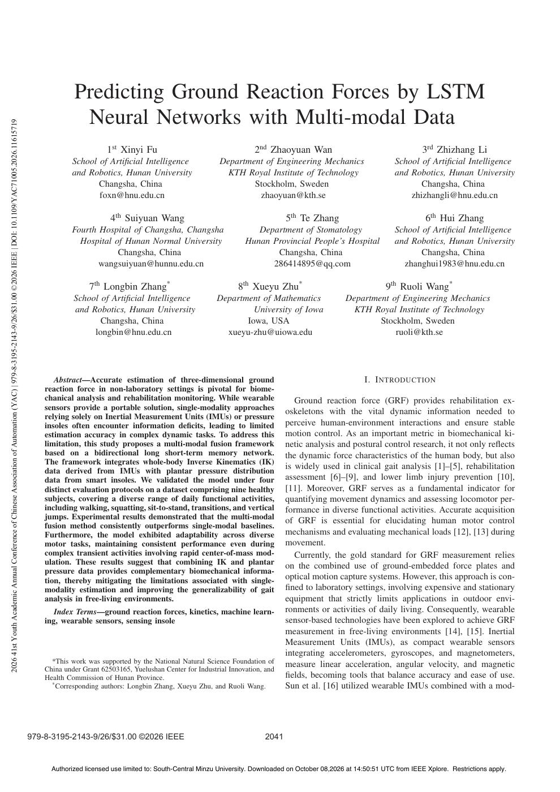
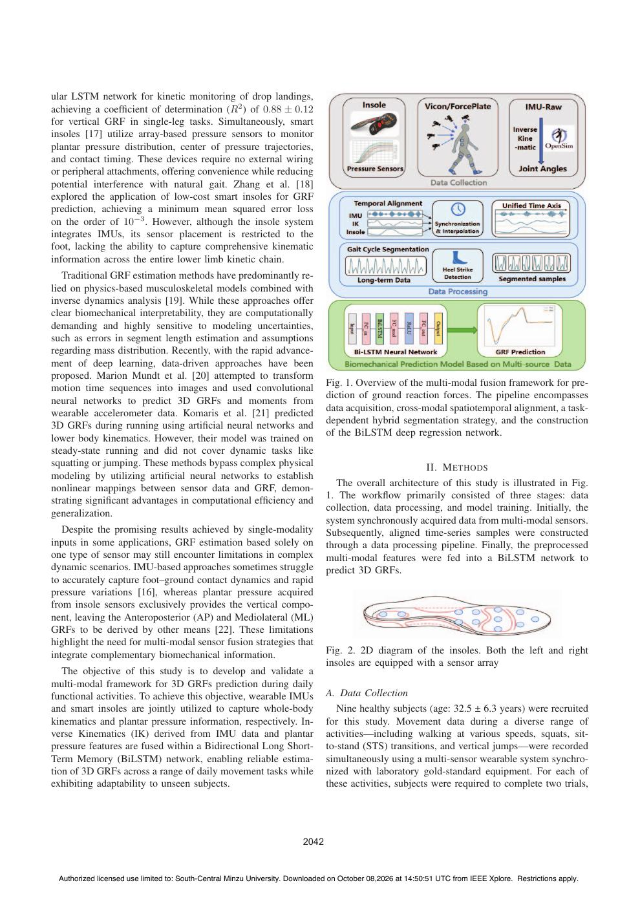
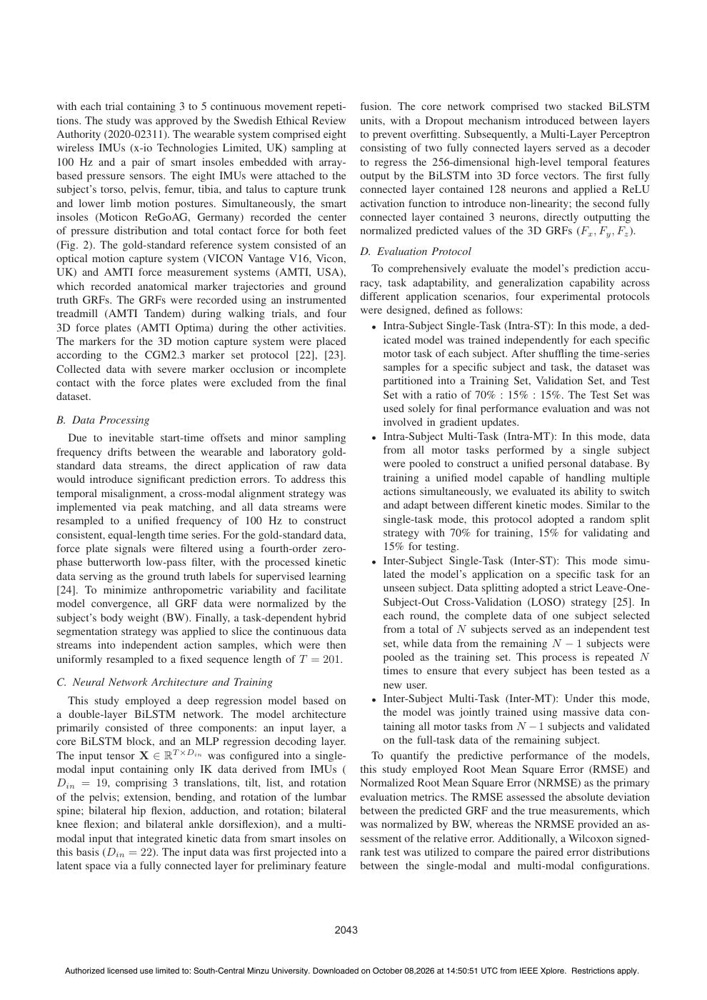
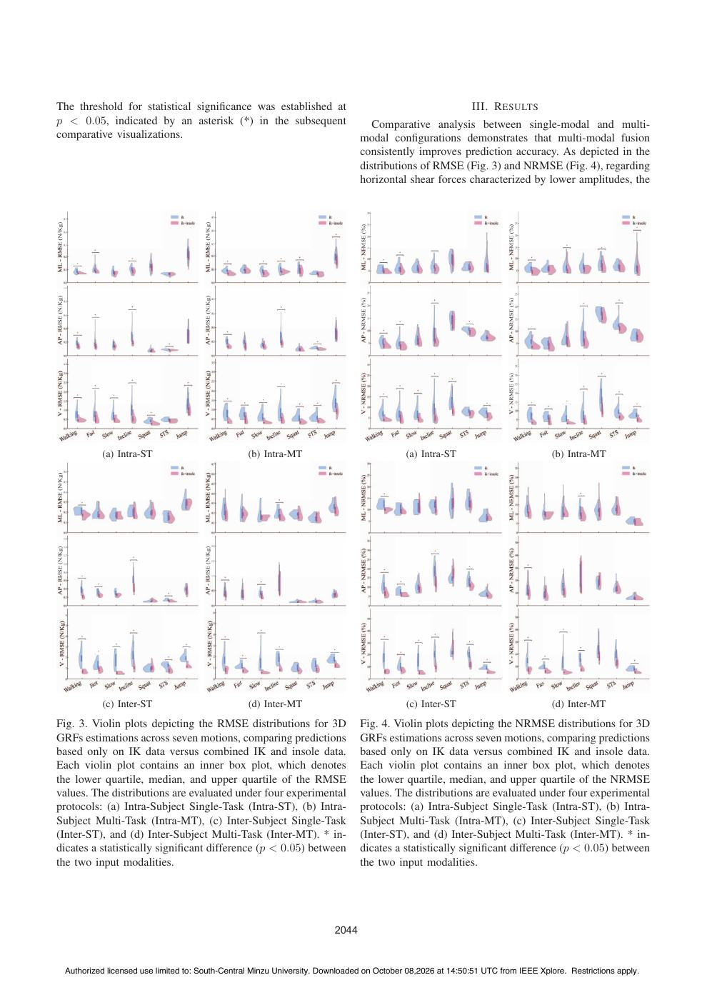
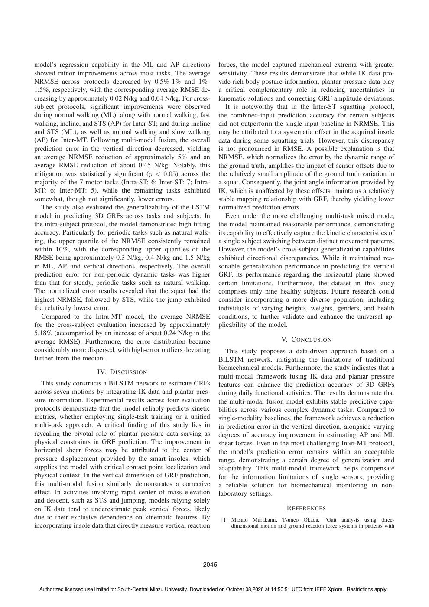
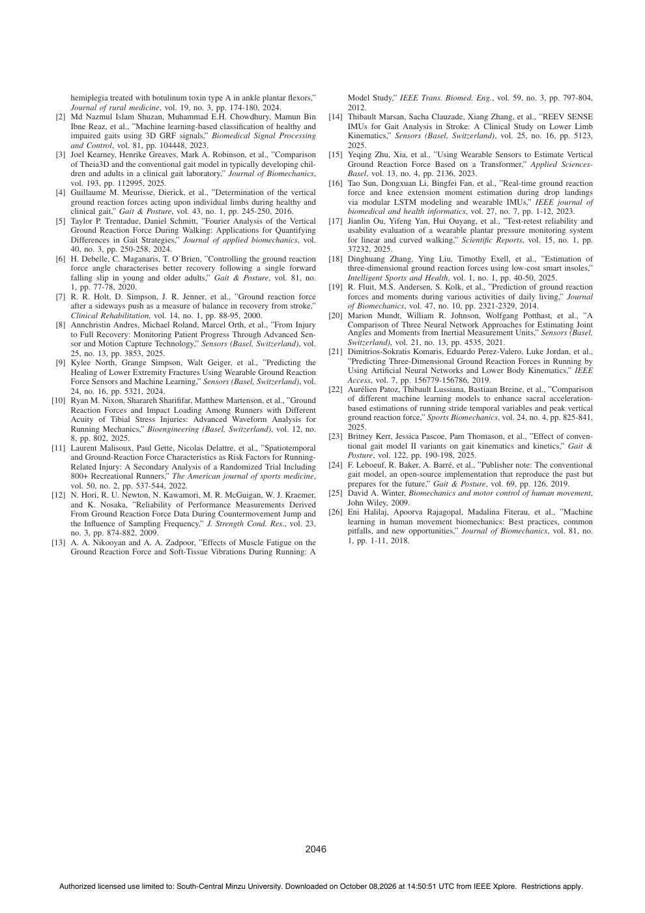

# Fu2026-YAC：多模态LSTM地面反力预测

> English text extracted from the source PDF; not translated or editorially corrected. Each original PDF page is embedded below as a rendered image so figures, tables, and vector artwork remain visible.

- Source PDF: `Fu2026-YAC：多模态LSTM地面反力预测.pdf`
- SHA-256: `5a14c4e07f7ed1153c8321f21b48ac99ec732d5b2ec03bdedd13d7740eb88b5b`
- Pages: 6
- Extraction: Poppler `pdftotext -layout`; page images rendered with `pdftoppm` (max dimension 1400 px, JPEG quality 76).

## Page 1

English text extracted from page 1

<pre>
Predicting Ground Reaction Forces by LSTM
                                                                                                                                                                                     Neural Networks with Multi-modal Data

2026 41st Youth Academic Annual Conference of Chinese Association of Automation (YAC) | 979-8-3195-2143-9/26/$31.00 ©2026 IEEE | DOI: 10.1109/YAC71005.2026.11615719
                                                                                                                                                                                               1st Xinyi Fu                                     2nd Zhaoyuan Wan                                        3rd Zhizhang Li
                                                                                                                                                                                   School of Artificial Intelligence                 Department of Engineering Mechanics                       School of Artificial Intelligence
                                                                                                                                                                                   and Robotics, Hunan University                     KTH Royal Institute of Technology                       and Robotics, Hunan University
                                                                                                                                                                                          Changsha, China                                   Stockholm, Sweden                                        Changsha, China
                                                                                                                                                                                          foxn@hnu.edu.cn                                    zhaoyuan@kth.se                                      zhizhangli@hnu.edu.cn

                                                                                                                                                                                                4th Suiyuan Wang                                          5th Te Zhang                                   6th Hui Zhang
                                                                                                                                                                                   Fourth Hospital of Changsha, Changsha                        Department of Stomatology                     School of Artificial Intelligence
                                                                                                                                                                                     Hospital of Hunan Normal University                     Hunan Provincial People’s Hospital               and Robotics, Hunan University
                                                                                                                                                                                               Changsha, China                                      Changsha, China                                  Changsha, China
                                                                                                                                                                                          wangsuiyuan@hunnu.edu.cn                                 286414895@qq.com                             zhanghui1983@hnu.edu.cn

                                                                                                                                                                                         7th Longbin Zhang*                               8th Xueyu Zhu*                                   9th Ruoli Wang*
                                                                                                                                                                                    School of Artificial Intelligence               Department of Mathematics                  Department of Engineering Mechanics
                                                                                                                                                                                    and Robotics, Hunan University                          University of Iowa                  KTH Royal Institute of Technology
                                                                                                                                                                                           Changsha, China                                Iowa, USA                                   Stockholm, Sweden
                                                                                                                                                                                         longbin@hnu.edu.cn                          xueyu-zhu@uiowa.edu                                  ruoli@kth.se

                                                                                                                                                                              Abstract—Accurate estimation of three-dimensional ground                                              I. I NTRODUCTION
                                                                                                                                                                           reaction force in non-laboratory settings is pivotal for biome-
                                                                                                                                                                           chanical analysis and rehabilitation monitoring. While wearable                   Ground reaction force (GRF) provides rehabilitation ex-
                                                                                                                                                                           sensors provide a portable solution, single-modality approaches
                                                                                                                                                                                                                                                          oskeletons with the vital dynamic information needed to
                                                                                                                                                                           relying solely on Inertial Measurement Units (IMUs) or pressure
                                                                                                                                                                           insoles often encounter information deficits, leading to limited                perceive human-environment interactions and ensure stable
                                                                                                                                                                           estimation accuracy in complex dynamic tasks. To address this                  motion control. As an important metric in biomechanical ki-
                                                                                                                                                                           limitation, this study proposes a multi-modal fusion framework                 netic analysis and postural control research, it not only reflects
                                                                                                                                                                           based on a bidirectional long short-term memory network.                       the dynamic force characteristics of the human body, but also
                                                                                                                                                                           The framework integrates whole-body Inverse Kinematics (IK)
                                                                                                                                                                                                                                                          is widely used in clinical gait analysis [1]–[5], rehabilitation
                                                                                                                                                                           data derived from IMUs with plantar pressure distribution
                                                                                                                                                                           data from smart insoles. We validated the model under four                     assessment [6]–[9], and lower limb injury prevention [10],
                                                                                                                                                                           distinct evaluation protocols on a dataset comprising nine healthy             [11]. Moreover, GRF serves as a fundamental indicator for
                                                                                                                                                                           subjects, covering a diverse range of daily functional activities,             quantifying movement dynamics and assessing locomotor per-
                                                                                                                                                                           including walking, squatting, sit-to-stand, transitions, and vertical          formance in diverse functional activities. Accurate acquisition
                                                                                                                                                                           jumps. Experimental results demonstrated that the multi-modal
                                                                                                                                                                                                                                                          of GRF is essential for elucidating human motor control
                                                                                                                                                                           fusion method consistently outperforms single-modal baselines.
                                                                                                                                                                           Furthermore, the model exhibited adaptability across diverse                   mechanisms and evaluating mechanical loads [12], [13] during
                                                                                                                                                                           motor tasks, maintaining consistent performance even during                    movement.
                                                                                                                                                                           complex transient activities involving rapid center-of-mass mod-                  Currently, the gold standard for GRF measurement relies
                                                                                                                                                                           ulation. These results suggest that combining IK and plantar                   on the combined use of ground-embedded force plates and
                                                                                                                                                                           pressure data provides complementary biomechanical informa-
                                                                                                                                                                           tion, thereby mitigating the limitations associated with single-               optical motion capture systems. However, this approach is con-
                                                                                                                                                                           modality estimation and improving the generalizability of gait                 fined to laboratory settings, involving expensive and stationary
                                                                                                                                                                           analysis in free-living environments.                                          equipment that strictly limits applications in outdoor envi-
                                                                                                                                                                              Index Terms—ground reaction forces, kinetics, machine learn-                ronments or activities of daily living. Consequently, wearable
                                                                                                                                                                           ing, wearable sensors, sensing insole                                          sensor-based technologies have been explored to achieve GRF
                                                                                                                                                                                                                                                          measurement in free-living environments [14], [15]. Inertial
                                                                                                                                                                                                                                                          Measurement Units (IMUs), as compact wearable sensors
                                                                                                                                                                                                                                                          integrating accelerometers, gyroscopes, and magnetometers,
                                                                                                                                                                             *This work was supported by the National Natural Science Foundation of       measure linear acceleration, angular velocity, and magnetic
                                                                                                                                                                           China under Grant 62503165, Yuelushan Center for Industrial Innovation, and
                                                                                                                                                                           Health Commission of Hunan Province.                                           fields, becoming tools that balance accuracy and ease of use.
                                                                                                                                                                             * Corresponding authors: Longbin Zhang, Xueyu Zhu, and Ruoli Wang.           Sun et al. [16] utilized wearable IMUs combined with a mod-

                                                                                                                                                                       979-8-3195-2143-9/26/$31.00 ©2026 IEEE                                      2041

                                                                                                                                                                             Authorized licensed use limited to: South-Central Minzu University. Downloaded on October 08,2026 at 14:50:51 UTC from IEEE Xplore. Restrictions apply.
</pre>

## Page 2

English text extracted from page 2

<pre>
ular LSTM network for kinetic monitoring of drop landings,
achieving a coefficient of determination (R2 ) of 0.88 ± 0.12
for vertical GRF in single-leg tasks. Simultaneously, smart
insoles [17] utilize array-based pressure sensors to monitor
plantar pressure distribution, center of pressure trajectories,
and contact timing. These devices require no external wiring
or peripheral attachments, offering convenience while reducing
potential interference with natural gait. Zhang et al. [18]
explored the application of low-cost smart insoles for GRF
prediction, achieving a minimum mean squared error loss
on the order of 10−3 . However, although the insole system
integrates IMUs, its sensor placement is restricted to the
foot, lacking the ability to capture comprehensive kinematic
information across the entire lower limb kinetic chain.
   Traditional GRF estimation methods have predominantly re-
lied on physics-based musculoskeletal models combined with
inverse dynamics analysis [19]. While these approaches offer
clear biomechanical interpretability, they are computationally
demanding and highly sensitive to modeling uncertainties,
such as errors in segment length estimation and assumptions
regarding mass distribution. Recently, with the rapid advance-
ment of deep learning, data-driven approaches have been
proposed. Marion Mundt et al. [20] attempted to transform
                                                                              Fig. 1. Overview of the multi-modal fusion framework for pre-
motion time sequences into images and used convolutional
                                                                              diction of ground reaction forces. The pipeline encompasses
neural networks to predict 3D GRFs and moments from
                                                                              data acquisition, cross-modal spatiotemporal alignment, a task-
wearable accelerometer data. Komaris et al. [21] predicted
                                                                              dependent hybrid segmentation strategy, and the construction
3D GRFs during running using artificial neural networks and
                                                                              of the BiLSTM deep regression network.
lower body kinematics. However, their model was trained on
steady-state running and did not cover dynamic tasks like
squatting or jumping. These methods bypass complex physical                                                II. M ETHODS
modeling by utilizing artificial neural networks to establish
                                                                                 The overall architecture of this study is illustrated in Fig.
nonlinear mappings between sensor data and GRF, demon-
                                                                              1. The workflow primarily consisted of three stages: data
strating significant advantages in computational efficiency and
                                                                              collection, data processing, and model training. Initially, the
generalization.
                                                                              system synchronously acquired data from multi-modal sensors.
   Despite the promising results achieved by single-modality                  Subsequently, aligned time-series samples were constructed
inputs in some applications, GRF estimation based solely on                   through a data processing pipeline. Finally, the preprocessed
one type of sensor may still encounter limitations in complex                 multi-modal features were fed into a BiLSTM network to
dynamic scenarios. IMU-based approaches sometimes struggle                    predict 3D GRFs.
to accurately capture foot–ground contact dynamics and rapid
pressure variations [16], whereas plantar pressure acquired
from insole sensors exclusively provides the vertical compo-
nent, leaving the Anteroposterior (AP) and Mediolateral (ML)
GRFs to be derived by other means [22]. These limitations
highlight the need for multi-modal sensor fusion strategies that
integrate complementary biomechanical information.                            Fig. 2. 2D diagram of the insoles. Both the left and right
                                                                              insoles are equipped with a sensor array
   The objective of this study is to develop and validate a
multi-modal framework for 3D GRFs prediction during daily
functional activities. To achieve this objective, wearable IMUs               A. Data Collection
and smart insoles are jointly utilized to capture whole-body                     Nine healthy subjects (age: 32.5 ± 6.3 years) were recruited
kinematics and plantar pressure information, respectively. In-                for this study. Movement data during a diverse range of
verse Kinematics (IK) derived from IMU data and plantar                       activities—including walking at various speeds, squats, sit-
pressure features are fused within a Bidirectional Long Short-                to-stand (STS) transitions, and vertical jumps—were recorded
Term Memory (BiLSTM) network, enabling reliable estima-                       simultaneously using a multi-sensor wearable system synchro-
tion of 3D GRFs across a range of daily movement tasks while                  nized with laboratory gold-standard equipment. For each of
exhibiting adaptability to unseen subjects.                                   these activities, subjects were required to complete two trials,

                                                                       2042

 Authorized licensed use limited to: South-Central Minzu University. Downloaded on October 08,2026 at 14:50:51 UTC from IEEE Xplore. Restrictions apply.
</pre>

## Page 3

English text extracted from page 3

<pre>
with each trial containing 3 to 5 continuous movement repeti-                 fusion. The core network comprised two stacked BiLSTM
tions. The study was approved by the Swedish Ethical Review                   units, with a Dropout mechanism introduced between layers
Authority (2020-02311). The wearable system comprised eight                   to prevent overfitting. Subsequently, a Multi-Layer Perceptron
wireless IMUs (x-io Technologies Limited, UK) sampling at                     consisting of two fully connected layers served as a decoder
100 Hz and a pair of smart insoles embedded with array-                       to regress the 256-dimensional high-level temporal features
based pressure sensors. The eight IMUs were attached to the                   output by the BiLSTM into 3D force vectors. The first fully
subject’s torso, pelvis, femur, tibia, and talus to capture trunk             connected layer contained 128 neurons and applied a ReLU
and lower limb motion postures. Simultaneously, the smart                     activation function to introduce non-linearity; the second fully
insoles (Moticon ReGoAG, Germany) recorded the center                         connected layer contained 3 neurons, directly outputting the
of pressure distribution and total contact force for both feet                normalized predicted values of the 3D GRFs (Fx , Fy , Fz ).
(Fig. 2). The gold-standard reference system consisted of an
                                                                              D. Evaluation Protocol
optical motion capture system (VICON Vantage V16, Vicon,
UK) and AMTI force measurement systems (AMTI, USA),                              To comprehensively evaluate the model’s prediction accu-
which recorded anatomical marker trajectories and ground                      racy, task adaptability, and generalization capability across
truth GRFs. The GRFs were recorded using an instrumented                      different application scenarios, four experimental protocols
treadmill (AMTI Tandem) during walking trials, and four                       were designed, defined as follows:
3D force plates (AMTI Optima) during the other activities.                       • Intra-Subject Single-Task (Intra-ST): In this mode, a ded-
The markers for the 3D motion capture system were placed                           icated model was trained independently for each specific
according to the CGM2.3 marker set protocol [22], [23].                            motor task of each subject. After shuffling the time-series
Collected data with severe marker occlusion or incomplete                          samples for a specific subject and task, the dataset was
contact with the force plates were excluded from the final                          partitioned into a Training Set, Validation Set, and Test
dataset.                                                                           Set with a ratio of 70% : 15% : 15%. The Test Set was
                                                                                   used solely for final performance evaluation and was not
B. Data Processing                                                                 involved in gradient updates.
   Due to inevitable start-time offsets and minor sampling                       • Intra-Subject Multi-Task (Intra-MT): In this mode, data
frequency drifts between the wearable and laboratory gold-                         from all motor tasks performed by a single subject
standard data streams, the direct application of raw data                          were pooled to construct a unified personal database. By
would introduce significant prediction errors. To address this                      training a unified model capable of handling multiple
temporal misalignment, a cross-modal alignment strategy was                        actions simultaneously, we evaluated its ability to switch
implemented via peak matching, and all data streams were                           and adapt between different kinetic modes. Similar to the
resampled to a unified frequency of 100 Hz to construct                             single-task mode, this protocol adopted a random split
consistent, equal-length time series. For the gold-standard data,                  strategy with 70% for training, 15% for validating and
force plate signals were filtered using a fourth-order zero-                        15% for testing.
phase butterworth low-pass filter, with the processed kinetic                     • Inter-Subject Single-Task (Inter-ST): This mode simu-
data serving as the ground truth labels for supervised learning                    lated the model’s application on a specific task for an
[24]. To minimize anthropometric variability and facilitate                        unseen subject. Data splitting adopted a strict Leave-One-
model convergence, all GRF data were normalized by the                             Subject-Out Cross-Validation (LOSO) strategy [25]. In
subject’s body weight (BW). Finally, a task-dependent hybrid                       each round, the complete data of one subject selected
segmentation strategy was applied to slice the continuous data                     from a total of N subjects served as an independent test
streams into independent action samples, which were then                           set, while data from the remaining N − 1 subjects were
uniformly resampled to a fixed sequence length of T = 201.                          pooled as the training set. This process is repeated N
                                                                                   times to ensure that every subject has been tested as a
C. Neural Network Architecture and Training                                        new user.
   This study employed a deep regression model based on                          • Inter-Subject Multi-Task (Inter-MT): Under this mode,
a double-layer BiLSTM network. The model architecture                              the model was jointly trained using massive data con-
primarily consisted of three components: an input layer, a                         taining all motor tasks from N − 1 subjects and validated
core BiLSTM block, and an MLP regression decoding layer.                           on the full-task data of the remaining subject.
The input tensor X ∈ RT ×Din was configured into a single-                        To quantify the predictive performance of the models,
modal input containing only IK data derived from IMUs (                       this study employed Root Mean Square Error (RMSE) and
Din = 19, comprising 3 translations, tilt, list, and rotation                 Normalized Root Mean Square Error (NRMSE) as the primary
of the pelvis; extension, bending, and rotation of the lumbar                 evaluation metrics. The RMSE assessed the absolute deviation
spine; bilateral hip flexion, adduction, and rotation; bilateral               between the predicted GRF and the true measurements, which
knee flexion; and bilateral ankle dorsiflexion), and a multi-                   was normalized by BW, whereas the NRMSE provided an as-
modal input that integrated kinetic data from smart insoles on                sessment of the relative error. Additionally, a Wilcoxon signed-
this basis (Din = 22). The input data was first projected into a               rank test was utilized to compare the paired error distributions
latent space via a fully connected layer for preliminary feature              between the single-modal and multi-modal configurations.

                                                                       2043

 Authorized licensed use limited to: South-Central Minzu University. Downloaded on October 08,2026 at 14:50:51 UTC from IEEE Xplore. Restrictions apply.
</pre>

## Page 4

English text extracted from page 4

<pre>
The threshold for statistical significance was established at                                               III. R ESULTS
p &lt; 0.05, indicated by an asterisk (*) in the subsequent                         Comparative analysis between single-modal and multi-
comparative visualizations.                                                   modal configurations demonstrates that multi-modal fusion
                                                                              consistently improves prediction accuracy. As depicted in the
                                                                              distributions of RMSE (Fig. 3) and NRMSE (Fig. 4), regarding
                                                                              horizontal shear forces characterized by lower amplitudes, the

          (a) Intra-ST                           (b) Intra-MT                             (a) Intra-ST                           (b) Intra-MT

          (c) Inter-ST                           (d) Inter-MT                             (c) Inter-ST                           (d) Inter-MT
Fig. 3. Violin plots depicting the RMSE distributions for 3D                  Fig. 4. Violin plots depicting the NRMSE distributions for 3D
GRFs estimations across seven motions, comparing predictions                  GRFs estimations across seven motions, comparing predictions
based only on IK data versus combined IK and insole data.                     based only on IK data versus combined IK and insole data.
Each violin plot contains an inner box plot, which denotes                    Each violin plot contains an inner box plot, which denotes
the lower quartile, median, and upper quartile of the RMSE                    the lower quartile, median, and upper quartile of the NRMSE
values. The distributions are evaluated under four experimental               values. The distributions are evaluated under four experimental
protocols: (a) Intra-Subject Single-Task (Intra-ST), (b) Intra-               protocols: (a) Intra-Subject Single-Task (Intra-ST), (b) Intra-
Subject Multi-Task (Intra-MT), (c) Inter-Subject Single-Task                  Subject Multi-Task (Intra-MT), (c) Inter-Subject Single-Task
(Inter-ST), and (d) Inter-Subject Multi-Task (Inter-MT). * in-                (Inter-ST), and (d) Inter-Subject Multi-Task (Inter-MT). * in-
dicates a statistically significant difference (p &lt; 0.05) between              dicates a statistically significant difference (p &lt; 0.05) between
the two input modalities.                                                     the two input modalities.

                                                                       2044

 Authorized licensed use limited to: South-Central Minzu University. Downloaded on October 08,2026 at 14:50:51 UTC from IEEE Xplore. Restrictions apply.
</pre>

## Page 5

English text extracted from page 5

<pre>
model’s regression capability in the ML and AP directions                     forces, the model captured mechanical extrema with greater
showed minor improvements across most tasks. The average                      sensitivity. These results demonstrate that while IK data pro-
NRMSE across protocols decreased by 0.5%-1% and 1%-                           vide rich body posture information, plantar pressure data play
1.5%, respectively, with the corresponding average RMSE de-                   a critical complementary role in reducing uncertainties in
creasing by approximately 0.02 N/kg and 0.04 N/kg. For cross-                 kinematic solutions and correcting GRF amplitude deviations.
subject protocols, significant improvements were observed                         It is noteworthy that in the Inter-ST squatting protocol,
during normal walking (ML), along with normal walking, fast                   the combined-input prediction accuracy for certain subjects
walking, incline, and STS (AP) for Inter-ST; and during incline               did not outperform the single-input baseline in NRMSE. This
and STS (ML), as well as normal walking and slow walking                      may be attributed to a systematic offset in the acquired insole
(AP) for Inter-MT. Following multi-modal fusion, the overall                  data during some squatting trials. However, this discrepancy
prediction error in the vertical direction decreased, yielding                is not pronounced in RMSE. A possible explanation is that
an average NRMSE reduction of approximately 5% and an                         NRMSE, which normalizes the error by the dynamic range of
average RMSE reduction of about 0.45 N/kg. Notably, this                      the ground truth, amplifies the impact of sensor offsets due to
mitigation was statistically significant (p &lt; 0.05) across the                 the relatively small amplitude of the ground truth variation in
majority of the 7 motor tasks (Intra-ST: 6; Inter-ST: 7; Intra-               a squat. Consequently, the joint angle information provided by
MT: 6; Inter-MT: 5), while the remaining tasks exhibited                      IK, which is unaffected by these offsets, maintains a relatively
somewhat, though not significantly, lower errors.                              stable mapping relationship with GRF, thereby yielding lower
   The study also evaluated the generalizability of the LSTM                  normalized prediction errors.
model in predicting 3D GRFs across tasks and subjects. In                        Even under the more challenging multi-task mixed mode,
the intra-subject protocol, the model demonstrated high fitting                the model maintained reasonable performance, demonstrating
accuracy. Particularly for periodic tasks such as natural walk-               its capability to effectively capture the kinetic characteristics of
ing, the upper quartile of the NRMSE consistently remained                    a single subject switching between distinct movement patterns.
within 10%, with the corresponding upper quartiles of the                     However, the model’s cross-subject generalization capabilities
RMSE being approximately 0.3 N/kg, 0.4 N/kg and 1.5 N/kg                      exhibited directional discrepancies. While it maintained rea-
in ML, AP, and vertical directions, respectively. The overall                 sonable generalization performance in predicting the vertical
prediction error for non-periodic dynamic tasks was higher                    GRF, its performance regarding the horizontal plane showed
than that for steady, periodic tasks such as natural walking.                 certain limitations. Furthermore, the dataset in this study
The normalized error results revealed that the squat had the                  comprises only nine healthy subjects. Future research could
highest NRMSE, followed by STS, while the jump exhibited                      consider incorporating a more diverse population, including
the relatively lowest error.                                                  individuals of varying heights, weights, genders, and health
   Compared to the Intra-MT model, the average NRMSE                          conditions, to further validate and enhance the universal ap-
for the cross-subject evaluation increased by approximately                   plicability of the model.
5.18% (accompanied by an increase of about 0.24 N/kg in the
average RMSE). Furthermore, the error distribution became                                                V. C ONCLUSION
considerably more dispersed, with high-error outliers deviating                  This study proposes a data-driven approach based on a
further from the median.                                                      BiLSTM network, mitigating the limitations of traditional
                                                                              biomechanical models. Furthermore, the study indicates that a
                          IV. D ISCUSSION
                                                                              multi-modal framework fusing IK data and plantar pressure
   This study constructs a BiLSTM network to estimate GRFs                    features can enhance the prediction accuracy of 3D GRFs
across seven motions by integrating IK data and plantar pres-                 during daily functional activities. The results demonstrate that
sure information. Experimental results across four evaluation                 the multi-modal fusion model exhibits stable predictive capa-
protocols demonstrate that the model reliably predicts kinetic                bilities across various complex dynamic tasks. Compared to
metrics, whether employing single-task training or a unified                   single-modality baselines, the framework achieves a reduction
multi-task approach. A critical finding of this study lies in                  in prediction error in the vertical direction, alongside varying
revealing the pivotal role of plantar pressure data serving as                degrees of accuracy improvement in estimating AP and ML
physical constraints in GRF prediction. The improvement in                    shear forces. Even in the most challenging Inter-MT protocol,
horizontal shear forces may be attributed to the center of                    the model’s prediction error remains within an acceptable
pressure displacement provided by the smart insoles, which                    range, demonstrating a certain degree of generalization and
supplies the model with critical contact point localization and               adaptability. This multi-modal framework helps compensate
physical context. In the vertical dimension of GRF prediction,                for the information limitations of single sensors, providing
this multi-modal fusion similarly demonstrates a corrective                   a reliable solution for biomechanical monitoring in non-
effect. In activities involving rapid center of mass elevation                laboratory settings.
and descent, such as STS and jumping, models relying solely
on IK data tend to underestimate peak vertical forces, likely                                               R EFERENCES
due to their exclusive dependence on kinematic features. By                    [1] Masato Murakami, Tsuneo Okada, ”Gait analysis using three-
incorporating insole data that directly measure vertical reaction                  dimensional motion and ground reaction force systems in patients with

                                                                       2045

 Authorized licensed use limited to: South-Central Minzu University. Downloaded on October 08,2026 at 14:50:51 UTC from IEEE Xplore. Restrictions apply.
</pre>

## Page 6

English text extracted from page 6

<pre>
hemiplegia treated with botulinum toxin type A in ankle plantar flexors,”        Model Study,” IEEE Trans. Biomed. Eng., vol. 59, no. 3, pp. 797-804,
     Journal of rural medicine, vol. 19, no. 3, pp. 174-180, 2024.                   2012.
 [2] Md Nazmul Islam Shuzan, Muhammad E.H. Chowdhury, Mamun Bin                 [14] Thibault Marsan, Sacha Clauzade, Xiang Zhang, et al., ”REEV SENSE
     Ibne Reaz, et al., ”Machine learning-based classification of healthy and         IMUs for Gait Analysis in Stroke: A Clinical Study on Lower Limb
     impaired gaits using 3D GRF signals,” Biomedical Signal Processing              Kinematics,” Sensors (Basel, Switzerland), vol. 25, no. 16, pp. 5123,
     and Control, vol. 81, pp. 104448, 2023.                                         2025.
 [3] Joel Kearney, Henrike Greaves, Mark A. Robinson, et al., ”Comparison       [15] Yeqing Zhu, Xia, et al., ”Using Wearable Sensors to Estimate Vertical
     of Theia3D and the conventional gait model in typically developing chil-        Ground Reaction Force Based on a Transformer,” Applied Sciences-
     dren and adults in a clinical gait laboratory,” Journal of Biomechanics,        Basel, vol. 13, no. 4, pp. 2136, 2023.
     vol. 193, pp. 112995, 2025.                                                [16] Tao Sun, Dongxuan Li, Bingfei Fan, et al., ”Real-time ground reaction
 [4] Guillaume M. Meurisse, Dierick, et al., ”Determination of the vertical          force and knee extension moment estimation during drop landings
     ground reaction forces acting upon individual limbs during healthy and          via modular LSTM modeling and wearable IMUs,” IEEE journal of
     clinical gait,” Gait &amp; Posture, vol. 43, no. 1, pp. 245-250, 2016.              biomedical and health informatics, vol. 27, no. 7, pp. 1-12, 2023.
 [5] Taylor P. Trentadue, Daniel Schmitt, ”Fourier Analysis of the Vertical     [17] Jianlin Ou, Yifeng Yan, Hui Ouyang, et al., ”Test-retest reliability and
     Ground Reaction Force During Walking: Applications for Quantifying              usability evaluation of a wearable plantar pressure monitoring system
     Differences in Gait Strategies,” Journal of applied biomechanics, vol.          for linear and curved walking,” Scientific Reports, vol. 15, no. 1, pp.
     40, no. 3, pp. 250-258, 2024.                                                   37232, 2025.
 [6] H. Debelle, C. Maganaris, T. O’Brien, ”Controlling the ground reaction     [18] Dinghuang Zhang, Ying Liu, Timothy Exell, et al., ”Estimation of
     force angle characterises better recovery following a single forward            three-dimensional ground reaction forces using low-cost smart insoles,”
     falling slip in young and older adults,” Gait &amp; Posture, vol. 81, no.           Intelligent Sports and Health, vol. 1, no. 1, pp. 40-50, 2025.
     1, pp. 77-78, 2020.                                                        [19] R. Fluit, M.S. Andersen, S. Kolk, et al., ”Prediction of ground reaction
 [7] R. R. Holt, D. Simpson, J. R. Jenner, et al., ”Ground reaction force            forces and moments during various activities of daily living,” Journal
     after a sideways push as a measure of balance in recovery from stroke,”         of Biomechanics, vol. 47, no. 10, pp. 2321-2329, 2014.
     Clinical Rehabilitation, vol. 14, no. 1, pp. 88-95, 2000.                  [20] Marion Mundt, William R. Johnson, Wolfgang Potthast, et al., ”A
 [8] Annchristin Andres, Michael Roland, Marcel Orth, et al., ”From Injury           Comparison of Three Neural Network Approaches for Estimating Joint
     to Full Recovery: Monitoring Patient Progress Through Advanced Sen-             Angles and Moments from Inertial Measurement Units,” Sensors (Basel,
     sor and Motion Capture Technology,” Sensors (Basel, Switzerland), vol.          Switzerland), vol. 21, no. 13, pp. 4535, 2021.
     25, no. 13, pp. 3853, 2025.                                                [21] Dimitrios-Sokratis Komaris, Eduardo Perez-Valero, Luke Jordan, et al.,
 [9] Kylee North, Grange Simpson, Walt Geiger, et al., ”Predicting the               ”Predicting Three-Dimensional Ground Reaction Forces in Running by
     Healing of Lower Extremity Fractures Using Wearable Ground Reaction             Using Artificial Neural Networks and Lower Body Kinematics,” IEEE
     Force Sensors and Machine Learning,” Sensors (Basel, Switzerland), vol.         Access, vol. 7, pp. 156779-156786, 2019.
     24, no. 16, pp. 5321, 2024.                                                [22] Aurélien Patoz, Thibault Lussiana, Bastiaan Breine, et al., ”Comparison
[10] Ryan M. Nixon, Sharareh Sharififar, Matthew Martenson, et al., ”Ground           of different machine learning models to enhance sacral acceleration-
     Reaction Forces and Impact Loading Among Runners with Different                 based estimations of running stride temporal variables and peak vertical
     Acuity of Tibial Stress Injuries: Advanced Waveform Analysis for                ground reaction force,” Sports Biomechanics, vol. 24, no. 4, pp. 825-841,
     Running Mechanics,” Bioengineering (Basel, Switzerland), vol. 12, no.           2025.
     8, pp. 802, 2025.                                                          [23] Britney Kerr, Jessica Pascoe, Pam Thomason, et al., ”Effect of conven-
[11] Laurent Malisoux, Paul Gette, Nicolas Delattre, et al., ”Spatiotemporal         tional gait model II variants on gait kinematics and kinetics,” Gait &amp;
     and Ground-Reaction Force Characteristics as Risk Factors for Running-          Posture, vol. 122, pp. 190-198, 2025.
     Related Injury: A Secondary Analysis of a Randomized Trial Including       [24] F. Leboeuf, R. Baker, A. Barré, et al., ”Publisher note: The conventional
     800+ Recreational Runners,” The American journal of sports medicine,            gait model, an open-source implementation that reproduce the past but
     vol. 50, no. 2, pp. 537-544, 2022.                                              prepares for the future,” Gait &amp; Posture, vol. 69, pp. 126, 2019.
[12] N. Hori, R. U. Newton, N. Kawamori, M. R. McGuigan, W. J. Kraemer,         [25] David A. Winter, Biomechanics and motor control of human movement,
     and K. Nosaka, ”Reliability of Performance Measurements Derived                 John Wiley, 2009.
     From Ground Reaction Force Data During Countermovement Jump and            [26] Eni Halilaj, Apoorva Rajagopal, Madalina Fiterau, et al., ”Machine
     the Influence of Sampling Frequency,” J. Strength Cond. Res., vol. 23,           learning in human movement biomechanics: Best practices, common
     no. 3, pp. 874-882, 2009.                                                       pitfalls, and new opportunities,” Journal of Biomechanics, vol. 81, no.
[13] A. A. Nikooyan and A. A. Zadpoor, ”Effects of Muscle Fatigue on the             1, pp. 1-11, 2018.
     Ground Reaction Force and Soft-Tissue Vibrations During Running: A

                                                                         2046

  Authorized licensed use limited to: South-Central Minzu University. Downloaded on October 08,2026 at 14:50:51 UTC from IEEE Xplore. Restrictions apply.
</pre>

