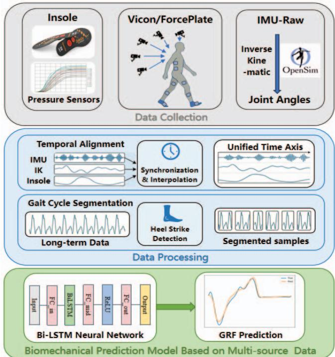
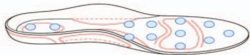
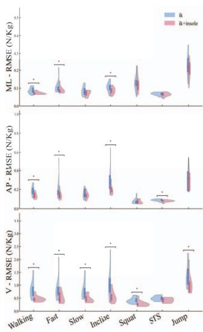
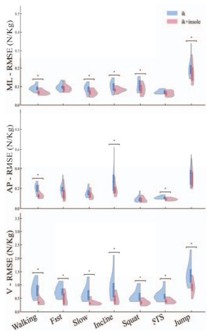
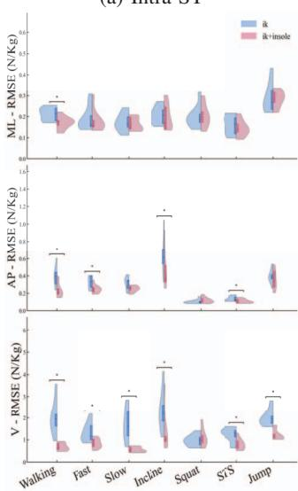
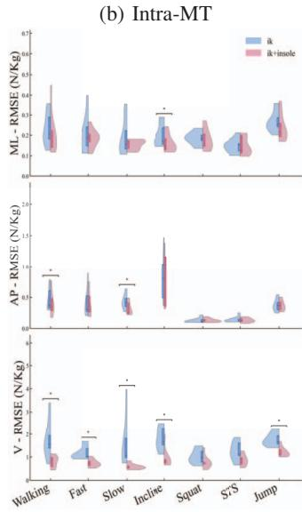
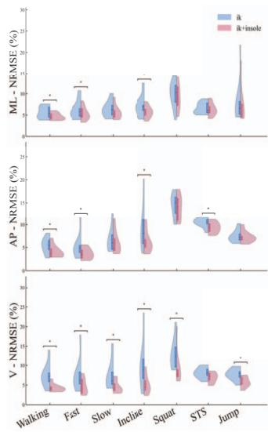
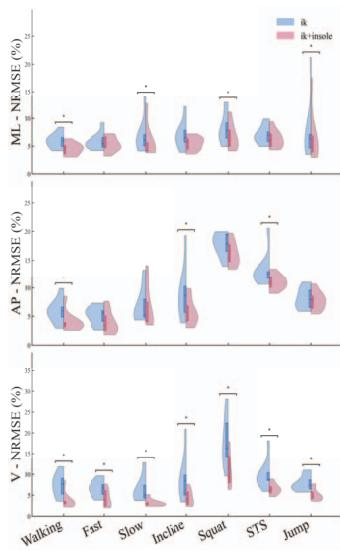
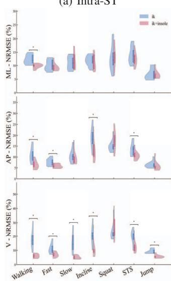
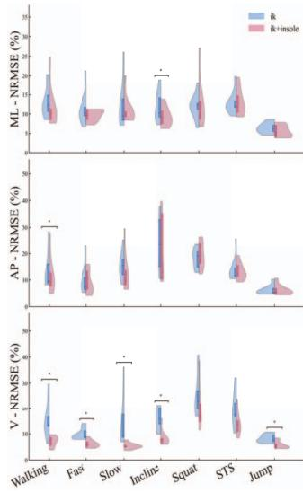

# Predicting Ground Reaction Forces by LSTM Neural Networks with Multi-modal Data

1st Xinyi Fu School of Artificial Intelligence and Robotics, Hunan University Changsha, China foxn@hnu.edu.cn

4th Suiyuan Wang Fourth Hospital of Changsha, Changsha Hospital of Hunan Normal University Changsha, China wangsuiyuan@hunnu.edu.cn

7th Longbin Zhang \* School of Artificial Intelligence and Robotics, Hunan University Changsha, China longbin@hnu.edu.cn

2nd Zhaoyuan Wan Department of Engineering Mechanics KTH Royal Institute of Technology Stockholm, Sweden zhaoyuan@kth.se

5th Te Zhang Department of Stomatology Hunan Provincial People’s Hospital Changsha, China 286414895@qq.com

8th Xueyu Zhu Department of Mathematics University of Iowa Iowa, USA xueyu-zhu@uiowa.edu

3rd Zhizhang Li School of Artificial Intelligence and Robotics, Hunan University Changsha, China zhizhangli@hnu.edu.cn

6th Hui Zhang School of Artificial Intelligence and Robotics, Hunan University Changsha, China zhanghui1983@hnu.edu.cn

9th Ruoli Wang\* Department of Engineering Mechanics KTH Royal Institute of Technology Stockholm, Sweden ruoli@kth.se

Abstract—Accurate estimation of three-dimensional ground reaction force in non-laboratory settings is pivotal for biomechanical analysis and rehabilitation monitoring. While wearable sensors provide a portable solution, single-modality approaches relying solely on Inertial Measurement Units (IMUs) or pressure insoles often encounter information deficits, leading to limited estimation accuracy in complex dynamic tasks. To address this limitation, this study proposes a multi-modal fusion framework based on a bidirectional long short-term memory network. The framework integrates whole-body Inverse Kinematics (IK) data derived from IMUs with plantar pressure distribution data from smart insoles. We validated the model under four distinct evaluation protocols on a dataset comprising nine healthy subjects, covering a diverse range of daily functional activities, including walking, squatting, sit-to-stand, transitions, and vertical jumps. Experimental results demonstrated that the multi-modal fusion method consistently outperforms single-modal baselines. Furthermore, the model exhibited adaptability across diverse motor tasks, maintaining consistent performance even during complex transient activities involving rapid center-of-mass modulation. These results suggest that combining IK and plantar pressure data provides complementary biomechanical information, thereby mitigating the limitations associated with singlemodality estimation and improving the generalizability of gait analysis in free-living environments.

Index Terms—ground reaction forces, kinetics, machine learning, wearable sensors, sensing insole

## I. INTRODUCTION

Ground reaction force (GRF) provides rehabilitation exoskeletons with the vital dynamic information needed to perceive human-environment interactions and ensure stable motion control. As an important metric in biomechanical kinetic analysis and postural control research, it not only reflects the dynamic force characteristics of the human body, but also is widely used in clinical gait analysis [1]–[5], rehabilitation assessment [6]–[9], and lower limb injury prevention [10], [11]. Moreover, GRF serves as a fundamental indicator for quantifying movement dynamics and assessing locomotor performance in diverse functional activities. Accurate acquisition of GRF is essential for elucidating human motor control mechanisms and evaluating mechanical loads [12], [13] during movement.

Currently, the gold standard for GRF measurement relies on the combined use of ground-embedded force plates and optical motion capture systems. However, this approach is confined to laboratory settings, involving expensive and stationary equipment that strictly limits applications in outdoor environments or activities of daily living. Consequently, wearable sensor-based technologies have been explored to achieve GRF measurement in free-living environments [14], [15]. Inertial Measurement Units (IMUs), as compact wearable sensors integrating accelerometers, gyroscopes, and magnetometers, measure linear acceleration, angular velocity, and magnetic fields, becoming tools that balance accuracy and ease of use. Sun et al. [16] utilized wearable IMUs combined with a modular LSTM network for kinetic monitoring of drop landings, achieving a coefficient of determination (R2) of 0.88 0.12 for vertical GRF in single-leg tasks. Simultaneously, smart insoles [17] utilize array-based pressure sensors to monitor plantar pressure distribution, center of pressure trajectories, and contact timing. These devices require no external wiring or peripheral attachments, offering convenience while reducing potential interference with natural gait. Zhang et al. [18] explored the application of low-cost smart insoles for GRF prediction, achieving a minimum mean squared error loss on the order of 10−3. However, although the insole system integrates IMUs, its sensor placement is restricted to the foot, lacking the ability to capture comprehensive kinematic information across the entire lower limb kinetic chain.

Traditional GRF estimation methods have predominantly relied on physics-based musculoskeletal models combined with inverse dynamics analysis [19]. While these approaches offer clear biomechanical interpretability, they are computationally demanding and highly sensitive to modeling uncertainties, such as errors in segment length estimation and assumptions regarding mass distribution. Recently, with the rapid advance ment of deep learning, data-driven approaches have been proposed. Marion Mundt et al. [20] attempted to transform motion time sequences into images and used convolutional neural networks to predict 3D GRFs and moments from wearable accelerometer data. Komaris et al. [21] predicted 3D GRFs during running using artificial neural networks and lower body kinematics. However, their model was trained on steady-state running and did not cover dynamic tasks like squatting or jumping. These methods bypass complex physical modeling by utilizing artificial neural networks to establish nonlinear mappings between sensor data and GRF, demonstrating significant advantages in computational efficiency and generalization.

Despite the promising results achieved by single-modality inputs in some applications, GRF estimation based solely on one type of sensor may still encounter limitations in complex dynamic scenarios. IMU-based approaches sometimes struggle to accurately capture foot–ground contact dynamics and rapid pressure variations [16], whereas plantar pressure acquired from insole sensors exclusively provides the vertical component, leaving the Anteroposterior (AP) and Mediolateral (ML) GRFs to be derived by other means [22]. These limitations highlight the need for multi-modal sensor fusion strategies that integrate complementary biomechanical information.

The objective of this study is to develop and validate a multi-modal framework for 3D GRFs prediction during daily functional activities. To achieve this objective, wearable IMUs and smart insoles are jointly utilized to capture whole-body kinematics and plantar pressure information, respectively. In verse Kinematics (IK) derived from IMU data and plantar pressure features are fused within a Bidirectional Long Short-Term Memory (BiLSTM) network, enabling reliable estimation of 3D GRFs across a range of daily movement tasks while exhibiting adaptability to unseen subjects.

  
Fig. 1. Overview of the multi-modal fusion framework for prediction of ground reaction forces. The pipeline encompasses data acquisition, cross-modal spatiotemporal alignment, a taskdependent hybrid segmentation strategy, and the construction of the BiLSTM deep regression network.

## II. METHODS

The overall architecture of this study is illustrated in Fig. 1. The workflow primarily consisted of three stages: data collection, data processing, and model training. Initially, the system synchronously acquired data from multi-modal sensors. Subsequently, aligned time-series samples were constructed through a data processing pipeline. Finally, the preprocessed multi-modal features were fed into a BiLSTM network to predict 3D GRFs.

  
Fig. 2. 2D diagram of the insoles. Both the left and right insoles are equipped with a sensor array

## A. Data Collection

Nine healthy subjects (age: 32.5 ± 6.3 years) were recruited for this study. Movement data during a diverse range of activities—including walking at various speeds, squats, sitto-stand (STS) transitions, and vertical jumps—were recorded simultaneously using a multi-sensor wearable system synchronized with laboratory gold-standard equipment. For each of these activities, subjects were required to complete two trials, with each trial containing 3 to 5 continuous movement repetitions. The study was approved by the Swedish Ethical Review Authority (2020-02311). The wearable system comprised eight wireless IMUs (x-io Technologies Limited, UK) sampling at 100 Hz and a pair of smart insoles embedded with array based pressure sensors. The eight IMUs were attached to the subject’s torso, pelvis, femur, tibia, and talus to capture trunk and lower limb motion postures. Simultaneously, the smart insoles (Moticon ReGoAG, Germany) recorded the center of pressure distribution and total contact force for both feet (Fig. 2). The gold-standard reference system consisted of an optical motion capture system (VICON Vantage V16, Vicon, UK) and AMTI force measurement systems (AMTI, USA), which recorded anatomical marker trajectories and ground truth GRFs. The GRFs were recorded using an instrumented treadmill (AMTI Tandem) during walking trials, and four 3D force plates (AMTI Optima) during the other activities. The markers for the 3D motion capture system were placed according to the CGM2.3 marker set protocol [22], [23]. Collected data with severe marker occlusion or incomplete contact with the force plates were excluded from the final dataset.

## B. Data Processing

Due to inevitable start-time offsets and minor sampling frequency drifts between the wearable and laboratory gold standard data streams, the direct application of raw data would introduce significant prediction errors. To address this temporal misalignment, a cross-modal alignment strategy was implemented via peak matching, and all data streams were resampled to a unified frequency of 100 Hz to construct consistent, equal-length time series. For the gold-standard data, force plate signals were filtered using a fourth-order zero phase butterworth low-pass filter, with the processed kinetic data serving as the ground truth labels for supervised learning [24]. To minimize anthropometric variability and facilitate model convergence, all GRF data were normalized by the subject’s body weight (BW). Finally, a task-dependent hybrid segmentation strategy was applied to slice the continuous data streams into independent action samples, which were then uniformly resampled to a fixed sequence length of T = 201.

## C. Neural Network Architecture and Training

This study employed a deep regression model based on a double-layer BiLSTM network. The model architecture primarily consisted of three components: an input layer, a core BiLSTM block, and an MLP regression decoding layer. The input tensor $\mathbf { X } \in \mathbb { R } ^ { T \times D _ { i n } }$ was configured into a singlemodal input containing only IK data derived from IMUs ( $D _ { i n } \ = \ 1 9$ , comprising 3 translations, tilt, list, and rotation of the pelvis; extension, bending, and rotation of the lumbar spine; bilateral hip flexion, adduction, and rotation; bilateral knee flexion; and bilateral ankle dorsiflexion), and a multimodal input that integrated kinetic data from smart insoles on this basis $( D _ { i n } = 2 2 )$ . The input data was first projected into a latent space via a fully connected layer for preliminary feature fusion. The core network comprised two stacked BiLSTM units, with a Dropout mechanism introduced between layers to prevent overfitting. Subsequently, a Multi-Layer Perceptron consisting of two fully connected layers served as a decoder to regress the 256-dimensional high-level temporal features output by the BiLSTM into 3D force vectors. The first fully connected layer contained 128 neurons and applied a ReLU activation function to introduce non-linearity; the second fully connected layer contained 3 neurons, directly outputting the normalized predicted values of the 3D GRFs $( F _ { x } , F _ { y } , F _ { z } )$ .

## D. Evaluation Protocol

To comprehensively evaluate the model’s prediction accuracy, task adaptability, and generalization capability across different application scenarios, four experimental protocols were designed, defined as follows:

Intra-Subject Single-Task (Intra-ST): In this mode, a dedicated model was trained independently for each specific motor task of each subject. After shuffling the time-series samples for a specific subject and task, the dataset was partitioned into a Training Set, Validation Set, and Test Set with a ratio of 70% : 15% : 15%. The Test Set was used solely for final performance evaluation and was not involved in gradient updates.

Intra-Subject Multi-Task (Intra-MT): In this mode, data from all motor tasks performed by a single subject were pooled to construct a unified personal database. By training a unified model capable of handling multiple actions simultaneously, we evaluated its ability to switch and adapt between different kinetic modes. Similar to the single-task mode, this protocol adopted a random split strategy with 70% for training, 15% for validating and 15% for testing.

Inter-Subject Single-Task (Inter-ST): This mode simulated the model’s application on a specific task for an unseen subject. Data splitting adopted a strict Leave-One-Subject-Out Cross-Validation (LOSO) strategy [25]. In each round, the complete data of one subject selected from a total of N subjects served as an independent test set, while data from the remaining N  1 subjects were pooled as the training set. This process is repeated N times to ensure that every subject has been tested as a new user.

Inter-Subject Multi-Task (Inter-MT): Under this mode, the model was jointly trained using massive data containing all motor tasks from N 1 subjects and validated on the full-task data of the remaining subject.

To quantify the predictive performance of the models, this study employed Root Mean Square Error (RMSE) and Normalized Root Mean Square Error (NRMSE) as the primary evaluation metrics. The RMSE assessed the absolute deviation between the predicted GRF and the true measurements, which was normalized by BW, whereas the NRMSE provided an assessment of the relative error. Additionally, a Wilcoxon signedrank test was utilized to compare the paired error distributions between the single-modal and multi-modal configurations.

The threshold for statistical significance was established at $p \ < \ 0 . 0 5$ , indicated by an asterisk (\*) in the subsequent comparative visualizations.

  
(a) Intra-ST

  
(c) Inter-ST

  
(d) Inter-MT  
Fig. 3. Violin plots depicting the RMSE distributions for 3D GRFs estimations across seven motions, comparing predictions based only on IK data versus combined IK and insole data. Each violin plot contains an inner box plot, which denotes the lower quartile, median, and upper quartile of the RMSE values. The distributions are evaluated under four experimental protocols: (a) Intra-Subject Single-Task (Intra-ST), (b) Intra-Subject Multi-Task (Intra-MT), (c) Inter-Subject Single-Task (Inter-ST), and (d) Inter-Subject Multi-Task (Inter-MT). \* indicates a statistically significant difference $( p < 0 . 0 5 )$ ) between the two input modalities.

## III. RESULTS

Comparative analysis between single-modal and multimodal configurations demonstrates that multi-modal fusion consistently improves prediction accuracy. As depicted in the distributions of RMSE (Fig. 3) and NRMSE (Fig. 4), regarding horizontal shear forces characterized by lower amplitudes, the model’s regression capability in the ML and AP directions showed minor improvements across most tasks. The average NRMSE across protocols decreased by 0.5%-1% and 1%- 1.5%, respectively, with the corresponding average RMSE decreasing by approximately 0.02 N/kg and 0.04 N/kg. For crosssubject protocols, significant improvements were observed during normal walking (ML), along with normal walking, fast walking, incline, and STS (AP) for Inter-ST; and during incline and STS (ML), as well as normal walking and slow walking (AP) for Inter-MT. Following multi-modal fusion, the overall prediction error in the vertical direction decreased, yielding an average NRMSE reduction of approximately 5% and an average RMSE reduction of about 0.45 N/kg. Notably, this mitigation was statistically significant $( p < 0 . 0 5 )$ across the majority of the 7 motor tasks (Intra-ST: 6; Inter-ST: 7; Intra-MT: 6; Inter-MT: 5), while the remaining tasks exhibited somewhat, though not significantly, lower errors.

  
(a) Intra-ST

  
(b) Intra-MT

  
(c) Inter-ST

  
(d) Inter-MT  
Fig. 4. Violin plots depicting the NRMSE distributions for 3D GRFs estimations across seven motions, comparing predictions based only on IK data versus combined IK and insole data. Each violin plot contains an inner box plot, which denotes the lower quartile, median, and upper quartile of the NRMSE values. The distributions are evaluated under four experimental protocols: (a) Intra-Subject Single-Task (Intra-ST), (b) Intra-Subject Multi-Task (Intra-MT), (c) Inter-Subject Single-Task (Inter-ST), and (d) Inter-Subject Multi-Task (Inter-MT). \* indicates a statistically significant difference $( p < 0 . 0 5 )$ between the two input modalities.

The study also evaluated the generalizability of the LSTM model in predicting 3D GRFs across tasks and subjects. In the intra-subject protocol, the model demonstrated high fitting accuracy. Particularly for periodic tasks such as natural walk ing, the upper quartile of the NRMSE consistently remained within 10%, with the corresponding upper quartiles of the RMSE being approximately 0.3 N/kg, 0.4 N/kg and 1.5 N/kg in ML, AP, and vertical directions, respectively. The overall prediction error for non-periodic dynamic tasks was higher than that for steady, periodic tasks such as natural walking. The normalized error results revealed that the squat had the highest NRMSE, followed by STS, while the jump exhibited the relatively lowest error.

Compared to the Intra-MT model, the average NRMSE for the cross-subject evaluation increased by approximately 5.18% (accompanied by an increase of about 0.24 N/kg in the average RMSE). Furthermore, the error distribution became considerably more dispersed, with high-error outliers deviating further from the median.

## IV. DISCUSSION

This study constructs a BiLSTM network to estimate GRFs across seven motions by integrating IK data and plantar pressure information. Experimental results across four evaluation protocols demonstrate that the model reliably predicts kinetic metrics, whether employing single-task training or a unified multi-task approach. A critical finding of this study lies in revealing the pivotal role of plantar pressure data serving as physical constraints in GRF prediction. The improvement in horizontal shear forces may be attributed to the center of pressure displacement provided by the smart insoles, which supplies the model with critical contact point localization and physical context. In the vertical dimension of GRF prediction, this multi-modal fusion similarly demonstrates a corrective effect. In activities involving rapid center of mass elevation and descent, such as STS and jumping, models relying solely on IK data tend to underestimate peak vertical forces, likely due to their exclusive dependence on kinematic features. By incorporating insole data that directly measure vertical reaction forces, the model captured mechanical extrema with greater sensitivity. These results demonstrate that while IK data provide rich body posture information, plantar pressure data play a critical complementary role in reducing uncertainties in kinematic solutions and correcting GRF amplitude deviations.

It is noteworthy that in the Inter-ST squatting protocol, the combined-input prediction accuracy for certain subjects did not outperform the single-input baseline in NRMSE. This may be attributed to a systematic offset in the acquired insole data during some squatting trials. However, this discrepancy is not pronounced in RMSE. A possible explanation is that NRMSE, which normalizes the error by the dynamic range of the ground truth, amplifies the impact of sensor offsets due to the relatively small amplitude of the ground truth variation in a squat. Consequently, the joint angle information provided by IK, which is unaffected by these offsets, maintains a relatively stable mapping relationship with GRF, thereby yielding lower normalized prediction errors.

Even under the more challenging multi-task mixed mode, the model maintained reasonable performance, demonstrating its capability to effectively capture the kinetic characteristics of a single subject switching between distinct movement patterns. However, the model’s cross-subject generalization capabilities exhibited directional discrepancies. While it maintained reasonable generalization performance in predicting the vertical GRF, its performance regarding the horizontal plane showed certain limitations. Furthermore, the dataset in this study comprises only nine healthy subjects. Future research could consider incorporating a more diverse population, including individuals of varying heights, weights, genders, and health conditions, to further validate and enhance the universal applicability of the model.

## V. CONCLUSION

This study proposes a data-driven approach based on a BiLSTM network, mitigating the limitations of traditional biomechanical models. Furthermore, the study indicates that a multi-modal framework fusing IK data and plantar pressure features can enhance the prediction accuracy of 3D GRFs during daily functional activities. The results demonstrate that the multi-modal fusion model exhibits stable predictive capabilities across various complex dynamic tasks. Compared to single-modality baselines, the framework achieves a reduction in prediction error in the vertical direction, alongside varying degrees of accuracy improvement in estimating AP and ML shear forces. Even in the most challenging Inter-MT protocol, the model’s prediction error remains within an acceptable range, demonstrating a certain degree of generalization and adaptability. This multi-modal framework helps compensate for the information limitations of single sensors, providing a reliable solution for biomechanical monitoring in nonlaboratory settings.

## REFERENCES

[1] Masato Murakami, Tsuneo Okada, ”Gait analysis using threedimensional motion and ground reaction force systems in patients with

hemiplegia treated with botulinum toxin type A in ankle plantar flexors,” Journal of rural medicine, vol. 19, no. 3, pp. 174-180, 2024.

[2] Md Nazmul Islam Shuzan, Muhammad E.H. Chowdhury, Mamun Bin Ibne Reaz, et al., ”Machine learning-based classification of healthy and impaired gaits using 3D GRF signals,” Biomedical Signal Processing and Control, vol. 81, pp. 104448, 2023.

[3] Joel Kearney, Henrike Greaves, Mark A. Robinson, et al., ”Comparison of Theia3D and the conventional gait model in typically developing children and adults in a clinical gait laboratory,” Journal of Biomechanics, vol. 193, pp. 112995, 2025.

[4] Guillaume M. Meurisse, Dierick, et al., ”Determination of the vertical ground reaction forces acting upon individual limbs during healthy and clinical gait,” Gait & Posture, vol. 43, no. 1, pp. 245-250, 2016.

[5] Taylor P. Trentadue, Daniel Schmitt, ”Fourier Analysis of the Vertical Ground Reaction Force During Walking: Applications for Quantifying Differences in Gait Strategies,” Journal of applied biomechanics, vol. 40, no. 3, pp. 250-258, 2024.

[6] H. Debelle, C. Maganaris, T. O’Brien, ”Controlling the ground reaction force angle characterises better recovery following a single forward falling slip in young and older adults,” Gait & Posture, vol. 81, no. 1, pp. 77-78, 2020.

[7] R. R. Holt, D. Simpson, J. R. Jenner, et al., ”Ground reaction force after a sideways push as a measure of balance in recovery from stroke,” Clinical Rehabilitation, vol. 14, no. 1, pp. 88-95, 2000.

[8] Annchristin Andres, Michael Roland, Marcel Orth, et al., ”From Injury to Full Recovery: Monitoring Patient Progress Through Advanced Sensor and Motion Capture Technology,” Sensors (Basel, Switzerland), vol. 25, no. 13, pp. 3853, 2025.

[9] Kylee North, Grange Simpson, Walt Geiger, et al., ”Predicting the Healing of Lower Extremity Fractures Using Wearable Ground Reaction Force Sensors and Machine Learning,” Sensors (Basel, Switzerland), vol. 24, no. 16, pp. 5321, 2024.

[10] Ryan M. Nixon, Sharareh Sharififar, Matthew Martenson, et al., ”Ground Reaction Forces and Impact Loading Among Runners with Different Acuity of Tibial Stress Injuries: Advanced Waveform Analysis for Running Mechanics,” Bioengineering (Basel, Switzerland), vol. 12, no. 8, pp. 802, 2025.

[11] Laurent Malisoux, Paul Gette, Nicolas Delattre, et al., ”Spatiotemporal and Ground-Reaction Force Characteristics as Risk Factors for Running-Related Injury: A Secondary Analysis of a Randomized Trial Including 800+ Recreational Runners,” The American journal of sports medicine, vol. 50, no. 2, pp. 537-544, 2022.

[12] N. Hori, R. U. Newton, N. Kawamori, M. R. McGuigan, W. J. Kraemer, and K. Nosaka, ”Reliability of Performance Measurements Derived From Ground Reaction Force Data During Countermovement Jump and the Influence of Sampling Frequency,” J. Strength Cond. Res., vol. 23, no. 3, pp. 874-882, 2009.

[13] A. A. Nikooyan and A. A. Zadpoor, ”Effects of Muscle Fatigue on the Ground Reaction Force and Soft-Tissue Vibrations During Running: A

Model Study,” IEEE Trans. Biomed. Eng., vol. 59, no. 3, pp. 797-804, 2012.

[14] Thibault Marsan, Sacha Clauzade, Xiang Zhang, et al., ”REEV SENSE IMUs for Gait Analysis in Stroke: A Clinical Study on Lower Limb Kinematics,” Sensors (Basel, Switzerland), vol. 25, no. 16, pp. 5123, 2025.

[15] Yeqing Zhu, Xia, et al., ”Using Wearable Sensors to Estimate Vertical Ground Reaction Force Based on a Transformer,” Applied Sciences Basel, vol. 13, no. 4, pp. 2136, 2023.

[16] Tao Sun, Dongxuan Li, Bingfei Fan, et al., ”Real-time ground reaction force and knee extension moment estimation during drop landings via modular LSTM modeling and wearable IMUs,” IEEE journal of biomedical and health informatics, vol. 27, no. 7, pp. 1-12, 2023.

[17] Jianlin Ou, Yifeng Yan, Hui Ouyang, et al., ”Test-retest reliability and usability evaluation of a wearable plantar pressure monitoring system for linear and curved walking,” Scientific Reports, vol. 15, no. 1, pp. 37232, 2025.

[18] Dinghuang Zhang, Ying Liu, Timothy Exell, et al., ”Estimation of three-dimensional ground reaction forces using low-cost smart insoles,” Intelligent Sports and Health, vol. 1, no. 1, pp. 40-50, 2025.

[19] R. Fluit, M.S. Andersen, S. Kolk, et al., ”Prediction of ground reaction forces and moments during various activities of daily living,” Journal of Biomechanics, vol. 47, no. 10, pp. 2321-2329, 2014.

[20] Marion Mundt, William R. Johnson, Wolfgang Potthast, et al., ”A Comparison of Three Neural Network Approaches for Estimating Joint Angles and Moments from Inertial Measurement Units,” Sensors (Basel, Switzerland), vol. 21, no. 13, pp. 4535, 2021.

[21] Dimitrios-Sokratis Komaris, Eduardo Perez-Valero, Luke Jordan, et al., ”Predicting Three-Dimensional Ground Reaction Forces in Running by Using Artificial Neural Networks and Lower Body Kinematics,” IEEE Access, vol. 7, pp. 156779-156786, 2019.

[22] Aurelien Patoz, Thibault Lussiana, Bastiaan Breine, et al., ”Co´ mparison of different machine learning models to enhance sacral accelerationbased estimations of running stride temporal variables and peak vertical ground reaction force,” Sports Biomechanics, vol. 24, no. 4, pp. 825-841, 2025.

[23] Britney Kerr, Jessica Pascoe, Pam Thomason, et al., ”Effect of conventional gait model II variants on gait kinematics and kinetics,” Gait & Posture, vol. 122, pp. 190-198, 2025.

[24] F. Leboeuf, R. Baker, A. Barre, et al., ”Publisher note: The conventional´ gait model, an open-source implementation that reproduce the past but prepares for the future,” Gait & Posture, vol. 69, pp. 126, 2019.

[25] David A. Winter, Biomechanics and motor control of human movement, John Wiley, 2009.

[26] Eni Halilaj, Apoorva Rajagopal, Madalina Fiterau, et al., ”Machine learning in human movement biomechanics: Best practices, common pitfalls, and new opportunities,” Journal of Biomechanics, vol. 81, no. 1, pp. 1-11, 2018.