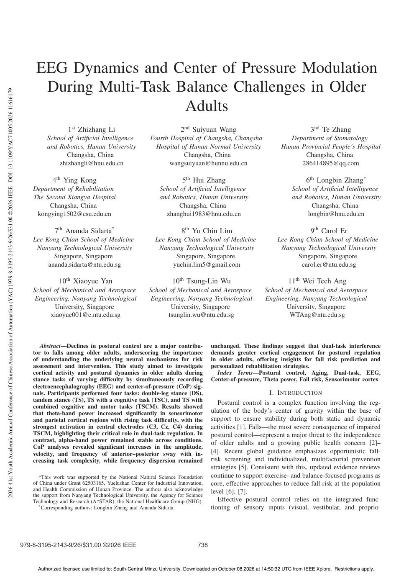
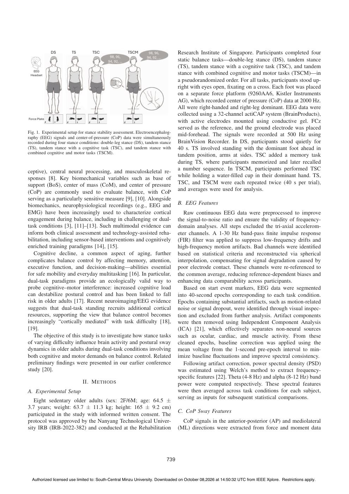
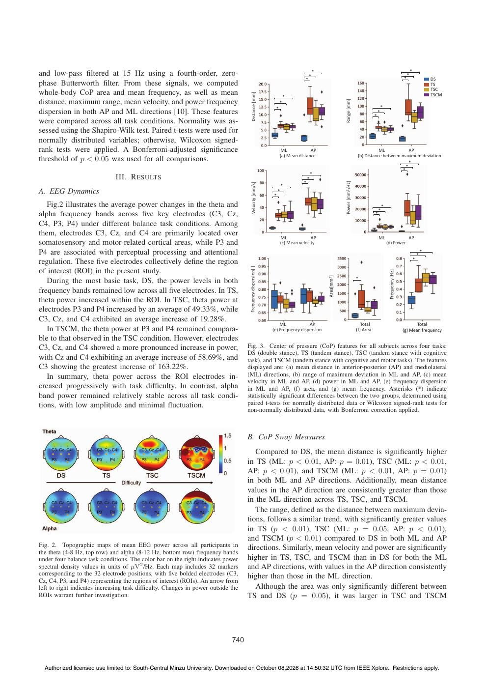
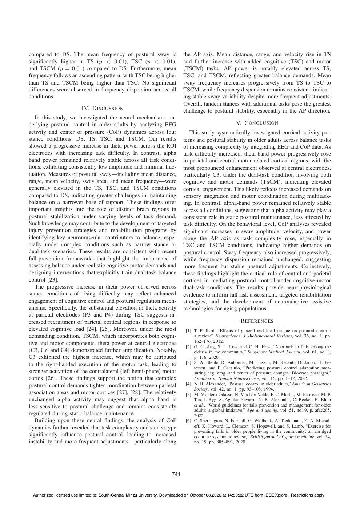
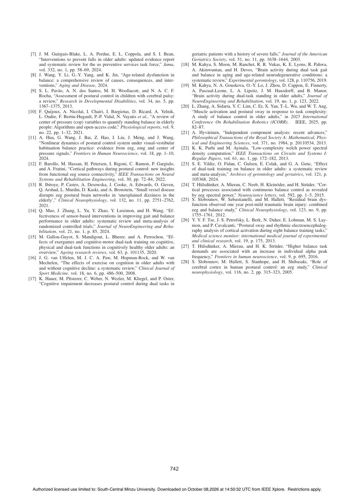

# Li2026-YAC：多任务平衡挑战的EEG与压力中心调节

> English text extracted from the source PDF; not translated or editorially corrected. Each original PDF page is embedded below as a rendered image so figures, tables, and vector artwork remain visible.

- Source PDF: `Li2026-YAC：多任务平衡挑战的EEG与压力中心调节.pdf`
- SHA-256: `03b60d7088a10a6ee3834e92d376d7680d42f9aa7ad92fa984d697ed5aea2298`
- Pages: 5
- Extraction: Poppler `pdftotext -layout`; page images rendered with `pdftoppm` (max dimension 1400 px, JPEG quality 76).

## Page 1

English text extracted from page 1

<pre>
EEG Dynamics and Center of Pressure Modulation
                                                                                                                                                                             During Multi-Task Balance Challenges in Older

2026 41st Youth Academic Annual Conference of Chinese Association of Automation (YAC) | 979-8-3195-2143-9/26/$31.00 ©2026 IEEE | DOI: 10.1109/YAC71005.2026.11616179
                                                                                                                                                                                                Adults
                                                                                                                                                                                          1st Zhizhang Li                                    2nd Suiyuan Wang                                          3nd Te Zhang
                                                                                                                                                                                 School of Artificial Intelligence              Fourth Hospital of Changsha, Changsha                         Department of Stomatology
                                                                                                                                                                                 and Robotics, Hunan University                  Hospital of Hunan Normal University                      Hunan Provincial People’s Hospital
                                                                                                                                                                                        Changsha, China                                    Changsha, China                                       Changsha, China
                                                                                                                                                                                     zhizhangli@hnu.edu.cn                            wangsuiyuan@hunnu.edu.cn                                  286414895@qq.com

                                                                                                                                                                                   4th Ying Kong                                             5th Hui Zhang                                           6th Longbin Zhang*
                                                                                                                                                                           Department of Rehabilitation                            School of Artificial Intelligence                           School of Artificial Intelligence
                                                                                                                                                                           The Second Xiangya Hospital                             and Robotics, Hunan University                             and Robotics, Hunan University
                                                                                                                                                                                Changsha, China                                           Changsha, China                                            Changsha, China
                                                                                                                                                                            kongying1502@csu.edu.cn                                  zhanghui1983@hnu.edu.cn                                       longbin@hnu.edu.cn

                                                                                                                                                                                    7th Ananda Sidarta*                                      8th Yu Chin Lim                                           9th Carol Er
                                                                                                                                                                           Lee Kong Chian School of Medicine                     Lee Kong Chian School of Medicine                      Lee Kong Chian School of Medicine
                                                                                                                                                                            Nanyang Technological University                      Nanyang Technological University                       Nanyang Technological University
                                                                                                                                                                                  Singapore, Singapore                                  Singapore, Singapore                                  Singapore, Singapore
                                                                                                                                                                                ananda.sidarta@ntu.edu.sg                              yuchin.lim5@gmail.com                                   carol.er@ntu.edu.sg

                                                                                                                                                                                      10th Xiaoyue Yan                                   10th Tsung-Lin Wu                                   11th Wei Tech Ang
                                                                                                                                                                           School of Mechanical and Aerospace                 School of Mechanical and Aerospace                  School of Mechanical and Aerospace
                                                                                                                                                                            Engineering, Nanyang Technological                 Engineering, Nanyang Technological                 Engineering, Nanyang Technological
                                                                                                                                                                                  University, Singapore                               University, Singapore                              University, Singapore
                                                                                                                                                                                 xiaoyue001@e.ntu.edu.sg                             tsunglin.wu@ntu.edu.sg                                WTAng@ntu.edu.sg

                                                                                                                                                                              Abstract—Declines in postural control are a major contribu-                 unchanged. These findings suggest that dual-task interference
                                                                                                                                                                           tor to falls among older adults, underscoring the importance                   demands greater cortical engagement for postural regulation
                                                                                                                                                                           of understanding the underlying neural mechanisms for risk                     in older adults, offering insights for fall risk prediction and
                                                                                                                                                                           assessment and intervention. This study aimed to investigate                   personalized rehabilitation strategies.
                                                                                                                                                                           cortical activity and postural dynamics in older adults during                   Index Terms—Postural control, Aging, Dual-task, EEG,
                                                                                                                                                                           stance tasks of varying difficulty by simultaneously recording                  Center-of-pressure, Theta power, Fall risk, Sensorimotor cortex
                                                                                                                                                                           electroencephalography (EEG) and center-of-pressure (CoP) sig-
                                                                                                                                                                           nals. Participants performed four tasks: double-leg stance (DS),                                      I. I NTRODUCTION
                                                                                                                                                                           tandem stance (TS), TS with a cognitive task (TSC), and TS with                   Postural control is a complex function involving the reg-
                                                                                                                                                                           combined cognitive and motor tasks (TSCM). Results showed
                                                                                                                                                                           that theta-band power increased significantly in sensorimotor                   ulation of the body’s center of gravity within the base of
                                                                                                                                                                           and parietal cortical regions with rising task difficulty, with the             support to ensure stability during both static and dynamic
                                                                                                                                                                           strongest activation in central electrodes (C3, Cz, C4) during                 activities [1]. Falls—the most severe consequence of impaired
                                                                                                                                                                           TSCM, highlighting their critical role in dual-task regulation. In             postural control—represent a major threat to the independence
                                                                                                                                                                           contrast, alpha-band power remained stable across conditions.                  of older adults and a growing public health concern [2]–
                                                                                                                                                                           CoP analyses revealed significant increases in the amplitude,
                                                                                                                                                                           velocity, and frequency of anterior–posterior sway with in-                    [4]. Recent global guidance emphasizes opportunistic fall-
                                                                                                                                                                           creasing task complexity, while frequency dispersion remained                  risk screening and individualized, multifactorial prevention
                                                                                                                                                                                                                                                          strategies [5]. Consistent with this, updated evidence reviews
                                                                                                                                                                             *This work was supported by the National Natural Science Foundation          continue to support exercise- and balance-focused programs as
                                                                                                                                                                           of China under Grant 62503165, Yuelushan Center for Industrial Innovation,     core, effective approaches to reduce fall risk at the population
                                                                                                                                                                           and Health Commission of Hunan Province. The authors also acknowledge          level [6], [7].
                                                                                                                                                                           the support from Nanyang Technological University, the Agency for Science
                                                                                                                                                                           Technology and Research (A*STAR), the National Healthcare Group (NHG).            Effective postural control relies on the integrated func-
                                                                                                                                                                             * Corresponding authors: Longbin Zhang and Ananda Sidarta.                   tioning of sensory inputs (visual, vestibular, and proprio-

                                                                                                                                                                       979-8-3195-2143-9/26/$31.00 ©2026 IEEE                                       738

                                                                                                                                                                             Authorized licensed use limited to: South-Central Minzu University. Downloaded on October 08,2026 at 14:50:32 UTC from IEEE Xplore. Restrictions apply.
</pre>

## Page 2

English text extracted from page 2

<pre>
DS       TS          TSC                TSCM                       Research Institute of Singapore. Participants completed four
                                                                                 static balance tasks—double-leg stance (DS), tandem stance
                                                                                 (TS), tandem stance with a cognitive task (TSC), and tandem
  EEG
 Headset                                                                         stance with combined cognitive and motor tasks (TSCM)—in
                                                                                 a pseudorandomized order. For all tasks, participants stood up-
                                                                                 right with eyes open, fixating on a cross. Each foot was placed
                                                                                 on a separate force platform (9260AA6, Kistler Instruments
                                                                                 AG), which recorded center of pressure (CoP) data at 2000 Hz.
                                                                                 All were right-handed and right-leg dominant. EEG data were
                                                                                 collected using a 32-channel actiCAP system (BrainProducts),
Force Plate
                                                                                 with active electrodes mounted using conductive gel. FCz
                                                                                 served as the reference, and the ground electrode was placed
Fig. 1. Experimental setup for stance stability assessment. Electroencephalog-
raphy (EEG) signals and center-of-pressure (CoP) data were simultaneously
                                                                                 mid-forehead. The signals were recorded at 500 Hz using
recorded during four stance conditions: double-leg stance (DS), tandem stance    BrainVision Recorder. In DS, participants stood quietly for
(TS), tandem stance with a cognitive task (TSC), and tandem stance with          40 s. TS involved standing with the dominant foot ahead in
combined cognitive and motor tasks (TSCM).
                                                                                 tandem position, arms at sides. TSC added a memory task
                                                                                 during TS, where participants memorized and later recalled
ceptive), central neural processing, and musculoskeletal re-                     a number sequence. In TSCM, participants performed TSC
sponses [8]. Key biomechanical variables such as base of                         while holding a water-filled cup in their dominant hand. TS,
support (BoS), center of mass (CoM), and center of pressure                      TSC, and TSCM were each repeated twice (40 s per trial),
(CoP) are commonly used to evaluate balance, with CoP                            and averages were used for analysis.
serving as a particularly sensitive measure [9], [10]. Alongside
biomechanics, neurophysiological recordings (e.g., EEG and                       B. EEG Features
EMG) have been increasingly used to characterize cortical                           Raw continuous EEG data were preprocessed to improve
engagement during balance, including in challenging or dual-                     the signal-to-noise ratio and ensure the validity of frequency-
task conditions [3], [11]–[13]. Such multimodal evidence can                     domain analyses. All steps excluded the tri-axial accelerom-
inform both clinical assessment and technology-assisted reha-                    eter channels. A 1-30 Hz band-pass finite impulse response
bilitation, including sensor-based interventions and cognitively                 (FIR) filter was applied to suppress low-frequency drifts and
enriched training paradigms [14], [15].                                          high-frequency motion artifacts. Bad channels were identified
   Cognitive decline, a common aspect of aging, further                          based on statistical criteria and reconstructed via spherical
complicates balance control by affecting memory, attention,                      interpolation, compensating for signal degradation caused by
executive function, and decision-making—abilities essential                      poor electrode contact. These channels were re-referenced to
for safe mobility and everyday multitasking [16]. In particular,                 the common average, reducing reference-dependent biases and
dual-task paradigms provide an ecologically valid way to                         enhancing data comparability across participants.
probe cognitive–motor interference: increased cognitive load                        Based on start event markers, EEG data were segmented
can destabilize postural control and has been linked to fall                     into 40-second epochs corresponding to each task condition.
risk in older adults [17]. Recent neuroimaging/EEG evidence                      Epochs containing substantial artifacts, such as motion-related
suggests that dual-task standing recruits additional cortical                    noise or signal dropout, were identified through visual inspec-
resources, supporting the view that balance control becomes                      tion and excluded from further analysis. Artifact components
increasingly “cortically mediated” with task difficulty [18],                     were then removed using Independent Component Analysis
[19].                                                                            (ICA) [21], which effectively separates non-neural sources
   The objective of this study is to investigate how stance tasks                such as ocular, cardiac, and muscle activity. From these
of varying difficulty influence brain activity and postural sway                   cleaned epochs, baseline correction was applied using the
dynamics in older adults during dual-task conditions involving                   mean voltage from the 1-second pre-epoch interval to min-
both cognitive and motor demands on balance control. Related                     imize baseline fluctuations and improve spectral consistency.
preliminary findings were presented in our earlier conference                        Following artifact correction, power spectral density (PSD)
study [20].                                                                      was estimated using Welch’s method to extract frequency-
                                                                                 specific features [22]. Theta (4-8 Hz) and alpha (8-12 Hz) band
                             II. M ETHODS                                        power were computed respectively. These spectral features
A. Experimental Setup                                                            were then averaged across task conditions for each subject,
                                                                                 serving as inputs for subsequent statistical comparisons.
   Eight sedentary older adults (sex: 2F/6M; age: 64.5 ±
3.7 years; weight: 63.7 ± 11.3 kg; height: 165 ± 9.2 cm)
                                                                                 C. CoP Sway Features
participated in the study with informed written consent. The
protocol was approved by the Nanyang Technological Univer-                         CoP signals in the anterior-posterior (AP) and mediolateral
sity IRB (IRB-2022-382) and conducted at the Rehabilitation                      (ML) directions were extracted from force and moment data

                                                                           739

  Authorized licensed use limited to: South-Central Minzu University. Downloaded on October 08,2026 at 14:50:32 UTC from IEEE Xplore. Restrictions apply.
</pre>

## Page 3

English text extracted from page 3

<pre>
*                                                                                 *
and low-pass filtered at 15 Hz using a fourth-order, zero-                                                                            *                                                                                 *
                                                                                                                                 *                                                                                 *                       DS
phase Butterworth filter. From these signals, we computed                                                                                                                                                                                   TS
                                                                                                                                                                                                                                           TSC
whole-body CoP area and mean frequency, as well as mean

                                                                                     Distance [mm]
                                                                                                                      *                                                                                                                    TSCM

                                                                                                                                                         Range [mm]
distance, maximum range, mean velocity, and power frequency                                                       *
                                                                                                              *                                                                              *
dispersion in both AP and ML directions [10]. These features                                                                                                                         *
                                                                                                                                                                                         *
were compared across all task conditions. Normality was as-
sessed using the Shapiro-Wilk test. Paired t-tests were used for
normally distributed variables; otherwise, Wilcoxon signed-
rank tests were applied. A Bonferroni-adjusted significance                                                         ML            AP                                                  ML            AP
                                                                                                                  (a) Mean distance                                       (b) Distance between maximum deviation
threshold of p &lt; 0.05 was used for all comparisons.                                                                                                                                                *
                                                                                                                                                                                                 *
                                                                                                                                                                                               *
                                                                                                                                        *
                              III. R ESULTS                                                                                         *
                                                                                                                                *

                                                                                     Velocity [mm/s]                                                     Power [mm2/Hz]
                                                                                                                     *
A. EEG Dynamics                                                                                              *
                                                                                                                 *

   Fig.2 illustrates the average power changes in the theta and                                                                                                                              *
                                                                                                                                                                                         *
alpha frequency bands across five key electrodes (C3, Cz,                                                                                                                             *

C4, P3, P4) under different balance task conditions. Among
them, electrodes C3, Cz, and C4 are primarily located over
                                                                                                                     ML             AP                                                   ML                            AP
somatosensory and motor-related cortical areas, while P3 and                                                         (c) Mean velocity                                                           (d) Power

P4 are associated with perceptual processing and attentional                                                                                                                                                                       *
                                                                                                                                                                                                                                       *
                                                                                                                                                                                                                               *
regulation. These five electrodes collectively define the region

                                                                                   Frequency dispersion[ ]
of interest (ROI) in the present study.

                                                                                                                                             Area[mm2]                                            Frequency [Hz]
                                                                                                                                                                          *
   During the most basic task, DS, the power levels in both
frequency bands remained low across all five electrodes. In TS,
theta power increased within the ROI. In TSC, theta power at
electrodes P3 and P4 increased by an average of 49.33%, while
C3, Cz, and C4 exhibited an average increase of 19.28%.
                                                                                                                 ML            AP                                            Total                                        Total
   In TSCM, the theta power at P3 and P4 remained compara-                                                   (e) Frequency dispersion                                     (f) Area                                 (g) Mean frequency
ble to that observed in the TSC condition. However, electrodes
C3, Cz, and C4 showed a more pronounced increase in power,                        Fig. 3. Center of pressure (CoP) features for all subjects across four tasks:
                                                                                  DS (double stance), TS (tandem stance), TSC (tandem stance with cognitive
with Cz and C4 exhibiting an average increase of 58.69%, and                      task), and TSCM (tandem stance with cognitive and motor tasks). The features
C3 showing the greatest increase of 163.22%.                                      displayed are: (a) mean distance in anterior-posterior (AP) and mediolateral
   In summary, theta power across the ROI electrodes in-                          (ML) directions, (b) range of maximum deviation in ML and AP, (c) mean
                                                                                  velocity in ML and AP, (d) power in ML and AP, (e) frequency dispersion
creased progressively with task difficulty. In contrast, alpha                     in ML and AP, (f) area, and (g) mean frequency. Asterisks (*) indicate
band power remained relatively stable across all task condi-                      statistically significant differences between the two groups, determined using
tions, with low amplitude and minimal fluctuation.                                 paired t-tests for normally distributed data or Wilcoxon signed-rank tests for
                                                                                  non-normally distributed data, with Bonferroni correction applied.

                                                                                  B. CoP Sway Measures
                                                                                     Compared to DS, the mean distance is significantly higher
                                                                                  in TS (ML: p &lt; 0.01, AP: p = 0.01), TSC (ML: p &lt; 0.01,
                                                                                  AP: p &lt; 0.01), and TSCM (ML: p &lt; 0.01, AP: p = 0.01)
                                                                                  in both ML and AP directions. Additionally, mean distance
                                                                                  values in the AP direction are consistently greater than those
                                                                                  in the ML direction across TS, TSC, and TSCM.
                                                                                     The range, defined as the distance between maximum devia-
                                                                                  tions, follows a similar trend, with significantly greater values
                                                                                  in TS (p &lt; 0.01), TSC (ML: p = 0.05, AP: p &lt; 0.01),
                                                                                  and TSCM (p &lt; 0.01) compared to DS in both ML and AP
Fig. 2. Topographic maps of mean EEG power across all participants in             directions. Similarly, mean velocity and power are significantly
the theta (4-8 Hz, top row) and alpha (8-12 Hz, bottom row) frequency bands
under four balance task conditions. The color bar on the right indicates power    higher in TS, TSC, and TSCM than in DS for both the ML
spectral density values in units of μV2 /Hz. Each map includes 32 markers         and AP directions, with values in the AP direction consistently
corresponding to the 32 electrode positions, with five bolded electrodes (C3,      higher than those in the ML direction.
Cz, C4, P3, and P4) representing the regions of interest (ROIs). An arrow from
left to right indicates increasing task difficulty. Changes in power outside the      Although the area was only significantly different between
ROIs warrant further investigation.                                               TS and DS (p = 0.05), it was larger in TSC and TSCM

                                                                            740

  Authorized licensed use limited to: South-Central Minzu University. Downloaded on October 08,2026 at 14:50:32 UTC from IEEE Xplore. Restrictions apply.
</pre>

## Page 4

English text extracted from page 4

<pre>
compared to DS. The mean frequency of postural sway is                        the AP axis. Mean distance, range, and velocity rise in TS
significantly higher in TS (p &lt; 0.01), TSC (p &lt; 0.01),                         and further increase with added cognitive (TSC) and motor
and TSCM (p = 0.01) compared to DS. Furthermore, mean                         (TSCM) tasks. AP power is notably elevated across TS,
frequency follows an ascending pattern, with TSC being higher                 TSC, and TSCM, reflecting greater balance demands. Mean
than TS and TSCM being higher than TSC. No significant                         sway frequency increases progressively from TS to TSC to
differences were observed in frequency dispersion across all                  TSCM, while frequency dispersion remains consistent, indicat-
conditions.                                                                   ing stable sway variability despite more frequent adjustments.
                                                                              Overall, tandem stances with additional tasks pose the greatest
                          IV. D ISCUSSION                                     challenge to postural stability, especially in the AP direction.
   In this study, we investigated the neural mechanisms un-
derlying postural control in older adults by analyzing EEG                                               V. C ONCLUSION
activity and center of pressure (CoP) dynamics across four                       This study systematically investigated cortical activity pat-
stance conditions: DS, TS, TSC, and TSCM. Our results                         terns and postural stability in older adults across balance tasks
showed a progressive increase in theta power across the ROI                   of increasing complexity by integrating EEG and CoP data. As
electrodes with increasing task difficulty. In contrast, alpha                 task difficulty increased, theta-band power progressively rose
band power remained relatively stable across all task condi-                  in parietal and central motor-related cortical regions, with the
tions, exhibiting consistently low amplitude and minimal fluc-                 most pronounced enhancement observed at central electrodes,
tuation. Measures of postural sway—including mean distance,                   particularly C3, under the dual-task condition involving both
range, mean velocity, sway area, and mean frequency—were                      cognitive and motor demands (TSCM), indicating elevated
generally elevated in the TS, TSC, and TSCM conditions                        cortical engagement. This likely reflects increased demands on
compared to DS, indicating greater challenges in maintaining                  sensory integration and motor coordination during multitask-
balance on a narrower base of support. These findings offer                    ing. In contrast, alpha-band power remained relatively stable
important insights into the role of distinct brain regions in                 across all conditions, suggesting that alpha activity may play a
postural stabilization under varying levels of task demand.                   consistent role in static postural maintenance, less affected by
Such knowledge may contribute to the development of targeted                  task difficulty. On the behavioral level, CoP analyses revealed
injury prevention strategies and rehabilitation programs by                   significant increases in sway amplitude, velocity, and power
identifying key neuromuscular contributors to balance, espe-                  along the AP axis as task complexity rose, especially in
cially under complex conditions such as narrow stance or                      TSC and TSCM conditions, indicating higher demands on
dual-task scenarios. These results are consistent with recent                 postural control. Sway frequency also increased progressively,
fall-prevention frameworks that highlight the importance of                   while frequency dispersion remained unchanged, suggesting
assessing balance under realistic cognitive-motor demands and                 more frequent but stable postural adjustments. Collectively,
designing interventions that explicitly train dual-task balance               these findings highlight the critical role of central and parietal
control [23].                                                                 cortices in mediating postural control under cognitive-motor
   The progressive increase in theta power observed across                    dual-task conditions. The results provide neurophysiological
stance conditions of rising difficulty may reflect enhanced                     evidence to inform fall risk assessment, targeted rehabilitation
engagement of cognitive control and postural regulation mech-                 strategies, and the development of neuroadaptive assistive
anisms. Specifically, the substantial elevation in theta activity              technologies for aging populations.
at parietal electrodes (P3 and P4) during TSC suggests in-
creased recruitment of parietal cortical regions in response to                                             R EFERENCES
elevated cognitive load [24], [25]. Moreover, under the most                   [1] T. Paillard, “Effects of general and local fatigue on postural control:
demanding condition, TSCM, which incorporates both cogni-                          a review,” Neuroscience &amp; Biobehavioral Reviews, vol. 36, no. 1, pp.
tive and motor components, theta power at central electrodes                       162–176, 2012.
                                                                               [2] G. C. Ang, S. L. Low, and C. H. How, “Approach to falls among the
(C3, Cz, and C4) demonstrated further amplification. Notably,                       elderly in the community,” Singapore Medical Journal, vol. 61, no. 3,
C3 exhibited the highest increase, which may be attributed                         p. 116, 2020.
to the right-handed execution of the motor task, leading to                    [3] S. A. Stehle, R. Aubonnet, M. Hassan, M. Recenti, D. Jacob, H. Pe-
                                                                                   tersen, and P. Gargiulo, “Predicting postural control adaptation mea-
stronger activation of the contralateral (left hemisphere) motor                   suring eeg, emg, and center of pressure changes: Biovrsea paradigm,”
cortex [26]. These findings support the notion that complex                         Frontiers in Human Neuroscience, vol. 16, pp. 1–12, 2022.
postural control demands tighter coordination between parietal                 [4] N. B. Alexander, “Postural control in older adults,” American Geriatrics
                                                                                   Society, vol. 42, no. 1, pp. 93–108, 1994.
association areas and motor cortices [27], [28]. The relatively                [5] M. Montero-Odasso, N. Van Der Velde, F. C. Martin, M. Petrovic, M. P.
unchanged alpha activity may suggest that alpha band is                            Tan, J. Ryg, S. Aguilar-Navarro, N. B. Alexander, C. Becker, H. Blain
less sensitive to postural challenge and remains consistently                      et al., “World guidelines for falls prevention and management for older
                                                                                   adults: a global initiative,” Age and ageing, vol. 51, no. 9, p. afac205,
regulated during static balance maintenance.                                       2022.
   Building upon these neural findings, the analysis of CoP                     [6] C. Sherrington, N. Fairhall, G. Wallbank, A. Tiedemann, Z. A. Michal-
dynamics further revealed that task complexity and stance type                     eff, K. Howard, L. Clemson, S. Hopewell, and S. Lamb, “Exercise for
                                                                                   preventing falls in older people living in the community: an abridged
significantly influence postural control, leading to increased                       cochrane systematic review,” British journal of sports medicine, vol. 54,
instability and more frequent adjustments—particularly along                       no. 15, pp. 885–891, 2020.

                                                                        741

 Authorized licensed use limited to: South-Central Minzu University. Downloaded on October 08,2026 at 14:50:32 UTC from IEEE Xplore. Restrictions apply.
</pre>

## Page 5

English text extracted from page 5

<pre>
[7] J. M. Guirguis-Blake, L. A. Perdue, E. L. Coppola, and S. I. Bean,                geriatric patients with a history of severe falls,” Journal of the American
     “Interventions to prevent falls in older adults: updated evidence report          Geriatrics Society, vol. 51, no. 11, pp. 1638–1644, 2003.
     and systematic review for the us preventive services task force,” Jama,      [18] M. Kahya, S. Moon, M. Ranchet, R. R. Vukas, K. E. Lyons, R. Pahwa,
     vol. 332, no. 1, pp. 58–69, 2024.                                                 A. Akinwuntan, and H. Devos, “Brain activity during dual task gait
 [8] J. Wang, Y. Li, G.-Y. Yang, and K. Jin, “Age-related dysfunction in               and balance in aging and age-related neurodegenerative conditions: a
     balance: a comprehensive review of causes, consequences, and inter-               systematic review,” Experimental gerontology, vol. 128, p. 110756, 2019.
     ventions,” Aging and Disease, 2024.                                          [19] M. Kahya, N. A. Gouskova, O.-Y. Lo, J. Zhou, D. Cappon, E. Finnerty,
 [9] S. L. Pavão, A. N. dos Santos, M. H. Woollacott, and N. A. C. F.                 A. Pascual-Leone, L. A. Lipsitz, J. M. Hausdorff, and B. Manor,
     Rocha, “Assessment of postural control in children with cerebral palsy:           “Brain activity during dual-task standing in older adults,” Journal of
     a review,” Research in Developmental Disabilities, vol. 34, no. 5, pp.            NeuroEngineering and Rehabilitation, vol. 19, no. 1, p. 123, 2022.
     1367–1375, 2013.                                                             [20] L. Zhang, A. Sidarta, Y. C. Lim, C. Er, X. Yan, T.-L. Wu, and W. T. Ang,
[10] F. Quijoux, A. Nicolaı̈, I. Chairi, I. Bargiotas, D. Ricard, A. Yelnik,           “Muscle activation and postural sway in response to task complexity:
     L. Oudre, F. Bertin-Hugault, P.-P. Vidal, N. Vayatis et al., “A review of         A study of balance control in older adults,” in 2025 International
     center of pressure (cop) variables to quantify standing balance in elderly        Conference On Rehabilitation Robotics (ICORR). IEEE, 2025, pp.
     people: Algorithms and open-access code,” Physiological reports, vol. 9,          82–87.
     no. 22, pp. 1–32, 2021.                                                      [21] A. Hyvärinen, “Independent component analysis: recent advances,”
[11] A. Hua, G. Wang, J. Bai, Z. Hao, J. Liu, J. Meng, and J. Wang,                    Philosophical Transactions of the Royal Society A: Mathematical, Phys-
     “Nonlinear dynamics of postural control system under visual-vestibular            ical and Engineering Sciences, vol. 371, no. 1984, p. 20110534, 2013.
     habituation balance practice: evidence from eeg, emg and center of           [22] K. K. Parhi and M. Ayinala, “Low-complexity welch power spectral
     pressure signals,” Frontiers in Human Neuroscience, vol. 18, pp. 1–10,            density computation,” IEEE Transactions on Circuits and Systems I:
     2024.                                                                             Regular Papers, vol. 61, no. 1, pp. 172–182, 2013.
[12] F. Barollo, M. Hassan, H. Petersen, I. Rigoni, C. Ramon, P. Gargiulo,        [23] S. E. Yildiz, O. Fidan, C. Gulsen, E. Colak, and G. A. Genc, “Effect
     and A. Fratini, “Cortical pathways during postural control: new insights          of dual-task training on balance in older adults: a systematic review
     from functional eeg source connectivity,” IEEE Transactions on Neural             and meta-analysis,” Archives of gerontology and geriatrics, vol. 121, p.
     Systems and Rehabilitation Engineering, vol. 30, pp. 72–84, 2022.                 105368, 2024.
[13] R. Ibitoye, P. Castro, A. Desowska, J. Cooke, A. Edwards, O. Guven,          [24] T. Hülsdünker, A. Mierau, C. Neeb, H. Kleinöder, and H. Strüder, “Cor-
     Q. Arshad, L. Murdin, D. Kaski, and A. Bronstein, “Small vessel disease           tical processes associated with continuous balance control as revealed
     disrupts eeg postural brain networks in ‘unexplained dizziness in the             by eeg spectral power,” Neuroscience letters, vol. 592, pp. 1–5, 2015.
     elderly’,” Clinical Neurophysiology, vol. 132, no. 11, pp. 2751–2762,        [25] S. Slobounov, W. Sebastianelli, and M. Hallett, “Residual brain dys-
     2021.                                                                             function observed one year post-mild traumatic brain injury: combined
[14] Q. Mao, J. Zhang, L. Yu, Y. Zhao, Y. Luximon, and H. Wang, “Ef-                   eeg and balance study,” Clinical Neurophysiology, vol. 123, no. 9, pp.
     fectiveness of sensor-based interventions in improving gait and balance           1755–1761, 2012.
     performance in older adults: systematic review and meta-analysis of          [26] Y. Y. F. Tse, J. S. Petrofsky, L. Berk, N. Daher, E. Lohman, M. S. Lay-
     randomized controlled trials,” Journal of NeuroEngineering and Reha-              mon, and P. Cavalcanti, “Postural sway and rhythmic electroencephalog-
     bilitation, vol. 21, no. 1, p. 85, 2024.                                          raphy analysis of cortical activation during eight balance training tasks,”
[15] M. Gallou-Guyot, S. Mandigout, L. Bherer, and A. Perrochon, “Ef-                  Medical science monitor: international medical journal of experimental
     fects of exergames and cognitive-motor dual-task training on cognitive,           and clinical research, vol. 19, p. 175, 2013.
     physical and dual-task functions in cognitively healthy older adults: an     [27] T. Hülsdünker, A. Mierau, and H. K. Strüder, “Higher balance task
     overview,” Ageing research reviews, vol. 63, p. 101135, 2020.                     demands are associated with an increase in individual alpha peak
[16] J. G. van Uffelen, M. J. C. A. Paw, M. Hopman-Rock, and W. van                    frequency,” Frontiers in human neuroscience, vol. 9, p. 695, 2016.
     Mechelen, “The effects of exercise on cognition in older adults with         [28] S. Slobounov, M. Hallett, S. Stanhope, and H. Shibasaki, “Role of
     and without cognitive decline: a systematic review,” Clinical Journal of          cerebral cortex in human postural control: an eeg study,” Clinical
     Sport Medicine, vol. 18, no. 6, pp. 486–500, 2008.                                neurophysiology, vol. 116, no. 2, pp. 315–323, 2005.
[17] K. Hauer, M. Pfisterer, C. Weber, N. Wezler, M. Kliegel, and P. Oster,
     “Cognitive impairment decreases postural control during dual tasks in

                                                                            742

  Authorized licensed use limited to: South-Central Minzu University. Downloaded on October 08,2026 at 14:50:32 UTC from IEEE Xplore. Restrictions apply.
</pre>

