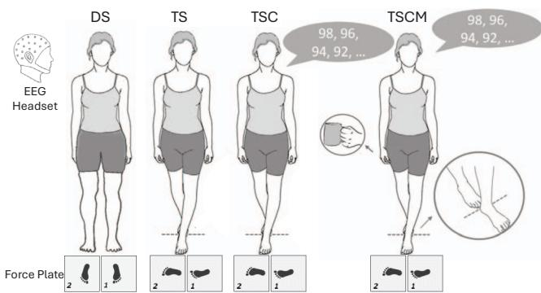
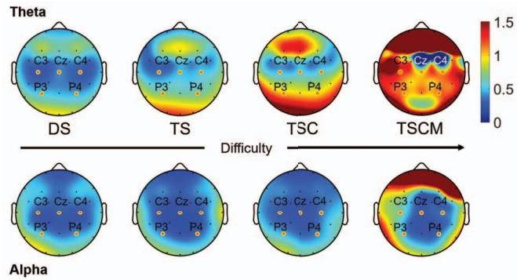
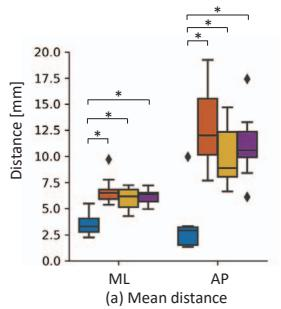
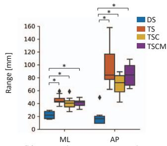
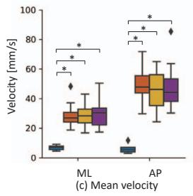
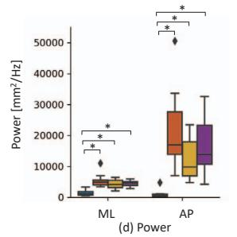
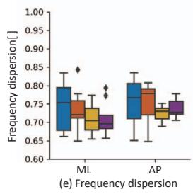
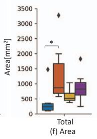
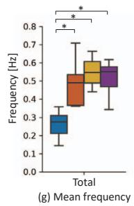

# EEG Dynamics and Center of Pressure Modulation During Multi-Task Balance Challenges in Older Adults

1st Zhizhang Li School of Artificial Intelligence and Robotics, Hunan University Changsha, China zhizhangli@hnu.edu.cn

4th Ying Kong Department of Rehabilitation The Second Xiangya Hospital Changsha, China kongying1502@csu.edu.cn

7th Ananda Sidarta\* Lee Kong Chian School of Medicine Nanyang Technological University Singapore, Singapore ananda.sidarta@ntu.edu.sg

10th Xiaoyue Yan School of Mechanical and Aerospace Engineering, Nanyang Technological University, Singapore xiaoyue001@e.ntu.edu.sg

2nd Suiyuan Wang Fourth Hospital of Changsha, Changsha Hospital of Hunan Normal University Changsha, China wangsuiyuan@hunnu.edu.cn

5th Hui Zhang School of Artificial Intelligence and Robotics, Hunan University Changsha, China zhanghui1983@hnu.edu.cn

8th Yu Chin Lim Lee Kong Chian School of Medicine Nanyang Technological University Singapore, Singapore yuchin.lim5@gmail.com

10th Tsung-Lin Wu School of Mechanical and Aerospace Engineering, Nanyang Technological University, Singapore tsunglin.wu@ntu.edu.sg

3nd Te Zhang Department of Stomatology Hunan Provincial People’s Hospital Changsha, China 286414895@qq.com

6th Longbin Zhang\* School of Artificial Intelligence and Robotics, Hunan University Changsha, China longbin@hnu.edu.cn

9th Carol Er Lee Kong Chian School of Medicine Nanyang Technological University Singapore, Singapore carol.er@ntu.edu.sg

11th Wei Tech Ang School of Mechanical and Aerospace Engineering, Nanyang Technological University, Singapore WTAng@ntu.edu.sg

Abstract—Declines in postural control are a major contributor to falls among older adults, underscoring the importance of understanding the underlying neural mechanisms for risk assessment and intervention. This study aimed to investigate cortical activity and postural dynamics in older adults during stance tasks of varying difficulty by simultaneously recording electroencephalography (EEG) and center-of-pressure (CoP) signals. Participants performed four tasks: double-leg stance (DS), tandem stance (TS), TS with a cognitive task (TSC), and TS with combined cognitive and motor tasks (TSCM). Results showed that theta-band power increased significantly in sensorimotor and parietal cortical regions with rising task difficulty, with the strongest activation in central electrodes (C3, Cz, C4) during TSCM, highlighting their critical role in dual-task regulation. In contrast, alpha-band power remained stable across conditions. CoP analyses revealed significant increases in the amplitude, velocity, and frequency of anterior–posterior sway with increasing task complexity, while frequency dispersion remained unchanged. These findings suggest that dual-task interference demands greater cortical engagement for postural regulation in older adults, offering insights for fall risk prediction and personalized rehabilitation strategies.

Index Terms—Postural control, Aging, Dual-task, EEG, Center-of-pressure, Theta power, Fall risk, Sensorimotor cortex

## I. INTRODUCTION

Postural control is a complex function involving the regulation of the body’s center of gravity within the base of support to ensure stability during both static and dynamic activities [1]. Falls—the most severe consequence of impaired postural control—represent a major threat to the independence of older adults and a growing public health concern [2]– [4]. Recent global guidance emphasizes opportunistic fallrisk screening and individualized, multifactorial prevention strategies [5]. Consistent with this, updated evidence reviews continue to support exercise- and balance-focused programs as core, effective approaches to reduce fall risk at the population level [6], [7].

Effective postural control relies on the integrated functioning of sensory inputs (visual, vestibular, and proprioceptive), central neural processing, and musculoskeletal responses [8]. Key biomechanical variables such as base of support (BoS), center of mass (CoM), and center of pressure (CoP) are commonly used to evaluate balance, with CoP serving as a particularly sensitive measure [9], [10]. Alongside biomechanics, neurophysiological recordings (e.g., EEG and EMG) have been increasingly used to characterize cortical engagement during balance, including in challenging or dual task conditions [3], [11]–[13]. Such multimodal evidence can inform both clinical assessment and technology-assisted rehabilitation, including sensor-based interventions and cognitively enriched training paradigms [14], [15].

  
Fig. 1. Experimental setup for stance stability assessment. Electroencephalog raphy (EEG) signals and center-of-pressure (CoP) data were simultaneously recorded during four stance conditions: double-leg stance (DS), tandem stance (TS), tandem stance with a cognitive task (TSC), and tandem stance with combined cognitive and motor tasks (TSCM).

Cognitive decline, a common aspect of aging, further complicates balance control by affecting memory, attention, executive function, and decision-making—abilities essentia for safe mobility and everyday multitasking [16]. In particular, dual-task paradigms provide an ecologically valid way to probe cognitive–motor interference: increased cognitive load can destabilize postural control and has been linked to fall risk in older adults [17]. Recent neuroimaging/EEG evidence suggests that dual-task standing recruits additional cortical resources, supporting the view that balance control becomes increasingly “cortically mediated” with task difficulty [18], [19].

The objective of this study is to investigate how stance tasks of varying difficulty influence brain activity and postural sway dynamics in older adults during dual-task conditions involving both cognitive and motor demands on balance control. Related preliminary findings were presented in our earlier conference study [20].

## II. METHODS

## A. Experimental Setup

Eight sedentary older adults (sex: 2F/6M; age: $6 4 . 5 \ \pm$ 3.7 years; weight: $6 3 . 7 \pm 1 1 . 3$ kg; height: $1 6 5 \pm 9 . 2$ cm) participated in the study with informed written consent. The protocol was approved by the Nanyang Technological University IRB (IRB-2022-382) and conducted at the Rehabilitation

Research Institute of Singapore. Participants completed four static balance tasks—double-leg stance (DS), tandem stance (TS), tandem stance with a cognitive task (TSC), and tandem stance with combined cognitive and motor tasks (TSCM)—in a pseudorandomized order. For all tasks, participants stood upright with eyes open, fixating on a cross. Each foot was placed on a separate force platform (9260AA6, Kistler Instruments AG), which recorded center of pressure (CoP) data at 2000 Hz. All were right-handed and right-leg dominant. EEG data were collected using a 32-channel actiCAP system (BrainProducts), with active electrodes mounted using conductive gel. FCz served as the reference, and the ground electrode was placed mid-forehead. The signals were recorded at 500 Hz using BrainVision Recorder. In DS, participants stood quietly for 40 s. TS involved standing with the dominant foot ahead in tandem position, arms at sides. TSC added a memory task during TS, where participants memorized and later recalled a number sequence. In TSCM, participants performed TSC while holding a water-filled cup in their dominant hand. TS, TSC, and TSCM were each repeated twice (40 s per trial), and averages were used for analysis.

## B. EEG Features

Raw continuous EEG data were preprocessed to improve the signal-to-noise ratio and ensure the validity of frequencydomain analyses. All steps excluded the tri-axial accelerometer channels. A 1-30 Hz band-pass finite impulse response (FIR) filter was applied to suppress low-frequency drifts and high-frequency motion artifacts. Bad channels were identified based on statistical criteria and reconstructed via spherical interpolation, compensating for signal degradation caused by poor electrode contact. These channels were re-referenced to the common average, reducing reference-dependent biases and enhancing data comparability across participants.

Based on start event markers, EEG data were segmented into 40-second epochs corresponding to each task condition. Epochs containing substantial artifacts, such as motion-related noise or signal dropout, were identified through visual inspection and excluded from further analysis. Artifact components were then removed using Independent Component Analysis (ICA) [21], which effectively separates non-neural sources such as ocular, cardiac, and muscle activity. From these cleaned epochs, baseline correction was applied using the mean voltage from the 1-second pre-epoch interval to minimize baseline fluctuations and improve spectral consistency.

Following artifact correction, power spectral density (PSD) was estimated using Welch’s method to extract frequencyspecific features [22]. Theta (4-8 Hz) and alpha (8-12 Hz) band power were computed respectively. These spectral features were then averaged across task conditions for each subject, serving as inputs for subsequent statistical comparisons.

## C. CoP Sway Features

CoP signals in the anterior-posterior (AP) and mediolateral (ML) directions were extracted from force and moment data and low-pass filtered at 15 Hz using a fourth-order, zero phase Butterworth filter. From these signals, we computed whole-body CoP area and mean frequency, as well as mean distance, maximum range, mean velocity, and power frequency dispersion in both AP and ML directions [10]. These features were compared across all task conditions. Normality was assessed using the Shapiro-Wilk test. Paired t-tests were used for normally distributed variables; otherwise, Wilcoxon signedrank tests were applied. A Bonferroni-adjusted significance threshold of $p < 0 . 0 5$ was used for all comparisons.

## III. RESULTS

## A. EEG Dynamics

Fig.2 illustrates the average power changes in the theta and alpha frequency bands across five key electrodes (C3, Cz, C4, P3, P4) under different balance task conditions. Among them, electrodes C3, Cz, and C4 are primarily located over somatosensory and motor-related cortical areas, while P3 and P4 are associated with perceptual processing and attentional regulation. These five electrodes collectively define the region of interest (ROI) in the present study.

During the most basic task, DS, the power levels in both frequency bands remained low across all five electrodes. In TS, theta power increased within the ROI. In TSC, theta power at electrodes P3 and P4 increased by an average of 49.33%, while C3, Cz, and C4 exhibited an average increase of 19.28%.

In TSCM, the theta power at P3 and P4 remained comparable to that observed in the TSC condition. However, electrodes C3, Cz, and C4 showed a more pronounced increase in power, with Cz and C4 exhibiting an average increase of 58.69%, and C3 showing the greatest increase of 163.22%.

In summary, theta power across the ROI electrodes increased progressively with task difficulty. In contrast, alpha band power remained relatively stable across all task condi tions, with low amplitude and minimal fluctuation.

  
Fig. 2. Topographic maps of mean EEG power across all participants in the theta (4-8 Hz, top row) and alpha (8-12 Hz, bottom row) frequency bands under four balance task conditions. The color bar on the right indicates power spectral density values in units of $\mu \mathrm { V } ^ { 2 } / \mathrm { H z } .$ Each map includes 32 markers corresponding to the 32 electrode positions, with five bolded electrodes (C3, Cz, C4, P3, and P4) representing the regions of interest (ROIs). An arrow from left to right indicates increasing task difficulty. Changes in power outside the ROIs warrant further investigation.

  
Fig. 3. Center of pressure (CoP) features for all subjects across four tasks: DS (double stance), TS (tandem stance), TSC (tandem stance with cognitive task), and TSCM (tandem stance with cognitive and motor tasks). The features displayed are: (a) mean distance in anterior-posterior (AP) and mediolateral (ML) directions, (b) range of maximum deviation in ML and AP, (c) mean velocity in ML and AP, (d) power in ML and AP, (e) frequency dispersion in ML and AP, (f) area, and (g) mean frequency. Asterisks (\*) indicate statistically significant differences between the two groups, determined using paired t-tests for normally distributed data or Wilcoxon signed-rank tests for non-normally distributed data, with Bonferroni correction applied.

## B. CoP Sway Measures

Compared to DS, the mean distance is significantly higher in TS (ML: $p < 0 . 0 1 , \mathrm { A P } ; p = 0 . 0 1 )$ , TSC (ML: $p < 0 . 0 1$ AP: $p < 0 . 0 1 )$ , and TSCM (ML: $p < 0 . 0 1$ , AP: $p = 0 . 0 1 )$ in both ML and AP directions. Additionally, mean distance values in the AP direction are consistently greater than those in the ML direction across TS, TSC, and TSCM.

The range, defined as the distance between maximum deviations, follows a similar trend, with significantly greater values in TS $( p ~ < ~ 0 . 0 1 )$ , TSC (ML: $p \ = \ 0 . 0 5$ , AP: $p ~ < ~ 0 . 0 1 )$ and TSCM $( p < 0 . 0 1 )$ compared to DS in both ML and AP directions. Similarly, mean velocity and power are significantly higher in TS, TSC, and TSCM than in DS for both the ML and AP directions, with values in the AP direction consistently higher than those in the ML direction.

Although the area was only significantly different between TS and DS $( p \ : = \ : 0 . 0 5 )$ , it was larger in TSC and TSCM compared to DS. The mean frequency of postural sway is significantly higher in TS $( p ~ < ~ 0 . 0 1 )$ , TSC $( p ~ < ~ 0 . 0 1 )$ and TSCM $( p = 0 . 0 1 )$ compared to DS. Furthermore, mean frequency follows an ascending pattern, with TSC being higher than TS and TSCM being higher than TSC. No significant differences were observed in frequency dispersion across all conditions.

## IV. DISCUSSION

In this study, we investigated the neural mechanisms underlying postural control in older adults by analyzing EEG activity and center of pressure (CoP) dynamics across four stance conditions: DS, TS, TSC, and TSCM. Our results showed a progressive increase in theta power across the ROI electrodes with increasing task difficulty. In contrast, alpha band power remained relatively stable across all task condi tions, exhibiting consistently low amplitude and minimal fluc tuation. Measures of postural sway—including mean distance, range, mean velocity, sway area, and mean frequency—were generally elevated in the TS, TSC, and TSCM conditions compared to DS, indicating greater challenges in maintaining balance on a narrower base of support. These findings offer important insights into the role of distinct brain regions in postural stabilization under varying levels of task demand. Such knowledge may contribute to the development of targeted injury prevention strategies and rehabilitation programs by identifying key neuromuscular contributors to balance, especially under complex conditions such as narrow stance or dual-task scenarios. These results are consistent with recent fall-prevention frameworks that highlight the importance of assessing balance under realistic cognitive-motor demands and designing interventions that explicitly train dual-task balance control [23].

The progressive increase in theta power observed across stance conditions of rising difficulty may reflect enhanced engagement of cognitive control and postural regulation mech anisms. Specifically, the substantial elevation in theta activity at parietal electrodes (P3 and P4) during TSC suggests in creased recruitment of parietal cortical regions in response to elevated cognitive load [24], [25]. Moreover, under the most demanding condition, TSCM, which incorporates both cogni tive and motor components, theta power at central electrodes $( \mathbf { C } 3 , \mathbf { C } \mathbf { Z } ,$ and C4) demonstrated further amplification. Notably, C3 exhibited the highest increase, which may be attributed to the right-handed execution of the motor task, leading to stronger activation of the contralateral (left hemisphere) motor cortex [26]. These findings support the notion that complex postural control demands tighter coordination between parietal association areas and motor cortices [27], [28]. The relatively unchanged alpha activity may suggest that alpha band is less sensitive to postural challenge and remains consistently regulated during static balance maintenance.

Building upon these neural findings, the analysis of CoP dynamics further revealed that task complexity and stance type significantly influence postural control, leading to increased instability and more frequent adjustments—particularly along the AP axis. Mean distance, range, and velocity rise in TS and further increase with added cognitive (TSC) and motor (TSCM) tasks. AP power is notably elevated across TS, TSC, and TSCM, reflecting greater balance demands. Mean sway frequency increases progressively from TS to TSC to TSCM, while frequency dispersion remains consistent, indicating stable sway variability despite more frequent adjustments. Overall, tandem stances with additional tasks pose the greatest challenge to postural stability, especially in the AP direction.

## V. CONCLUSION

This study systematically investigated cortical activity patterns and postural stability in older adults across balance tasks of increasing complexity by integrating EEG and CoP data. As task difficulty increased, theta-band power progressively rose in parietal and central motor-related cortical regions, with the most pronounced enhancement observed at central electrodes, particularly C3, under the dual-task condition involving both cognitive and motor demands (TSCM), indicating elevated cortical engagement. This likely reflects increased demands on sensory integration and motor coordination during multitasking. In contrast, alpha-band power remained relatively stable across all conditions, suggesting that alpha activity may play a consistent role in static postural maintenance, less affected by task difficulty. On the behavioral level, CoP analyses revealed significant increases in sway amplitude, velocity, and power along the AP axis as task complexity rose, especially in TSC and TSCM conditions, indicating higher demands on postural control. Sway frequency also increased progressively, while frequency dispersion remained unchanged, suggesting more frequent but stable postural adjustments. Collectively, these findings highlight the critical role of central and parietal cortices in mediating postural control under cognitive-motor dual-task conditions. The results provide neurophysiological evidence to inform fall risk assessment, targeted rehabilitation strategies, and the development of neuroadaptive assistive technologies for aging populations.

## REFERENCES

[1] T. Paillard, “Effects of general and local fatigue on postural control: a review,” Neuroscience & Biobehavioral Reviews, vol. 36, no. 1, pp. 162–176, 2012.

[2] G. C. Ang, S. L. Low, and C. H. How, “Approach to falls among the elderly in the community,” Singapore Medical Journal, vol. 61, no. 3, p. 116, 2020.

[3] S. A. Stehle, R. Aubonnet, M. Hassan, M. Recenti, D. Jacob, H. Petersen, and P. Gargiulo, “Predicting postural control adaptation measuring eeg, emg, and center of pressure changes: Biovrsea paradigm,” Frontiers in Human Neuroscience, vol. 16, pp. 1–12, 2022.

[4] N. B. Alexander, “Postural control in older adults,” American Geriatrics Society, vol. 42, no. 1, pp. 93–108, 1994.

[5] M. Montero-Odasso, N. Van Der Velde, F. C. Martin, M. Petrovic, M. P. Tan, J. Ryg, S. Aguilar-Navarro, N. B. Alexander, C. Becker, H. Blain et al., “World guidelines for falls prevention and management for older adults: a global initiative,” Age and ageing, vol. 51, no. 9, p. afac205, 2022.

[6] C. Sherrington, N. Fairhall, G. Wallbank, A. Tiedemann, Z. A. Michaleff, K. Howard, L. Clemson, S. Hopewell, and S. Lamb, “Exercise for preventing falls in older people living in the community: an abridged cochrane systematic review,” British journal of sports medicine, vol. 54, no. 15, pp. 885–891, 2020.

[7] J. M. Guirguis-Blake, L. A. Perdue, E. L. Coppola, and S. I. Bean, “Interventions to prevent falls in older adults: updated evidence report and systematic review for the us preventive services task force,” Jama, vol. 332, no. 1, pp. 58–69, 2024.

[8] J. Wang, Y. Li, G.-Y. Yang, and K. Jin, “Age-related dysfunction in balance: a comprehensive review of causes, consequences, and interventions,” Aging and Disease, 2024.

[9] S. L. Pavao, A. N. dos Santos, M. H. Woollacott, and N. A. C. F.˜ Rocha, “Assessment of postural control in children with cerebral palsy: a review,” Research in Developmental Disabilities, vol. 34, no. 5, pp. 1367–1375, 2013.

[10] F. Quijoux, A. Nicola¨ı, I. Chairi, I. Bargiotas, D. Ricard, A. Yelnik, L. Oudre, F. Bertin-Hugault, P.-P. Vidal, N. Vayatis et al., “A review of center of pressure (cop) variables to quantify standing balance in elderly people: Algorithms and open-access code,” Physiological reports, vol. 9, no. 22, pp. 1–32, 2021.

[11] A. Hua, G. Wang, J. Bai, Z. Hao, J. Liu, J. Meng, and J. Wang, “Nonlinear dynamics of postural control system under visual-vestibular habituation balance practice: evidence from eeg, emg and center of pressure signals,” Frontiers in Human Neuroscience, vol. 18, pp. 1–10, 2024.

[12] F. Barollo, M. Hassan, H. Petersen, I. Rigoni, C. Ramon, P. Gargiulo, and A. Fratini, “Cortical pathways during postural control: new insights from functional eeg source connectivity,” IEEE Transactions on Neural Systems and Rehabilitation Engineering, vol. 30, pp. 72–84, 2022.

[13] R. Ibitoye, P. Castro, A. Desowska, J. Cooke, A. Edwards, O. Guven, Q. Arshad, L. Murdin, D. Kaski, and A. Bronstein, “Small vessel disease disrupts eeg postural brain networks in ‘unexplained dizziness in the elderly’,” Clinical Neurophysiology, vol. 132, no. 11, pp. 2751–2762, 2021.

[14] Q. Mao, J. Zhang, L. Yu, Y. Zhao, Y. Luximon, and H. Wang, “Effectiveness of sensor-based interventions in improving gait and balance performance in older adults: systematic review and meta-analysis of randomized controlled trials,” Journal of NeuroEngineering and Rehabilitation, vol. 21, no. 1, p. 85, 2024.

[15] M. Gallou-Guyot, S. Mandigout, L. Bherer, and A. Perrochon, “Effects of exergames and cognitive-motor dual-task training on cognitive, physical and dual-task functions in cognitively healthy older adults: an overview,” Ageing research reviews, vol. 63, p. 101135, 2020.

[16] J. G. van Uffelen, M. J. C. A. Paw, M. Hopman-Rock, and W. van Mechelen, “The effects of exercise on cognition in older adults with and without cognitive decline: a systematic review,” Clinical Journal of Sport Medicine, vol. 18, no. 6, pp. 486–500, 2008.

[17] K. Hauer, M. Pfisterer, C. Weber, N. Wezler, M. Kliegel, and P. Oster, “Cognitive impairment decreases postural control during dual tasks in

geriatric patients with a history of severe falls,” Journal of the American Geriatrics Society, vol. 51, no. 11, pp. 1638–1644, 2003.

[18] M. Kahya, S. Moon, M. Ranchet, R. R. Vukas, K. E. Lyons, R. Pahwa, A. Akinwuntan, and H. Devos, “Brain activity during dual task gait and balance in aging and age-related neurodegenerative conditions: a systematic review,” Experimental gerontology, vol. 128, p. 110756, 2019.

[19] M. Kahya, N. A. Gouskova, O.-Y. Lo, J. Zhou, D. Cappon, E. Finnerty, A. Pascual-Leone, L. A. Lipsitz, J. M. Hausdorff, and B. Manor, “Brain activity during dual-task standing in older adults,” Journal of NeuroEngineering and Rehabilitation, vol. 19, no. 1, p. 123, 2022.

[20] L. Zhang, A. Sidarta, Y. C. Lim, C. Er, X. Yan, T.-L. Wu, and W. T. Ang, “Muscle activation and postural sway in response to task complexity: A study of balance control in older adults,” in 2025 International Conference On Rehabilitation Robotics (ICORR). IEEE, 2025, pp. 82–87.

[21] A. Hyvarinen, “Independent component analysis: recent advances,”¨ Philosophical Transactions of the Royal Society A: Mathematical, Physical and Engineering Sciences, vol. 371, no. 1984, p. 20110534, 2013.

[22] K. K. Parhi and M. Ayinala, “Low-complexity welch power spectral density computation,” IEEE Transactions on Circuits and Systems I: Regular Papers, vol. 61, no. 1, pp. 172–182, 2013.

[23] S. E. Yildiz, O. Fidan, C. Gulsen, E. Colak, and G. A. Genc, “Effect of dual-task training on balance in older adults: a systematic review and meta-analysis,” Archives of gerontology and geriatrics, vol. 121, p. 105368, 2024.

[24] T. Hulsd¨ unker, A. Mierau, C. Neeb, H. Klein¨ oder, and H. Str¨ uder, “Cor-¨ tical processes associated with continuous balance control as revealed by eeg spectral power,” Neuroscience letters, vol. 592, pp. 1–5, 2015.

[25] S. Slobounov, W. Sebastianelli, and M. Hallett, “Residual brain dysfunction observed one year post-mild traumatic brain injury: combined eeg and balance study,” Clinical Neurophysiology, vol. 123, no. 9, pp. 1755–1761, 2012.

[26] Y. Y. F. Tse, J. S. Petrofsky, L. Berk, N. Daher, E. Lohman, M. S. Lay mon, and P. Cavalcanti, “Postural sway and rhythmic electroencephalography analysis of cortical activation during eight balance training tasks,” Medical science monitor: international medical journal of experimental and clinical research, vol. 19, p. 175, 2013.

[27] T. Hulsd¨ unker, A. Mierau, and H. K. Str¨ uder, “Higher balance task¨ demands are associated with an increase in individual alpha peak frequency,” Frontiers in human neuroscience, vol. 9, p. 695, 2016.

[28] S. Slobounov, M. Hallett, S. Stanhope, and H. Shibasaki, “Role of cerebral cortex in human postural control: an eeg study,” Clinical neurophysiology, vol. 116, no. 2, pp. 315–323, 2005.