# Wang2024-FrontBioeng：卒中后踝肌个体化结构与收缩特性

> English text extracted from the source PDF; not translated or editorially corrected. Each original PDF page is embedded below as a rendered image so figures, tables, and vector artwork remain visible.

- Source PDF: `Wang2024-FrontBioeng：卒中后踝肌个体化结构与收缩特性.pdf`
- SHA-256: `70f68db75c082381d258ccf2f134f7bcfb5c31dd2745d9e8c22780f001cceac9`
- Pages: 12
- Extraction: Poppler `pdftotext -layout`; page images rendered with `pdftoppm` (max dimension 1400 px, JPEG quality 76).

## Page 1

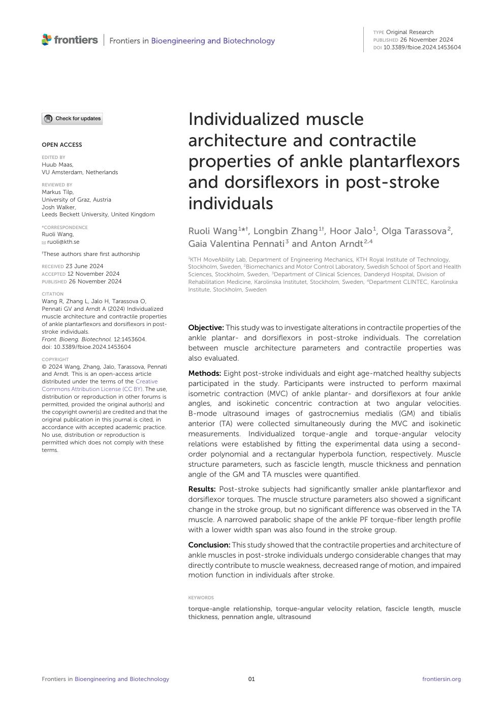

English text extracted from page 1

<pre>
TYPE Original Research
                                                                                                                      PUBLISHED 26 November 2024
                                                                                                                      DOI 10.3389/fbioe.2024.1453604

                                                    Individualized muscle
OPEN ACCESS                                         architecture and contractile
EDITED BY
Huub Maas,
VU Amsterdam, Netherlands
                                                    properties of ankle plantarflexors
REVIEWED BY
Markus Tilp,
                                                    and dorsiflexors in post-stroke
University of Graz, Austria
Josh Walker,
Leeds Beckett University, United Kingdom
                                                    individuals
*CORRESPONDENCE
Ruoli Wang,                                         Ruoli Wang 1*†, Longbin Zhang 1†, Hoor Jalo 1, Olga Tarassova 2,
  ruoli@kth.se
                                                    Gaia Valentina Pennati 3 and Anton Arndt 2,4
These authors share first authorship
†
                                                    1
                                                      KTH MoveAbility Lab, Department of Engineering Mechanics, KTH Royal Institute of Technology,
RECEIVED 23 June 2024                               Stockholm, Sweden, 2Biomechanics and Motor Control Laboratory, Swedish School of Sport and Health
ACCEPTED 12 November 2024                           Sciences, Stockholm, Sweden, 3Department of Clinical Sciences, Danderyd Hospital, Division of
PUBLISHED 26 November 2024                          Rehabilitation Medicine, Karolinska Institutet, Stockholm, Sweden, 4Department CLINTEC, Karolinska
                                                    Institute, Stockholm, Sweden
CITATION
Wang R, Zhang L, Jalo H, Tarassova O,
Pennati GV and Arndt A (2024) Individualized
muscle architecture and contractile properties
of ankle plantarflexors and dorsiflexors in post-
stroke individuals.
                                                    Objective: This study was to investigate alterations in contractile properties of the
Front. Bioeng. Biotechnol. 12:1453604.              ankle plantar- and dorsiflexors in post-stroke individuals. The correlation
doi: 10.3389/fbioe.2024.1453604                     between muscle architecture parameters and contractile properties was
COPYRIGHT                                           also evaluated.
© 2024 Wang, Zhang, Jalo, Tarassova, Pennati
and Arndt. This is an open-access article           Methods: Eight post-stroke individuals and eight age-matched healthy subjects
distributed under the terms of the Creative         participated in the study. Participants were instructed to perform maximal
Commons Attribution License (CC BY). The use,
distribution or reproduction in other forums is     isometric contraction (MVC) of ankle plantar- and dorsiflexors at four ankle
permitted, provided the original author(s) and      angles, and isokinetic concentric contraction at two angular velocities.
the copyright owner(s) are credited and that the    B-mode ultrasound images of gastrocnemius medialis (GM) and tibialis
original publication in this journal is cited, in
accordance with accepted academic practice.         anterior (TA) were collected simultaneously during the MVC and isokinetic
No use, distribution or reproduction is             measurements. Individualized torque-angle and torque-angular velocity
permitted which does not comply with these          relations were established by fitting the experimental data using a second-
terms.
                                                    order polynomial and a rectangular hyperbola function, respectively. Muscle
                                                    structure parameters, such as fascicle length, muscle thickness and pennation
                                                    angle of the GM and TA muscles were quantified.

                                                    Results: Post-stroke subjects had significantly smaller ankle plantarflexor and
                                                    dorsiflexor torques. The muscle structure parameters also showed a significant
                                                    change in the stroke group, but no significant difference was observed in the TA
                                                    muscle. A narrowed parabolic shape of the ankle PF torque-fiber length profile
                                                    with a lower width span was also found in the stroke group.

                                                    Conclusion: This study showed that the contractile properties and architecture of
                                                    ankle muscles in post-stroke individuals undergo considerable changes that may
                                                    directly contribute to muscle weakness, decreased range of motion, and impaired
                                                    motion function in individuals after stroke.

                                                    KEYWORDS

                                                    torque-angle relationship, torque-angular velocity relation, fascicle length, muscle
                                                    thickness, pennation angle, ultrasound

Frontiers in Bioengineering and Biotechnology                            01                                                             frontiersin.org
</pre>

## Page 2

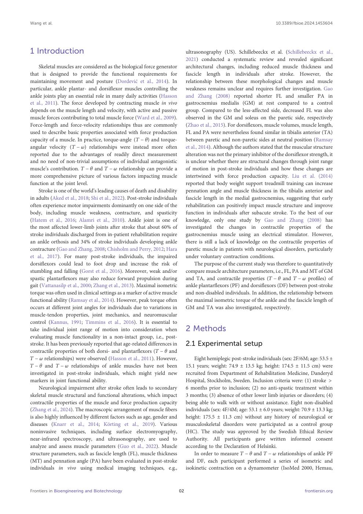

English text extracted from page 2

<pre>
Wang et al.                                                                                                                10.3389/fbioe.2024.1453604

1 Introduction                                                                  ultrasonography (US). Schillebeeckx et al. (Schillebeeckx et al.,
                                                                                2021) conducted a systematic review and revealed significant
     Skeletal muscles are considered as the biological force generator          architectural changes, including reduced muscle thickness and
that is designed to provide the functional requirements for                     fascicle length in individuals after stroke. However, the
maintaining movement and posture (Dordević et al., 2014). In                    relationship between these morphological changes and muscle
particular, ankle plantar- and dorsiflexor muscles controlling the               weakness remains unclear and requires further investigation. Gao
ankle joints play an essential role in many daily activities (Hasson            and Zhang (2008) reported shorter FL and smaller PA in
et al., 2011). The force developed by contracting muscle in vivo                gastrocnemius medialis (GM) at rest compared to a control
depends on the muscle length and velocity, with active and passive              group. Compared to the less-affected side, decreased FL was also
muscle forces contributing to total muscle force (Ward et al., 2009).           observed in the GM and soleus on the paretic side, respectively
Force-length and force-velocity relationships thus are commonly                 (Zhao et al., 2015). For dorsiflexors, muscle volumes, muscle length,
used to describe basic properties associated with force production              FL and PA were nevertheless found similar in tibialis anterior (TA)
capacity of a muscle. In practice, torque-angle (T − θ) and torque-             between paretic and non-paretic sides at neutral position (Ramsay
angular velocity (T − ω) relationships were instead more often                  et al., 2014). Although the authors stated that the muscular structure
reported due to the advantages of readily direct measurement                    alteration was not the primary inhibitor of the dorsiflexor strength, it
and no need of non-trivial assumptions of individual antagonistic               is unclear whether there are structural changes through joint range
muscle’s contribution. T − θ and T − ω relationship can provide a               of motion in post-stroke individuals and how these changes are
more comprehensive picture of various factors impacting muscle                  intertwined with force production capacity. Liu et al. (2014)
function at the joint level.                                                    reported that body weight support treadmill training can increase
     Stroke is one of the world’s leading causes of death and disability        pennation angle and muscle thickness in the tibialis anterior and
in adults (Aked et al., 2018; Shi et al., 2022). Post-stroke individuals        fascicle length in the medial gastrocnemius, suggesting that early
often experience motor impairments dominantly on one side of the                rehabilitation can positively impact muscle structure and improve
body, including muscle weakness, contracture, and spasticity                    function in individuals after subacute stroke. To the best of our
(Hatem et al., 2016; Alamri et al., 2010). Ankle joint is one of                knowledge, only one study by Gao and Zhang (2008) has
the most affected lower-limb joints after stroke that about 60% of              investigated the changes in contractile properties of the
stroke individuals discharged from in-patient rehabilitation require            gastrocnemius muscle using an electrical stimulator. However,
an ankle orthosis and 34% of stroke individuals developing ankle                there is still a lack of knowledge on the contractile properties of
contracture (Gao and Zhang, 2008; Chisholm and Perry, 2012; Hara                paretic muscle in patients with neurological disorders, particularly
et al., 2017). For many post-stroke individuals, the impaired                   under voluntary contraction conditions.
dorsiflexors could lead to foot drop and increase the risk of                         The purpose of the current study was therefore to quantitatively
stumbling and falling (Gorst et al., 2016). Moreover, weak and/or               compare muscle architecture parameters, i.e., FL, PA and MT of GM
spastic plantarflexors may also reduce forward propulsion during                 and TA, and contractile properties (T − θ and T − ω profiles) of
gait (Vattanasilp et al., 2000; Zhang et al., 2013). Maximal isometric          ankle plantarflexors (PF) and dorsiflexors (DF) between post-stroke
torque was often used in clinical settings as a marker of active muscle         and non-disabled individuals. In addition, the relationship between
functional ability (Ramsay et al., 2014). However, peak torque often            the maximal isometric torque of the ankle and the fascicle length of
occurs at different joint angles for individuals due to variations in           GM and TA was also investigated, respectively.
muscle-tendon properties, joint mechanics, and neuromuscular
control (Kannus, 1991; Timmins et al., 2016). It is essential to
take individual joint range of motion into consideration when                   2 Methods
evaluating muscle functionality in a non-intact group, i.e., post-
stroke. It has been previously reported that age-related differences in         2.1 Experimental setup
contractile properties of both dorsi- and plantarflexors (T − θ and
T − ω relationships) were observed (Hasson et al., 2011). However,                  Eight hemiplegic post-stroke individuals (sex: 2F/6M; age: 53.5 ±
T − θ and T − ω relationships of ankle muscles have not been                    15.1 years; weight: 74.9 ± 13.5 kg; height: 174.5 ± 11.5 cm) were
investigated in post-stroke individuals, which might yield new                  recruited from Department of Rehabilitation Medicine, Danderyd
markers in joint functional ability.                                            Hospital, Stockholm, Sweden. Inclusion criteria were: (1) stroke &gt;
     Neurological impairment after stroke often leads to secondary              6 months prior to inclusion; (2) no anti-spastic treatment within
skeletal muscle structural and functional alterations, which impact             3 months; (3) absence of other lower limb injuries or disorders; (4)
contractile properties of the muscle and force production capacity              being able to walk with or without assistance. Eight non-disabled
(Zhang et al., 2024). The macroscopic arrangement of muscle fibers               individuals (sex: 4F/4M; age: 53.1 ± 6.0 years; weight: 70.9 ± 13.3 kg;
is also highly influenced by different factors such as age, gender and           height: 175.5 ± 11.3 cm) without any history of neurological or
diseases (Knarr et al., 2014; Körting et al., 2019). Various                    musculoskeletal disorders were participated as a control group
noninvasive techniques, including surface electromyography,                     (HC). The study was approved by the Swedish Ethical Review
near-infrared spectroscopy, and ultrasonography, are used to                    Authority. All participants gave written informed consent
analyze and assess muscle parameters (Guo et al., 2022). Muscle                 according to the Declaration of Helsinki.
structure parameters, such as fascicle length (FL), muscle thickness                In order to measure T − θ and T − ω relationships of ankle PF
(MT) and pennation angle (PA) have been evaluated in post-stroke                and DF, each participant performed a series of isometric and
individuals in vivo using medical imaging techniques, e.g.,                     isokinetic contraction on a dynamometer (IsoMed 2000, Hemau,

Frontiers in Bioengineering and Biotechnology                              02                                                            frontiersin.org
</pre>

## Page 3

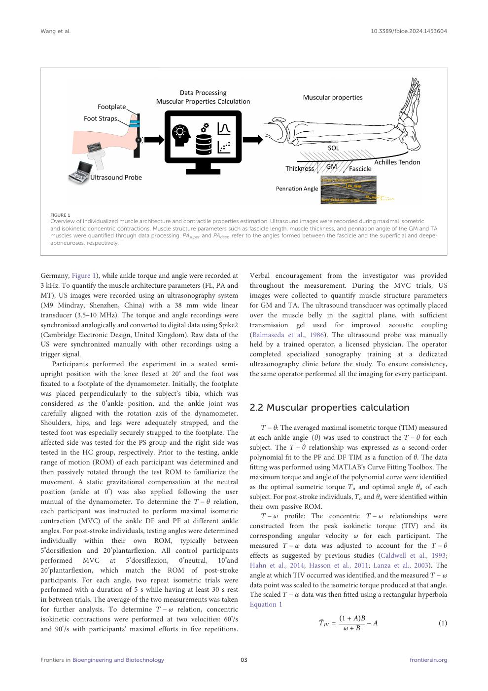

English text extracted from page 3

<pre>
Wang et al.                                                                                                                 10.3389/fbioe.2024.1453604

   FIGURE 1
   Overview of individualized muscle architecture and contractile properties estimation. Ultrasound images were recorded during maximal isometric
   and isokinetic concentric contractions. Muscle structure parameters such as fascicle length, muscle thickness, and pennation angle of the GM and TA
   muscles were quantified through data processing. PAsuper and PAdeep refer to the angles formed between the fascicle and the superficial and deeper
   aponeuroses, respectively.

Germany, Figure 1), while ankle torque and angle were recorded at               Verbal encouragement from the investigator was provided
3 kHz. To quantify the muscle architecture parameters (FL, PA and               throughout the measurement. During the MVC trials, US
MT), US images were recorded using an ultrasonography system                    images were collected to quantify muscle structure parameters
(M9 Mindray, Shenzhen, China) with a 38 mm wide linear                          for GM and TA. The ultrasound transducer was optimally placed
transducer (3.5–10 MHz). The torque and angle recordings were                   over the muscle belly in the sagittal plane, with sufficient
synchronized analogically and converted to digital data using Spike2            transmission gel used for improved acoustic coupling
(Cambridge Electronic Design, United Kingdom). Raw data of the                  (Balmaseda et al., 1986). The ultrasound probe was manually
US were synchronized manually with other recordings using a                     held by a trained operator, a licensed physician. The operator
trigger signal.                                                                 completed specialized sonography training at a dedicated
    Participants performed the experiment in a seated semi-                     ultrasonography clinic before the study. To ensure consistency,
upright position with the knee flexed at 20° and the foot was                    the same operator performed all the imaging for every participant.
fixated to a footplate of the dynamometer. Initially, the footplate
was placed perpendicularly to the subject’s tibia, which was
considered as the 0°ankle position, and the ankle joint was
carefully aligned with the rotation axis of the dynamometer.
                                                                                2.2 Muscular properties calculation
Shoulders, hips, and legs were adequately strapped, and the
                                                                                    T − θ: The averaged maximal isometric torque (TIM) measured
tested foot was especially securely strapped to the footplate. The
                                                                                at each ankle angle (θ) was used to construct the T − θ for each
affected side was tested for the PS group and the right side was
                                                                                subject. The T − θ relationship was expressed as a second-order
tested in the HC group, respectively. Prior to the testing, ankle
                                                                                polynomial fit to the PF and DF TIM as a function of θ. The data
range of motion (ROM) of each participant was determined and
                                                                                fitting was performed using MATLAB’s Curve Fitting Toolbox. The
then passively rotated through the test ROM to familiarize the
                                                                                maximum torque and angle of the polynomial curve were identified
movement. A static gravitational compensation at the neutral
                                                                                as the optimal isometric torque To and optimal angle θo of each
position (ankle at 0°) was also applied following the user
                                                                                subject. For post-stroke individuals, To and θo were identified within
manual of the dynamometer. To determine the T − θ relation,
                                                                                their own passive ROM.
each participant was instructed to perform maximal isometric
                                                                                    T − ω profile: The concentric T − ω relationships were
contraction (MVC) of the ankle DF and PF at different ankle
                                                                                constructed from the peak isokinetic torque (TIV) and its
angles. For post-stroke individuals, testing angles were determined
                                                                                corresponding angular velocity ω for each participant. The
individually within their own ROM, typically between
                                                                                measured T − ω data was adjusted to account for the T − θ
5°dorsiflexion and 20°plantarflexion. All control participants
                                                                                effects as suggested by previous studies (Caldwell et al., 1993;
performed MVC at 5°dorsiflexion, 0°neutral, 10°and
                                                                                Hahn et al., 2014; Hasson et al., 2011; Lanza et al., 2003). The
20°plantarflexion, which match the ROM of post-stroke
                                                                                angle at which TIV occurred was identified, and the measured T − ω
participants. For each angle, two repeat isometric trials were
                                                                                data point was scaled to the isometric torque produced at that angle.
performed with a duration of 5 s while having at least 30 s rest
                                                                                The scaled T − ω data was then fitted using a rectangular hyperbola
in between trials. The average of the two measurements was taken
                                                                                Equation 1
for further analysis. To determine T − ω relation, concentric
isokinetic contractions were performed at two velocities: 60°/s                                          IV  (1 + A)B − A
                                                                                                         T                                               (1)
and 90°/s with participants’ maximal efforts in five repetitions.                                                ω+B

Frontiers in Bioengineering and Biotechnology                              03                                                              frontiersin.org
</pre>

## Page 4

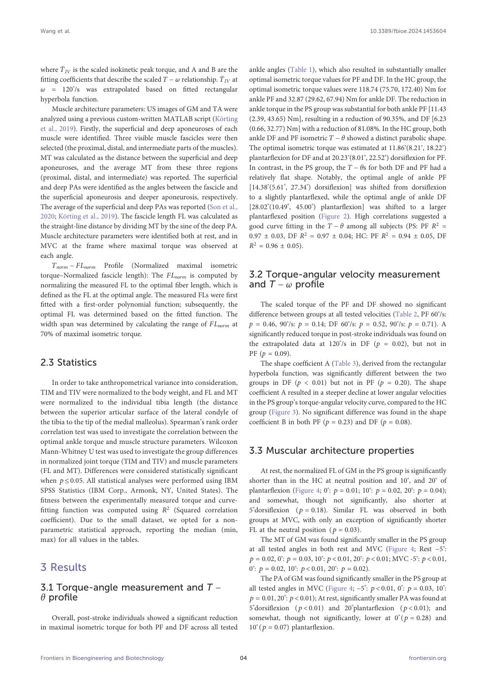

English text extracted from page 4

<pre>
Wang et al.                                                                                                                10.3389/fbioe.2024.1453604

where T  IV is the scaled isokinetic peak torque, and A and B are the         ankle angles (Table 1), which also resulted in substantially smaller
                                                                IV at
fitting coefficients that describe the scaled T − ω relationship. T              optimal isometric torque values for PF and DF. In the HC group, the
ω = 120 /s was extrapolated based on fitted rectangular
             °                                                                 optimal isometric torque values were 118.74 (75.70, 172.40) Nm for
hyperbola function.                                                            ankle PF and 32.87 (29.62, 67.94) Nm for ankle DF. The reduction in
    Muscle architecture parameters: US images of GM and TA were                ankle torque in the PS group was substantial for both ankle PF [11.43
analyzed using a previous custom-written MATLAB script (Körting                (2.39, 43.65) Nm], resulting in a reduction of 90.35%, and DF [6.23
et al., 2019). Firstly, the superficial and deep aponeuroses of each            (0.66, 32.77) Nm] with a reduction of 81.08%. In the HC group, both
muscle were identified. Three visible muscle fascicles were then                ankle DF and PF isometric T − θ showed a distinct parabolic shape.
selected (the proximal, distal, and intermediate parts of the muscles).        The optimal isometric torque was estimated at 11.86°(8.21°, 18.22°)
MT was calculated as the distance between the superficial and deep              plantarflexion for DF and at 20.23°(8.01°, 22.52°) dorsiflexion for PF.
aponeuroses, and the average MT from these three regions                       In contrast, in the PS group, the T − θs for both DF and PF had a
(proximal, distal, and intermediate) was reported. The superficial              relatively flat shape. Notably, the optimal angle of ankle PF
and deep PAs were identified as the angles between the fascicle and             [14.38°(5.61°, 27.34°) dorsiflexion] was shifted from dorsiflexion
the superficial aponeurosis and deeper aponeurosis, respectively.               to a slightly plantarflexed, while the optimal angle of ankle DF
The average of the superficial and deep PAs was reported (Son et al.,           [28.02°(10.49°, 45.00°) plantarflexion] was shifted to a larger
2020; Körting et al., 2019). The fascicle length FL was calculated as          plantarflexed position (Figure 2). High correlations suggested a
the straight-line distance by dividing MT by the sine of the deep PA.          good curve fitting in the T − θ among all subjects (PS: PF R2 =
Muscle architecture parameters were identified both at rest, and in             0.97 ± 0.03, DF R2 = 0.97 ± 0.04; HC: PF R2 = 0.94 ± 0.05, DF
MVC at the frame where maximal torque was observed at                          R2 = 0.96 ± 0.05).
each angle.
    Tnorm − FLnorm Profile (Normalized maximal isometric
torque–Normalized fascicle length): The FLnorm is computed by                  3.2 Torque-angular velocity measurement
normalizing the measured FL to the optimal fiber length, which is               and T − ω profile
defined as the FL at the optimal angle. The measured FLs were first
fitted with a first-order polynomial function; subsequently, the                     The scaled torque of the PF and DF showed no significant
optimal FL was determined based on the fitted function. The                     difference between groups at all tested velocities (Table 2, PF 60°/s:
width span was determined by calculating the range of FLnorm at                p = 0.46, 90°/s: p = 0.14; DF 60°/s: p = 0.52, 90°/s: p = 0.71). A
70% of maximal isometric torque.                                               significantly reduced torque in post-stroke individuals was found on
                                                                               the extrapolated data at 120°/s in DF (p = 0.02), but not in
                                                                               PF (p = 0.09).
2.3 Statistics                                                                     The shape coefficient A (Table 3), derived from the rectangular
                                                                               hyperbola function, was significantly different between the two
    In order to take anthropometrical variance into consideration,             groups in DF (p &lt; 0.01) but not in PF (p = 0.20). The shape
TIM and TIV were normalized to the body weight, and FL and MT                  coefficient A resulted in a steeper decline at lower angular velocities
were normalized to the individual tibia length (the distance                   in the PS group’s torque-angular velocity curve, compared to the HC
between the superior articular surface of the lateral condyle of               group (Figure 3). No significant difference was found in the shape
the tibia to the tip of the medial malleolus). Spearman’s rank order           coefficient B in both PF (p = 0.23) and DF (p = 0.08).
correlation test was used to investigate the correlation between the
optimal ankle torque and muscle structure parameters. Wilcoxon
Mann-Whitney U test was used to investigate the group differences              3.3 Muscular architecture properties
in normalized joint torque (TIM and TIV) and muscle parameters
(FL and MT). Differences were considered statistically significant                   At rest, the normalized FL of GM in the PS group is significantly
when p ≤ 0.05. All statistical analyses were performed using IBM               shorter than in the HC at neutral position and 10°, and 20° of
SPSS Statistics (IBM Corp., Armonk, NY, United States). The                    plantarflexion (Figure 4; 0°: p  0.01; 10°: p  0.02, 20°: p  0.04);
fitness between the experimentally measured torque and curve-                   and somewhat, though not significantly, also shorter at
fitting function was computed using R2 (Squared correlation                     5°dorsiflexion (p  0.18). Similar FL was observed in both
coefficient). Due to the small dataset, we opted for a non-                     groups at MVC, with only an exception of significantly shorter
parametric statistical approach, reporting the median (min,                    FL at the neutral position (p  0.03).
max) for all values in the tables.                                                  The MT of GM was found significantly smaller in the PS group
                                                                               at all tested angles in both rest and MVC (Figure 4; Rest −5°:
                                                                               p  0.02, 0°: p  0.03, 10°: p &lt; 0.01, 20°: p &lt; 0.01; MVC -5°: p &lt; 0.01,
3 Results                                                                      0°: p  0.02, 10°: p &lt; 0.01, 20°: p  0.02).
                                                                                    The PA of GM was found significantly smaller in the PS group at
3.1 Torque-angle measurement and T −                                           all tested angles in MVC (Figure 4; −5°: p &lt; 0.01, 0°: p  0.03, 10°:
θ profile                                                                       p  0.01, 20°: p &lt; 0.01); At rest, significantly smaller PA was found at
                                                                               5°dorsiflexion (p &lt; 0.01) and 20°plantarflexion (p &lt; 0.01); and
    Overall, post-stroke individuals showed a significant reduction             somewhat, though not significantly, lower at 0°(p  0.28) and
in maximal isometric torque for both PF and DF across all tested               10°(p  0.07) plantarflexion.

Frontiers in Bioengineering and Biotechnology                             04                                                             frontiersin.org
</pre>

## Page 5

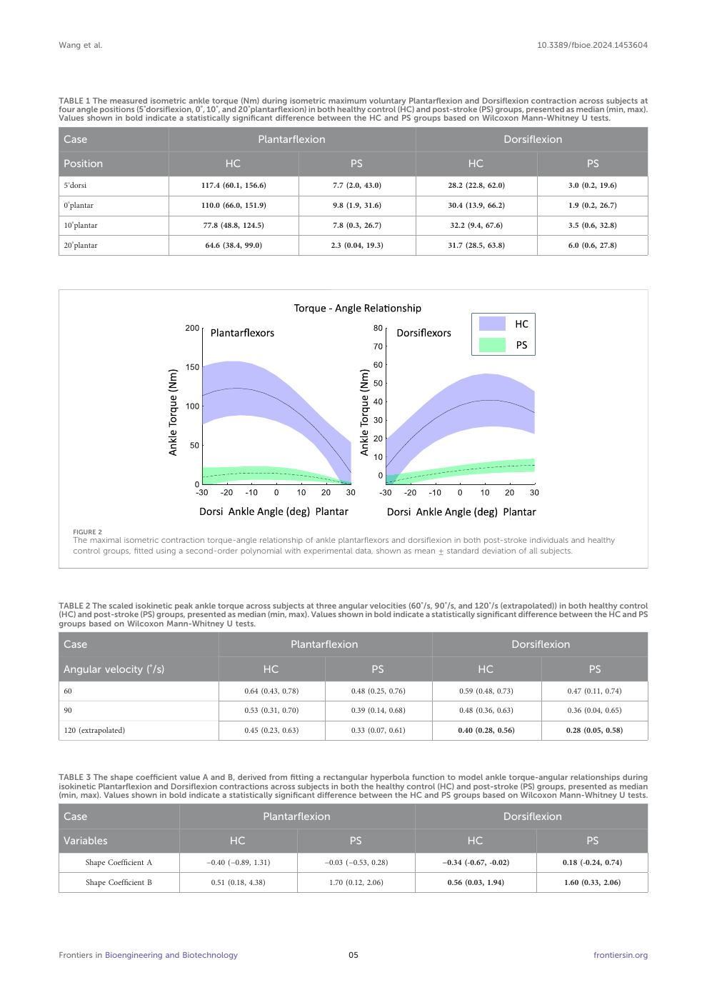

English text extracted from page 5

<pre>
Wang et al.                                                                                                                      10.3389/fbioe.2024.1453604

TABLE 1 The measured isometric ankle torque (Nm) during isometric maximum voluntary Plantarflexion and Dorsiflexion contraction across subjects at
four angle positions (5°dorsiflexion, 0°, 10°, and 20°plantarflexion) in both healthy control (HC) and post-stroke (PS) groups, presented as median (min, max).
Values shown in bold indicate a statistically significant difference between the HC and PS groups based on Wilcoxon Mann-Whitney U tests.

 Case                                                   Plantarflexion                                                      Dorsiflexion

 Position                                     HC                                 PS                           HC                                PS
 5°dorsi                               117.4 (60.1, 156.6)                  7.7 (2.0, 43.0)             28.2 (22.8, 62.0)                 3.0 (0.2, 19.6)

 0°plantar                             110.0 (66.0, 151.9)                  9.8 (1.9, 31.6)             30.4 (13.9, 66.2)                 1.9 (0.2, 26.7)

 10°plantar                             77.8 (48.8, 124.5)                  7.8 (0.3, 26.7)             32.2 (9.4, 67.6)                  3.5 (0.6, 32.8)

 20°plantar                             64.6 (38.4, 99.0)                   2.3 (0.04, 19.3)            31.7 (28.5, 63.8)                 6.0 (0.6, 27.8)

      FIGURE 2
      The maximal isometric contraction torque-angle relationship of ankle plantarflexors and dorsiflexion in both post-stroke individuals and healthy
      control groups, fitted using a second-order polynomial with experimental data, shown as mean ± standard deviation of all subjects.

TABLE 2 The scaled isokinetic peak ankle torque across subjects at three angular velocities (60°/s, 90°/s, and 120°/s (extrapolated)) in both healthy control
(HC) and post-stroke (PS) groups, presented as median (min, max). Values shown in bold indicate a statistically significant difference between the HC and PS
groups based on Wilcoxon Mann-Whitney U tests.

 Case                                                             Plantarflexion                                              Dorsiflexion

 Angular velocity (°/s)                                     HC                          PS                       HC                             PS
 60                                                 0.64 (0.43, 0.78)             0.48 (0.25, 0.76)        0.59 (0.48, 0.73)              0.47 (0.11, 0.74)

 90                                                 0.53 (0.31, 0.70)             0.39 (0.14, 0.68)        0.48 (0.36, 0.63)              0.36 (0.04, 0.65)

 120 (extrapolated)                                 0.45 (0.23, 0.63)             0.33 (0.07, 0.61)        0.40 (0.28, 0.56)              0.28 (0.05, 0.58)

TABLE 3 The shape coefficient value A and B, derived from fitting a rectangular hyperbola function to model ankle torque-angular relationships during
isokinetic Plantarflexion and Dorsiflexion contractions across subjects in both the healthy control (HC) and post-stroke (PS) groups, presented as median
(min, max). Values shown in bold indicate a statistically significant difference between the HC and PS groups based on Wilcoxon Mann-Whitney U tests.

 Case                                                       Plantarflexion                                                  Dorsiflexion

 Variables                                     HC                                PS                          HC                                 PS
         Shape Coefficient A             −0.40 (−0.89, 1.31)             −0.03 (−0.53, 0.28)           −0.34 (-0.67, -0.02)               0.18 (-0.24, 0.74)

         Shape Coefficient B               0.51 (0.18, 4.38)              1.70 (0.12, 2.06)              0.56 (0.03, 1.94)                1.60 (0.33, 2.06)

Frontiers in Bioengineering and Biotechnology                                    05                                                               frontiersin.org
</pre>

## Page 6

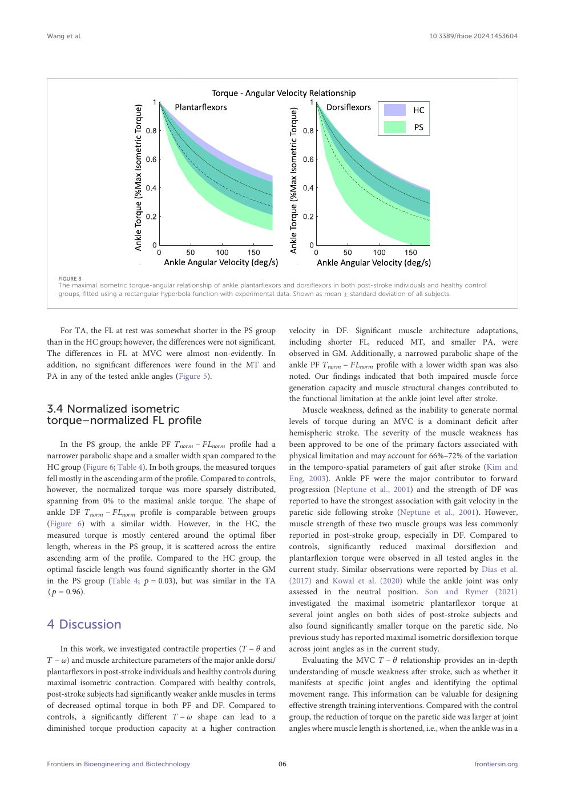

English text extracted from page 6

<pre>
Wang et al.                                                                                                                 10.3389/fbioe.2024.1453604

   FIGURE 3
   The maximal isometric torque-angular relationship of ankle plantarflexors and dorsiflexors in both post-stroke individuals and healthy control
   groups, fitted using a rectangular hyperbola function with experimental data. Shown as mean ± standard deviation of all subjects.

    For TA, the FL at rest was somewhat shorter in the PS group                velocity in DF. Significant muscle architecture adaptations,
than in the HC group; however, the differences were not significant.            including shorter FL, reduced MT, and smaller PA, were
The differences in FL at MVC were almost non-evidently. In                     observed in GM. Additionally, a narrowed parabolic shape of the
addition, no significant differences were found in the MT and                   ankle PF Tnorm − FLnorm profile with a lower width span was also
PA in any of the tested ankle angles (Figure 5).                               noted. Our findings indicated that both impaired muscle force
                                                                               generation capacity and muscle structural changes contributed to
                                                                               the functional limitation at the ankle joint level after stroke.
3.4 Normalized isometric                                                           Muscle weakness, defined as the inability to generate normal
torque–normalized FL profile                                                    levels of torque during an MVC is a dominant deficit after
                                                                               hemispheric stroke. The severity of the muscle weakness has
     In the PS group, the ankle PF Tnorm − FLnorm profile had a                 been approved to be one of the primary factors associated with
narrower parabolic shape and a smaller width span compared to the              physical limitation and may account for 66%–72% of the variation
HC group (Figure 6; Table 4). In both groups, the measured torques             in the temporo-spatial parameters of gait after stroke (Kim and
fell mostly in the ascending arm of the profile. Compared to controls,          Eng, 2003). Ankle PF were the major contributor to forward
however, the normalized torque was more sparsely distributed,                  progression (Neptune et al., 2001) and the strength of DF was
spanning from 0% to the maximal ankle torque. The shape of                     reported to have the strongest association with gait velocity in the
ankle DF Tnorm − FLnorm profile is comparable between groups                    paretic side following stroke (Neptune et al., 2001). However,
(Figure 6) with a similar width. However, in the HC, the                       muscle strength of these two muscle groups was less commonly
measured torque is mostly centered around the optimal fiber                     reported in post-stroke group, especially in DF. Compared to
length, whereas in the PS group, it is scattered across the entire             controls, significantly reduced maximal dorsiflexion and
ascending arm of the profile. Compared to the HC group, the                     plantarflexion torque were observed in all tested angles in the
optimal fascicle length was found significantly shorter in the GM               current study. Similar observations were reported by Dias et al.
in the PS group (Table 4; p  0.03), but was similar in the TA                 (2017) and Kowal et al. (2020) while the ankle joint was only
(p  0.96).                                                                    assessed in the neutral position. Son and Rymer (2021)
                                                                               investigated the maximal isometric plantarflexor torque at
                                                                               several joint angles on both sides of post-stroke subjects and
4 Discussion                                                                   also found significantly smaller torque on the paretic side. No
                                                                               previous study has reported maximal isometric dorsiflexion torque
    In this work, we investigated contractile properties (T − θ and            across joint angles as in the current study.
T − ω) and muscle architecture parameters of the major ankle dorsi/                Evaluating the MVC T − θ relationship provides an in-depth
plantarflexors in post-stroke individuals and healthy controls during           understanding of muscle weakness after stroke, such as whether it
maximal isometric contraction. Compared with healthy controls,                 manifests at specific joint angles and identifying the optimal
post-stroke subjects had significantly weaker ankle muscles in terms            movement range. This information can be valuable for designing
of decreased optimal torque in both PF and DF. Compared to                     effective strength training interventions. Compared with the control
controls, a significantly different T − ω shape can lead to a                   group, the reduction of torque on the paretic side was larger at joint
diminished torque production capacity at a higher contraction                  angles where muscle length is shortened, i.e., when the ankle was in a

Frontiers in Bioengineering and Biotechnology                             06                                                               frontiersin.org
</pre>

## Page 7

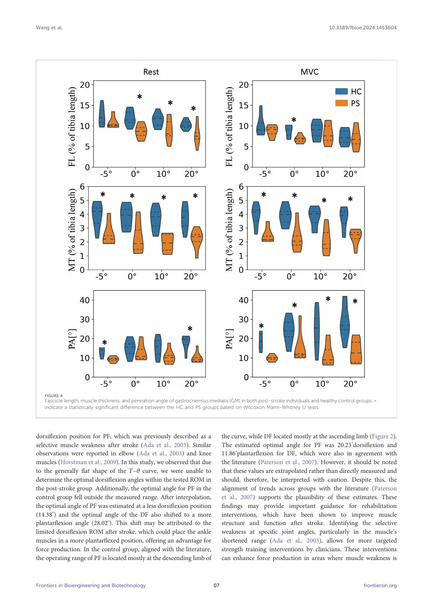

English text extracted from page 7

<pre>
Wang et al.                                                                                                                      10.3389/fbioe.2024.1453604

   FIGURE 4
   Fascicle length, muscle thickness, and pennation angle of gastrocnemius medialis (GM) in both post-stroke individuals and healthy control groups. p
   indicate a statistically significant difference between the HC and PS groups based on Wilcoxon Mann-Whitney U tests.

dorsiflexion position for PF, which was previously described as a                  the curve, while DF located mostly at the ascending limb (Figure 2).
selective muscle weakness after stroke (Ada et al., 2003). Similar                The estimated optimal angle for PF was 20.23°dorsiflexion and
observations were reported in elbow (Ada et al., 2003) and knee                   11.86°plantarflexion for DF, which were also in agreement with
muscles (Horstman et al., 2009). In this study, we observed that due              the literature (Paterson et al., 2007). However, it should be noted
to the generally flat shape of the T–θ curve, we were unable to                    that these values are extrapolated rather than directly measured and
determine the optimal dorsiflexion angles within the tested ROM in                 should, therefore, be interpreted with caution. Despite this, the
the post-stroke group. Additionally, the optimal angle for PF in the              alignment of trends across groups with the literature (Paterson
control group fell outside the measured range. After interpolation,               et al., 2007) supports the plausibility of these estimates. These
the optimal angle of PF was estimated at a less dorsiflexion position              findings may provide important guidance for rehabilitation
(14.38°) and the optimal angle of the DF also shifted to a more                   interventions, which have been shown to improve muscle
plantarflexion angle (28.02°). This shift may be attributed to the                 structure and function after stroke. Identifying the selective
limited dorsiflexion ROM after stroke, which could place the ankle                 weakness at specific joint angles, particularly in the muscle’s
muscles in a more plantarflexed position, offering an advantage for                shortened range (Ada et al., 2003), allows for more targeted
force production. In the control group, aligned with the literature,              strength training interventions by clinicians. These interventions
the operating range of PF is located mostly at the descending limb of             can enhance force production in areas where muscle weakness is

Frontiers in Bioengineering and Biotechnology                                07                                                                 frontiersin.org
</pre>

## Page 8

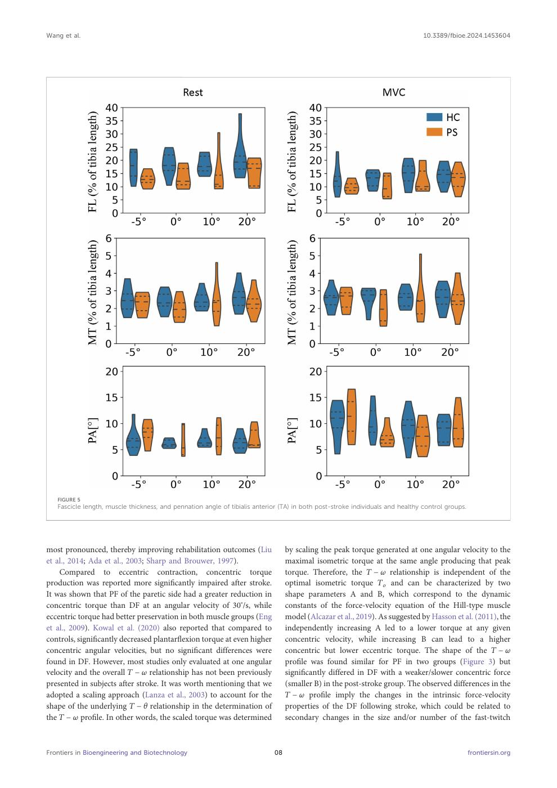

English text extracted from page 8

<pre>
Wang et al.                                                                                                                     10.3389/fbioe.2024.1453604

   FIGURE 5
   Fascicle length, muscle thickness, and pennation angle of tibialis anterior (TA) in both post-stroke individuals and healthy control groups.

most pronounced, thereby improving rehabilitation outcomes (Liu                   by scaling the peak torque generated at one angular velocity to the
et al., 2014; Ada et al., 2003; Sharp and Brouwer, 1997).                         maximal isometric torque at the same angle producing that peak
    Compared to eccentric contraction, concentric torque                          torque. Therefore, the T − ω relationship is independent of the
production was reported more significantly impaired after stroke.                  optimal isometric torque To and can be characterized by two
It was shown that PF of the paretic side had a greater reduction in               shape parameters A and B, which correspond to the dynamic
concentric torque than DF at an angular velocity of 30°/s, while                  constants of the force-velocity equation of the Hill-type muscle
eccentric torque had better preservation in both muscle groups (Eng               model (Alcazar et al., 2019). As suggested by Hasson et al. (2011), the
et al., 2009). Kowal et al. (2020) also reported that compared to                 independently increasing A led to a lower torque at any given
controls, significantly decreased plantarflexion torque at even higher              concentric velocity, while increasing B can lead to a higher
concentric angular velocities, but no significant differences were                 concentric but lower eccentric torque. The shape of the T − ω
found in DF. However, most studies only evaluated at one angular                  profile was found similar for PF in two groups (Figure 3) but
velocity and the overall T − ω relationship has not been previously               significantly differed in DF with a weaker/slower concentric force
presented in subjects after stroke. It was worth mentioning that we               (smaller B) in the post-stroke group. The observed differences in the
adopted a scaling approach (Lanza et al., 2003) to account for the                T − ω profile imply the changes in the intrinsic force-velocity
shape of the underlying T − θ relationship in the determination of                properties of the DF following stroke, which could be related to
the T − ω profile. In other words, the scaled torque was determined                secondary changes in the size and/or number of the fast-twitch

Frontiers in Bioengineering and Biotechnology                                08                                                                   frontiersin.org
</pre>

## Page 9

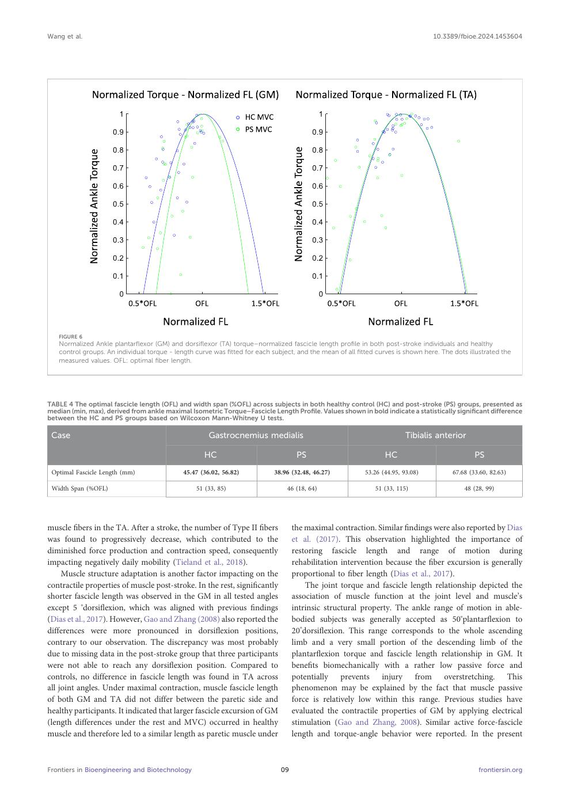

English text extracted from page 9

<pre>
Wang et al.                                                                                                                     10.3389/fbioe.2024.1453604

   FIGURE 6
   Normalized Ankle plantarflexor (GM) and dorsiflexor (TA) torque–normalized fascicle length profile in both post-stroke individuals and healthy
   control groups. An individual torque - length curve was fitted for each subject, and the mean of all fitted curves is shown here. The dots illustrated the
   measured values. OFL: optimal fiber length.

TABLE 4 The optimal fascicle length (OFL) and width span (%OFL) across subjects in both healthy control (HC) and post-stroke (PS) groups, presented as
median (min, max), derived from ankle maximal Isometric Torque–Fascicle Length Profile. Values shown in bold indicate a statistically significant difference
between the HC and PS groups based on Wilcoxon Mann-Whitney U tests.

 Case                                                Gastrocnemius medialis                                             Tibialis anterior

                                                   HC                              PS                           HC                             PS
 Optimal Fascicle Length (mm)               45.47 (36.02, 56.82)           38.96 (32.48, 46.27)          53.26 (44.95, 93.08)          67.68 (33.60, 82.63)

 Width Span (%OFL)                               51 (33, 85)                   46 (18, 64)                   51 (33, 115)                  48 (28, 99)

muscle fibers in the TA. After a stroke, the number of Type II fibers               the maximal contraction. Similar findings were also reported by Dias
was found to progressively decrease, which contributed to the                     et al. (2017). This observation highlighted the importance of
diminished force production and contraction speed, consequently                   restoring fascicle length and range of motion during
impacting negatively daily mobility (Tieland et al., 2018).                       rehabilitation intervention because the fiber excursion is generally
     Muscle structure adaptation is another factor impacting on the               proportional to fiber length (Dias et al., 2017).
contractile properties of muscle post-stroke. In the rest, significantly               The joint torque and fascicle length relationship depicted the
shorter fascicle length was observed in the GM in all tested angles               association of muscle function at the joint level and muscle’s
except 5 °dorsiflexion, which was aligned with previous findings                    intrinsic structural property. The ankle range of motion in able-
(Dias et al., 2017). However, Gao and Zhang (2008) also reported the              bodied subjects was generally accepted as 50°plantarflexion to
differences were more pronounced in dorsiflexion positions,                        20°dorsiflexion. This range corresponds to the whole ascending
contrary to our observation. The discrepancy was most probably                    limb and a very small portion of the descending limb of the
due to missing data in the post-stroke group that three participants              plantarflexion torque and fascicle length relationship in GM. It
were not able to reach any dorsiflexion position. Compared to                      benefits biomechanically with a rather low passive force and
controls, no difference in fascicle length was found in TA across                 potentially prevents injury from overstretching. This
all joint angles. Under maximal contraction, muscle fascicle length               phenomenon may be explained by the fact that muscle passive
of both GM and TA did not differ between the paretic side and                     force is relatively low within this range. Previous studies have
healthy participants. It indicated that larger fascicle excursion of GM           evaluated the contractile properties of GM by applying electrical
(length differences under the rest and MVC) occurred in healthy                   stimulation (Gao and Zhang, 2008). Similar active force-fascicle
muscle and therefore led to a similar length as paretic muscle under              length and torque-angle behavior were reported. In the present

Frontiers in Bioengineering and Biotechnology                                09                                                                 frontiersin.org
</pre>

## Page 10

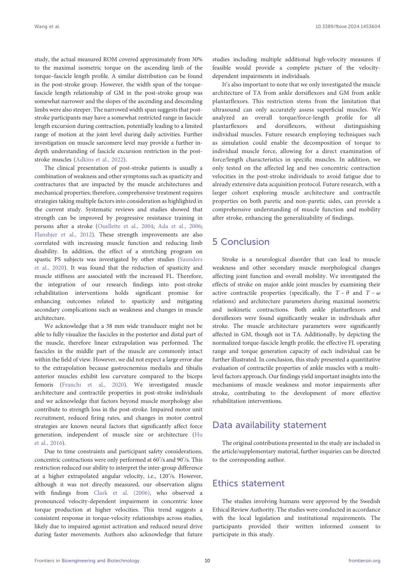

English text extracted from page 10

<pre>
Wang et al.                                                                                                                 10.3389/fbioe.2024.1453604

study, the actual measured ROM covered approximately from 30%                    studies including multiple additional high-velocity measures if
to the maximal isometric torque on the ascending limb of the                     feasible would provide a complete picture of the velocity-
torque–fascicle length profile. A similar distribution can be found               dependent impairments in individuals.
in the post-stroke group. However, the width span of the torque-                     It’s also important to note that we only investigated the muscle
fascicle length relationship of GM in the post-stroke group was                  architecture of TA from ankle dorsiflexors and GM from ankle
somewhat narrower and the slopes of the ascending and descending                 plantarflexors. This restriction stems from the limitation that
limbs were also steeper. The narrowed width span suggests that post-             ultrasound can only accurately assess superficial muscles. We
stroke participants may have a somewhat restricted range in fascicle             analyzed an overall torque/force-length profile for all
length excursion during contraction, potentially leading to a limited            plantarflexors and dorsiflexors, without distinguishing
range of motion at the joint level during daily activities. Further              individual muscles. Future research employing techniques such
investigation on muscle sarcomere level may provide a further in-                as simulation could enable the decomposition of torque to
depth understanding of fascicle excursion restriction in the post-               individual muscle force, allowing for a direct examination of
stroke muscles (Adkins et al., 2022).                                            force/length characteristics in specific muscles. In addition, we
     The clinical presentation of post-stroke patients is usually a              only tested on the affected leg and two concentric contraction
combination of weakness and other symptoms such as spasticity and                velocities in the post-stroke individuals to avoid fatigue due to
contractures that are impacted by the muscle architectures and                   already extensive data acquisition protocol. Future research, with a
mechanical properties; therefore, comprehensive treatment requires               larger cohort exploring muscle architecture and contractile
strategies taking multiple factors into consideration as highlighted in          properties on both paretic and non-paretic sides, can provide a
the current study. Systematic reviews and studies showed that                    comprehensive understanding of muscle function and mobility
strength can be improved by progressive resistance training in                   after stroke, enhancing the generalizability of findings.
persons after a stroke (Ouellette et al., 2004; Ada et al., 2006;
Flansbjer et al., 2012). These strength improvements are also
correlated with increasing muscle function and reducing limb                     5 Conclusion
disability. In addition, the effect of a stretching program on
spastic PS subjects was investigated by other studies (Saunders                      Stroke is a neurological disorder that can lead to muscle
et al., 2020). It was found that the reduction of spasticity and                 weakness and other secondary muscle morphological changes
muscle stiffness are associated with the increased FL. Therefore,                affecting joint function and overall mobility. We investigated the
the integration of our research findings into post-stroke                         effects of stroke on major ankle joint muscles by examining their
rehabilitation interventions holds significant promise for                        active contractile properties (specifically, the T − θ and T − ω
enhancing outcomes related to spasticity and mitigating                          relations) and architecture parameters during maximal isometric
secondary complications such as weakness and changes in muscle                   and isokinetic contractions. Both ankle plantarflexors and
architecture.                                                                    dorsiflexors were found significantly weaker in individuals after
     We acknowledge that a 38 mm wide transducer might not be                    stroke. The muscle architecture parameters were significantly
able to fully visualize the fascicles in the posterior and distal part of        affected in GM, though not in TA. Additionally, by depicting the
the muscle, therefore linear extrapolation was performed. The                    normalized torque-fascicle length profile, the effective FL operating
fascicles in the middle part of the muscle are commonly intact                   range and torque generation capacity of each individual can be
within the field of view. However, we did not expect a large error due            further illustrated. In conclusion, this study presented a quantitative
to the extrapolation because gastrocnemius medialis and tibialis                 evaluation of contractile properties of ankle muscles with a multi-
anterior muscles exhibit less curvature compared to the biceps                   level factors approach. Our findings yield important insights into the
femoris (Franchi et al., 2020). We investigated muscle                           mechanisms of muscle weakness and motor impairments after
architecture and contractile properties in post-stroke individuals               stroke, contributing to the development of more effective
and we acknowledge that factors beyond muscle morphology also                    rehabilitation interventions.
contribute to strength loss in the post-stroke. Impaired motor unit
recruitment, reduced firing rates, and changes in motor control
strategies are known neural factors that significantly affect force               Data availability statement
generation, independent of muscle size or architecture (Hu
et al., 2016).                                                                       The original contributions presented in the study are included in
     Due to time constraints and participant safety considerations,              the article/supplementary material, further inquiries can be directed
concentric contractions were only performed at 60°/s and 90°/s. This             to the corresponding author.
restriction reduced our ability to interpret the inter-group difference
at a higher extrapolated angular velocity, i.e., 120°/s. However,
although it was not directly measured, our observation aligns                    Ethics statement
with findings from Clark et al. (2006), who observed a
pronounced velocity-dependent impairment in concentric knee                          The studies involving humans were approved by the Swedish
torque production at higher velocities. This trend suggests a                    Ethical Review Authority. The studies were conducted in accordance
consistent response in torque-velocity relationships across studies,             with the local legislation and institutional requirements. The
likely due to impaired agonist activation and reduced neural drive               participants provided their written informed consent to
during faster movements. Authors also acknowledge that future                    participate in this study.

Frontiers in Bioengineering and Biotechnology                               10                                                            frontiersin.org
</pre>

## Page 11

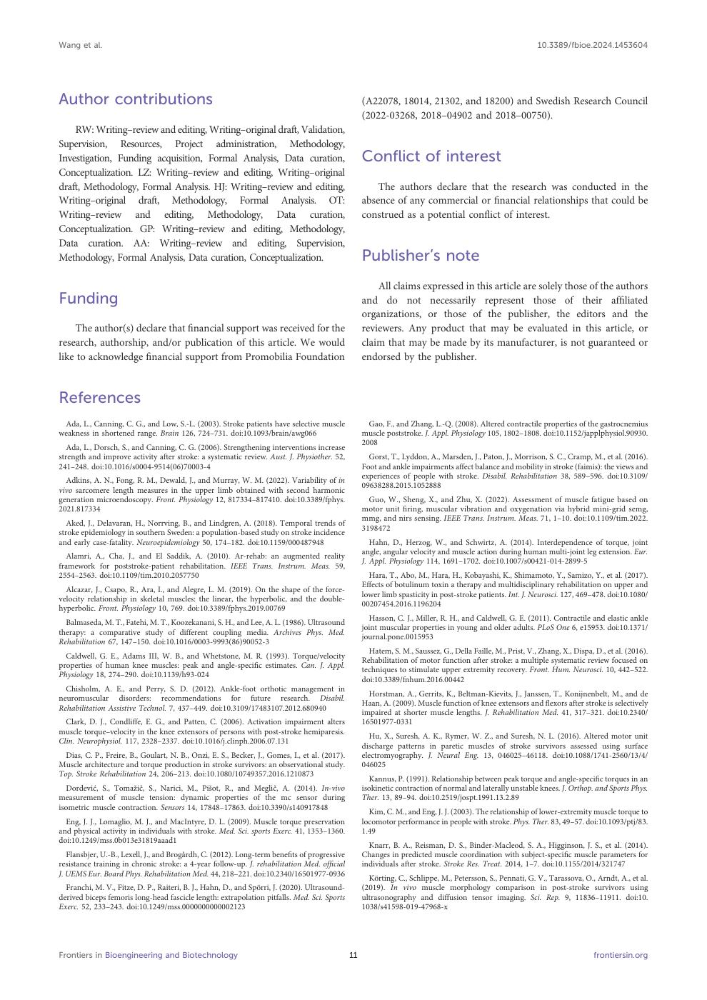

English text extracted from page 11

<pre>
Wang et al.                                                                                                                                                   10.3389/fbioe.2024.1453604

Author contributions                                                                                 (A22078, 18014, 21302, and 18200) and Swedish Research Council
                                                                                                     (2022-03268, 2018–04902 and 2018–00750).
    RW: Writing–review and editing, Writing–original draft, Validation,
Supervision, Resources, Project administration, Methodology,
Investigation, Funding acquisition, Formal Analysis, Data curation,                                  Conflict of interest
Conceptualization. LZ: Writing–review and editing, Writing–original
draft, Methodology, Formal Analysis. HJ: Writing–review and editing,                                     The authors declare that the research was conducted in the
Writing–original draft, Methodology, Formal Analysis. OT:                                            absence of any commercial or financial relationships that could be
Writing–review and editing, Methodology, Data curation,                                              construed as a potential conflict of interest.
Conceptualization. GP: Writing–review and editing, Methodology,
Data curation. AA: Writing–review and editing, Supervision,
Methodology, Formal Analysis, Data curation, Conceptualization.                                      Publisher’s note
                                                                                                         All claims expressed in this article are solely those of the authors
Funding                                                                                              and do not necessarily represent those of their affiliated
                                                                                                     organizations, or those of the publisher, the editors and the
     The author(s) declare that financial support was received for the                                reviewers. Any product that may be evaluated in this article, or
research, authorship, and/or publication of this article. We would                                   claim that may be made by its manufacturer, is not guaranteed or
like to acknowledge financial support from Promobilia Foundation                                      endorsed by the publisher.

References
 Ada, L., Canning, C. G., and Low, S.-L. (2003). Stroke patients have selective muscle                 Gao, F., and Zhang, L.-Q. (2008). Altered contractile properties of the gastrocnemius
weakness in shortened range. Brain 126, 724–731. doi:10.1093/brain/awg066                            muscle poststroke. J. Appl. Physiology 105, 1802–1808. doi:10.1152/japplphysiol.90930.
                                                                                                     2008
   Ada, L., Dorsch, S., and Canning, C. G. (2006). Strengthening interventions increase
strength and improve activity after stroke: a systematic review. Aust. J. Physiother. 52,              Gorst, T., Lyddon, A., Marsden, J., Paton, J., Morrison, S. C., Cramp, M., et al. (2016).
241–248. doi:10.1016/s0004-9514(06)70003-4                                                           Foot and ankle impairments affect balance and mobility in stroke (faimis): the views and
                                                                                                     experiences of people with stroke. Disabil. Rehabilitation 38, 589–596. doi:10.3109/
  Adkins, A. N., Fong, R. M., Dewald, J., and Murray, W. M. (2022). Variability of in
                                                                                                     09638288.2015.1052888
vivo sarcomere length measures in the upper limb obtained with second harmonic
generation microendoscopy. Front. Physiology 12, 817334–817410. doi:10.3389/fphys.                     Guo, W., Sheng, X., and Zhu, X. (2022). Assessment of muscle fatigue based on
2021.817334                                                                                          motor unit firing, muscular vibration and oxygenation via hybrid mini-grid semg,
                                                                                                     mmg, and nirs sensing. IEEE Trans. Instrum. Meas. 71, 1–10. doi:10.1109/tim.2022.
   Aked, J., Delavaran, H., Norrving, B., and Lindgren, A. (2018). Temporal trends of
                                                                                                     3198472
stroke epidemiology in southern Sweden: a population-based study on stroke incidence
and early case-fatality. Neuroepidemiology 50, 174–182. doi:10.1159/000487948                           Hahn, D., Herzog, W., and Schwirtz, A. (2014). Interdependence of torque, joint
                                                                                                     angle, angular velocity and muscle action during human multi-joint leg extension. Eur.
  Alamri, A., Cha, J., and El Saddik, A. (2010). Ar-rehab: an augmented reality
                                                                                                     J. Appl. Physiology 114, 1691–1702. doi:10.1007/s00421-014-2899-5
framework for poststroke-patient rehabilitation. IEEE Trans. Instrum. Meas. 59,
2554–2563. doi:10.1109/tim.2010.2057750                                                                Hara, T., Abo, M., Hara, H., Kobayashi, K., Shimamoto, Y., Samizo, Y., et al. (2017).
                                                                                                     Effects of botulinum toxin a therapy and multidisciplinary rehabilitation on upper and
  Alcazar, J., Csapo, R., Ara, I., and Alegre, L. M. (2019). On the shape of the force-
                                                                                                     lower limb spasticity in post-stroke patients. Int. J. Neurosci. 127, 469–478. doi:10.1080/
velocity relationship in skeletal muscles: the linear, the hyperbolic, and the double-
                                                                                                     00207454.2016.1196204
hyperbolic. Front. Physiology 10, 769. doi:10.3389/fphys.2019.00769
                                                                                                       Hasson, C. J., Miller, R. H., and Caldwell, G. E. (2011). Contractile and elastic ankle
  Balmaseda, M. T., Fatehi, M. T., Koozekanani, S. H., and Lee, A. L. (1986). Ultrasound
                                                                                                     joint muscular properties in young and older adults. PLoS One 6, e15953. doi:10.1371/
therapy: a comparative study of different coupling media. Archives Phys. Med.
                                                                                                     journal.pone.0015953
Rehabilitation 67, 147–150. doi:10.1016/0003-9993(86)90052-3
                                                                                                       Hatem, S. M., Saussez, G., Della Faille, M., Prist, V., Zhang, X., Dispa, D., et al. (2016).
  Caldwell, G. E., Adams III, W. B., and Whetstone, M. R. (1993). Torque/velocity
                                                                                                     Rehabilitation of motor function after stroke: a multiple systematic review focused on
properties of human knee muscles: peak and angle-specific estimates. Can. J. Appl.
                                                                                                     techniques to stimulate upper extremity recovery. Front. Hum. Neurosci. 10, 442–522.
Physiology 18, 274–290. doi:10.1139/h93-024
                                                                                                     doi:10.3389/fnhum.2016.00442
  Chisholm, A. E., and Perry, S. D. (2012). Ankle-foot orthotic management in
                                                                                                       Horstman, A., Gerrits, K., Beltman-Kievits, J., Janssen, T., Konijnenbelt, M., and de
neuromuscular disorders: recommendations for future research. Disabil.
                                                                                                     Haan, A. (2009). Muscle function of knee extensors and flexors after stroke is selectively
Rehabilitation Assistive Technol. 7, 437–449. doi:10.3109/17483107.2012.680940
                                                                                                     impaired at shorter muscle lengths. J. Rehabilitation Med. 41, 317–321. doi:10.2340/
  Clark, D. J., Condliffe, E. G., and Patten, C. (2006). Activation impairment alters                16501977-0331
muscle torque–velocity in the knee extensors of persons with post-stroke hemiparesis.
                                                                                                       Hu, X., Suresh, A. K., Rymer, W. Z., and Suresh, N. L. (2016). Altered motor unit
Clin. Neurophysiol. 117, 2328–2337. doi:10.1016/j.clinph.2006.07.131
                                                                                                     discharge patterns in paretic muscles of stroke survivors assessed using surface
  Dias, C. P., Freire, B., Goulart, N. B., Onzi, E. S., Becker, J., Gomes, I., et al. (2017).        electromyography. J. Neural Eng. 13, 046025–46118. doi:10.1088/1741-2560/13/4/
Muscle architecture and torque production in stroke survivors: an observational study.               046025
Top. Stroke Rehabilitation 24, 206–213. doi:10.1080/10749357.2016.1210873
                                                                                                       Kannus, P. (1991). Relationship between peak torque and angle-specific torques in an
  Dordević, S., Tomažič, S., Narici, M., Pišot, R., and Meglič, A. (2014). In-vivo                   isokinetic contraction of normal and laterally unstable knees. J. Orthop. and Sports Phys.
measurement of muscle tension: dynamic properties of the mc sensor during                            Ther. 13, 89–94. doi:10.2519/jospt.1991.13.2.89
isometric muscle contraction. Sensors 14, 17848–17863. doi:10.3390/s140917848
                                                                                                       Kim, C. M., and Eng, J. J. (2003). The relationship of lower-extremity muscle torque to
  Eng, J. J., Lomaglio, M. J., and MacIntyre, D. L. (2009). Muscle torque preservation               locomotor performance in people with stroke. Phys. Ther. 83, 49–57. doi:10.1093/ptj/83.
and physical activity in individuals with stroke. Med. Sci. sports Exerc. 41, 1353–1360.             1.49
doi:10.1249/mss.0b013e31819aaad1
                                                                                                       Knarr, B. A., Reisman, D. S., Binder-Macleod, S. A., Higginson, J. S., et al. (2014).
   Flansbjer, U.-B., Lexell, J., and Brogårdh, C. (2012). Long-term benefits of progressive           Changes in predicted muscle coordination with subject-specific muscle parameters for
resistance training in chronic stroke: a 4-year follow-up. J. rehabilitation Med. official            individuals after stroke. Stroke Res. Treat. 2014, 1–7. doi:10.1155/2014/321747
J. UEMS Eur. Board Phys. Rehabilitation Med. 44, 218–221. doi:10.2340/16501977-0936
                                                                                                       Körting, C., Schlippe, M., Petersson, S., Pennati, G. V., Tarassova, O., Arndt, A., et al.
  Franchi, M. V., Fitze, D. P., Raiteri, B. J., Hahn, D., and Spörri, J. (2020). Ultrasound-         (2019). In vivo muscle morphology comparison in post-stroke survivors using
derived biceps femoris long-head fascicle length: extrapolation pitfalls. Med. Sci. Sports           ultrasonography and diffusion tensor imaging. Sci. Rep. 9, 11836–11911. doi:10.
Exerc. 52, 233–243. doi:10.1249/mss.0000000000002123                                                 1038/s41598-019-47968-x

Frontiers in Bioengineering and Biotechnology                                                   11                                                                               frontiersin.org
</pre>

## Page 12

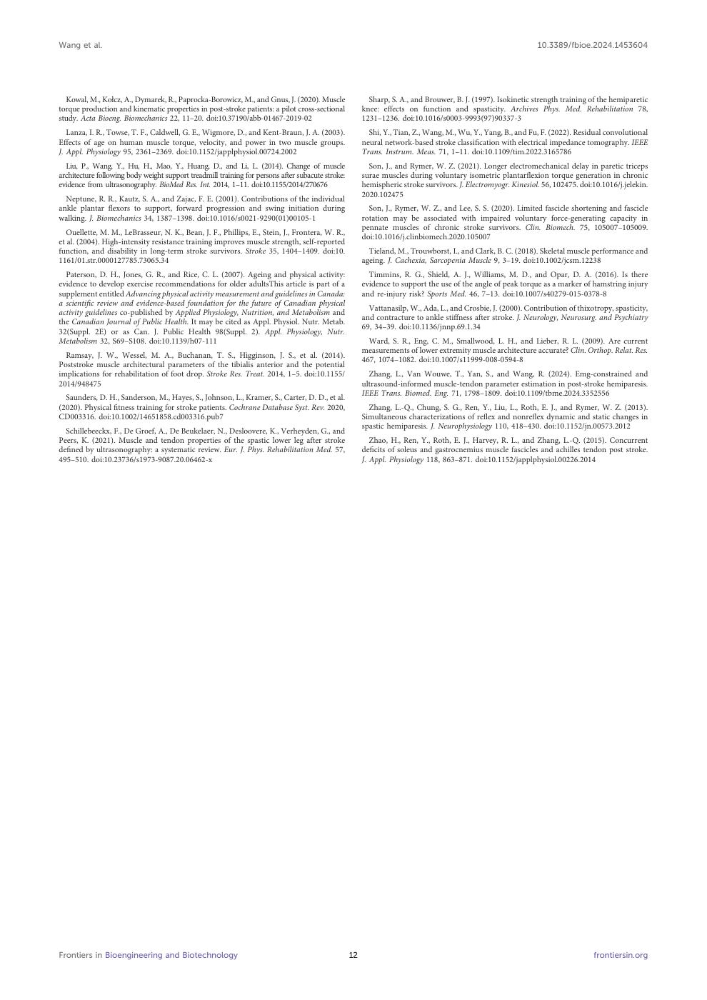

English text extracted from page 12

<pre>
Wang et al.                                                                                                                                                    10.3389/fbioe.2024.1453604

  Kowal, M., Kołcz, A., Dymarek, R., Paprocka-Borowicz, M., and Gnus, J. (2020). Muscle                   Sharp, S. A., and Brouwer, B. J. (1997). Isokinetic strength training of the hemiparetic
torque production and kinematic properties in post-stroke patients: a pilot cross-sectional             knee: effects on function and spasticity. Archives Phys. Med. Rehabilitation 78,
study. Acta Bioeng. Biomechanics 22, 11–20. doi:10.37190/abb-01467-2019-02                              1231–1236. doi:10.1016/s0003-9993(97)90337-3
   Lanza, I. R., Towse, T. F., Caldwell, G. E., Wigmore, D., and Kent-Braun, J. A. (2003).                Shi, Y., Tian, Z., Wang, M., Wu, Y., Yang, B., and Fu, F. (2022). Residual convolutional
Effects of age on human muscle torque, velocity, and power in two muscle groups.                        neural network-based stroke classification with electrical impedance tomography. IEEE
J. Appl. Physiology 95, 2361–2369. doi:10.1152/japplphysiol.00724.2002                                  Trans. Instrum. Meas. 71, 1–11. doi:10.1109/tim.2022.3165786
  Liu, P., Wang, Y., Hu, H., Mao, Y., Huang, D., and Li, L. (2014). Change of muscle                      Son, J., and Rymer, W. Z. (2021). Longer electromechanical delay in paretic triceps
architecture following body weight support treadmill training for persons after subacute stroke:        surae muscles during voluntary isometric plantarflexion torque generation in chronic
evidence from ultrasonography. BioMed Res. Int. 2014, 1–11. doi:10.1155/2014/270676                     hemispheric stroke survivors. J. Electromyogr. Kinesiol. 56, 102475. doi:10.1016/j.jelekin.
                                                                                                        2020.102475
  Neptune, R. R., Kautz, S. A., and Zajac, F. E. (2001). Contributions of the individual
ankle plantar flexors to support, forward progression and swing initiation during                          Son, J., Rymer, W. Z., and Lee, S. S. (2020). Limited fascicle shortening and fascicle
walking. J. Biomechanics 34, 1387–1398. doi:10.1016/s0021-9290(01)00105-1                               rotation may be associated with impaired voluntary force-generating capacity in
                                                                                                        pennate muscles of chronic stroke survivors. Clin. Biomech. 75, 105007–105009.
   Ouellette, M. M., LeBrasseur, N. K., Bean, J. F., Phillips, E., Stein, J., Frontera, W. R.,
                                                                                                        doi:10.1016/j.clinbiomech.2020.105007
et al. (2004). High-intensity resistance training improves muscle strength, self-reported
function, and disability in long-term stroke survivors. Stroke 35, 1404–1409. doi:10.                     Tieland, M., Trouwborst, I., and Clark, B. C. (2018). Skeletal muscle performance and
1161/01.str.0000127785.73065.34                                                                         ageing. J. Cachexia, Sarcopenia Muscle 9, 3–19. doi:10.1002/jcsm.12238
  Paterson, D. H., Jones, G. R., and Rice, C. L. (2007). Ageing and physical activity:                    Timmins, R. G., Shield, A. J., Williams, M. D., and Opar, D. A. (2016). Is there
evidence to develop exercise recommendations for older adultsThis article is part of a                  evidence to support the use of the angle of peak torque as a marker of hamstring injury
supplement entitled Advancing physical activity measurement and guidelines in Canada:                   and re-injury risk? Sports Med. 46, 7–13. doi:10.1007/s40279-015-0378-8
a scientific review and evidence-based foundation for the future of Canadian physical
                                                                                                          Vattanasilp, W., Ada, L., and Crosbie, J. (2000). Contribution of thixotropy, spasticity,
activity guidelines co-published by Applied Physiology, Nutrition, and Metabolism and
                                                                                                        and contracture to ankle stiffness after stroke. J. Neurology, Neurosurg. and Psychiatry
the Canadian Journal of Public Health. It may be cited as Appl. Physiol. Nutr. Metab.
                                                                                                        69, 34–39. doi:10.1136/jnnp.69.1.34
32(Suppl. 2E) or as Can. J. Public Health 98(Suppl. 2). Appl. Physiology, Nutr.
Metabolism 32, S69–S108. doi:10.1139/h07-111                                                              Ward, S. R., Eng, C. M., Smallwood, L. H., and Lieber, R. L. (2009). Are current
                                                                                                        measurements of lower extremity muscle architecture accurate? Clin. Orthop. Relat. Res.
  Ramsay, J. W., Wessel, M. A., Buchanan, T. S., Higginson, J. S., et al. (2014).
                                                                                                        467, 1074–1082. doi:10.1007/s11999-008-0594-8
Poststroke muscle architectural parameters of the tibialis anterior and the potential
implications for rehabilitation of foot drop. Stroke Res. Treat. 2014, 1–5. doi:10.1155/                  Zhang, L., Van Wouwe, T., Yan, S., and Wang, R. (2024). Emg-constrained and
2014/948475                                                                                             ultrasound-informed muscle-tendon parameter estimation in post-stroke hemiparesis.
                                                                                                        IEEE Trans. Biomed. Eng. 71, 1798–1809. doi:10.1109/tbme.2024.3352556
  Saunders, D. H., Sanderson, M., Hayes, S., Johnson, L., Kramer, S., Carter, D. D., et al.
(2020). Physical fitness training for stroke patients. Cochrane Database Syst. Rev. 2020,                  Zhang, L.-Q., Chung, S. G., Ren, Y., Liu, L., Roth, E. J., and Rymer, W. Z. (2013).
CD003316. doi:10.1002/14651858.cd003316.pub7                                                            Simultaneous characterizations of reflex and nonreflex dynamic and static changes in
                                                                                                        spastic hemiparesis. J. Neurophysiology 110, 418–430. doi:10.1152/jn.00573.2012
  Schillebeeckx, F., De Groef, A., De Beukelaer, N., Desloovere, K., Verheyden, G., and
Peers, K. (2021). Muscle and tendon properties of the spastic lower leg after stroke                       Zhao, H., Ren, Y., Roth, E. J., Harvey, R. L., and Zhang, L.-Q. (2015). Concurrent
defined by ultrasonography: a systematic review. Eur. J. Phys. Rehabilitation Med. 57,                   deficits of soleus and gastrocnemius muscle fascicles and achilles tendon post stroke.
495–510. doi:10.23736/s1973-9087.20.06462-x                                                             J. Appl. Physiology 118, 863–871. doi:10.1152/japplphysiol.00226.2014

Frontiers in Bioengineering and Biotechnology                                                      12                                                                            frontiersin.org
</pre>

