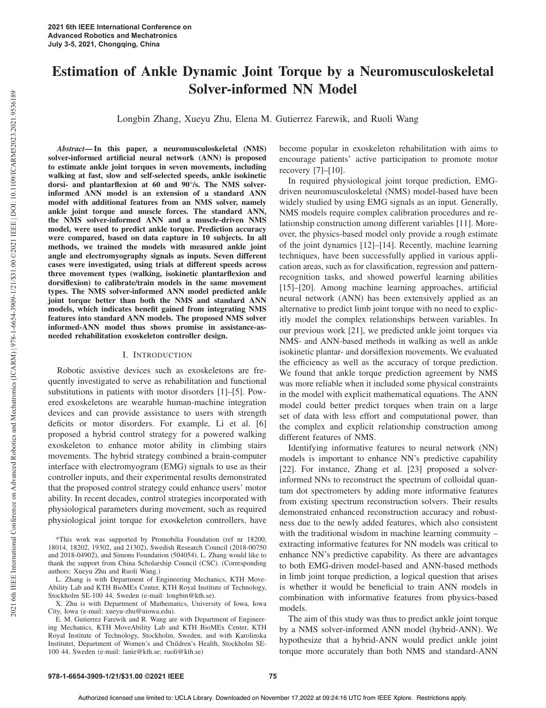
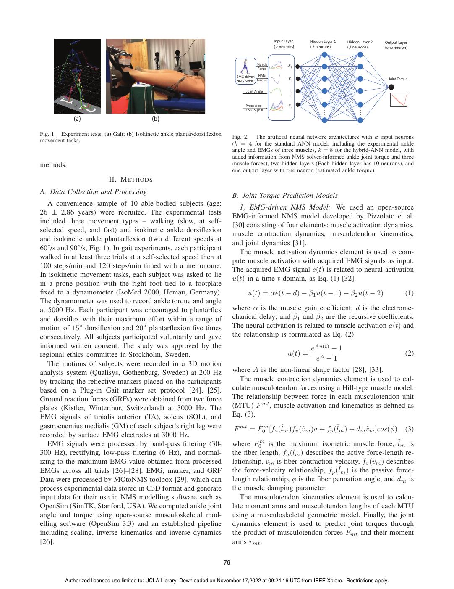
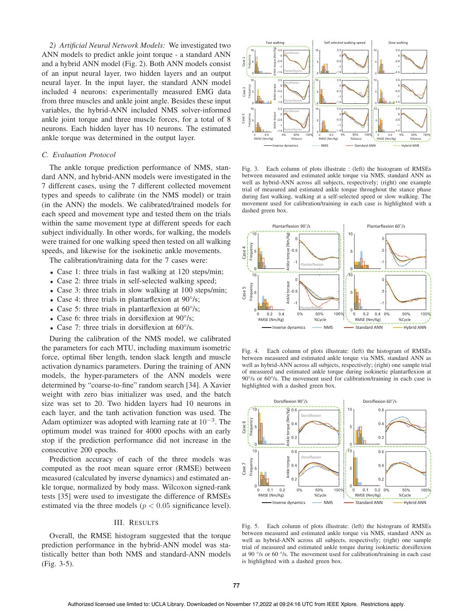
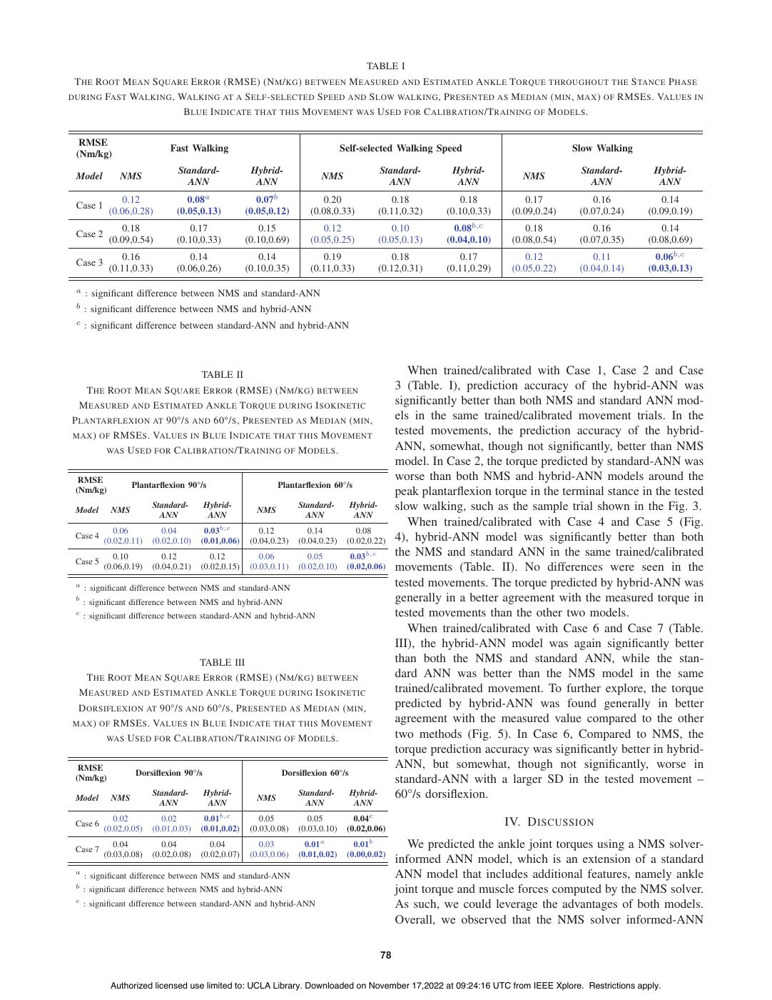
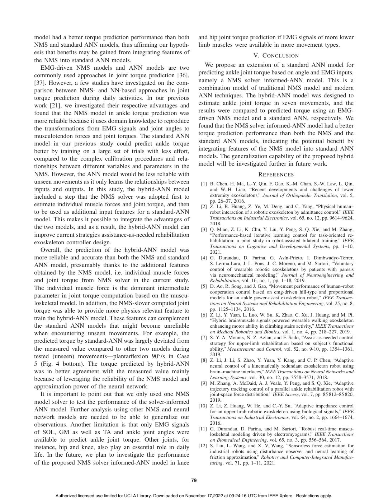
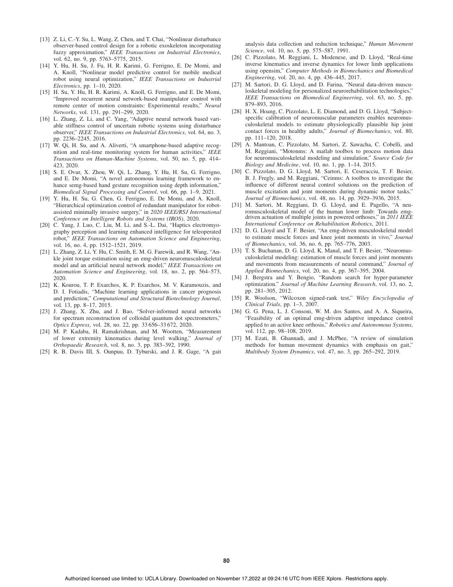

# Zhang2021-ICARM：NMS求解器与NN的踝动态力矩估计

> English text extracted from the source PDF; not translated or editorially corrected. Each original PDF page is embedded below as a rendered image so figures, tables, and vector artwork remain visible.

- Source PDF: `Zhang2021-ICARM：NMS求解器与NN的踝动态力矩估计.pdf`
- SHA-256: `bc2306f29e1b8fab63b98c970a99d4c3ba5744e0dda03550e98c9988ab7da1e3`
- Pages: 6
- Extraction: Poppler `pdftotext -layout`; page images rendered with `pdftoppm` (max dimension 1400 px, JPEG quality 76).

## Page 1

English text extracted from page 1

<pre>
2021 6th IEEE International Conference on
                                                                                                                                                                       Advanced Robotics and Mechatronics
                                                                                                                                                                       July 3-5, 2021, Chongqing, China

                                                                                                                                                                        Estimation of Ankle Dynamic Joint Torque by a Neuromusculoskeletal
                                                                                                                                                                                             Solver-informed NN Model

2021 6th IEEE International Conference on Advanced Robotics and Mechatronics (ICARM) | 978-1-6654-3909-1/21/$31.00 ©2021 IEEE | DOI: 10.1109/ICARM52023.2021.9536189
                                                                                                                                                                                             Longbin Zhang, Xueyu Zhu, Elena M. Gutierrez Farewik, and Ruoli Wang

                                                                                                                                                                          Abstract— In this paper, a neuromusculoskeletal (NMS)                       become popular in exoskeleton rehabilitation with aims to
                                                                                                                                                                       solver-informed artificial neural network (ANN) is proposed                     encourage patients’ active participation to promote motor
                                                                                                                                                                       to estimate ankle joint torques in seven movements, including                  recovery [7]–[10].
                                                                                                                                                                       walking at fast, slow and self-selected speeds, ankle isokinetic
                                                                                                                                                                       dorsi- and plantarflexion at 60 and 90°/s. The NMS solver-                         In required physiological joint torque prediction, EMG-
                                                                                                                                                                       informed ANN model is an extension of a standard ANN                           driven neuromusculoskeletal (NMS) model-based have been
                                                                                                                                                                       model with additional features from an NMS solver, namely                      widely studied by using EMG signals as an input. Generally,
                                                                                                                                                                       ankle joint torque and muscle forces. The standard ANN,                        NMS models require complex calibration procedures and re-
                                                                                                                                                                       the NMS solver-informed ANN and a muscle-driven NMS                            lationship construction among different variables [11]. More-
                                                                                                                                                                       model, were used to predict ankle torque. Prediction accuracy
                                                                                                                                                                       were compared, based on data capture in 10 subjects. In all                    over, the physics-based model only provide a rough estimate
                                                                                                                                                                       methods, we trained the models with measured ankle joint                       of the joint dynamics [12]–[14]. Recently, machine learning
                                                                                                                                                                       angle and electromyography signals as inputs. Seven different                  techniques, have been successfully applied in various appli-
                                                                                                                                                                       cases were investigated, using trials at different speeds across               cation areas, such as for classification, regression and pattern-
                                                                                                                                                                       three movement types (walking, isokinetic plantarflexion and                    recognition tasks, and showed powerful learning abilities
                                                                                                                                                                       dorsiflexion) to calibrate/train models in the same movement
                                                                                                                                                                       types. The NMS solver-informed ANN model predicted ankle                       [15]–[20]. Among machine learning approaches, artificial
                                                                                                                                                                       joint torque better than both the NMS and standard ANN                         neural network (ANN) has been extensively applied as an
                                                                                                                                                                       models, which indicates benefit gained from integrating NMS                     alternative to predict limb joint torque with no need to explic-
                                                                                                                                                                       features into standard ANN models. The proposed NMS solver                     itly model the complex relationships between variables. In
                                                                                                                                                                       informed-ANN model thus shows promise in assistance-as-                        our previous work [21], we predicted ankle joint torques via
                                                                                                                                                                       needed rehabilitation exoskeleton controller design.
                                                                                                                                                                                                                                                      NMS- and ANN-based methods in walking as well as ankle
                                                                                                                                                                                               I. I NTRODUCTION                                       isokinetic plantar- and dorsiflexion movements. We evaluated
                                                                                                                                                                                                                                                      the efficiency as well as the accuracy of torque prediction.
                                                                                                                                                                          Robotic assistive devices such as exoskeletons are fre-                     We found that ankle torque prediction agreement by NMS
                                                                                                                                                                       quently investigated to serve as rehabilitation and functional                 was more reliable when it included some physical constraints
                                                                                                                                                                       substitutions in patients with motor disorders [1]–[5]. Pow-                   in the model with explicit mathematical equations. The ANN
                                                                                                                                                                       ered exoskeletons are wearable human-machine integration                       model could better predict torques when train on a large
                                                                                                                                                                       devices and can provide assistance to users with strength                      set of data with less effort and computational power, than
                                                                                                                                                                       deficits or motor disorders. For example, Li et al. [6]                         the complex and explicit relationship construction among
                                                                                                                                                                       proposed a hybrid control strategy for a powered walking                       different features of NMS.
                                                                                                                                                                       exoskeleton to enhance motor ability in climbing stairs                           Identifying informative features to neural network (NN)
                                                                                                                                                                       movements. The hybrid strategy combined a brain-computer                       models is important to enhance NN’s predictive capability
                                                                                                                                                                       interface with electromyogram (EMG) signals to use as their                    [22]. For instance, Zhang et al. [23] proposed a solver-
                                                                                                                                                                       controller inputs, and their experimental results demonstrated                 informed NNs to reconstruct the spectrum of colloidal quan-
                                                                                                                                                                       that the proposed control strategy could enhance users’ motor                  tum dot spectrometers by adding more informative features
                                                                                                                                                                       ability. In recent decades, control strategies incorporated with               from existing spectrum reconstruction solvers. Their results
                                                                                                                                                                       physiological parameters during movement, such as required                     demonstrated enhanced reconstruction accuracy and robust-
                                                                                                                                                                       physiological joint torque for exoskeleton controllers, have                   ness due to the newly added features, which also consistent
                                                                                                                                                                                                                                                      with the traditional wisdom in machine learning commuity –
                                                                                                                                                                          *This work was supported by Promobilia Foundation (ref nr 18200,
                                                                                                                                                                       18014, 18202, 19302, and 21302), Swedish Research Council (2018-00750          extracting informative features for NN models was critical to
                                                                                                                                                                       and 2018-04902), and Simons Foundation (504054). L. Zhang would like to        enhance NN’s predictive capability. As there are advantages
                                                                                                                                                                       thank the support from China Scholarship Council (CSC). (Corresponding         to both EMG-driven model-based and ANN-based methods
                                                                                                                                                                       authors: Xueyu Zhu and Ruoli Wang.)
                                                                                                                                                                          L. Zhang is with Department of Engineering Mechanics, KTH Move-             in limb joint torque prediction, a logical question that arises
                                                                                                                                                                       Ability Lab and KTH BioMEx Center, KTH Royal Institute of Technology,          is whether it would be beneficial to train ANN models in
                                                                                                                                                                       Stockholm SE-100 44, Sweden (e-mail: longbin@kth.se).                          combination with informative features from physics-based
                                                                                                                                                                          X. Zhu is with Department of Mathematics, University of Iowa, Iowa
                                                                                                                                                                       City, Iowa (e-mail: xueyu-zhu@uiowa.edu).                                      models.
                                                                                                                                                                          E. M. Gutierrez Farewik and R. Wang are with Department of Engineer-           The aim of this study was thus to predict ankle joint torque
                                                                                                                                                                       ing Mechanics, KTH MoveAbility Lab and KTH BioMEx Center, KTH                  by a NMS solver-informed ANN model (hybrid-ANN). We
                                                                                                                                                                       Royal Institute of Technology, Stockholm, Sweden, and with Karolinska
                                                                                                                                                                       Institutet, Department of Women’s and Children’s Health, Stockholm SE-         hypothesize that a hybrid-ANN would predict ankle joint
                                                                                                                                                                       100 44, Sweden (e-mail: lanie@kth.se; ruoli@kth.se)                            torque more accurately than both NMS and standard-ANN

                                                                                                                                                                       978-1-6654-3909-1/21/$31.00 ©2021 IEEE                                    75

                                                                                                                                                                                Authorized licensed use limited to: UCLA Library. Downloaded on November 17,2022 at 09:24:16 UTC from IEEE Xplore. Restrictions apply.
</pre>

## Page 2

English text extracted from page 2

<pre>
Input Layer      Hidden Layer 1   Hidden Layer 2   Output Layer
                                                                                                         ( k neurons)     ( i neurons)     ( j neurons)     (one neuron)

                                                                                                Muscle           X1
                                                                                                Force

                                                                                     EMG-driven NMS
                                                                                     NMS Model Torque
                                                                                                                 X2                                           Joint Torque

                                                                                          Joint Angle            ...

                                                                                         Processed               Xk
                                                                                         EMG Signal
                                                                                                                                 ...             ...
              (a)                             (b)

Fig. 1. Experiment tests. (a) Gait; (b) Isokinetic ankle plantar/dorsiflexion
                                                                                    Fig. 2. The artificial neural network architectures with k input neurons
movement tasks.
                                                                                    (k = 4 for the standard ANN model, including the experimental ankle
                                                                                    angle and EMGs of three muscles, k = 8 for the hybrid-ANN model, with
                                                                                    added information from NMS solver-informed ankle joint torque and three
methods.                                                                            muscle forces), two hidden layers (Each hidden layer has 10 neurons), and
                                                                                    one output layer with one neuron (estimated ankle torque).
                            II. M ETHODS
A. Data Collection and Processing
                                                                                    B. Joint Torque Prediction Models
   A convenience sample of 10 able-bodied subjects (age:
                                                                                      1) EMG-driven NMS Model: We used an open-source
26 ± 2.86 years) were recruited. The experimental tests
                                                                                    EMG-informed NMS model developed by Pizzolato et al.
included three movement types – walking (slow, at self-
                                                                                    [30] consisting of four elements: muscle activation dynamics,
selected speed, and fast) and isokinetic ankle dorsiflexion
                                                                                    muscle contraction dynamics, musculotendon kinematics,
and isokinetic ankle plantarflexion (two different speeds at
                                                                                    and joint dynamics [31].
60°/s and 90°/s, Fig. 1). In gait experiments, each participant
                                                                                      The muscle activation dynamics element is used to com-
walked in at least three trials at a self-selected speed then at
                                                                                    pute muscle activation with acquired EMG signals as input.
100 steps/min and 120 steps/min timed with a metronome.
                                                                                    The acquired EMG signal e(t) is related to neural activation
In isokinetic movement tasks, each subject was asked to lie
                                                                                    u(t) in a time t domain, as Eq. (1) [32].
in a prone position with the right foot tied to a footplate
fixed to a dynamometer (IsoMed 2000, Hemau, Germany).                                       u(t) = αe(t − d) − β1 u(t − 1) − β2 u(t − 2)                                 (1)
The dynamometer was used to record ankle torque and angle
at 5000 Hz. Each participant was encouraged to plantarflex                           where α is the muscle gain coefficient; d is the electrome-
and dorsiflex with their maximum effort within a range of                            chanical delay; and β1 and β2 are the recursive coefficients.
motion of 15◦ dorsiflexion and 20◦ plantarflexion five times                           The neural activation is related to muscle activation a(t) and
consecutively. All subjects participated voluntarily and gave                       the relationship is formulated as Eq. (2):
informed written consent. The study was approved by the                                                                   eAu(t) − 1
regional ethics committee in Stockholm, Sweden.                                                                  a(t) =                                                 (2)
                                                                                                                           eA − 1
   The motions of subjects were recorded in a 3D motion
analysis system (Qualisys, Gothenburg, Sweden) at 200 Hz                            where A is the non-linear shape factor [28], [33].
by tracking the reflective markers placed on the participants                          The muscle contraction dynamics element is used to cal-
based on a Plug-in Gait marker set protocol [24], [25].                             culate musculotendon forces using a Hill-type muscle model.
Ground reaction forces (GRFs) were obtained from two force                          The relationship between force in each musculotendon unit
plates (Kistler, Winterthur, Switzerland) at 3000 Hz. The                           (MTU) F mt , muscle activation and kinematics is defined as
EMG signals of tibialis anterior (TA), soleus (SOL), and                            Eq. (3),
gastrocnemius medialis (GM) of each subject’s right leg were                        F mt = F0m [fa (˜lm )fv (ṽm )a + fp (˜lm ) + dm ṽm ]cos(φ)                        (3)
recorded by surface EMG electrodes at 3000 Hz.
   EMG signals were processed by band-pass filtering (30-                            where F0m is the maximum isometric muscle force, l˜m is
300 Hz), rectifying, low-pass filtering (6 Hz), and normal-                          the fiber length, fa (l˜m ) describes the active force-length re-
izing to the maximum EMG value obtained from processed                              lationship, ṽm is fiber contraction velocity, fv (ṽm ) describes
EMGs across all trials [26]–[28]. EMG, marker, and GRF                              the force-velocity relationship, fp (l˜m ) is the passive force-
Data were processed by MOtoNMS toolbox [29], which can                              length relationship, φ is the fiber pennation angle, and dm is
process experimental data stored in C3D format and generate                         the muscle damping parameter.
input data for their use in NMS modelling software such as                             The musculotendon kinematics element is used to calcu-
OpenSim (SimTK, Stanford, USA). We computed ankle joint                             late moment arms and musculotendon lengths of each MTU
angle and torque using open-sourse musculoskeletal mod-                             using a musculoskeletal geometric model. Finally, the joint
elling software (OpenSim 3.3) and an established pipeline                           dynamics element is used to predict joint torques through
including scaling, inverse kinematics and inverse dynamics                          the product of musculotendon forces Fmt and their moment
[26].                                                                               arms rmt .

                                                                               76

          Authorized licensed use limited to: UCLA Library. Downloaded on November 17,2022 at 09:24:16 UTC from IEEE Xplore. Restrictions apply.
</pre>

## Page 3

English text extracted from page 3

<pre>
Fast walking                                                              Self selected walking speed               Slow walking
   2) Artificial Neural Network Models: We investigated two

                                                                                                                  Ankle torque (Nm/Kg)
                                                                                                                                         Dorsiflexion
ANN models to predict ankle joint torque - a standard ANN
and a hybrid ANN model (Fig. 2). Both ANN models consist                      Case 1    Frequency

                                                                                                                                         Plantarflexion
of an input neural layer, two hidden layers and an output
neural layer. In the input layer, the standard ANN model                                                                                 Dorsiflexion

                                                                                                                  Ankle torque
included 4 neurons: experimentally measured EMG data                           Case 2   Frequency

from three muscles and ankle joint angle. Besides these input                                                                            Plantarflexion

variables, the hybrid-ANN included NMS solver-informed                                                                                   Dorsiflexion

                                                                                        Frequency                 Ankle torque
ankle joint torque and three muscle forces, for a total of 8                  Case 3

neurons. Each hidden layer has 10 neurons. The estimated                                                                                 Plantarflexion

ankle torque was determined in the output layer.                                                       RMSE (Nm/Kg)                                              %Stance          RMSE (Nm/Kg)           %Stance           RMSE (Nm/Kg)          %Stance

                                                                                                                  Inverse dynamics                                                    NMS                  Standard ANN                    Hybrid ANN

C. Evaluation Protocol
   The ankle torque prediction performance of NMS, stan-                      Fig. 3. Each column of plots illustrate : (left) the histogram of RMSEs
dard ANN, and hybrid-ANN models were investigated in the                      between measured and estimated ankle torque via NMS, standard ANN as
                                                                              well as hybrid-ANN across all subjects, respectively; (right) one example
7 different cases, using the 7 different collected movement                   trial of measured and estimated ankle torque throughout the stance phase
types and speeds to calibrate (in the NMS model) or train                     during fast walking, walking at a self-selected speed or slow walking. The
(in the ANN) the models. We calibrated/trained models for                     movement used for calibration/training in each case is highlighted with a
                                                                              dashed green box.
each speed and movement type and tested them on the trials
within the same movement type at different speeds for each                                                        Plantarflexion 90◦/s                                                                                Plantarflexion 60◦/s
subject individually. In other words, for walking, the models

                                                                                                                                          Ankle torque (Nm/Kg)
were trained for one walking speed then tested on all walking
                                                                              Case 4       Frequency
speeds, and likewise for the isokinetic ankle movements.
   The calibration/training data for the 7 cases were:                                                                                                                 Plantarflexion

   • Case 1: three trials in fast walking at 120 steps/min;
   • Case 2: three trials in self-selected walking speed;

                                                                              Case 5       Frequency                                      Ankle torque
   • Case 3: three trials in slow walking at 100 steps/min;
   • Case 4: three trials in plantarflexion at 90°/s;
   • Case 5: three trials in plantarflexion at 60°/s;                                                                                                                  Plantarflexion

   • Case 6: three trials in dorsiflexion at 90°/s;                                                       RMSE (Nm/Kg)                                                          %Cycle                       RMSE (Nm/Kg)                  %Cycle

   • Case 7: three trials in dorsiflexion at 60°/s.                                                                Inverse dynamics                                                      NMS                 Standard ANN                    Hybrid ANN

   During the calibration of the NMS model, we calibrated
the parameters for each MTU, including maximum isometric                      Fig. 4. Each column of plots illustrate: (left) the histogram of RMSEs
force, optimal fiber length, tendon slack length and muscle                    between measured and estimated ankle torque via NMS, standard ANN as
activation dynamics parameters. During the training of ANN                    well as hybrid-ANN across all subjects, respectively; (right) one sample trial
                                                                              of measured and estimated ankle torque during isokinetic plantarflexion at
models, the hyper-parameters of the ANN models were                           90°/s or 60°/s. The movement used for calibration/training in each case is
determined by “coarse-to-fine” random search [34]. A Xavier                    highlighted with a dashed green box.
weight with zero bias initializer was used, and the batch
                                                                                                                      Dorsiflexion 90◦/s                                                                           Dorsiflexion 60◦/s
size was set to 20. Two hidden layers had 10 neurons in

                                                                                                                                          Ankle torque (Nm/Kg)
each layer, and the tanh activation function was used. The                                                                                                             Dorsiflexion
Adam optimizer was adopted with learning rate at 10−3 . The
                                                                              Case 6       Frequency
optimum model was trained for 4000 epochs with an early
stop if the prediction performance did not increase in the
consecutive 200 epochs.
                                                                                                                                                                       Dorsiflexion

                                                                                                                                          Ankle torque
   Prediction accuracy of each of the three models was
computed as the root mean square error (RMSE) between                         Case 7       Frequency

measured (calculated by inverse dynamics) and estimated an-
kle torque, normalized by body mass. Wilcoxon signed-rank
tests [35] were used to investigate the difference of RMSEs                                              RMSE (Nm/Kg)                                                          %Cycle                       RMSE (Nm/Kg)                  %Cycle
                                                                                                                  Inverse dynamics                                                      NMS                 Standard ANN                    Hybrid ANN
estimated via the three models (p &lt; 0.05 significance level).

                          III. R ESULTS                                       Fig. 5. Each column of plots illustrate: (left) the histogram of RMSEs
   Overall, the RMSE histogram suggested that the torque                      between measured and estimated ankle torque via NMS, standard ANN as
                                                                              well as hybrid-ANN across all subjects, respectively; (right) one sample
prediction performance in the hybrid-ANN model was sta-                       trial of measured and estimated ankle torque during isokinetic dorsiflexion
tistically better than both NMS and standard-ANN models                       at 90 °/s or 60 °/s. The movement used for calibration/training in each case
(Fig. 3-5).                                                                   is highlighted with a dashed green box.

                                                                         77

        Authorized licensed use limited to: UCLA Library. Downloaded on November 17,2022 at 09:24:16 UTC from IEEE Xplore. Restrictions apply.
</pre>

## Page 4

English text extracted from page 4

<pre>
TABLE I
 T HE ROOT M EAN S QUARE E RROR (RMSE) (N M / KG ) BETWEEN M EASURED AND E STIMATED A NKLE T ORQUE THROUGHOUT THE S TANCE P HASE
DURING FAST WALKING , WALKING AT A S ELF - SELECTED S PEED AND S LOW WALKING , P RESENTED AS M EDIAN ( MIN , MAX ) OF RMSE S . VALUES IN
                                B LUE I NDICATE THAT THIS M OVEMENT WAS U SED FOR C ALIBRATION /T RAINING OF M ODELS .

  RMSE
                             Fast Walking                                        Self-selected Walking Speed                             Slow Walking
 (Nm/kg)
                               Standard-             Hybrid-                                 Standard-       Hybrid-                      Standard-      Hybrid-
 Model        NMS                                                        NMS                                                 NMS
                                 ANN                  ANN                                      ANN            ANN                           ANN           ANN
               0.12              0.08a                 0.07b              0.20                  0.18            0.18          0.17            0.16          0.14
 Case 1
           (0.06,0.28)        (0.05,0.13)           (0.05,0.12)       (0.08,0.33)            (0.11,0.32)    (0.10,0.33)    (0.09,0.24)    (0.07,0.24)   (0.09,0.19)
               0.18               0.17                 0.15               0.12                  0.10          0.08b,c         0.18            0.16          0.14
 Case 2
           (0.09,0.54)        (0.10,0.33)           (0.10,0.69)       (0.05,0.25)            (0.05,0.13)    (0.04,0.10)    (0.08,0.54)    (0.07,0.35)   (0.08,0.69)
               0.16               0.14                 0.14               0.19                  0.18            0.17          0.12            0.11        0.06b,c
 Case 3
           (0.11,0.33)        (0.06,0.26)           (0.10,0.35)       (0.11,0.33)            (0.12,0.31)    (0.11,0.29)    (0.05,0.22)    (0.04,0.14)   (0.03,0.13)

 a : significant difference between NMS and standard-ANN

 b : significant difference between NMS and hybrid-ANN

 c : significant difference between standard-ANN and hybrid-ANN

                            TABLE II                                                                 When trained/calibrated with Case 1, Case 2 and Case
   T HE ROOT M EAN S QUARE E RROR (RMSE) (N M / KG ) BETWEEN                                      3 (Table. I), prediction accuracy of the hybrid-ANN was
  M EASURED AND E STIMATED A NKLE T ORQUE DURING I SOKINETIC                                      significantly better than both NMS and standard ANN mod-
P LANTARFLEXION AT 90°/ S AND 60°/ S , P RESENTED AS M EDIAN ( MIN ,                              els in the same trained/calibrated movement trials. In the
MAX ) OF RMSE S . VALUES IN B LUE I NDICATE THAT THIS M OVEMENT                                   tested movements, the prediction accuracy of the hybrid-
          WAS U SED FOR C ALIBRATION /T RAINING OF M ODELS .                                      ANN, somewhat, though not significantly, better than NMS
                                                                                                  model. In Case 2, the torque predicted by standard-ANN was
  RMSE                                                                                            worse than both NMS and hybrid-ANN models around the
                  Plantarflexion 90°/s                        Plantarflexion 60°/s
 (Nm/kg)                                                                                          peak plantarflexion torque in the terminal stance in the tested
 Model      NMS
                        Standard-     Hybrid-
                                                       NMS
                                                                   Standard-       Hybrid-        slow walking, such as the sample trial shown in the Fig. 3.
                          ANN          ANN                           ANN            ANN
                                                                                                     When trained/calibrated with Case 4 and Case 5 (Fig.
             0.06          0.04        0.03b,c          0.12          0.14           0.08
 Case 4
          (0.02,0.11)   (0.02,0.10)   (0.01,0.06)    (0.04,0.23)   (0.04,0.23)    (0.02,0.22)     4), hybrid-ANN model was significantly better than both
             0.10          0.12          0.12           0.06          0.05         0.03b,c        the NMS and standard ANN in the same trained/calibrated
 Case 5
          (0.06,0.19)   (0.04,0.21)   (0.02,0.15)    (0.03,0.11)   (0.02,0.10)    (0.02,0.06)     movements (Table. II). No differences were seen in the
 a
     : significant difference between NMS and standard-ANN
                                                                                                  tested movements. The torque predicted by hybrid-ANN was
 b
     : significant difference between NMS and hybrid-ANN                                           generally in a better agreement with the measured torque in
 c
     : significant difference between standard-ANN and hybrid-ANN                                  tested movements than the other two models.
                                                                                                     When trained/calibrated with Case 6 and Case 7 (Table.
                                                                                                  III), the hybrid-ANN model was again significantly better
                            TABLE III                                                             than both the NMS and standard ANN, while the stan-
     T HE ROOT M EAN S QUARE E RROR (RMSE) (N M / KG ) BETWEEN                                    dard ANN was better than the NMS model in the same
  M EASURED AND E STIMATED A NKLE T ORQUE DURING I SOKINETIC                                      trained/calibrated movement. To further explore, the torque
 D ORSIFLEXION AT 90°/ S AND 60°/ S , P RESENTED AS M EDIAN ( MIN ,                               predicted by hybrid-ANN was found generally in better
MAX ) OF RMSE S . VALUES IN B LUE I NDICATE THAT THIS M OVEMENT                                   agreement with the measured value compared to the other
       WAS U SED FOR C ALIBRATION /T RAINING OF M ODELS .                                         two methods (Fig. 5). In Case 6, Compared to NMS, the
                                                                                                  torque prediction accuracy was significantly better in hybrid-
  RMSE                                                                                            ANN, but somewhat, though not significantly, worse in
                  Dorsiflexion 90°/s                          Dorsiflexion 60°/s
 (Nm/kg)                                                                                          standard-ANN with a larger SD in the tested movement –
 Model      NMS
                        Standard-     Hybrid-
                                                       NMS
                                                                   Standard-       Hybrid-        60°/s dorsiflexion.
                          ANN          ANN                           ANN            ANN
             0.02          0.02        0.01b,c          0.05          0.05          0.04c                                 IV. D ISCUSSION
 Case 6
          (0.02,0.05)   (0.01,0.03)   (0.01,0.02)    (0.03,0.08)   (0.03,0.10)    (0.02,0.06)
             0.04          0.04          0.04           0.03         0.01a          0.01b            We predicted the ankle joint torques using a NMS solver-
 Case 7
          (0.03,0.08)   (0.02,0.08)   (0.02,0.07)    (0.03,0.06)   (0.01,0.02)    (0.00,0.02)
                                                                                                  informed ANN model, which is an extension of a standard
 a
     : significant difference between NMS and standard-ANN                                         ANN model that includes additional features, namely ankle
 b
     : significant difference between NMS and hybrid-ANN                                           joint torque and muscle forces computed by the NMS solver.
 c
     : significant difference between standard-ANN and hybrid-ANN                                  As such, we could leverage the advantages of both models.
                                                                                                  Overall, we observed that the NMS solver informed-ANN

                                                                                             78

           Authorized licensed use limited to: UCLA Library. Downloaded on November 17,2022 at 09:24:16 UTC from IEEE Xplore. Restrictions apply.
</pre>

## Page 5

English text extracted from page 5

<pre>
model had a better torque prediction performance than both                    and hip joint torque prediction if EMG signals of more lower
NMS and standard ANN models, thus affirming our hypoth-                        limb muscles were available in more movement types.
esis that benefits may be gained from integrating features of                                         V. C ONCLUSION
the NMS into standard ANN models.
   EMG-driven NMS models and ANN models are two                                  We propose an extension of a standard ANN model for
commonly used approaches in joint torque prediction [36],                     predicting ankle joint torque based on angle and EMG inputs,
[37]. However, a few studies have investigated on the com-                    namely a NMS solver informed-ANN model. This is a
parison between NMS- and NN-based approaches in joint                         combination model of traditional NMS model and modern
torque prediction during daily activities. In our previous                    ANN techniques. The hybrid-ANN model was designed to
work [21], we investigated their respective advantages and                    estimate ankle joint torque in seven movements, and the
found that the NMS model in ankle torque prediction was                       results were compared to predicted torque using an EMG-
more reliable because it uses domain knowledge to reproduce                   driven NMS model and a standard ANN, respectively. We
the transformations from EMG signals and joint angles to                      found that the NMS solver informed-ANN model had a better
musculotendon forces and joint torques. The standard ANN                      torque prediction performance than both the NMS and the
model in our previous study could predict ankle torque                        standard ANN models, indicating the potential benefit by
better by training on a large set of trials with less effort,                 integrating features of the NMS model into standard ANN
compared to the complex calibration procedures and rela-                      models. The generalization capability of the proposed hybrid
tionships between different variables and parameters in the                   model will be investigated further in future work.
NMS. However, the ANN model would be less reliable with                                                     R EFERENCES
unseen movements as it only learns the relationships between                   [1] B. Chen, H. Ma, L.-Y. Qin, F. Gao, K.-M. Chan, S.-W. Law, L. Qin,
inputs and outputs. In this study, the hybrid-ANN model                            and W.-H. Liao, “Recent developments and challenges of lower
included a step that the NMS solver was adopted first to                            extremity exoskeletons,” Journal of Orthopaedic Translation, vol. 5,
                                                                                   pp. 26–37, 2016.
estimate individual muscle forces and joint torque, and then                   [2] Z. Li, B. Huang, Z. Ye, M. Deng, and C. Yang, “Physical human–
to be used as additional input features for a standard-ANN                         robot interaction of a robotic exoskeleton by admittance control,” IEEE
model. This makes it possible to integrate the advantages of                       Transactions on Industrial Electronics, vol. 65, no. 12, pp. 9614–9624,
                                                                                   2018.
the two models, and as a result, the hybrid-ANN model can                      [3] Q. Miao, Z. Li, K. Chu, Y. Liu, Y. Peng, S. Q. Xie, and M. Zhang,
improve current strategies assistance-as-needed rehabilitation                     “Performance-based iterative learning control for task-oriented re-
exoskeleton controller design.                                                     habilitation: a pilot study in robot-assisted bilateral training,” IEEE
                                                                                   Transactions on Cognitive and Developmental Systems, pp. 1–10,
   Overall, the prediction of the hybrid-ANN model was                             2021.
more reliable and accurate than both the NMS and standard                      [4] G. Durandau, D. Farina, G. Ası́n-Prieto, I. Dimbwadyo-Terrer,
ANN model, presumably thanks to the additional features                            S. Lerma-Lara, J. L. Pons, J. C. Moreno, and M. Sartori, “Voluntary
                                                                                   control of wearable robotic exoskeletons by patients with paresis
obtained by the NMS model, i.e. individual muscle forces                           via neuromechanical modeling,” Journal of Neuroengineering and
and joint torque from NMS solver in the current study.                             Rehabilitation, vol. 16, no. 1, pp. 1–18, 2019.
The individual muscle force is the dominant intermediate                       [5] D. Ao, R. Song, and J. Gao, “Movement performance of human–robot
                                                                                   cooperation control based on emg-driven hill-type and proportional
parameter in joint torque computation based on the muscu-                          models for an ankle power-assist exoskeleton robot,” IEEE Transac-
loskeletal model. In addition, the NMS-slover computed joint                       tions on Neural Systems and Rehabilitation Engineering, vol. 25, no. 8,
torque was able to provide more physics relevant feature to                        pp. 1125–1134, 2016.
                                                                               [6] Z. Li, Y. Yuan, L. Luo, W. Su, K. Zhao, C. Xu, J. Huang, and M. Pi,
train the hybrid-ANN model. These features can complement                          “Hybrid brain/muscle signals powered wearable walking exoskeleton
the standard ANN models that might become unreliable                               enhancing motor ability in climbing stairs activity,” IEEE Transactions
when encountering unseen movements. For example, the                               on Medical Robotics and Bionics, vol. 1, no. 4, pp. 218–227, 2019.
                                                                               [7] S. Y. A. Mounis, N. Z. Azlan, and F. Sado, “Assist-as-needed control
predicted torque by standard-ANN was largely deviated from                         strategy for upper-limb rehabilitation based on subject’s functional
the measured value compared to other two models during                             ability,” Measurement and Control, vol. 52, no. 9-10, pp. 1354–1361,
tested (unseen) movements—plantarflexion 90°/s in Case                              2019.
                                                                               [8] Z. Li, J. Li, S. Zhao, Y. Yuan, Y. Kang, and C. P. Chen, “Adaptive
5 (Fig. 4 bottom). The torque predicted by hybrid-ANN                              neural control of a kinematically redundant exoskeleton robot using
was in better agreement with the measured value mainly                             brain–machine interfaces,” IEEE Transactions on Neural Networks and
because of leveraging the reliability of the NMS model and                         Learning Systems, vol. 30, no. 12, pp. 3558–3571, 2018.
                                                                               [9] M. Zhang, A. McDaid, A. J. Veale, Y. Peng, and S. Q. Xie, “Adaptive
approximation power of the neural network.                                         trajectory tracking control of a parallel ankle rehabilitation robot with
   It is important to point out that we only used one NMS                          joint-space force distribution,” IEEE Access, vol. 7, pp. 85 812–85 820,
model solver to test the performance of the solver-informed                        2019.
                                                                              [10] Z. Li, Z. Huang, W. He, and C.-Y. Su, “Adaptive impedance control
ANN model. Further analysis using other NMS and neural                             for an upper limb robotic exoskeleton using biological signals,” IEEE
network models are needed to be able to generalize our                             Transactions on Industrial Electronics, vol. 64, no. 2, pp. 1664–1674,
observations. Another limitation is that only EMG signals                          2016.
                                                                              [11] G. Durandau, D. Farina, and M. Sartori, “Robust real-time muscu-
of SOL, GM as well as TA and ankle joint angles were                               loskeletal modeling driven by electromyograms,” IEEE Transactions
available to predict ankle joint torque. Other joints, for                         on Biomedical Engineering, vol. 65, no. 3, pp. 556–564, 2017.
instance, hip and knee, also play an essential role in daily                  [12] S. Liu, L. Wang, and X. V. Wang, “Sensorless force estimation for
                                                                                   industrial robots using disturbance observer and neural learning of
life. In the future, we plan to investigate the performance                        friction approximation,” Robotics and Computer-Integrated Manufac-
of the proposed NMS solver informed-ANN model in knee                              turing, vol. 71, pp. 1–11, 2021.

                                                                         79

        Authorized licensed use limited to: UCLA Library. Downloaded on November 17,2022 at 09:24:16 UTC from IEEE Xplore. Restrictions apply.
</pre>

## Page 6

English text extracted from page 6

<pre>
[13] Z. Li, C.-Y. Su, L. Wang, Z. Chen, and T. Chai, “Nonlinear disturbance
     observer-based control design for a robotic exoskeleton incorporating               analysis data collection and reduction technique,” Human Movement
     fuzzy approximation,” IEEE Transactions on Industrial Electronics,                  Science, vol. 10, no. 5, pp. 575–587, 1991.
     vol. 62, no. 9, pp. 5763–5775, 2015.                                           [26] C. Pizzolato, M. Reggiani, L. Modenese, and D. Lloyd, “Real-time
[14] Y. Hu, H. Su, J. Fu, H. R. Karimi, G. Ferrigno, E. De Momi, and                     inverse kinematics and inverse dynamics for lower limb applications
     A. Knoll, “Nonlinear model predictive control for mobile medical                    using opensim,” Computer Methods in Biomechanics and Biomedical
     robot using neural optimization,” IEEE Transactions on Industrial                   Engineering, vol. 20, no. 4, pp. 436–445, 2017.
     Electronics, pp. 1–10, 2020.                                                   [27] M. Sartori, D. G. Lloyd, and D. Farina, “Neural data-driven muscu-
[15] H. Su, Y. Hu, H. R. Karimi, A. Knoll, G. Ferrigno, and E. De Momi,                  loskeletal modeling for personalized neurorehabilitation technologies,”
     “Improved recurrent neural network-based manipulator control with                   IEEE Transactions on Biomedical Engineering, vol. 63, no. 5, pp.
     remote center of motion constraints: Experimental results,” Neural                  879–893, 2016.
     Networks, vol. 131, pp. 291–299, 2020.                                         [28] H. X. Hoang, C. Pizzolato, L. E. Diamond, and D. G. Lloyd, “Subject-
[16] L. Zhang, Z. Li, and C. Yang, “Adaptive neural network based vari-                  specific calibration of neuromuscular parameters enables neuromus-
     able stiffness control of uncertain robotic systems using disturbance               culoskeletal models to estimate physiologically plausible hip joint
     observer,” IEEE Transactions on Industrial Electronics, vol. 64, no. 3,             contact forces in healthy adults,” Journal of Biomechanics, vol. 80,
     pp. 2236–2245, 2016.                                                                pp. 111–120, 2018.
[17] W. Qi, H. Su, and A. Aliverti, “A smartphone-based adaptive recog-             [29] A. Mantoan, C. Pizzolato, M. Sartori, Z. Sawacha, C. Cobelli, and
     nition and real-time monitoring system for human activities,” IEEE                  M. Reggiani, “Motonms: A matlab toolbox to process motion data
     Transactions on Human-Machine Systems, vol. 50, no. 5, pp. 414–                     for neuromusculoskeletal modeling and simulation,” Source Code for
     423, 2020.                                                                          Biology and Medicine, vol. 10, no. 1, pp. 1–14, 2015.
[18] S. E. Ovur, X. Zhou, W. Qi, L. Zhang, Y. Hu, H. Su, G. Ferrigno,               [30] C. Pizzolato, D. G. Lloyd, M. Sartori, E. Ceseracciu, T. F. Besier,
     and E. De Momi, “A novel autonomous learning framework to en-                       B. J. Fregly, and M. Reggiani, “Ceinms: A toolbox to investigate the
     hance semg-based hand gesture recognition using depth information,”                 influence of different neural control solutions on the prediction of
     Biomedical Signal Processing and Control, vol. 66, pp. 1–9, 2021.                   muscle excitation and joint moments during dynamic motor tasks,”
[19] Y. Hu, H. Su, G. Chen, G. Ferrigno, E. De Momi, and A. Knoll,                       Journal of Biomechanics, vol. 48, no. 14, pp. 3929–3936, 2015.
     “Hierarchical optimization control of redundant manipulator for robot-         [31] M. Sartori, M. Reggiani, D. G. Lloyd, and E. Pagello, “A neu-
     assisted minimally invasive surgery,” in 2020 IEEE/RSJ International                romusculoskeletal model of the human lower limb: Towards emg-
     Conference on Intelligent Robots and Systems (IROS), 2020.                          driven actuation of multiple joints in powered orthoses,” in 2011 IEEE
[20] C. Yang, J. Luo, C. Liu, M. Li, and S.-L. Dai, “Haptics electromyo-                 International Conference on Rehabilitation Robotics, 2011.
     graphy perception and learning enhanced intelligence for teleoperated          [32] D. G. Lloyd and T. F. Besier, “An emg-driven musculoskeletal model
     robot,” IEEE Transactions on Automation Science and Engineering,                    to estimate muscle forces and knee joint moments in vivo,” Journal
     vol. 16, no. 4, pp. 1512–1521, 2019.                                                of Biomechanics, vol. 36, no. 6, pp. 765–776, 2003.
[21] L. Zhang, Z. Li, Y. Hu, C. Smith, E. M. G. Farewik, and R. Wang, “An-          [33] T. S. Buchanan, D. G. Lloyd, K. Manal, and T. F. Besier, “Neuromus-
     kle joint torque estimation using an emg-driven neuromusculoskeletal                culoskeletal modeling: estimation of muscle forces and joint moments
     model and an artificial neural network model,” IEEE Transactions on                  and movements from measurements of neural command,” Journal of
     Automation Science and Engineering, vol. 18, no. 2, pp. 564–573,                    Applied Biomechanics, vol. 20, no. 4, pp. 367–395, 2004.
     2020.                                                                          [34] J. Bergstra and Y. Bengio, “Random search for hyper-parameter
[22] K. Kourou, T. P. Exarchos, K. P. Exarchos, M. V. Karamouzis, and                    optimization.” Journal of Machine Learning Research, vol. 13, no. 2,
     D. I. Fotiadis, “Machine learning applications in cancer prognosis                  pp. 281–305, 2012.
     and prediction,” Computational and Structural Biotechnology Journal,           [35] R. Woolson, “Wilcoxon signed-rank test,” Wiley Encyclopedia of
     vol. 13, pp. 8–17, 2015.                                                            Clinical Trials, pp. 1–3, 2007.
[23] J. Zhang, X. Zhu, and J. Bao, “Solver-informed neural networks                 [36] G. G. Pena, L. J. Consoni, W. M. dos Santos, and A. A. Siqueira,
     for spectrum reconstruction of colloidal quantum dot spectrometers,”                “Feasibility of an optimal emg-driven adaptive impedance control
     Optics Express, vol. 28, no. 22, pp. 33 656–33 672, 2020.                           applied to an active knee orthosis,” Robotics and Autonomous Systems,
[24] M. P. Kadaba, H. Ramakrishnan, and M. Wootten, “Measurement                         vol. 112, pp. 98–108, 2019.
     of lower extremity kinematics during level walking,” Journal of                [37] M. Ezati, B. Ghannadi, and J. McPhee, “A review of simulation
     Orthopaedic Research, vol. 8, no. 3, pp. 383–392, 1990.                             methods for human movement dynamics with emphasis on gait,”
[25] R. B. Davis III, S. Ounpuu, D. Tyburski, and J. R. Gage, “A gait                    Multibody System Dynamics, vol. 47, no. 3, pp. 265–292, 2019.

                                                                               80

          Authorized licensed use limited to: UCLA Library. Downloaded on November 17,2022 at 09:24:16 UTC from IEEE Xplore. Restrictions apply.
</pre>

