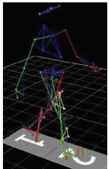
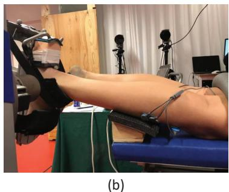
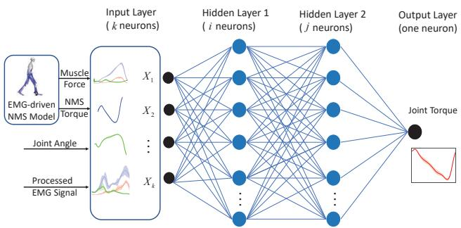
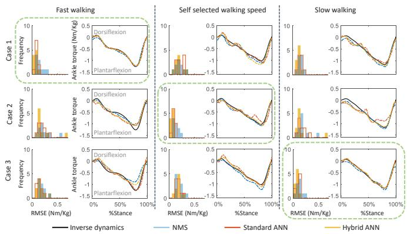
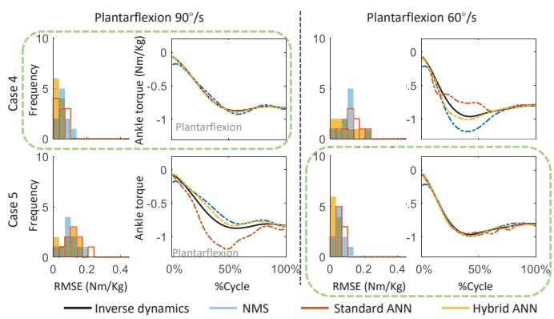
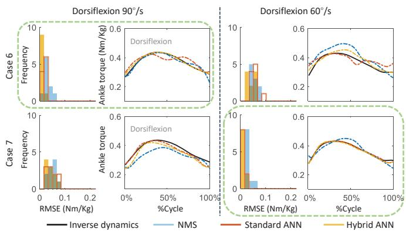

# Estimation of Ankle Dynamic Joint Torque by a Neuromusculoskeletal Solver-informed NN Model

Longbin Zhang, Xueyu Zhu, Elena M. Gutierrez Farewik, and Ruoli Wang

Abstract— In this paper, a neuromusculoskeletal (NMS) solver-informed artificial neural network (ANN) is proposed to estimate ankle joint torques in seven movements, including walking at fast, slow and self-selected speeds, ankle isokinetic dorsi- and plantarflexion at 60 and 90°/s. The NMS solverinformed ANN model is an extension of a standard ANN model with additional features from an NMS solver, namely ankle joint torque and muscle forces. The standard ANN, the NMS solver-informed ANN and a muscle-driven NMS model, were used to predict ankle torque. Prediction accuracy were compared, based on data capture in 10 subjects. In all methods, we trained the models with measured ankle joint angle and electromyography signals as inputs. Seven different cases were investigated, using trials at different speeds across three movement types (walking, isokinetic plantarflexion and dorsiflexion) to calibrate/train models in the same movement types. The NMS solver-informed ANN model predicted ankle joint torque better than both the NMS and standard ANN models, which indicates benefit gained from integrating NMS features into standard ANN models. The proposed NMS solver informed-ANN model thus shows promise in assistance-asneeded rehabilitation exoskeleton controller design.

## I. INTRODUCTION

Robotic assistive devices such as exoskeletons are frequently investigated to serve as rehabilitation and functional substitutions in patients with motor disorders [1]–[5]. Powered exoskeletons are wearable human-machine integration devices and can provide assistance to users with strength deficits or motor disorders. For example, Li et al. [6] proposed a hybrid control strategy for a powered walking exoskeleton to enhance motor ability in climbing stairs movements. The hybrid strategy combined a brain-computer interface with electromyogram (EMG) signals to use as their controller inputs, and their experimental results demonstrated that the proposed control strategy could enhance users’ motor ability. In recent decades, control strategies incorporated with physiological parameters during movement, such as required physiological joint torque for exoskeleton controllers, have become popular in exoskeleton rehabilitation with aims to encourage patients’ active participation to promote motor recovery [7]–[10].

In required physiological joint torque prediction, EMGdriven neuromusculoskeletal (NMS) model-based have been widely studied by using EMG signals as an input. Generally, NMS models require complex calibration procedures and relationship construction among different variables [11]. Moreover, the physics-based model only provide a rough estimate of the joint dynamics [12]–[14]. Recently, machine learning techniques, have been successfully applied in various application areas, such as for classification, regression and patternrecognition tasks, and showed powerful learning abilities [15]–[20]. Among machine learning approaches, artificial neural network (ANN) has been extensively applied as an alternative to predict limb joint torque with no need to explicitly model the complex relationships between variables. In our previous work [21], we predicted ankle joint torques via NMS- and ANN-based methods in walking as well as ankle isokinetic plantar- and dorsiflexion movements. We evaluated the efficiency as well as the accuracy of torque prediction. We found that ankle torque prediction agreement by NMS was more reliable when it included some physical constraints in the model with explicit mathematical equations. The ANN model could better predict torques when train on a large set of data with less effort and computational power, than the complex and explicit relationship construction among different features of NMS.

Identifying informative features to neural network (NN) models is important to enhance NN’s predictive capability [22]. For instance, Zhang et al. [23] proposed a solverinformed NNs to reconstruct the spectrum of colloidal quantum dot spectrometers by adding more informative features from existing spectrum reconstruction solvers. Their results demonstrated enhanced reconstruction accuracy and robustness due to the newly added features, which also consistent with the traditional wisdom in machine learning commuity – extracting informative features for NN models was critical to enhance NN’s predictive capability. As there are advantages to both EMG-driven model-based and ANN-based methods in limb joint torque prediction, a logical question that arises is whether it would be beneficial to train ANN models in combination with informative features from physics-based models.

The aim of this study was thus to predict ankle joint torque by a NMS solver-informed ANN model (hybrid-ANN). We hypothesize that a hybrid-ANN would predict ankle joint torque more accurately than both NMS and standard-ANN

(a)  

  
Fig. 1. Experiment tests. (a) Gait; (b) Isokinetic ankle plantar/dorsiflexion movement tasks.

methods.

## II. METHODS

## A. Data Collection and Processing

A convenience sample of 10 able-bodied subjects (age: $2 6 ~ \pm ~ 2 . 8 6$ years) were recruited. The experimental tests included three movement types – walking (slow, at selfselected speed, and fast) and isokinetic ankle dorsiflexion and isokinetic ankle plantarflexion (two different speeds at 60°/s and 90°/s, Fig. 1). In gait experiments, each participant walked in at least three trials at a self-selected speed then at 100 steps/min and 120 steps/min timed with a metronome. In isokinetic movement tasks, each subject was asked to lie in a prone position with the right foot tied to a footplate fixed to a dynamometer (IsoMed 2000, Hemau, Germany). The dynamometer was used to record ankle torque and angle at 5000 Hz. Each participant was encouraged to plantarflex and dorsiflex with their maximum effort within a range of motion of 15◦ dorsiflexion and 20◦ plantarflexion five times consecutively. All subjects participated voluntarily and gave informed written consent. The study was approved by the regional ethics committee in Stockholm, Sweden.

The motions of subjects were recorded in a 3D motion analysis system (Qualisys, Gothenburg, Sweden) at 200 Hz by tracking the reflective markers placed on the participants based on a Plug-in Gait marker set protocol [24], [25]. Ground reaction forces (GRFs) were obtained from two force plates (Kistler, Winterthur, Switzerland) at 3000 Hz. The EMG signals of tibialis anterior (TA), soleus (SOL), and gastrocnemius medialis (GM) of each subject’s right leg were recorded by surface EMG electrodes at 3000 Hz.

EMG signals were processed by band-pass filtering (30- 300 Hz), rectifying, low-pass filtering (6 Hz), and normalizing to the maximum EMG value obtained from processed EMGs across all trials [26]–[28]. EMG, marker, and GRF Data were processed by MOtoNMS toolbox [29], which can process experimental data stored in C3D format and generate input data for their use in NMS modelling software such as OpenSim (SimTK, Stanford, USA). We computed ankle joint angle and torque using open-sourse musculoskeletal modelling software (OpenSim 3.3) and an established pipeline including scaling, inverse kinematics and inverse dynamics [26].

  
Fig. 2. The artificial neural network architectures with k input neurons $( k = 4$ for the standard ANN model, including the experimental ankle angle and EMGs of three muscles, k = 8 for the hybrid-ANN model, with added information from NMS solver-informed ankle joint torque and three muscle forces), two hidden layers (Each hidden layer has 10 neurons), and one output layer with one neuron (estimated ankle torque).

## B. Joint Torque Prediction Models

1) EMG-driven NMS Model: We used an open-source EMG-informed NMS model developed by Pizzolato et al. [30] consisting of four elements: muscle activation dynamics, muscle contraction dynamics, musculotendon kinematics, and joint dynamics [31].

The muscle activation dynamics element is used to compute muscle activation with acquired EMG signals as input. The acquired EMG signal $e ( t )$ is related to neural activation u(t) in a time t domain, as Eq. (1) [32].

$$
u (t) = \alpha e (t - d) - \beta_ {1} u (t - 1) - \beta_ {2} u (t - 2)\tag{1}
$$

where α is the muscle gain coefficient; d is the electromechanical delay; and $\beta _ { 1 }$ and $\beta _ { 2 }$ are the recursive coefficients. The neural activation is related to muscle activation a(t) and the relationship is formulated as Eq. (2):

$$
a (t) = \frac {e ^ {A u (t)} - 1}{e ^ {A} - 1}\tag{2}
$$

where A is the non-linear shape factor [28], [33].

The muscle contraction dynamics element is used to calculate musculotendon forces using a Hill-type muscle model. The relationship between force in each musculotendon unit (MTU) $F ^ { m t }$ , muscle activation and kinematics is defined as Eq. (3),

$$
F ^ {m t} = F _ {0} ^ {m} [ f _ {a} (\tilde {l} _ {m}) f _ {v} (\tilde {v} _ {m}) a + f _ {p} (\tilde {l} _ {m}) + d _ {m} \tilde {v} _ {m} ] c o s (\phi)\tag{3}
$$

where $F _ { 0 } ^ { m }$ is the maximum isometric muscle force, $\tilde { l } _ { m }$ is the fiber length, $f _ { a } ( \tilde { l } _ { m } )$ describes the active force-length relationship, $\tilde { v } _ { m }$ is fiber contraction velocity, $f _ { v } ( \tilde { v } _ { m } )$ describes the force-velocity relationship, $f _ { p } ( \tilde { l } _ { m } )$ is the passive forcelength relationship, φ is the fiber pennation angle, and $d _ { m }$ is the muscle damping parameter.

The musculotendon kinematics element is used to calculate moment arms and musculotendon lengths of each MTU using a musculoskeletal geometric model. Finally, the joint dynamics element is used to predict joint torques through the product of musculotendon forces $F _ { m t }$ and their moment arms $r _ { m t }$

2) Artificial Neural Network Models: We investigated two ANN models to predict ankle joint torque - a standard ANN and a hybrid ANN model (Fig. 2). Both ANN models consist of an input neural layer, two hidden layers and an output neural layer. In the input layer, the standard ANN model included 4 neurons: experimentally measured EMG data from three muscles and ankle joint angle. Besides these input variables, the hybrid-ANN included NMS solver-informed ankle joint torque and three muscle forces, for a total of 8 neurons. Each hidden layer has 10 neurons. The estimated ankle torque was determined in the output layer.

## C. Evaluation Protocol

The ankle torque prediction performance of NMS, standard ANN, and hybrid-ANN models were investigated in the 7 different cases, using the 7 different collected movement types and speeds to calibrate (in the NMS model) or train (in the ANN) the models. We calibrated/trained models for each speed and movement type and tested them on the trials within the same movement type at different speeds for each subject individually. In other words, for walking, the models were trained for one walking speed then tested on all walking speeds, and likewise for the isokinetic ankle movements.

The calibration/training data for the 7 cases were:

• Case 1: three trials in fast walking at 120 steps/min;

Case 2: three trials in self-selected walking speed;

Case 3: three trials in slow walking at 100 steps/min;

Case 4: three trials in plantarflexion at $9 0 ^ { \circ } / s ;$

Case 5: three trials in plantarflexion at $6 0 ^ { \circ } / s ;$

Case 6: three trials in dorsiflexion at $9 0 ^ { \circ } / \mathrm { s } ;$

Case 7: three trials in dorsiflexion at $6 0 \%$

During the calibration of the NMS model, we calibrated the parameters for each MTU, including maximum isometric force, optimal fiber length, tendon slack length and muscle activation dynamics parameters. During the training of ANN models, the hyper-parameters of the ANN models were determined by “coarse-to-fine” random search [34]. A Xavier weight with zero bias initializer was used, and the batch size was set to 20. Two hidden layers had 10 neurons in each layer, and the tanh activation function was used. The Adam optimizer was adopted with learning rate at $1 0 ^ { - 3 }$ . The optimum model was trained for 4000 epochs with an early stop if the prediction performance did not increase in the consecutive 200 epochs.

Prediction accuracy of each of the three models was computed as the root mean square error (RMSE) between measured (calculated by inverse dynamics) and estimated ankle torque, normalized by body mass. Wilcoxon signed-rank tests [35] were used to investigate the difference of RMSEs estimated via the three models $( p < 0 . 0 5$ significance level).

## III. RESULTS

Overall, the RMSE histogram suggested that the torque prediction performance in the hybrid-ANN model was statistically better than both NMS and standard-ANN models (Fig. 3-5).

Fig. 3. Each column of plots illustrate : (left) the histogram of RMSEs between measured and estimated ankle torque via NMS, standard ANN as well as hybrid-ANN across all subjects, respectively; (right) one example trial of measured and estimated ankle torque throughout the stance phase during fast walking, walking at a self-selected speed or slow walking. The movement used for calibration/training in each case is highlighted with a dashed green box.  

Fig. 4. Each column of plots illustrate: (left) the histogram of RMSEs between measured and estimated ankle torque via NMS, standard ANN as well as hybrid-ANN across all subjects, respectively; (right) one sample trial of measured and estimated ankle torque during isokinetic plantarflexion at 90°/s or 60°/s. The movement used for calibration/training in each case is highlighted with a dashed green box.  
  
Fig. 5. Each column of plots illustrate: (left) the histogram of RMSEs between measured and estimated ankle torque via NMS, standard ANN as well as hybrid-ANN across all subjects, respectively; (right) one sample trial of measured and estimated ankle torque during isokinetic dorsiflexion at $9 0 ~ { } ^ { \circ } / \mathrm { s }$ or $6 0 ~ ^ { \circ } / \mathrm { s } .$ The movement used for calibration/training in each case is highlighted with a dashed green box.

TABLE I  
THE ROOT MEAN SQUARE ERROR (RMSE) (NM/KG) BETWEEN MEASURED AND ESTIMATED ANKLE TORQUE THROUGHOUT THE STANCE PHASE DURING FAST WALKING, WALKING AT A SELF-SELECTED SPEED AND SLOW WALKING, PRESENTED AS MEDIAN (MIN, MAX) OF RMSES. VALUES IN BLUE INDICATE THAT THIS MOVEMENT WAS USED FOR CALIBRATION/TRAINING OF MODELS.

<table><tr><td colspan="2">RMSE (Nm/kg)</td><td colspan="2">Fast Walking</td><td colspan="3">Self-selected Walking Speed</td><td colspan="3">Slow Walking</td></tr><tr><td>Model</td><td>NMS</td><td>Standard-ANN</td><td>Hybrid-ANN</td><td>NMS</td><td>Standard-ANN</td><td>Hybrid-ANN</td><td>NMS</td><td>Standard-ANN</td><td>Hybrid-ANN</td></tr><tr><td>Case 1</td><td>0.12(0.06,0.28)</td><td> $\mathbf{0.08}^a$ (0.05,0.13)</td><td> $\mathbf{0.07}^b$ (0.05,0.12)</td><td>0.20(0.08,0.33)</td><td>0.18(0.11,0.32)</td><td>0.18(0.10,0.33)</td><td>0.17(0.09,0.24)</td><td>0.16(0.07,0.24)</td><td>0.14(0.09,0.19)</td></tr><tr><td>Case 2</td><td>0.18(0.09,0.54)</td><td>0.17(0.10,0.33)</td><td>0.15(0.10,0.69)</td><td>0.12(0.05,0.25)</td><td>0.10(0.05,0.13)</td><td> $\mathbf{0.08}^{b,c}$ (0.04,0.10)</td><td>0.18(0.08,0.54)</td><td>0.16(0.07,0.35)</td><td>0.14(0.08,0.69)</td></tr><tr><td>Case 3</td><td>0.16(0.11,0.33)</td><td>0.14(0.06,0.26)</td><td>0.14(0.10,0.35)</td><td>0.19(0.11,0.33)</td><td>0.18(0.12,0.31)</td><td>0.17(0.11,0.29)</td><td>0.12(0.05,0.22)</td><td>0.11(0.04,0.14)</td><td> $\mathbf{0.06}^{b,c}$ (0.03,0.13)</td></tr></table>

a : significant difference between NMS and standard-ANN  
b : significant difference between NMS and hybrid-ANN  
c : significant difference between standard-ANN and hybrid-ANN

## TABLE II

THE ROOT MEAN SQUARE ERROR (RMSE) (NM/KG) BETWEEN MEASURED AND ESTIMATED ANKLE TORQUE DURING ISOKINETIC PLANTARFLEXION AT 90°/S AND 60°/S, PRESENTED AS MEDIAN (MIN, MAX) OF RMSES. VALUES IN BLUE INDICATE THAT THIS MOVEMENT

WAS USED FOR CALIBRATION/TRAINING OF MODELS.

<table><tr><td>RMSE (Nm/kg)</td><td colspan="3">Plantarflexion 90°/s</td><td colspan="3">Plantarflexion 60°/s</td></tr><tr><td>Model</td><td>NMS</td><td>Standard-ANN</td><td>Hybrid-ANN</td><td>NMS</td><td>Standard-ANN</td><td>Hybrid-ANN</td></tr><tr><td>Case 4</td><td>0.06(0.02,0.11)</td><td>0.04(0.02,0.10)</td><td> $\mathbf{0.03^{b,c}}$ (0.01,0.06)</td><td>0.12(0.04,0.23)</td><td>0.14(0.04,0.23)</td><td>0.08(0.02,0.22)</td></tr><tr><td>Case 5</td><td>0.10(0.06,0.19)</td><td>0.12(0.04,0.21)</td><td>0.12(0.02,0.15)</td><td>0.06(0.03,0.11)</td><td>0.05(0.02,0.10)</td><td> $\mathbf{0.03^{b,c}}$ (0.02,0.06)</td></tr></table>

a : significant difference between NMS and standard-ANN  
b : significant difference between NMS and hybrid-ANN  
c : significant difference between standard-ANN and hybrid-ANN

## TABLE III

THE ROOT MEAN SQUARE ERROR (RMSE) (NM/KG) BETWEEN MEASURED AND ESTIMATED ANKLE TORQUE DURING ISOKINETIC DORSIFLEXION AT 90°/S AND 60°/S, PRESENTED AS MEDIAN (MIN, MAX) OF RMSES. VALUES IN BLUE INDICATE THAT THIS MOVEMENT WAS USED FOR CALIBRATION/TRAINING OF MODELS.

<table><tr><td>RMSE (Nm/kg)</td><td colspan="3">Dorsiflexion 90°/s</td><td colspan="3">Dorsiflexion 60°/s</td></tr><tr><td>Model</td><td>NMS</td><td>Standard-ANN</td><td>Hybrid-ANN</td><td>NMS</td><td>Standard-ANN</td><td>Hybrid-ANN</td></tr><tr><td>Case 6</td><td>0.02(0.02,0.05)</td><td>0.02(0.01,0.03)</td><td> $\mathbf{0.01^{b,c}}$ (0.01,0.02)</td><td>0.05(0.03,0.08)</td><td>0.05(0.03,0.10)</td><td> $\mathbf{0.04^c}$ (0.02,0.06)</td></tr><tr><td>Case 7</td><td>0.04(0.03,0.08)</td><td>0.04(0.02,0.08)</td><td>0.04(0.02,0.07)</td><td>0.03(0.03,0.06)</td><td> $\mathbf{0.01^a}$ (0.01,0.02)</td><td> $\mathbf{0.01^b}$ (0.00,0.02)</td></tr></table>

a : significant difference between NMS and standard-ANN  
b : significant difference between NMS and hybrid-ANN  
c : significant difference between standard-ANN and hybrid-ANN

When trained/calibrated with Case 1, Case 2 and Case 3 (Table. I), prediction accuracy of the hybrid-ANN was significantly better than both NMS and standard ANN models in the same trained/calibrated movement trials. In the tested movements, the prediction accuracy of the hybrid-ANN, somewhat, though not significantly, better than NMS model. In Case 2, the torque predicted by standard-ANN was worse than both NMS and hybrid-ANN models around the peak plantarflexion torque in the terminal stance in the tested slow walking, such as the sample trial shown in the Fig. 3.

When trained/calibrated with Case 4 and Case 5 (Fig. 4), hybrid-ANN model was significantly better than both the NMS and standard ANN in the same trained/calibrated movements (Table. II). No differences were seen in the tested movements. The torque predicted by hybrid-ANN was generally in a better agreement with the measured torque in tested movements than the other two models.

When trained/calibrated with Case 6 and Case 7 (Table. III), the hybrid-ANN model was again significantly better than both the NMS and standard ANN, while the standard ANN was better than the NMS model in the same trained/calibrated movement. To further explore, the torque predicted by hybrid-ANN was found generally in better agreement with the measured value compared to the other two methods (Fig. 5). In Case 6, Compared to NMS, the torque prediction accuracy was significantly better in hybrid-ANN, but somewhat, though not significantly, worse in standard-ANN with a larger SD in the tested movement – 60°/s dorsiflexion.

## IV. DISCUSSION

We predicted the ankle joint torques using a NMS solverinformed ANN model, which is an extension of a standard ANN model that includes additional features, namely ankle joint torque and muscle forces computed by the NMS solver. As such, we could leverage the advantages of both models. Overall, we observed that the NMS solver informed-ANN model had a better torque prediction performance than both NMS and standard ANN models, thus affirming our hypothesis that benefits may be gained from integrating features of the NMS into standard ANN models.

EMG-driven NMS models and ANN models are two commonly used approaches in joint torque prediction [36], [37]. However, a few studies have investigated on the comparison between NMS- and NN-based approaches in joint torque prediction during daily activities. In our previous work [21], we investigated their respective advantages and found that the NMS model in ankle torque prediction was more reliable because it uses domain knowledge to reproduce the transformations from EMG signals and joint angles to musculotendon forces and joint torques. The standard ANN model in our previous study could predict ankle torque better by training on a large set of trials with less effort, compared to the complex calibration procedures and relationships between different variables and parameters in the NMS. However, the ANN model would be less reliable with unseen movements as it only learns the relationships between inputs and outputs. In this study, the hybrid-ANN model included a step that the NMS solver was adopted first to estimate individual muscle forces and joint torque, and then to be used as additional input features for a standard-ANN model. This makes it possible to integrate the advantages of the two models, and as a result, the hybrid-ANN model can improve current strategies assistance-as-needed rehabilitation exoskeleton controller design.

Overall, the prediction of the hybrid-ANN model was more reliable and accurate than both the NMS and standard ANN model, presumably thanks to the additional features obtained by the NMS model, i.e. individual muscle forces and joint torque from NMS solver in the current study. The individual muscle force is the dominant intermediate parameter in joint torque computation based on the musculoskeletal model. In addition, the NMS-slover computed joint torque was able to provide more physics relevant feature to train the hybrid-ANN model. These features can complement the standard ANN models that might become unreliable when encountering unseen movements. For example, the predicted torque by standard-ANN was largely deviated from the measured value compared to other two models during tested (unseen) movements—plantarflexion 90°/s in Case 5 (Fig. 4 bottom). The torque predicted by hybrid-ANN was in better agreement with the measured value mainly because of leveraging the reliability of the NMS model and approximation power of the neural network.

It is important to point out that we only used one NMS model solver to test the performance of the solver-informed ANN model. Further analysis using other NMS and neural network models are needed to be able to generalize our observations. Another limitation is that only EMG signals of SOL, GM as well as TA and ankle joint angles were available to predict ankle joint torque. Other joints, for instance, hip and knee, also play an essential role in daily life. In the future, we plan to investigate the performance of the proposed NMS solver informed-ANN model in knee and hip joint torque prediction if EMG signals of more lower limb muscles were available in more movement types.

## V. CONCLUSION

We propose an extension of a standard ANN model for predicting ankle joint torque based on angle and EMG inputs, namely a NMS solver informed-ANN model. This is a combination model of traditional NMS model and modern ANN techniques. The hybrid-ANN model was designed to estimate ankle joint torque in seven movements, and the results were compared to predicted torque using an EMGdriven NMS model and a standard ANN, respectively. We found that the NMS solver informed-ANN model had a better torque prediction performance than both the NMS and the standard ANN models, indicating the potential benefit by integrating features of the NMS model into standard ANN models. The generalization capability of the proposed hybrid model will be investigated further in future work.

## REFERENCES

[1] B. Chen, H. Ma, L.-Y. Qin, F. Gao, K.-M. Chan, S.-W. Law, L. Qin, and W.-H. Liao, “Recent developments and challenges of lower extremity exoskeletons,” Journal of Orthopaedic Translation, vol. 5, pp. 26–37, 2016.

[2] Z. Li, B. Huang, Z. Ye, M. Deng, and C. Yang, “Physical human– robot interaction of a robotic exoskeleton by admittance control,” IEEE Transactions on Industrial Electronics, vol. 65, no. 12, pp. 9614–9624, 2018.

[3] Q. Miao, Z. Li, K. Chu, Y. Liu, Y. Peng, S. Q. Xie, and M. Zhang, “Performance-based iterative learning control for task-oriented rehabilitation: a pilot study in robot-assisted bilateral training,” IEEE Transactions on Cognitive and Developmental Systems, pp. 1–10, 2021.

[4] G. Durandau, D. Farina, G. As´ın-Prieto, I. Dimbwadyo-Terrer, S. Lerma-Lara, J. L. Pons, J. C. Moreno, and M. Sartori, “Voluntary control of wearable robotic exoskeletons by patients with paresis via neuromechanical modeling,” Journal of Neuroengineering and Rehabilitation, vol. 16, no. 1, pp. 1–18, 2019.

[5] D. Ao, R. Song, and J. Gao, “Movement performance of human–robot cooperation control based on emg-driven hill-type and proportional models for an ankle power-assist exoskeleton robot,” IEEE Transactions on Neural Systems and Rehabilitation Engineering, vol. 25, no. 8, pp. 1125–1134, 2016.

[6] Z. Li, Y. Yuan, L. Luo, W. Su, K. Zhao, C. Xu, J. Huang, and M. Pi, “Hybrid brain/muscle signals powered wearable walking exoskeleton enhancing motor ability in climbing stairs activity,” IEEE Transactions on Medical Robotics and Bionics, vol. 1, no. 4, pp. 218–227, 2019.

[7] S. Y. A. Mounis, N. Z. Azlan, and F. Sado, “Assist-as-needed control strategy for upper-limb rehabilitation based on subject’s functional ability,” Measurement and Control, vol. 52, no. 9-10, pp. 1354–1361, 2019.

[8] Z. Li, J. Li, S. Zhao, Y. Yuan, Y. Kang, and C. P. Chen, “Adaptive neural control of a kinematically redundant exoskeleton robot using brain–machine interfaces,” IEEE Transactions on Neural Networks and Learning Systems, vol. 30, no. 12, pp. 3558–3571, 2018.

[9] M. Zhang, A. McDaid, A. J. Veale, Y. Peng, and S. Q. Xie, “Adaptive trajectory tracking control of a parallel ankle rehabilitation robot with joint-space force distribution,” IEEE Access, vol. 7, pp. 85 812–85 820, 2019.

[10] Z. Li, Z. Huang, W. He, and C.-Y. Su, “Adaptive impedance control for an upper limb robotic exoskeleton using biological signals,” IEEE Transactions on Industrial Electronics, vol. 64, no. 2, pp. 1664–1674, 2016.

[11] G. Durandau, D. Farina, and M. Sartori, “Robust real-time musculoskeletal modeling driven by electromyograms,” IEEE Transactions on Biomedical Engineering, vol. 65, no. 3, pp. 556–564, 2017.

[12] S. Liu, L. Wang, and X. V. Wang, “Sensorless force estimation for industrial robots using disturbance observer and neural learning of friction approximation,” Robotics and Computer-Integrated Manufacturing, vol. 71, pp. 1–11, 2021.

[13] Z. Li, C.-Y. Su, L. Wang, Z. Chen, and T. Chai, “Nonlinear disturbance observer-based control design for a robotic exoskeleton incorporating fuzzy approximation,” IEEE Transactions on Industrial Electronics, vol. 62, no. 9, pp. 5763–5775, 2015.

[14] Y. Hu, H. Su, J. Fu, H. R. Karimi, G. Ferrigno, E. De Momi, and A. Knoll, “Nonlinear model predictive control for mobile medical robot using neural optimization,” IEEE Transactions on Industrial Electronics, pp. 1–10, 2020.

[15] H. Su, Y. Hu, H. R. Karimi, A. Knoll, G. Ferrigno, and E. De Momi, “Improved recurrent neural network-based manipulator control with remote center of motion constraints: Experimental results,” Neural Networks, vol. 131, pp. 291–299, 2020.

[16] L. Zhang, Z. Li, and C. Yang, “Adaptive neural network based variable stiffness control of uncertain robotic systems using disturbance observer,” IEEE Transactions on Industrial Electronics, vol. 64, no. 3, pp. 2236–2245, 2016.

[17] W. Qi, H. Su, and A. Aliverti, “A smartphone-based adaptive recognition and real-time monitoring system for human activities,” IEEE Transactions on Human-Machine Systems, vol. 50, no. 5, pp. 414– 423, 2020.

[18] S. E. Ovur, X. Zhou, W. Qi, L. Zhang, Y. Hu, H. Su, G. Ferrigno, and E. De Momi, “A novel autonomous learning framework to enhance semg-based hand gesture recognition using depth information,” Biomedical Signal Processing and Control, vol. 66, pp. 1–9, 2021.

[19] Y. Hu, H. Su, G. Chen, G. Ferrigno, E. De Momi, and A. Knoll, “Hierarchical optimization control of redundant manipulator for robotassisted minimally invasive surgery,” in 2020 IEEE/RSJ International Conference on Intelligent Robots and Systems (IROS), 2020.

[20] C. Yang, J. Luo, C. Liu, M. Li, and S.-L. Dai, “Haptics electromyography perception and learning enhanced intelligence for teleoperated robot,” IEEE Transactions on Automation Science and Engineering, vol. 16, no. 4, pp. 1512–1521, 2019.

[21] L. Zhang, Z. Li, Y. Hu, C. Smith, E. M. G. Farewik, and R. Wang, “Ankle joint torque estimation using an emg-driven neuromusculoskeletal model and an artificial neural network model,” IEEE Transactions on Automation Science and Engineering, vol. 18, no. 2, pp. 564–573, 2020.

[22] K. Kourou, T. P. Exarchos, K. P. Exarchos, M. V. Karamouzis, and D. I. Fotiadis, “Machine learning applications in cancer prognosis and prediction,” Computational and Structural Biotechnology Journal, vol. 13, pp. 8–17, 2015.

[23] J. Zhang, X. Zhu, and J. Bao, “Solver-informed neural networks for spectrum reconstruction of colloidal quantum dot spectrometers,” Optics Express, vol. 28, no. 22, pp. 33 656–33 672, 2020.

[24] M. P. Kadaba, H. Ramakrishnan, and M. Wootten, “Measurement of lower extremity kinematics during level walking,” Journal of Orthopaedic Research, vol. 8, no. 3, pp. 383–392, 1990.

[25] R. B. Davis III, S. Ounpuu, D. Tyburski, and J. R. Gage, “A gait

analysis data collection and reduction technique,” Human Movement Science, vol. 10, no. 5, pp. 575–587, 1991.

[26] C. Pizzolato, M. Reggiani, L. Modenese, and D. Lloyd, “Real-time inverse kinematics and inverse dynamics for lower limb applications using opensim,” Computer Methods in Biomechanics and Biomedical Engineering, vol. 20, no. 4, pp. 436–445, 2017.

[27] M. Sartori, D. G. Lloyd, and D. Farina, “Neural data-driven musculoskeletal modeling for personalized neurorehabilitation technologies,” IEEE Transactions on Biomedical Engineering, vol. 63, no. 5, pp. 879–893, 2016.

[28] H. X. Hoang, C. Pizzolato, L. E. Diamond, and D. G. Lloyd, “Subjectspecific calibration of neuromuscular parameters enables neuromusculoskeletal models to estimate physiologically plausible hip joint contact forces in healthy adults,” Journal of Biomechanics, vol. 80, pp. 111–120, 2018.

[29] A. Mantoan, C. Pizzolato, M. Sartori, Z. Sawacha, C. Cobelli, and M. Reggiani, “Motonms: A matlab toolbox to process motion data for neuromusculoskeletal modeling and simulation,” Source Code for Biology and Medicine, vol. 10, no. 1, pp. 1–14, 2015.

[30] C. Pizzolato, D. G. Lloyd, M. Sartori, E. Ceseracciu, T. F. Besier, B. J. Fregly, and M. Reggiani, “Ceinms: A toolbox to investigate the influence of different neural control solutions on the prediction of muscle excitation and joint moments during dynamic motor tasks,” Journal of Biomechanics, vol. 48, no. 14, pp. 3929–3936, 2015.

[31] M. Sartori, M. Reggiani, D. G. Lloyd, and E. Pagello, “A neuromusculoskeletal model of the human lower limb: Towards emgdriven actuation of multiple joints in powered orthoses,” in 2011 IEEE International Conference on Rehabilitation Robotics, 2011.

[32] D. G. Lloyd and T. F. Besier, “An emg-driven musculoskeletal model to estimate muscle forces and knee joint moments in vivo,” Journal of Biomechanics, vol. 36, no. 6, pp. 765–776, 2003.

[33] T. S. Buchanan, D. G. Lloyd, K. Manal, and T. F. Besier, “Neuromusculoskeletal modeling: estimation of muscle forces and joint moments and movements from measurements of neural command,” Journal of Applied Biomechanics, vol. 20, no. 4, pp. 367–395, 2004.

[34] J. Bergstra and Y. Bengio, “Random search for hyper-parameter optimization.” Journal of Machine Learning Research, vol. 13, no. 2, pp. 281–305, 2012.

[35] R. Woolson, “Wilcoxon signed-rank test,” Wiley Encyclopedia of Clinical Trials, pp. 1–3, 2007.

[36] G. G. Pena, L. J. Consoni, W. M. dos Santos, and A. A. Siqueira, “Feasibility of an optimal emg-driven adaptive impedance control applied to an active knee orthosis,” Robotics and Autonomous Systems, vol. 112, pp. 98–108, 2019.

[37] M. Ezati, B. Ghannadi, and J. McPhee, “A review of simulation methods for human movement dynamics with emphasis on gait,” Multibody System Dynamics, vol. 47, no. 3, pp. 265–292, 2019.