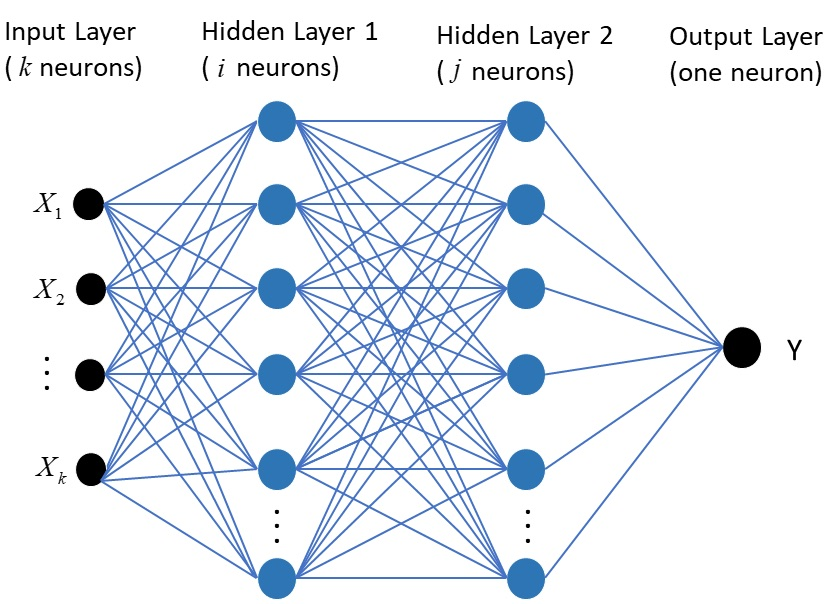

# Ankle Joint Torque Estimation Using an EMG-Driven Neuromusculoskeletal Model and an Artificial Neural Network Model

> 原文出处：IEEE TASE 18(2): 564-573, 2021 ｜ DOI 10.1109/tase.2020.3033664
> 中文精读：research-tool 九段闭环 + LLM 翻译（2026-10-01 生成）
> 原文 PDF：`Zhang2021-TASE-AnkleTorque`（本地 `papers/`）
> 译文完整度：10/10 段已译

---

## 一句话结论
在七种踝关节运动任务中比较 EMG-driven NMS 模型与 ANN 模型估测关节扭矩的性能，并分析校准与训练数据选择的影响。

## 研究问题
1. 如何在多种踝关节运动场景下准确估测关节扭矩，以支撑主动参与型外骨骼康复控制。
2. EMG-driven NMS 模型与 ANN 模型哪个更适合踝关节扭矩估测。
3. 不同校准/训练数据组合方案对两种模型预测精度的影响规律。
4. ANN 在未见过的运动（unseen movements）上预测可靠性是否下降。

## 方法
1. **EMG-driven NMS 模型**：基于 Hill-type 肌肉模型，通过数学方程复现 EMG 信号与关节角到肌腱力、再到关节扭矩的转换。
2. **ANN 模型**：三层人工神经网络，输入为 EMG 信号与关节角，输出为关节扭矩，采用 Adam 优化方法训练。
3. **运动任务（七项）**：快速行走、慢速行走、自选速度行走、60°/s 与 90°/s 等速背屈/跖屈。
4. **数据来源**：3-D 运动分析系统；EMG 信号 + 踝关节角作为模型输入，关节扭矩作为预测目标。
5. **实验设计**：设置 6 种方案（cases），分别采用不同的运动试验作为 NMS 校准数据或 ANN 训练数据，对预测-实测一致性进行对比。
6. 模型在 OpenSim 框架中构建 NMS 模型以整合肌骨几何与运动学。

## 关键数据
原文未给出（节选为摘要与引言部分，具体 RMSE/R²/相关系数/样本量/p 值等数值需查阅正文表格，本节选未呈现具体数字）。

## 结论与局限
1. NMS 模型在总体上比 ANN 模型能更好地从 EMG+角度数据预测踝关节扭矩，但存在例外。
2. ANN 在以"同种运动"数据训练后预测一致性更佳。
4. NMS 模型在 EMG 达到最大水平的试验作为校准时预测最佳；ANN 则在训练数据量大、涵盖多种运动类型时表现良好。
6. 局限：ANN 在预测未见过的运动（unseen movements）时可靠性可能降低；样本与运动类型相对有限。

## 对「视觉→关节角（RGB 视频估计人体关节角序列）」课题的可借鉴点
1. **物理约束思路**：借鉴 EMG-driven NMS 模型将生理信号→肌肉力→关节扭矩的多级物理建模范式，在视觉→关节角任务中引入运动学链一致性、关节角度范围与角加速度平滑等硬约束。
2. **可作 baseline 的回归模块**：可参考其三层 ANN 作为输入-输出端到端回归的简单 baseline，并采用 Adam 优化；进一步可替换为 LSTM/Transformer 等时序网络处理视频序列。
3. **可借鉴的消融实验设计**：可复用其"6 种校准/训练方案"思路，对视觉模型做"单视角 vs 多视角"、"单人数据 vs 多人数据"、"同类动作 vs 跨动作泛化"的消融比较。
4. **可比指标与可比性**：其"同运动训练 vs 跨运动泛化"的分析框架可直接迁移用于评估 RGB 视频关节角估计模型在 seen/unseen 动作上的表现差异。

---

## 全文中文译

# 基于肌电驱动神经肌肉骨骼模型与人工神经网络模型的踝关节力矩估计

**Longbin Zhang、Zhijun Li（IEEE 会士）、Yingbai Hu、Christian Smith（IEEE 会员）、Elena M. Gutierrez Farewik、Ruoli Wang**

**摘要**—近几十年来，使用机器人动力外骨骼来辅助患有运动障碍的患者进行康复和日常生活，引起了越来越多的关注。在外骨骼控制领域，提供能够补偿用户残余肌肉贡献的辅助力矩是一个日益发展且具有挑战性的方向。本文采用肌电图（EMG）驱动的神经肌肉骨骼（NMS）模型和人工神经网络（ANN）模型，在七项运动任务中估计踝关节力矩，包括快速行走、慢速行走、自选速度行走以及 60°/s 和 90°/s 的等速背屈/跖屈。每种方法均以 EMG 信号和踝关节角度作为输入，使用三维（3-D）运动分析数据对模型进行训练，并对踝关节力矩进行预测。设计了六种使用不同运动试验分别作为校准（用于 NMS 模型）/训练（用于 ANN）的方案，并计算预测踝关节力矩与实测踝关节力矩之间的一致性。结果发现，除少数情况外，NMS 模型基于 EMG 和角度数据预测踝关节力矩的整体性能优于 ANN 模型；而当以同一运动的数据进行训练时，ANN 预测踝关节力矩具有更好的一致性。NMS 模型在以 EMG 达到最大水平的试验进行校准时对踝关节力矩的预测效果最佳，而 ANN 在以大量试验和多种运动类型进行训练时预测效果良好。此外，ANN 在预测未见过的运动时，其预测的可靠性可能会降低。对踝关节力矩预测方法的详细比较研究对于确定外骨骼的控制策略至关重要。

**致实践者注记**—在军事、工业和医疗应用中用于力量增强的外骨骼控制中，提供能够补偿用户残余肌肉贡献的辅助力矩是一个具有挑战性的问题。本文使用肌电图（EMG）驱动的神经肌肉骨骼（NMS）模型和人工神经网络（ANN）模型在不同运动中预测踝关节力矩。据我们所知，这是首次将 EMG 驱动模型的关节力矩预测性能与 ANN 进行比较的研究。在 EMG 驱动 NMS 模型中，通过建立数学方程来重现从 EMG 信号产生和关节角度到肌腱力和关节力矩的转换过程。构建了一个采用自适应矩估计（Adam）优化方法的三层 ANN，以学习输入（EMG 信号和关节角度）与输出（关节力矩）之间的关系。在实验中，我们估计了步态和等速运动中的踝关节力矩，并结合方法的校准/训练方式，比较了各方法在踝关节力矩预测方面的性能。对各方法在踝关节力矩预测中性能的详细分析，将显著有助于确定选择哪种模型以及在何种情况下使用，从而对外骨骼康复控制器的设计大有裨益。

**索引词**—自适应矩估计（Adam）、希尔型肌肉模型（hill-type muscle model）、肌腱运动学（musculotendon kinematics）、OpenSim。

## I. 引言

由神经系统疾病引起的身体变化，例如肌无力、协调能力差和感觉丧失，影响着大量人群的日常活动，如行走 [1]。行走能力的康复始终是运动障碍患者的首要任务 [2]。例如，已经开发出用于恢复运动功能并促进脊髓损伤（SCI）和脑卒中患者行走康复的设备。其中一种这样的设备就是动力外骨骼 [3]、[4]。在外骨骼辅助康复过程中，患者的主动参与对于促进神经肌肉恢复至关重要 [5]。然而，尽管机电一体化和生物电领域取得了发展，涉及神经受损患者主动参与的外骨骼控制方法仍然很少，这限制了诱发活动驱动的神……

---

> 稿件收到日期：2020 年 6 月 17 日；录用日期：2020 年 10 月 18 日。出版日期：2020 年 11 月 16 日；当前版本日期：2021 年 4 月 7 日。本文经副编辑 C. Krishnan 和编辑 M. Zhang 根据审稿人意见评估后推荐发表。本研究部分由 Promobilia 基金会资助（资助号 18200 和 18014），部分由瑞典研究理事会资助（资助号 2018-00750 和 2018-04902）。Longbin Zhang 的工作得到国家留学基金管理委员会（CSC）的资助。Yingbai Hu 的工作得到之江实验室国际青年人才基金的资助。（通讯作者：Ruoli Wang。）
>
> Longbin Zhang 就职于瑞典皇家理工学院 KTH MoveAbility 实验室、KTH BioMEx 中心、工程力学系，邮编 SE-100 44，瑞典斯德哥尔摩（电子邮箱：longbin@kth.se）。
>
> Zhijun Li 就职于中国科学技术大学自动化系，邮编 230060，中国合肥（电子邮箱：zjli@ieee.org）。
>
> Yingbai Hu 就职于慕尼黑工业大学信息学系，邮编 85748，德国慕尼黑（电子邮箱：yingbai.hu@tum.de）。
>
> Christian Smith 就职于瑞典皇家理工学院机器人感知与学习实验室，邮编 SE-100 44，瑞典斯德哥尔摩（电子邮箱：ccs@kth.se）。
>
> Elena M. Gutierrez Farewik 和 Ruoli Wang 就职于瑞典皇家理工学院 KTH MoveAbility 实验室、KTH BioMEx 中心、工程力学系，邮编 SE-100 44，瑞典斯德哥尔摩；同时也隶属于卡罗林斯卡医学院妇女与儿童健康系，邮编 SE-100 44，瑞典斯德哥尔摩（电子邮箱：lanie@kth.se；ruoli@kth.se）。
>
> 本> 本文中一幅或多幅图形的彩色版本可在线获取，网址为 https://ieeexplore.ieee.org。
>
> 本作品采用知识共享署名 4.0 国际许可协议（Creative Commons Attribution 4.0 License）授权。更多信息请访问 https://creativecommons.org/licenses/by/4.0/。

---

ZHANG 等：基于 EMG 驱动 NMS 模型与 ANN 模型的踝关节力矩估计 565

在由外骨骼辅助的康复训练过程中，已经设计了许多控制算法以增强患者的肌肉力量、脑可塑性和运动能力[7]。Neuhaus 等[8]提出了一种名为"Mina"的机器人矫形器，通过使用来自健全个体的记录角度轨迹来辅助截瘫患者的移动。Farris 等[9]提出了一种动力下肢矫形器，能够在步态中为髋关节和膝关节在矢状面提供辅助力矩，基于来自健全受试者的关节角度轨迹。然而，这些控制算法使用了对完整步态周期预定义的参考轨迹。预定义轨迹不利于身体的自然运动，也没有考虑人体肌肉是如何协调的。此外，由于无法将运动轨迹从一种步态模式平滑地转移到另一种步态模式，因此个体适应非常困难。因此，迫切需要设计能够实现用户意图而非参考轨迹的外骨骼控制算法。

基于用户意图设计外骨骼控制算法需要对运动功能进行准确且稳健的解码，例如通过记录来自中枢神经系统（central nervous system, CNS）的大脑、神经和肌肉的肌电图（electromyography, EMG）信号等神经肌肉活动[10]–[13]。与脑信号和神经信号相比，EMG 信号相对易于采集和处理，并能提供关于人体运动的重要信息。EMG 信号与肌肉力量和关节力矩之间存在非线性关系[14]。需要建立模型来关联肌肉激活与关节力矩，例如，采用修正 Hill 型肌肉模型的神经肌肉骨骼（neuromusculoskeletal, NMS）模型已被广泛使用[15]，[16]。基于 EMG 的建模也已整合到外骨骼执行器的各种人机控制策略中。Yao 等[5]提出了一种利用 EMG 驱动肌肉骨骼模型实现的自适应导纳控制方案，用于踝关节外骨骼，并在八名健全受试者上进行了测试。他们能够根据踝关节实时刚度估计实现柔顺的关节辅助。Durandau 等[6]开发了一种患者特异性的 NMS 计算模型，该模型结合 EMG 信号以控制下肢外骨骼，辅助患有肌无力的患者，结果在增加外骨骼辅助水平的同时降低了肌肉激活和完成运动任务所需的生理力矩。Ronsse 等[17]基于健全受试者的关节位置，利用自适应振荡器引入了速度和加速度的实时估计，可应用于基于阻抗的行走辅助方案。Karavas 等[18]提出了一种新颖的远程阻抗控制器，用于膝关节外骨骼，该控制器基于用户意图和关节刚度为健全受试者提供辅助。考虑到涉及生物力学和神经生理学两方面的复杂动态，将这些研究扩展到基于患者神经肌肉能力开发外骨骼控制器具有明显的价值。因此，构建 EMG 驱动的 NMS 模型以预测用户的生理力矩对于设计外骨骼控制策略具有重要意义。

近年来，人工神经网络（artificial neural network, ANN）技术已广泛应用于分类、预测、识别和优化问题[19]–[22]，并已在现代社会的许多领域（如市场营销、农业和医疗保健[23]）展现出显著的能力。外骨骼辅助策略的传统肌电控制策略需要精心构建和选择特征。例如，EMG 驱动的 NMS 模型包含复杂的标定程序，并需要在不同变量（如 EMG 信号、肌肉几何、运动数据和关节力矩）之间构建复杂关系。作为替代，ANN 模型可以在多个表示层次上提取特征，并通过足够的表示层组合来预测非常复杂的函数，而无需明确描述变量之间的复杂关系。ANN 方法已被用于估计垂直跳跃过程中的下肢关节力矩[24]、等速膝关节收缩[25]以及肘关节屈曲运动[26]。因此，ANN 是使用 EMG 驱动的 NMS 模型将 EMG 信号映射到关节力矩的一种可能替代方案。

本研究的目标是同时使用 EMG 驱动的 NMS 模型和 ANN 模型估计踝关节力矩。比较并分析了两种方法所预测关节力矩与实测关节力矩之间的一致性。我们的假设是：当在大量数据上进行训练时，ANN 模型将比 EMG 驱动的 NMS 模型具有更好的整体性能；但当标定和测试涉及相似肌肉收缩协调的运动时，EMG 驱动的 NMS 可能具有更好的一致性。

## II. 方法

### A. 实验装置

招募了十名健全成年人（年龄：26 ± 2.86 岁；体重：70.36 ± 11.49 kg；身高：175.06 ± 8.45 cm；性别：4F/6M）。所有受试者均提供了书面知情同意。数据采集在瑞典斯德哥尔摩瑞典体育与健康科学学院（GIH）的生物力学与运动控制（Biomechanics and Motor Control, BMC）实验室完成，本研究获得了斯德哥尔摩卡罗林斯卡学院（Karolinska Institutet）地区伦理委员会的批准。根据欧洲关于表面 EMG 的建议[27]，将表面 EMG 电极放置在右腿的比目鱼肌（soleus, SOL）、胫骨前肌（tibialis anterior, TA）和腓肠肌内侧头（gastrocnemius medialis, GM）上。

使用三维（3-D）运动捕捉系统（Qualisys，瑞典哥德堡）按照传统标记设置（Plug-in Gait/CGM1）协议[28]，[29]记录放置于受试者身上的标记轨迹。实验包括步态分析和踝关节等速背屈/跖屈测试。实验装置如图 1 所示。要求受试者首先以自选速度行走，然后分别以 120 cadences/min 和 100 cadences/min 的速度与节拍器同步步频，每次三次。地面反作用力（ground reaction forces, GRFs）由两块测力板（Kistler，瑞士温特图尔）测量。

在踝关节等速运动过程中，受试者俯卧位，右膝屈曲 20°，右

表示，如下所示：

$$u_i(t) = \alpha e_i(t-d) - \beta_1 u_i(t-1) - \beta_2 u_i(t-2) \quad (3)$$

其中 $e_i(t)$ 为第 $i$ 块肌肉 EMG 信号的线性包络；$u_i(t)$ 为第 $i$ 块肌肉的神经激活；$d$ 为电机械延迟；$\alpha$ 为肌肉增益系数；$\beta_1$ 和 $\beta_2$ 为递推系数，并满足以下约束以获得稳定解 [15]、[37]、[38]：$\beta_1 = C_1 + C_2$，$\beta_2 = C_1 \cdot C_2$，其中 $|C_1| < 1$，$|C_2| < 1$，且 $\alpha - \beta_1 - \beta_2 = 1$。

*ZHANG et al.: ANKLE JOINT TORQUE ESTIMATION USING AN EMG-DRIVEN NMS MODEL AND AN ANN MODEL &nbsp;&nbsp;&nbsp; 567*

从神经激活到肌肉激活的非线性关系被构建以描述肌肉激活动力学，如下式所示：

$$a_i(t) = \frac{e^{A_i u_i(t)} - 1}{e^{A_i} - 1} \tag{4}$$

其中 $a_i(t)$ 为第 $i$ 块肌肉的激活值；$A_i$ 为第 $i$ 块肌肉的非线性形状因子，限定在区间 $(-3, 0)$ 内，其中 0 代表线性关系，负值则在神经激活与肌肉激活之间引入非线性关系 [32], [38]。

肌肉–肌腱力通过基于三元素 Hill 型肌肉模型的肌肉收缩动力学计算得到，该模型包括：一个串联弹性元件（Series Elastic Element, SE）、一个收缩元件（Contractile Element, CE）和一个并联弹性元件（Parallel Elastic Element, PE）。每条肌肉–肌腱单元（Musculotendon Unit, MTU）的力（$F^{mt}$）可表示为肌肉激活与肌肉运动学的函数，如下式所示：

$$F^{mt} = F_0^m \, f_a(\tilde{l}_m) \cdot f_v(\dot{\tilde{v}}_m) \cdot a + f_p(\tilde{l}_m) + d_m \, \dot{\tilde{v}}_m \cos(\phi) \tag{5}$$

其中 $F_0^m$ 为最大等长肌肉力；$f_a(\tilde{l}_m)$ 为主动力–长度关系，描述肌纤维在不同长度下产生力的能力；$\tilde{l}_m$ 为相对于最佳纤维长度归一化后的纤维长度；$f_v(\dot{\tilde{v}}_m)$ 为力–速度关系，表示肌纤维收缩速度（$\dot{\tilde{v}}_m$）对肌纤维力的贡献，其中速度以最大收缩速度和最佳纤维长度进行归一化；$f_p(\tilde{l}_m)$ 为被动力–长度关系，表示纤维对应变的力响应；$d_m$ 为肌肉阻尼系数，表示肌肉的阻尼特性；$\phi$ 为纤维的羽状角。

随后，关节力矩通过肌肉–肌腱力 $F^{mt}$ 与力臂 $r^{mt}$ 的乘积，经由关节动力学分量估算得到，如下式所示：

$$M = r^{mt} \times F^{mt} \tag{6}$$

肌电驱动神经肌肉骨骼模型（Electromyography-Driven Neuromusculoskeletal Model, EMG-driven NMS model）通过校准的肌电信息神经肌肉骨骼建模工具箱（Calibrated EMG-Informed Neuromusculoskeletal Modeling Toolbox, CEINMS）[15] 在 OpenSim 中实现。OpenSim 还用于通过缩放后的肌肉骨骼模型 [39]，依据关节角度计算肌肉–肌腱长度和力臂。随后，CEINMS 用于校准受试者特异性的 EMG 驱动 NMS 模型，以预测关节力矩。

EMG 驱动 NMS 模型的详细参数配置遵循 Pizzolato 等 [15] 的建议。对于每个受试者特异性的 EMG 驱动 NMS 模型，每条 MTU 的最佳纤维长度 $l_0^m$ 和肌腱静息长度 $l_s^t$ 的最优值被限定在其初始值的 ±15% 范围内，肌肉激活动力学参数 $A$、$C_1$ 和 $C_2$ 进行全局校准。形状因子 $A$ 被限定在 $-3$ 到 $0$ 之间，系数 $C_1$ 和 $C_2$ 被限定在 $-1$ 到 $1$ 之间。为每条 MTU 分配一个限定在 0.5 到 2.5 之间的强度系数，用于校准最大等长力。在校准过程中，这些受试者特异性参数通过优化算法进行精炼，以最小化估算的踝关节力矩与测量/实际踝关节力矩之间的误差。

**Fig. 3.** 三层 ANN 架构，包含 k 个输入神经元（k = 4，包括来自三块肌肉的肌电记录和踝关节角度）、两个分别包含 i 和 j 个神经元的隐藏层（i = 10，j = 10），以及一个用于预测踝关节力矩 Y 的输出神经元。

### D. 人工神经网络模型

用于估算踝关节力矩的 ANN 模型由一个输入神经网络层（以实验测量数据作为输入变量）、一个输出神经网络层（在该层确定预测的踝关节力矩）以及两个隐藏层（在该层促进神经网络的收敛工作）组成。

在输入层（见图 3），每个神经元代表输入变量（$X_1, \ldots, X_k$），包括肌电记录和踝关节角度（k = 4）。输入变量通过以下传播规则传递至隐藏层：

$$S_i = \sum_{k=1}^{N} W_{ki} X_k + b_i \tag{7}$$

其中 $S_i$ 为第一个隐藏层中第 $i$ 个输出（i = 10），$W_{ki}$ 为输入层神经元 $k$ 与第一个隐藏层神经元 $i$ 之间连接的权重值，$b_i$ 为与神经元 $i$ 相关联的偏置值。对于具有 $j$ 个神经元（j = 10）的第二个隐藏层，前一层的输出被设置为输入并传递至下一层。

隐藏层中的每个神经元使用修正线性单元（Rectifier Linear Unit, ReLU）$S_i = \max(S_i, 0)$ 作为其激活函数。在实践中，相较于其他激活函数（如 sigmoid 和 tanh），ReLU 网络的训练在统计性能和计算成本方面表现更优 [40], [41]。预测踝关节力矩的输出层是加权隐藏层输出与 ANN 偏置值的线性组合。

在 ANN 模型的训练过程中，预测踝关节力矩与测量踝关节力矩之间的均方误差（Mean Square Error, MSE）被用作损失函数 $L$，如下式所示：

$$L = 1/n \sum_{i=1}^{n} (y_{i,\text{predict}} - y_{i,\text{measure}}) \tag{8}$$

其中 $n$ 为数据样本的数量；$y_{\text{predict}}$ 和 $y_{\text{measure}}$ 分别为预测的踝关节力矩和测量的踝关节力矩。

训练后的人工神经网络（Artificial Neural Network, ANN）旨在通过使用自适应矩估计（adaptive moment estimation, Adam）优化方法达到全局最优解。Adam 由 Kingma 和 Ba [42] 提出，目前是人工神经网络领域最流行的步长方法之一 [43]。Adam 根据每个权重的梯度的一阶矩和二阶矩（即均值和非中心化方差）自动调整每个权重的学习率。

为训练具有较低损失[由式（8）计算]的合格 ANN 模型，采用"由粗到细"随机搜索来获取模型所包含的参数。应用了两个含十个神经元的隐藏全连接层，并使用修正线性单元（Rectified Linear Unit, ReLU）激活函数。Adam 优化器的学习率调至 0.0009。ANN 的批大小（batch size）设为 20。选用 Xavier 权重初始化器，偏置初始化为零，共使用 500 个训练周期。

### E. 评估协议

为研究和比较通过 EMG 驱动的神经肌肉骨骼（Neuromusculoskeletal, NMS）模型与 ANN 预测踝关节力矩的效率和准确性，使用不同类型的试验分别对 NMS 模型进行标定、对 ANN 进行训练，形成了六种不同的情形。标定（训练）后，得到 NMS 模型的参数，包括每个肌腱单元（Muscle Tendon Unit, MTU）的最佳肌纤维长度和肌腱松弛长度、肌肉激活动力学参数以及最大等长力；同时获得 ANN 模型的参数，包括隐藏层神经元数、学习率、批大小、初始化器以及训练周期数。标定和训练后的模型随后分别在剩余试验上进行测试。选择这六种情形是为了验证以下假设：ANN 模型的整体性能优于 EMG 驱动的 NMS 模型；而 EMG 驱动的 NMS 模型在标定和测试涉及相同肌肉收缩的运动时可能具有更好的一致性。标定/训练数据如下。

情形 1：来自 100 步/分钟慢走的三次试验。
情形 2：来自 90°/s 等速跖屈的三次试验。
情形 3：来自 90°/s 背屈的三次试验。
情形 4：来自 60°/s 背屈的三次试验和来自 60°/s 跖屈的三次试验。
情形 5：分别来自（每种）100 步/分钟慢走、自选步速、60°/s 背屈、90°/s 背屈、60°/s 跖屈和 90°/s 跖屈各两次试验。
情形 6：三次试验包含所有试验中 SOL（比目鱼肌, Soleus）、GM（腓肠肌内侧头, Gastrocnemius Medialis）和 TA（胫骨前肌, Tibialis Anterior）肌肉的最大信号处理肌电幅值。

采用测量的（由逆动力学计算）和预测的踝关节力矩（按体重归一化）之间的均方根误差（Root Mean Square Error, RMSE）$E_{\text{rms}}$ 来评估每个模型的一致性。对每位受试者计算 RMSE，然后在十位受试者间取平均：

$$E_{\text{rms}} = \sqrt{\frac{1}{N} \sum_{i=1}^{n} (y_p - y_a)^2} \tag{9}$$

其中 $y_p$ 和 $y_a$ 分别为预测和实际踝关节力矩。采用配对 t 检验（paired t-test）研究 NMS 模型和 ANN 所预测的与测量的关节力矩之间的一致性（显著性水平为 5%）。

## III. 结果

在情形 1 中，NMS 模型和 ANN 的预测力矩在步态中与测量的力矩一致性优于等速踝关节运动，其中在跖屈运动中一致性稍好。与 NMS 相比，ANN 预测的力矩一致性在标定/训练的慢走运动中显著更好（$p < 0.01$）。在其他运动中两种方法之间未发现显著差异（见图 4）。十位受试者间 RMSE 的均值和标准差（Standard Deviation, SD）如表 I 所示。

在情形 2 中，NMS 模型和 ANN 预测的力矩在跖屈运动中与测量的力矩一致性优于步态和背屈运动，而在背屈运动中一致性最差。与 NMS 相比，ANN 预测的力矩一致性在跖屈任务中显著更好（$p = 0.01$ 和 $p = 0.03$），但在步态中显著更差（$p = 0.05$、$p = 0.01$ 和 $p = 0.04$）。虽然在背屈任务中 NMS 模型预测的力矩 RMSE 更低，但差异不显著（$p = 0.15$ 和 $p = 0.10$）。

在情形 3 中，NMS 模型和 ANN 预测的力矩在背屈运动中与测量的力矩一致性优于步态和跖屈运动。与 NMS 相比，ANN 预测的力矩一致性在背屈任务中显著更好（$p < 0.01$），但在步态中显著更差（$p = 0.02$、$p = 0.01$ 和 $p < 0.01$）。虽然在跖屈任务中 NMS 模型预测的力矩 RMSE 更低，但差异不显著（$p = 0.11$ 和 $p = 0.07$）。总体而言，NMS 模型预测的力矩 RMSE 显著低于 ANN（$p = 0.03$）。

在情形 4 中，NMS 模型和 ANN 预测的力矩在背屈和跖屈运动中的一致性优于步态。与 NMS 相比，ANN 预测的力矩一致性在标定/训练的跖屈和背屈运动中显著更好（$p < 0.01$）。虽然在步态中 NMS 模型预测的力矩 RMSE 更低，但差异不显著（$p = 0.44$、$p = 0.63$ 和 $p = 0.33$）。

在情形 5 中，与前四种情形相比，NMS 模型和 ANN 预测的力矩总体上具有更好的一致性。ANN 预测的力矩一致性在所有运动中均优于 NMS 预测的力矩。ANN 预测的力矩总体 RMSE 显著低于 NMS 模型。NMS 模型和 ANN 估计的 RMSE 在步态（$p < 0.01$）、90°/s 跖屈（$p = 0.03$）和 90°/s 背屈（$p < 0.01$）运动中存在显著差异。虽然在 60°/s 背屈和 60°/s 背屈运动中 ANN 模型预测的力矩 RMSE 更低，但差异不显著（$p = 0.05$ 和 $p = 0.37$）。

---

ZHANG et al.: 基于 EMG 驱动的 NMS 模型和 ANN 模型的踝关节力矩估计                                                                                              569

100 步/分钟慢速行走的三次试验。情形 2：来自 90°/s 跖屈的三次试验。情形 3：来自 90°/s 背屈的三次试验。情形 4：来自 60°/s 背屈的三次试验以及来自 60°/s 跖屈的三次试验。情形 5：分别来自 100 步/分钟慢速行走、自选行走速度、60°/s 背屈、90°/s 背屈、60°/s 跖屈以及 90°/s 跖屈的各两次试验。情形 6：三次试验包含来自比目鱼肌（Soleus, SOL）、内侧腓肠肌（Gastrocnemius Medialis, GM）和胫骨前肌（Tibialis Anterior, TA）所有试验中的最大肌电值。每个模型预测的踝关节力矩（按体重归一化）与观测值（逆向动力学）之间的一致性以均方根误差（Root Mean Square Error, RMSE）计算。对每位受试者计算 RMSE，并求取平均值，如柱状图所示。∗ 和 # 分别表示基于配对 t 检验，ANN 估计的 RMSE 显著低于和显著高于 NMS 模型。

在情形 6 中，与情形 5 的结果相比，NMS 模型预测的力矩与实测力矩吻合更好，而 ANN 预测的力矩则稍差。NMS 模型与 ANN 在步态中预测的 RMSE 之间存在显著差异（p = 0.02、p = 0.02 和 p = 0.04）。在其他运动中，两种方法之间未发现显著差异。

## IV. 讨 论

我们使用两种相关但根本不同的方法估计了踝关节力矩：EMG 驱动 NMS 模型和 ANN。本文是首个比较 EMG 驱动 NMS 模型与 ANN 在不同运动中、使用不同训练数据作为输入时关节力矩预测性能的研究。我们发现，NMS 模型在踝关节力矩预测中的一致性优于 ANN 模型，但存在一些例外；当使用相同运动类型的数据训练时，ANN 预测的踝关节力矩一致性更好。NMS 模型在校准试验（在校准过程中 EMG 达到最大水平的试验）时，预测踝关节力矩最佳；而 ANN 在使用多种试验和运动类型进行训练时预测良好。本文详细比较了不同方法预测踝关节力矩的性能，与方法的校准/训练方式相关，可以显著有助于决定在不同情况下选择哪种模型，从而对外骨骼康复控制器设计大有裨益。

EMG 驱动 NMS 和 ANN 模型方法均已普遍应用于肢体关节力矩估计，但其各自的预测优势尚未得到充分研究。由 EMG 驱动 NMS 模型预测的踝关节力矩和关节刚度被用作踝关节外骨骼控制器的输入 [5]；预测值与实测的踝关节刚度及力矩之间均报告了显著相关性。Meyer 等人 [44] 提出了一种 EMG 驱动建模方法，可以自动修改用户肌肉骨骼几何的替代表示，并改善步态中下肢关节力矩预测的准确性。EMG 驱动 NMS 模型使用数学方程再现从 EMG 信号生成和关节角度到肌肉-肌腱力和关节力矩的转换。使用个性化肌肉骨骼几何（如力矩臂和肌肉特性）进行校准的受试者特异性 EMG 驱动模型，可提高其在关节力矩预测中的可靠性。然而，EMG 驱动 NMS 模型包含复杂的校准程序，并且需要构建不同变量（如 EMG 信号、肌肉几何、运动数据和关节力矩）之间的复杂关系。作为替代，ANN 可以提取特征并将信息存储在整个网络中，并在足够多表示层的组合下预测非常复杂的函数，而无需显式描述变量之间的复杂关系。Hahn [25] 使用三层 ANN 模型在 30 和 60°/s 等速屈伸中估计膝关节力矩，其结果表明，与逐步回归模型相比，ANN 模型的力矩预测更为准确。Jali 等人 [26] 应用三层 ANN 在肘屈曲运动期间估计关节力矩，其结果表明，ANN 可很好地展示 EMG-力矩关系，并可用于手臂康复设备的力矩控制。Liu 等人 [24] 使用三层 ANN 以地面反作用力（Ground Reaction Force, GRF）数据作为输入，在垂直跳跃中估计下肢关节力矩，其研究表明 ANN 能够估计垂直跳跃中 GRF 数据与下肢关节力矩之间的非线性关系。然而，ANN 可用于映射输入与输出之间的关系，但不能解释网络的行为，因此会降低其在网络中的可靠性。EMG 驱动 NMS 模型与 ANN 模型各有优缺点；但尚未进行由 EMG 驱动 NMS 模型与 ANN 模型预测的踝关节力矩之间的比较。

### 表 I

**十名受试者踝关节力矩估计中 RMSE 的均值和标准差**

---

ANN 预测在使用相似运动的数据训练时表现良好，而在预测未见过的运动时可能变得不太可靠。在情形 1–4 中，与 EMG 驱动 NMS 模型相比，当相同运动包含在校准/训练模型中时，ANN 分别在步态、跖屈、背屈和背屈/跖屈任务中具有更低的 RMSE。特别是在情形 5 中，在 ANN 模型的所有任务中均发现了更低的 RMSE，当所有类型的运动都包含在训练过程中时，ANN 的总体 RMSE 显著低于 NMS 模型。在 ANN 模型中，构建了一个具有两个隐藏层的三层神经网络。输入变量将数据特征传播到隐藏层。两个隐藏层通常是常见的选择，并被认为足以表达社会中的大多数关系 [45]。更多的隐藏层将构建出比所需更复杂的神经网络，并且可能造成过拟合 [46]。本研究中的数据量可能不足以构建具有更多隐藏层的复杂神经网络。隐藏层中的神经元学习一组不同的权重和偏置来表示输入数据上的不同函数。ReLu 激活函数独立应用于隐藏层的每个元素，为神经网络添加非线性性质，并因此学习数据中更复杂的关系和模式。Adam 优化方法训练 ANN 模型以获得全局最优解，而其他参数则通过基于试错的"由粗到细"随机搜索进行选择，以在训练 ANN 模型时具有更低的损失。在使用相似运动的数据时，构建的 ANN 模型能够提取 EMG 信号与关节力矩之间的复杂非线性关系，因此在相似运动的力矩预测中的一致性优于 NMS 模型。因此，ANN 在估计与训练过程中相同类型的运动中的肢体关节力矩方面优于 NMS 模型。然而，ANN 预测在遇到未见过的运动时可能变得不太可靠。

ZHANG 等人：使用 EMG-DRIVEN NMS 模型和 ANN 模型的踝关节力矩估计 571

例如，在运动未参与训练过程的情况下，人工神经网络（Artificial Neural Network, ANN）预测扭矩的一致性较差，在 Case 1 和 Case 3 的等速跖屈以及 Case 2 和 Case 6 的等速背屈中，其标准差（Standard Deviation, SD）也大于神经肌肉骨骼（Neuromusculoskeletal, NMS）模型。这可以解释为：ANN 以黑箱方式从训练运动数据中学习输入与输出之间的关系，从而导致网络行为难以解释。训练后的 ANN 模型可能并未学习到未见任务中各变量之间的关系，因而变得不可预测；因此，其预测一致性较差。因此，整体均方根误差（Root Mean Square Error, RMSE）有时可能较低，但更大的变异性很可能使其在遇到未见运动时可靠性降低。

需要指出的是，ANN 模型仅通过其隐藏层学习输入（肌电（Electromyography, EMG）信号与踝关节角度）与输出（踝关节扭矩）之间的关系；例如，关于肌肉力或关节接触力的其他相关信息并未被显式计算。因此，该模型仅适用于预测特定指定的输出。相比之下，NMS 模型具有中间步骤，在这些步骤中会计算相关信息，并可用于其他情境。例如，计算所得的肌肉力是在中间步骤中计算的，可用于计算关节刚度，并可作为踝关节外骨骼控制器的输入，正如 Yao 等人 [5] 的研究所示。

然而，训练后的肌电驱动神经肌肉骨骼（EMG-driven NMS）模型在肌肉收缩模式与标定运动相似的运动中，整体上比 ANN 更好地预测了踝关节扭矩。例如，在 Case 2 中，肌电驱动 NMS 模型在步态和等速跖屈中预测的关节扭矩显著优于等速背屈中的预测。这可归因于以下观察结果：在步态和等速跖屈中，比目鱼肌（Soleus, SOL）和腓肠肌内侧头（Gastrocnemius Medialis, GM）均作为运动的主导肌肉，并可能具有相似的肌肉协调模式。在肌电驱动 NMS 模型中，肌肉协调（涉及相对时序和相对幅度 [47]、[48]）在标定过程中被明确考虑；因此，若未见运动具有相似的肌肉协调模式，则肌电驱动 NMS 模型将表现更好。因此，在预测涉及与标定任务相似肌肉收缩协调的未见任务肢体关节扭矩时，肌电驱动模型表现更佳。

在大量试验上进行标定通常并未改善 NMS 模型在关节扭矩预测中的性能，但确实改善了 ANN 的性能。在 Case 5 中，ANN 预测扭矩的整体 RMSE 显著低于 NMS 预测扭矩的 RMSE。ANN 模型利用自选的神经元和神经网络层来估计输入信号与回归输出之间的非线性关系。在大量数据条件下，ANN 能够学习到与 EMG 信号和关节扭矩之间关系相关的更多本质特征。相比之下，NMS 预测的扭矩在 Case 6 中与实测扭矩的一致性最佳。在肌电驱动 NMS 模型中，通过数学公式来表征 EMG 信号与扭矩之间的非线性关系，并使用优化算法来标定其他肌腱单元（Muscle–Tendon Unit, MTU）特异性参数，例如最优肌纤维长度和最大等长肌力。在 EMG 幅值较高的情况下，大范围的肌肉力–长度、力–速度以及肌腱力–应变关系被纳入标定过程，从而能良好地标定与 MTU 相关的参数。因此，在包含相对较高 EMG 幅值的试验上进行标定时，其结果更为可靠。

需要指出的是，我们仅测试了一个 ANN 模型和一个 NMS 模型。其他 NMS 模型，甚至当前使用的 NMS 模型中的不同参数，也可能产生不同的结果。同样，还有许多其他结构不同的 ANN 和机器学习模型，它们很可能产生不同的结果。我们的发现应在这一背景下加以理解。本研究的另一个局限在于，仅比较了两种方法在踝关节扭矩预测中的表现。可用的数据仅有胫骨前肌（Tibialis Anterior, TA）、腓肠肌（Gastrocnemius, GA）和 SOL 的 EMG 信号以及踝关节角度。膝关节和髋关节扭矩是可以预测的，若能在更多不同类型的运动中记录更多下肢肌肉的 EMG 数据，则比较结果将更具参考价值且更为稳健。

## V. 结论

在本文中，我们对肌电驱动 NMS 模型与 ANN 在踝关节扭矩预测方面的表现进行了详细比较。在我们的研究方案中，除少数例外情况外，肌电驱动 NMS 模型基于 EMG 和关节角度数据能更好地预测关节扭矩；当在肌肉激活程度较高的试验上进行标定时，NMS 预测踝关节扭矩的效果更好；而当在大量且多样化试验集上进行训练时，ANN 预测踝关节扭矩的效果略优。对这两种方法在踝关节扭矩预测中表现的详细分析，可显著有助于确定在何种情境下应选用何种模型，从而对外骨骼康复控制器的设计大有裨益。由于还存在其他 NMS 模型以及大量其他机器学习算法，未来有必要采用其他 NMS 模型和机器学习算法进一步研究，以确定在不同情境下哪种方法更适合用于关节扭矩预测。

## 参考文献

[1] A. Pedrinelli, L. E. Garcez-Leme, 和 R. D. S. A. Nobre, "体力训练对老年人运动系统的影响," *Revista Brasileira de Ortopedia*, 卷 44, 期 2, 页 96–101, 2009 年 1 月.

[2] Z. Liu, B. Zhong, W. Zhong, K. Guo, 和 M. Zhang, "一种用于机器人辅助踝关节韧带康复的新型轨迹确定方法," 载于 *第 41 届 IEEE 医学与生物学工程学会国际年会论文集 (EMBC)*, 2019 年 7 月, 页 5390–5393.

[3] R. A. R. C. Gopura, D. S. V. Bandara, K. Kiguchi, 和 G. K. I. Mann, "主动上肢外骨骼机器人硬件系统的发展：综述," *Robot. Auto. Syst.*, 卷 75, 页 203–220, 2016 年 1 月.

[4] M. Zhang, A. McDaid, A. J. Veale, Y. Peng, 和 S. Q. Xie, "具有关节空间力分布的并联踝关节康复机器人自适应轨迹跟踪控制," *IEEE Access*, 卷 7, 页 85812–85820, 2019.

[5] S. Yao, Y. Zhuang, Z. Li, 和 R. Song, "使用肌电驱动肌肉骨骼模型的踝关节外骨骼自适应导纳控制," *Frontiers Neurorobotics*, 卷 12, 页 16, 2018 年 4 月.

| | |
|---|---|
| [6] G. Durandau 等人，"通过神经力学建模实现轻瘫患者对可穿戴机器人外骨骼的自主控制"，*《神经工程与康复杂志》（J. NeuroEngineering Rehabil.）*，第 16 卷，第 1 期，第 91 页，2019 年 12 月。 [7] K. Fujii 等人，"用于胸椎后纵韧带骨化术后训练的自驱动混合辅助肢体（Hybrid Assistive Limb, HAL）外骨骼：病例报告"，*《脊髓医学杂志》（J. Spinal Cord Med.）*，第 40 卷，第 3 期，第 361–367 页，2017 年 5 月。 [8] P. D. Neuhaus、J. H. Noorden、T. J. Craig、T. Torres、J. Kirschbaum 和 J. E. Pratt，"Mina 的设计与评估：用于截瘫患者的机器人矫形器"，载于 *《IEEE 国际康复机器人会议论文集》（Proc. IEEE Int. Conf. Rehabil. Robot.）*，2011 年 6 月，第 1–8 页。 [9] R. J. Farris、H. A. Quintero 和 M. Goldfarb，"用于辅助截瘫个体行走的动力下肢矫形器的初步评估"，*《IEEE 神经系统和康复工程汇刊》（IEEE Trans. Neural Syst. Rehabil. Eng.）*，第 19 卷，第 6 期，第 652–659 页，2011 年 12 月。 [10] M. Sartori、G. Durandau、S. Došen 和 D. Farina，"通过实时神经肌肉骨骼建模实现腕手假肢多自由度稳健同步肌电控制"，*《神经工程杂志》（J. Neural Eng.）*，第 15 卷，第 6 期，2018 年 12 月，文章编号 066026。 [11] M. Zhang、W. Meng、T. C. Davies、Y. Zhang 和 S. Q. Xie，"一种机器人驱动的用于估计被动踝关节力矩的计算模型（具有受试者特异性适应）"，*《IEEE 生物医学工程汇刊》（IEEE Trans. Biomed. Eng.）*，第 63 卷，第 4 期，第 814–821 页，2015 年 8 月。 [12] Z. Li 等人，"由脑/肌肉混合信号驱动的可穿戴行走外骨骼在增强爬楼梯活动中的运动能力"，*《IEEE 医疗机器人与仿生学汇刊》（IEEE Trans. Med. Robot. Bionics）*，第 1 卷，第 4 期，第 218–227 页，2019 年 11 月。 [13] Z. Li、J. Li、S. Zhao、Y. Yuan、Y. Kang 和 C. L. P. Chen，"使用脑机接口的运动学冗余外骨骼机器人自适应神经控制"，*《IEEE 神经网络和学习系统汇刊》（IEEE Trans. Neural Netw. Learn. Syst.）*，第 30 卷，第 12 期，第 3558–3571 页，2019 年 12 月。 [14] E. Trigili 等人，"使用肌电信号为上肢外骨骼在伸手任务中检测运动起始"，*《神经工程与康复杂志》（J. NeuroEngineering Rehabil.）*，第 16 卷，第 1 期，第 45 页，2019 年 12 月。 [15] C. Pizzolato 等人，"CEINMS：一个用于研究不同神经控制方案对动态运动任务中肌肉激发和关节力矩预测影响的工具箱"，*《生物力学杂志》（J. Biomechanics）*，第 48 卷，第 14 期，第 3929–3936 页，2015 年 11 月。 [16] A. Erdemir、S. McLean、W. Herzog 和 A. J. van den Bogert，"运动过程中施加的肌肉力的基于模型的估计"，*《临床生物力学》（Clin. Biomechanics）*，第 22 卷，第 2 期，第 131–154 页，2007 年 2 月。 [17] R. Ronsse 等人，"使用自适应振荡器实时估计周期导数：在基于阻抗的行走辅助中的应用"，载于 *《IEEE/RSJ 国际智能机器人系统会议论文集》（Proc. IEEE/RSJ Int. Conf. Intell. Robots Syst.）*，2012 年 10 月，第 3362–3368 页。 [18] N. Karavas、A. Ajoudani、N. Tsagarakis、J. Saglia、A. Bicchi 和 D. Caldwell，"基于遥阻抗的膝关节外骨骼装置刚度与运动增强"，载于 *《IEEE 国际机器人与自动化会议论文集》（Proc. IEEE Int. Conf. Robot. Autom.）*，2013 年 5 月，第 2194–2200 页。 [19] G. Chen、H. Cao、J. Conradt、H. Tang、F. Rohrbein 和 A. Knoll，"用于自动驾驶的事件驱动神经形态视觉：仿生视觉传感与感知范式的转变"，*《IEEE 信号处理杂志》（IEEE Signal Process. Mag.）*，第 37 卷，第 4 期，第 34–49 页，2020 年 7 月。 [20] L. Zhang、Z. Li 和 C. Yang，"使用扰动观测器的不确定机器人系统基于自适应神经网络的变刚度控制"，*《IEEE 工业电子学汇刊》（IEEE Trans. Ind. Electron.）*，第 64 卷，第 3 期，第 2236–2245 页，2017 年 3 月。 [21] Z. E. Kanat 和 N. Özdil，"人工神经网络（Artificial Neural Network, ANN）在不同含水量下针织物热阻预测中的应用"，*《纺织学会杂志》（J. Textile Inst.）*，第 109 卷，第 9 期，第 1247–1253 页，2018 年 9 月。 [22] Y. Hu、X. Wu、P. Geng 和 Z. Li，"不确定条件下抓取中具有变阻抗控制的进化策略学习"，*《IEEE 工业电子学汇刊》（IEEE Trans. Ind. Electron.）*，第 66 卷，第 10 期，第 7788–7799 页，2019 年 10 月。 [23] H. Su、Y. Hu、H. R. Karimi、A. Knoll、G. Ferrigno 和 E. De Momi，"具有远程运动中心约束的改进型循环神经网络机械臂控制：实验结果"，*《神经网络》（Neural Netw.）*，第 131 卷，第 291–299 页，2020 年 11 月。 [24] Y. Liu、S.-M. Shih、S.-L. Tian、Y.-J. Zhong 和 L. Li，"垂直跳跃期间使用人工神经网络预测下肢关节力矩"，*《生物力学杂志》（J. Biomechanics）*，第 42 卷，第 7 期，第 906–911 页，2009 年 5 月。 [25] M. E. Hahn，"使用神经网络模型估计等速膝关节力矩的可行性"，*《生物力学杂志》（J. Biomechanics）*，第 40 卷，第 5 期，第 1107–1114 页，2007 年 1 月。 | [26] M. H. Jali、T. A. Izzuddin、Z. H. Bohari、M. F. Sulaima 和 H. Sarkawi，"用于手臂康复的基于肌电信号的肘关节力矩预测（使用多输入人工神经网络神经元）"，载于 *《UKSim-AMSS 第 16 届国际计算机建模与仿真会议论文集》（Proc. UKSim-AMSS 16th Int. Conf. Comput. Modeling Simulation）*，2014 年 3 月，第 189–194 页。 [27] B. Freriks 和 H. Hermens，"表面肌电图的欧洲建议"，*《Roessingh 研究与发展》（Roessingh Res. Develop.）*，第 8 卷，第 2 期，第 13–54 页，2000 年。 [28] M. P. Kadaba、H. K. Ramakrishnan 和 M. E. Wootten，"水平行走期间下肢运动学的测量"，*《骨科研究杂志》（J. Orthopaedic Res.）*，第 8 卷，第 3 期，第 383–392 页，1990 年 5 月。 [29] R. B. Davis、S. Õunpuu、D. Tyburski 和 J. R. Gage，"一种步态分析数据采集与归约技术"，*《人体运动科学》（Hum. Movement Sci.）*，第 10 卷，第 5 期，第 575–587 页，1991 年 10 月。 [30] C. Pizzolato、M. Reggiani、L. Modenese 和 D. G. Lloyd，"使用 OpenSim 进行下肢应用的实时逆运动学和逆动力学"，*《生物力学与生物医学工程中的计算方法》（Comput. Methods Biomech. Biomed. Eng.）*，第 20 卷，第 4 期，第 436–445 页，2017 年 3 月。 [31] M. Sartori、D. G. Llyod 和 D. Farina，"用于个性化神经康复技术的神经数据驱动肌肉骨骼建模"，*《IEEE 生物医学工程汇刊》（IEEE Trans. Biomed. Eng.）*，第 63 卷，第 5 期，第 879–893 页，2016 年 5 月。 [32] H. X. Hoang、C. Pizzolato、L. E. Diamond 和 D. G. Lloyd，"神经肌肉参数的受试者特异性校准使肌肉骨骼模型能够估计健康成人生理上合理的髋关节接触力"，*《生物力学杂志》（J. Biomechanics）*，第 80 卷，第 111–120 页，2018 年 10 月。 [33] A. Mantoan、C. Pizzolato、M. Sartori、Z. Sawacha、C. Cobelli 和 M. Reggiani，"MOtoNMS：一个用于处理神经肌肉骨骼建模与仿真运动数据的 MATLAB 工具箱"，*《生物学与医学源代码》（Source Code Biol. Med.）*，第 10 卷，第 1 期，第 12 页，2015 年 12 月。 [34] T.-W. Lu 和 J. J. O'Connor，"使用带关节约束的全局优化从皮肤标志点坐标估计骨骼位置"，*《生物力学杂志》（J. Biomechanics）*，第 32 卷，第 2 期，第 129–134 页，1999 年 2 月。 [35] F. E. Zajac、R. R. Neptune 和 S. A. Kautz，"人类行走的生物力学与肌肉协调：第一部分：概念、能量传递、动力学与仿真介绍"，*《步态与姿势》（Gait Posture）*，第 16 卷，第 3 期，第 215–232 页，2002 年。 [36] M. Sartori、M. Reggiani、D. G. Lloyd 和 E. Pagello，"人体下肢神经肌肉骨骼模型：迈向动力矫形器中肌电驱动的多关节驱动"，载于 *《IEEE 国际康复机器人会议论文集》（Proc. IEEE Int. Conf. Rehabil. Robot.）*，2011 年 6 月，第 1–6 页。 [37] D. G. Lloyd 和 T. F. Besier，"用于估计体内肌肉力和膝关节力矩的肌电驱动肌肉骨骼模型"，*《生物力学杂志》（J. Biomechanics）*，第 36 卷，第 6 期，第 765–776 页，2003 年 6 月。 [38] T. S. Buchanan、D. G. Lloyd、K. Manal 和 T. F. Besier，"神经肌肉骨骼建模：根据神经指令测量估计肌肉力、关节力矩和关节运动"，*《应用生物力学杂志》（J. Appl. Biomechanics）*，第 20 卷，第 4 期，第 367–395 页，2004 年 11 月。 [39] E. Ceseracciu 等人，"增强可穿戴机器人的灵活架构：肌电信息模型的集成"，载于 *《IEEE/RSJ 国际智能机器人系统会议论文集（IROS）》（Proc. IEEE/RSJ Int. Conf. Intell. Robots Syst. (IROS)）*，2015 年 9 月，第 4368–4374 页。 [40] X. Glorot、A. Bordes 和 Y. Bengio，"深度稀疏修正线性单元神经网络"，载于 *《第 14 届国际人工智能与统计会议论文集》（Proc. 14th Int. Conf. Artif. Intell. Statist.）*，2011 年，第 315–323 页。 [41] J. Schmidt-Hieber，"使用具有 ReLU 激活函数的深度神经网络的非参数回归"，*《统计学年刊》（Ann. Statist.）*，第 48 卷，第 4 期，第 1875–1897 页，2020 年 8 月。 [42] D. P. Kingma 和 J. Ba，"Adam：一种随机优化方法"，2014 年，arXiv:1412.6980。[在线]。可获取：http://arxiv.org/abs/1412.6980 [43] S. Bock、J. Goppold 和 M. Weiß，"ADAM 优化器收敛性证明的改进"，2018 年，arXiv:1804.10587。[在线]。可获取：http://arxiv.org/abs/1804.10587 [44] A. J. Meyer、C. Patten 和 B. J. Fregly，"具有肌肉骨骼几何自动调整的下肢肌电驱动行走建模"，*《PLoS ONE》*，第 12 卷，第 7 期，2017 年 7 月，文章编号 e0179698。 [45] A. J. Thomas、M. Petridis、S. D. Walters、S. M. Gheytassi 和 R. E. Morgan，"两个隐藏层通常优于一个"，载于 *《国际工程与应用神经网络会议论文集》（Proc. Int. Conf. Eng. Appl. Neural Netw.）*，瑞士 Cham：Springer，2017 年，第 279–290 页。 [46] C. Fan、F. Xiao 和 Y. Zhao，"使用深度学习算法的短期建筑冷负荷预测方法"，*《应用能源》（Appl. Energy）*，第 195 卷，第 222–233 页，2017 年 6 月。 [47] F. Hug 和 S. Dorel，"踏蹬的肌电分析：综述"，*《肌电图与运动学杂志》（J. Electromyogr. Kinesiol.）*，第 19 卷，第 2 期，第 182–198 页，2009 年 4 月。 [48] J. M. Wakeling、O. M. Blake 和 H. K. Chan，"肌肉协调是肢体运动功率输出与机械效率的关键"，*《实验生物学杂志》（J. Experim. Biol.）*，第 213 卷，第 3 期，第 487–492 页，2010 年 2 月。 |

ZHANG 等：基于 EMG 驱动 NMS 模型与 ANN 模型的踝关节力矩估计                                                                          573

                          张龙斌于 2017 年在中国广州华南理工大学                                Christian Smith（IEEE 会员）分别于 2005 年和
                          获得控制工程硕士学位。她目前正在攻读博士                                2009 年在瑞典斯德哥尔摩的瑞典皇家理工学
                          学位，研究方向为针对运动功能障碍患者的机                                院（KTH Royal Institute of Technology）获得
                          器人外骨骼，所属院系为瑞典皇家理工学院                            工程物理硕士学位和计算机科学博士学位。
                          工程力学系。                                                    他于 2010 年至 2011 年在日本京都的
                          她参与了瑞典 Promobilia 基金会（编号 18200）                                国际先进电信研究所（Advanced
                          和瑞典科学研究委员会（编号 2018-00750）资助                                Telecommunications Research International，
                          的若干研究项目，主要从事生物信号处理和外骨                                以下简称 ATR）从事博士后研究工作。他目
                          骼控制方面的研究。她已在国际会议和期刊上                                前是瑞典皇家理工学院计算机科学副教授，
                          发表数篇论文。她的主要研究方向包括人体运动                                并兼任机器人、感知与学习研究部副主任。
                          仿真、机器人外骨骼辅助策略、肌电（EMG）                                他的研究兴趣包括面向以人为中心环境（例
                          控制，以及优化与强化学习控制。                                  如医疗设施和小型制造工厂）的操作与抓取
                                                                                  控制与建模，以及物理人机交互。
                                                                                  Smith 博士曾担任 2016 年 IEEE 国际机器人
                                                                                  与自动化大会（International Conference on
                                                                                  Robotics and Automation）的财务主席。他还
                                                                                  是 IEEE 机器人与自动化学会（IEEE Robotics
                                                                                  and Automation Society）瑞典分会的秘书。
                                                                                  他同时担任《IEEE 机器人与自动化快报》
                                                                                  （IEEE ROBOTICS AND AUTOMATION LETTERS）
                                                                                  以及若干会议编辑委员会的副主编。

                          李志俊（IEEE 高级会员）于 2002 年在中国                                Elena M. Gutierrez Farewik 于 1995 年在美国
                          上海的上海交通大学获得机电一体化博士学位。                                他纽约州伊萨卡的康奈尔大学（Cornell
                          2003 年至 2005 年，他在日本东京的电通信大                                University）获得机械工程理学学士学位，于
                          学（The University of Electro-Communications）                 周昌州州安特兰蒂尔的密歇根大学（University
                          机械工程与智能系统系从事博士后研究。2005                                of Michigan）获得生物医学工程硕士学位，
                          年至 2006 年，他在新加坡国立大学（National                                并于 2003 年在瑞典索尔纳的卡罗林斯卡学院
                          University of Singapore）和新加坡南洋理工大                                （Karolinska Institutet）获得骨科博士学位。
                          学（Nanyang Technological University）电气与                    她目前是瑞典皇家理工学院工程力学系生物
                          计算机工程系担任研究员。自 2012 年起，他一                                力学教授。她同时任职于卡罗林斯卡学院妇
                          直担任中国广州华南理工大学自动化科学与工                                女儿童健康系。她领导 KTH MoveAbility 实验
                          程学院教授。自 2017 年起，他同时担任中国合                                Room 智慧实验室的研究团队。她与团队成员
                          肥的中国科学技术大学自动化系教授。他目前                                相结合，将实验与数值建模相结合，研究偏离
                          的研究兴趣包括服务机器人、远程操作系统、                                载荷对发育中儿童肌肉骨骼组织的短期与长
                          非线性控制以及神经网络优化。                          他们的研究成果还
  李志俊博士曾担任 2016 年和 2017 年 IEEE 先                                    涵盖用于研究神经可塑性的下半身包括
                                                                                                  期影响。他们还在开发利用多种形式的生物
                                                                                                  信号控制的、用于辅助下肢部位的按需辅助设
                                                                                                  备，以应用于神经康复与康复领域，其目标
                                                                                                  是保留可用神经通路并补充使用者的功能。
                                                                                                  她的研究兴趣跨越多个生物学尺度，涵盖运动
                                                                                                  功能障碍儿童与成人的建模、预测仿真及设
                                                                                                  备设计。

|  |  |
|---|---|
| Yingbai Hu 于 2017 年在中国广州华南理工大学获得控制理论与控制工程（control theory and control engineering）硕士学位。他目前正在德国慕尼黑的慕尼黑工业大学（Technische Universität München）攻读计算机科学（computer science）博士学位。  他曾于 2017 年至 2018 年在中国北京的中国科学院深圳先进技术研究院担任研究员（Research Fellow）。他同时也是慕尼黑工业大学机器人学、人工智能与实时系统信息学 6 教席（Informatics 6-Chair of Robotics, Artificial Intelligence and Real-time Systems）的成员。他曾参与欧盟资助项目——欧盟"地平线 2020"研究与创新框架计划（European Union's Horizon 2020 Framework Programme for Research and Innovation）下的特定资助协议（Specific Grant Agreement）编号 785907（人脑计划 SGA2（Human Brain Project SGA2））。他在国际会议和期刊上发表了多篇文章。他的主要研究兴趣包括移动机器人控制与仪器仪表、人机交互（human–robot interaction）、外科机器人（surgical robotics）以及强化学习（reinforcement learning）。 | Ruoli Wang 于 2004 年在中国南京的东南大学获得机械工程（mechanical engineering）工学学士学位，并于 2007 年和 2012 年在瑞典斯德哥尔摩的瑞典皇家理工学院（KTH Royal Institute of Technology）分别获得工程力学（engineering mechanics）硕士学位和博士学位。  她在瑞典斯德哥尔摩卡罗林斯卡学院（Karolinska Institutet）儿科神经病学组（Paediatric Neurology Group）以及瑞典皇家理工学院计算生物学组（Computational Biology Group）开展的博士后研究工作，主要围绕痉挛（spasticity）的定量评估以及痉挛后继发的肌肉结构与材料属性变化展开。在她目前担任瑞典皇家理工学院工程科学系工程力学（KTH Engineering Sciences, Engineering Mechanics）助理教授（Assistant Professor）的岗位上，她的重点研究方向是结合医学影像、肌肉骨骼建模（musculoskeletal modeling）与优化方法，开发用于无创估计个体化肌腱参数（musculotendon parameters）的方法论。她同时也是 KTH 运动能力实验室（KTH MoveAbility Lab）研究团队的成员，并担任 KTH 生物力学与生物力学工程中心（KTH BioMEx Center）执行委员会成员。她的研究兴趣包括人体肌肉–肌腱结构机械属性的体内（in vivo）定量评估、人体运动的神经肌肉骨骼建模（neuromusculoskeletal modeling），以及人体肌肉的神经生理学（neurophysiology）。 |
