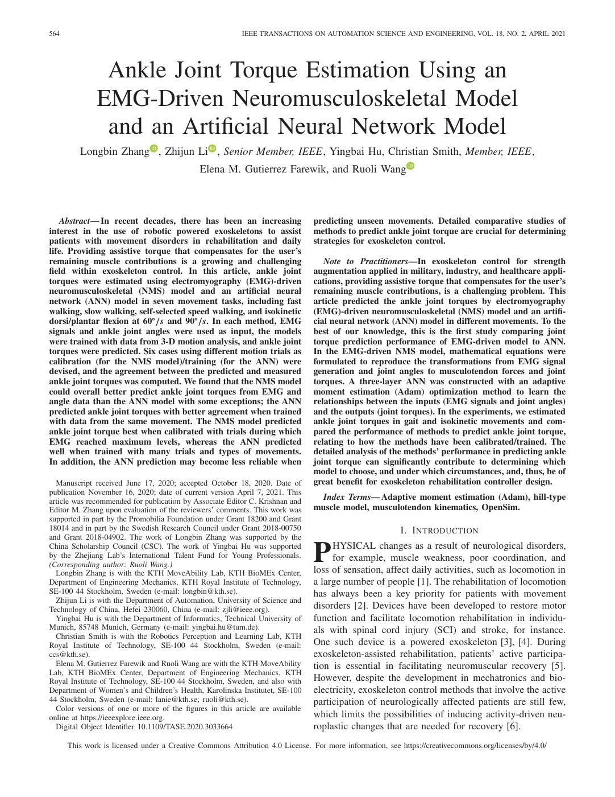
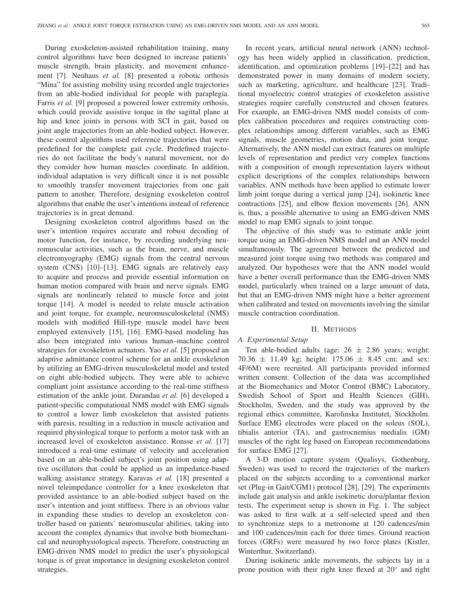
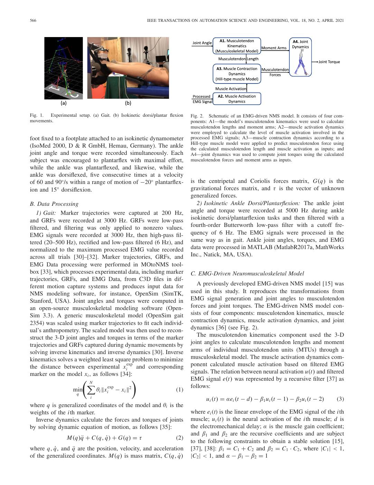
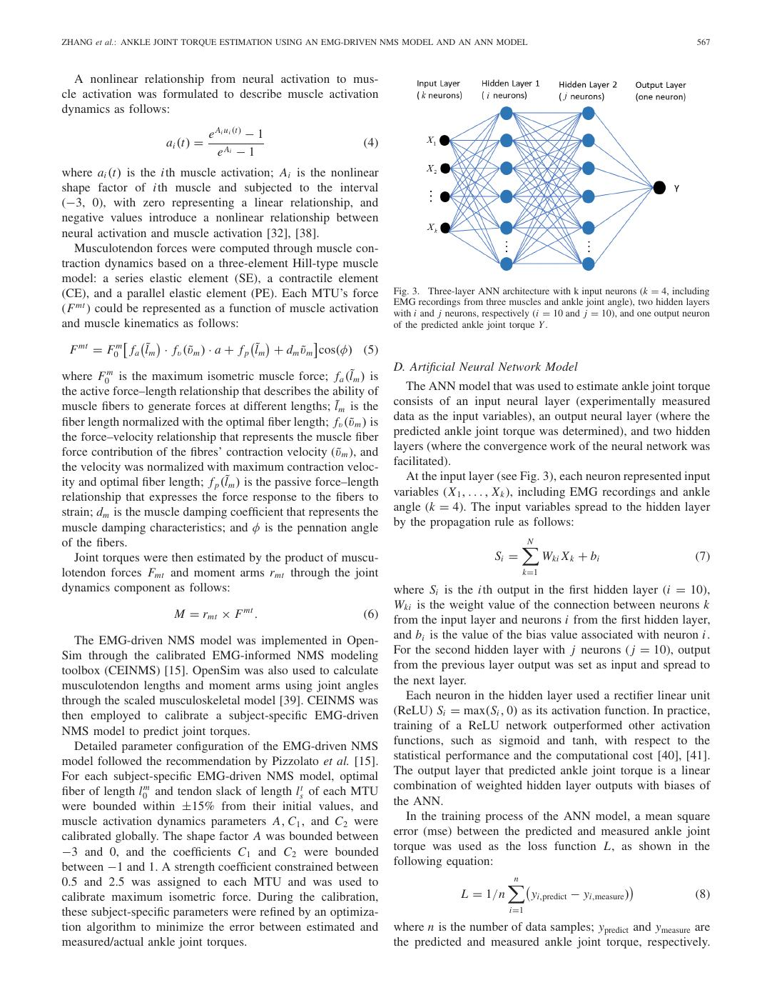
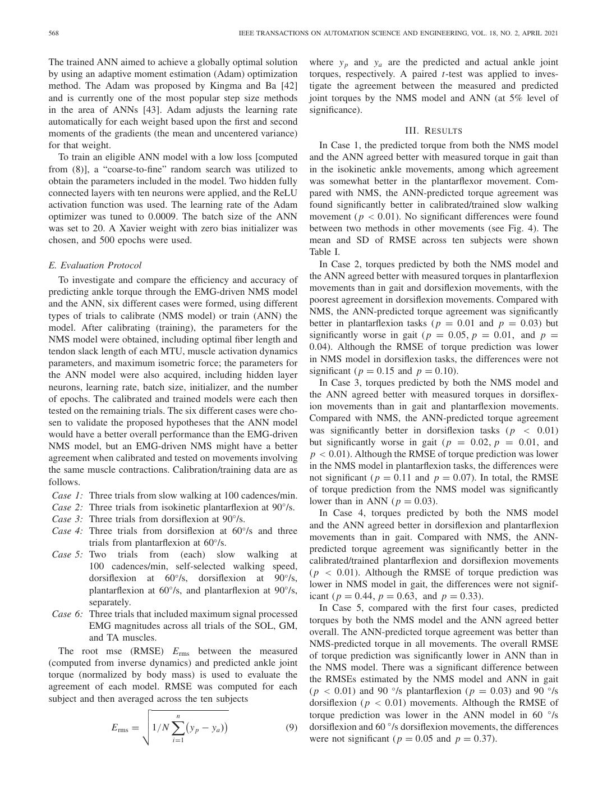
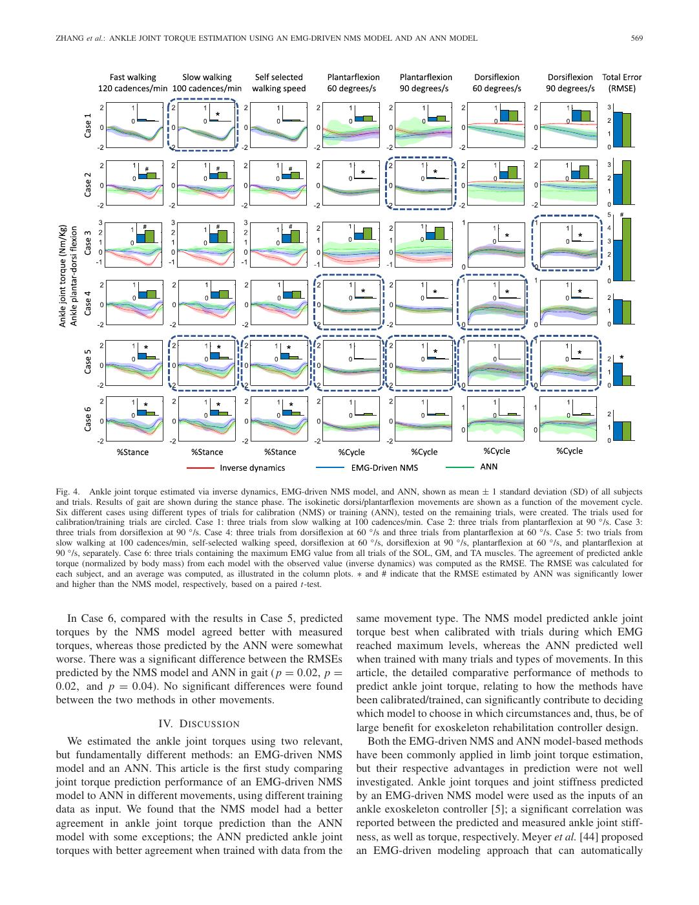
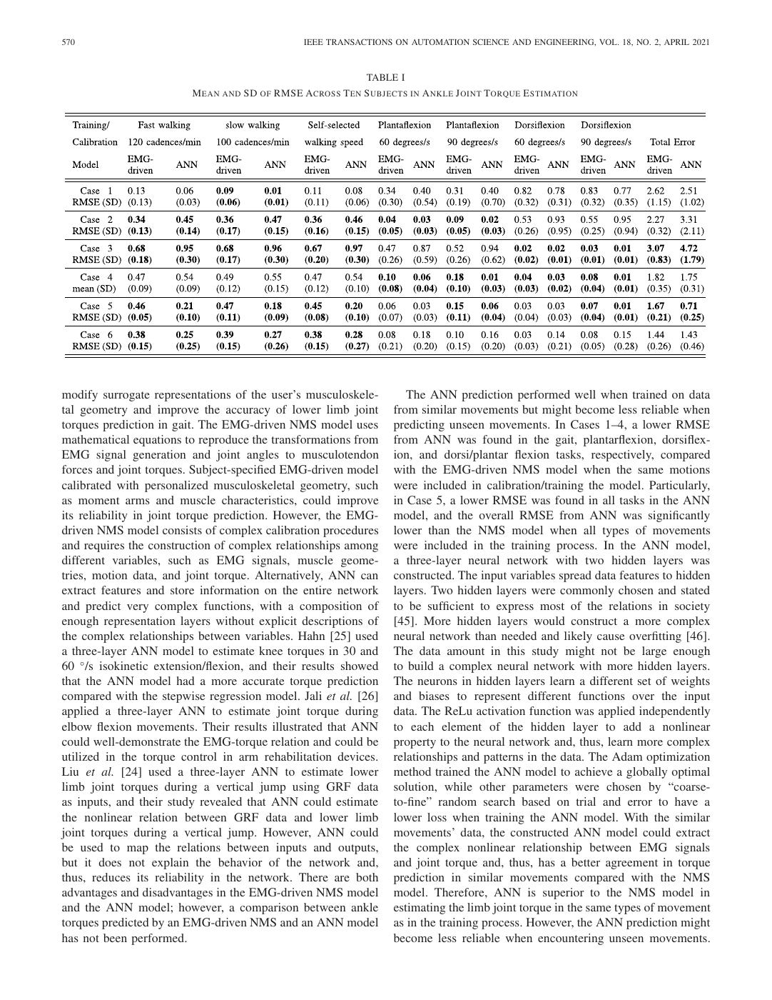
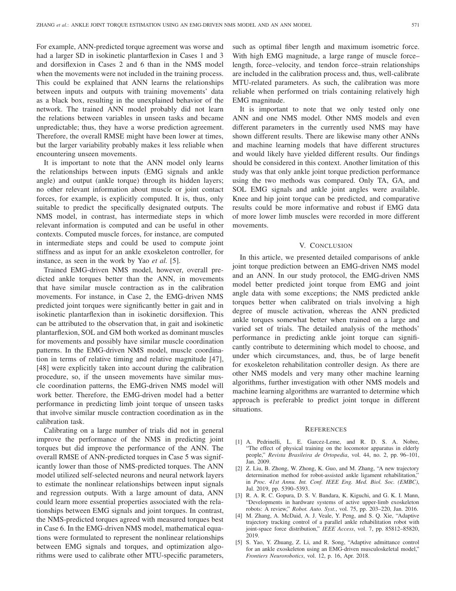
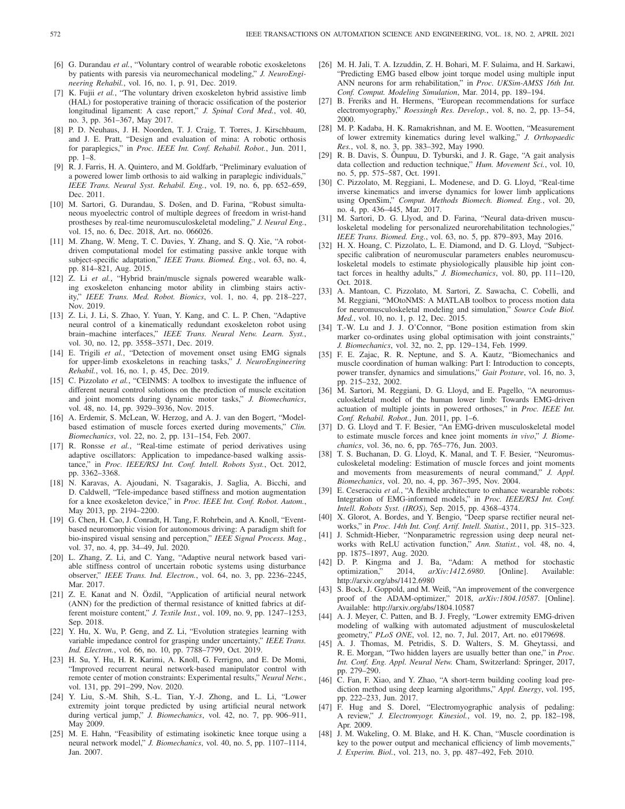

# Zhang2021-TASE：肌电驱动 NMS 模型与 ANN 的踝关节力矩估计

> English text extracted from the source PDF; not translated or editorially corrected. Each original PDF page is embedded below as a rendered image so figures, tables, and vector artwork remain visible.

- Source PDF: `Zhang2021-TASE：肌电驱动 NMS 模型与 ANN 的踝关节力矩估计.pdf`
- SHA-256: `2d005c7d8aff267c55f763af00008c61f214981d1f842eebb1800c75535c0cd2`
- Pages: 10
- Extraction: Poppler `pdftotext -layout`; page images rendered with `pdftoppm` (max dimension 1400 px, JPEG quality 76).

## Page 1

English text extracted from page 1

<pre>
564                                                       IEEE TRANSACTIONS ON AUTOMATION SCIENCE AND ENGINEERING, VOL. 18, NO. 2, APRIL 2021

               Ankle Joint Torque Estimation Using an
              EMG-Driven Neuromusculoskeletal Model
               and an Artificial Neural Network Model
         Longbin Zhang , Zhijun Li , Senior Member, IEEE, Yingbai Hu, Christian Smith, Member, IEEE,
                                             Elena M. Gutierrez Farewik, and Ruoli Wang

   Abstract— In recent decades, there has been an increasing                   predicting unseen movements. Detailed comparative studies of
interest in the use of robotic powered exoskeletons to assist                  methods to predict ankle joint torque are crucial for determining
patients with movement disorders in rehabilitation and daily                   strategies for exoskeleton control.
life. Providing assistive torque that compensates for the user’s
remaining muscle contributions is a growing and challenging                       Note to Practitioners—In exoskeleton control for strength
field within exoskeleton control. In this article, ankle joint                 augmentation applied in military, industry, and healthcare appli-
torques were estimated using electromyography (EMG)-driven                     cations, providing assistive torque that compensates for the user’s
neuromusculoskeletal (NMS) model and an artificial neural                      remaining muscle contributions, is a challenging problem. This
network (ANN) model in seven movement tasks, including fast                    article predicted the ankle joint torques by electromyography
walking, slow walking, self-selected speed walking, and isokinetic             (EMG)-driven neuromusculoskeletal (NMS) model and an artifi-
dorsi/plantar flexion at 60◦ /s and 90◦ /s. In each method, EMG                cial neural network (ANN) model in different movements. To the
signals and ankle joint angles were used as input, the models                  best of our knowledge, this is the first study comparing joint
were trained with data from 3-D motion analysis, and ankle joint               torque prediction performance of EMG-driven model to ANN.
torques were predicted. Six cases using different motion trials as             In the EMG-driven NMS model, mathematical equations were
calibration (for the NMS model)/training (for the ANN) were                    formulated to reproduce the transformations from EMG signal
devised, and the agreement between the predicted and measured                  generation and joint angles to musculotendon forces and joint
ankle joint torques was computed. We found that the NMS model                  torques. A three-layer ANN was constructed with an adaptive
could overall better predict ankle joint torques from EMG and                  moment estimation (Adam) optimization method to learn the
angle data than the ANN model with some exceptions; the ANN                    relationships between the inputs (EMG signals and joint angles)
predicted ankle joint torques with better agreement when trained               and the outputs (joint torques). In the experiments, we estimated
with data from the same movement. The NMS model predicted                      ankle joint torques in gait and isokinetic movements and com-
ankle joint torque best when calibrated with trials during which               pared the performance of methods to predict ankle joint torque,
EMG reached maximum levels, whereas the ANN predicted                          relating to how the methods have been calibrated/trained. The
well when trained with many trials and types of movements.                     detailed analysis of the methods’ performance in predicting ankle
In addition, the ANN prediction may become less reliable when                  joint torque can significantly contribute to determining which
                                                                               model to choose, and under which circumstances, and, thus, be of
  Manuscript received June 17, 2020; accepted October 18, 2020. Date of        great benefit for exoskeleton rehabilitation controller design.
publication November 16, 2020; date of current version April 7, 2021. This
article was recommended for publication by Associate Editor C. Krishnan and     Index Terms— Adaptive moment estimation (Adam), hill-type
Editor M. Zhang upon evaluation of the reviewers’ comments. This work was      muscle model, musculotendon kinematics, OpenSim.
supported in part by the Promobilia Foundation under Grant 18200 and Grant
18014 and in part by the Swedish Research Council under Grant 2018-00750                                I. I NTRODUCTION
and Grant 2018-04902. The work of Longbin Zhang was supported by the
China Scholarship Council (CSC). The work of Yingbai Hu was supported
by the Zhejiang Lab’s International Talent Fund for Young Professionals.
(Corresponding author: Ruoli Wang.)
  Longbin Zhang is with the KTH MoveAbility Lab, KTH BioMEx Center,
                                                                               P    HYSICAL changes as a result of neurological disorders,
                                                                                    for example, muscle weakness, poor coordination, and
                                                                               loss of sensation, affect daily activities, such as locomotion in
Department of Engineering Mechanics, KTH Royal Institute of Technology,        a large number of people [1]. The rehabilitation of locomotion
SE-100 44 Stockholm, Sweden (e-mail: longbin@kth.se).                          has always been a key priority for patients with movement
  Zhijun Li is with the Department of Automation, University of Science and
Technology of China, Hefei 230060, China (e-mail: zjli@ieee.org).              disorders [2]. Devices have been developed to restore motor
  Yingbai Hu is with the Department of Informatics, Technical University of    function and facilitate locomotion rehabilitation in individu-
Munich, 85748 Munich, Germany (e-mail: yingbai.hu@tum.de).                     als with spinal cord injury (SCI) and stroke, for instance.
  Christian Smith is with the Robotics Perception and Learning Lab, KTH
Royal Institute of Technology, SE-100 44 Stockholm, Sweden (e-mail:            One such device is a powered exoskeleton [3], [4]. During
ccs@kth.se).                                                                   exoskeleton-assisted rehabilitation, patients’ active participa-
  Elena M. Gutierrez Farewik and Ruoli Wang are with the KTH MoveAbility       tion is essential in facilitating neuromuscular recovery [5].
Lab, KTH BioMEx Center, Department of Engineering Mechanics, KTH
Royal Institute of Technology, SE-100 44 Stockholm, Sweden, and also with      However, despite the development in mechatronics and bio-
Department of Women’s and Children’s Health, Karolinska Institutet, SE-100     electricity, exoskeleton control methods that involve the active
44 Stockholm, Sweden (e-mail: lanie@kth.se; ruoli@kth.se).                     participation of neurologically affected patients are still few,
  Color versions of one or more of the figures in this article are available
online at https://ieeexplore.ieee.org.                                         which limits the possibilities of inducing activity-driven neu-
  Digital Object Identifier 10.1109/TASE.2020.3033664                          roplastic changes that are needed for recovery [6].
      This work is licensed under a Creative Commons Attribution 4.0 License. For more information, see https://creativecommons.org/licenses/by/4.0/
</pre>

## Page 2

English text extracted from page 2

<pre>
ZHANG et al.: ANKLE JOINT TORQUE ESTIMATION USING AN EMG-DRIVEN NMS MODEL AND AN ANN MODEL                                       565

   During exoskeleton-assisted rehabilitation training, many           In recent years, artificial neural network (ANN) technol-
control algorithms have been designed to increase patients’         ogy has been widely applied in classification, prediction,
muscle strength, brain plasticity, and movement enhance-            identification, and optimization problems [19]–[22] and has
ment [7]. Neuhaus et al. [8] presented a robotic orthosis           demonstrated power in many domains of modern society,
“Mina” for assisting mobility using recorded angle trajectories     such as marketing, agriculture, and healthcare [23]. Tradi-
from an able-bodied individual for people with paraplegia.          tional myoelectric control strategies of exoskeleton assistive
Farris et al. [9] proposed a powered lower extremity orthosis,      strategies require carefully constructed and chosen features.
which could provide assistive torque in the sagittal plane at       For example, an EMG-driven NMS model consists of com-
hip and knee joints in persons with SCI in gait, based on           plex calibration procedures and requires constructing com-
joint angle trajectories from an able-bodied subject. However,      plex relationships among different variables, such as EMG
these control algorithms used reference trajectories that were      signals, muscle geometries, motion data, and joint torque.
predefined for the complete gait cycle. Predefined trajecto-        Alternatively, the ANN model can extract features on multiple
ries do not facilitate the body’s natural movement, nor do          levels of representation and predict very complex functions
they consider how human muscles coordinate. In addition,            with a composition of enough representation layers without
individual adaptation is very difficult since it is not possible    explicit descriptions of the complex relationships between
to smoothly transfer movement trajectories from one gait            variables. ANN methods have been applied to estimate lower
pattern to another. Therefore, designing exoskeleton control        limb joint torque during a vertical jump [24], isokinetic knee
algorithms that enable the user’s intentions instead of reference   contractions [25], and elbow flexion movements [26]. ANN
trajectories is in great demand.                                    is, thus, a possible alternative to using an EMG-driven NMS
   Designing exoskeleton control algorithms based on the            model to map EMG signals to joint torque.
user’s intention requires accurate and robust decoding of              The objective of this study was to estimate ankle joint
motor function, for instance, by recording underlying neu-          torque using an EMG-driven NMS model and an ANN model
romuscular activities, such as the brain, nerve, and muscle         simultaneously. The agreement between the predicted and
electromyography (EMG) signals from the central nervous             measured joint torque using two methods was compared and
system (CNS) [10]–[13]. EMG signals are relatively easy             analyzed. Our hypotheses were that the ANN model would
to acquire and process and provide essential information on         have a better overall performance than the EMG-driven NMS
human motion compared with brain and nerve signals. EMG             model, particularly when trained on a large amount of data,
signals are nonlinearly related to muscle force and joint           but that an EMG-driven NMS might have a better agreement
torque [14]. A model is needed to relate muscle activation          when calibrated and tested on movements involving the similar
and joint torque, for example, neuromusculoskeletal (NMS)           muscle contraction coordination.
models with modified Hill-type muscle model have been
employed extensively [15], [16]. EMG-based modeling has                                     II. M ETHODS
also been integrated into various human–machine control             A. Experimental Setup
strategies for exoskeleton actuators. Yao et al. [5] proposed an       Ten able-bodied adults (age: 26 ± 2.86 years; weight:
adaptive admittance control scheme for an ankle exoskeleton         70.36 ± 11.49 kg; height: 175.06 ± 8.45 cm; and sex:
by utilizing an EMG-driven musculoskeletal model and tested         4F/6M) were recruited. All participants provided informed
on eight able-bodied subjects. They were able to achieve            written consent. Collection of the data was accomplished
compliant joint assistance according to the real-time stiffness     at the Biomechanics and Motor Control (BMC) Laboratory,
estimation of the ankle joint. Durandau et al. [6] developed a      Swedish School of Sport and Health Sciences (GIH),
patient-specific computational NMS model with EMG signals           Stockholm, Sweden, and the study was approved by the
to control a lower limb exoskeleton that assisted patients          regional ethics committee, Karolinska Institutet, Stockholm.
with paresis, resulting in a reduction in muscle activation and     Surface EMG electrodes were placed on the soleus (SOL),
required physiological torque to perform a motor task with an       tibialis anterior (TA), and gastrocnemius medialis (GM)
increased level of exoskeleton assistance. Ronsse et al. [17]       muscles of the right leg based on European recommendations
introduced a real-time estimate of velocity and acceleration        for surface EMG [27].
based on an able-bodied subject’s joint position using adap-           A 3-D motion capture system (Qualisys, Gothenburg,
tive oscillators that could be applied as an impedance-based        Sweden) was used to record the trajectories of the markers
walking assistance strategy. Karavas et al. [18] presented a        placed on the subjects according to a conventional marker
novel teleimpedance controller for a knee exoskeleton that          set (Plug-in Gait/CGM1) protocol [28], [29]. The experiments
provided assistance to an able-bodied subject based on the          include gait analysis and ankle isokinetic dorsi/plantar flexion
user’s intention and joint stiffness. There is an obvious value     tests. The experiment setup is shown in Fig. 1. The subject
in expanding these studies to develop an exoskeleton con-           was asked to first walk at a self-selected speed and then
troller based on patients’ neuromuscular abilities, taking into     to synchronize steps to a metronome at 120 cadences/min
account the complex dynamics that involve both biomechani-          and 100 cadences/min each for three times. Ground reaction
cal and neurophysiological aspects. Therefore, constructing an      forces (GRFs) were measured by two force plates (Kistler,
EMG-driven NMS model to predict the user’s physiological            Winterthur, Switzerland).
torque is of great importance in designing exoskeleton control         During isokinetic ankle movements, the subjects lay in a
strategies.                                                         prone position with their right knee flexed at 20◦ and right
</pre>

## Page 3

English text extracted from page 3

<pre>
566                                                     IEEE TRANSACTIONS ON AUTOMATION SCIENCE AND ENGINEERING, VOL. 18, NO. 2, APRIL 2021

Fig. 1. Experimental setup. (a) Gait. (b) Isokinetic dorsi/plantar flexion   Fig. 2. Schematic of an EMG-driven NMS model. It consists of four com-
movements.                                                                   ponents: A1—the model’s musculotendon kinematics were used to calculate
                                                                             musculotendon lengths and moment arms; A2—muscle activation dynamics
                                                                             were employed to calculate the level of muscle activation involved in the
foot fixed to a footplate attached to an isokinetic dynamometer              processed EMG signals; A3—muscle contraction dynamics according to a
                                                                             Hill-type muscle model were applied to predict musculotendon force using
(IsoMed 2000, D &amp; R GmbH, Hemau, Germany). The ankle                         the calculated musculotendon length and muscle activation as inputs; and
joint angle and torque were recorded simultaneously. Each                    A4—joint dynamics was used to compute joint torques using the calculated
subject was encouraged to plantarflex with maximal effort,                   musculotendon forces and moment arms as inputs.
while the ankle was plantarflexed, and likewise, while the
ankle was dorsiflexed, five consecutive times at a velocity
of 60 and 90◦ /s within a range of motion of −20◦ plantarflex-               is the centripetal and Coriolis forces matrix, G(q) is the
ion and 15◦ dorsiflexion.                                                    gravitational forces matrix, and τ is the vector of unknown
                                                                             generalized forces.
B. Data Processing                                                              2) Isokinetic Ankle Dorsi/Plantarflexion: The ankle joint
    1) Gait: Marker trajectories were captured at 200 Hz,                    angle and torque were recorded at 5000 Hz during ankle
and GRFs were recorded at 3000 Hz. GRFs were low-pass                        isokinetic dorsi/plantarflexion tasks and then filtered with a
filtered, and filtering was only applied to nonzero values.                  fourth-order Butterworth low-pass filter with a cutoff fre-
EMG signals were recorded at 3000 Hz, then high-pass fil-                    quency of 6 Hz. The EMG signals were processed in the
tered (20–500 Hz), rectified and low-pass filtered (6 Hz), and               same way as in gait. Ankle joint angles, torques, and EMG
normalized to the maximum processed EMG value recorded                       data were processed in MATLAB (MatlabR2017a, MathWorks
across all trials [30]–[32]. Marker trajectories, GRFs, and                  Inc., Natick, MA, USA).
EMG Data processing were performed in MOtoNMS tool-
box [33], which processes experimental data, including marker                C. EMG-Driven Neuromusculoskeletal Model
trajectories, GRFs, and EMG Data, from C3D files in dif-
ferent motion capture systems and produces input data for                       A previously developed EMG-driven NMS model [15] was
NMS modeling software, for instance, OpenSim (SimTK,                         used in this study. It reproduces the transformations from
Stanford, USA). Joint angles and torques were computed in                    EMG signal generation and joint angles to musculotendon
an open-source musculoskeletal modeling software (Open-                      forces and joint torques. The EMG-driven NMS model con-
Sim 3.3). A generic musculoskeletal model (OpenSim gait                      sists of four components: musculotendon kinematics, muscle
2354) was scaled using marker trajectories to fit each individ-              contraction dynamics, muscle activation dynamics, and joint
ual’s anthropometry. The scaled model was then used to recon-                dynamics [36] (see Fig. 2).
struct the 3-D joint angles and torques in terms of the marker                  The musculotendon kinematics component used the 3-D
trajectories and GRFs captured during dynamic movements by                   joint angles to calculate musculotendon lengths and moment
solving inverse kinematics and inverse dynamics [30]. Inverse                arms of individual musculotendon units (MTUs) through a
kinematics solves a weighted least square problem to minimize                musculoskeletal model. The muscle activation dynamics com-
                                          exp
the distance between experimental x i and corresponding                      ponent calculated muscle activation based on filtered EMG
marker on the model x i , as follows [34]:                                   signals. The relation between neural activation u(t) and filtered
                        N                                                  EMG signal e(t) was represented by a recursive filter [37] as
                                 exp                                        follows:
                   min      θi x i − x i 2
                                                            (1)
                      q
                             i                                                      u i (t) = αei (t − d) − β1 u i (t − 1) − β2 u i (t − 2)       (3)
where q is generalized coordinates of the model and θi is the
weights of the i th marker.                                                  where ei (t) is the linear envelope of the EMG signal of the i th
  Inverse dynamics calculate the forces and torques of joints                muscle; u i (t) is the neural activation of the i th muscle; d is
by solving dynamic equation of motion, as follows [35]:                      the electromechanical delay; α is the muscle gain coefficient;
                                                                             and β1 and β2 are the recursive coefficients and are subject
                 M(q)q̈ + C(q, q̇) + G(q) = τ                         (2)
                                                                             to the following constraints to obtain a stable solution [15],
where q, q̇, and q̈ are the position, velocity, and acceleration             [37], [38]: β1 = C1 + C2 and β2 = C1 · C2 , where |C1 | &lt; 1,
of the generalized coordinates. M(q) is mass matrix, C(q, q̇)                |C2 | &lt; 1, and α − β1 − β2 = 1
</pre>

## Page 4

English text extracted from page 4

<pre>
ZHANG et al.: ANKLE JOINT TORQUE ESTIMATION USING AN EMG-DRIVEN NMS MODEL AND AN ANN MODEL                                                       567

   A nonlinear relationship from neural activation to mus-
cle activation was formulated to describe muscle activation
dynamics as follows:
                                 e Ai u i (t) − 1
                      ai (t) =                                   (4)
                                   e Ai − 1
where ai (t) is the i th muscle activation; Ai is the nonlinear
shape factor of i th muscle and subjected to the interval
(−3, 0), with zero representing a linear relationship, and
negative values introduce a nonlinear relationship between
neural activation and muscle activation [32], [38].
   Musculotendon forces were computed through muscle con-
traction dynamics based on a three-element Hill-type muscle
model: a series elastic element (SE), a contractile element
(CE), and a parallel elastic element (PE). Each MTU’s force             Fig. 3. Three-layer ANN architecture with k input neurons (k = 4, including
                                                                        EMG recordings from three muscles and ankle joint angle), two hidden layers
(F mt ) could be represented as a function of muscle activation         with i and j neurons, respectively (i = 10 and j = 10), and one output neuron
and muscle kinematics as follows:                                       of the predicted ankle joint torque Y .
                                                     
  F mt = F0m f a l˜m · f v (ṽ m ) · a + f p l˜m + dm ṽ m cos(φ) (5)
                                                                        D. Artificial Neural Network Model
where F0m is the maximum isometric muscle force; fa (l˜m ) is
the active force–length relationship that describes the ability of         The ANN model that was used to estimate ankle joint torque
muscle fibers to generate forces at different lengths; l˜m is the       consists of an input neural layer (experimentally measured
fiber length normalized with the optimal fiber length; f v (ṽ m ) is   data as the input variables), an output neural layer (where the
the force–velocity relationship that represents the muscle fiber        predicted ankle joint torque was determined), and two hidden
force contribution of the fibres’ contraction velocity (ṽ m ), and     layers (where the convergence work of the neural network was
the velocity was normalized with maximum contraction veloc-             facilitated).
ity and optimal fiber length; f p (l˜m ) is the passive force–length       At the input layer (see Fig. 3), each neuron represented input
relationship that expresses the force response to the fibers to         variables (X 1 , . . . , X k ), including EMG recordings and ankle
strain; dm is the muscle damping coefficient that represents the        angle (k = 4). The input variables spread to the hidden layer
muscle damping characteristics; and φ is the pennation angle            by the propagation rule as follows:
of the fibers.                                                                                         
                                                                                                       N
   Joint torques were then estimated by the product of muscu-                                   Si =         Wki X k + bi                        (7)
lotendon forces Fmt and moment arms rmt through the joint                                              k=1
dynamics component as follows:                                          where Si is the i th output in the first hidden layer (i = 10),
                                                                        Wki is the weight value of the connection between neurons k
                        M = rmt × F mt .                         (6)    from the input layer and neurons i from the first hidden layer,
   The EMG-driven NMS model was implemented in Open-                    and bi is the value of the bias value associated with neuron i .
Sim through the calibrated EMG-informed NMS modeling                    For the second hidden layer with j neurons ( j = 10), output
toolbox (CEINMS) [15]. OpenSim was also used to calculate               from the previous layer output was set as input and spread to
musculotendon lengths and moment arms using joint angles                the next layer.
through the scaled musculoskeletal model [39]. CEINMS was                  Each neuron in the hidden layer used a rectifier linear unit
then employed to calibrate a subject-specific EMG-driven                (ReLU) Si = max(Si , 0) as its activation function. In practice,
NMS model to predict joint torques.                                     training of a ReLU network outperformed other activation
   Detailed parameter configuration of the EMG-driven NMS               functions, such as sigmoid and tanh, with respect to the
model followed the recommendation by Pizzolato et al. [15].             statistical performance and the computational cost [40], [41].
For each subject-specific EMG-driven NMS model, optimal                 The output layer that predicted ankle joint torque is a linear
fiber of length l0m and tendon slack of length lst of each MTU          combination of weighted hidden layer outputs with biases of
were bounded within ±15% from their initial values, and                 the ANN.
muscle activation dynamics parameters A, C1 , and C2 were                  In the training process of the ANN model, a mean square
calibrated globally. The shape factor A was bounded between             error (mse) between the predicted and measured ankle joint
−3 and 0, and the coefficients C1 and C2 were bounded                   torque was used as the loss function L, as shown in the
between −1 and 1. A strength coefficient constrained between            following equation:
0.5 and 2.5 was assigned to each MTU and was used to                                               
                                                                                                   n
                                                                                                                                     
calibrate maximum isometric force. During the calibration,                              L = 1/n           yi,predict − yi,measure )              (8)
these subject-specific parameters were refined by an optimiza-                                      i=1

tion algorithm to minimize the error between estimated and              where n is the number of data samples; ypredict and ymeasure are
measured/actual ankle joint torques.                                    the predicted and measured ankle joint torque, respectively.
</pre>

## Page 5

English text extracted from page 5

<pre>
568                                                     IEEE TRANSACTIONS ON AUTOMATION SCIENCE AND ENGINEERING, VOL. 18, NO. 2, APRIL 2021

The trained ANN aimed to achieve a globally optimal solution              where y p and ya are the predicted and actual ankle joint
by using an adaptive moment estimation (Adam) optimization                torques, respectively. A paired t-test was applied to inves-
method. The Adam was proposed by Kingma and Ba [42]                       tigate the agreement between the measured and predicted
and is currently one of the most popular step size methods                joint torques by the NMS model and ANN (at 5% level of
in the area of ANNs [43]. Adam adjusts the learning rate                  significance).
automatically for each weight based upon the first and second
moments of the gradients (the mean and uncentered variance)                                        III. R ESULTS
for that weight.                                                             In Case 1, the predicted torque from both the NMS model
   To train an eligible ANN model with a low loss [computed               and the ANN agreed better with measured torque in gait than
from (8)], a “coarse-to-fine” random search was utilized to               in the isokinetic ankle movements, among which agreement
obtain the parameters included in the model. Two hidden fully             was somewhat better in the plantarflexor movement. Com-
connected layers with ten neurons were applied, and the ReLU              pared with NMS, the ANN-predicted torque agreement was
activation function was used. The learning rate of the Adam               found significantly better in calibrated/trained slow walking
optimizer was tuned to 0.0009. The batch size of the ANN                  movement ( p &lt; 0.01). No significant differences were found
was set to 20. A Xavier weight with zero bias initializer was             between two methods in other movements (see Fig. 4). The
chosen, and 500 epochs were used.                                         mean and SD of RMSE across ten subjects were shown
                                                                          Table I.
E. Evaluation Protocol                                                       In Case 2, torques predicted by both the NMS model and
   To investigate and compare the efficiency and accuracy of              the ANN agreed better with measured torques in plantarflexion
predicting ankle torque through the EMG-driven NMS model                  movements than in gait and dorsiflexion movements, with the
and the ANN, six different cases were formed, using different             poorest agreement in dorsiflexion movements. Compared with
types of trials to calibrate (NMS model) or train (ANN) the               NMS, the ANN-predicted torque agreement was significantly
model. After calibrating (training), the parameters for the               better in plantarflexion tasks ( p = 0.01 and p = 0.03) but
NMS model were obtained, including optimal fiber length and               significantly worse in gait ( p = 0.05, p = 0.01, and p =
tendon slack length of each MTU, muscle activation dynamics               0.04). Although the RMSE of torque prediction was lower
parameters, and maximum isometric force; the parameters for               in NMS model in dorsiflexion tasks, the differences were not
the ANN model were also acquired, including hidden layer                  significant ( p = 0.15 and p = 0.10).
neurons, learning rate, batch size, initializer, and the number              In Case 3, torques predicted by both the NMS model and
of epochs. The calibrated and trained models were each then               the ANN agreed better with measured torques in dorsiflex-
tested on the remaining trials. The six different cases were cho-         ion movements than in gait and plantarflexion movements.
sen to validate the proposed hypotheses that the ANN model                Compared with NMS, the ANN-predicted torque agreement
would have a better overall performance than the EMG-driven               was significantly better in dorsiflexion tasks ( p &lt; 0.01)
NMS model, but an EMG-driven NMS might have a better                      but significantly worse in gait ( p = 0.02, p = 0.01, and
agreement when calibrated and tested on movements involving               p &lt; 0.01). Although the RMSE of torque prediction was lower
the same muscle contractions. Calibration/training data are as            in the NMS model in plantarflexion tasks, the differences were
follows.                                                                  not significant ( p = 0.11 and p = 0.07). In total, the RMSE
                                                                          of torque prediction from the NMS model was significantly
 Case 1: Three trials from slow walking at 100 cadences/min.
                                                                          lower than in ANN ( p = 0.03).
 Case 2: Three trials from isokinetic plantarflexion at 90◦ /s.
                                                                             In Case 4, torques predicted by both the NMS model
 Case 3: Three trials from dorsiflexion at 90◦ /s.
                                                                          and the ANN agreed better in dorsiflexion and plantarflexion
 Case 4: Three trials from dorsiflexion at 60◦ /s and three
                                                                          movements than in gait. Compared with NMS, the ANN-
           trials from plantarflexion at 60◦ /s.
                                                                          predicted torque agreement was significantly better in the
 Case 5: Two trials from (each) slow walking at
                                                                          calibrated/trained plantarflexion and dorsiflexion movements
           100 cadences/min, self-selected walking speed,
                                                                          ( p &lt; 0.01). Although the RMSE of torque prediction was
           dorsiflexion at 60◦ /s, dorsiflexion at 90◦ /s,
                                                                          lower in NMS model in gait, the differences were not signif-
           plantarflexion at 60◦ /s, and plantarflexion at 90◦ /s,
                                                                          icant ( p = 0.44, p = 0.63, and p = 0.33).
           separately.
                                                                             In Case 5, compared with the first four cases, predicted
 Case 6: Three trials that included maximum signal processed
                                                                          torques by both the NMS model and the ANN agreed better
           EMG magnitudes across all trials of the SOL, GM,
                                                                          overall. The ANN-predicted torque agreement was better than
           and TA muscles.
                                                                          NMS-predicted torque in all movements. The overall RMSE
   The root mse (RMSE) E rms between the measured                         of torque prediction was significantly lower in ANN than in
(computed from inverse dynamics) and predicted ankle joint                the NMS model. There was a significant difference between
torque (normalized by body mass) is used to evaluate the                  the RMSEs estimated by the NMS model and ANN in gait
agreement of each model. RMSE was computed for each                       ( p &lt; 0.01) and 90 ◦ /s plantarflexion ( p = 0.03) and 90 ◦ /s
subject and then averaged across the ten subjects                         dorsiflexion ( p &lt; 0.01) movements. Although the RMSE of
                                 
                                 n
                                                                        torque prediction was lower in the ANN model in 60 ◦ /s
                E rms =    1/N         y p − ya )                   (9)   dorsiflexion and 60 ◦ /s dorsiflexion movements, the differences
                                 i=1                                      were not significant ( p = 0.05 and p = 0.37).
</pre>

## Page 6

English text extracted from page 6

<pre>
ZHANG et al.: ANKLE JOINT TORQUE ESTIMATION USING AN EMG-DRIVEN NMS MODEL AND AN ANN MODEL                                                                       569

Fig. 4. Ankle joint torque estimated via inverse dynamics, EMG-driven NMS model, and ANN, shown as mean ± 1 standard deviation (SD) of all subjects
and trials. Results of gait are shown during the stance phase. The isokinetic dorsi/plantarflexion movements are shown as a function of the movement cycle.
Six different cases using different types of trials for calibration (NMS) or training (ANN), tested on the remaining trials, were created. The trials used for
calibration/training trials are circled. Case 1: three trials from slow walking at 100 cadences/min. Case 2: three trials from plantarflexion at 90 ◦ /s. Case 3:
three trials from dorsiflexion at 90 ◦ /s. Case 4: three trials from dorsiflexion at 60 ◦ /s and three trials from plantarflexion at 60 ◦ /s. Case 5: two trials from
slow walking at 100 cadences/min, self-selected walking speed, dorsiflexion at 60 ◦ /s, dorsiflexion at 90 ◦ /s, plantarflexion at 60 ◦ /s, and plantarflexion at
90 ◦ /s, separately. Case 6: three trials containing the maximum EMG value from all trials of the SOL, GM, and TA muscles. The agreement of predicted ankle
torque (normalized by body mass) from each model with the observed value (inverse dynamics) was computed as the RMSE. The RMSE was calculated for
each subject, and an average was computed, as illustrated in the column plots. ∗ and # indicate that the RMSE estimated by ANN was significantly lower
and higher than the NMS model, respectively, based on a paired t-test.

   In Case 6, compared with the results in Case 5, predicted                        same movement type. The NMS model predicted ankle joint
torques by the NMS model agreed better with measured                                torque best when calibrated with trials during which EMG
torques, whereas those predicted by the ANN were somewhat                           reached maximum levels, whereas the ANN predicted well
worse. There was a significant difference between the RMSEs                         when trained with many trials and types of movements. In this
predicted by the NMS model and ANN in gait ( p = 0.02, p =                          article, the detailed comparative performance of methods to
0.02, and p = 0.04). No significant differences were found                          predict ankle joint torque, relating to how the methods have
between the two methods in other movements.                                         been calibrated/trained, can significantly contribute to deciding
                                                                                    which model to choose in which circumstances and, thus, be of
                            IV. D ISCUSSION                                         large benefit for exoskeleton rehabilitation controller design.
   We estimated the ankle joint torques using two relevant,                            Both the EMG-driven NMS and ANN model-based methods
but fundamentally different methods: an EMG-driven NMS                              have been commonly applied in limb joint torque estimation,
model and an ANN. This article is the first study comparing                         but their respective advantages in prediction were not well
joint torque prediction performance of an EMG-driven NMS                            investigated. Ankle joint torques and joint stiffness predicted
model to ANN in different movements, using different training                       by an EMG-driven NMS model were used as the inputs of an
data as input. We found that the NMS model had a better                             ankle exoskeleton controller [5]; a significant correlation was
agreement in ankle joint torque prediction than the ANN                             reported between the predicted and measured ankle joint stiff-
model with some exceptions; the ANN predicted ankle joint                           ness, as well as torque, respectively. Meyer et al. [44] proposed
torques with better agreement when trained with data from the                       an EMG-driven modeling approach that can automatically
</pre>

## Page 7

English text extracted from page 7

<pre>
570                                             IEEE TRANSACTIONS ON AUTOMATION SCIENCE AND ENGINEERING, VOL. 18, NO. 2, APRIL 2021

                                                             TABLE I
                         M EAN AND SD OF RMSE A CROSS T EN S UBJECTS IN A NKLE J OINT T ORQUE E STIMATION

modify surrogate representations of the user’s musculoskele-         The ANN prediction performed well when trained on data
tal geometry and improve the accuracy of lower limb joint         from similar movements but might become less reliable when
torques prediction in gait. The EMG-driven NMS model uses         predicting unseen movements. In Cases 1–4, a lower RMSE
mathematical equations to reproduce the transformations from      from ANN was found in the gait, plantarflexion, dorsiflex-
EMG signal generation and joint angles to musculotendon           ion, and dorsi/plantar flexion tasks, respectively, compared
forces and joint torques. Subject-specified EMG-driven model      with the EMG-driven NMS model when the same motions
calibrated with personalized musculoskeletal geometry, such       were included in calibration/training the model. Particularly,
as moment arms and muscle characteristics, could improve          in Case 5, a lower RMSE was found in all tasks in the ANN
its reliability in joint torque prediction. However, the EMG-     model, and the overall RMSE from ANN was significantly
driven NMS model consists of complex calibration procedures       lower than the NMS model when all types of movements
and requires the construction of complex relationships among      were included in the training process. In the ANN model,
different variables, such as EMG signals, muscle geome-           a three-layer neural network with two hidden layers was
tries, motion data, and joint torque. Alternatively, ANN can      constructed. The input variables spread data features to hidden
extract features and store information on the entire network      layers. Two hidden layers were commonly chosen and stated
and predict very complex functions, with a composition of         to be sufficient to express most of the relations in society
enough representation layers without explicit descriptions of     [45]. More hidden layers would construct a more complex
the complex relationships between variables. Hahn [25] used       neural network than needed and likely cause overfitting [46].
a three-layer ANN model to estimate knee torques in 30 and        The data amount in this study might not be large enough
60 ◦ /s isokinetic extension/flexion, and their results showed    to build a complex neural network with more hidden layers.
that the ANN model had a more accurate torque prediction          The neurons in hidden layers learn a different set of weights
compared with the stepwise regression model. Jali et al. [26]     and biases to represent different functions over the input
applied a three-layer ANN to estimate joint torque during         data. The ReLu activation function was applied independently
elbow flexion movements. Their results illustrated that ANN       to each element of the hidden layer to add a nonlinear
could well-demonstrate the EMG-torque relation and could be       property to the neural network and, thus, learn more complex
utilized in the torque control in arm rehabilitation devices.     relationships and patterns in the data. The Adam optimization
Liu et al. [24] used a three-layer ANN to estimate lower          method trained the ANN model to achieve a globally optimal
limb joint torques during a vertical jump using GRF data          solution, while other parameters were chosen by “coarse-
as inputs, and their study revealed that ANN could estimate       to-fine” random search based on trial and error to have a
the nonlinear relation between GRF data and lower limb            lower loss when training the ANN model. With the similar
joint torques during a vertical jump. However, ANN could          movements’ data, the constructed ANN model could extract
be used to map the relations between inputs and outputs,          the complex nonlinear relationship between EMG signals
but it does not explain the behavior of the network and,          and joint torque and, thus, has a better agreement in torque
thus, reduces its reliability in the network. There are both      prediction in similar movements compared with the NMS
advantages and disadvantages in the EMG-driven NMS model          model. Therefore, ANN is superior to the NMS model in
and the ANN model; however, a comparison between ankle            estimating the limb joint torque in the same types of movement
torques predicted by an EMG-driven NMS and an ANN model           as in the training process. However, the ANN prediction might
has not been performed.                                           become less reliable when encountering unseen movements.
</pre>

## Page 8

English text extracted from page 8

<pre>
ZHANG et al.: ANKLE JOINT TORQUE ESTIMATION USING AN EMG-DRIVEN NMS MODEL AND AN ANN MODEL                                                    571

For example, ANN-predicted torque agreement was worse and           such as optimal fiber length and maximum isometric force.
had a larger SD in isokinetic plantarflexion in Cases 1 and 3       With high EMG magnitude, a large range of muscle force–
and dorsiflexion in Cases 2 and 6 than in the NMS model             length, force–velocity, and tendon force–strain relationships
when the movements were not included in the training process.       are included in the calibration process and, thus, well-calibrate
This could be explained that ANN learns the relationships           MTU-related parameters. As such, the calibration was more
between inputs and outputs with training movements’ data            reliable when performed on trials containing relatively high
as a black box, resulting in the unexplained behavior of the        EMG magnitude.
network. The trained ANN model probably did not learn                  It is important to note that we only tested only one
the relations between variables in unseen tasks and became          ANN and one NMS model. Other NMS models and even
unpredictable; thus, they have a worse prediction agreement.        different parameters in the currently used NMS may have
Therefore, the overall RMSE might have been lower at times,         shown different results. There are likewise many other ANNs
but the larger variability probably makes it less reliable when     and machine learning models that have different structures
encountering unseen movements.                                      and would likely have yielded different results. Our findings
   It is important to note that the ANN model only learns           should be considered in this context. Another limitation of this
the relationships between inputs (EMG signals and ankle             study was that only ankle joint torque prediction performance
angle) and output (ankle torque) through its hidden layers;         using the two methods was compared. Only TA, GA, and
no other relevant information about muscle or joint contact         SOL EMG signals and ankle joint angles were available.
forces, for example, is explicitly computed. It is, thus, only      Knee and hip joint torque can be predicted, and comparative
suitable to predict the specifically designated outputs. The        results could be more informative and robust if EMG data
NMS model, in contrast, has intermediate steps in which             of more lower limb muscles were recorded in more different
relevant information is computed and can be useful in other         movements.
contexts. Computed muscle forces, for instance, are computed
in intermediate steps and could be used to compute joint                                       V. C ONCLUSION
stiffness and as input for an ankle exoskeleton controller, for
instance, as seen in the work by Yao et al. [5].                       In this article, we presented detailed comparisons of ankle
   Trained EMG-driven NMS model, however, overall pre-              joint torque prediction between an EMG-driven NMS model
dicted ankle torques better than the ANN, in movements              and an ANN. In our study protocol, the EMG-driven NMS
that have similar muscle contraction as in the calibration          model better predicted joint torque from EMG and joint
movements. For instance, in Case 2, the EMG-driven NMS              angle data with some exceptions; the NMS predicted ankle
predicted joint torques were significantly better in gait and in    torques better when calibrated on trials involving a high
isokinetic plantarflexion than in isokinetic dorsiflexion. This     degree of muscle activation, whereas the ANN predicted
can be attributed to the observation that, in gait and isokinetic   ankle torques somewhat better when trained on a large and
plantarflexion, SOL and GM both worked as dominant muscles          varied set of trials. The detailed analysis of the methods’
for movements and possibly have similar muscle coordination         performance in predicting ankle joint torque can signifi-
patterns. In the EMG-driven NMS model, muscle coordina-             cantly contribute to determining which model to choose, and
tion in terms of relative timing and relative magnitude [47],       under which circumstances, and, thus, be of large benefit
[48] were explicitly taken into account during the calibration      for exoskeleton rehabilitation controller design. As there are
procedure, so, if the unseen movements have similar mus-            other NMS models and very many other machine learning
cle coordination patterns, the EMG-driven NMS model will            algorithms, further investigation with other NMS models and
work better. Therefore, the EMG-driven model had a better           machine learning algorithms are warranted to determine which
performance in predicting limb joint torque of unseen tasks         approach is preferable to predict joint torque in different
that involve similar muscle contraction coordination as in the      situations.
calibration task.
   Calibrating on a large number of trials did not in general                                     R EFERENCES
improve the performance of the NMS in predicting joint               [1] A. Pedrinelli, L. E. Garcez-Leme, and R. D. S. A. Nobre,
torques but did improve the performance of the ANN. The                  “The effect of physical training on the locomotor apparatus in elderly
overall RMSE of ANN-predicted torques in Case 5 was signif-              people,” Revista Brasileira de Ortopedia, vol. 44, no. 2, pp. 96–101,
                                                                         Jan. 2009.
icantly lower than those of NMS-predicted torques. The ANN           [2] Z. Liu, B. Zhong, W. Zhong, K. Guo, and M. Zhang, “A new trajectory
model utilized self-selected neurons and neural network layers           determination method for robot-assisted ankle ligament rehabilitation,”
to estimate the nonlinear relationships between input signals            in Proc. 41st Annu. Int. Conf. IEEE Eng. Med. Biol. Soc. (EMBC),
                                                                         Jul. 2019, pp. 5390–5393.
and regression outputs. With a large amount of data, ANN             [3] R. A. R. C. Gopura, D. S. V. Bandara, K. Kiguchi, and G. K. I. Mann,
could learn more essential properties associated with the rela-          “Developments in hardware systems of active upper-limb exoskeleton
tionships between EMG signals and joint torques. In contrast,            robots: A review,” Robot. Auto. Syst., vol. 75, pp. 203–220, Jan. 2016.
                                                                     [4] M. Zhang, A. McDaid, A. J. Veale, Y. Peng, and S. Q. Xie, “Adaptive
the NMS-predicted torques agreed with measured torques best              trajectory tracking control of a parallel ankle rehabilitation robot with
in Case 6. In the EMG-driven NMS model, mathematical equa-               joint-space force distribution,” IEEE Access, vol. 7, pp. 85812–85820,
tions were formulated to represent the nonlinear relationships           2019.
                                                                     [5] S. Yao, Y. Zhuang, Z. Li, and R. Song, “Adaptive admittance control
between EMG signals and torques, and optimization algo-                  for an ankle exoskeleton using an EMG-driven musculoskeletal model,”
rithms were used to calibrate other MTU-specific parameters,             Frontiers Neurorobotics, vol. 12, p. 16, Apr. 2018.
</pre>

## Page 9

English text extracted from page 9

<pre>
572                                                          IEEE TRANSACTIONS ON AUTOMATION SCIENCE AND ENGINEERING, VOL. 18, NO. 2, APRIL 2021

 [6] G. Durandau et al., “Voluntary control of wearable robotic exoskeletons       [26] M. H. Jali, T. A. Izzuddin, Z. H. Bohari, M. F. Sulaima, and H. Sarkawi,
     by patients with paresis via neuromechanical modeling,” J. NeuroEngi-              “Predicting EMG based elbow joint torque model using multiple input
     neering Rehabil., vol. 16, no. 1, p. 91, Dec. 2019.                                ANN neurons for arm rehabilitation,” in Proc. UKSim-AMSS 16th Int.
 [7] K. Fujii et al., “The voluntary driven exoskeleton hybrid assistive limb           Conf. Comput. Modeling Simulation, Mar. 2014, pp. 189–194.
     (HAL) for postoperative training of thoracic ossification of the posterior    [27] B. Freriks and H. Hermens, “European recommendations for surface
     longitudinal ligament: A case report,” J. Spinal Cord Med., vol. 40,               electromyography,” Roessingh Res. Develop., vol. 8, no. 2, pp. 13–54,
     no. 3, pp. 361–367, May 2017.                                                      2000.
 [8] P. D. Neuhaus, J. H. Noorden, T. J. Craig, T. Torres, J. Kirschbaum,          [28] M. P. Kadaba, H. K. Ramakrishnan, and M. E. Wootten, “Measurement
     and J. E. Pratt, “Design and evaluation of mina: A robotic orthosis                of lower extremity kinematics during level walking,” J. Orthopaedic
     for paraplegics,” in Proc. IEEE Int. Conf. Rehabil. Robot., Jun. 2011,             Res., vol. 8, no. 3, pp. 383–392, May 1990.
     pp. 1–8.                                                                      [29] R. B. Davis, S. Õunpuu, D. Tyburski, and J. R. Gage, “A gait analysis
 [9] R. J. Farris, H. A. Quintero, and M. Goldfarb, “Preliminary evaluation of          data collection and reduction technique,” Hum. Movement Sci., vol. 10,
     a powered lower limb orthosis to aid walking in paraplegic individuals,”           no. 5, pp. 575–587, Oct. 1991.
     IEEE Trans. Neural Syst. Rehabil. Eng., vol. 19, no. 6, pp. 652–659,          [30] C. Pizzolato, M. Reggiani, L. Modenese, and D. G. Lloyd, “Real-time
     Dec. 2011.                                                                         inverse kinematics and inverse dynamics for lower limb applications
[10] M. Sartori, G. Durandau, S. Došen, and D. Farina, “Robust simulta-                 using OpenSim,” Comput. Methods Biomech. Biomed. Eng., vol. 20,
     neous myoelectric control of multiple degrees of freedom in wrist-hand             no. 4, pp. 436–445, Mar. 2017.
     prostheses by real-time neuromusculoskeletal modeling,” J. Neural Eng.,       [31] M. Sartori, D. G. Llyod, and D. Farina, “Neural data-driven muscu-
     vol. 15, no. 6, Dec. 2018, Art. no. 066026.                                        loskeletal modeling for personalized neurorehabilitation technologies,”
                                                                                        IEEE Trans. Biomed. Eng., vol. 63, no. 5, pp. 879–893, May 2016.
[11] M. Zhang, W. Meng, T. C. Davies, Y. Zhang, and S. Q. Xie, “A robot-
                                                                                   [32] H. X. Hoang, C. Pizzolato, L. E. Diamond, and D. G. Lloyd, “Subject-
     driven computational model for estimating passive ankle torque with
                                                                                        specific calibration of neuromuscular parameters enables neuromuscu-
     subject-specific adaptation,” IEEE Trans. Biomed. Eng., vol. 63, no. 4,
                                                                                        loskeletal models to estimate physiologically plausible hip joint con-
     pp. 814–821, Aug. 2015.
                                                                                        tact forces in healthy adults,” J. Biomechanics, vol. 80, pp. 111–120,
[12] Z. Li et al., “Hybrid brain/muscle signals powered wearable walk-                  Oct. 2018.
     ing exoskeleton enhancing motor ability in climbing stairs activ-             [33] A. Mantoan, C. Pizzolato, M. Sartori, Z. Sawacha, C. Cobelli, and
     ity,” IEEE Trans. Med. Robot. Bionics, vol. 1, no. 4, pp. 218–227,                 M. Reggiani, “MOtoNMS: A MATLAB toolbox to process motion data
     Nov. 2019.                                                                         for neuromusculoskeletal modeling and simulation,” Source Code Biol.
[13] Z. Li, J. Li, S. Zhao, Y. Yuan, Y. Kang, and C. L. P. Chen, “Adaptive              Med., vol. 10, no. 1, p. 12, Dec. 2015.
     neural control of a kinematically redundant exoskeleton robot using           [34] T.-W. Lu and J. J. O’Connor, “Bone position estimation from skin
     brain–machine interfaces,” IEEE Trans. Neural Netw. Learn. Syst.,                  marker co-ordinates using global optimisation with joint constraints,”
     vol. 30, no. 12, pp. 3558–3571, Dec. 2019.                                         J. Biomechanics, vol. 32, no. 2, pp. 129–134, Feb. 1999.
[14] E. Trigili et al., “Detection of movement onset using EMG signals             [35] F. E. Zajac, R. R. Neptune, and S. A. Kautz, “Biomechanics and
     for upper-limb exoskeletons in reaching tasks,” J. NeuroEngineering                muscle coordination of human walking: Part I: Introduction to concepts,
     Rehabil., vol. 16, no. 1, p. 45, Dec. 2019.                                        power transfer, dynamics and simulations,” Gait Posture, vol. 16, no. 3,
[15] C. Pizzolato et al., “CEINMS: A toolbox to investigate the influence of            pp. 215–232, 2002.
     different neural control solutions on the prediction of muscle excitation     [36] M. Sartori, M. Reggiani, D. G. Lloyd, and E. Pagello, “A neuromus-
     and joint moments during dynamic motor tasks,” J. Biomechanics,                    culoskeletal model of the human lower limb: Towards EMG-driven
     vol. 48, no. 14, pp. 3929–3936, Nov. 2015.                                         actuation of multiple joints in powered orthoses,” in Proc. IEEE Int.
[16] A. Erdemir, S. McLean, W. Herzog, and A. J. van den Bogert, “Model-                Conf. Rehabil. Robot., Jun. 2011, pp. 1–6.
     based estimation of muscle forces exerted during movements,” Clin.            [37] D. G. Lloyd and T. F. Besier, “An EMG-driven musculoskeletal model
     Biomechanics, vol. 22, no. 2, pp. 131–154, Feb. 2007.                              to estimate muscle forces and knee joint moments in vivo,” J. Biome-
[17] R. Ronsse et al., “Real-time estimate of period derivatives using                  chanics, vol. 36, no. 6, pp. 765–776, Jun. 2003.
     adaptive oscillators: Application to impedance-based walking assis-           [38] T. S. Buchanan, D. G. Lloyd, K. Manal, and T. F. Besier, “Neuromus-
     tance,” in Proc. IEEE/RSJ Int. Conf. Intell. Robots Syst., Oct. 2012,              culoskeletal modeling: Estimation of muscle forces and joint moments
     pp. 3362–3368.                                                                     and movements from measurements of neural command,” J. Appl.
[18] N. Karavas, A. Ajoudani, N. Tsagarakis, J. Saglia, A. Bicchi, and                  Biomechanics, vol. 20, no. 4, pp. 367–395, Nov. 2004.
     D. Caldwell, “Tele-impedance based stiffness and motion augmentation          [39] E. Ceseracciu et al., “A flexible architecture to enhance wearable robots:
     for a knee exoskeleton device,” in Proc. IEEE Int. Conf. Robot. Autom.,            Integration of EMG-informed models,” in Proc. IEEE/RSJ Int. Conf.
     May 2013, pp. 2194–2200.                                                           Intell. Robots Syst. (IROS), Sep. 2015, pp. 4368–4374.
[19] G. Chen, H. Cao, J. Conradt, H. Tang, F. Rohrbein, and A. Knoll, “Event-      [40] X. Glorot, A. Bordes, and Y. Bengio, “Deep sparse rectifier neural net-
     based neuromorphic vision for autonomous driving: A paradigm shift for             works,” in Proc. 14th Int. Conf. Artif. Intell. Statist., 2011, pp. 315–323.
     bio-inspired visual sensing and perception,” IEEE Signal Process. Mag.,       [41] J. Schmidt-Hieber, “Nonparametric regression using deep neural net-
     vol. 37, no. 4, pp. 34–49, Jul. 2020.                                              works with ReLU activation function,” Ann. Statist., vol. 48, no. 4,
[20] L. Zhang, Z. Li, and C. Yang, “Adaptive neural network based vari-                 pp. 1875–1897, Aug. 2020.
                                                                                   [42] D. P. Kingma and J. Ba, “Adam: A method for stochastic
     able stiffness control of uncertain robotic systems using disturbance
                                                                                        optimization,”      2014,    arXiv:1412.6980.        [Online].     Available:
     observer,” IEEE Trans. Ind. Electron., vol. 64, no. 3, pp. 2236–2245,
                                                                                        http://arxiv.org/abs/1412.6980
     Mar. 2017.
                                                                                   [43] S. Bock, J. Goppold, and M. Weiß, “An improvement of the convergence
[21] Z. E. Kanat and N. Özdil, “Application of artificial neural network
                                                                                        proof of the ADAM-optimizer,” 2018, arXiv:1804.10587. [Online].
     (ANN) for the prediction of thermal resistance of knitted fabrics at dif-
                                                                                        Available: http://arxiv.org/abs/1804.10587
     ferent moisture content,” J. Textile Inst., vol. 109, no. 9, pp. 1247–1253,   [44] A. J. Meyer, C. Patten, and B. J. Fregly, “Lower extremity EMG-driven
     Sep. 2018.                                                                         modeling of walking with automated adjustment of musculoskeletal
[22] Y. Hu, X. Wu, P. Geng, and Z. Li, “Evolution strategies learning with              geometry,” PLoS ONE, vol. 12, no. 7, Jul. 2017, Art. no. e0179698.
     variable impedance control for grasping under uncertainty,” IEEE Trans.       [45] A. J. Thomas, M. Petridis, S. D. Walters, S. M. Gheytassi, and
     Ind. Electron., vol. 66, no. 10, pp. 7788–7799, Oct. 2019.                         R. E. Morgan, “Two hidden layers are usually better than one,” in Proc.
[23] H. Su, Y. Hu, H. R. Karimi, A. Knoll, G. Ferrigno, and E. De Momi,                 Int. Conf. Eng. Appl. Neural Netw. Cham, Switzerland: Springer, 2017,
     “Improved recurrent neural network-based manipulator control with                  pp. 279–290.
     remote center of motion constraints: Experimental results,” Neural Netw.,     [46] C. Fan, F. Xiao, and Y. Zhao, “A short-term building cooling load pre-
     vol. 131, pp. 291–299, Nov. 2020.                                                  diction method using deep learning algorithms,” Appl. Energy, vol. 195,
[24] Y. Liu, S.-M. Shih, S.-L. Tian, Y.-J. Zhong, and L. Li, “Lower                     pp. 222–233, Jun. 2017.
     extremity joint torque predicted by using artificial neural network           [47] F. Hug and S. Dorel, “Electromyographic analysis of pedaling:
     during vertical jump,” J. Biomechanics, vol. 42, no. 7, pp. 906–911,               A review,” J. Electromyogr. Kinesiol., vol. 19, no. 2, pp. 182–198,
     May 2009.                                                                          Apr. 2009.
[25] M. E. Hahn, “Feasibility of estimating isokinetic knee torque using a         [48] J. M. Wakeling, O. M. Blake, and H. K. Chan, “Muscle coordination is
     neural network model,” J. Biomechanics, vol. 40, no. 5, pp. 1107–1114,             key to the power output and mechanical efficiency of limb movements,”
     Jan. 2007.                                                                         J. Experim. Biol., vol. 213, no. 3, pp. 487–492, Feb. 2010.
</pre>

## Page 10

English text extracted from page 10

<pre>
ZHANG et al.: ANKLE JOINT TORQUE ESTIMATION USING AN EMG-DRIVEN NMS MODEL AND AN ANN MODEL                                                                    573

                          Longbin Zhang received the M.Sc. degree in con-                                  Christian Smith (Member, IEEE) received the
                          trol engineering from the South China University                                 M.Sc. degree in engineering physics and the
                          of Technology, Guangzhou, China, in 2017. She is                                 Ph.D. degree in computer science from the KTH
                          currently pursuing the Ph.D. degree with a focus on                              Royal Institute of Technology, Stockholm, Sweden,
                          robotic exoskeletons for patients with a motor disor-                            in 2005 and 2009, respectively.
                          der with the Department of Engineering Mechanics,                                   He was a Post-Doctoral Researcher with Advanced
                          KTH Royal Institute of Technology, Stockholm,                                    Telecommunications Research International (ATR),
                          Sweden.                                                                          Kyoto, Japan, from 2010 to 2011. He is currently
                            She has participated in some research projects in                              an Associate Professor of Computer Science and the
                          Sweden sponsored by the Promobilia Foundation                                    Deputy Head of the Division of Robotics, Percep-
                          (ref. nr. 18200) and Swedish Scientific Council                                  tion, and Learning, KTH Royal Institute of Tech-
(2018-00750) and worked on biosignal processing and exoskeleton control.          nology. His research interests include control and modeling for manipulation
She has published several articles in international conferences and jour-         and grasping in human-centric environments, such as medical facilities
nals. Her main research interests include simulation of human movement,           and small-scale manufacturing plants, as well as physical human–robot
robotic exoskeleton assistive strategies, electromyography (EMG) control, and     interaction.
optimizing and reinforcement learning control.                                      Dr. Smith was the Treasury Chair of the IEEE International Conference
                                                                                  on Robotics and Automation in 2016. He is also the Secretary of the IEEE
                                                                                  Robotics and Automation Society Swedish Chapter. He also serves as an
                                                                                  Associate Editor for the IEEE ROBOTICS AND AUTOMATION L ETTERS and
                                                                                  several conference editorial boards.
                          Zhijun Li (Senior Member, IEEE) received the
                          Ph.D. degree in mechatronics from Shanghai Jiao
                          Tong University, Shanghai, China, in 2002.
                            From 2003 to 2005, he was a Post-Doctoral Fellow                                 Elena M. Gutierrez Farewik received the B.Sc.
                          with the Department of Mechanical Engineering                                      degree in mechanical engineering from Cornell Uni-
                          and Intelligent systems, The University of Electro-                                versity, Ithaca, NY, USA, in 1995, the M.Sc. degree
                          Communications, Tokyo, Japan. From 2005 to 2006,                                   in biomedical engineering from the University of
                          he was a Research Fellow with the Department                                       Michigan, Ann Arbor, MI, USA, in 1997, and the
                          of Electrical and Computer Engineering, National                                   Ph.D. degree in orthopedics from Karolinska Insti-
                          University of Singapore, Singapore, and Nanyang                                    tutet, Solna, Sweden, in 2003.
                          Technological University, Singapore. Since 2012,                                     She is currently a Professor of Biomechanics with
he has been a Professor with the College of Automation Science and                                           the Department of Engineering Mechanics, KTH
Engineering, South China University of Technology, Guangzhou, China. Since                                   Royal Institute of Technology, Stockholm, Sweden.
2017, he has been a Professor with the Department of Automation, University                                  She is also with the Department of Women’s and
of Science and Technology, Hefei, China. His current research interests           Children’s Health, Karolinska Institutet. She leads the research group at
include service robotics, teleoperation systems, nonlinear control, and neural    the KTH MoveAbility Lab. She and her group combine experiments with
network optimization.                                                             numerical modeling to study the short- and long-term consequences of
  Dr. Li was the General Chair and the Program Chair of the 2016 and              deviating loading on musculoskeletal tissues in growing children. They are
2017 IEEE Conference on Advanced Robotics and Mechatronics. Since 2016,           also developing biosignal-controlled assistive-as-needed devices for the lower
he has been the Co-Chair of the Technical Committee on Bio-mechatronics           extremities for applications in neurorehabilitation and rehabilitation, with
and Bio-robotics Systems (B 2 S), the IEEE Systems, Man and Cybernetics           a goal to preserve available neural pathways and complement the user’s
Society, the Technical Committee on Neuro-Robotics Systems, and the IEEE          functional abilities. Her research interests span several biological scales and
Robotics and Automation Society. He has been serving as an Editor-at-Large        include modeling, predictive simulation, and device design for children and
of the Journal of Intelligent and Robotic Systems and an Associate Editor of      adults with motor disorders.
several IEEE T RANSACTIONS .

                                                                                                             Ruoli Wang received the B.Eng. degree in mechan-
                                                                                                             ical engineering from Southeast University, Nanjing,
                         Yingbai Hu received the M.Sc. degree in con-                                        China, in 2004, and the M.Sc. and Ph.D. degrees in
                         trol theory and control engineering from the South                                  engineering mechanics from the KTH Royal Institute
                         China University of Technology, Guangzhou, China,                                   of Technology, Stockholm, Sweden, in 2007 and
                         in 2017. He is currently pursuing the Ph.D. degree                                  2012, respectively.
                         in computer science with Technische Universität                                       Her post-doctoral research at Paediatric Neurology
                         München, Munich, Germany.                                                           Group, Karolinska Institutet, Stockholm, Sweden,
                           He was a Research Fellow with the Shenzhen Insti-                                 and Computational Biology Group, KTH, centered
                         tutes of Advanced Technology, Chinese Academy of                                    around the quantification of spasticity and secondary
                         Sciences, Beijing, China, from 2017 to 2018. He is                                  muscle structure, and property changes following
                         also a member of the Informatics 6-Chair of Robot-       spasticity. At her current post as an Assistant Professor at KTH Engineering
                         ics, Artificial Intelligence and Real-time Systems,      Sciences, Engineering Mechanics, her focus is to develop methodologies
Technische Universität München. He has participated in the EU-funded project      for estimating personalized musculotendon parameters noninvasively using a
European Union’s Horizon 2020 Framework Programme for Research and                combination of medical imaging, musculoskeletal modeling, and optimization.
Innovation under the Specific Grant Agreement No. 785907 (Human Brain             She is also a member of the Research Group, KTH MoveAbility Lab, where
Project SGA2). He has published several articles in international conferences     she is also a member of the Executive Board of the KTH BioMEx Center. Her
and journals. His main research interests include control and instrumentation     research interests include in vivo quantification of mechanical properties of
in mobile robot, human–robot interaction, surgical robotics, and reinforcement    the human muscle-tendon structure, neuromusculoskeletal modeling of human
learning.                                                                         movement, and neurophysiology of human muscles.
</pre>

