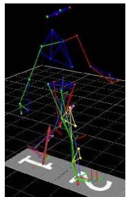
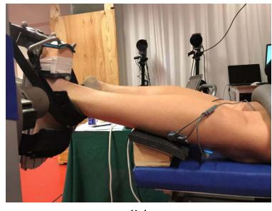
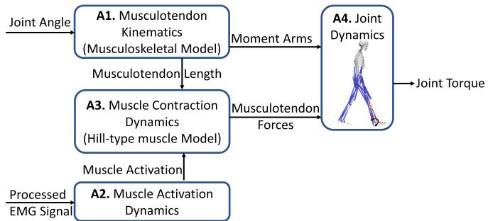
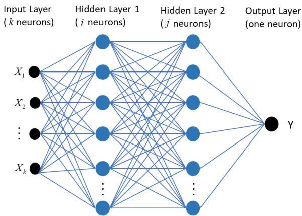
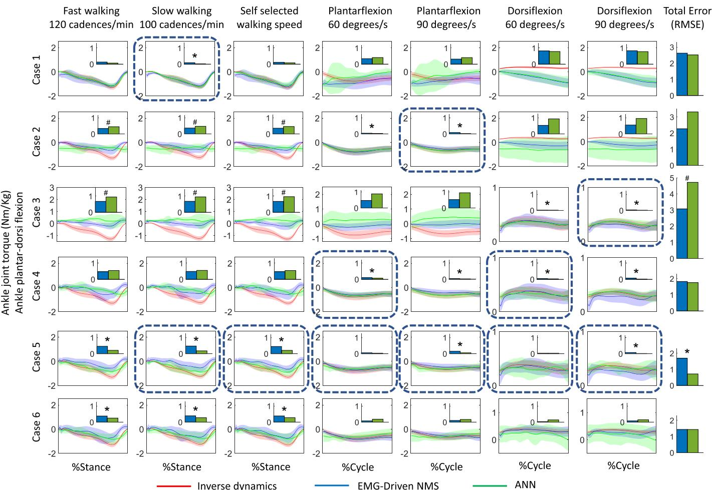
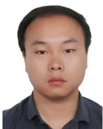

# 基于肌电驱动神经肌肉骨骼模型与人工神经网络模型的踝关节力矩估计

Longbin Zhang , Zhijun Li , Senior Member, IEEE, Yingbai Hu, Christian Smith, Member, IEEE, Elena M. Gutierrez Farewik, and Ruoli Wang

摘要— 近几十年来，利用动力外骨骼机器人辅助运动障碍患者进行康复和日常生活的关注度日益增加。提供能够补偿用户剩余肌肉贡献的辅助力矩是外骨骼控制领域中一个不断发展且具有挑战性的方向。在本文中，利用肌电图（EMG）驱动的神经肌肉骨骼（NMS）模型和人工神经网络（ANN）模型在七种运动任务中估计了踝关节力矩，这些任务包括快走、慢走、自选速度行走以及在 60◦/s 和 90◦/s 下的等速背屈/跖屈。在每种方法中，均将 EMG 信号和踝关节角度作为输入，利用三维运动分析数据对模型进行训练，并预测踝关节力矩。设计了六种采用不同运动试验作为校准（针对 NMS 模型）/训练（针对 ANN）的案例，并计算了预测的踝关节力矩与测量值之间的一致性。我们发现，除了某些特例外，总体而言 NMS 模型根据 EMG 和角度数据预测踝关节力矩的效果优于 ANN 模型；当使用来自相同运动的数据进行训练时，ANN 预测踝关节力矩的一致性更高。当使用 EMG 达到最大水平的试验进行校准时，NMS 模型对踝关节力矩的预测效果最佳，而 ANN 在使用大量试验和多种运动类型进行训练时表现良好。此外，在预测未见过的运动时，ANN 的预测可靠性可能会降低。对预测踝关节力矩的方法进行详细的对比研究对于确定外骨骼控制策略至关重要。

从业者须知——在应用于军事、工业和医疗领域的增强力量型外骨骼控制中，提供能够补偿用户残余肌肉贡献的辅助力矩是一个具有挑战性的问题。本文通过肌电（EMG）驱动的神经肌肉骨骼（NMS）模型和人工神经网络（ANN）模型预测了不同运动中的踝关节力矩。据我们所知，这是首项对比 EMG 驱动模型与 ANN 在关节力矩预测性能方面的研究。在 EMG 驱动的 NMS 模型中，构建了数学方程以重现从 EMG 信号生成和关节角度到肌腱力和关节力矩的转换过程。构建了一个采用自适应矩估计（Adam）优化方法的三层 ANN，以学习输入（EMG 信号和关节角度）与输出（关节力矩）之间的关系。在实验中，我们估计了步态和等速运动中的踝关节力矩，并结合各方法的校准/训练方式，比较了这些方法预测踝关节力矩的性能。对这些方法在预测踝关节力矩方面性能的详细分析，有助于确定在何种情况下选择何种模型，从而对外骨骼康复控制器的设计大有裨益。

Index Terms— 自适应矩估计（Adaptive moment estimation, Adam）、Hill 型肌肉模型、肌腱运动学、OpenSim。

## I. 引言

神经系统疾病导致的身体机能改变，例如肌肉无力、协调性差，以及例如肌肉无力、协调性差和感觉丧失，影响了大量人群的日常活动（例如行走运动）[1]。运动功能的康复对于运动障碍患者而言一直是一项首要任务 [2]。目前已开发出多种设备用于恢复运动功能并促进脊髓损伤（SCI）和脑卒中等患者的行走康复。动力外骨骼就是其中一种设备 [3]、[4]。在外骨骼辅助康复过程中，患者的主动参与对于促进神经肌肉恢复至关重要 [5]。然而，尽管机电一体化和生物电技术取得了发展，涉及神经受损患者主动参与的外骨骼控制方法仍然较少，这限制了诱导康复所需的主动驱动型神经可塑性改变的可能性 [6]。

在外骨骼辅助康复训练中，已经设计了许多控制算法以增强患者的肌肉力量、大脑可塑性并提高运动能力 [7]。Neuhaus 等人 [8] 提出了一种名为“Mina”的机器人矫形器，利用从健全人身上记录的角度轨迹来协助截瘫患者活动。Farris 等人 [9] 提出了一种动力下肢矫形器，该矫形器基于健全受试者的关节角度轨迹，能够在步态过程中为脊髓损伤（SCI）患者的髋关节和膝关节在矢状面上提供辅助力矩。然而，这些控制算法使用的参考轨迹针对整个步态周期进行了预定义。预定义轨迹既不利于身体的自然运动，也没有考虑人体肌肉是如何协同运作的。此外，由于无法将运动轨迹从一种步态模式平滑过渡到另一种步态模式，个体适应性非常难以实现。因此，迫切需要设计能够体现用户意图而非依赖参考轨迹的外骨骼控制算法。

基于用户意图设计外骨骼控制算法需要对运动功能进行准确且鲁棒的解码，例如通过记录来自中枢神经系统（CNS）的大脑、神经和肌肉肌电（EMG）信号等底层神经肌肉活动 [10]–[13]。与脑信号和神经信号相比，EMG 信号相对更容易采集和处理，并能提供有关人体运动的关键信息。EMG 信号与肌肉力和关节力矩呈非线性关系 [14]。因此需要建立模型来关联肌肉激活度与关节力矩，例如，结合改进 Hill 型肌肉模型的神经-肌骨（NMS）模型已得到广泛应用 [15], [16]。基于 EMG 的建模也已被整合到用于外骨骼执行器的各种人机控制策略中。Yao 等人 [5] 利用 EMG 驱动的肌骨模型提出了一种用于踝关节外骨骼的自适应导纳控制方案，并在 8 名健全受试者身上进行了测试。他们能够根据踝关节的实时刚度估计实现顺应性关节助力。Durandau 等人 [6] 开发了一种基于 EMG 信号的患者特异性计算 NMS 模型，用于控制辅助轻瘫患者的下肢外骨骼；随着外骨骼助力水平的提高，执行运动任务所需的肌肉激活度和生理力矩均有所降低。Ronsse 等人 [17] 提出了一种利用自适应振荡器基于健全受试者关节位置实时估计速度和加速度的方法，该方法可应用于基于阻抗的行走助力策略。Karavas 等人 [18] 提出了一种用于膝关节外骨骼的新型远程阻抗控制器，该控制器可根据用户意图和关节刚度为健全受试者提供助力。在考虑涉及生物力学和神经生理学两方面的复杂动力学的情况下，拓展这些研究以开发基于患者神经肌肉能力的外骨骼控制器具有显著价值。因此，构建 EMG 驱动的 NMS 模型以预测用户的生理力矩，对于设计外骨骼控制策略具有重要意义。

近年来，人工神经网络（artificial neural network, ANN）技术已广泛应用于分类、预测、识别和优化问题 [19]–[22]，并在现代社会的许多领域展示了强大的能力，如市场营销、农业和医疗保健 [23]。外骨骼辅助策略的传统肌电控制策略需要精心构建和选择特征。例如，肌电驱动的神经肌肉骨骼（EMG-driven NMS）模型包含复杂的校准过程，并且需要构建不同变量之间的复杂关系，例如肌电（EMG）信号、肌肉几何形态、运动数据和关节力矩。作为替代方案，ANN 模型可以在多个表征层级上提取特征，并通过足够多的表征层组合来预测非常复杂的函数，而无需显式描述变量之间的复杂关系。ANN 方法已应用于估算垂直跳跃 [24]、等速膝关节收缩 [25] 以及屈肘运动 [26] 期间的下肢关节力矩。因此，ANN 是一种将 EMG 信号映射到关节力矩的可行替代方案，可替代 EMG 驱动的 NMS 模型。

本研究的目的是同时使用 EMG 驱动的 NMS 模型和 ANN 模型来估算踝关节力矩。对比并分析了两种方法预测的关节力矩与实测关节力矩之间的一致性。我们的假设是：ANN 模型的总体性能将优于 EMG 驱动的 NMS 模型，特别是在大量数据上进行训练时；但当在涉及相似肌肉收缩协调模式的运动上进行校准和测试时，EMG 驱动的 NMS 模型可能会具有更好的一致性。

## II. 方法

## A. 实验设置

招募了 10 名身体健全的成年人（年龄：$2 6 ~ \pm ~ 2 . 8 6$ 岁；体重：$7 0 . 3 6 ~ \pm ~ 1 1 . 4 9$ kg；身高：$1 7 5 . 0 6 ~ \pm ~ 8 . 4 5$ cm；性别：4女/6男）。所有参与者均签署了书面知情同意书。数据采集在瑞典斯德哥尔摩瑞典体育与健康科学学院（Swedish School of Sport and Health Sciences, GIH）的生物力学与运动控制（Biomechanics and Motor Control, BMC）实验室完成，且本研究已获得斯德哥尔摩卡罗林斯卡学院（Karolinska Institutet）区域伦理委员会的批准。根据欧洲表面肌电建议 [27]，将表面肌电（EMG）电极放置在右腿的比目鱼肌（soleus, SOL）、胫骨前肌（tibialis anterior, TA）和腓肠肌内侧头（gastrocnemius medialis, GM）上。

使用三维动作捕捉系统（Qualisys，瑞典哥德堡）根据常规标记点集（Plug-in Gait/CGM1）方案 [28], [29] 记录放置在受试者身上的标记点轨迹。实验包括步态分析和踝关节等速背屈/跖屈测试。实验设置如图 1 所示。受试者被要求首先以自选速度行走，然后根据节拍器以 120 步/分钟和 100 步/分钟的步频同步步伐各行走三次。地面反作用力（GRFs）由两块测力台（Kistler，瑞士温特图尔）进行测量。

在等速踝关节运动期间，受试者取俯卧位，右膝屈曲 20°，右脚固定在连接到等速测力仪（IsoMed 2000, D & R GmbH, 德国黑茂）的脚踏板上。踝关节角度和力矩同时被记录。在 $- 2 0 ^ { \circ }$ 跖屈和 $1 5 ^ { \circ } { }$ 背屈的活动度范围内，分别以 60 和 $9 0 \mathrm { { ^ \circ / s } }$ 的速度连续进行五次，鼓励每位受试者在踝关节跖屈时以最大力量跖屈，在踝关节背屈时亦同。

  
(a)

  
(b)  
Fig. 1. 实验设置。(a) 步态。(b) 等速背屈/跖屈运动。

## B. 数据处理

1) 步态：标记点轨迹以 200 Hz 采集，GRFs 以 3000 Hz 记录。GRFs 经过低通滤波，且滤波仅应用于非零值。EMG 信号以 3000 Hz 记录，随后进行高通滤波（20–500 Hz）、整流和低通滤波（6 Hz），并归一化为所有试验中记录到的最大处理后 EMG 值 [30]–[32]。标记点轨迹、GRFs 和 EMG 数据处理在 MOtoNMS 工具箱 [33] 中进行，该工具箱处理来自不同动作捕捉系统中 C3D 文件的实验数据（包括标记点轨迹、GRFs 和 EMG 数据），并为 NMS 建模软件（例如 OpenSim（SimTK, Stanford, USA））生成输入数据。关节角度和力矩在开源肌肉骨骼建模软件（Open-Sim 3.3）中计算。使用标记点轨迹缩放通用肌肉骨骼模型（OpenSim gait 2354），以契合每个个体的解剖特征。然后，通过求解逆运动学和逆动力学 [30]，利用缩放后的模型根据动态运动期间捕获的标记点轨迹和 GRFs 重建三维关节角度和力矩。逆运动学求解一个加权最小二乘问题，以最小化实验标记点 $\boldsymbol { x } _ { i } ^ { \mathrm { e x p } }$ 与模型上相应标记点 $x _ { i }$ 之间的距离，如下所示 [34]

$$
\min _ {q} \left(\sum_ {i} ^ {N} \theta_ {i} \| x _ {i} ^ {\exp} - x _ {i} \| ^ {2}\right)\tag{1}
$$

其中 $q$ 为模型的广义坐标，$\theta _ { i }$ 为第 $i$ 个标记点的权重。

逆动力学通过求解如下运动动力学方程来计算关节力和力矩 [35]

$$
M (q) \ddot {q} + C (q, \dot {q}) + G (q) = \tau\tag{2}
$$

其中 $q , \dot { q }$ 和 $\ddot { q }$ 分别为广义坐标的位置、速度和加速度。$M ( q )$ 为质量矩阵，$C ( q , \dot { q } )$

  
Fig. 2. EMG 驱动的 NMS 模型示意图。它由四个部分组成：A1——利用模型的肌腱运动学计算肌腱长度和力臂；A2——采用肌肉激活力学计算处理后的 EMG 信号所对应的肌肉激活水平；A3——根据 Hill 型肌肉模型应用肌肉收缩动力学，以计算出的肌腱长度和肌肉激活为输入来预测肌腱力；A4——利用计算得到的肌腱力和力臂作为输入，通过关节动力学计算关节力矩。

为向心力和科里奥利力矩阵，$G ( q )$ 为重力矩阵，$\tau$ 为未知广义力向量。

2) 踝关节等速背屈/跖屈：在踝关节等速背屈/跖屈任务中以 5000 Hz 记录踝关节角度和力矩，随后使用截止频率为 6 Hz 的四阶巴特沃斯低通滤波器进行滤波。EMG 信号的处理方式与步态实验中相同。踝关节角度、力矩和 EMG 数据均在 MATLAB（MatlabR2017a, MathWorks Inc., Natick, MA, USA）中进行处理。

## C. EMG驱动的神经肌肉骨骼模型

本研究使用了一个先前开发的 EMG 驱动 NMS 模型 [15]。该模型重现了从 EMG 信号产生及关节角度到肌腱力和关节力矩的转换过程。EMG 驱动的 NMS 模型由四个部分组成：肌腱运动学、肌肉收缩动力学、肌肉激活力学和关节动力学 [36]（见 Fig. 2）。

肌腱运动学部分通过肌肉骨骼模型，利用三维关节角度计算各肌腱单元（musculotendon units, MTUs）的肌腱长度和力臂。肌肉激活力学部分根据滤波后的 EMG 信号计算肌肉激活度。神经激活 $u ( t )$ 与滤波后的 EMG 信号 $e ( t )$ 之间的关系由如下递推滤波器表示 [37]

$$
u _ {i} (t) = \alpha e _ {i} (t - d) - \beta_ {1} u _ {i} (t - 1) - \beta_ {2} u _ {i} (t - 2)\tag{3}
$$

其中 $e _ { i } ( t )$ 为第 $i$ 块肌肉 EMG 信号的线性包络；$u _ { i } ( t )$ 为第 $i$ 块肌肉的神经激活；$d$ 为机电延迟；$\alpha$ 为肌肉增益系数；$\beta _ { 1 }$ 和 $\beta _ { 2 }$ 为递归系数，为获得稳定解需满足以下约束条件 [15], [37], [38]：$\beta _ { 1 } = C _ { 1 } + C _ { 2 }$ 且 $\beta _ { 2 } = C _ { 1 } \cdot C _ { 2 }$，其中 $| C _ { 1 } | < 1$ 2 $| C _ { 2 } | < 1$，且 $\alpha - \beta _ { 1 } - \beta _ { 2 } = 1$。

建立了从神经激活到肌肉激活的非线性关系，以描述肌肉激活力学特性，公式如下

$$
a _ {i} (t) = \frac {e ^ {A _ {i} u _ {i} (t)} - 1}{e ^ {A _ {i}} - 1}\tag{4}
$$

其中 $a _ { i } ( t )$ 为第 $i$ 块肌肉的激活度；$A _ { i }$ 为第 $i$ 块肌肉的非线性形状因子，取值范围为 (-3, 0)，其中 0 表示线性关系，负值则在神经激活与肌肉激活之间引入非线性关系 [32], [38]。

肌腱力通过基于三元件 Hill 型肌肉模型（Hill-type muscle model）的肌肉收缩力学进行计算，该模型包括：串联弹性元件（SE）、收缩元件（CE）和并联弹性元件（PE）。每个肌腱单元（MTU）的力 $( F ^ { m t } )$ 可表示为肌肉激活度与肌肉运动学的函数，如下所示

$$
F ^ {m t} = F _ {0} ^ {m} \left[ f _ {a} (\tilde {l} _ {m}) \cdot f _ {v} (\tilde {v} _ {m}) \cdot a + f _ {p} (\tilde {l} _ {m}) + d _ {m} \tilde {v} _ {m} \right] \cos (\phi)\tag{5}
$$

其中 $F _ { 0 } ^ { m }$ 为最大等长肌力；$f _ { a } ( \widetilde { l } _ { m } )$ 为主动力-长度关系，描述了肌纤维在不同长度下产生力的能力；$\tilde { l } _ { m }$ 为用最佳肌纤维长度归一化后的肌纤维长度；$f _ { v } ( \tilde { v } _ { m } )$ 为力-速度关系，表示肌纤维收缩速度 $( \widetilde { v } _ { m } )$ 对肌纤维力的贡献，该速度使用最大收缩速度和最佳肌纤维长度进行了归一化；$f _ { p } ( \widetilde { l } _ { m } )$ 为被动力-长度关系，表示肌纤维对应变的力响应；$d _ { m }$ 为肌肉阻尼系数，表示肌肉的阻尼特性；$\phi$ 为肌纤维的羽状角。

随后，通过关节动力学组件，利用肌腱力 $F _ { m t }$ 与力臂 $r _ { m t }$ 的乘积来估算关节力矩，如下所示

$$
M = r _ {m t} \times F ^ {m t}.\tag{6}
$$

EMG 驱动的 NMS 模型通过校准的 EMG 信息 NMS 建模工具箱（CEINMS）[15] 在 OpenSim 中实现。OpenSim 还用于通过缩放后的肌肉骨骼模型 [39] 利用关节角度计算肌腱长度和力臂。随后采用 CEINMS 校准特定受试者的 EMG 驱动 NMS 模型以预测关节力矩。

EMG 驱动 NMS 模型的详细参数配置遵循 Pizzolato 等人 [15] 的建议。对于每个特定受试者的 EMG 驱动 NMS 模型，每个 MTU 的最佳肌纤维长度 $l _ { 0 } ^ { m }$ 和肌腱松弛长度 $l _ { s } ^ { t }$ 均被限制在其初始值的 15% 以内，肌肉激活力学参数 $A , C _ { 1 }$ 和 $C _ { 2 }$ 进行了全局校准。形状因子 A 限制在 3 到 0 之间，系数 $C _ { 1 }$ 和 $C _ { 2 }$ 限制在 1 到 1 之间。为每个 MTU 分配了一个约束在 0.5 到 2.5 之间的强度系数，用于校准最大等长肌力。在校准过程中，这些特定受试者的参数通过优化算法进行优化，以最小化估计的与测量/实际的踝关节力矩之间的误差。

  
Fig. 3. 包含 k 个输入神经元（$k = 4$，包括来自三块肌肉的 EMG 记录和踝关节角度）、分别具有 i 和 j 个神经元的两个隐藏层（$i = 1 0$ 和 $j = 1 0$）以及一个用于预测踝关节力矩 Y 的输出神经元的三层 ANN 架构。

## D. 人工神经网络模型

用于估计踝关节力矩的 ANN 模型由输入神经层（实验测量数据作为输入变量）、输出神经层（确定预测的踝关节力矩）以及两个隐藏层（促进神经网络的收敛计算）组成。

在输入层（见 Fig. 3），每个神经元代表输入变量 $( X _ { 1 } , \ldots , X _ { k } )$，包括 EMG 记录和踝关节角度 $( k = 4 )$。输入变量通过如下传播规则传递到隐藏层

$$
S _ {i} = \sum_ {k = 1} ^ {N} W _ {k i} X _ {k} + b _ {i}\tag{7}
$$

其中 $S _ { i }$ 是第一隐藏层中的第 i 个输出 $( i = 1 0 )$，$W _ { k i }$ 是输入层神经元 k 与第一隐藏层神经元 i 之间连接的权重值，$b _ { i }$ 是与神经元 i 关联的偏置值。对于具有 j 个神经元 $( j = 1 0 )$ 的第二隐藏层，前一层的输出被设置为输入并传递到下一层。

隐藏层中的每个神经元均使用线性整流单元（rectifier linear unit, ReLU）$S _ { i } = \operatorname* { m a x } ( S _ { i } , 0 )$ 作为其激活函数。在实践中，在统计性能和计算成本方面，ReLU 网络的训练表现均优于其他激活函数，如 sigmoid 和 tanh [40], [41]。预测踝关节力矩的输出层是加权隐藏层输出与 ANN 偏置的线性组合。

在 ANN 模型的训练过程中，预测和测量的踝关节力矩之间的均方误差（mean square error, MSE）被用作损失函数 $L ,$，如下式所示：

$$
L = 1 / n \sum_ {i = 1} ^ {n} \left(y _ {i, \text { predict }} - y _ {i, \text { measure }}\right)\tag{8}
$$

其中 $n$ 为数据样本数；$y _ { \mathrm { p r e d i c t } }$ 和 $y _ { \mathrm { { m e a s u r e } } }$ 分别为预测和测量的踝关节力矩。

训练后的 ANN 旨在通过自适应矩估计（adaptive moment estimation, Adam）优化方法来实现全局最优解。Adam 由 Kingma 和 Ba [42] 提出，是目前 ANN 领域中最常用的步长方法之一 [43]。Adam 根据每个权重的梯度一阶矩和二阶矩（均值和未中心化方差）自动调整该权重的学习率。

为了训练出一个具有低损失[根据 (8) 计算]的合格 ANN 模型，采用了“由粗到细”（coarse-to-fine）的随机搜索来获取模型中包含的参数。应用了两个包含 10 个神经元的隐藏全连接层，并使用了 ReLU 激活函数。Adam 优化器的学习率调整为 0.0009。ANN 的批大小（batch size）设置为 20。选用 Xavier 权重与零偏置初始化器，并进行了 500 个轮次（epochs）的训练。

## E. 评估方案

为了研究并比较通过 EMG 驱动的 NMS 模型与 ANN 预测踝关节力矩的效率和准确性，构建了六种不同的情况（cases），使用不同类型的试验来校准（NMS 模型）或训练（ANN）模型。在校准（训练）之后，获得了 NMS 模型的参数，包括每个 MTU 的最佳肌纤维长度和肌腱松弛长度、肌肉激活力学参数以及最大等长肌力；同时也获取了 ANN 模型的参数，包括隐藏层神经元数量、学习率、批大小、初始化器和训练轮数。随后，校准和训练后的模型分别在剩余的试验中进行测试。选择这六种不同情况是为了验证所提出的假设，即 ANN 模型具有比 EMG 驱动的 NMS 模型更好的整体性能，但当在涉及相同肌肉收缩的运动上进行校准和测试时，EMG 驱动的 NMS 模型可能具有更好的一致性。校准/训练数据如下。

情况 1（Case 1）：来自 100 步频/分钟慢速行走的三个试验。

情况 2：90◦/s 等速跖屈的三个试验。

情况 3：90◦/s 背屈的三个试验。

情况 4：60◦/s 背屈的三个试验和 60◦/s 跖屈的三个试验。

情况 5：分别取自 100 步频/分钟的慢速行走、自选步行速度、60◦/s 背屈、$6 0 ^ { \circ } / \mathrm { s }$ 跖屈、90◦/s 背屈以及 90◦/s 跖屈的试验（各两次）。

情况 6：包含所有试验中比目鱼肌（SOL）、腓肠肌内侧头（GM）和胫骨前肌（TA）的最大信号处理后肌电（EMG）幅值的三个试验。

测量值（由逆向动力学计算得出）与预测的踝关节力矩（按体重归一化）之间的均方根误差（RMSE）$E _ { \mathrm { r m s } }$ 用于评估各模型的一致性。针对每名受试者计算 RMSE，然后在十名受试者中求平均值

$$
E _ {\mathrm{rms}} = \sqrt {1 / N \sum_ {i = 1} ^ {n} \left(y _ {p} - y _ {a}\right)}\tag{9}
$$

其中 $y _ { p }$ 和 $y _ { a }$ 分别为预测的和实际的踝关节力矩。应用配对 t 检验来研究所测力矩与 NMS 模型和 ANN 预测力矩之间的一致性（在 5% 的显著性水平下）。

## III. 结果

在情况 1 中，NMS 模型和 ANN 预测的力矩在步态中与测量力矩的一致性均优于在等速踝关节运动中的表现，其中在跖屈运动中的一致性稍好一些。与 NMS 相比，在校准/训练的慢速行走运动中，ANN 预测的力矩一致性显著更好 $( p < 0 . 0 1 )$。在其他运动中未发现两种方法之间存在显著差异（见 Fig. 4）。十名受试者的 RMSE 均值和标准差见 Table I。

在情况 2 中，NMS 模型和 ANN 预测的力矩在跖屈运动中与测量力矩的一致性优于在步态和背屈运动中的表现，而在背屈运动中的一致性最差。与 NMS 相比，ANN 预测的力矩一致性在跖屈任务中显著更好 $( p = 0 . 0 1$ 和 $p = 0 . 0 3 )$，但在步态中显著更差 $( p = 0 . 0 5 , p = 0 . 0 1$ 和 $p =$ 0.04)。尽管在背屈任务中 NMS 模型的力矩预测 RMSE 较低，但差异并不显著 $( p = 0 . 1 5$ 和 $p = 0 . 1 0 )$。

在 Case 3 中，NMS 模型和 ANN 预测的力矩与实测力矩的一致性在背屈运动中均优于步态和跖屈运动。与 NMS 相比，ANN 预测的力矩一致性在背屈任务中显著更好 $( p \mathrm { ~  ~ { ~ < ~ } ~ } 0 . 0 1 )$，但在步态中显著更差 $( p ~ = ~ 0 . 0 2 , p ~ = ~ 0 . 0 1$ 和 $p < 0 . 0 1 )$。尽管在跖屈任务中 NMS 模型的力矩预测 RMSE 较低，但差异并不显著 $( p = 0 . 1 1$ 和 $p = 0 . 0 7 )$。总体而言，NMS 模型的力矩预测 RMSE 显著低于 ANN $( p = 0 . 0 3 )$。

在 Case 4 中，NMS 模型和 ANN 预测的力矩在背屈和跖屈运动中的一致性均优于步态。与 NMS 相比，ANN 预测的力矩一致性在经校准/训练的跖屈和背屈运动中显著更好 $( p \ < \ 0 . 0 1 )$。尽管在步态中 NMS 模型的力矩预测 RMSE 较低，但差异并不显著 $( p = 0 . 4 4 , p = 0 . 6 3$ 和 $p = 0 . 3 3 )$。

在 Case 5 中，与前四种情况相比，NMS 模型和 ANN 预测力矩的整体一致性更好。在所有运动中，ANN 预测的力矩一致性均优于 NMS 预测的力矩。ANN 的力矩预测整体 RMSE 显著低于 NMS 模型。在步态 $( p < 0 . 0 1 )$、$9 0 ~ ^ { \circ } / \mathrm { s }$ 跖屈 $( p = 0 . 0 3 )$ 以及 $9 0 ~ ^ { \circ } / \mathrm { s }$ 背屈 $( p < 0 . 0 1 )$ 运动中，NMS 模型与 ANN 估计的 RMSE 之间存在显著差异。尽管在 $6 0 ~ ^ { \circ } / \mathrm { s }$ 背屈和 $6 0 ^ { \circ } / \mathrm { s }$ 背屈运动中 ANN 模型的力矩预测 RMSE 较低，但差异并不显著 $( p = 0 . 0 5$ 和 $p = 0 . 3 7 )$。

  
Fig. 4. 通过逆动力学（inverse dynamics）、EMG 驱动的 NMS 模型和 ANN 估计的踝关节力矩，显示为所有受试者和试验的均值 $\pm$ 1 个标准差（SD）。步态结果展示于支撑相期间。等速背屈/跖屈运动展示为运动周期的函数。创建了六种不同的情况，分别使用不同类型的试验进行校准（NMS）或训练（ANN），并在剩余试验上进行测试。用于校准/训练的试验用圆圈标出。情况 1（Case 1）：来自 100 步/分慢速行走的 3 次试验。情况 2（Case 2）：来自 $9 0 ~ { } ^ { \circ } / \mathrm { s }$ 跖屈的 3 次试验。情况 3（Case 3）：来自 $9 0 ~ { } ^ { \circ } / \mathrm { s }$ 背屈的 3 次试验。情况 4（Case 4）：来自 $6 0 ~ ^ { \circ } / \mathrm { s }$ 背屈的 3 次试验和来自 $6 0 ~ ^ { \circ } / \mathrm { s } .$ 跖屈的 3 次试验。情况 5（Case 5）：分别来自 100 步/分慢速行走、自选步速行走、$6 0 ~ ^ { \circ } / \mathrm { s } .$ 背屈、90 ◦/s 背屈、$6 0 ~ ^ { \circ } / \mathrm { s } ,$ 跖屈以及 $9 0 ~ ^ { \circ } / \mathrm { s } ,$ 跖屈的各 2 次试验。情况 6（Case 6）：包含来自 SOL、GM 和 TA 肌肉所有试验中最大 EMG 值的 3 次试验。各模型预测的踝关节力矩（按体重归一化）与观测值（逆动力学）的一致性以 RMSE 计算。为每位受试者计算 RMSE 并求取平均值，如柱状图所示。根据配对 t 检验，* 和 # 分别表示 ANN 估计的 RMSE 显著低于和高于 NMS 模型。

在情况 6 中，与情况 5 的结果相比，NMS 模型预测的力矩与测量力矩的一致性更好，而 ANN 预测的力矩则有所变差。在步态中，NMS 模型与 ANN 预测的 RMSE 之间存在显著差异 $( p = 0 . 0 2 , p =$ 0.02, 和 $p = 0 . 0 4 )$。在其他运动中，两种方法之间未发现显著差异。

我们使用两种相关但截然不同的方法估计了踝关节力矩：EMG 驱动的 NMS 模型和 ANN。本文是首个在不同运动中、使用不同训练数据作为输入来比较 EMG 驱动的 NMS 模型与 ANN 的关节力矩预测性能的研究。我们发现，除少数例外情况外，NMS 模型在踝关节力矩预测方面比 ANN 模型具有更好的一致性；当使用来自……的数据进行训练时，ANN 预测踝关节力矩的一致性更好。

## IV. 讨论

同种运动类型。当使用 EMG（肌电）达到最大水平的试验进行校准时，NMS 模型对踝关节力矩的预测效果最好；而当使用大量试验和多种运动类型进行训练时，ANN 的预测表现良好。在本文中，结合各方法的校准/训练方式对其预测踝关节力矩的性能进行详细的对比，可以为在何种情况下选择何种模型提供重要的决策依据，从而对外骨骼康复控制器的设计大有裨益。

基于肌电驱动神经肌肉骨骼（EMG-driven NMS）和人工神经网络（ANN）模型的方法已被广泛应用于肢体关节力矩估计中，但它们各自在预测方面的优势尚未得到深入研究。由 EMG-driven NMS 模型预测的踝关节力矩和关节刚度被用作踝关节外骨骼控制器的输入 [5]；据报道，预测的与测量的踝关节刚度以及力矩之间均存在显著相关性。Meyer 等人 [44] 提出了一种 EMG-driven 建模方法，该方法能够自动修改用户肌肉骨骼几何形态的代理表示，并提高步态中下肢关节力矩预测的准确性。EMG-driven NMS 模型利用数学方程来重现从肌电信号产生和关节角度到肌腱力与关节力矩的转换过程。采用个性化肌肉骨骼几何形态（例如力臂和肌肉特性）进行校准的被试特异性 EMG-driven 模型，可以提高其在关节力矩预测中的可靠性。然而，EMG-driven NMS 模型包含复杂的校准过程，并且需要构建不同变量之间的复杂关系，例如肌电信号、肌肉几何形态、运动数据和关节力矩。作为替代方案，ANN 可以在整个网络中提取特征并存储信息，在无需显式描述变量之间复杂关系的情况下，通过足够表示层的组合来预测非常复杂的函数。Hahn [25] 使用三层 ANN 模型估计了 30 和 60 ◦/s 等速伸/屈运动中的膝关节力矩，其结果表明，与逐步回归模型相比，ANN 模型的力矩预测更为准确。Jali 等人 [26] 应用三层 ANN 来估计肘关节屈曲运动期间的关节力矩。他们的结果表明，ANN 能够很好地展现肌电-力矩关系，并可用于手臂康复设备的力矩控制。Liu 等人 [24] 使用三层 ANN，以地面反作用力（GRF）数据作为输入来估计垂直跳跃过程中的下肢关节力矩，其研究表明 ANN 能够估计垂直跳跃期间 GRF 数据与下肢关节力矩之间的非线性关系。然而，ANN 虽然可以用于映射输入与输出之间的关系，但它无法解释网络的行为机制，从而降低了其可靠性。EMG-driven NMS 模型和 ANN 模型各有优缺点；然而，目前尚未对 EMG-driven NMS 与 ANN 模型预测的踝关节力矩进行过对比研究。

TABLE I  
十名被试踝关节力矩估计中 RMSE 的均值与标准差（SD）

<table><tr><td rowspan="2">训练/校准模型</td><td colspan="2">快速步行 120 步频/min</td><td colspan="2">慢速步行 100 步频/min</td><td colspan="2">自选步行速度</td><td colspan="2">跖屈 60 degrees/s</td><td colspan="2">跖屈 90 degrees/s</td><td colspan="2">背屈 60 degrees/s</td><td colspan="2">背屈 90 degrees/s</td><td colspan="2">总误差</td></tr><tr><td>EMG-driven</td><td>ANN</td><td>EMG-driven</td><td>ANN</td><td>EMG-driven</td><td>ANN</td><td>EMG-driven</td><td>ANN</td><td>EMG-driven</td><td>ANN</td><td>EMG-driven</td><td>ANN</td><td>EMG-driven</td><td>ANN</td><td>EMG-driven</td><td>ANN</td></tr><tr><td>Case 1 RMSE (SD)</td><td>0.13(0.13)</td><td>0.06(0.03)</td><td>0.09(0.06)</td><td>0.01(0.01)</td><td>0.11(0.11)</td><td>0.08(0.06)</td><td>0.34(0.30)</td><td>0.40(0.54)</td><td>0.31(0.19)</td><td>0.40(0.70)</td><td>0.82(0.32)</td><td>0.78(0.31)</td><td>0.83(0.32)</td><td>0.77(0.35)</td><td>2.62(1.15)</td><td>2.51(1.02)</td></tr><tr><td>Case 2 RMSE (SD)</td><td>0.34(0.13)</td><td>0.45(0.14)</td><td>0.36(0.17)</td><td>0.47(0.15)</td><td>0.36(0.16)</td><td>0.46(0.15)</td><td>0.04(0.05)</td><td>0.03(0.03)</td><td>0.09(0.05)</td><td>0.02(0.03)</td><td>0.53(0.26)</td><td>0.93(0.95)</td><td>0.55(0.25)</td><td>0.95(0.94)</td><td>2.27(0.32)</td><td>3.31(2.11)</td></tr><tr><td>Case 3 RMSE (SD)</td><td>0.68(0.18)</td><td>0.95(0.30)</td><td>0.68(0.17)</td><td>0.96(0.30)</td><td>0.67(0.20)</td><td>0.97(0.30)</td><td>0.47(0.26)</td><td>0.87(0.59)</td><td>0.52(0.26)</td><td>0.94(0.62)</td><td>0.02(0.02)</td><td>0.02(0.01)</td><td>0.03(0.01)</td><td>0.01(0.01)</td><td>3.07(0.83)</td><td>4.72(1.79)</td></tr><tr><td>Case 4 均值 (SD)</td><td>0.47(0.09)</td><td>0.54(0.09)</td><td>0.49(0.12)</td><td>0.55(0.15)</td><td>0.47(0.12)</td><td>0.54(0.10)</td><td>0.10(0.08)</td><td>0.06(0.04)</td><td>0.18(0.10)</td><td>0.01(0.03)</td><td>0.04(0.03)</td><td>0.03(0.02)</td><td>0.08(0.04)</td><td>0.01(0.01)</td><td>1.82(0.35)</td><td>1.75(0.31)</td></tr><tr><td>Case 5 RMSE (SD)</td><td>0.46(0.05)</td><td>0.21(0.10)</td><td>0.47(0.11)</td><td>0.18(0.09)</td><td>0.45(0.08)</td><td>0.20(0.10)</td><td>0.06(0.07)</td><td>0.03(0.03)</td><td>0.15(0.11)</td><td>0.06(0.04)</td><td>0.03(0.04)</td><td>0.03(0.03)</td><td>0.07(0.04)</td><td>0.01(0.01)</td><td>1.67(0.21)</td><td>0.71(0.25)</td></tr><tr><td>Case 6 RMSE (SD)</td><td>0.38(0.15)</td><td>0.25(0.25)</td><td>0.39(0.15)</td><td>0.27(0.26)</td><td>0.38(0.15)</td><td>0.28(0.27)</td><td>0.08(0.21)</td><td>0.18(0.20)</td><td>0.10(0.15)</td><td>0.16(0.20)</td><td>0.03(0.03)</td><td>0.14(0.21)</td><td>0.08(0.05)</td><td>0.15(0.28)</td><td>1.44(0.26)</td><td>1.43(0.46)</td></tr></table>

当使用来自相似运动的数据进行训练时，人工神经网络（ANN）的预测表现良好，但在预测未见过的运动时其可靠性可能会降低。在情况 1–4 中，当模型校准/训练中包含相同的动作时，与 EMG 驱动的神经肌肉骨骼（NMS）模型相比，ANN 在步态、跖屈、背屈以及背屈/跖屈任务中分别表现出更低的均方根误差（RMSE）。特别是，在情况 5 中，当训练过程中包含所有类型的运动时，ANN 模型在所有任务中均表现出更低的 RMSE，且 ANN 的总体 RMSE 显著低于 NMS 模型。在 ANN 模型中，构建了一个包含两个隐藏层的三层神经网络。输入变量将数据特征传递至隐藏层。两个隐藏层通常是被普遍选择的，并且据称足以表达现实中的大部分关系 [45]。更多的隐藏层会构建出超出需求的更复杂神经网络，并可能导致过拟合 [46]。本研究中的数据量可能不足以构建具有更多隐藏层的复杂神经网络。隐藏层中的神经元学习不同组的权重和偏置，以表征输入数据的不同函数。ReLU 激活函数独立应用于隐藏层的每个神经元，为神经网络增添非线性特性，从而学习数据中更复杂的关系和模式。Adam 优化方法用于训练 ANN 模型以实现全局最优解，而其他参数则是基于试错法通过“由粗到细”（coarse-to-fine）的随机搜索进行选择，以在训练 ANN 模型时获得更低的损失。利用相似运动的数据，所构建的 ANN 模型能够提取 EMG 信号与关节扭矩之间复杂的非线性关系，因此与 NMS 模型相比，在相似运动的扭矩预测中具有更好的一致性。因此，在估计与训练过程中运动类型相同的肢体关节扭矩时，ANN 优于 NMS 模型。然而，当遇到未见过的运动时，ANN 的预测可能会变得不那么可靠。

例如，当运动未包含在训练过程中时，在情况 1 和 3 的等速跖屈以及情况 2 和 6 的背屈中，ANN 预测的扭矩一致性较差，且标准差（SD）比 NMS 模型更大。这可以解释为 ANN 将训练运动数据作为黑盒来学习输入与输出之间的关系，从而导致网络出现不可解释的行为。训练后的 ANN 模型可能没有学到未见任务中变量之间的关系，变得不可预测；因此，其预测一致性更差。因此，尽管总体 RMSE 有时可能较低，但较大的变异性可能使其在遇到未见过的运动时可靠性降低。

值得注意的是，ANN（人工神经网络）模型仅通过其隐藏层学习输入（EMG 信号和踝关节角度）与输出（踝关节力矩）之间的关系；例如，肌肉或关节接触力等其他相关信息并未被显式计算。因此，它仅适用于预测特定指定的输出。相比之下，NMS（神经肌肉骨骼）模型包含中间步骤，在这些步骤中计算出的相关信息在其他场景中可能非常有用。例如，在中间步骤中计算出的肌肉力可用于计算关节刚度，并可作为踝关节外骨骼控制器的输入，如 Yao et al. [5] 的研究所展示的那样。

然而，在与标定动作具有相似肌肉收缩的运动中，训练后的 EMG 驱动 NMS 模型对踝关节力矩的整体预测表现优于 ANN。例如，在 Case 2 中，EMG 驱动的 NMS 模型在步态和等速跖屈中预测的关节力矩显著优于等速背屈。这可以归因于以下观察：在步态和等速跖屈中，SOL 和 GM 均作为运动的主导肌肉，并且可能具有相似的肌肉协调模式。在 EMG 驱动的 NMS 模型中，标定过程中明确考虑了相对时序和相对幅度方面的肌肉协调 [47], [48]，因此，如果未见过的运动具有相似的肌肉协调模式，EMG 驱动的 NMS 模型将表现更好。因此，在预测包含与标定任务相似的肌肉收缩协调的未知任务的肢体关节力矩时，EMG 驱动的模型表现出更好的性能。

总体而言，基于大量试验进行标定并没有改善 NMS 预测关节力矩的性能，但确实提升了 ANN 的性能。在 Case 5 中，ANN 预测力矩的整体 RMSE 显著低于 NMS 预测的力矩。ANN 模型利用自选神经元和神经网络层来估计输入信号与回归输出之间的非线性关系。在大量数据的支持下，ANN 能够学习到与 EMG 信号和关节力矩之间关系相关的更多本质特征。相比之下，Case 6 中 NMS 预测的力矩与测量力矩的一致性最好。在 EMG 驱动的 NMS 模型中，构建了数学方程来表示 EMG 信号与力矩之间的非线性关系，并使用优化算法来标定其他 MTU（肌腱单位）特定参数，例如最佳肌纤维长度和最大等长肌力。在 EMG 幅度较高的情况下，标定过程中涵盖了更大范围的肌肉力-长度、力-速度以及肌腱力-应变关系，从而能更好地标定 MTU 相关参数。因此，当在包含相对较高 EMG 幅度的试验上进行标定时，标定结果更加可靠。

需要指出的是，我们仅测试了一种 ANN 模型和一种 NMS 模型。其他 NMS 模型，乃至当前所用 NMS 中的不同参数设置，都可能会呈现出不同的结果。同样，许多其他具有不同结构的 ANN 和机器学习模型也可能会得出不同的结果。我们的研究发现应在此背景下进行考量。本研究的另一个局限性在于，仅比较了使用这两种方法预测踝关节力矩的性能。实验中仅采集了 TA、GA 和 SOL 的 EMG 信号以及踝关节角度。膝关节和髋关节力矩也是可以被预测的，如果在更多不同运动中记录更多下肢肌肉的 EMG 数据，对比结果可能会提供更多信息且更加稳健。

## V. 结论

在本文中，我们详细比较了 EMG 驱动的 NMS 模型与 ANN 在踝关节力矩预测方面的表现。在我们的研究方案中，除少数例外情况外，EMG 驱动的 NMS 模型能更好地基于 EMG 和关节角度数据预测关节力矩；当使用包含高肌肉激活程度的试验进行校准时，NMS 预测踝关节力矩的效果更好，而当在庞大且多样化的试验集上进行训练时，ANN 预测踝关节力矩的效果稍好一些。对各方法在预测踝关节力矩性能方面的详细分析，可以为在何种情况下选择哪种模型提供重要参考，从而对外骨骼康复控制器的设计大有裨益。由于还存在其他 NMS 模型以及大量的其他机器学习算法，有必要对其他 NMS 模型和机器学习算法展开进一步研究，以确定在不同情况下哪种方法更适合用于预测关节力矩。

## 参考文献

[1] A. Pedrinelli, L. E. Garcez-Leme, and R. D. S. A. Nobre, “The effect of physical training on the locomotor apparatus in elderly people,” Revista Brasileira de Ortopedia, vol. 44, no. 2, pp. 96–101, Jan. 2009.

[2] Z. Liu, B. Zhong, W. Zhong, K. Guo, and M. Zhang, “A new trajectory determination method for robot-assisted ankle ligament rehabilitation,” in Proc. 41st Annu. Int. Conf. IEEE Eng. Med. Biol. Soc. (EMBC), Jul. 2019, pp. 5390–5393.

[3] R. A. R. C. Gopura, D. S. V. Bandara, K. Kiguchi, and G. K. I. Mann, “Developments in hardware systems of active upper-limb exoskeleton robots: A review,” Robot. Auto. Syst., vol. 75, pp. 203–220, Jan. 2016.

[4] M. Zhang, A. McDaid, A. J. Veale, Y. Peng, and S. Q. Xie, “Adaptive trajectory tracking control of a parallel ankle rehabilitation robot with joint-space force distribution,” IEEE Access, vol. 7, pp. 85812–85820, 2019.

[5] S. Yao, Y. Zhuang, Z. Li, and R. Song, “Adaptive admittance control for an ankle exoskeleton using an EMG-driven musculoskeletal model,” Frontiers Neurorobotics, vol. 12, p. 16, Apr. 2018.

[6] G. Durandau et al., “Voluntary control of wearable robotic exoskeletons by patients with paresis via neuromechanical modeling,” J. NeuroEngineering Rehabil., vol. 16, no. 1, p. 91, Dec. 2019.

[7] K. Fujii et al., “The voluntary driven exoskeleton hybrid assistive limb (HAL) for postoperative training of thoracic ossification of the posterior longitudinal ligament: A case report,” J. Spinal Cord Med., vol. 40, no. 3, pp. 361–367, May 2017.

[8] P. D. Neuhaus, J. H. Noorden, T. J. Craig, T. Torres, J. Kirschbaum, and J. E. Pratt, “Design and evaluation of mina: A robotic orthosis for paraplegics,” in Proc. IEEE Int. Conf. Rehabil. Robot., Jun. 2011, pp. 1–8.

[9] R. J. Farris, H. A. Quintero, and M. Goldfarb, “Preliminary evaluation of a powered lower limb orthosis to aid walking in paraplegic individuals,” IEEE Trans. Neural Syst. Rehabil. Eng., vol. 19, no. 6, pp. 652–659, Dec. 2011.

[10] M. Sartori, G. Durandau, S. Došen, and D. Farina, “Robust simultaneous myoelectric control of multiple degrees of freedom in wrist-hand prostheses by real-time neuromusculoskeletal modeling,” J. Neural Eng., vol. 15, no. 6, Dec. 2018, Art. no. 066026.

[11] M. Zhang, W. Meng, T. C. Davies, Y. Zhang, and S. Q. Xie, “A robotdriven computational model for estimating passive ankle torque with subject-specific adaptation,” IEEE Trans. Biomed. Eng., vol. 63, no. 4, pp. 814–821, Aug. 2015.

[12] Z. Li et al., “Hybrid brain/muscle signals powered wearable walking exoskeleton enhancing motor ability in climbing stairs activity,” IEEE Trans. Med. Robot. Bionics, vol. 1, no. 4, pp. 218–227, Nov. 2019.

[13] Z. Li, J. Li, S. Zhao, Y. Yuan, Y. Kang, and C. L. P. Chen, “Adaptive neural control of a kinematically redundant exoskeleton robot using brain–machine interfaces,” IEEE Trans. Neural Netw. Learn. Syst., vol. 30, no. 12, pp. 3558–3571, Dec. 2019.

[14] E. Trigili et al., “Detection of movement onset using EMG signals for upper-limb exoskeletons in reaching tasks,” J. NeuroEngineering Rehabil., vol. 16, no. 1, p. 45, Dec. 2019.

[15] C. Pizzolato et al., “CEINMS: A toolbox to investigate the influence of different neural control solutions on the prediction of muscle excitation and joint moments during dynamic motor tasks,” J. Biomechanics, vol. 48, no. 14, pp. 3929–3936, Nov. 2015.

[16] A. Erdemir, S. McLean, W. Herzog, and A. J. van den Bogert, “Modelbased estimation of muscle forces exerted during movements,” Clin. Biomechanics, vol. 22, no. 2, pp. 131–154, Feb. 2007.

[17] R. Ronsse et al., “Real-time estimate of period derivatives using adaptive oscillators: Application to impedance-based walking assistance,” in Proc. IEEE/RSJ Int. Conf. Intell. Robots Syst., Oct. 2012, pp. 3362–3368.

[18] N. Karavas, A. Ajoudani, N. Tsagarakis, J. Saglia, A. Bicchi, and D. Caldwell, “Tele-impedance based stiffness and motion augmentation for a knee exoskeleton device,” in Proc. IEEE Int. Conf. Robot. Autom., May 2013, pp. 2194–2200.

[19] G. Chen, H. Cao, J. Conradt, H. Tang, F. Rohrbein, and A. Knoll, “Eventbased neuromorphic vision for autonomous driving: A paradigm shift for bio-inspired visual sensing and perception,” IEEE Signal Process. Mag., vol. 37, no. 4, pp. 34–49, Jul. 2020.

[20] L. Zhang, Z. Li, and C. Yang, “Adaptive neural network based variable stiffness control of uncertain robotic systems using disturbance observer,” IEEE Trans. Ind. Electron., vol. 64, no. 3, pp. 2236–2245, Mar. 2017.

[21] Z. E. Kanat and N. Özdil, “Application of artificial neural network (ANN) for the prediction of thermal resistance of knitted fabrics at different moisture content,” J. Textile Inst., vol. 109, no. 9, pp. 1247–1253, Sep. 2018.

[22] Y. Hu, X. Wu, P. Geng, and Z. Li, “Evolution strategies learning with variable impedance control for grasping under uncertainty,” IEEE Trans. Ind. Electron., vol. 66, no. 10, pp. 7788–7799, Oct. 2019.

[23] H. Su, Y. Hu, H. R. Karimi, A. Knoll, G. Ferrigno, and E. De Momi, “Improved recurrent neural network-based manipulator control with remote center of motion constraints: Experimental results,” Neural Netw., vol. 131, pp. 291–299, Nov. 2020.

[24] Y. Liu, S.-M. Shih, S.-L. Tian, Y.-J. Zhong, and L. Li, “Lower extremity joint torque predicted by using artificial neural network during vertical jump,” J. Biomechanics, vol. 42, no. 7, pp. 906–911, May 2009.

[25] M. E. Hahn, “Feasibility of estimating isokinetic knee torque using a neural network model,” J. Biomechanics, vol. 40, no. 5, pp. 1107–1114, Jan. 2007.

[26] M. H. Jali, T. A. Izzuddin, Z. H. Bohari, M. F. Sulaima, and H. Sarkawi, “Predicting EMG based elbow joint torque model using multiple input ANN neurons for arm rehabilitation,” in Proc. UKSim-AMSS 16th Int. Conf. Comput. Modeling Simulation, Mar. 2014, pp. 189–194.

[27] B. Freriks and H. Hermens, “European recommendations for surface electromyography,” Roessingh Res. Develop., vol. 8, no. 2, pp. 13–54, 2000.

[28] M. P. Kadaba, H. K. Ramakrishnan, and M. E. Wootten, “Measurement of lower extremity kinematics during level walking,” J. Orthopaedic Res., vol. 8, no. 3, pp. 383–392, May 1990.

[29] R. B. Davis, S. Õunpuu, D. Tyburski, and J. R. Gage, “A gait analysis data collection and reduction technique,” Hum. Movement Sci., vol. 10, no. 5, pp. 575–587, Oct. 1991.

[30] C. Pizzolato, M. Reggiani, L. Modenese, and D. G. Lloyd, “Real-time inverse kinematics and inverse dynamics for lower limb applications using OpenSim,” Comput. Methods Biomech. Biomed. Eng., vol. 20, no. 4, pp. 436–445, Mar. 2017.

[31] M. Sartori, D. G. Llyod, and D. Farina, “Neural data-driven musculoskeletal modeling for personalized neurorehabilitation technologies,” IEEE Trans. Biomed. Eng., vol. 63, no. 5, pp. 879–893, May 2016.

[32] H. X. Hoang, C. Pizzolato, L. E. Diamond, and D. G. Lloyd, “Subjectspecific calibration of neuromuscular parameters enables neuromusculoskeletal models to estimate physiologically plausible hip joint contact forces in healthy adults,” J. Biomechanics, vol. 80, pp. 111–120, Oct. 2018.

[33] A. Mantoan, C. Pizzolato, M. Sartori, Z. Sawacha, C. Cobelli, and M. Reggiani, “MOtoNMS: A MATLAB toolbox to process motion data for neuromusculoskeletal modeling and simulation,” Source Code Biol. Med., vol. 10, no. 1, p. 12, Dec. 2015.

[34] T.-W. Lu and J. J. O’Connor, “Bone position estimation from skin marker co-ordinates using global optimisation with joint constraints,” J. Biomechanics, vol. 32, no. 2, pp. 129–134, Feb. 1999.

[35] F. E. Zajac, R. R. Neptune, and S. A. Kautz, “Biomechanics and muscle coordination of human walking: Part I: Introduction to concepts, power transfer, dynamics and simulations,” Gait Posture, vol. 16, no. 3, pp. 215–232, 2002.

[36] M. Sartori, M. Reggiani, D. G. Lloyd, and E. Pagello, “A neuromusculoskeletal model of the human lower limb: Towards EMG-driven actuation of multiple joints in powered orthoses,” in Proc. IEEE Int. Conf. Rehabil. Robot., Jun. 2011, pp. 1–6.

[37] D. G. Lloyd and T. F. Besier, “An EMG-driven musculoskeletal model to estimate muscle forces and knee joint moments in vivo,” J. Biomechanics, vol. 36, no. 6, pp. 765–776, Jun. 2003.

[38] T. S. Buchanan, D. G. Lloyd, K. Manal, and T. F. Besier, “Neuromusculoskeletal modeling: Estimation of muscle forces and joint moments and movements from measurements of neural command,” J. Appl. Biomechanics, vol. 20, no. 4, pp. 367–395, Nov. 2004.

[39] E. Ceseracciu et al., “A flexible architecture to enhance wearable robots: Integration of EMG-informed models,” in Proc. IEEE/RSJ Int. Conf. Intell. Robots Syst. (IROS), Sep. 2015, pp. 4368–4374.

[40] X. Glorot, A. Bordes, and Y. Bengio, “Deep sparse rectifier neural networks,” in Proc. 14th Int. Conf. Artif. Intell. Statist., 2011, pp. 315–323.

[41] J. Schmidt-Hieber, “Nonparametric regression using deep neural networks with ReLU activation function,” Ann. Statist., vol. 48, no. 4, pp. 1875–1897, Aug. 2020.

[42] D. P. Kingma and J. Ba, “Adam: A method for stochastic optimization,” 2014, arXiv:1412.6980. [Online]. Available: http://arxiv.org/abs/1412.6980

[43] S. Bock, J. Goppold, and M. Weiß, “An improvement of the convergence proof of the ADAM-optimizer,” 2018, arXiv:1804.10587. [Online]. Available: http://arxiv.org/abs/1804.10587

[44] A. J. Meyer, C. Patten, and B. J. Fregly, “Lower extremity EMG-driven modeling of walking with automated adjustment of musculoskeletal geometry,” PLoS ONE, vol. 12, no. 7, Jul. 2017, Art. no. e0179698.

[45] A. J. Thomas, M. Petridis, S. D. Walters, S. M. Gheytassi, and R. E. Morgan, “Two hidden layers are usually better than one,” in Proc. Int. Conf. Eng. Appl. Neural Netw. Cham, Switzerland: Springer, 2017, pp. 279–290.

[46] C. Fan, F. Xiao, and Y. Zhao, “A short-term building cooling load prediction method using deep learning algorithms,” Appl. Energy, vol. 195, pp. 222–233, Jun. 2017.

[47] F. Hug and S. Dorel, “Electromyographic analysis of pedaling: A review,” J. Electromyogr. Kinesiol., vol. 19, no. 2, pp. 182–198, Apr. 2009.

[48] J. M. Wakeling, O. M. Blake, and H. K. Chan, “Muscle coordination is key to the power output and mechanical efficiency of limb movements,” J. Experim. Biol., vol. 213, no. 3, pp. 487–492, Feb. 2010.

Longbin Zhang 于 2017 年获得中国广州华南理工大学控制工程硕士学位。她目前在瑞典斯德哥尔摩皇家理工学院（KTH Royal Institute of Technology）工程力学系攻读博士学位，主要研究方向为面向运动障碍患者的机器人外骨骼。

她曾参与多项由 Promobilia 基金会（项目号：18200）和瑞典科学理事会（Swedish Scientific Council，项目号：2018-00750）资助的瑞典研究项目，从事生物信号处理和外骨骼控制方面的研究。她已在国际会议和期刊上发表了多篇论文。她的主要研究兴趣包括人体运动仿真、机器人外骨骼辅助策略、肌电（EMG）控制，以及优化与强化学习控制。

Zhijun Li（Senior Member，IEEE）于 2002 年获得中国上海交通大学机电一体化博士学位。

2003 年至 2005 年，他在日本东京电气通信大学（The University of Electro-Communications）机械工程与智能系统系担任博士后研究员。2005 年至 2006 年，他在新加坡国立大学（National University of Singapore）电气与计算机工程系及新加坡南洋理工大学（Nanyang Technological University）担任研究员。自 2012 年起，

他在中国广州华南理工大学自动化科学与工程学院担任教授。自 2017 年起，他在中国合肥中国科学技术大学自动化系担任教授。他目前的研究兴趣包括服务机器人、遥操作系统、非线性控制和神经网络优化。

李博士曾担任 2016 年和 2017 年 IEEE 先进机器人与机电一体化国际会议（IEEE Conference on Advanced Robotics and Mechatronics）的大会总主席和程序委员会主席。自 2016 年起，他一直担任 IEEE 系统、人与控制论学会（IEEE Systems, Man and Cybernetics Society）生物机电与生物机器人系统技术委员会（B2S）以及 IEEE 机器人与自动化学会（IEEE Robotics and Automation Society）神经机器人系统技术委员会的联合主席。他一直担任《Journal of Intelligent and Robotic Systems》的总编辑（Editor-at-Large）以及多本 IEEE TRANSACTIONS 的副主编。

Yingbai Hu 于 2017 年在中国广州华南理工大学（South China University of Technology）获得控制理论与控制工程硕士学位。他目前正在德国慕尼黑工业大学（Technische Universität München）攻读计算机科学博士学位。

他曾于 2017 年至 2018 年在中国科学院深圳先进技术研究院（Shenzhen Institutes of Advanced Technology, Chinese Academy of Sciences）担任研究员（Research Fellow）。他也是慕尼黑工业大学（Technische Universität München）

信息学 6-机器人、人工智能与实时系统教席（Informatics 6-Chair of Robotics, Artificial Intelligence and Real-time Systems）的成员。他参与了欧盟资助的欧盟“地平线 2020”研究与创新框架计划（项目特定资助协议编号：No. 785907，人类脑计划 SGA2）。他已在国际会议和期刊上发表了多篇文章。他的主要研究方向包括移动机器人控制与仪器仪表、人机交互、手术机器人以及强化学习。

Christian Smith（IEEE 会员）分别于 2005 年和 2009 年在瑞典斯德哥尔摩皇家理工学院（KTH Royal Institute of Technology）获得工程物理学硕士学位和计算机科学博士学位。

他曾于 2010 年至 2011 年在日本京都国际电气通信基础技术研究所（ATR）担任博士后研究员。他目前是瑞典皇家理工学院（KTH Royal Institute of Tech-

nology）计算机科学副教授兼机器人、感知与学习学部（Division of Robotics, Perception, and Learning）副主任。他的研究方向包括以人为中心的环境（如医疗设施和小型制造工厂）中操纵与抓取的控制与建模，以及物理人机交互。

Smith 博士曾担任 2016 年 IEEE 机器人与自动化国际会议（IEEE International Conference on Robotics and Automation）的财务主席。他还是 IEEE 机器人与自动化学会（IEEE Robotics and Automation Society）瑞典分会的秘书。他还担任 IEEE ROBOTICS AND AUTOMATION LETTERS 及多个会议编委会的副主编（Associate Editor）。

Elena M. Gutierrez Farewik 于 1995 年在美国纽约州伊萨卡康奈尔大学（Cornell University）获得机械工程学士学位，1997 年在美国密歇根州安娜堡密歇根大学（University of Michigan）获得生物医学工程硕士学位，并于 2003 年在瑞典索尔纳卡罗林斯卡学院（Karolinska Institutet）获得骨科学博士学位。

她目前是瑞典斯德哥尔摩皇家理工学院（KTH Royal Institute of Technology）工程力学系（Department of Engineering Mechanics）的生物力学教授。她同时也任职于妇女与

Karolinska Institutet（卡罗林斯卡学院）儿童健康领域。她在 KTH MoveAbility Lab 领导研究团队。她和她的团队将实验与数值模拟相结合，研究发育期儿童肌肉骨骼组织承受异常负荷所带来的短期和长期影响。他们还在开发用于下肢的基于生物信号控制的按需辅助设备，以应用于神经康复和康复领域，其目标是保留现有的神经通路并补充使用者的功能能力。她的研究兴趣跨越多个生物尺度，包括针对患有运动障碍的儿童和成人的建模、预测性仿真以及设备设计。

Ruoli Wang 于 2004 年在中国南京东南大学（Southeast University）获得机械工程学士学位，并分别于 2007 年和 2012 年在瑞典斯德哥尔摩皇家理工学院（KTH Royal Institute of Technology）获得工程力学硕士和博士学位。

她在瑞典斯德哥尔摩卡罗林斯卡学院儿科神经病学课题组以及 KTH 计算生物学课题组的博士后研究，主要围绕痉挛状态以及痉挛引起的继发性肌肉结构和特性变化的量化展开。在她目前担任 KTH 工程科学学部工程力学助理教授的岗位上，她的研究重点是结合医学影像、肌肉骨骼建模和优化方法，开发用于无创估计个性化肌腱参数的方法论。她还是 KTH MoveAbility Lab 研究团队的成员，并在 KTH BioMEx Center 担任执行董事会成员。她的研究兴趣包括人体肌腱结构力学特性的体内（in vivo）量化、人体运动的神经肌肉骨骼建模以及人体肌肉的神经生理学。