# Zhang2022-JBHI：NMS-ANN 与迁移学习的踝关节力矩预测

> English text extracted from the source PDF; not translated or editorially corrected. Each original PDF page is embedded below as a rendered image so figures, tables, and vector artwork remain visible.

- Source PDF: `Zhang2022-JBHI：NMS-ANN 与迁移学习的踝关节力矩预测.pdf`
- SHA-256: `414eabce5404f5de3ea416af1223e9191f30284f539ffa569e8f23ca2cfe73a4`
- Pages: 12
- Extraction: Poppler `pdftotext -layout`; page images rendered with `pdftoppm` (max dimension 1400 px, JPEG quality 76).

## Page 1

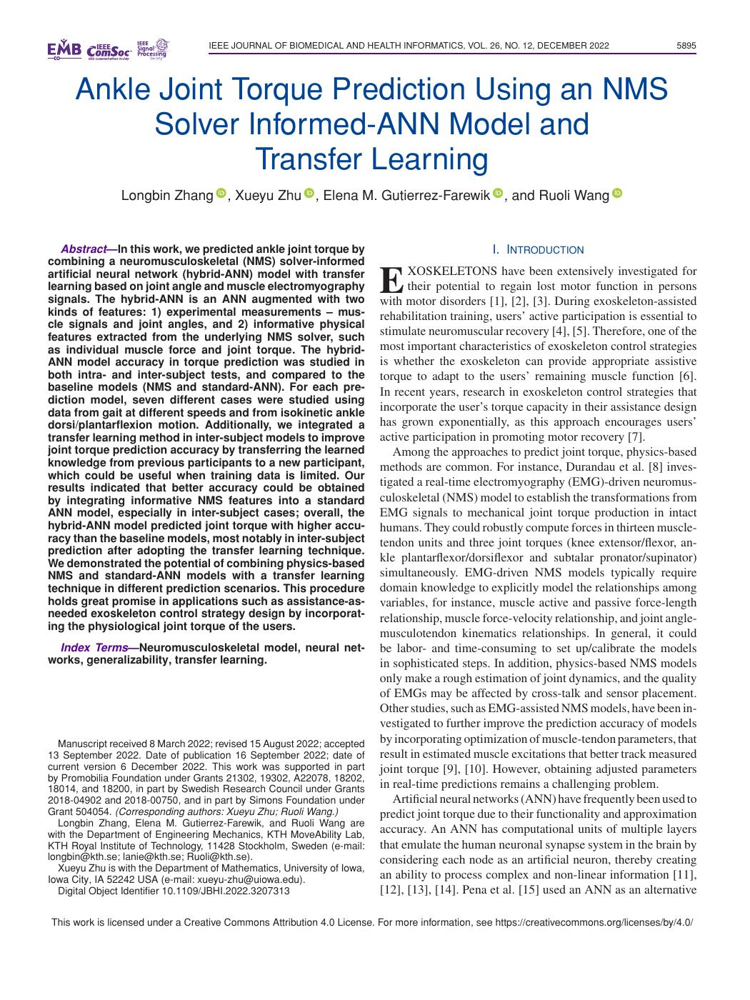

English text extracted from page 1

<pre>
IEEE JOURNAL OF BIOMEDICAL AND HEALTH INFORMATICS, VOL. 26, NO. 12, DECEMBER 2022                      5895

      Ankle Joint Torque Prediction Using an NMS
           Solver Informed-ANN Model and
                    Transfer Learning
                Longbin Zhang , Xueyu Zhu , Elena M. Gutierrez-Farewik , and Ruoli Wang

   Abstract—In this work, we predicted ankle joint torque by                                     I. INTRODUCTION
combining a neuromusculoskeletal (NMS) solver-informed
                                                                               XOSKELETONS have been extensively investigated for
artificial neural network (hybrid-ANN) model with transfer
learning based on joint angle and muscle electromyography
signals. The hybrid-ANN is an ANN augmented with two
                                                                         E     their potential to regain lost motor function in persons
                                                                         with motor disorders [1], [2], [3]. During exoskeleton-assisted
kinds of features: 1) experimental measurements – mus-                   rehabilitation training, users’ active participation is essential to
cle signals and joint angles, and 2) informative physical
features extracted from the underlying NMS solver, such                  stimulate neuromuscular recovery [4], [5]. Therefore, one of the
as individual muscle force and joint torque. The hybrid-                 most important characteristics of exoskeleton control strategies
ANN model accuracy in torque prediction was studied in                   is whether the exoskeleton can provide appropriate assistive
both intra- and inter-subject tests, and compared to the                 torque to adapt to the users’ remaining muscle function [6].
baseline models (NMS and standard-ANN). For each pre-                    In recent years, research in exoskeleton control strategies that
diction model, seven different cases were studied using
data from gait at different speeds and from isokinetic ankle             incorporate the user’s torque capacity in their assistance design
dorsi/plantarflexion motion. Additionally, we integrated a               has grown exponentially, as this approach encourages users’
transfer learning method in inter-subject models to improve              active participation in promoting motor recovery [7].
joint torque prediction accuracy by transferring the learned                Among the approaches to predict joint torque, physics-based
knowledge from previous participants to a new participant,               methods are common. For instance, Durandau et al. [8] inves-
which could be useful when training data is limited. Our
results indicated that better accuracy could be obtained                 tigated a real-time electromyography (EMG)-driven neuromus-
by integrating informative NMS features into a standard                  culoskeletal (NMS) model to establish the transformations from
ANN model, especially in inter-subject cases; overall, the               EMG signals to mechanical joint torque production in intact
hybrid-ANN model predicted joint torque with higher accu-                humans. They could robustly compute forces in thirteen muscle-
racy than the baseline models, most notably in inter-subject             tendon units and three joint torques (knee extensor/flexor, an-
prediction after adopting the transfer learning technique.
We demonstrated the potential of combining physics-based                 kle plantarflexor/dorsiflexor and subtalar pronator/supinator)
NMS and standard-ANN models with a transfer learning                     simultaneously. EMG-driven NMS models typically require
technique in different prediction scenarios. This procedure              domain knowledge to explicitly model the relationships among
holds great promise in applications such as assistance-as-               variables, for instance, muscle active and passive force-length
needed exoskeleton control strategy design by incorporat-                relationship, muscle force-velocity relationship, and joint angle-
ing the physiological joint torque of the users.
                                                                         musculotendon kinematics relationships. In general, it could
  Index Terms—Neuromusculoskeletal model, neural net-                    be labor- and time-consuming to set up/calibrate the models
works, generalizability, transfer learning.                              in sophisticated steps. In addition, physics-based NMS models
                                                                         only make a rough estimation of joint dynamics, and the quality
                                                                         of EMGs may be affected by cross-talk and sensor placement.
                                                                         Other studies, such as EMG-assisted NMS models, have been in-
                                                                         vestigated to further improve the prediction accuracy of models
  Manuscript received 8 March 2022; revised 15 August 2022; accepted     by incorporating optimization of muscle-tendon parameters, that
13 September 2022. Date of publication 16 September 2022; date of        result in estimated muscle excitations that better track measured
current version 6 December 2022. This work was supported in part         joint torque [9], [10]. However, obtaining adjusted parameters
by Promobilia Foundation under Grants 21302, 19302, A22078, 18202,
18014, and 18200, in part by Swedish Research Council under Grants       in real-time predictions remains a challenging problem.
2018-04902 and 2018-00750, and in part by Simons Foundation under           Artificial neural networks (ANN) have frequently been used to
Grant 504054. (Corresponding authors: Xueyu Zhu; Ruoli Wang.)            predict joint torque due to their functionality and approximation
  Longbin Zhang, Elena M. Gutierrez-Farewik, and Ruoli Wang are
with the Department of Engineering Mechanics, KTH MoveAbility Lab,       accuracy. An ANN has computational units of multiple layers
KTH Royal Institute of Technology, 11428 Stockholm, Sweden (e-mail:      that emulate the human neuronal synapse system in the brain by
longbin@kth.se; lanie@kth.se; Ruoli@kth.se).                             considering each node as an artificial neuron, thereby creating
  Xueyu Zhu is with the Department of Mathematics, University of Iowa,
Iowa City, IA 52242 USA (e-mail: xueyu-zhu@uiowa.edu).                   an ability to process complex and non-linear information [11],
  Digital Object Identifier 10.1109/JBHI.2022.3207313                    [12], [13], [14]. Pena et al. [15] used an ANN as an alternative

This work is licensed under a Creative Commons Attribution 4.0 License. For more information, see https://creativecommons.org/licenses/by/4.0/
</pre>

## Page 2

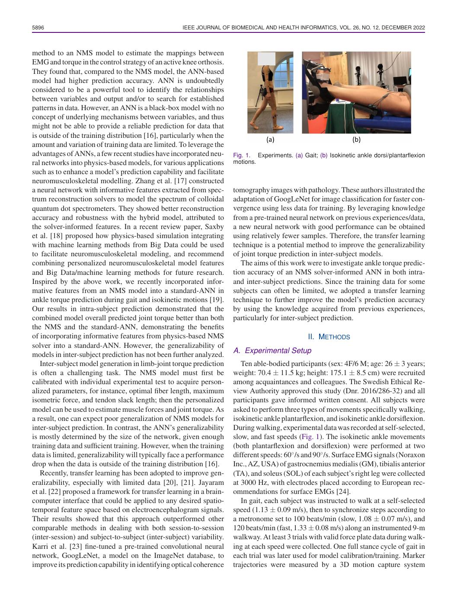

English text extracted from page 2

<pre>
5896                                                IEEE JOURNAL OF BIOMEDICAL AND HEALTH INFORMATICS, VOL. 26, NO. 12, DECEMBER 2022

method to an NMS model to estimate the mappings between
EMG and torque in the control strategy of an active knee orthosis.
They found that, compared to the NMS model, the ANN-based
model had higher prediction accuracy. ANN is undoubtedly
considered to be a powerful tool to identify the relationships
between variables and output and/or to search for established
patterns in data. However, an ANN is a black-box model with no
concept of underlying mechanisms between variables, and thus
might not be able to provide a reliable prediction for data that
is outside of the training distribution [16], particularly when the
amount and variation of training data are limited. To leverage the
advantages of ANNs, a few recent studies have incorporated neu-       Fig. 1. Experiments. (a) Gait; (b) Isokinetic ankle dorsi/plantarflexion
ral networks into physics-based models, for various applications      motions.
such as to enhance a model’s prediction capability and facilitate
neuromusculoskeletal modelling. Zhang et al. [17] constructed
a neural network with informative features extracted from spec-       tomography images with pathology. These authors illustrated the
trum reconstruction solvers to model the spectrum of colloidal        adaptation of GoogLeNet for image classification for faster con-
quantum dot spectrometers. They showed better reconstruction          vergence using less data for training. By leveraging knowledge
accuracy and robustness with the hybrid model, attributed to          from a pre-trained neural network on previous experiences/data,
the solver-informed features. In a recent review paper, Saxby         a new neural network with good performance can be obtained
et al. [18] proposed how physics-based simulation integrating         using relatively fewer samples. Therefore, the transfer learning
with machine learning methods from Big Data could be used             technique is a potential method to improve the generalizability
to facilitate neuromusculoskeletal modeling, and recommend            of joint torque prediction in inter-subject models.
combining personalized neuromusculoskeletal model features               The aims of this work were to investigate ankle torque predic-
and Big Data/machine learning methods for future research.            tion accuracy of an NMS solver-informed ANN in both intra-
Inspired by the above work, we recently incorporated infor-           and inter-subject predictions. Since the training data for some
mative features from an NMS model into a standard-ANN in              subjects can often be limited, we adopted a transfer learning
ankle torque prediction during gait and isokinetic motions [19].      technique to further improve the model’s prediction accuracy
Our results in intra-subject prediction demonstrated that the         by using the knowledge acquired from previous experiences,
combined model overall predicted joint torque better than both        particularly for inter-subject prediction.
the NMS and the standard-ANN, demonstrating the benefits
of incorporating informative features from physics-based NMS                                      II. METHODS
solver into a standard-ANN. However, the generalizability of
models in inter-subject prediction has not been further analyzed.     A. Experimental Setup
   Inter-subject model generation in limb-joint torque prediction        Ten able-bodied participants (sex: 4F/6 M; age: 26 ± 3 years;
is often a challenging task. The NMS model must first be              weight: 70.4 ± 11.5 kg; height: 175.1 ± 8.5 cm) were recruited
calibrated with individual experimental test to acquire person-       among acquaintances and colleagues. The Swedish Ethical Re-
alized parameters, for instance, optimal fiber length, maximum        view Authority approved this study (Dnr. 2016/286-32) and all
isometric force, and tendon slack length; then the personalized       participants gave informed written consent. All subjects were
model can be used to estimate muscle forces and joint torque. As      asked to perform three types of movements specifically walking,
a result, one can expect poor generalization of NMS models for        isokinetic ankle plantarflexion, and isokinetic ankle dorsiflexion.
inter-subject prediction. In contrast, the ANN’s generalizability     During walking, experimental data was recorded at self-selected,
is mostly determined by the size of the network, given enough         slow, and fast speeds (Fig. 1). The isokinetic ankle movements
training data and sufficient training. However, when the training     (both plantarflexion and dorsiflexion) were performed at two
data is limited, generalizability will typically face a performance   different speeds: 60◦ /s and 90◦ /s. Surface EMG signals (Noraxon
drop when the data is outside of the training distribution [16].      Inc., AZ, USA) of gastrocnemius medialis (GM), tibialis anterior
   Recently, transfer learning has been adopted to improve gen-       (TA), and soleus (SOL) of each subject’s right leg were collected
eralizability, especially with limited data [20], [21]. Jayaram       at 3000 Hz, with electrodes placed according to European rec-
et al. [22] proposed a framework for transfer learning in a brain-    ommendations for surface EMGs [24].
computer interface that could be applied to any desired spatio-          In gait, each subject was instructed to walk at a self-selected
temporal feature space based on electroencephalogram signals.         speed (1.13 ± 0.09 m/s), then to synchronize steps according to
Their results showed that this approach outperformed other            a metronome set to 100 beats/min (slow, 1.08 ± 0.07 m/s), and
comparable methods in dealing with both session-to-session            120 beats/min (fast, 1.33 ± 0.08 m/s) along an instrumented 9-m
(inter-session) and subject-to-subject (inter-subject) variability.   walkway. At least 3 trials with valid force plate data during walk-
Karri et al. [23] fine-tuned a pre-trained convolutional neural       ing at each speed were collected. One full stance cycle of gait in
network, GoogLeNet, a model on the ImageNet database, to              each trial was later used for model calibration/training. Marker
improve its prediction capability in identifying optical coherence    trajectories were measured by a 3D motion capture system
</pre>

## Page 3

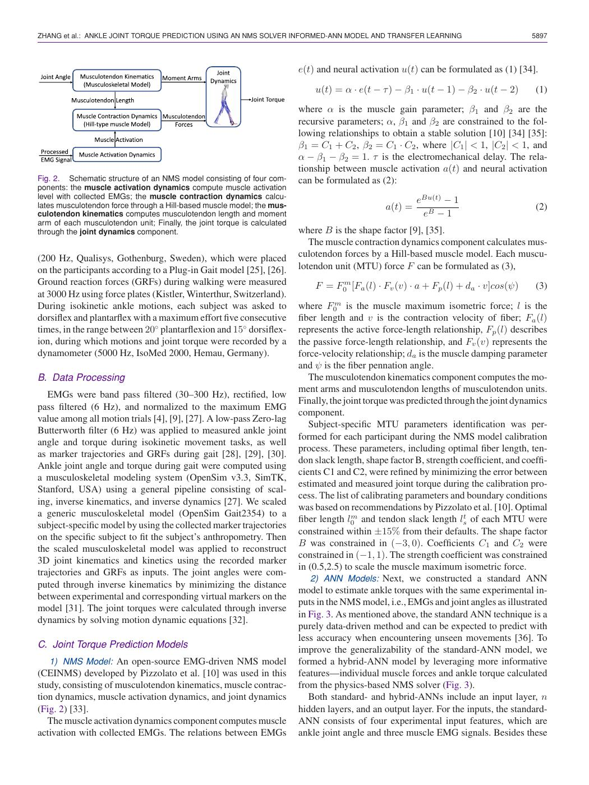

English text extracted from page 3

<pre>
ZHANG et al.: ANKLE JOINT TORQUE PREDICTION USING AN NMS SOLVER INFORMED-ANN MODEL AND TRANSFER LEARNING                                5897

                                                                          e(t) and neural activation u(t) can be formulated as (1) [34].

                                                                              u(t) = α · e(t − τ ) − β1 · u(t − 1) − β2 · u(t − 2)       (1)

                                                                          where α is the muscle gain parameter; β1 and β2 are the
                                                                          recursive parameters; α, β1 and β2 are constrained to the fol-
                                                                          lowing relationships to obtain a stable solution [10] [34] [35]:
                                                                          β1 = C1 + C2 , β2 = C1 · C2 , where |C1 | &lt; 1, |C2 | &lt; 1, and
                                                                          α − β1 − β2 = 1. τ is the electromechanical delay. The rela-
                                                                          tionship between muscle activation a(t) and neural activation
Fig. 2. Schematic structure of an NMS model consisting of four com-       can be formulated as (2):
ponents: the muscle activation dynamics compute muscle activation
level with collected EMGs; the muscle contraction dynamics calcu-
                                                                                                          eBu(t) − 1
lates musculotendon force through a Hill-based muscle model; the mus-                            a(t) =                                  (2)
culotendon kinematics computes musculotendon length and moment                                             eB − 1
arm of each musculotendon unit; Finally, the joint torque is calculated
through the joint dynamics component.                                     where B is the shape factor [9], [35].
                                                                             The muscle contraction dynamics component calculates mus-
(200 Hz, Qualisys, Gothenburg, Sweden), which were placed                 culotendon forces by a Hill-based muscle model. Each muscu-
on the participants according to a Plug-in Gait model [25], [26].         lotendon unit (MTU) force F can be formulated as (3),
Ground reaction forces (GRFs) during walking were measured                    F = F0m [Fa (l) · Fv (v) · a + Fp (l) + da · v]cos(ψ)      (3)
at 3000 Hz using force plates (Kistler, Winterthur, Switzerland).
During isokinetic ankle motions, each subject was asked to                where F0m is the muscle maximum isometric force; l is the
dorsiflex and plantarflex with a maximum effort five consecutive          fiber length and v is the contraction velocity of fiber; Fa (l)
times, in the range between 20◦ plantarflexion and 15◦ dorsiflex-         represents the active force-length relationship, Fp (l) describes
ion, during which motions and joint torque were recorded by a             the passive force-length relationship, and Fv (v) represents the
dynamometer (5000 Hz, IsoMed 2000, Hemau, Germany).                       force-velocity relationship; da is the muscle damping parameter
                                                                          and ψ is the fiber pennation angle.
B. Data Processing                                                           The musculotendon kinematics component computes the mo-
                                                                          ment arms and musculotendon lengths of musculotendon units.
   EMGs were band pass filtered (30–300 Hz), rectified, low
                                                                          Finally, the joint torque was predicted through the joint dynamics
pass filtered (6 Hz), and normalized to the maximum EMG
                                                                          component.
value among all motion trials [4], [9], [27]. A low-pass Zero-lag
                                                                             Subject-specific MTU parameters identification was per-
Butterworth filter (6 Hz) was applied to measured ankle joint
                                                                          formed for each participant during the NMS model calibration
angle and torque during isokinetic movement tasks, as well
                                                                          process. These parameters, including optimal fiber length, ten-
as marker trajectories and GRFs during gait [28], [29], [30].
                                                                          don slack length, shape factor B, strength coefficient, and coeffi-
Ankle joint angle and torque during gait were computed using
                                                                          cients C1 and C2, were refined by minimizing the error between
a musculoskeletal modeling system (OpenSim v3.3, SimTK,
                                                                          estimated and measured joint torque during the calibration pro-
Stanford, USA) using a general pipeline consisting of scal-
                                                                          cess. The list of calibrating parameters and boundary conditions
ing, inverse kinematics, and inverse dynamics [27]. We scaled
                                                                          was based on recommendations by Pizzolato et al. [10]. Optimal
a generic musculoskeletal model (OpenSim Gait2354) to a
                                                                          fiber length l0m and tendon slack length lst of each MTU were
subject-specific model by using the collected marker trajectories
                                                                          constrained within ±15% from their defaults. The shape factor
on the specific subject to fit the subject’s anthropometry. Then
                                                                          B was constrained in (−3, 0). Coefficients C1 and C2 were
the scaled musculoskeletal model was applied to reconstruct
                                                                          constrained in (−1, 1). The strength coefficient was constrained
3D joint kinematics and kinetics using the recorded marker
                                                                          in (0.5,2.5) to scale the muscle maximum isometric force.
trajectories and GRFs as inputs. The joint angles were com-
                                                                              2) ANN Models: Next, we constructed a standard ANN
puted through inverse kinematics by minimizing the distance
                                                                          model to estimate ankle torques with the same experimental in-
between experimental and corresponding virtual markers on the
                                                                          puts in the NMS model, i.e., EMGs and joint angles as illustrated
model [31]. The joint torques were calculated through inverse
                                                                          in Fig. 3. As mentioned above, the standard ANN technique is a
dynamics by solving motion dynamic equations [32].
                                                                          purely data-driven method and can be expected to predict with
                                                                          less accuracy when encountering unseen movements [36]. To
C. Joint Torque Prediction Models
                                                                          improve the generalizability of the standard-ANN model, we
   1) NMS Model: An open-source EMG-driven NMS model                      formed a hybrid-ANN model by leveraging more informative
(CEINMS) developed by Pizzolato et al. [10] was used in this              features—individual muscle forces and ankle torque calculated
study, consisting of musculotendon kinematics, muscle contrac-            from the physics-based NMS solver (Fig. 3).
tion dynamics, muscle activation dynamics, and joint dynamics                Both standard- and hybrid-ANNs include an input layer, n
(Fig. 2) [33].                                                            hidden layers, and an output layer. For the inputs, the standard-
   The muscle activation dynamics component computes muscle               ANN consists of four experimental input features, which are
activation with collected EMGs. The relations between EMGs                ankle joint angle and three muscle EMG signals. Besides these
</pre>

## Page 4

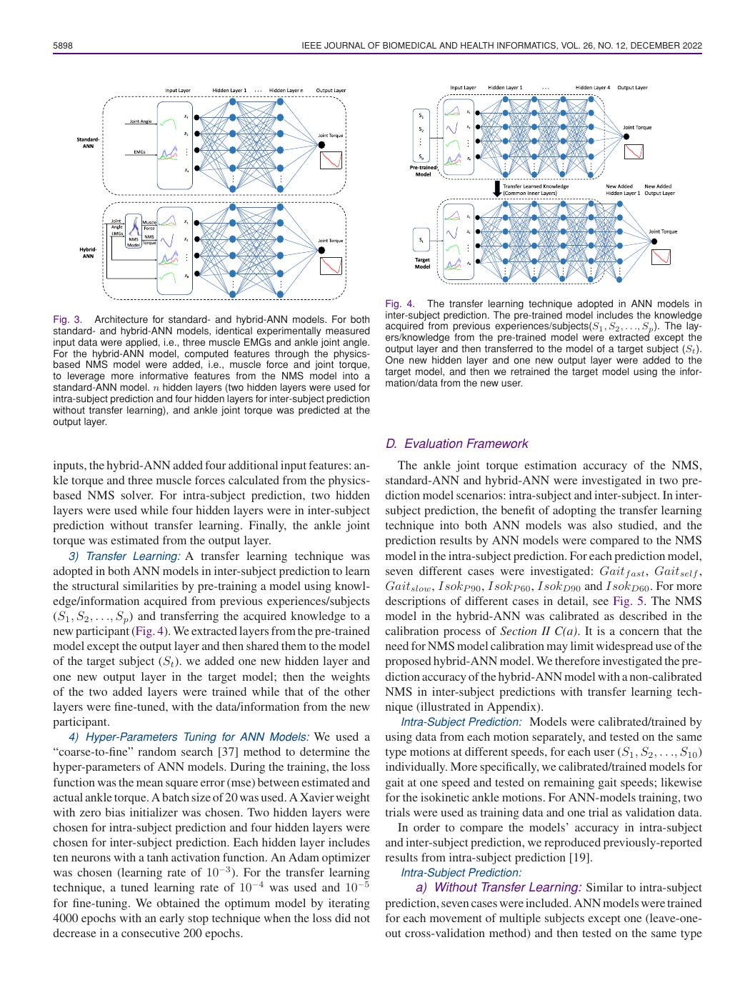

English text extracted from page 4

<pre>
5898                                                       IEEE JOURNAL OF BIOMEDICAL AND HEALTH INFORMATICS, VOL. 26, NO. 12, DECEMBER 2022

                                                                               Fig. 4. The transfer learning technique adopted in ANN models in
Fig. 3. Architecture for standard- and hybrid-ANN models. For both             inter-subject prediction. The pre-trained model includes the knowledge
standard- and hybrid-ANN models, identical experimentally measured             acquired from previous experiences/subjects(S1 , S2 , . . ., Sp ). The lay-
input data were applied, i.e., three muscle EMGs and ankle joint angle.        ers/knowledge from the pre-trained model were extracted except the
For the hybrid-ANN model, computed features through the physics-               output layer and then transferred to the model of a target subject (St ).
based NMS model were added, i.e., muscle force and joint torque,               One new hidden layer and one new output layer were added to the
to leverage more informative features from the NMS model into a                target model, and then we retrained the target model using the infor-
standard-ANN model. n hidden layers (two hidden layers were used for           mation/data from the new user.
intra-subject prediction and four hidden layers for inter-subject prediction
without transfer learning), and ankle joint torque was predicted at the
output layer.

                                                                               D. Evaluation Framework
inputs, the hybrid-ANN added four additional input features: an-                  The ankle joint torque estimation accuracy of the NMS,
kle torque and three muscle forces calculated from the physics-                standard-ANN and hybrid-ANN were investigated in two pre-
based NMS solver. For intra-subject prediction, two hidden                     diction model scenarios: intra-subject and inter-subject. In inter-
layers were used while four hidden layers were in inter-subject                subject prediction, the benefit of adopting the transfer learning
prediction without transfer learning. Finally, the ankle joint                 technique into both ANN models was also studied, and the
torque was estimated from the output layer.                                    prediction results by ANN models were compared to the NMS
   3) Transfer Learning: A transfer learning technique was                     model in the intra-subject prediction. For each prediction model,
adopted in both ANN models in inter-subject prediction to learn                seven different cases were investigated: Gaitf ast , Gaitself ,
the structural similarities by pre-training a model using knowl-               Gaitslow , IsokP 90 , IsokP 60 , IsokD90 and IsokD60 . For more
edge/information acquired from previous experiences/subjects                   descriptions of different cases in detail, see Fig. 5. The NMS
(S1 , S2 , . . ., Sp ) and transferring the acquired knowledge to a            model in the hybrid-ANN was calibrated as described in the
new participant (Fig. 4). We extracted layers from the pre-trained             calibration process of Section II C(a). It is a concern that the
model except the output layer and then shared them to the model                need for NMS model calibration may limit widespread use of the
of the target subject (St ). we added one new hidden layer and                 proposed hybrid-ANN model. We therefore investigated the pre-
one new output layer in the target model; then the weights                     diction accuracy of the hybrid-ANN model with a non-calibrated
of the two added layers were trained while that of the other                   NMS in inter-subject predictions with transfer learning tech-
layers were fine-tuned, with the data/information from the new                 nique (illustrated in Appendix).
participant.                                                                       Intra-Subject Prediction: Models were calibrated/trained by
   4) Hyper-Parameters Tuning for ANN Models: We used a                        using data from each motion separately, and tested on the same
“coarse-to-fine” random search [37] method to determine the                    type motions at different speeds, for each user (S1 , S2 , . . ., S10 )
hyper-parameters of ANN models. During the training, the loss                  individually. More specifically, we calibrated/trained models for
function was the mean square error (mse) between estimated and                 gait at one speed and tested on remaining gait speeds; likewise
actual ankle torque. A batch size of 20 was used. A Xavier weight              for the isokinetic ankle motions. For ANN-models training, two
with zero bias initializer was chosen. Two hidden layers were                  trials were used as training data and one trial as validation data.
chosen for intra-subject prediction and four hidden layers were                   In order to compare the models’ accuracy in intra-subject
chosen for inter-subject prediction. Each hidden layer includes                and inter-subject prediction, we reproduced previously-reported
ten neurons with a tanh activation function. An Adam optimizer                 results from intra-subject prediction [19].
was chosen (learning rate of 10−3 ). For the transfer learning                    Intra-Subject Prediction:
technique, a tuned learning rate of 10−4 was used and 10−5                           a) Without Transfer Learning: Similar to intra-subject
for fine-tuning. We obtained the optimum model by iterating                    prediction, seven cases were included. ANN models were trained
4000 epochs with an early stop technique when the loss did not                 for each movement of multiple subjects except one (leave-one-
decrease in a consecutive 200 epochs.                                          out cross-validation method) and then tested on the same type
</pre>

## Page 5

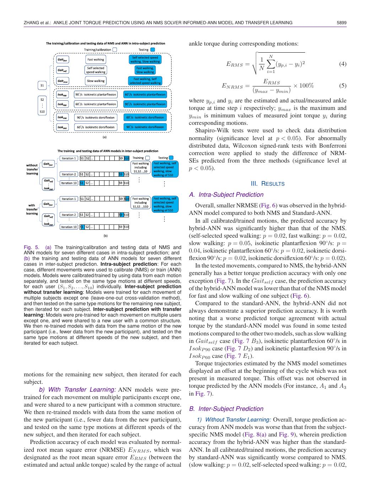

English text extracted from page 5

<pre>
ZHANG et al.: ANKLE JOINT TORQUE PREDICTION USING AN NMS SOLVER INFORMED-ANN MODEL AND TRANSFER LEARNING                                      5899

                                                                               ankle torque during corresponding motions:
                                                                                                        
                                                                                                        
                                                                                                        1 N 
                                                                                             ERM S =           (yp,i − yi )2                  (4)
                                                                                                          N i=1

                                                                                                             ERM S
                                                                                             EN RM S =                   × 100%                (5)
                                                                                                          (ymax − ymin )
                                                                               where yp,i and yi are the estimated and actual/measured ankle
                                                                               torque at time step i respectively; ymax is the maximum and
                                                                               ymin is minimum values of measured joint torque yi during
                                                                               corresponding motions.
                                                                                  Shapiro-Wilk tests were used to check data distribution
                                                                               normality (significance level at p &lt; 0.05). For abnormally
                                                                               distributed data, Wilcoxon signed-rank tests with Bonferroni
                                                                               correction were applied to study the difference of NRM-
                                                                               SEs predicted from the three methods (significance level at
                                                                               p &lt; 0.05).

                                                                                                         III. RESULTS
                                                                               A. Intra-Subject Prediction
                                                                                  Overall, smaller NRMSE (Fig. 6) was observed in the hybrid-
                                                                               ANN model compared to both NMS and Standard-ANN.
                                                                                  In all calibrated/trained motions, the predicted accuracy by
                                                                               hybrid-ANN was significantly higher than that of the NMS.
                                                                               (self-selected speed walking: p = 0.02, fast walking: p = 0.02,
                                                                               slow walking: p = 0.05, isokinetic plantarflexion 90◦ /s: p =
Fig. 5. (a) The training/calibration and testing data of NMS and
ANN models for seven different cases in intra-subject prediction; and          0.04, isokinetic plantarflexion 60◦ /s: p = 0.02, isokinetic dorsi-
(b) the training and testing data of ANN models for seven different            flexion 90◦ /s: p = 0.02, isokinetic dorsiflexion 60◦ /s: p = 0.02).
cases in inter-subject prediction. Intra-subject prediction: For each             In the tested movements, compared to NMS, the hybrid-ANN
case, different movements were used to calibrate (NMS) or train (ANN)
models. Models were calibrated/trained by using data from each motion          generally has a better torque prediction accuracy with only one
separately, and tested on the same type motions at different speeds,           exception (Fig. 7). In the Gaitself case, the prediction accuracy
for each user (S1 , S2 , . . ., S10 ) individually. Inter-subject prediction   of the hybrid-ANN model was lower than that of the NMS model
without transfer learning: Models were trained for each movement of
multiple subjects except one (leave-one-out cross-validation method),          for fast and slow walking of one subject (Fig. 6).
and then tested on the same type motions for the remaining new subject,           Compared to the standard-ANN, the hybrid-ANN did not
then iterated for each subject. Inter-subject prediction with transfer         always demonstrate a superior prediction accuracy. It is worth
learning: Models were pre-trained for each movement on multiple users
except one, and were shared to a new user with a common structure.             noting that a worse predicted torque agreement with actual
We then re-trained models with data from the same motion of the new            torque by the standard-ANN model was found in some tested
participant (i.e., fewer data from the new participant), and tested on the     motions compared to the other two models, such as slow walking
same type motions at different speeds of the new subject, and then
iterated for each subject.                                                     in Gaitself case (Fig. 7 B3 ), isokinetic plantarflexion 60◦ /s in
                                                                               IsokP 90 case (Fig. 7 D2 ) and isokinetic plantarflexion 90◦ /s in
                                                                               IsokP 60 case (Fig. 7 E1 ).
                                                                                  Torque trajectories estimated by the NMS model sometimes
                                                                               displayed an offset at the beginning of the cycle which was not
motions for the remaining new subject, then iterated for each
                                                                               present in measured torque. This offset was not observed in
subject.
                                                                               torque predicted by the ANN models (For instance, A1 and A3
      b) With Transfer Learning: ANN models were pre-
                                                                               in Fig. 7).
trained for each movement on multiple participants except one,
and were shared to a new participant with a common structure.
                                                                               B. Inter-Subject Prediction
We then re-trained models with data from the same motion of
the new participant (i.e., fewer data from the new participant),                  1) Without Transfer Learning: Overall, torque prediction ac-
and tested on the same type motions at different speeds of the                 curacy from ANN models was worse than that from the subject-
new subject, and then iterated for each subject.                               specific NMS model (Fig. 8(a) and Fig. 9), wherein prediction
   Prediction accuracy of each model was evaluated by normal-                  accuracy from the hybrid-ANN was higher than the standard-
ized root mean square error (NRMSE) EN RM S , which was                        ANN. In all calibrated/trained motions, the prediction accuracy
designated as the root mean square error ERM S (between the                    by standard-ANN was significantly worse compared to NMS.
estimated and actual ankle torque) scaled by the range of actual               (slow walking: p = 0.02, self-selected speed walking: p = 0.02,
</pre>

## Page 6

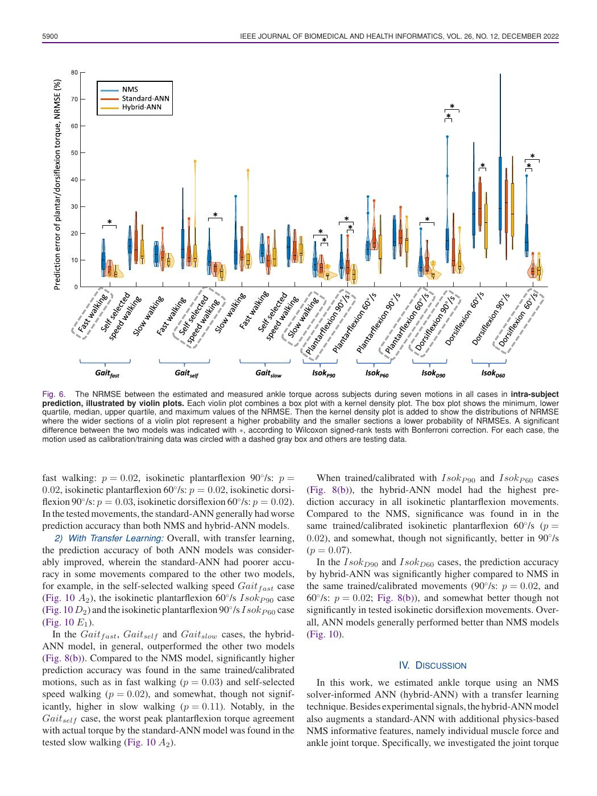

English text extracted from page 6

<pre>
5900                                                  IEEE JOURNAL OF BIOMEDICAL AND HEALTH INFORMATICS, VOL. 26, NO. 12, DECEMBER 2022

Fig. 6. The NRMSE between the estimated and measured ankle torque across subjects during seven motions in all cases in intra-subject
prediction, illustrated by violin plots. Each violin plot combines a box plot with a kernel density plot. The box plot shows the minimum, lower
quartile, median, upper quartile, and maximum values of the NRMSE. Then the kernel density plot is added to show the distributions of NRMSE
where the wider sections of a violin plot represent a higher probability and the smaller sections a lower probability of NRMSEs. A significant
difference between the two models was indicated with ∗, according to Wilcoxon signed-rank tests with Bonferroni correction. For each case, the
motion used as calibration/training data was circled with a dashed gray box and others are testing data.

fast walking: p = 0.02, isokinetic plantarflexion 90◦ /s: p =               When trained/calibrated with IsokP 90 and IsokP 60 cases
0.02, isokinetic plantarflexion 60◦ /s: p = 0.02, isokinetic dorsi-      (Fig. 8(b)), the hybrid-ANN model had the highest pre-
flexion 90◦ /s: p = 0.03, isokinetic dorsiflexion 60◦ /s: p = 0.02).     diction accuracy in all isokinetic plantarflexion movements.
In the tested movements, the standard-ANN generally had worse            Compared to the NMS, significance was found in in the
prediction accuracy than both NMS and hybrid-ANN models.                 same trained/calibrated isokinetic plantarflexion 60◦ /s (p =
    2) With Transfer Learning: Overall, with transfer learning,          0.02), and somewhat, though not significantly, better in 90◦ /s
the prediction accuracy of both ANN models was consider-                 (p = 0.07).
ably improved, wherein the standard-ANN had poorer accu-                    In the IsokD90 and IsokD60 cases, the prediction accuracy
racy in some movements compared to the other two models,                 by hybrid-ANN was significantly higher compared to NMS in
for example, in the self-selected walking speed Gaitf ast case           the same trained/calibrated movements (90◦ /s: p = 0.02, and
(Fig. 10 A2 ), the isokinetic plantarflexion 60◦ /s IsokP 90 case        60◦ /s: p = 0.02; Fig. 8(b)), and somewhat better though not
(Fig. 10 D2 ) and the isokinetic plantarflexion 90◦ /s IsokP 60 case     significantly in tested isokinetic dorsiflexion movements. Over-
(Fig. 10 E1 ).                                                           all, ANN models generally performed better than NMS models
   In the Gaitf ast , Gaitself and Gaitslow cases, the hybrid-           (Fig. 10).
ANN model, in general, outperformed the other two models
(Fig. 8(b)). Compared to the NMS model, significantly higher
prediction accuracy was found in the same trained/calibrated                                      IV. DISCUSSION
motions, such as in fast walking (p = 0.03) and self-selected               In this work, we estimated ankle torque using an NMS
speed walking (p = 0.02), and somewhat, though not signif-               solver-informed ANN (hybrid-ANN) with a transfer learning
icantly, higher in slow walking (p = 0.11). Notably, in the              technique. Besides experimental signals, the hybrid-ANN model
Gaitself case, the worst peak plantarflexion torque agreement            also augments a standard-ANN with additional physics-based
with actual torque by the standard-ANN model was found in the            NMS informative features, namely individual muscle force and
tested slow walking (Fig. 10 A2 ).                                       ankle joint torque. Specifically, we investigated the joint torque
</pre>

## Page 7

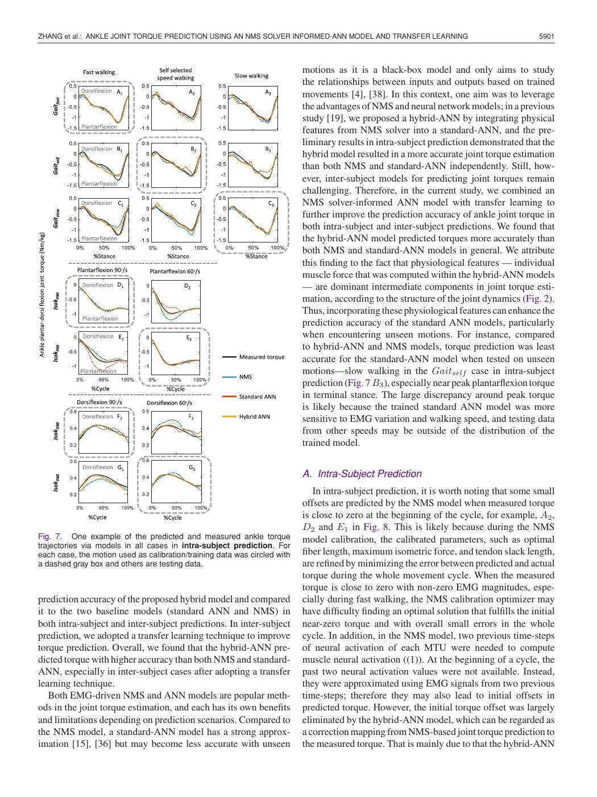

English text extracted from page 7

<pre>
ZHANG et al.: ANKLE JOINT TORQUE PREDICTION USING AN NMS SOLVER INFORMED-ANN MODEL AND TRANSFER LEARNING                                   5901

                                                                           motions as it is a black-box model and only aims to study
                                                                           the relationships between inputs and outputs based on trained
                                                                           movements [4], [38]. In this context, one aim was to leverage
                                                                           the advantages of NMS and neural network models; in a previous
                                                                           study [19], we proposed a hybrid-ANN by integrating physical
                                                                           features from NMS solver into a standard-ANN, and the pre-
                                                                           liminary results in intra-subject prediction demonstrated that the
                                                                           hybrid model resulted in a more accurate joint torque estimation
                                                                           than both NMS and standard-ANN independently. Still, how-
                                                                           ever, inter-subject models for predicting joint torques remain
                                                                           challenging. Therefore, in the current study, we combined an
                                                                           NMS solver-informed ANN model with transfer learning to
                                                                           further improve the prediction accuracy of ankle joint torque in
                                                                           both intra-subject and inter-subject predictions. We found that
                                                                           the hybrid-ANN model predicted torques more accurately than
                                                                           both NMS and standard-ANN models in general. We attribute
                                                                           this finding to the fact that physiological features — individual
                                                                           muscle force that was computed within the hybrid-ANN models
                                                                           — are dominant intermediate components in joint torque esti-
                                                                           mation, according to the structure of the joint dynamics (Fig. 2).
                                                                           Thus, incorporating these physiological features can enhance the
                                                                           prediction accuracy of the standard ANN models, particularly
                                                                           when encountering unseen motions. For instance, compared
                                                                           to hybrid-ANN and NMS models, torque prediction was least
                                                                           accurate for the standard-ANN model when tested on unseen
                                                                           motions—slow walking in the Gaitself case in intra-subject
                                                                           prediction (Fig. 7 B3 ), especially near peak plantarflexion torque
                                                                           in terminal stance. The large discrepancy around peak torque
                                                                           is likely because the trained standard ANN model was more
                                                                           sensitive to EMG variation and walking speed, and testing data
                                                                           from other speeds may be outside of the distribution of the
                                                                           trained model.

                                                                           A. Intra-Subject Prediction
                                                                              In intra-subject prediction, it is worth noting that some small
                                                                           offsets are predicted by the NMS model when measured torque
                                                                           is close to zero at the beginning of the cycle, for example, A2 ,
                                                                           D2 and E1 in Fig. 8. This is likely because during the NMS
Fig. 7. One example of the predicted and measured ankle torque             model calibration, the calibrated parameters, such as optimal
trajectories via models in all cases in intra-subject prediction. For
each case, the motion used as calibration/training data was circled with   fiber length, maximum isometric force, and tendon slack length,
a dashed gray box and others are testing data.                             are refined by minimizing the error between predicted and actual
                                                                           torque during the whole movement cycle. When the measured
                                                                           torque is close to zero with non-zero EMG magnitudes, espe-
prediction accuracy of the proposed hybrid model and compared              cially during fast walking, the NMS calibration optimizer may
it to the two baseline models (standard ANN and NMS) in                    have difficulty finding an optimal solution that fulfills the initial
both intra-subject and inter-subject predictions. In inter-subject         near-zero torque and with overall small errors in the whole
prediction, we adopted a transfer learning technique to improve            cycle. In addition, in the NMS model, two previous time-steps
torque prediction. Overall, we found that the hybrid-ANN pre-              of neural activation of each MTU were needed to compute
dicted torque with higher accuracy than both NMS and standard-             muscle neural activation ((1)). At the beginning of a cycle, the
ANN, especially in inter-subject cases after adopting a transfer           past two neural activation values were not available. Instead,
learning technique.                                                        they were approximated using EMG signals from two previous
   Both EMG-driven NMS and ANN models are popular meth-                    time-steps; therefore they may also lead to initial offsets in
ods in the joint torque estimation, and each has its own benefits          predicted torque. However, the initial torque offset was largely
and limitations depending on prediction scenarios. Compared to             eliminated by the hybrid-ANN model, which can be regarded as
the NMS model, a standard-ANN model has a strong approx-                   a correction mapping from NMS-based joint torque prediction to
imation [15], [36] but may become less accurate with unseen                the measured torque. That is mainly due to that the hybrid-ANN
</pre>

## Page 8

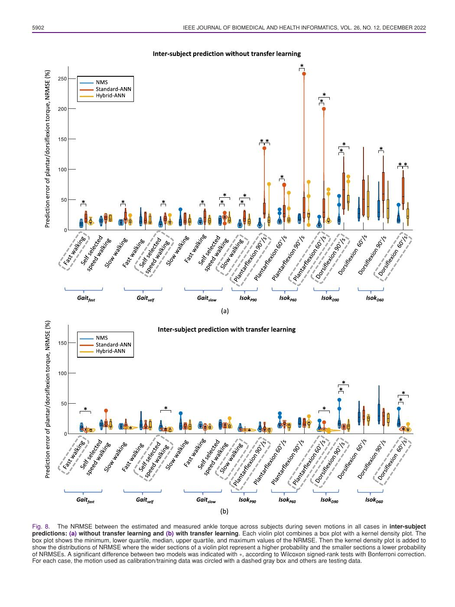

English text extracted from page 8

<pre>
5902                                                     IEEE JOURNAL OF BIOMEDICAL AND HEALTH INFORMATICS, VOL. 26, NO. 12, DECEMBER 2022

Fig. 8. The NRMSE between the estimated and measured ankle torque across subjects during seven motions in all cases in inter-subject
predictions: (a) without transfer learning and (b) with transfer learning. Each violin plot combines a box plot with a kernel density plot. The
box plot shows the minimum, lower quartile, median, upper quartile, and maximum values of the NRMSE. Then the kernel density plot is added to
show the distributions of NRMSE where the wider sections of a violin plot represent a higher probability and the smaller sections a lower probability
of NRMSEs. A significant difference between two models was indicated with ∗, according to Wilcoxon signed-rank tests with Bonferroni correction.
For each case, the motion used as calibration/training data was circled with a dashed gray box and others are testing data.
</pre>

## Page 9

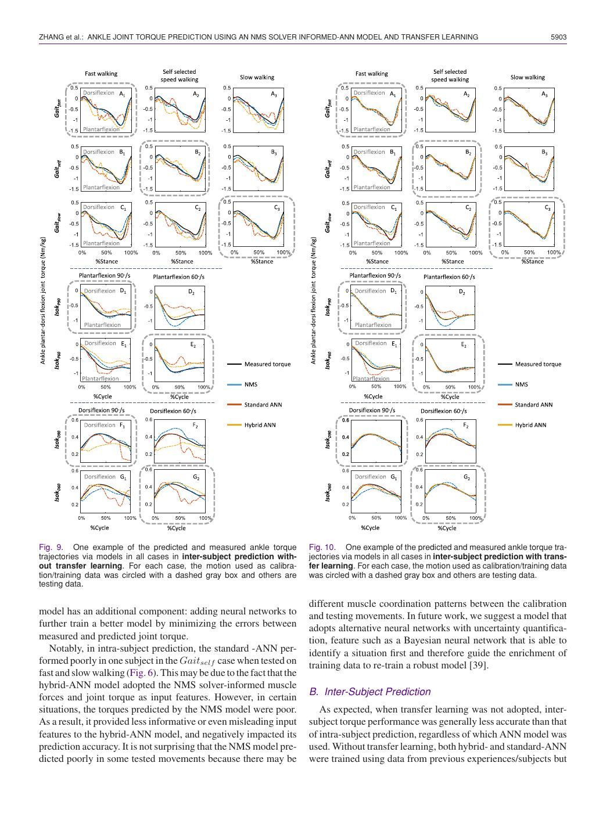

English text extracted from page 9

<pre>
ZHANG et al.: ANKLE JOINT TORQUE PREDICTION USING AN NMS SOLVER INFORMED-ANN MODEL AND TRANSFER LEARNING                                     5903

Fig. 9. One example of the predicted and measured ankle torque           Fig. 10. One example of the predicted and measured ankle torque tra-
trajectories via models in all cases in inter-subject prediction with-   jectories via models in all cases in inter-subject prediction with trans-
out transfer learning. For each case, the motion used as calibra-        fer learning. For each case, the motion used as calibration/training data
tion/training data was circled with a dashed gray box and others are     was circled with a dashed gray box and others are testing data.
testing data.

                                                                         different muscle coordination patterns between the calibration
model has an additional component: adding neural networks to             and testing movements. In future work, we suggest a model that
further train a better model by minimizing the errors between            adopts alternative neural networks with uncertainty quantifica-
measured and predicted joint torque.                                     tion, feature such as a Bayesian neural network that is able to
   Notably, in intra-subject prediction, the standard -ANN per-          identify a situation first and therefore guide the enrichment of
formed poorly in one subject in the Gaitself case when tested on         training data to re-train a robust model [39].
fast and slow walking (Fig. 6). This may be due to the fact that the
hybrid-ANN model adopted the NMS solver-informed muscle
forces and joint torque as input features. However, in certain           B. Inter-Subject Prediction
situations, the torques predicted by the NMS model were poor.               As expected, when transfer learning was not adopted, inter-
As a result, it provided less informative or even misleading input       subject torque performance was generally less accurate than that
features to the hybrid-ANN model, and negatively impacted its            of intra-subject prediction, regardless of which ANN model was
prediction accuracy. It is not surprising that the NMS model pre-        used. Without transfer learning, both hybrid- and standard-ANN
dicted poorly in some tested movements because there may be              were trained using data from previous experiences/subjects but
</pre>

## Page 10

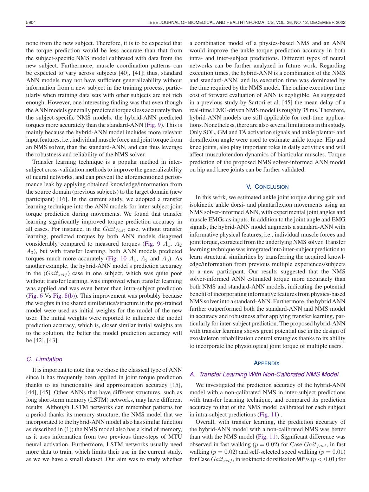

English text extracted from page 10

<pre>
5904                                                IEEE JOURNAL OF BIOMEDICAL AND HEALTH INFORMATICS, VOL. 26, NO. 12, DECEMBER 2022

none from the new subject. Therefore, it is to be expected that       a combination model of a physics-based NMS and an ANN
the torque prediction would be less accurate than that from           would improve the ankle torque prediction accuracy in both
the subject-specific NMS model calibrated with data from the          intra- and inter-subject predictions. Different types of neural
new subject. Furthermore, muscle coordination patterns can            networks can be further analyzed in future work. Regarding
be expected to vary across subjects [40], [41]; thus, standard        execution times, the hybrid-ANN is a combination of the NMS
ANN models may not have sufficient generalizability without           and standard-ANN, and its execution time was dominated by
information from a new subject in the training process, partic-       the time required by the NMS model. The online execution time
ularly when training data sets with other subjects are not rich       cost of forward evaluation of ANN is negligible. As suggested
enough. However, one interesting finding was that even though         in a previous study by Sartori et al. [45] the mean delay of a
the ANN models generally predicted torques less accurately than       real-time EMG-driven NMS model is roughly 35 ms. Therefore,
the subject-specific NMS models, the hybrid-ANN predicted             hybrid-ANN models are still applicable for real-time applica-
torques more accurately than the standard-ANN (Fig. 9). This is       tions. Nonetheless, there are also several limitations in this study.
mainly because the hybrid-ANN model includes more relevant            Only SOL, GM and TA activation signals and ankle plantar- and
input features, i.e., individual muscle force and joint torque from   dorsiflexion angle were used to estimate ankle torque. Hip and
an NMS solver, than the standard-ANN, and can thus leverage           knee joints, also play important roles in daily activities and will
the robustness and reliability of the NMS solver.                     affect musculotendon dynamics of biarticular muscles. Torque
   Transfer learning technique is a popular method in inter-          prediction of the proposed NMS solver-informed ANN model
subject cross-validation methods to improve the generalizability      on hip and knee joints can be further validated.
of neural networks, and can prevent the aforementioned perfor-
mance leak by applying obtained knowledge/information from                                     V. CONCLUSION
the source domain (previous subjects) to the target domain (new
participant) [16]. In the current study, we adopted a transfer           In this work, we estimated ankle joint torque during gait and
learning technique into the ANN models for inter-subject joint        isokinetic ankle dorsi- and plantarflexion movements using an
torque prediction during movements. We found that transfer            NMS solver-informed ANN, with experimental joint angles and
learning significantly improved torque prediction accuracy in         muscle EMGs as inputs. In addition to the joint angle and EMG
all cases. For instance, in the Gaitf ast case, without transfer      signals, the hybrid-ANN model augments a standard-ANN with
learning, predicted torques by both ANN models disagreed              informative physical features, i.e., individual muscle forces and
considerably compared to measured torques (Fig. 9 A1 , A2             joint torque, extracted from the underlying NMS solver. Transfer
A3 ), but with transfer learning, both ANN models predicted           learning technique was integrated into inter-subject prediction to
torques much more accurately (Fig. 10 A1 , A2 and A3 ). As            learn structural similarities by transferring the acquired knowl-
another example, the hybrid-ANN model’s prediction accuracy           edge/information from previous multiple experiences/subjects
in the (Gaitself ) case in one subject, which was quite poor          to a new participant. Our results suggested that the NMS
without transfer learning, was improved when transfer learning        solver-informed ANN estimated torque more accurately than
was applied and was even better than intra-subject prediction         both NMS and standard-ANN models, indicating the potential
(Fig. 6 Vs Fig. 8(b)). This improvement was probably because          benefit of incorporating informative features from physics-based
the weights in the shared similarities/structure in the pre-trained   NMS solver into a standard-ANN. Furthermore, the hybrid ANN
model were used as initial weights for the model of the new           further outperformed both the standard-ANN and NMS model
user. The initial weights were reported to influence the model        in accuracy and robustness after applying transfer learning, par-
prediction accuracy, which is, closer similar initial weights are     ticularly for inter-subject prediction. The proposed hybrid-ANN
to the solution, the better the model prediction accuracy will        with transfer learning shows great potential use in the design of
be [42], [43].                                                        exoskeleton rehabilitation control strategies thanks to its ability
                                                                      to incorporate the physiological joint torque of multiple users.

C. Limitation
                                                                                                  APPENDIX
   It is important to note that we chose the classical type of ANN
since it has frequently been applied in joint torque prediction       A. Transfer Learning With Non-Calibrated NMS Model
thanks to its functionality and approximation accuracy [15],             We investigated the prediction accuracy of the hybrid-ANN
[44], [45]. Other ANNs that have different structures, such as        model with a non-calibrated NMS in inter-subject predictions
long short-term memory (LSTM) networks, may have different            with transfer learning technique, and compared its prediction
results. Although LSTM networks can remember patterns for             accuracy to that of the NMS model calibrated for each subject
a period thanks its memory structure, the NMS model that we           in intra-subject predictions (Fig. 11) .
incorporated to the hybrid-ANN model also has similar function           Overall, with transfer learning, the prediction accuracy of
as described in (1); the NMS model also has a kind of memory,         the hybrid-ANN model with a non-calibrated NMS was better
as it uses information from two previous time-steps of MTU            than with the NMS model (Fig. 11). Significant difference was
neural activation. Furthermore, LSTM networks usually need            observed in fast walking (p = 0.02) for Case Gaitf ast , in fast
more data to train, which limits their use in the current study,      walking (p = 0.02) and self-selected speed walking (p = 0.01)
as we we have a small dataset. Our aim was to study whether           for Case Gaitself , in isokinetic dorsiflexion 90◦ /s (p &lt; 0.01) for
</pre>

## Page 11

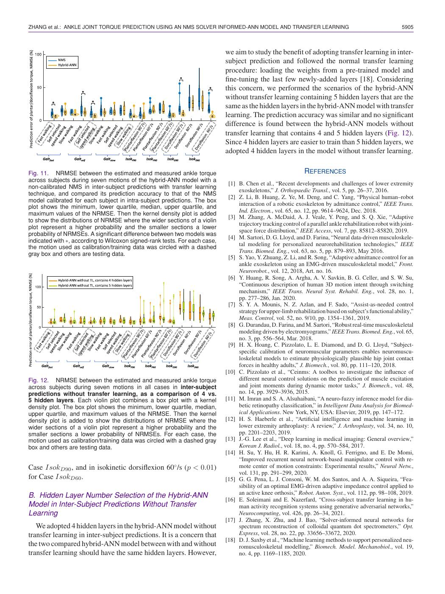

English text extracted from page 11

<pre>
ZHANG et al.: ANKLE JOINT TORQUE PREDICTION USING AN NMS SOLVER INFORMED-ANN MODEL AND TRANSFER LEARNING                                                   5905

                                                                            we aim to study the benefit of adopting transfer learning in inter-
                                                                            subject prediction and followed the normal transfer learning
                                                                            procedure: loading the weights from a pre-trained model and
                                                                            fine-tuning the last few newly-added layers [18]. Considering
                                                                            this concern, we performed the scenarios of the hybrid-ANN
                                                                            without transfer learning containing 5 hidden layers that are the
                                                                            same as the hidden layers in the hybrid-ANN model with transfer
                                                                            learning. The prediction accuracy was similar and no significant
                                                                            difference is found between the hybrid-ANN models without
                                                                            transfer learning that contains 4 and 5 hidden layers (Fig. 12).
                                                                            Since 4 hidden layers are easier to train than 5 hidden layers, we
                                                                            adopted 4 hidden layers in the model without transfer learning.

Fig. 11. NRMSE between the estimated and measured ankle torque                                                 REFERENCES
across subjects during seven motions of the hybrid-ANN model with a
                                                                             [1] B. Chen et al., “Recent developments and challenges of lower extremity
non-calibrated NMS in inter-subject predictions with transfer learning
                                                                                 exoskeletons,” J. Orthopaedic Transl., vol. 5, pp. 26–37, 2016.
technique, and compared its prediction accuracy to that of the NMS
                                                                             [2] Z. Li, B. Huang, Z. Ye, M. Deng, and C. Yang, “Physical human–robot
model calibrated for each subject in intra-subject predictions. The box
                                                                                 interaction of a robotic exoskeleton by admittance control,” IEEE Trans.
plot shows the minimum, lower quartile, median, upper quartile, and
                                                                                 Ind. Electron., vol. 65, no. 12, pp. 9614–9624, Dec. 2018.
maximum values of the NRMSE. Then the kernel density plot is added
                                                                             [3] M. Zhang, A. McDaid, A. J. Veale, Y. Peng, and S. Q. Xie, “Adaptive
to show the distributions of NRMSE where the wider sections of a violin
                                                                                 trajectory tracking control of a parallel ankle rehabilitation robot with joint-
plot represent a higher probability and the smaller sections a lower
                                                                                 space force distribution,” IEEE Access, vol. 7, pp. 85812–85820, 2019.
probability of NRMSEs. A significant difference between two models was
                                                                             [4] M. Sartori, D. G. Lloyd, and D. Farina, “Neural data-driven musculoskele-
indicated with ∗, according to Wilcoxon signed-rank tests. For each case,
                                                                                 tal modeling for personalized neurorehabilitation technologies,” IEEE
the motion used as calibration/training data was circled with a dashed
                                                                                 Trans. Biomed. Eng., vol. 63, no. 5, pp. 879–893, May 2016.
gray box and others are testing data.
                                                                             [5] S. Yao, Y. Zhuang, Z. Li, and R. Song, “Adaptive admittance control for an
                                                                                 ankle exoskeleton using an EMG-driven musculoskeletal model,” Front.
                                                                                 Neurorobot., vol. 12, 2018, Art. no. 16.
                                                                             [6] Y. Huang, R. Song, A. Argha, A. V. Savkin, B. G. Celler, and S. W. Su,
                                                                                 “Continuous description of human 3D motion intent through switching
                                                                                 mechanism,” IEEE Trans. Neural Syst. Rehabil. Eng., vol. 28, no. 1,
                                                                                 pp. 277–286, Jan. 2020.
                                                                             [7] S. Y. A. Mounis, N. Z. Azlan, and F. Sado, “Assist-as-needed control
                                                                                 strategy for upper-limb rehabilitation based on subject’s functional ability,”
                                                                                 Meas. Control, vol. 52, no. 9/10, pp. 1354–1361, 2019.
                                                                             [8] G. Durandau, D. Farina, and M. Sartori, “Robust real-time musculoskeletal
                                                                                 modeling driven by electromyograms,” IEEE Trans. Biomed. Eng., vol. 65,
                                                                                 no. 3, pp. 556–564, Mar. 2018.
                                                                             [9] H. X. Hoang, C. Pizzolato, L. E. Diamond, and D. G. Lloyd, “Subject-
                                                                                 specific calibration of neuromuscular parameters enables neuromuscu-
                                                                                 loskeletal models to estimate physiologically plausible hip joint contact
                                                                                 forces in healthy adults,” J. Biomech., vol. 80, pp. 111–120, 2018.
                                                                            [10] C. Pizzolato et al., “Ceinms: A toolbox to investigate the influence of
Fig. 12. NRMSE between the estimated and measured ankle torque                   different neural control solutions on the prediction of muscle excitation
across subjects during seven motions in all cases in inter-subject               and joint moments during dynamic motor tasks,” J. Biomech., vol. 48,
predictions without transfer learning, as a comparison of 4 vs.                  no. 14, pp. 3929–3936, 2015.
5 hidden layers. Each violin plot combines a box plot with a kernel         [11] M. Imran and S. A. Alsuhaibani, “A neuro-fuzzy inference model for dia-
density plot. The box plot shows the minimum, lower quartile, median,            betic retinopathy classification,” in Intelligent Data Analysis for Biomed-
upper quartile, and maximum values of the NRMSE. Then the kernel                 ical Applications. New York, NY, USA: Elsevier, 2019, pp. 147–172.
density plot is added to show the distributions of NRMSE where the          [12] H. S. Haeberle et al., “Artificial intelligence and machine learning in
wider sections of a violin plot represent a higher probability and the           lower extremity arthroplasty: A review,” J. Arthroplasty, vol. 34, no. 10,
smaller sections a lower probability of NRMSEs. For each case, the               pp. 2201–2203, 2019.
motion used as calibration/training data was circled with a dashed gray     [13] J.-G. Lee et al., “Deep learning in medical imaging: General overview,”
box and others are testing data.                                                 Korean J. Radiol., vol. 18, no. 4, pp. 570–584, 2017.
                                                                            [14] H. Su, Y. Hu, H. R. Karimi, A. Knoll, G. Ferrigno, and E. De Momi,
                                                                                 “Improved recurrent neural network-based manipulator control with re-
Case IsokD90 , and in isokinetic dorsiflexion 60◦ /s (p &lt; 0.01)                  mote center of motion constraints: Experimental results,” Neural Netw.,
                                                                                 vol. 131, pp. 291–299, 2020.
for Case IsokD60 .                                                          [15] G. G. Pena, L. J. Consoni, W. M. dos Santos, and A. A. Siqueira, “Fea-
                                                                                 sibility of an optimal EMG-driven adaptive impedance control applied to
B. Hidden Layer Number Selection of the Hybrid-ANN                               an active knee orthosis,” Robot. Auton. Syst., vol. 112, pp. 98–108, 2019.
                                                                            [16] E. Soleimani and E. Nazerfard, “Cross-subject transfer learning in hu-
Model in Inter-Subject Predictions Without Transfer                              man activity recognition systems using generative adversarial networks,”
Learning                                                                         Neurocomputing, vol. 426, pp. 26–34, 2021.
                                                                            [17] J. Zhang, X. Zhu, and J. Bao, “Solver-informed neural networks for
   We adopted 4 hidden layers in the hybrid-ANN model without                    spectrum reconstruction of colloidal quantum dot spectrometers,” Opt.
transfer learning in inter-subject predictions. It is a concern that             Express, vol. 28, no. 22, pp. 33656–33672, 2020.
                                                                            [18] D. J. Saxby et al., “Machine learning methods to support personalized neu-
the two compared hybrid-ANN model between with and without                       romusculoskeletal modelling,” Biomech. Model. Mechanobiol., vol. 19,
transfer learning should have the same hidden layers. However,                   no. 4, pp. 1169–1185, 2020.
</pre>

## Page 12

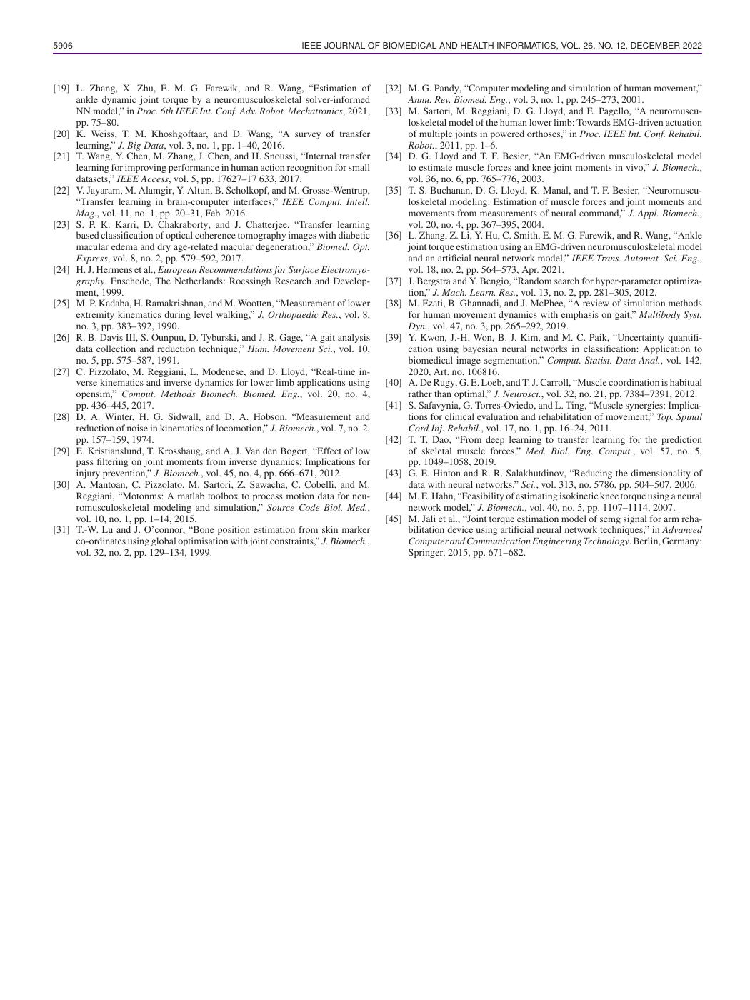

English text extracted from page 12

<pre>
5906                                                           IEEE JOURNAL OF BIOMEDICAL AND HEALTH INFORMATICS, VOL. 26, NO. 12, DECEMBER 2022

[19] L. Zhang, X. Zhu, E. M. G. Farewik, and R. Wang, “Estimation of                [32] M. G. Pandy, “Computer modeling and simulation of human movement,”
     ankle dynamic joint torque by a neuromusculoskeletal solver-informed                Annu. Rev. Biomed. Eng., vol. 3, no. 1, pp. 245–273, 2001.
     NN model,” in Proc. 6th IEEE Int. Conf. Adv. Robot. Mechatronics, 2021,        [33] M. Sartori, M. Reggiani, D. G. Lloyd, and E. Pagello, “A neuromuscu-
     pp. 75–80.                                                                          loskeletal model of the human lower limb: Towards EMG-driven actuation
[20] K. Weiss, T. M. Khoshgoftaar, and D. Wang, “A survey of transfer                    of multiple joints in powered orthoses,” in Proc. IEEE Int. Conf. Rehabil.
     learning,” J. Big Data, vol. 3, no. 1, pp. 1–40, 2016.                              Robot., 2011, pp. 1–6.
[21] T. Wang, Y. Chen, M. Zhang, J. Chen, and H. Snoussi, “Internal transfer        [34] D. G. Lloyd and T. F. Besier, “An EMG-driven musculoskeletal model
     learning for improving performance in human action recognition for small            to estimate muscle forces and knee joint moments in vivo,” J. Biomech.,
     datasets,” IEEE Access, vol. 5, pp. 17627–17 633, 2017.                             vol. 36, no. 6, pp. 765–776, 2003.
[22] V. Jayaram, M. Alamgir, Y. Altun, B. Scholkopf, and M. Grosse-Wentrup,         [35] T. S. Buchanan, D. G. Lloyd, K. Manal, and T. F. Besier, “Neuromuscu-
     “Transfer learning in brain-computer interfaces,” IEEE Comput. Intell.              loskeletal modeling: Estimation of muscle forces and joint moments and
     Mag., vol. 11, no. 1, pp. 20–31, Feb. 2016.                                         movements from measurements of neural command,” J. Appl. Biomech.,
[23] S. P. K. Karri, D. Chakraborty, and J. Chatterjee, “Transfer learning               vol. 20, no. 4, pp. 367–395, 2004.
     based classification of optical coherence tomography images with diabetic      [36] L. Zhang, Z. Li, Y. Hu, C. Smith, E. M. G. Farewik, and R. Wang, “Ankle
     macular edema and dry age-related macular degeneration,” Biomed. Opt.               joint torque estimation using an EMG-driven neuromusculoskeletal model
     Express, vol. 8, no. 2, pp. 579–592, 2017.                                          and an artificial neural network model,” IEEE Trans. Automat. Sci. Eng.,
[24] H. J. Hermens et al., European Recommendations for Surface Electromyo-              vol. 18, no. 2, pp. 564–573, Apr. 2021.
     graphy. Enschede, The Netherlands: Roessingh Research and Develop-             [37] J. Bergstra and Y. Bengio, “Random search for hyper-parameter optimiza-
     ment, 1999.                                                                         tion,” J. Mach. Learn. Res., vol. 13, no. 2, pp. 281–305, 2012.
[25] M. P. Kadaba, H. Ramakrishnan, and M. Wootten, “Measurement of lower           [38] M. Ezati, B. Ghannadi, and J. McPhee, “A review of simulation methods
     extremity kinematics during level walking,” J. Orthopaedic Res., vol. 8,            for human movement dynamics with emphasis on gait,” Multibody Syst.
     no. 3, pp. 383–392, 1990.                                                           Dyn., vol. 47, no. 3, pp. 265–292, 2019.
[26] R. B. Davis III, S. Ounpuu, D. Tyburski, and J. R. Gage, “A gait analysis      [39] Y. Kwon, J.-H. Won, B. J. Kim, and M. C. Paik, “Uncertainty quantifi-
     data collection and reduction technique,” Hum. Movement Sci., vol. 10,              cation using bayesian neural networks in classification: Application to
     no. 5, pp. 575–587, 1991.                                                           biomedical image segmentation,” Comput. Statist. Data Anal., vol. 142,
[27] C. Pizzolato, M. Reggiani, L. Modenese, and D. Lloyd, “Real-time in-                2020, Art. no. 106816.
     verse kinematics and inverse dynamics for lower limb applications using        [40] A. De Rugy, G. E. Loeb, and T. J. Carroll, “Muscle coordination is habitual
     opensim,” Comput. Methods Biomech. Biomed. Eng., vol. 20, no. 4,                    rather than optimal,” J. Neurosci., vol. 32, no. 21, pp. 7384–7391, 2012.
     pp. 436–445, 2017.                                                             [41] S. Safavynia, G. Torres-Oviedo, and L. Ting, “Muscle synergies: Implica-
[28] D. A. Winter, H. G. Sidwall, and D. A. Hobson, “Measurement and                     tions for clinical evaluation and rehabilitation of movement,” Top. Spinal
     reduction of noise in kinematics of locomotion,” J. Biomech., vol. 7, no. 2,        Cord Inj. Rehabil., vol. 17, no. 1, pp. 16–24, 2011.
     pp. 157–159, 1974.                                                             [42] T. T. Dao, “From deep learning to transfer learning for the prediction
[29] E. Kristianslund, T. Krosshaug, and A. J. Van den Bogert, “Effect of low            of skeletal muscle forces,” Med. Biol. Eng. Comput., vol. 57, no. 5,
     pass filtering on joint moments from inverse dynamics: Implications for             pp. 1049–1058, 2019.
     injury prevention,” J. Biomech., vol. 45, no. 4, pp. 666–671, 2012.            [43] G. E. Hinton and R. R. Salakhutdinov, “Reducing the dimensionality of
[30] A. Mantoan, C. Pizzolato, M. Sartori, Z. Sawacha, C. Cobelli, and M.                data with neural networks,” Sci., vol. 313, no. 5786, pp. 504–507, 2006.
     Reggiani, “Motonms: A matlab toolbox to process motion data for neu-           [44] M. E. Hahn, “Feasibility of estimating isokinetic knee torque using a neural
     romusculoskeletal modeling and simulation,” Source Code Biol. Med.,                 network model,” J. Biomech., vol. 40, no. 5, pp. 1107–1114, 2007.
     vol. 10, no. 1, pp. 1–14, 2015.                                                [45] M. Jali et al., “Joint torque estimation model of semg signal for arm reha-
[31] T.-W. Lu and J. O’connor, “Bone position estimation from skin marker                bilitation device using artificial neural network techniques,” in Advanced
     co-ordinates using global optimisation with joint constraints,” J. Biomech.,        Computer and Communication Engineering Technology. Berlin, Germany:
     vol. 32, no. 2, pp. 129–134, 1999.                                                  Springer, 2015, pp. 671–682.
</pre>

