# 基于 NMS 求解器融合 ANN 模型与迁移学习的踝关节力矩预测

Longbin Zhang , Xueyu Zhu , Elena M. Gutierrez-Farewik , and Ruoli Wang

摘要—在这项工作中，我们基于关节角度和肌电信号（EMG），通过将神经肌骨骼（neuromusculoskeletal, NMS）求解器融合人工神经网络（hybrid-ANN）模型与迁移学习相结合，预测了踝关节力矩。hybrid-ANN 是一种通过两类特征进行增强的 ANN：1）实验测量数据——肌肉信号与关节角度，以及 2）从底层 NMS 求解器中提取的包含物理信息的特征，例如单根肌肉力和关节力矩。在受试者内和跨受试者测试中均研究了 hybrid-ANN 模型的力矩预测准确性，并将其与基线模型（NMS 和 standard-ANN）进行了对比。对于每个预测模型，利用不同速度下的步态数据以及踝关节等速背屈/跖屈运动数据，分别研究了七种不同的工况。此外，我们在跨受试者模型中引入了迁移学习方法，通过将从先前参与者学到的知识迁移给新参与者来提高关节力矩预测精度，这在训练数据有限时非常有效。研究结果表明，通过将富含物理信息的 NMS 特征整合到标准 ANN 模型中可以获得更高的准确性，尤其是在跨受试者情况下；总体而言，hybrid-ANN 模型预测关节力矩的准确性高于基线模型，尤其是在采用迁移学习技术后的跨受试者预测中表现最为显著。我们展示了在不同预测场景下将基于物理机理的 NMS 模型、标准 ANN 模型与迁移学习技术相结合的潜力。该方法在结合使用者生理关节力矩设计按需助力外骨骼控制策略等应用中具有广阔的前景。

索引词—神经肌骨骼模型，神经网络，泛化性，迁移学习。

## I. 引言

外骨骼在帮助运动功能障碍患者恢复丧失的运动功能方面的潜力已得到广泛研究 [1], [2], [3]。在外骨骼辅助康复训练过程中，使用者的主动参与对于刺激神经肌肉恢复至关重要 [4], [5]。因此，外骨骼控制策略最重要的特征之一在于外骨骼是否能够提供适当的助力矩以适应使用者的残余肌肉功能 [6]。近年来，在助力设计中结合使用者力矩能力的外骨骼控制策略研究呈指数级增长，因为这种方法能够鼓励使用者主动参与以促进运动功能的恢复 [7]。

在预测关节力矩的方法中，基于物理的方法很常见。例如，Durandau 等人 [8] 研究了一种实时肌电图（EMG）驱动的神经肌肉骨骼（NMS）模型，以建立健全人体中从 EMG 信号到机械关节力矩生成的转换。他们能够同时稳健地计算 13 个肌腱单元的力和 3 个关节力矩（膝关节伸肌/屈肌、踝关节跖屈肌/背屈肌以及距下关节旋前肌/旋后肌）。EMG 驱动的 NMS 模型通常需要领域知识来显式建模变量之间的关系，例如肌肉的主动和被动力-长度关系、肌肉力-速度关系以及关节角-肌腱运动学关系。一般来说，通过复杂的步骤来建立/校准这些模型可能是费时费力的。此外，基于物理的 NMS 模型仅对关节动力学进行粗略估计，且 EMG 信号质量可能会受到肌电串扰和传感器放置位置的影响。其他研究（例如 EMG 辅助的 NMS 模型）通过结合肌腱参数优化来进一步提高模型的预测精度，从而使估计出的肌肉兴奋度能够更好地追踪测量所得的关节力矩 [9], [10]。然而，在实时预测中获取调整后的参数仍然是一个具有挑战性的问题。

人工神经网络（artificial neural networks, ANN）因其功能性和逼近精度，已被广泛用于预测关节力矩。ANN 拥有多层计算单元，通过将每个节点视为人工神经元来模拟人脑的神经元突触系统，从而具备了处理复杂和非线性信息的能力 [11], [12], [13], [14]。Pena et al. [15] 在主动膝关节矫形器的控制策略中，使用 ANN 作为神经肌肉骨骼（neuromusculoskeletal, NMS）模型的替代方法，以估计肌电（EMG）与力矩之间的映射关系。他们发现，与 NMS 模型相比，基于 ANN 的模型具有更高的预测精度。毫无疑问，ANN 被认为是识别变量与输出之间关系以及/或者在数据中搜索既定模式的有力工具。然而，ANN 是一种黑盒模型，对变量之间的底层机理缺乏概念，因此可能无法对处于训练分布之外的数据提供可靠的预测 [16]，特别是在训练数据的数量和多样性有限的情况下。为了充分发挥 ANN 的优势，近期的一些研究将神经网络融入基于物理的模型中，应用于增强模型预测能力和促进神经肌肉骨骼建模等多种场景。Zhang et al. [17] 构建了一个结合从光谱重建求解器中提取的信息特征的神经网络，用于对胶体量子点光谱仪的光谱进行建模。得益于基于求解器的先验特征（solver-informed features），他们利用该混合模型展现出了更好的重建精度和鲁棒性。在近期的一篇综述论文中，Saxby et al. [18] 提出了如何利用基于物理的仿真与大数据机器学习方法的结合来推进神经肌肉骨骼建模，并建议未来研究将个性化神经肌肉骨骼模型特征与大数据/机器学习方法相结合。受上述工作的启发，我们近期在步态和等速运动期间的踝关节力矩预测中，将来自 NMS 模型的信息特征融入了标准 ANN（standard-ANN）中 [19]。我们在受试者内预测（intra-subject prediction）中的结果表明，该组合模型预测关节力矩的总体表现优于 NMS 模型和标准 ANN，这证实了将基于物理的 NMS 求解器提供的信息特征融入标准 ANN 中的益处。然而，模型在受试者间预测（inter-subject prediction）中的泛化能力尚未得到进一步分析。

在肢体关节力矩预测中，跨受试者（inter-subject）模型的生成通常是一项具有挑战性的任务。NMS（神经肌肉骨骼）模型必须首先通过个体实验测试进行校准，以获取个性化参数，例如最佳肌纤维长度、最大等长肌力以及肌腱松弛长度；随后个性化模型才能用于估计肌肉力和关节力矩。因此，NMS 模型在跨受试者预测中的泛化能力往往较差。相比之下，在拥有充足训练数据和充分训练的前提下，ANN（人工神经网络）的泛化能力主要取决于网络的规模。然而，当训练数据有限时，一旦数据超出训练分布范围，泛化性能通常会出现明显下降 [16]。

近年来，迁移学习已被用于提高模型的泛化能力，特别是在数据有限的情况下 [20], [21]。Jayaram 等人 [22] 提出了一种用于脑机接口的迁移学习框架，该框架可应用于基于脑电图（electroencephalogram）信号的任意所需时空特征空间。他们的研究结果表明，在处理跨会话（inter-session）和跨受试者（inter-subject）的变异性方面，该方法优于其他可比方法。Karri 等人 [23] 对在 ImageNet 数据库上预训练的卷积神经网络 GoogLeNet 进行了微调，以提高其在识别具有病理特征的光学相干断层扫描图像时的预测能力。作者展示了 GoogLeNet 在图像分类中的迁移应用，即使用更少的训练数据实现更快的收敛。通过利用预训练神经网络从以往经验/数据中获取的知识，使用相对较少的样本即可构建出性能良好的新神经网络。因此，迁移学习技术是提高跨受试者模型中关节力矩预测泛化能力的一种潜在有效方法。

  
(a)

  
(b)  
Fig. 1. 实验。(a) 步态；(b) 等速踝关节背屈/跖屈运动。

本研究旨在探讨基于 NMS 求解器信息指导的 ANN（NMS solver-informed ANN）在受试者内（intra-subject）和跨受试者（inter-subject）预测中的踝关节力矩预测精度。由于某些受试者的训练数据往往有限，我们采用了迁移学习技术，通过利用从以往经验中获取的知识来进一步提高模型的预测精度，尤其是针对跨受试者预测。

## II. 方法

## A. 实验设置

从熟人和同事中招募了10名健全受试者（性别：4女/6男；年龄：26 3 岁；体重：70.4 11.5 kg；身高：175.1 8.5 cm）。瑞典伦理审查局（Swedish Ethical Review Authority）批准了本研究（Dnr. 2016/286-32），所有参与者均签署了知情同意书。所有受试者均被要求进行三种类型的运动，具体为步行、等速踝关节跖屈和等速踝关节背屈。在步行过程中，记录了自选速度、慢速和快速下的实验数据（Fig. 1）。等速踝关节运动（包括跖屈和背屈）在两种不同速度下进行：60◦/s 和 90◦/s。以 3000 Hz 的采样率采集每位受试者右腿腓肠肌内侧头（GM）、胫骨前肌（TA）和比目鱼肌（SOL）的表面肌电（EMG）信号（Noraxon Inc., AZ, USA），电极放置遵循欧洲表面肌电推荐标准 [24]。

在步态实验中，指导每位受试者沿着配有测量仪器的 9 米步道以自选速度 $( 1 . 1 3 \pm 0 . 0 9 \mathrm { m } / \mathrm { s } )$ 行走，随后根据节拍器设定的 100 拍/分钟（慢速，1.08 0.07 m/s）和 120 拍/分钟（快速，$1 . 3 3 \pm 0 . 0 8 \mathrm { m / s } )$ 同步行走步伐。在每个速度下至少采集了 3 次具有有效测力台数据的行走试验。每次试验中一个完整的步态支撑期随后用于模型校准/训练。标记点轨迹通过 3D 动作捕捉系统（200 Hz，Qualisys, Gothenburg, Sweden）测量，标记点根据 Plug-in Gait 模型 [25], [26] 粘贴在受试者身上。步行过程中的地面反作用力（GRF）使用测力台（Kistler, Winterthur, Switzerland）以 3000 Hz 采集。在等速踝关节运动中，要求每位受试者在 20◦ 跖屈至 15◦ 背屈的范围内尽全力连续进行五次背屈和跖屈，期间运动和关节力矩由测力计（5000 Hz，IsoMed 2000, Hemau, Germany）记录。

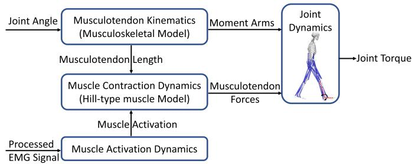  
Fig. 2. 由四个部分组成的 NMS 模型结构示意图：肌肉激活力学利用采集到的 EMG 计算肌肉激活水平；肌肉收缩力学通过基于 Hill 的肌肉模型计算肌腱复合体力；肌腱运动学计算每个肌腱单元的肌腱长度和力臂；最后，通过关节力学部分计算关节力矩。

## B. 数据处理

EMG 经过带通滤波（30–300 Hz）、整流、低通滤波（6 Hz），并归一化为所有运动试验中的最大 EMG 值 [4], [9], [27]。对等速运动任务中测得的踝关节角度和力矩，以及步态过程中的标记点轨迹和地面反作用力（GRF）应用了低通零滞后巴特沃斯滤波器（6 Hz）[28], [29], [30]。步态期间的踝关节角度和力矩使用肌骨建模系统（OpenSim v3.3, SimTK, Stanford, USA）通过包含缩放、逆向运动学和逆向动力学的常规流程计算得出 [27]。我们使用在特定受试者身上采集的标记点轨迹来拟合受试者的人体测量学参数，从而将通用肌骨模型（OpenSim Gait2354）缩放为受试者特异性模型。随后，以记录的标记点轨迹和 GRF 作为输入，应用缩放后的肌骨模型重建三维关节运动学和动力学。通过逆向运动学最小化实验标记点与模型上相应虚拟标记点之间的距离来计算关节角度 [31]。通过求解运动动力学方程，经由逆向动力学计算关节力矩 [32]。

## C. 关节力矩预测模型

1) NMS 模型：本研究采用了由 Pizzolato 等人开发的一款开源 EMG 驱动神经肌肉骨骼（NMS）模型（CEINMS）[10]，该模型由肌肉肌腱运动学、肌肉收缩动力学、肌肉激活度动力学和关节动力学组成（Fig. 2）[33]。

肌肉激活度动力学部分利用采集的 EMG 计算肌肉激活度。EMG e(t) 与神经激活度 $u ( t )$ 之间的关系可表示为 (1) [34]。

$$
u (t) = \alpha \cdot e (t - \tau) - \beta_ {1} \cdot u (t - 1) - \beta_ {2} \cdot u (t - 2)\tag{1}
$$

其中 α 是肌肉增益参数；$\beta _ { 1 }$ 和 $\beta _ { 2 }$ 是递归参数；$\alpha , \beta _ { 1 }$ 和 $\beta _ { 2 }$ 约束在以下关系中以获得稳定解 [10] [34] [35]：$\beta _ { 1 } = C _ { 1 } + C _ { 2 } , \beta _ { 2 } = C _ { 1 } \cdot C _ { 2 }$，其中 $\left| C _ { 1 } \right| < 1 , \left| C _ { 2 } \right| < 1$，且 $\alpha - \beta _ { 1 } - \beta _ { 2 } = 1$。$\tau$ 是机电延迟。肌肉激活度 $a ( t )$ 与神经激活度之间的关系可表示为 (2)：

$$
a (t) = \frac {e ^ {B u (t)} - 1}{e ^ {B} - 1}\tag{2}
$$

其中 $B$ 是形状因子 [9], [35]。

肌肉收缩动力学部分通过基于 Hill 的肌肉模型计算肌肉肌腱力。每个肌肉肌腱单元（MTU）的力 F 可表示为 (3)，

$$
F = F _ {0} ^ {m} [ F _ {a} (l) \cdot F _ {v} (v) \cdot a + F _ {p} (l) + d _ {a} \cdot v ] c o s (\psi)\tag{3}
$$

其中 $F _ { 0 } ^ { m }$ 为肌肉最大等长肌力；$l$ 为肌纤维长度，$v$ 为肌纤维收缩速度；$F _ { a } ( l )$ 表示主动力-长度关系，$F _ { p } ( l )$ 描述被动力-长度关系，$F _ { v } ( v )$ 表示力-速度关系；$d _ { a }$ 为肌肉阻尼参数，ψ 为肌纤维羽状角。

肌肉肌腱运动学组件用于计算肌腱单元（MTU）的力臂和肌肉肌腱长度。最后，通过关节动力学组件预测关节力矩。

在 NMS 模型校准过程中，对每位参与者进行了受试者特异性 MTU 参数辨识。这些参数（包括最佳肌纤维长度、肌腱松弛长度、形状因子 B、强度系数以及系数 C1 和 C2）在校准过程中通过最小化估计关节力矩与测量关节力矩之间的误差来进行优化。校准参数和边界条件的列表基于 Pizzolato 等人 [10] 的建议。每个 MTU 的最佳肌纤维长度 $l _ { 0 } ^ { m }$ 和肌腱松弛长度 $l _ { s } ^ { t }$ 被约束在其默认值的 15% 以内。形状因子 $B$ 被约束在 ( 3, 0)。系数 $C _ { 1 }$ 和 $C _ { 2 }$ 被约束在 ( 1, 1)。强度系数被约束在 (0.5,2.5) 以缩放肌肉最大等长肌力。

2) ANN 模型：接下来，我们构建了一个标准 ANN 模型，使用与 NMS 模型相同的实验输入（即如图 3 所示的 EMG 和关节角度）来估计踝关节力矩。如上所述，标准 ANN 技术是一种纯数据驱动的方法，在遇到未见过的动作时预测精度预计会有所下降 [36]。为了提高标准 ANN 模型的泛化能力，我们利用更具信息量的特征——即由基于物理的 NMS 求解器计算得出的单个肌肉肌力和踝关节力矩，构建了一个混合 ANN 模型（图 3）。

标准 ANN 和混合 ANN 均包含一个输入层、$n$ 个隐藏层和一个输出层。对于输入，标准 ANN 包含四个实验输入特征，即踝关节角度和三块肌肉的 EMG 信号。除了这些输入之外，混合 ANN 还增加了四个额外的输入特征：由基于物理的 NMS 求解器计算得出的踝关节力矩和三块肌肉的肌力。对于受试者内（intra-subject）预测，使用了两个隐藏层；而在无迁移学习的跨受试者（inter-subject）预测中，使用了四个隐藏层。最终，从输出层估计踝关节力矩。

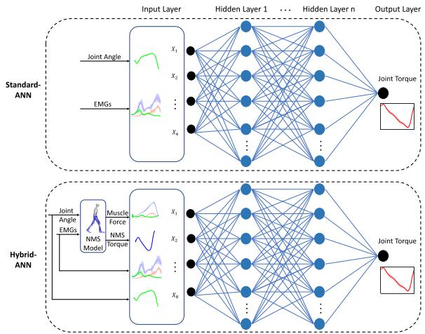  
Fig. 3. 标准与混合 ANN 模型的架构。对于标准和混合 ANN 模型，均采用了相同的实验测量输入数据，即三块肌肉的 EMG 和踝关节角度。对于混合 ANN 模型，添加了通过基于物理的 NMS 模型计算出的特征，即肌肉力和关节力矩，以便将来自 NMS 模型的更多有效信息特征利用到标准 ANN 模型中。包含 n 个隐藏层（无迁移学习的主体内预测使用两个隐藏层，主体间预测使用四个隐藏层），并在输出层预测踝关节力矩。

3) 迁移学习：在主体间预测的两个 ANN 模型中均采用了迁移学习技术，通过使用从先前经验/受试者 $( S _ { 1 } , S _ { 2 } , . . . , S _ { p } )$ 中获得的知识/信息对模型进行预训练，并将获得的知识迁移到新参与者，从而学习结构相似性（Fig. 4）。我们提取了预训练模型中除输出层以外的各层，然后将它们共享给目标受试者（St）的模型。我们在目标模型中添加了一个新的隐藏层和一个新的输出层；随后，使用来自新参与者的数据/信息，训练新增两层的权重，同时微调其他层的权重。

4) ANN 模型的超参数调优：我们使用了一种“由粗到细”的随机搜索 [37] 方法来确定 ANN 模型的超参数。在训练期间，损失函数为估计踝关节力矩与实际踝关节力矩之间的均方误差（mse）。使用的批大小（batch size）为 20。选择了 Xavier 权重及零偏置初始化器。主体内预测选择了两个隐藏层，主体间预测选择了四个隐藏层。每个隐藏层包含十个具有 tanh 激活函数的神经元。选择了 Adam 优化器（学习率为 $1 0 ^ { - 3 } )$。对于迁移学习技术，调整后的学习率为 $1 0 ^ { - 4 }$，微调学习率为 $1 0 ^ { - 5 }$。我们在连续 200 个轮次（epoch）损失未下降时采用早停（early stop）技术，通过迭代 4000 个轮次获得了最佳模型。

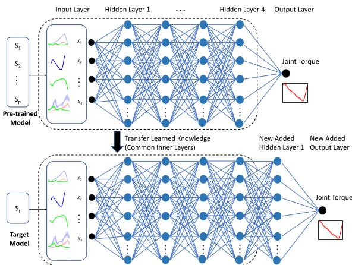  
Fig. 4. 在主体间预测的 ANN 模型中采用的迁移学习技术。预训练模型包含从先前的经验/受试者 $( S _ { 1 } , S _ { 2 } , . . . , S _ { p } )$ 中获得的知识。提取预训练模型中除输出层以外的层/知识，然后迁移到目标受试者 $( S _ { t } )$ 的模型中。在目标模型中添加了一个新的隐藏层和一个新的输出层，然后我们使用来自新用户的信息/数据重新训练了目标模型。

## D. 评估框架

在受试者内（intra-subject）和受试者间（inter-subject）两种预测模型场景下，研究了 NMS、standard-ANN 和 hybrid-ANN 的踝关节力矩估计精度。在受试者间预测中，还研究了将迁移学习技术引入两种 ANN 模型的益处，并将 ANN 模型的预测结果与受试者内预测中的 NMS 模型进行了比较。对于每种预测模型，研究了七种不同的工况：$G a i t _ { f a s t } , G a i t _ { s e l f }$ $G a i t _ { s l o w } ,$ 、IsokP90、IsokP60、IsokD90 和 $I s o k _ { D 6 0 }$。关于不同工况的更多详细描述，参见图 5。hybrid-ANN 中的 NMS 模型按照第 II 节 C(a) 部分所述的校准过程进行了校准。令人担忧的是，对 NMS 模型校准的需求可能会限制所提出的 hybrid-ANN 模型的广泛应用。因此，我们研究了在结合迁移学习技术的受试者间预测中，采用未校准 NMS 的 hybrid-ANN 模型的预测精度（见附录说明）。

受试者内预测：针对每个用户 $( S _ { 1 } , S _ { 2 } , . . . , S _ { 1 0 } )$ 分别使用来自每种运动的数据对模型进行校准/训练，并在不同速度的同类型运动上进行测试。更具体地说，我们针对某一速度下的步态校准/训练模型，并在其余步态速度上进行测试；等速踝关节运动亦是如此。对于 ANN 模型的训练，使用两个试验（trial）作为训练数据，一个试验作为验证数据。

为了比较模型在受试者内和受试者间预测中的精度，我们复现了先前报道的受试者内预测结果 [19]。

受试者内预测：

a) 无迁移学习：与受试者内预测类似，共包含七种工况。针对除一名受试者外的多名受试者的每种动作训练 ANN 模型（留一交叉验证法），然后在剩余的新受试者上测试相同类型的动作，随后对每名受试者进行迭代。

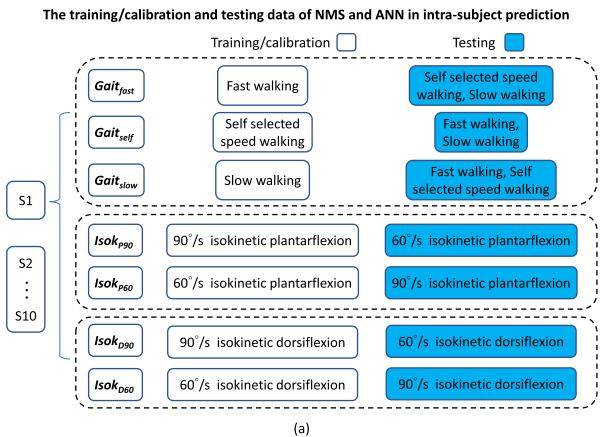

ANN 模型在受试者间预测中的训练与测试数据  
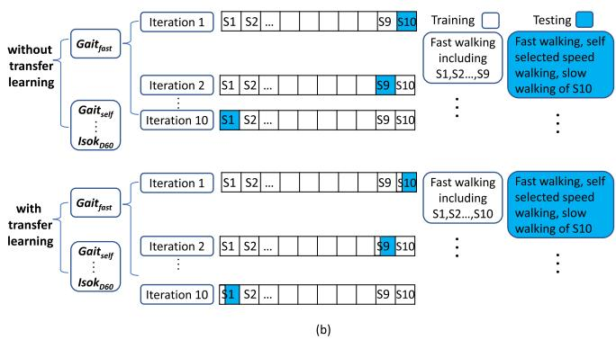  
Fig. 5. (a) 受试者内预测中七种不同情况下 NMS 和 ANN 模型的训练/校准与测试数据；以及 (b) 受试者间预测中七种不同情况下 ANN 模型的训练与测试数据。受试者内预测：对于每种情况，使用不同的动作来校准（NMS）或训练（ANN）模型。模型分别使用来自每种动作的数据进行校准/训练，并针对每个用户 $( S _ { 1 } , S _ { 2 } , . . . , S _ { 1 0 } )$ 单独在不同速度的同类型动作上进行测试。无迁移学习的受试者间预测：模型针对除一名受试者外的多名受试者的每种动作进行训练（留一交叉验证法），然后在剩余的新受试者的同类型动作上进行测试，接着对每个受试者进行迭代。有迁移学习的受试者间预测：模型针对除一名用户外的多名用户的每种动作进行预训练，并以通用结构共享给新用户。然后，我们使用来自新参与者相同动作的数据（即来自新参与者的较少数据）重新训练模型，并在新受试者不同速度的同类型动作上进行测试，接着对每个受试者进行迭代。

b) 有迁移学习：ANN 模型针对除一名参与者外的多名参与者的每种动作进行预训练，并以通用结构共享给新参与者。然后，我们使用来自新参与者相同动作的数据（即来自新参与者的较少数据）重新训练模型，并在新受试者不同速度的同类型动作上进行测试，接着对每个受试者进行迭代。

每个模型的预测精度通过归一化均方根误差（NRMSE）$E _ { N R M S }$ 进行评估，其被定义为（估计与实际踝关节力矩之间的）均方根误差 $E _ { R M S }$ 经相应动作期间实际踝关节力矩范围缩放后的值：

$$
E _ {R M S} = \sqrt {\frac {1}{N} \sum_ {i = 1} ^ {N} (y _ {p , i} - y _ {i}) ^ {2}}\tag{4}
$$

$$
E _ {N R M S} = \frac {E _ {R M S}}{(y _ {m a x} - y _ {m i n})} \times 100\tag{5}
$$

式中，$y _ { p , \ast }$ 和 $y _ { i }$ 分别为时间步 i 处的估计踝关节力矩与实际/测量踝关节力矩；$y _ { m a x }$ 和 $y _ { m i n }$ 分别为相应动作期间测量关节力矩 $y _ { i }$ 的最大值与最小值。

采用 Shapiro-Wilk 检验来检查数据分布的正态性（显著性水平为 $p < 0 . 0 5 )$）。对于非正态分布的数据，应用经 Bonferroni 校正的 Wilcoxon 符号秩检验来研究所述三种方法预测的 NRM-SE 差异（显著性水平为 $p < 0 . 0 5 )$）。

## III. 结果

## A. 受试者内预测

总体而言，与 NMS 和 Standard-ANN 相比，hybrid-ANN 模型观察到了更小的 NRMSE（Fig. 6）。

在所有校准/训练动作中，hybrid-ANN 的预测精度均显著高于 NMS（自选速度行走：$p = 0 . 0 2$，快速行走：$p = 0 . 0 2$，慢速行走：$p = 0 . 0 5$，等速跖屈 90◦/s：$p =$ $0 . 0 4$，等速跖屈 60◦/s：$p = 0 . 0 2$，等速背屈 $9 0 ^ { \circ } / \mathrm { s } { : } p = 0 . 0 2$，等速背屈 $6 0 ^ { \circ } / \mathrm { s } ; p = 0 . 0 2$）。

在测试的动作中，与 NMS 相比，hybrid-ANN 通常具有更好的力矩预测精度，仅有一个例外（Fig. 7）。在 $G a i t _ { s e l f }$ 情况下，对于一名受试者的快速和慢速行走，hybrid-ANN 模型的预测精度低于 NMS 模型（Fig. 6）。

与 standard-ANN 相比，hybrid-ANN 并不总是表现出更优越的预测精度。值得注意的是，与其他两个模型相比，在某些测试动作中，standard-ANN 模型的预测力矩与实际力矩的一致性较差，例如 $G a i t _ { s e l f }$ 情况下慢速行走 $( \mathrm { F i g . } 7 B _ { 3 } )$、IsokP90 情况下等速跖屈 60◦/s $( \mathrm { F i g . } 7 D _ { 2 } )$ 以及 $I s o k _ { P 6 0 }$ 情况下等速跖屈 90◦/s $( \mathrm { F i g . } 7 E _ { 1 } )$ ）。

由 NMS 模型估计的力矩轨迹在周期开始时有时会出现一个偏移量，而该偏移在测量的实际力矩中并不存在。在 ANN 模型预测的力矩中未观察到此偏移（例如，Fig. 7 中的 $A _ { 1 }$ 和 $A _ { 3 }$）。

## B. 跨受试者预测

1) 无迁移学习（Without Transfer Learning）：总体而言，ANN 模型的力矩预测精度劣于特定于受试者的 NMS 模型（Fig. 8(a) 和 Fig. 9），其中 hybrid-ANN 的预测精度高于 standard-ANN。在所有校准/训练动作中，standard-ANN 的预测精度显著差于 NMS（慢速行走：$p = 0 . 0 2$，自选速度行走：$p = 0 . 0 2$，快速行走：$p = 0 . 0 2$，等速跖屈 90◦/s：$p =$ 0.02，等速跖屈 $6 0 ^ { \circ } / \mathrm { s } \colon p = 0 . 0 2$，等速背屈 $9 0 ^ { \circ } / \mathrm { s } { : } p = 0 . 0 3$，等速背屈 $6 0 ^ { \circ } / \mathrm { s } ; p = 0 . 0 2$）。在测试动作中，standard-ANN 的预测精度通常劣于 NMS 和 hybrid-ANN 模型。

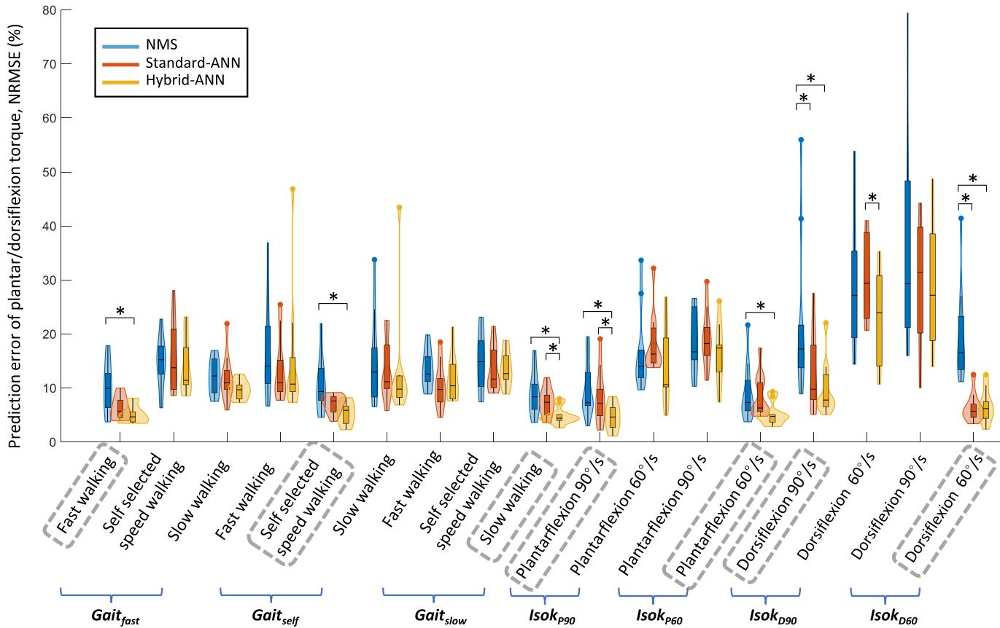  
Fig. 6. 在受试者内预测的所有情况下，七种运动过程中跨受试者的踝关节扭矩估计值与测量值之间的 NRMSE，以小提琴图展示。每个小提琴图结合了箱线图与核密度图。箱线图显示了 NRMSE 的最小值、下四分位数、中位数、上四分位数和最大值。随后添加核密度图以显示 NRMSE 的分布，其中小提琴图较宽的部分代表 NRMSE 出现的概率较高，较窄的部分代表概率较低。根据经 Bonferroni 校正的 Wilcoxon 符号秩检验，两种模型之间的显著性差异用 表示。对于每种情况，用灰色虚线框圈出的运动作为校准/训练数据，其余为测试数据。

2) 使用迁移学习（With Transfer Learning）：总体而言，在使用迁移学习后，两种 ANN 模型的预测精度均得到了显著提高，其中标准 ANN（standard-ANN）在某些动作中的精度与其他两种模型相比略逊一筹，例如在自选步行速度 $G a i t _ { f a s t }$ 情况 $( \mathrm { F i g . ~ } 1 0 \ A _ { 2 } )$ 、等速跖屈 60◦/s $I s o k _ { P 9 0 }$ 情况 $( \mathrm { F i g . 1 0 } D _ { 2 } )$ 以及等速跖屈 90◦/s IsokP60 情况 (Fig. 10 $E _ { 1 } )$ 中。

在 $G a i t _ { f a s t } , G a i t _ { s e l f }$ 和 $G a i t _ { s l o w }$ 情况下，混合 ANN（hybrid-ANN）模型总体上优于其他两种模型 (Fig. 8(b))。与 NMS 模型相比，在相同的训练/校准运动中发现了显著更高的预测精度，例如快速行走 $( p = 0 . 0 3 )$ 和自选速度行走 $( p = 0 . 0 2 )$ ，而在慢速行走中也稍高（尽管不显著， $( p = 0 . 1 1 )$ ）。值得注意的是，在 $G a i t _ { s e l f }$ 情况下，标准 ANN 模型对实际扭矩的峰值跖屈扭矩吻合度最差的情况出现在测试的慢速行走中 (Fig. 10 A )。

当使用 $I s o k _ { P 9 0 }$ 和 $I s o k _ { P 6 0 }$ 情况进行训练/校准时 (Fig. 8(b))，混合 ANN 模型在所有等速跖屈运动中均取得了最高的预测精度。与 NMS 相比，在相同的训练/校准等速跖屈 60◦/s 中发现了显著性差异 $( p =$ $0 . 0 2 )$ ，而在 90◦/s 中也稍好一些（尽管不显著， $( p = 0 . 0 7 )$ ）。

在 $I s o k _ { D 9 0 }$ 和 $I s o k _ { D 6 0 }$ 情况下，在相同的训练/校准运动中，混合 ANN 的预测精度显著高于 NMS（90◦/s: $p = 0 . 0 2$ ，以及 60◦/s: $p = 0 . 0 2 ; \mathrm { F i g . ~ 8 ( b ) } )$ ，在测试的等速背屈运动中也稍好一些（尽管不显著）。总体而言，ANN 模型通常比 NMS 模型表现更好 (Fig. 10)。

## IV. 讨论

在这项工作中，我们使用基于神经肌肉骨骼（NMS）求解器信息的 ANN（hybrid-ANN）结合迁移学习技术估计了踝关节力矩。除实验信号外，hybrid-ANN 模型还在标准 ANN（standard-ANN）的基础上增加了基于物理的额外 NMS 信息特征，即单个肌肉力和踝关节力矩。具体而言，我们研究了所提出的混合模型的关节力矩预测精度，并在受试者内（intra-subject）和受试者间（inter-subject）预测中将其与两个基线模型（标准 ANN 和 NMS）进行了比较。在受试者间预测中，我们采用了迁移学习技术来提高力矩预测性能。总体而言，我们发现 hybrid-ANN 预测力矩的精度高于 NMS 和 standard-ANN，特别是在采用迁移学习技术后的受试者间情况下。

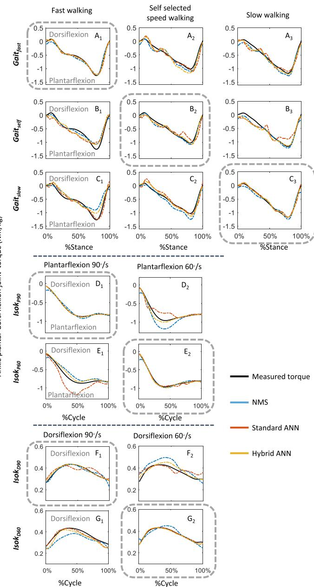  
Fig. 7. 在受试者内预测的所有情况下，通过各模型预测与测量的踝关节力矩轨迹示例。对于每种情况，用作校准/训练数据的运动均用灰色虚线框圈出，其余为测试数据。

肌电驱动（EMG-driven）NMS 模型和 ANN 模型都是关节力矩估计中的常用方法，且根据预测场景的不同，各自具有独特的优势与局限性。与 NMS 模型相比，标准 ANN（standard-ANN）模型具有强大的逼近能力 [15], [36]，但对于未见过的动作，其准确性可能会下降，因为它是黑盒模型，仅旨在基于训练过的运动来学习输入与输出之间的关系 [4], [38]。在此背景下，一个目标是充分利用 NMS 和神经网络模型的优势；在之前的一项研究 [19] 中，我们通过将来自 NMS 求解器的物理特征整合到标准 ANN 中提出了一种混合 ANN（hybrid-ANN），受试者内预测的初步结果表明，该混合模型比单独使用 NMS 和标准 ANN 能够实现更准确的关节力矩估计。然而，用于预测关节力矩的跨受试者模型仍然具有挑战性。因此，在本研究中，我们将 NMS 求解器指导的 ANN 模型与迁移学习（transfer learning）相结合，以进一步提高踝关节力矩在受试者内和跨受试者预测中的预测精度。我们发现，总体而言，混合 ANN 模型预测力矩的准确性均优于 NMS 和标准 ANN 模型。根据关节动力学的结构（Fig. 2），我们将这一发现归因于生理特征——即在混合 ANN 模型内部计算的单块肌肉力——是关节力矩估计中的主导中间分量。因此，结合这些生理特征可以提高标准 ANN 模型的预测精度，尤其是在遇到未见过的动作时。例如，与混合 ANN 和 NMS 模型相比，在受试者内预测中对未见过的动作——$G a i t _ { s e l f }$ 情况下的慢速行走进行测试时，标准 ANN 模型的力矩预测准确性最低 (Fig. $7 B _ { 3 } )$ ，尤其是在站立末期的峰值跖屈力矩附近。峰值力矩附近的较大偏差可能是由于训练后的标准 ANN 模型对 EMG 变化和行走速度更为敏感，而来自其他速度的测试数据可能超出了已训练模型的分布范围。

## A. 受试者内预测

在受试者内（intra-subject）预测中，值得注意的是，当周期开始时测得的力矩接近于零时，NMS 模型预测出会存在一些微小的偏差，例如图 8 中的 $A _ { 2 } ,$ $D _ { 2 }$ 和 $E _ { 1 }$。这可能是因为在 NMS 模型校准过程中，校准参数（例如最佳肌纤维长度、最大等长肌力和肌腱松弛长度）是通过最小化整个运动周期内预测力矩与实际力矩之间的误差来进行优化的。当测量力矩接近于零且 EMG 幅值非零时（特别是在快速行走期间），NMS 校准优化器可能难以找到既能满足初始接近零力矩、又能在整个周期内保持总体较小误差的最优解。此外，在 NMS 模型中，需要每个 MTU（肌腱复合体）前两个时间步的神经激活度来计算肌肉神经激活度（(1)）。在周期开始时，过去两个神经激活度值不可用。相反，它们是通过前两个时间步的 EMG 信号近似得到的；因此它们也可能导致预测力矩中出现初始偏差。然而，混合人工神经网络（hybrid-ANN）模型在很大程度上消除了初始力矩偏差，该模型可以被视为从基于 NMS 的关节力矩预测到测量力矩的校正映射。这主要是因为 hybrid-ANN 模型具有一个额外的组件：添加神经网络，通过最小化测量关节力矩与预测关节力矩之间的误差来进一步训练更好的模型。

无迁移学习的跨受试者预测（Inter-subject prediction without transfer learning）  
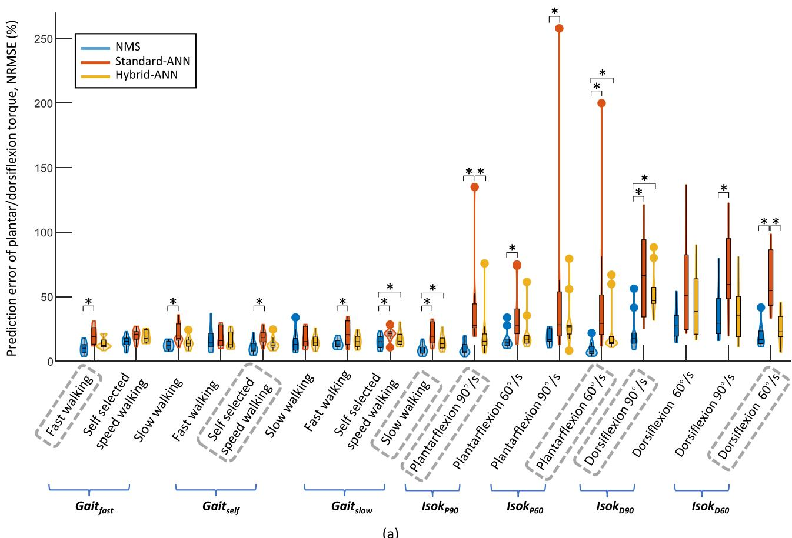

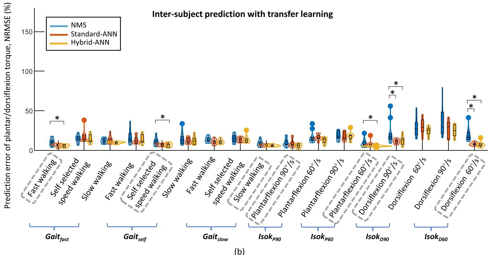  
(b)  
Fig. 8. 跨受试者预测中所有情况下七种运动期间受试者间估计踝关节力矩与测量踝关节力矩之间的 NRMSE：（a）无迁移学习和（b）有迁移学习。每个小提琴图结合了箱线图和核密度图。箱线图展示了 NRMSE 的最小值、下四分位数、中位数、上四分位数和最大值。随后添加核密度图以展示 NRMSE 的分布，其中小提琴图较宽的部分代表 NRMSE 的概率较高，较窄的部分代表概率较低。根据带有 Bonferroni 校正的 Wilcoxon 符号秩检验，两种模型之间的显著性差异用 表示。对于每种情况，用作校准/训练数据的运动均用灰色虚线框标出，其余为测试数据。

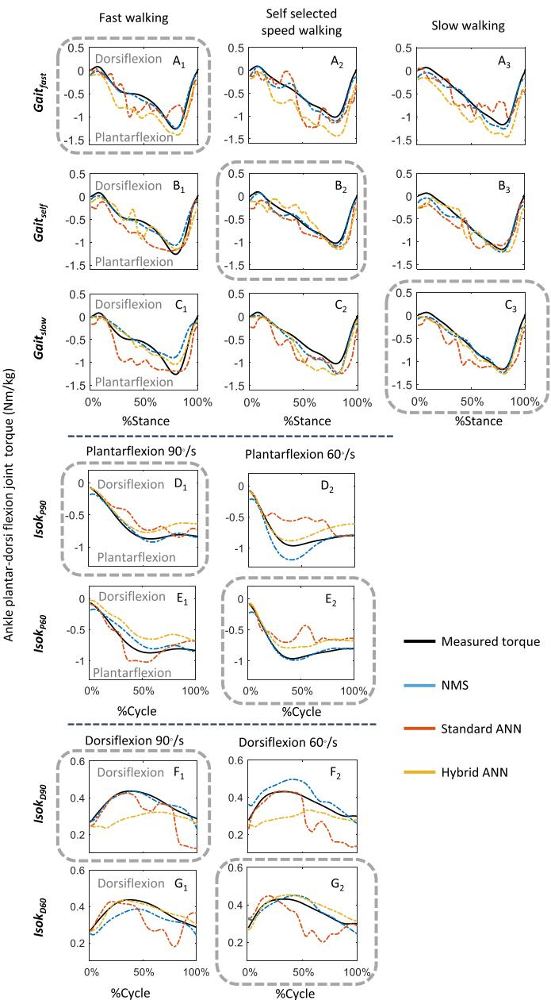  
Fig. 9. 无迁移学习的跨受试者预测中所有情况下通过模型得到的预测踝关节力矩与测量踝关节力矩轨迹的一个示例。对于每种情况，用作校准/训练数据的运动均用灰色虚线框标出，其余为测试数据。

值得注意的是，在受试者内预测（intra-subject prediction）中，当在快走和慢走测试时，标准 ANN（standard-ANN）在 $G a i t _ { s e l f }$ 情况下的某一个受试者身上表现较差（图 6）。这可能是由于混合 ANN（hybrid-ANN）模型采用了 NMS 求解器提供的肌肉力和关节力矩作为输入特征。然而，在某些情况下，NMS 模型预测的力矩较差。结果导致它向 hybrid-ANN 模型提供了信息量较少甚至是具有误导性的输入特征，从而对其预测精度产生了负面影响。NMS 模型在某些测试动作中预测较差并不令人意外，因为在校准动作和测试动作之间可能存在不同的肌肉协调模式。在未来的工作中，我们建议采用具有不确定性量化（uncertainty quantification）特征的替代神经网络模型，例如贝叶斯神经网络（Bayesian neural network），该网络能够首先识别所处情况，从而指导丰富训练数据以重新训练出鲁棒的模型 [39]。

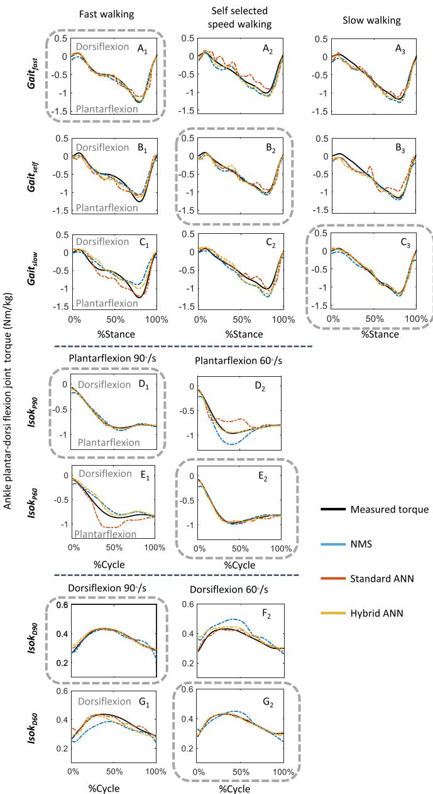  
Fig. 10. 采用迁移学习的跨受试者预测中各情况下各模型预测和实测踝关节力矩轨迹的一个示例。对于每种情况，用作校准/训练数据的动作均用灰色虚线框标出，其余为测试数据。

## B. 跨受试者预测

正如预期的那样，当未采用迁移学习时，无论使用哪种 ANN 模型，跨受试者力矩性能通常不如受试者内预测准确。在没有迁移学习的情况下，hybrid-ANN 和 standard-ANN 均使用来自先前经验/受试者的数据进行训练，而没有使用来自新受试者的数据。因此，可以预料到力矩预测的准确性将低于使用来自新受试者的数据校准的特定受试者 NMS 模型。此外，肌肉协调模式在不同受试者之间可能存在差异 [40], [41]；因此，在训练过程中若没有来自新受试者的信息，标准 ANN 模型的泛化能力可能不足，特别是当来自其他受试者的训练数据集不够丰富时。然而，一个有趣的发现是，尽管 ANN 模型预测力矩的准确性通常低于特定受试者的 NMS 模型，但 hybrid-ANN 预测力矩的准确性高于 standard-ANN（图 9）。这主要是因为与 standard-ANN 相比，hybrid-ANN 模型包含了更多相关的输入特征（即来自 NMS 求解器的单个肌肉力和关节力矩），因而能够利用 NMS 求解器的鲁棒性和可靠性。

迁移学习技术是跨受试者交叉验证中提高神经网络泛化能力的一种常用方法，通过将从源域（先前的受试者）获取的知识/信息应用到目标域（新的参与者），可以防止前述的性能泄漏 [16]。在本研究中，我们在用于运动过程中跨受试者关节力矩预测的人工神经网络（ANN）模型中采用了迁移学习技术。我们发现，迁移学习在所有情况下均显著提高了力矩预测精度。例如，在 $G a i t _ { f a s t }$ 情况下，若不采用迁移学习，两种 ANN 模型预测的力矩与实测力矩相比存在相当大的偏差（图 9 A1, A2 $A _ { 3 } )$ ；但引入迁移学习后，两种 ANN 模型的力矩预测精度均大幅提升（图 10 A1, $A _ { 2 }$ and $A _ { 3 } )$ 。又如，hybrid-ANN 模型在一名受试者的 $( G a i t _ { s e l f } )$ 情况下，未使用迁移学习时的预测精度相当差，而在应用迁移学习后不仅得到改善，甚至优于受试者内（intra-subject）预测（图 6 对比图 8(b)）。这种提升可能是因为预训练模型中共享相似特征/结构处的权重被用作了新用户模型的初始权重。已有研究表明初始权重会影响模型预测精度，即初始权重越接近最优解，模型的预测精度就越高 [42], [43]。

## C. 局限性

需要指出的是，由于经典类型的人工神经网络（ANN）具备出色的功能和逼近精度，且已频繁应用于关节力矩预测中，因此我们选择了经典类型的 ANN [15], [44], [45]。具有不同结构的其他 ANN，例如长短期记忆（LSTM）网络，可能会产生不同的结果。尽管 LSTM 网络由于其记忆结构可以在一定时间内记住模式，但我们在混合 ANN（hybrid-ANN）模型中引入的神经肌肉骨骼（NMS）模型也具有如公式 (1) 所述的类似功能；NMS 模型同样具备一种记忆特性，因为它利用了肌腱单元（MTU）神经激活在前两个时间步的信息。此外，LSTM 网络通常需要更多的数据进行训练，而本研究的数据集较小，这限制了其在当前研究中的应用。我们的目标是研究基于物理的 NMS 与 ANN 的组合模型是否能够提高受试者内和受试者间踝关节力矩的预测精度。在未来的工作中可以进一步分析不同类型的神经网络。关于执行时间，hybrid-ANN 是 NMS 与标准 ANN（standard-ANN）的结合，其执行时间主要由 NMS 模型所需的时间决定。ANN 前向评估的在线执行时间开销可以忽略不计。正如 Sartori 等人 [45] 先前的一项研究所表明的，实时肌电（EMG）驱动的 NMS 模型的平均延迟大约为 35 ms。因此，hybrid-ANN 模型对于实时应用仍然适用。尽管如此，本研究也存在若干局限性。仅使用了比目鱼肌（SOL）、腓肠肌内侧头（GM）和胫骨前肌（TA）的激活信号以及踝关节跖屈和背屈角度来估计踝关节力矩。髋关节和膝关节在日常活动中同样起着重要作用，并且会影响双关节肌的肌肉肌腱动力学。所提出的融合 NMS 求解器的 ANN 模型在髋关节和膝关节上的力矩预测仍有待进一步验证。

## V. 结论

在这项工作中，我们使用融合 NMS 求解器信息的 ANN（人工神经网络），以实验测得的关节角度和肌肉 EMG（肌电信号）作为输入，估计了步态以及等速踝关节背屈和跖屈运动过程中的踝关节力矩。除了关节角度和 EMG 信号外，该 hybrid-ANN 模型还利用从底层 NMS 求解器中提取的富含信息的物理特征（即单块肌肉肌力和关节力矩）对标准 ANN（standard-ANN）进行了增强。跨受试者预测中结合了迁移学习技术，通过将从以往多次实验/多个受试者中获得的知识/信息迁移给新的参与者，从而学习结构相似性。我们的研究结果表明，融合 NMS 求解器信息的 ANN 在估计力矩方面的准确性优于 NMS 模型和标准 ANN 模型，这表明将基于物理的 NMS 求解器中的丰富信息特征融入标准 ANN 具有潜在优势。此外，在应用迁移学习后，hybrid-ANN 在准确性和鲁棒性方面进一步优于标准 ANN 和 NMS 模型，尤其是在跨受试者预测中。所提出的结合迁移学习的 hybrid-ANN 能够融合多个用户的生理关节力矩，因此在外骨骼康复控制策略的设计中展现出巨大的应用潜力。

## 附录

## A. 基于未校准 NMS 模型的迁移学习

我们使用迁移学习技术研究了带有未校准 NMS 的 hybrid-ANN 模型在跨受试者预测中的预测准确性，并将其预测准确性与针对每个受试者分别校准的 NMS 模型在受试者内预测中的表现进行了比较（Fig. 11）。

总体而言，在采用迁移学习的情况下，带有未校准 NMS 的 hybrid-ANN 模型的预测准确性优于 NMS 模型（Fig. 11）。在 Case $G a i t _ { f a s t }$ 的快速行走中 $( p = 0 . 0 2 )$、Case $G a i t _ { s e l f }$ 的快速行走 $( p = 0 . 0 2 )$ 和自选速度行走中 $( p = 0 . 0 1 )$，以及等速背屈 $9 0 ^ { \circ } / \mathrm { s } \left( p < 0 . 0 1 \right)$ 中均观察到了显著性差异，对应于

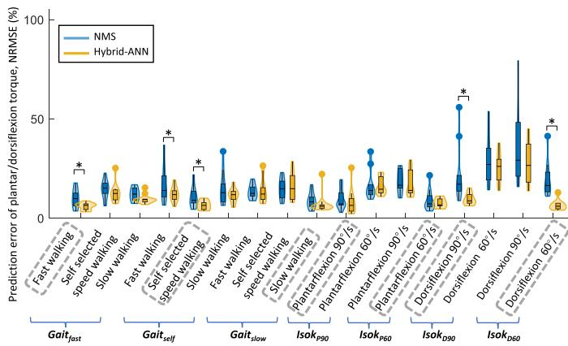  
Fig. 11. 采用迁移学习技术的跨受试者预测中，带有未校准 NMS 的混合 ANN（hybrid-ANN）模型在七种运动期间估计与实测踝关节力矩之间的跨受试者 NRMSE，并将其预测精度与受试者内预测中针对每个受试者校准的 NMS 模型的预测精度进行比较。箱线图展示了 NRMSE 的最小值、下四分位数、中位数、上四分位数和最大值。随后添加核密度图以展示 NRMSE 的分布，其中小提琴图的较宽部分代表 NRMSE 具有较高的概率，较窄部分代表较低的概率。根据 Wilcoxon 符号秩检验，两种模型之间的显著性差异用  表示。对于每种情况，用作校准/训练数据的运动均用灰色虚线框标出，其余为测试数据。

  
Fig. 12. 未采用迁移学习的跨受试者预测中，所有情况下在七种运动期间估计与实测踝关节力矩之间的跨受试者 NRMSE，作为 4 层与 5 层隐藏层的对比。每个小提琴图都结合了箱线图与核密度图。箱线图展示了 NRMSE 的最小值、下四分位数、中位数、上四分位数和最大值。随后添加核密度图以展示 NRMSE 的分布，其中小提琴图的较宽部分代表 NRMSE 具有较高的概率，较窄部分代表较低的概率。对于每种情况，用作校准/训练数据的运动均用灰色虚线框标出，其余为测试数据。

情况 $I s o k _ { D 9 0 }$，以及情况 $I s o k _ { D 6 0 }$ 的等速背屈 60◦/s $( p < 0 . 0 1 )$

## B. 未采用迁移学习的跨受试者预测中混合 ANN 模型的隐藏层数量选择

在未采用迁移学习的跨受试者预测中，我们在混合 ANN 模型中采用了 4 个隐藏层。可能有人会担忧，采用与未采用迁移学习的两个对比混合 ANN 模型应该具有相同数量的隐藏层。然而，我们的目标是研究在跨受试者预测中采用迁移学习的优势，并遵循了常规的迁移学习流程：加载预训练模型的权重并微调最后新增的几个层 [18]。考虑到这一顾虑，我们对包含 5 个隐藏层（与采用迁移学习的混合 ANN 模型隐藏层数相同）的未采用迁移学习的混合 ANN 方案进行了实验。预测精度相似，且包含 4 层和 5 层隐藏层的未采用迁移学习的混合 ANN 模型之间未发现显著性差异（Fig. 12）。由于 4 个隐藏层比 5 个隐藏层更容易训练，因此我们在未采用迁移学习的模型中采用了 4 个隐藏层。

## 参考文献

[1] B. Chen 等, “下肢外骨骼的最新进展与挑战,” J. Orthopaedic Transl., vol. 5, pp. 26–37, 2016.

[2] Z. Li, B. Huang, Z. Ye, M. Deng 和 C. Yang, “基于导纳控制的机器人外骨骼人机物理交互,” IEEE Trans. Ind. Electron., vol. 65, no. 12, pp. 9614–9624, 2018年12月.

[3] M. Zhang, A. McDaid, A. J. Veale, Y. Peng 和 S. Q. Xie, “具有关节空间力分配的并联踝关节康复机器人自适应轨迹跟踪控制,” IEEE Access, vol. 7, pp. 85812–85820, 2019.

[4] M. Sartori, D. G. Lloyd 和 D. Farina, “用于个性化神经康复技术的神经数据驱动肌肉骨骼建模,” IEEE Trans. Biomed. Eng., vol. 63, no. 5, pp. 879–893, 2016年5月.

[5] S. Yao, Y. Zhuang, Z. Li 和 R. Song, “基于肌电驱动肌肉骨骼模型的踝关节外骨骼自适应导纳控制,” Front. Neurorobot., vol. 12, 2018, Art. no. 16.

[6] Y. Huang, R. Song, A. Argha, A. V. Savkin, B. G. Celler 和 S. W. Su, “基于切换机制的人体三维运动意图连续描述,” IEEE Trans. Neural Syst. Rehabil. Eng., vol. 28, no. 1, pp. 277–286, 2020年1月.

[7] S. Y. A. Mounis, N. Z. Azlan 和 F. Sado, “基于受试者功能能力的上肢康复按需辅助控制策略,” Meas. Control, vol. 52, no. 9/10, pp. 1354–1361, 2019.

[8] G. Durandau, D. Farina 和 M. Sartori, “肌电图驱动的鲁棒实时肌肉骨骼建模,” IEEE Trans. Biomed. Eng., vol. 65, no. 3, pp. 556–564, 2018年3月.

[9] H. X. Hoang, C. Pizzolato, L. E. Diamond 和 D. G. Lloyd, “神经肌肉参数的受试者特异性校准使神经肌肉骨骼模型能够估算健康成年人生理合理的髋关节接触力,” J. Biomech., vol. 80, pp. 111–120, 2018.

[10] C. Pizzolato 等, “Ceinms：用于研究不同神经控制方案对动态运动任务期间肌肉兴奋和关节力矩预测影响的工具箱,” J. Biomech., vol. 48, no. 14, pp. 3929–3936, 2015.

[11] M. Imran 和 S. A. Alsuhaibani, “用于糖尿病视网膜病变分类的神经模糊推理模型,” 载于《生物医学应用中的智能数据分析》（Intelligent Data Analysis for Biomedical Applications）. New York, NY, USA: Elsevier, 2019, pp. 147–172.

[12] H. S. Haeberle 等, “下肢关节置换术中的人工智能与机器学习：综述,” J. Arthroplasty, vol. 34, no. 10, pp. 2201–2203, 2019.

[13] J.-G. Lee 等, “医学影像中的深度学习：总体概述,” Korean J. Radiol., vol. 18, no. 4, pp. 570–584, 2017.

[14] H. Su, Y. Hu, H. R. Karimi, A. Knoll, G. Ferrigno 和 E. De Momi, “具有远程运动中心约束的改进型循环神经网络机械臂控制：实验结果,” Neural Netw., vol. 131, pp. 291–299, 2020.

[15] G. G. Pena, L. J. Consoni, W. M. dos Santos, and A. A. Siqueira, “应用于主动膝关节矫形器的最优 EMG 驱动自适应阻抗控制的可行性,” Robot. Auton. Syst., vol. 112, pp. 98–108, 2019.

[16] E. Soleimani and E. Nazerfard, “利用生成对抗网络在人体活动识别系统中实现跨受试者迁移学习,” Neurocomputing, vol. 426, pp. 26–34, 2021.

[17] J. Zhang, X. Zhu, and J. Bao, “用于胶体量子点光谱仪光谱重建的求解器感知神经网络,” Opt. Express, vol. 28, no. 22, pp. 33656–33672, 2020.

[18] D. J. Saxby et al., “支持个性化神经肌肉骨骼建模的机器学习方法,” Biomech. Model. Mechanobiol., vol. 19, no. 4, pp. 1169–1185, 2020.

[19] L. Zhang, X. Zhu, E. M. G. Farewik, and R. Wang, “基于神经肌肉骨骼求解器感知神经网络模型的踝关节动态关节力矩估计,” in Proc. 6th IEEE Int. Conf. Adv. Robot. Mechatronics, 2021, pp. 75–80.

[20] K. Weiss, T. M. Khoshgoftaar, and D. Wang, “迁移学习综述,” J. Big Data, vol. 3, no. 1, pp. 1–40, 2016.

[21] T. Wang, Y. Chen, M. Zhang, J. Chen, and H. Snoussi, “用于提升小数据集人体动作识别性能的内部迁移学习,” IEEE Access, vol. 5, pp. 17627–17 633, 2017.

[22] V. Jayaram, M. Alamgir, Y. Altun, B. Scholkopf, and M. Grosse-Wentrup, “脑机接口中的迁移学习,” IEEE Comput. Intell. Mag., vol. 11, no. 1, pp. 20–31, Feb. 2016.

[23] S. P. K. Karri, D. Chakraborty, and J. Chatterjee, “基于迁移学习的伴有糖尿病黄斑水肿和干性年龄相关性黄斑变性的光学相干断层扫描图像分类,” Biomed. Opt. Express, vol. 8, no. 2, pp. 579–592, 2017.

[24] H. J. Hermens et al., 欧洲表面肌电图推荐规范 (European Recommendations for Surface Electromyography). Enschede, The Netherlands: Roessingh Research and Development, 1999.

[25] M. P. Kadaba, H. Ramakrishnan, and M. Wootten, “平地行走期间下肢运动学的测量,” J. Orthopaedic Res., vol. 8, no. 3, pp. 383–392, 1990.

[26] R. B. Davis III, S. Ounpuu, D. Tyburski, and J. R. Gage, “一种步态分析数据采集与缩减技术,” Hum. Movement Sci., vol. 10, no. 5, pp. 575–587, 1991.

[27] C. Pizzolato, M. Reggiani, L. Modenese, and D. Lloyd, “基于 OpenSim 的下肢应用实时逆向运动学与逆向动力学,” Comput. Methods Biomech. Biomed. Eng., vol. 20, no. 4, pp. 436–445, 2017.

[28] D. A. Winter, H. G. Sidwall, and D. A. Hobson, “运动运动学中噪声的测量与降低,” J. Biomech., vol. 7, no. 2, pp. 157–159, 1974.

[29] E. Kristianslund, T. Krosshaug, and A. J. Van den Bogert, “低通滤波对逆向动力学计算关节力矩的影响：对损伤预防的启示,” J. Biomech., vol. 45, no. 4, pp. 666–671, 2012.

[30] A. Mantoan, C. Pizzolato, M. Sartori, Z. Sawacha, C. Cobelli, and M. Reggiani, “Motonms: A matlab toolbox to process motion data for neuromusculoskeletal modeling and simulation,” Source Code Biol. Med., vol. 10, no. 1, pp. 1–14, 2015.

[31] T.-W. Lu and J. O’connor, “Bone position estimation from skin marker co-ordinates using global optimisation withjoint constraints,” J. Biomech., vol. 32, no. 2, pp. 129–134, 1999.

[32] M. G. Pandy, “Computer modeling and simulation of human movement,” Annu. Rev. Biomed. Eng., vol. 3, no. 1, pp. 245–273, 2001.

[33] M. Sartori, M. Reggiani, D. G. Lloyd, and E. Pagello, “A neuromusculoskeletal model of the human lower limb: Towards EMG-driven actuation of multiple joints in powered orthoses,” in Proc. IEEE Int. Conf. Rehabil. Robot., 2011, pp. 1–6.

[34] D. G. Lloyd and T. F. Besier, “An EMG-driven musculoskeletal model to estimate muscle forces and knee joint moments in vivo,” J. Biomech., vol. 36, no. 6, pp. 765–776, 2003.

[35] T. S. Buchanan, D. G. Lloyd, K. Manal, and T. F. Besier, “Neuromusculoskeletal modeling: Estimation of muscle forces and joint moments and movements from measurements of neural command,” J. Appl. Biomech., vol. 20, no. 4, pp. 367–395, 2004.

[36] L. Zhang, Z. Li, Y. Hu, C. Smith, E. M. G. Farewik, and R. Wang, “Ankle joint torque estimation using an EMG-driven neuromusculoskeletal model and an artificial neural network model,” IEEE Trans. Automat. Sci. Eng., vol. 18, no. 2, pp. 564–573, Apr. 2021.

[37] J. Bergstra and Y. Bengio, “Random search for hyper-parameter optimization,” J. Mach. Learn. Res., vol. 13, no. 2, pp. 281–305, 2012.

[38] M. Ezati, B. Ghannadi, and J. McPhee, “A review of simulation methods for human movement dynamics with emphasis on gait,” Multibody Syst. Dyn., vol. 47, no. 3, pp. 265–292, 2019.

[39] Y. Kwon, J.-H. Won, B. J. Kim, and M. C. Paik, “Uncertainty quantification using bayesian neural networks in classification: Application to biomedical image segmentation,” Comput. Statist. Data Anal., vol. 142, 2020, Art. no. 106816.

[40] A. De Rugy, G. E. Loeb, and T. J. Carroll, “Muscle coordination is habitual rather than optimal,” J. Neurosci., vol. 32, no. 21, pp. 7384–7391, 2012.

[41] S. Safavynia, G. Torres-Oviedo, and L. Ting, “Muscle synergies: Implications for clinical evaluation and rehabilitation of movement,” Top. Spinal Cord Inj. Rehabil., vol. 17, no. 1, pp. 16–24, 2011.

[42] T. T. Dao, “From deep learning to transfer learning for the prediction of skeletal muscle forces,” Med. Biol. Eng. Comput., vol. 57, no. 5, pp. 1049–1058, 2019.

[43] G. E. Hinton and R. R. Salakhutdinov, “Reducing the dimensionality of data with neural networks,” Sci., vol. 313, no. 5786, pp. 504–507, 2006.

[44] M. E. Hahn, “Feasibility ofestimating isokinetic knee torque using a neural network model,” J. Biomech., vol. 40, no. 5, pp. 1107–1114, 2007.

[45] M. Jali 等，“基于人工神经网络技术的手臂康复设备 sEMG 信号关节力矩估计模型”（Joint torque estimation model of semg signal for arm rehabilitation device using artificial neural network techniques），载于《高级计算机与通信工程技术》（Advanced Computer and Communication Engineering Technology）。德国柏林：Springer，2015，第 671–682 页。