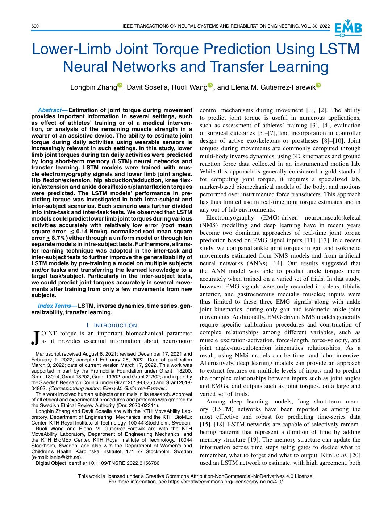
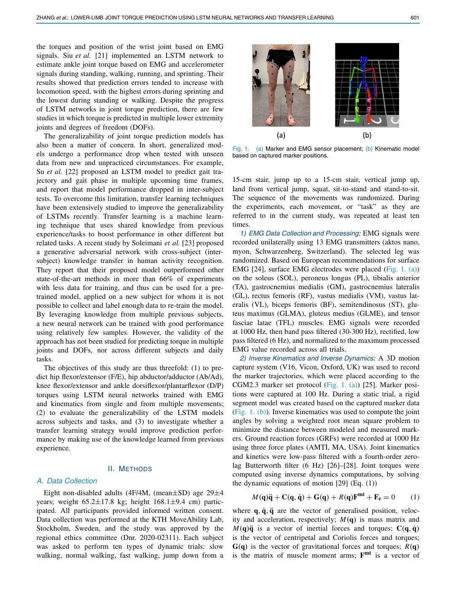
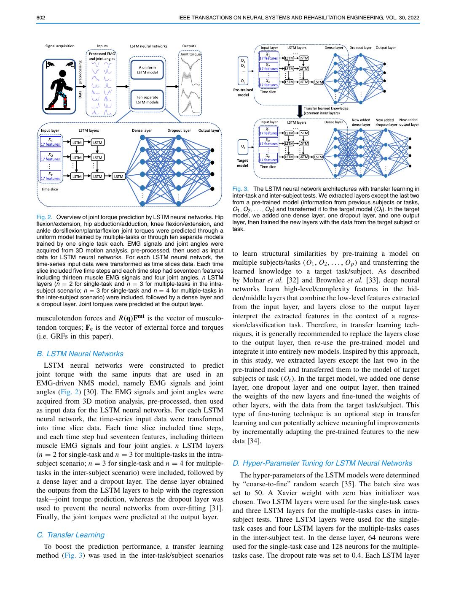
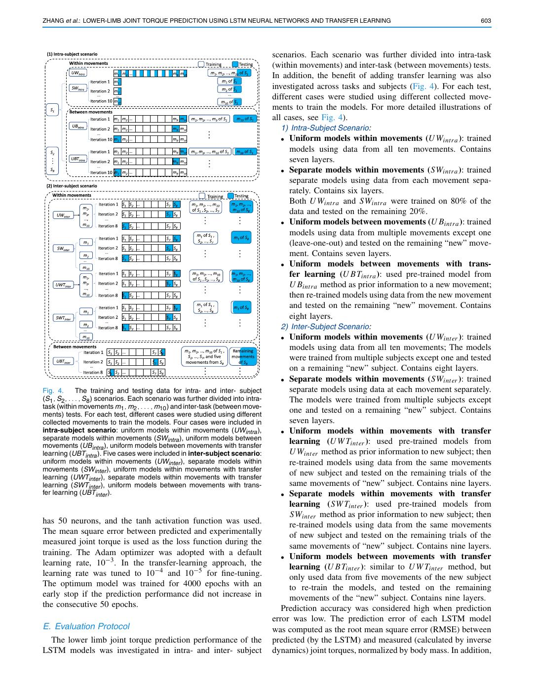
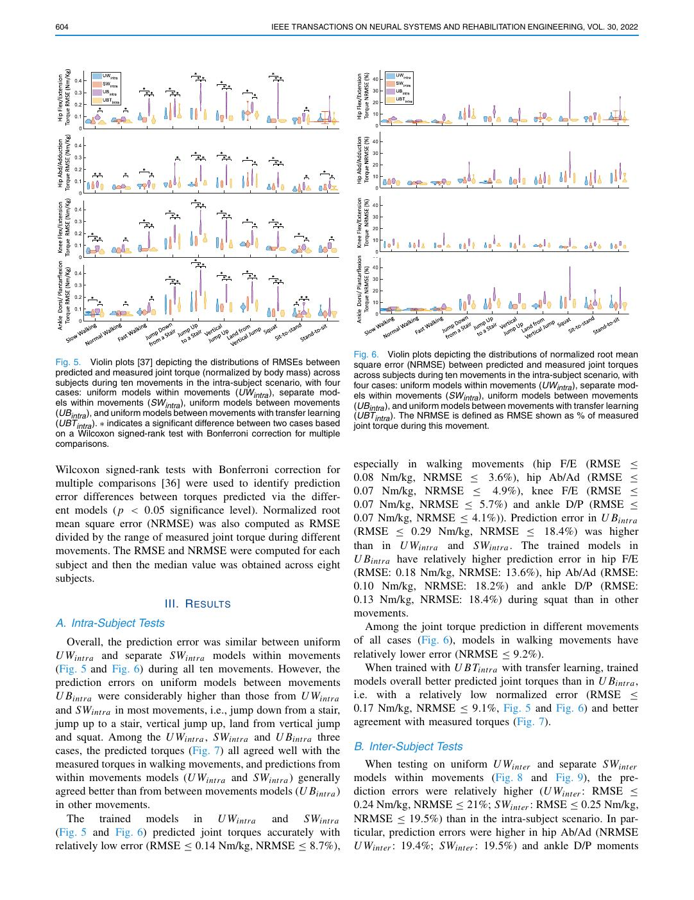
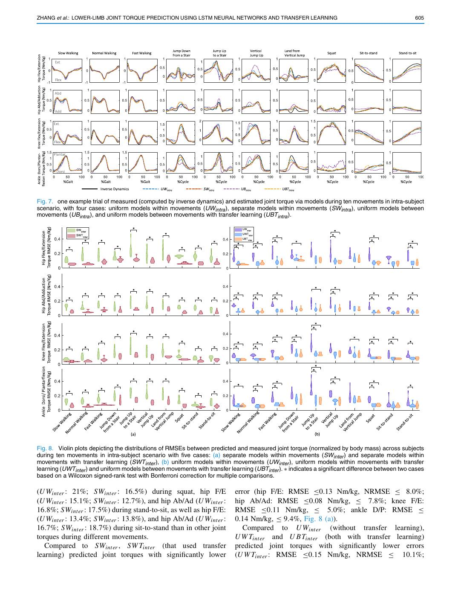
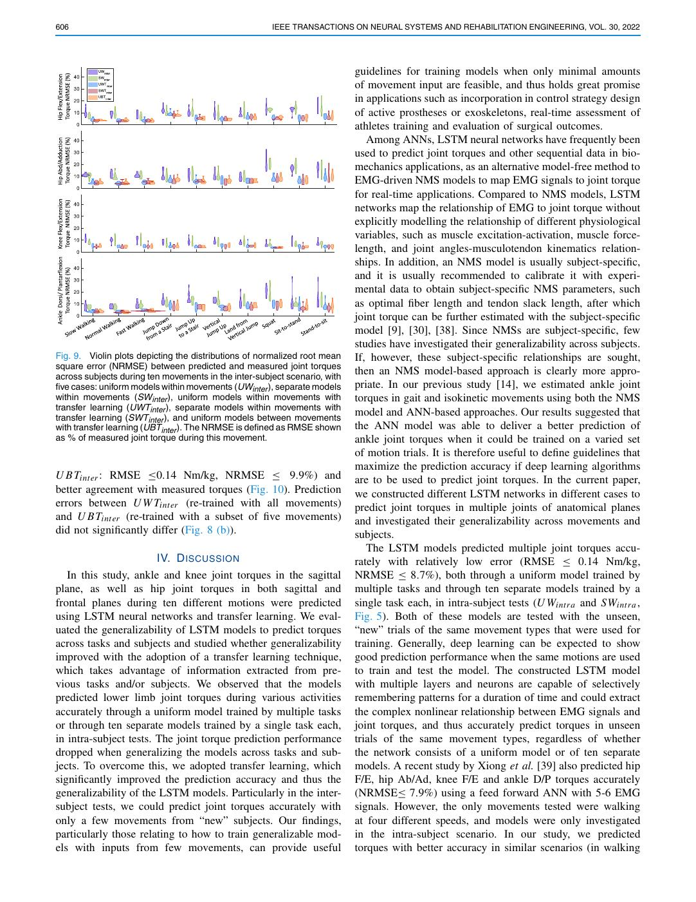
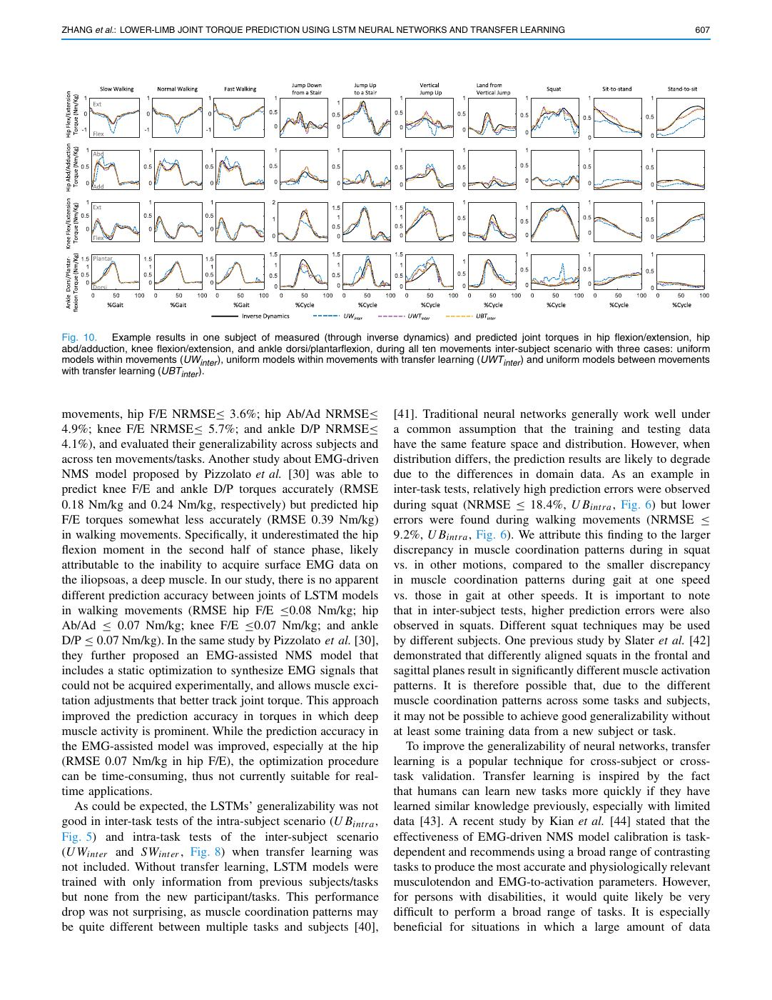
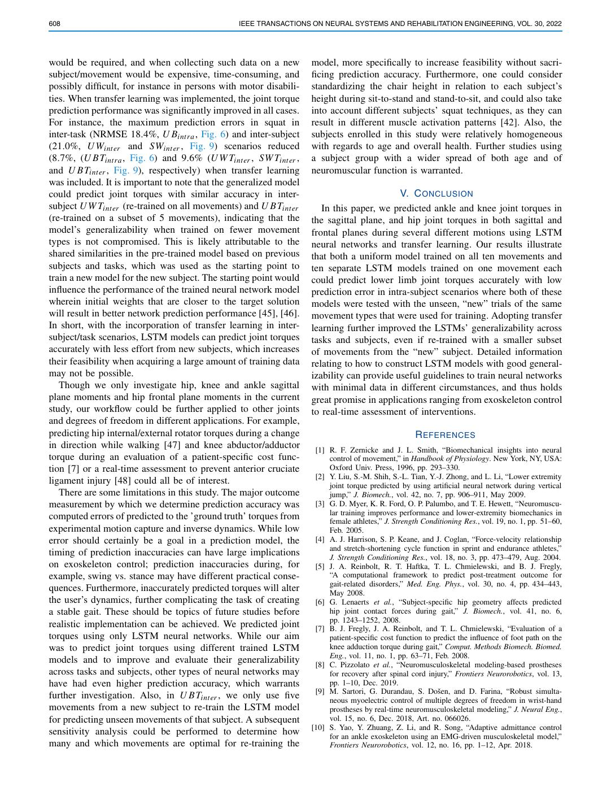
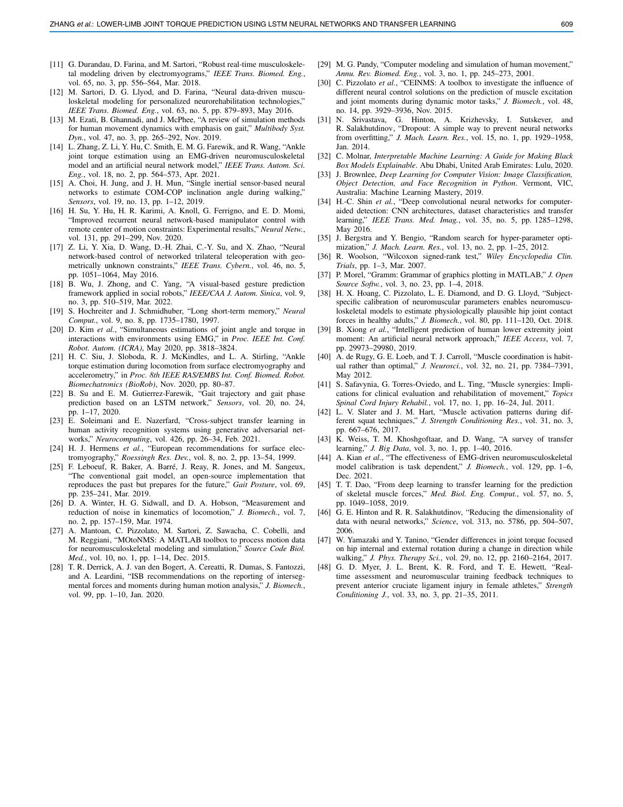

# Zhang2022-TNSRE：LSTM 与迁移学习的下肢关节力矩预测

> English text extracted from the source PDF; not translated or editorially corrected. Each original PDF page is embedded below as a rendered image so figures, tables, and vector artwork remain visible.

- Source PDF: `Zhang2022-TNSRE：LSTM 与迁移学习的下肢关节力矩预测.pdf`
- SHA-256: `b28381d5082e1dcd3f81f2274bb803cddbbbeadd162ecc15701d02e74e065ecc`
- Pages: 10
- Extraction: Poppler `pdftotext -layout`; page images rendered with `pdftoppm` (max dimension 1400 px, JPEG quality 76).

## Page 1

English text extracted from page 1

<pre>
600                                     IEEE TRANSACTIONS ON NEURAL SYSTEMS AND REHABILITATION ENGINEERING, VOL. 30, 2022

Lower-Limb Joint Torque Prediction Using LSTM
   Neural Networks and Transfer Learning
                 Longbin Zhang , Davit Soselia, Ruoli Wang , and Elena M. Gutierrez-Farewik

   Abstract — Estimation of joint torque during movement                   control mechanisms during movement [1], [2]. The ability
provides important information in several settings, such                   to predict joint torque is useful in numerous applications,
as effect of athletes’ training or of a medical interven-                  such as assessment of athletes’ training [3], [4], evaluation
tion, or analysis of the remaining muscle strength in a
wearer of an assistive device. The ability to estimate joint               of surgical outcomes [5]–[7], and incorporation in controller
torque during daily activities using wearable sensors is                   design of active exoskeletons or prostheses [8]–[10]. Joint
increasingly relevant in such settings. In this study, lower               torques during movements are commonly computed through
limb joint torques during ten daily activities were predicted              multi-body inverse dynamics, using 3D kinematics and ground
by long short-term memory (LSTM) neural networks and                       reaction force data collected in an instrumented motion lab.
transfer learning. LSTM models were trained with mus-
cle electromyography signals and lower limb joint angles.                  While this approach is generally considered a gold standard
Hip flexion/extension, hip abduction/adduction, knee flex-                 for computing joint torque, it requires a specialized lab,
ion/extension and ankle dorsiflexion/plantarflexion torques                marker-based biomechanical models of the body, and motions
were predicted. The LSTM models’ performance in pre-                       performed over instrumented force transducers. This approach
dicting torque was investigated in both intra-subject and                  has thus limited use in real-time joint torque estimates and in
inter-subject scenarios. Each scenario was further divided
into intra-task and inter-task tests. We observed that LSTM                any out-of-lab environments.
models could predict lower limb joint torques during various                  Electromyography (EMG)-driven neuromusculoskeletal
activities accurately with relatively low error (root mean                 (NMS) modelling and deep learning have in recent years
square error ≤ 0.14 Nm/kg, normalized root mean square                     become two dominant approaches of real-time joint torque
error ≤ 8.7%) either through a uniform model or through ten                prediction based on EMG signal inputs [11]–[13]. In a recent
separate models in intra-subject tests. Furthermore, a trans-
fer learning technique was adopted in the inter-task and                   study, we compared ankle joint torques in gait and isokinetic
inter-subject tests to further improve the generalizability of             movements estimated from NMS models and from artificial
LSTM models by pre-training a model on multiple subjects                   neural networks (ANNs) [14]. Our results suggested that
and/or tasks and transferring the learned knowledge to a                   the ANN model was able to predict ankle torques more
target task/subject. Particularly in the inter-subject tests,              accurately when trained on a varied set of trials. In that study,
we could predict joint torques accurately in several move-
ments after training from only a few movements from new                    however, EMG signals were only recorded in soleus, tibialis
subjects.                                                                  anterior, and gastrocnemius medialis muscles; inputs were
                                                                           thus limited to these three EMG signals along with ankle
  Index Terms — LSTM, inverse dynamics, time series, gen-
eralizability, transfer learning.                                          joint kinematics, during only gait and isokinetic ankle joint
                                                                           movements. Additionally, EMG-driven NMS models generally
                      I. I NTRODUCTION                                     require specific calibration procedures and construction of
                                                                           complex relationships among different variables, such as
J     OINT torque is an important biomechanical parameter
      as it provides essential information about neuromotor                muscle excitation-activation, force-length, force-velocity, and
                                                                           joint angle-musculotendon kinematics relationships. As a
  Manuscript received August 6, 2021; revised December 17, 2021 and        result, using NMS models can be time- and labor-intensive.
February 1, 2022; accepted February 28, 2022. Date of publication
March 3, 2022; date of current version March 17, 2022. This work was       Alternatively, deep learning models can provide an approach
supported in part by the Promobilia Foundation under Grant 18200,          to extract features on multiple levels of inputs and to predict
Grant 18014, Grant 18202, Grant 19302, and Grant 21302; and in part by     the complex relationships between inputs such as joint angles
the Swedish Research Council under Grant 2018-00750 and Grant 2018-
04902. (Corresponding author: Elena M. Gutierrez-Farewik.)                 and EMGs, and outputs such as joint torques, on a large and
  This work involved human subjects or animals in its research. Approval   varied set of trials.
of all ethical and experimental procedures and protocols was granted by       Among deep learning models, long short-term mem-
the Swedish Ethical Review Authority (Dnr. 2020-02311).
  Longbin Zhang and Davit Soselia are with the KTH MoveAbility Lab-        ory (LSTM) networks have been reported as among the
oratory, Department of Engineering Mechanics, and the KTH BioMEx           most effective and robust for predicting time-series data
Center, KTH Royal Institute of Technology, 100 44 Stockholm, Sweden.       [15]–[18]. LSTM networks are capable of selectively remem-
  Ruoli Wang and Elena M. Gutierrez-Farewik are with the KTH
MoveAbility Laboratory, Department of Engineering Mechanics, and           bering patterns that represent a duration of time by adding
the KTH BioMEx Center, KTH Royal Institute of Technology, 10044            memory structure [19]. The memory structure can update the
Stockholm, Sweden, and also with the Department of Women’s and             information across time steps using gates to decide what to
Children’s Health, Karolinska Institutet, 171 77 Stockholm, Sweden
(e-mail: lanie@kth.se).                                                    remember, what to forget and what to output. Kim et al. [20]
  Digital Object Identifier 10.1109/TNSRE.2022.3156786                     used an LSTM network to estimate, with high agreement, both

                    This work is licensed under a Creative Commons Attribution-NonCommercial-NoDerivatives 4.0 License.
                                   For more information, see https://creativecommons.org/licenses/by-nc-nd/4.0/
</pre>

## Page 2

English text extracted from page 2

<pre>
ZHANG et al.: LOWER-LIMB JOINT TORQUE PREDICTION USING LSTM NEURAL NETWORKS AND TRANSFER LEARNING                               601

the torques and position of the wrist joint based on EMG
signals. Siu et al. [21] implemented an LSTM network to
estimate ankle joint torque based on EMG and accelerometer
signals during standing, walking, running, and sprinting. Their
results showed that prediction errors tended to increase with
locomotion speed, with the highest errors during sprinting and
the lowest during standing or walking. Despite the progress
of LSTM networks in joint torque prediction, there are few
studies in which torque is predicted in multiple lower extremity
joints and degrees of freedom (DOFs).
   The generalizability of joint torque prediction models has
also been a matter of concern. In short, generalized mod-          Fig. 1. (a) Marker and EMG sensor placement; (b) Kinematic model
els undergo a performance drop when tested with unseen             based on captured marker positions.
data from new and unpracticed circumstances. For example,
Su et al. [22] proposed an LSTM model to predict gait tra-
jectory and gait phase in multiple upcoming time frames,           15-cm stair, jump up to a 15-cm stair, vertical jump up,
and report that model performance dropped in inter-subject         land from vertical jump, squat, sit-to-stand and stand-to-sit.
tests. To overcome this limitation, transfer learning techniques   The sequence of the movements was randomized. During
have been extensively studied to improve the generalizability      the experiments, each movement, or “task” as they are
of LSTMs recently. Transfer learning is a machine learn-           referred to in the current study, was repeated at least ten
ing technique that uses shared knowledge from previous             times.
experience/tasks to boost performance in other different but          1) EMG Data Collection and Processing: EMG signals were
related tasks. A recent study by Soleimani et al. [23] proposed    recorded unilaterally using 13 EMG transmitters (aktos nano,
a generative adversarial network with cross-subject (inter-        myon, Schwarzenberg, Switzerland). The selected leg was
subject) knowledge transfer in human activity recognition.         randomized. Based on European recommendations for surface
They report that their proposed model outperformed other           EMG [24], surface EMG electrodes were placed (Fig. 1. (a))
state-of-the-art methods in more than 66% of experiments           on the soleus (SOL), peroneus longus (PL), tibialis anterior
with less data for training, and thus can be used for a pre-       (TA), gastrocnemius medialis (GM), gastrocnemius lateralis
trained model, applied on a new subject for whom it is not         (GL), rectus femoris (RF), vastus medialis (VM), vastus lat-
possible to collect and label enough data to re-train the model.   eralis (VL), biceps femoris (BF), semitendinosus (ST), glu-
By leveraging knowledge from multiple previous subjects,           teus maximus (GLMA), gluteus medius (GLME), and tensor
a new neural network can be trained with good performance          fasciae latae (TFL) muscles. EMG signals were recorded
using relatively few samples. However, the validity of the         at 1000 Hz, then band pass filtered (30-300 Hz), rectified, low
approach has not been studied for predicting torque in multiple    pass filtered (6 Hz), and normalized to the maximum processed
joints and DOFs, nor across different subjects and daily           EMG value recorded across all trials.
tasks.                                                                2) Inverse Kinematics and Inverse Dynamics: A 3D motion
   The objectives of this study are thus threefold: (1) to pre-    capture system (V16, Vicon, Oxford, UK) was used to record
dict hip flexor/extensor (F/E), hip abductor/adductor (Ab/Ad),     the marker trajectories, which were placed according to the
knee flexor/extensor and ankle dorsiflexor/plantarflexor (D/P)     CGM2.3 marker set protocol (Fig. 1. (a)) [25]. Marker posi-
torques using LSTM neural networks trained with EMG                tions were captured at 100 Hz. During a static trial, a rigid
and kinematics from single and from multiple movements;            segment model was created based on the captured marker data
(2) to evaluate the generalizability of the LSTM models            (Fig. 1. (b)). Inverse kinematics was used to compute the joint
across subjects and tasks, and (3) to investigate whether a        angles by solving a weighted root mean square problem to
transfer learning strategy would improve prediction perfor-        minimize the distance between modeled and measured mark-
mance by making use of the knowledge learned from previous         ers. Ground reaction forces (GRFs) were recorded at 1000 Hz
experience.                                                        using three force plates (AMTI, MA, USA). Joint kinematics
                                                                   and kinetics were low-pass filtered with a fourth-order zero-
                        II. M ETHODS                               lag Butterworth filter (6 Hz) [26]–[28]. Joint torques were
                                                                   computed using inverse dynamics computations, by solving
A. Data Collection                                                 the dynamic equations of motion [29] (Eq. (1))
  Eight non-disabled adults (4F/4M, (mean±SD) age 29±4
                                                                         M(q)q̈ + C(q, q̇) + G(q) + R(q)Fmt + Fe = 0            (1)
years; weight 65.2±17.8 kg; height 168.1±9.4 cm) partic-
ipated. All participants provided informed written consent.        where q, q̇, q̈ are the vector of generalised position, veloc-
Data collection was performed at the KTH MoveAbility Lab,          ity and acceleration, respectively; M(q) is mass matrix and
Stockholm, Sweden, and the study was approved by the               M(q)q̈ is a vector of inertial forces and torques; C(q, q̇)
regional ethics committee (Dnr. 2020-02311). Each subject          is the vector of centripetal and Coriolis forces and torques;
was asked to perform ten types of dynamic trials: slow             G(q) is the vector of gravitational forces and torques; R(q)
walking, normal walking, fast walking, jump down from a            is the matrix of muscle moment arms; Fmt is a vector of
</pre>

## Page 3

English text extracted from page 3

<pre>
602                                                   IEEE TRANSACTIONS ON NEURAL SYSTEMS AND REHABILITATION ENGINEERING, VOL. 30, 2022

                                                                           Fig. 3. The LSTM neural network architectures with transfer learning in
                                                                           inter-task and inter-subject tests. We extracted layers except the last two
                                                                           from a pre-trained model (information from previous subjects or tasks,
                                                                           O1 , O2 , . . . , Op ) and transferred it to the target model (Ot ). In the target
Fig. 2. Overview of joint torque prediction by LSTM neural networks. Hip   model, we added one dense layer, one dropout layer, and one output
flexion/extension, hip abduction/adduction, knee flexion/extension, and    layer, then trained the new layers with the data from the target subject or
ankle dorsiflexion/plantarflexion joint torques were predicted through a   task.
uniform model trained by multiple-tasks or through ten separate models
trained by one single task each. EMG signals and joint angles were
acquired from 3D motion analysis, pre-processed, then used as input
data for LSTM neural networks. For each LSTM neural network, the
                                                                           to learn structural similarities by pre-training a model on
time-series input data were transformed as time slices data. Each time     multiple subjects/tasks (O1 , O2 , . . . , O p ) and transferring the
slice included five time steps and each time step had seventeen features   learned knowledge to a target task/subject. As described
including thirteen muscle EMG signals and four joint angles. n LSTM
layers (n = 2 for single-task and n = 3 for multiple-tasks in the intra-
                                                                           by Molnar et al. [32] and Brownlee et al. [33], deep neural
subject scenario; n = 3 for single-task and n = 4 for multiple-tasks in    networks learn high-level/complexity features in the hid-
the inter-subject scenario) were included, followed by a dense layer and   den/middle layers that combine the low-level features extracted
a dropout layer. Joint torques were predicted at the output layer.
                                                                           from the input layer, and layers close to the output layer
musculotendon forces and R(q)Fmt is the vector of musculo-                 interpret the extracted features in the context of a regres-
tendon torques; Fe is the vector of external force and torques             sion/classification task. Therefore, in transfer learning tech-
(i.e. GRFs in this paper).                                                 niques, it is generally recommended to replace the layers close
                                                                           to the output layer, then re-use the pre-trained model and
B. LSTM Neural Networks                                                    integrate it into entirely new models. Inspired by this approach,
                                                                           in this study, we extracted layers except the last two in the
   LSTM neural networks were constructed to predict
                                                                           pre-trained model and transferred them to the model of target
joint torque with the same inputs that are used in an
                                                                           subjects or task (Ot ). In the target model, we added one dense
EMG-driven NMS model, namely EMG signals and joint
                                                                           layer, one dropout layer and one output layer, then trained
angles (Fig. 2) [30]. The EMG signals and joint angles were
                                                                           the weights of the new layers and fine-tuned the weights of
acquired from 3D motion analysis, pre-processed, then used
                                                                           other layers, with the data from the target task/subject. This
as input data for the LSTM neural networks. For each LSTM
                                                                           type of fine-tuning technique is an optional step in transfer
neural network, the time-series input data were transformed
                                                                           learning and can potentially achieve meaningful improvements
into time slice data. Each time slice included time steps,
                                                                           by incrementally adapting the pre-trained features to the new
and each time step had seventeen features, including thirteen
                                                                           data [34].
muscle EMG signals and four joint angles. n LSTM layers
(n = 2 for single-task and n = 3 for multiple-tasks in the intra-
subject scenario; n = 3 for single-task and n = 4 for multiple-            D. Hyper-Parameter Tuning for LSTM Neural Networks
tasks in the inter-subject scenario) were included, followed by               The hyper-parameters of the LSTM models were determined
a dense layer and a dropout layer. The dense layer obtained                by “coarse-to-fine” random search [35]. The batch size was
the outputs from the LSTM layers to help with the regression               set to 50. A Xavier weight with zero bias initializer was
task—joint torque prediction, whereas the dropout layer was                chosen. Two LSTM layers were used for the single-task cases
used to prevent the neural networks from over-fitting [31].                and three LSTM layers for the multiple-tasks cases in intra-
Finally, the joint torques were predicted at the output layer.             subject tests. Three LSTM layers were used for the single-
                                                                           task cases and four LSTM layers for the multiple-tasks cases
C. Transfer Learning                                                       in the inter-subject test. In the dense layer, 64 neurons were
  To boost the prediction performance, a transfer learning                 used for the single-task case and 128 neurons for the multiple-
method (Fig. 3) was used in the inter-task/subject scenarios               tasks case. The dropout rate was set to 0.4. Each LSTM layer
</pre>

## Page 4

English text extracted from page 4

<pre>
ZHANG et al.: LOWER-LIMB JOINT TORQUE PREDICTION USING LSTM NEURAL NETWORKS AND TRANSFER LEARNING                                              603

                                                                                   scenarios. Each scenario was further divided into intra-task
                                                                                   (within movements) and inter-task (between movements) tests.
                                                                                   In addition, the benefit of adding transfer learning was also
                                                                                   investigated across tasks and subjects (Fig. 4). For each test,
                                                                                   different cases were studied using different collected move-
                                                                                   ments to train the models. For more detailed illustrations of
                                                                                   all cases, see Fig. 4).
                                                                                     1) Intra-Subject Scenario:
                                                                                     • Uniform models within movements (U Wintra ): trained
                                                                                       models using data from all ten movements. Contains
                                                                                       seven layers.
                                                                                     • Separate models within movements (SWintra ): trained
                                                                                       separate models using data from each movement sepa-
                                                                                       rately. Contains six layers.
                                                                                       Both U Wintra and SWintra were trained on 80% of the
                                                                                       data and tested on the remaining 20%.
                                                                                     • Uniform models between movements (U Bintra ): trained
                                                                                       models using data from multiple movements except one
                                                                                       (leave-one-out) and tested on the remaining “new” move-
                                                                                       ment. Contains seven layers.
                                                                                     • Uniform models between movements with trans-
                                                                                       fer learning (U BTintra ): used pre-trained model from
                                                                                       U Bintra method as prior information to a new movement;
                                                                                       then re-trained models using data from the new movement
                                                                                       and tested on the remaining “new” movement. Contains
                                                                                       eight layers.
                                                                                     2) Inter-Subject Scenario:
                                                                                     •  Uniform models within movements (U Wint er ): trained
                                                                                        models using data from all ten movements; The models
                                                                                        were trained from multiple subjects except one and tested
                                                                                        on a remaining “new” subject. Contains eight layers.
                                                                                      • Separate models within movements (SWint er ): trained
Fig. 4.        The training and testing data for intra- and inter- subject              separate models using data at each movement separately.
(S1 , S2 , . . . , S8 ) scenarios. Each scenario was further divided into intra-        The models were trained from multiple subjects except
task (within movements m1 , m2 , . . . , m10 ) and inter-task (between move-
ments) tests. For each test, different cases were studied using different
                                                                                        one and tested on a remaining “new” subject. Contains
collected movements to train the models. Four cases were included in                    seven layers.
intra-subject scenario: uniform models within movements (UWintra ),                   • Uniform models within movements with transfer
separate models within movements (SWintra ), uniform models between
movements (UBintra ), uniform models between movements with transfer
                                                                                        learning (U W Tint er ): used pre-trained models from
learning (UBTintra ). Five cases were included in inter-subject scenario:               U Wint er method as prior information to new subject; then
uniform models within movements (UWinter ), separate models within                      re-trained models using data from the same movements
movements (SWinter ), uniform models within movements with transfer
learning (UWTinter ), separate models within movements with transfer
                                                                                        of new subject and tested on the remaining trials of the
learning (SWTinter ), uniform models between movements with trans-                      same movements of “new” subject. Contains nine layers.
fer learning (UBTinter ).                                                             • Separate models within movements with transfer
                                                                                        learning (SW Tint er ): used pre-trained models from
                                                                                        SWint er method as prior information to new subject; then
has 50 neurons, and the tanh activation function was used.                              re-trained models using data from the same movements
The mean square error between predicted and experimentally                              of new subject and tested on the remaining trials of the
measured joint torque is used as the loss function during the                           same movements of “new” subject. Contains nine layers.
training. The Adam optimizer was adopted with a default                               • Uniform models between movements with transfer
learning rate, 10−3 . In the transfer-learning approach, the                            learning (U BTint er ): similar to U W Tint er method, but
learning rate was tuned to 10−4 and 10−5 for fine-tuning.                               only used data from five movements of the new subject
The optimum model was trained for 4000 epochs with an                                   to re-train the models, and tested on the remaining
early stop if the prediction performance did not increase in                            movements of the “new” subject. Contains nine layers.
the consecutive 50 epochs.                                                            Prediction accuracy was considered high when prediction
                                                                                   error was low. The prediction error of each LSTM model
E. Evaluation Protocol                                                             was computed as the root mean square error (RMSE) between
  The lower limb joint torque prediction performance of the                        predicted (by the LSTM) and measured (calculated by inverse
LSTM models was investigated in intra- and inter- subject                          dynamics) joint torques, normalized by body mass. In addition,
</pre>

## Page 5

English text extracted from page 5

<pre>
604                                                    IEEE TRANSACTIONS ON NEURAL SYSTEMS AND REHABILITATION ENGINEERING, VOL. 30, 2022

                                                                            Fig. 6. Violin plots depicting the distributions of normalized root mean
Fig. 5. Violin plots [37] depicting the distributions of RMSEs between      square error (NRMSE) between predicted and measured joint torques
predicted and measured joint torque (normalized by body mass) across        across subjects during ten movements in the intra-subject scenario, with
subjects during ten movements in the intra-subject scenario, with four      four cases: uniform models within movements (UWintra ), separate mod-
cases: uniform models within movements (UWintra ), separate mod-            els within movements (SWintra ), uniform models between movements
els within movements (SWintra ), uniform models between movements           (UBintra ), and uniform models between movements with transfer learning
(UBintra ), and uniform models between movements with transfer learning     (UBTintra ). The NRMSE is defined as RMSE shown as % of measured
(UBTintra ). ∗ indicates a significant difference between two cases based   joint torque during this movement.
on a Wilcoxon signed-rank test with Bonferroni correction for multiple
comparisons.

                                                                            especially in walking movements (hip F/E (RMSE ≤
Wilcoxon signed-rank tests with Bonferroni correction for
                                                                            0.08 Nm/kg, NRMSE ≤ 3.6%), hip Ab/Ad (RMSE ≤
multiple comparisons [36] were used to identify prediction
                                                                            0.07 Nm/kg, NRMSE ≤ 4.9%), knee F/E (RMSE ≤
error differences between torques predicted via the differ-
                                                                            0.07 Nm/kg, NRMSE ≤ 5.7%) and ankle D/P (RMSE ≤
ent models ( p &lt; 0.05 significance level). Normalized root
                                                                            0.07 Nm/kg, NRMSE ≤ 4.1%)). Prediction error in U Bintra
mean square error (NRMSE) was also computed as RMSE
                                                                            (RMSE ≤ 0.29 Nm/kg, NRMSE ≤ 18.4%) was higher
divided by the range of measured joint torque during different
movements. The RMSE and NRMSE were computed for each                        than in U Wintra and SWintra . The trained models in
                                                                            U Bintra have relatively higher prediction error in hip F/E
subject and then the median value was obtained across eight
                                                                            (RMSE: 0.18 Nm/kg, NRMSE: 13.6%), hip Ab/Ad (RMSE:
subjects.
                                                                            0.10 Nm/kg, NRMSE: 18.2%) and ankle D/P (RMSE:
                            III. R ESULTS                                   0.13 Nm/kg, NRMSE: 18.4%) during squat than in other
                                                                            movements.
A. Intra-Subject Tests                                                         Among the joint torque prediction in different movements
   Overall, the prediction error was similar between uniform                of all cases (Fig. 6), models in walking movements have
U Wintra and separate SWintra models within movements                       relatively lower error (NRMSE ≤ 9.2%).
(Fig. 5 and Fig. 6) during all ten movements. However, the                     When trained with U BTintra with transfer learning, trained
prediction errors on uniform models between movements                       models overall better predicted joint torques than in U Bintra ,
U Bintra were considerably higher than those from U Wintra                  i.e. with a relatively low normalized error (RMSE ≤
and SWintra in most movements, i.e., jump down from a stair,                0.17 Nm/kg, NRMSE ≤ 9.1%, Fig. 5 and Fig. 6) and better
jump up to a stair, vertical jump up, land from vertical jump               agreement with measured torques (Fig. 7).
and squat. Among the U Wintra , SWintra and U Bintra three
cases, the predicted torques (Fig. 7) all agreed well with the              B. Inter-Subject Tests
measured torques in walking movements, and predictions from                    When testing on uniform U Wint er and separate SWint er
within movements models (U Wintra and SWintra ) generally                   models within movements (Fig. 8 and Fig. 9), the pre-
agreed better than from between movements models (U Bintra )                diction errors were relatively higher (U Wint er : RMSE ≤
in other movements.                                                         0.24 Nm/kg, NRMSE ≤ 21%; SWint er : RMSE ≤ 0.25 Nm/kg,
   The trained models in U Wintra and SWintra                               NRMSE ≤ 19.5%) than in the intra-subject scenario. In par-
(Fig. 5 and Fig. 6) predicted joint torques accurately with                 ticular, prediction errors were higher in hip Ab/Ad (NRMSE
relatively low error (RMSE ≤ 0.14 Nm/kg, NRMSE ≤ 8.7%),                     U Wint er : 19.4%; SWint er : 19.5%) and ankle D/P moments
</pre>

## Page 6

English text extracted from page 6

<pre>
ZHANG et al.: LOWER-LIMB JOINT TORQUE PREDICTION USING LSTM NEURAL NETWORKS AND TRANSFER LEARNING                                               605

Fig. 7. one example trial of measured (computed by inverse dynamics) and estimated joint torque via models during ten movements in intra-subject
scenario, with four cases: uniform models within movements (UWintra ), separate models within movements (SWintra ), uniform models between
movements (UBintra ), and uniform models between movements with transfer learning (UBTintra ).

Fig. 8. Violin plots depicting the distributions of RMSEs between predicted and measured joint torque (normalized by body mass) across subjects
during ten movements in intra-subject scenario with five cases: (a) separate models within movements (SWinter ) and separate models within
movements with transfer learning (SWTinter ), (b) uniform models within movements (UWinter ), uniform models within movements with transfer
learning (UWTinter ) and uniform models between movements with transfer learning (UBTinter ). ∗ indicates a significant difference between two cases
based on a Wilcoxon signed-rank test with Bonferroni correction for multiple comparisons.

(U Wint er : 21%; SWint er : 16.5%) during squat, hip F/E                  error (hip F/E: RMSE ≤0.13 Nm/kg, NRMSE ≤ 8.0%;
(U Wint er : 15.1%; SWint er : 12.7%), and hip Ab/Ad (U Wint er :          hip Ab/Ad: RMSE ≤0.08 Nm/kg, ≤ 7.8%; knee F/E:
16.8%; SWint er : 17.5%) during stand-to-sit, as well as hip F/E:          RMSE ≤0.11 Nm/kg, ≤ 5.0%; ankle D/P: RMSE ≤
(U Wint er : 13.4%; SWint er : 13.8%), and hip Ab/Ad (U Wint er :          0.14 Nm/kg, ≤ 9.4%, Fig. 8 (a)).
16.7%; SWint er : 18.7%) during sit-to-stand than in other joint              Compared to U Wint er (without transfer learning),
torques during different movements.                                        U W Tint er and U BTint er (both with transfer learning)
   Compared to SWint er , SW Tint er (that used transfer                   predicted joint torques with significantly lower errors
learning) predicted joint torques with significantly lower                 (U W Tint er : RMSE ≤0.15 Nm/kg, NRMSE ≤ 10.1%;
</pre>

## Page 7

English text extracted from page 7

<pre>
606                                                   IEEE TRANSACTIONS ON NEURAL SYSTEMS AND REHABILITATION ENGINEERING, VOL. 30, 2022

                                                                           guidelines for training models when only minimal amounts
                                                                           of movement input are feasible, and thus holds great promise
                                                                           in applications such as incorporation in control strategy design
                                                                           of active prostheses or exoskeletons, real-time assessment of
                                                                           athletes training and evaluation of surgical outcomes.
                                                                              Among ANNs, LSTM neural networks have frequently been
                                                                           used to predict joint torques and other sequential data in bio-
                                                                           mechanics applications, as an alternative model-free method to
                                                                           EMG-driven NMS models to map EMG signals to joint torque
                                                                           for real-time applications. Compared to NMS models, LSTM
                                                                           networks map the relationship of EMG to joint torque without
                                                                           explicitly modelling the relationship of different physiological
                                                                           variables, such as muscle excitation-activation, muscle force-
                                                                           length, and joint angles-musculotendon kinematics relation-
                                                                           ships. In addition, an NMS model is usually subject-specific,
                                                                           and it is usually recommended to calibrate it with experi-
                                                                           mental data to obtain subject-specific NMS parameters, such
                                                                           as optimal fiber length and tendon slack length, after which
                                                                           joint torque can be further estimated with the subject-specific
                                                                           model [9], [30], [38]. Since NMSs are subject-specific, few
                                                                           studies have investigated their generalizability across subjects.
Fig. 9. Violin plots depicting the distributions of normalized root mean   If, however, these subject-specific relationships are sought,
square error (NRMSE) between predicted and measured joint torques
across subjects during ten movements in the inter-subject scenario, with
                                                                           then an NMS model-based approach is clearly more appro-
five cases: uniform models within movements (UWinter ), separate models    priate. In our previous study [14], we estimated ankle joint
within movements (SWinter ), uniform models within movements with          torques in gait and isokinetic movements using both the NMS
transfer learning (UWTinter ), separate models within movements with
transfer learning (SWTinter ), and uniform models between movements
                                                                           model and ANN-based approaches. Our results suggested that
with transfer learning (UBTinter ). The NRMSE is defined as RMSE shown     the ANN model was able to deliver a better prediction of
as % of measured joint torque during this movement.                        ankle joint torques when it could be trained on a varied set
                                                                           of motion trials. It is therefore useful to define guidelines that
                                                                           maximize the prediction accuracy if deep learning algorithms
U BTint er : RMSE ≤0.14 Nm/kg, NRMSE ≤ 9.9%) and                           are to be used to predict joint torques. In the current paper,
better agreement with measured torques (Fig. 10). Prediction               we constructed different LSTM networks in different cases to
errors between U W Tint er (re-trained with all movements)                 predict joint torques in multiple joints of anatomical planes
and U BTint er (re-trained with a subset of five movements)                and investigated their generalizability across movements and
did not significantly differ (Fig. 8 (b)).                                 subjects.
                                                                              The LSTM models predicted multiple joint torques accu-
                         IV. D ISCUSSION                                   rately with relatively low error (RMSE ≤ 0.14 Nm/kg,
   In this study, ankle and knee joint torques in the sagittal             NRMSE ≤ 8.7%), both through a uniform model trained by
plane, as well as hip joint torques in both sagittal and                   multiple tasks and through ten separate models trained by a
frontal planes during ten different motions were predicted                 single task each, in intra-subject tests (U Wintra and SWintra ,
using LSTM neural networks and transfer learning. We eval-                 Fig. 5). Both of these models are tested with the unseen,
uated the generalizability of LSTM models to predict torques               “new” trials of the same movement types that were used for
across tasks and subjects and studied whether generalizability             training. Generally, deep learning can be expected to show
improved with the adoption of a transfer learning technique,               good prediction performance when the same motions are used
which takes advantage of information extracted from pre-                   to train and test the model. The constructed LSTM model
vious tasks and/or subjects. We observed that the models                   with multiple layers and neurons are capable of selectively
predicted lower limb joint torques during various activities               remembering patterns for a duration of time and could extract
accurately through a uniform model trained by multiple tasks               the complex nonlinear relationship between EMG signals and
or through ten separate models trained by a single task each,              joint torques, and thus accurately predict torques in unseen
in intra-subject tests. The joint torque prediction performance            trials of the same movement types, regardless of whether
dropped when generalizing the models across tasks and sub-                 the network consists of a uniform model or of ten separate
jects. To overcome this, we adopted transfer learning, which               models. A recent study by Xiong et al. [39] also predicted hip
significantly improved the prediction accuracy and thus the                F/E, hip Ab/Ad, knee F/E and ankle D/P torques accurately
generalizability of the LSTM models. Particularly in the inter-            (NRMSE≤ 7.9%) using a feed forward ANN with 5-6 EMG
subject tests, we could predict joint torques accurately with              signals. However, the only movements tested were walking
only a few movements from “new” subjects. Our findings,                    at four different speeds, and models were only investigated
particularly those relating to how to train generalizable mod-             in the intra-subject scenario. In our study, we predicted
els with inputs from few movements, can provide useful                     torques with better accuracy in similar scenarios (in walking
</pre>

## Page 8

English text extracted from page 8

<pre>
ZHANG et al.: LOWER-LIMB JOINT TORQUE PREDICTION USING LSTM NEURAL NETWORKS AND TRANSFER LEARNING                                           607

Fig. 10. Example results in one subject of measured (through inverse dynamics) and predicted joint torques in hip flexion/extension, hip
abd/adduction, knee flexion/extension, and ankle dorsi/plantarflexion, during all ten movements inter-subject scenario with three cases: uniform
models within movements (UWinter ), uniform models within movements with transfer learning (UWTinter ) and uniform models between movements
with transfer learning (UBTinter ).

movements, hip F/E NRMSE≤ 3.6%; hip Ab/Ad NRMSE≤                         [41]. Traditional neural networks generally work well under
4.9%; knee F/E NRMSE≤ 5.7%; and ankle D/P NRMSE≤                         a common assumption that the training and testing data
4.1%), and evaluated their generalizability across subjects and          have the same feature space and distribution. However, when
across ten movements/tasks. Another study about EMG-driven               distribution differs, the prediction results are likely to degrade
NMS model proposed by Pizzolato et al. [30] was able to                  due to the differences in domain data. As an example in
predict knee F/E and ankle D/P torques accurately (RMSE                  inter-task tests, relatively high prediction errors were observed
0.18 Nm/kg and 0.24 Nm/kg, respectively) but predicted hip               during squat (NRMSE ≤ 18.4%, U Bintra , Fig. 6) but lower
F/E torques somewhat less accurately (RMSE 0.39 Nm/kg)                   errors were found during walking movements (NRMSE ≤
in walking movements. Specifically, it underestimated the hip            9.2%, U Bintra , Fig. 6). We attribute this finding to the larger
flexion moment in the second half of stance phase, likely                discrepancy in muscle coordination patterns during in squat
attributable to the inability to acquire surface EMG data on             vs. in other motions, compared to the smaller discrepancy
the iliopsoas, a deep muscle. In our study, there is no apparent         in muscle coordination patterns during gait at one speed
different prediction accuracy between joints of LSTM models              vs. those in gait at other speeds. It is important to note
in walking movements (RMSE hip F/E ≤0.08 Nm/kg; hip                      that in inter-subject tests, higher prediction errors were also
Ab/Ad ≤ 0.07 Nm/kg; knee F/E ≤0.07 Nm/kg; and ankle                      observed in squats. Different squat techniques may be used
D/P ≤ 0.07 Nm/kg). In the same study by Pizzolato et al. [30],           by different subjects. One previous study by Slater et al. [42]
they further proposed an EMG-assisted NMS model that                     demonstrated that differently aligned squats in the frontal and
includes a static optimization to synthesize EMG signals that            sagittal planes result in significantly different muscle activation
could not be acquired experimentally, and allows muscle exci-            patterns. It is therefore possible that, due to the different
tation adjustments that better track joint torque. This approach         muscle coordination patterns across some tasks and subjects,
improved the prediction accuracy in torques in which deep                it may not be possible to achieve good generalizability without
muscle activity is prominent. While the prediction accuracy in           at least some training data from a new subject or task.
the EMG-assisted model was improved, especially at the hip                  To improve the generalizability of neural networks, transfer
(RMSE 0.07 Nm/kg in hip F/E), the optimization procedure                 learning is a popular technique for cross-subject or cross-
can be time-consuming, thus not currently suitable for real-             task validation. Transfer learning is inspired by the fact
time applications.                                                       that humans can learn new tasks more quickly if they have
   As could be expected, the LSTMs’ generalizability was not             learned similar knowledge previously, especially with limited
good in inter-task tests of the intra-subject scenario (U Bintra ,       data [43]. A recent study by Kian et al. [44] stated that the
Fig. 5) and intra-task tests of the inter-subject scenario               effectiveness of EMG-driven NMS model calibration is task-
(U Wint er and SWint er , Fig. 8) when transfer learning was             dependent and recommends using a broad range of contrasting
not included. Without transfer learning, LSTM models were                tasks to produce the most accurate and physiologically relevant
trained with only information from previous subjects/tasks               musculotendon and EMG-to-activation parameters. However,
but none from the new participant/tasks. This performance                for persons with disabilities, it would quite likely be very
drop was not surprising, as muscle coordination patterns may             difficult to perform a broad range of tasks. It is especially
be quite different between multiple tasks and subjects [40],             beneficial for situations in which a large amount of data
</pre>

## Page 9

English text extracted from page 9

<pre>
608                                             IEEE TRANSACTIONS ON NEURAL SYSTEMS AND REHABILITATION ENGINEERING, VOL. 30, 2022

would be required, and when collecting such data on a new          model, more specifically to increase feasibility without sacri-
subject/movement would be expensive, time-consuming, and           ficing prediction accuracy. Furthermore, one could consider
possibly difficult, for instance in persons with motor disabili-   standardizing the chair height in relation to each subject’s
ties. When transfer learning was implemented, the joint torque     height during sit-to-stand and stand-to-sit, and could also take
prediction performance was significantly improved in all cases.    into account different subjects’ squat techniques, as they can
For instance, the maximum prediction errors in squat in            result in different muscle activation patterns [42]. Also, the
inter-task (NRMSE 18.4%, U Bintra , Fig. 6) and inter-subject      subjects enrolled in this study were relatively homogeneous
(21.0%, U Wint er and SWint er , Fig. 9) scenarios reduced         with regards to age and overall health. Further studies using
(8.7%, (U BTintra , Fig. 6) and 9.6% (U W Tint er , SW Tint er ,   a subject group with a wider spread of both age and of
and U BTint er , Fig. 9), respectively) when transfer learning     neuromuscular function is warranted.
was included. It is important to note that the generalized model
could predict joint torques with similar accuracy in inter-                                    V. C ONCLUSION
subject U W Tint er (re-trained on all movements) and U BTint er      In this paper, we predicted ankle and knee joint torques in
(re-trained on a subset of 5 movements), indicating that the       the sagittal plane, and hip joint torques in both sagittal and
model’s generalizability when trained on fewer movement            frontal planes during several different motions using LSTM
types is not compromised. This is likely attributable to the       neural networks and transfer learning. Our results illustrate
shared similarities in the pre-trained model based on previous     that both a uniform model trained on all ten movements and
subjects and tasks, which was used as the starting point to        ten separate LSTM models trained on one movement each
train a new model for the new subject. The starting point would    could predict lower limb joint torques accurately with low
influence the performance of the trained neural network model      prediction error in intra-subject scenarios where both of these
wherein initial weights that are closer to the target solution     models were tested with the unseen, “new” trials of the same
will result in better network prediction performance [45], [46].   movement types that were used for training. Adopting transfer
In short, with the incorporation of transfer learning in inter-    learning further improved the LSTMs’ generalizability across
subject/task scenarios, LSTM models can predict joint torques      tasks and subjects, even if re-trained with a smaller subset
accurately with less effort from new subjects, which increases     of movements from the “new” subject. Detailed information
their feasibility when acquiring a large amount of training data   relating to how to construct LSTM models with good general-
may not be possible.                                               izability can provide useful guidelines to train neural networks
   Though we only investigate hip, knee and ankle sagittal         with minimal data in different circumstances, and thus holds
plane moments and hip frontal plane moments in the current         great promise in applications ranging from exoskeleton control
study, our workflow could be further applied to other joints       to real-time assessment of interventions.
and degrees of freedom in different applications. For example,
predicting hip internal/external rotator torques during a change                                    R EFERENCES
in direction while walking [47] and knee abductor/adductor          [1] R. F. Zernicke and J. L. Smith, “Biomechanical insights into neural
torque during an evaluation of a patient-specific cost func-            control of movement,” in Handbook of Physiology. New York, NY, USA:
tion [7] or a real-time assessment to prevent anterior cruciate         Oxford Univ. Press, 1996, pp. 293–330.
                                                                    [2] Y. Liu, S.-M. Shih, S.-L. Tian, Y.-J. Zhong, and L. Li, “Lower extremity
ligament injury [48] could all be of interest.                          joint torque predicted by using artificial neural network during vertical
   There are some limitations in this study. The major outcome          jump,” J. Biomech., vol. 42, no. 7, pp. 906–911, May 2009.
measurement by which we determine prediction accuracy was           [3] G. D. Myer, K. R. Ford, O. P. Palumbo, and T. E. Hewett, “Neuromuscu-
                                                                        lar training improves performance and lower-extremity biomechanics in
computed errors of predicted to the ’ground truth’ torques from         female athletes,” J. Strength Conditioning Res., vol. 19, no. 1, pp. 51–60,
experimental motion capture and inverse dynamics. While low             Feb. 2005.
error should certainly be a goal in a prediction model, the         [4] A. J. Harrison, S. P. Keane, and J. Coglan, “Force-velocity relationship
                                                                        and stretch-shortening cycle function in sprint and endurance athletes,”
timing of prediction inaccuracies can have large implications           J. Strength Conditioning Res., vol. 18, no. 3, pp. 473–479, Aug. 2004.
on exoskeleton control; prediction inaccuracies during, for         [5] J. A. Reinbolt, R. T. Haftka, T. L. Chmielewski, and B. J. Fregly,
example, swing vs. stance may have different practical conse-           “A computational framework to predict post-treatment outcome for
                                                                        gait-related disorders,” Med. Eng. Phys., vol. 30, no. 4, pp. 434–443,
quences. Furthermore, inaccurately predicted torques will alter         May 2008.
the user’s dynamics, further complicating the task of creating      [6] G. Lenaerts et al., “Subject-specific hip geometry affects predicted
a stable gait. These should be topics of future studies before          hip joint contact forces during gait,” J. Biomech., vol. 41, no. 6,
                                                                        pp. 1243–1252, 2008.
realistic implementation can be achieved. We predicted joint        [7] B. J. Fregly, J. A. Reinbolt, and T. L. Chmielewski, “Evaluation of a
torques using only LSTM neural networks. While our aim                  patient-specific cost function to predict the influence of foot path on the
was to predict joint torques using different trained LSTM               knee adduction torque during gait,” Comput. Methods Biomech. Biomed.
                                                                        Eng., vol. 11, no. 1, pp. 63–71, Feb. 2008.
models and to improve and evaluate their generalizability           [8] C. Pizzolato et al., “Neuromusculoskeletal modeling-based prostheses
across tasks and subjects, other types of neural networks may           for recovery after spinal cord injury,” Frontiers Neurorobotics, vol. 13,
have had even higher prediction accuracy, which warrants                pp. 1–10, Dec. 2019.
                                                                    [9] M. Sartori, G. Durandau, S. Došen, and D. Farina, “Robust simulta-
further investigation. Also, in U BTint er , we only use five           neous myoelectric control of multiple degrees of freedom in wrist-hand
movements from a new subject to re-train the LSTM model                 prostheses by real-time neuromusculoskeletal modeling,” J. Neural Eng.,
for predicting unseen movements of that subject. A subsequent           vol. 15, no. 6, Dec. 2018, Art. no. 066026.
                                                                   [10] S. Yao, Y. Zhuang, Z. Li, and R. Song, “Adaptive admittance control
sensitivity analysis could be performed to determine how                for an ankle exoskeleton using an EMG-driven musculoskeletal model,”
many and which movements are optimal for re-training the                Frontiers Neurorobotics, vol. 12, no. 16, pp. 1–12, Apr. 2018.
</pre>

## Page 10

English text extracted from page 10

<pre>
ZHANG et al.: LOWER-LIMB JOINT TORQUE PREDICTION USING LSTM NEURAL NETWORKS AND TRANSFER LEARNING                                                          609

[11] G. Durandau, D. Farina, and M. Sartori, “Robust real-time musculoskele-     [29] M. G. Pandy, “Computer modeling and simulation of human movement,”
     tal modeling driven by electromyograms,” IEEE Trans. Biomed. Eng.,               Annu. Rev. Biomed. Eng., vol. 3, no. 1, pp. 245–273, 2001.
     vol. 65, no. 3, pp. 556–564, Mar. 2018.                                     [30] C. Pizzolato et al., “CEINMS: A toolbox to investigate the influence of
[12] M. Sartori, D. G. Llyod, and D. Farina, “Neural data-driven muscu-               different neural control solutions on the prediction of muscle excitation
     loskeletal modeling for personalized neurorehabilitation technologies,”          and joint moments during dynamic motor tasks,” J. Biomech., vol. 48,
     IEEE Trans. Biomed. Eng., vol. 63, no. 5, pp. 879–893, May 2016.                 no. 14, pp. 3929–3936, Nov. 2015.
[13] M. Ezati, B. Ghannadi, and J. McPhee, “A review of simulation methods       [31] N. Srivastava, G. Hinton, A. Krizhevsky, I. Sutskever, and
     for human movement dynamics with emphasis on gait,” Multibody Syst.              R. Salakhutdinov, “Dropout: A simple way to prevent neural networks
     Dyn., vol. 47, no. 3, pp. 265–292, Nov. 2019.                                    from overfitting,” J. Mach. Learn. Res., vol. 15, no. 1, pp. 1929–1958,
[14] L. Zhang, Z. Li, Y. Hu, C. Smith, E. M. G. Farewik, and R. Wang, “Ankle          Jan. 2014.
     joint torque estimation using an EMG-driven neuromusculoskeletal            [32] C. Molnar, Interpretable Machine Learning: A Guide for Making Black
     model and an artificial neural network model,” IEEE Trans. Autom. Sci.           Box Models Explainable. Abu Dhabi, United Arab Emirates: Lulu, 2020.
     Eng., vol. 18, no. 2, pp. 564–573, Apr. 2021.                               [33] J. Brownlee, Deep Learning for Computer Vision: Image Classification,
[15] A. Choi, H. Jung, and J. H. Mun, “Single inertial sensor-based neural            Object Detection, and Face Recognition in Python. Vermont, VIC,
     networks to estimate COM-COP inclination angle during walking,”                  Australia: Machine Learning Mastery, 2019.
     Sensors, vol. 19, no. 13, pp. 1–12, 2019.                                   [34] H.-C. Shin et al., “Deep convolutional neural networks for computer-
[16] H. Su, Y. Hu, H. R. Karimi, A. Knoll, G. Ferrigno, and E. D. Momi,               aided detection: CNN architectures, dataset characteristics and transfer
     “Improved recurrent neural network-based manipulator control with                learning,” IEEE Trans. Med. Imag., vol. 35, no. 5, pp. 1285–1298,
     remote center of motion constraints: Experimental results,” Neural Netw.,        May 2016.
     vol. 131, pp. 291–299, Nov. 2020.                                           [35] J. Bergstra and Y. Bengio, “Random search for hyper-parameter opti-
[17] Z. Li, Y. Xia, D. Wang, D.-H. Zhai, C.-Y. Su, and X. Zhao, “Neural               mization,” J. Mach. Learn. Res., vol. 13, no. 2, pp. 1–25, 2012.
     network-based control of networked trilateral teleoperation with geo-       [36] R. Woolson, “Wilcoxon signed-rank test,” Wiley Encyclopedia Clin.
     metrically unknown constraints,” IEEE Trans. Cybern., vol. 46, no. 5,            Trials, pp. 1–3, Mar. 2007.
     pp. 1051–1064, May 2016.                                                    [37] P. Morel, “Gramm: Grammar of graphics plotting in MATLAB,” J. Open
[18] B. Wu, J. Zhong, and C. Yang, “A visual-based gesture prediction                 Source Softw., vol. 3, no. 23, pp. 1–4, 2018.
     framework applied in social robots,” IEEE/CAA J. Autom. Sinica, vol. 9,     [38] H. X. Hoang, C. Pizzolato, L. E. Diamond, and D. G. Lloyd, “Subject-
     no. 3, pp. 510–519, Mar. 2022.                                                   specific calibration of neuromuscular parameters enables neuromuscu-
[19] S. Hochreiter and J. Schmidhuber, “Long short-term memory,” Neural               loskeletal models to estimate physiologically plausible hip joint contact
     Comput., vol. 9, no. 8, pp. 1735–1780, 1997.                                     forces in healthy adults,” J. Biomech., vol. 80, pp. 111–120, Oct. 2018.
[20] D. Kim et al., “Simultaneous estimations of joint angle and torque in       [39] B. Xiong et al., “Intelligent prediction of human lower extremity joint
     interactions with environments using EMG,” in Proc. IEEE Int. Conf.              moment: An artificial neural network approach,” IEEE Access, vol. 7,
     Robot. Autom. (ICRA), May 2020, pp. 3818–3824.                                   pp. 29973–29980, 2019.
[21] H. C. Siu, J. Sloboda, R. J. McKindles, and L. A. Stirling, “Ankle          [40] A. de Rugy, G. E. Loeb, and T. J. Carroll, “Muscle coordination is habit-
     torque estimation during locomotion from surface electromyography and            ual rather than optimal,” J. Neurosci., vol. 32, no. 21, pp. 7384–7391,
     accelerometry,” in Proc. 8th IEEE RAS/EMBS Int. Conf. Biomed. Robot.             May 2012.
     Biomechatronics (BioRob), Nov. 2020, pp. 80–87.                             [41] S. Safavynia, G. Torres-Oviedo, and L. Ting, “Muscle synergies: Impli-
[22] B. Su and E. M. Gutierrez-Farewik, “Gait trajectory and gait phase               cations for clinical evaluation and rehabilitation of movement,” Topics
     prediction based on an LSTM network,” Sensors, vol. 20, no. 24,                  Spinal Cord Injury Rehabil., vol. 17, no. 1, pp. 16–24, Jul. 2011.
     pp. 1–17, 2020.                                                             [42] L. V. Slater and J. M. Hart, “Muscle activation patterns during dif-
[23] E. Soleimani and E. Nazerfard, “Cross-subject transfer learning in               ferent squat techniques,” J. Strength Conditioning Res., vol. 31, no. 3,
     human activity recognition systems using generative adversarial net-             pp. 667–676, 2017.
     works,” Neurocomputing, vol. 426, pp. 26–34, Feb. 2021.                     [43] K. Weiss, T. M. Khoshgoftaar, and D. Wang, “A survey of transfer
[24] H. J. Hermens et al., “European recommendations for surface elec-                learning,” J. Big Data, vol. 3, no. 1, pp. 1–40, 2016.
     tromyography,” Roessingh Res. Dev., vol. 8, no. 2, pp. 13–54, 1999.         [44] A. Kian et al., “The effectiveness of EMG-driven neuromusculoskeletal
[25] F. Leboeuf, R. Baker, A. Barré, J. Reay, R. Jones, and M. Sangeux,               model calibration is task dependent,” J. Biomech., vol. 129, pp. 1–6,
     “The conventional gait model, an open-source implementation that                 Dec. 2021.
     reproduces the past but prepares for the future,” Gait Posture, vol. 69,    [45] T. T. Dao, “From deep learning to transfer learning for the prediction
     pp. 235–241, Mar. 2019.                                                          of skeletal muscle forces,” Med. Biol. Eng. Comput., vol. 57, no. 5,
[26] D. A. Winter, H. G. Sidwall, and D. A. Hobson, “Measurement and                  pp. 1049–1058, 2019.
     reduction of noise in kinematics of locomotion,” J. Biomech., vol. 7,       [46] G. E. Hinton and R. R. Salakhutdinov, “Reducing the dimensionality of
     no. 2, pp. 157–159, Mar. 1974.                                                   data with neural networks,” Science, vol. 313, no. 5786, pp. 504–507,
[27] A. Mantoan, C. Pizzolato, M. Sartori, Z. Sawacha, C. Cobelli, and                2006.
     M. Reggiani, “MOtoNMS: A MATLAB toolbox to process motion data              [47] W. Yamazaki and Y. Tanino, “Gender differences in joint torque focused
     for neuromusculoskeletal modeling and simulation,” Source Code Biol.             on hip internal and external rotation during a change in direction while
     Med., vol. 10, no. 1, pp. 1–14, Dec. 2015.                                       walking,” J. Phys. Therapy Sci., vol. 29, no. 12, pp. 2160–2164, 2017.
[28] T. R. Derrick, A. J. van den Bogert, A. Cereatti, R. Dumas, S. Fantozzi,    [48] G. D. Myer, J. L. Brent, K. R. Ford, and T. E. Hewett, “Real-
     and A. Leardini, “ISB recommendations on the reporting of interseg-              time assessment and neuromuscular training feedback techniques to
     mental forces and moments during human motion analysis,” J. Biomech.,            prevent anterior cruciate ligament injury in female athletes,” Strength
     vol. 99, pp. 1–10, Jan. 2020.                                                    Conditioning J., vol. 33, no. 3, pp. 21–35, 2011.
</pre>

