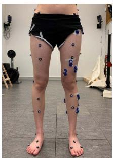
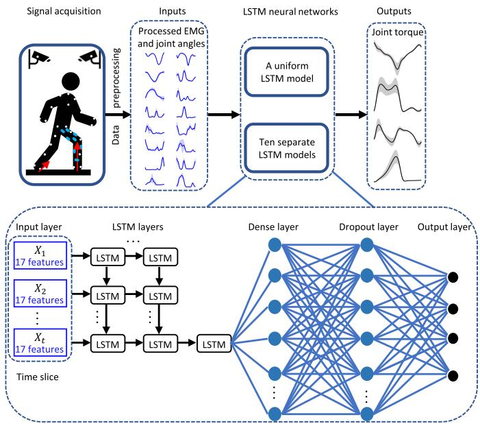
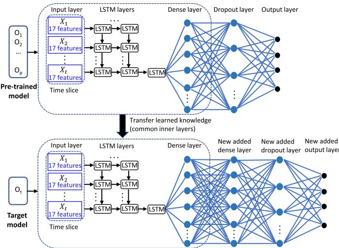
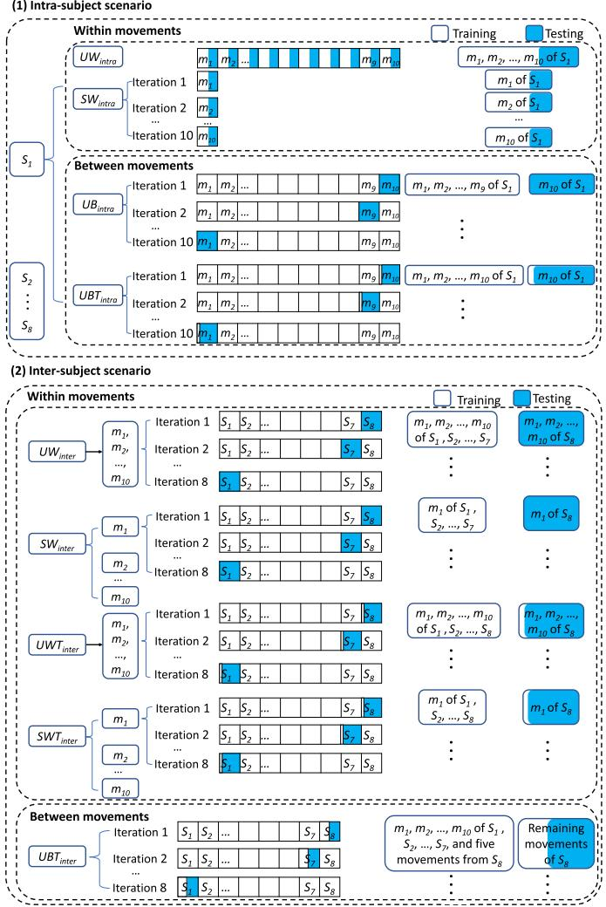
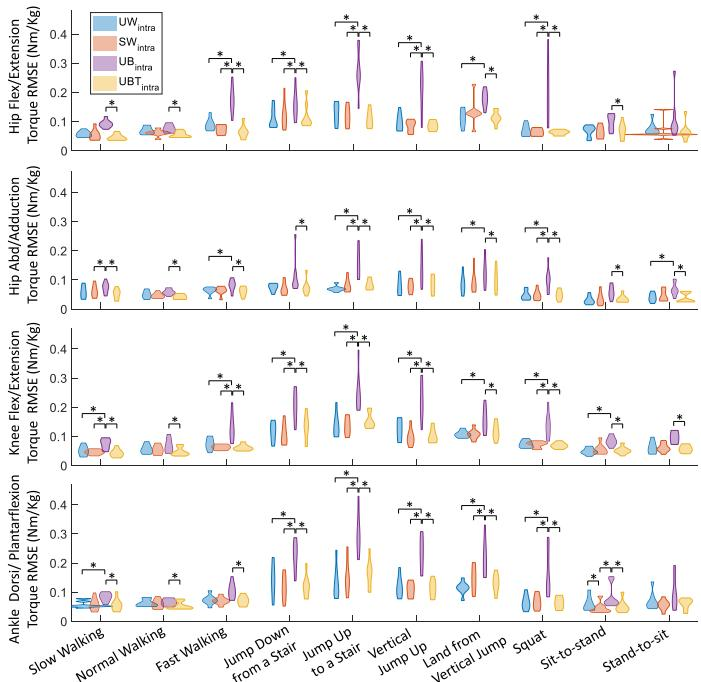
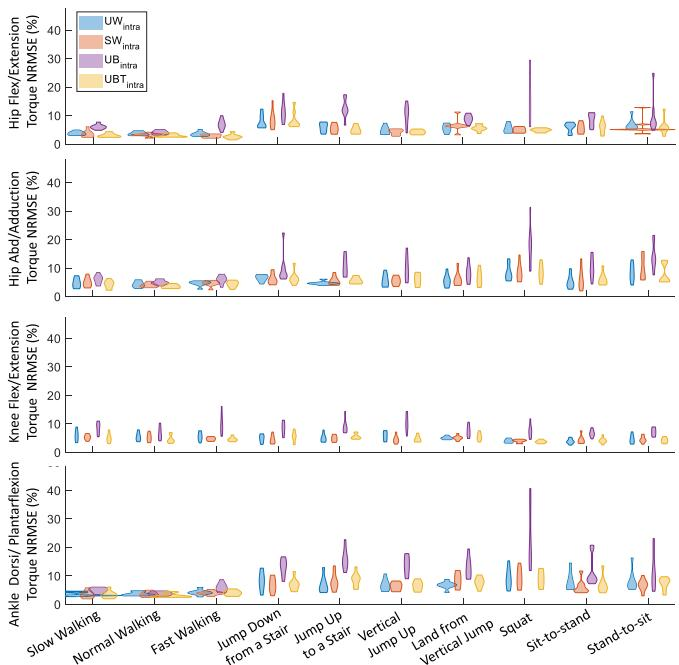
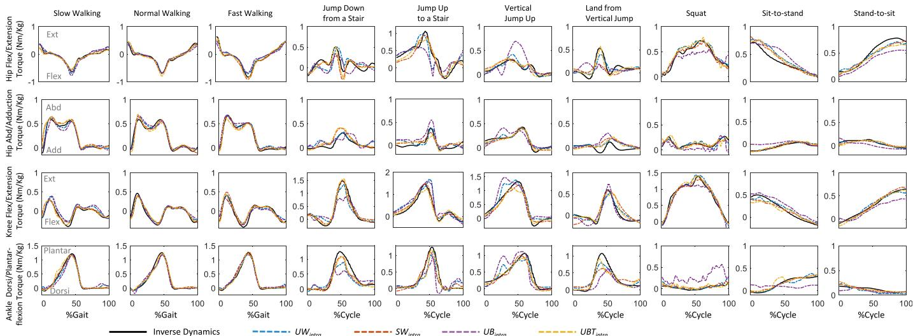
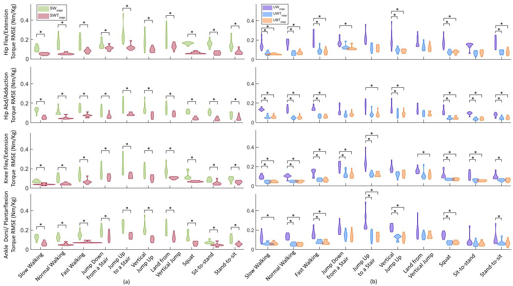

# 基于 LSTM 神经网络与迁移学习的下肢关节力矩预测

Longbin Zhang , Davit Soselia, Ruoli Wang , and Elena M. Gutierrez-Farewik

— 运动过程中的关节力矩估计在多种场景下提供了重要信息，例如评估运动员训练或医疗干预的效果，或者分析助行设备佩戴者的残余肌力。在这些场景中，利用可穿戴传感器估计日常活动中的关节力矩变得越来越重要。在本研究中，采用长短期记忆（LSTM）神经网络和迁移学习预测了十种日常活动中的下肢关节力矩。LSTM 模型使用肌肉表面肌电信号和下肢关节角度进行训练。预测了髋关节屈曲/伸展、髋关节外展/内收、膝关节屈曲/伸展以及踝关节背屈/跖屈力矩。在受试者内部（intra-subject）和跨受试者（inter-subject）场景下分别研究了 LSTM 模型预测力矩的性能。每个场景进一步细分为任务内部（intra-task）和跨任务（inter-task）测试。我们观察到，在受试者内部测试中，无论是通过统一模型还是通过十个独立模型，LSTM 模型都能以相对较低的误差（均方根误差 0.14 Nm/kg，归一化均方根误差 8.7%）准确预测各种活动中的下肢关节力矩。此外，在跨任务和跨受试者测试中采用了迁移学习技术，通过在多个受试者和/或任务上对模型进行预训练，并将学到的知识迁移到目标任务/受试者，从而进一步提高 LSTM 模型的泛化能力。特别是在跨受试者测试中，仅利用新受试者的少数动作进行训练后，我们即可准确预测若干动作中的关节力矩。

— LSTM, 逆动力学 (inverse dynamics), 时间序列 (time series), 泛化性 (generalizability), 迁移学习 (transfer learning).

## I. 引言

关节力矩是一项重要的生物力学参数，因为它提供了关于神经肌肉运动的重要信息

手稿收到日期：2021年8月6日；修订日期：2021年12月17日和2022年2月1日；录用日期：2022年2月28日。出版日期：2022年3月3日；当前版本日期：2022年3月17日。本工作部分得到了 Promobilia 基金会资助（项目编号：18200、18014、18202、19302 和 21302）；部分得到了瑞典研究理事会（Swedish Research Council）资助（项目编号：2018-00750 和 2018-04902）。（通讯作者：Elena M Gutierrez-Farewik）

本项研究涉及人类受试者或动物。所有伦理和实验程序及方案均已获得瑞典伦理审查局（Swedish Ethical Review Authority）的批准（批准号：Dnr. 2020-02311）。

Longbin Zhang 和 Davit Soselia 就职于瑞典斯德哥尔摩 100 44 皇家理工学院（KTH Royal Institute of Technology）工程力学系 KTH MoveAbility 实验室及 KTH BioMEx 中心。Ruoli Wang 和 Elena M. Gutierrez-Farewik 就职于瑞典斯德哥尔摩 100 44 皇家理工学院（KTH Royal Institute of Technology）工程力学系 KTH MoveAbility 实验室及 KTH BioMEx 中心，同时还就职于瑞典斯德哥尔摩 171 77 卡罗林斯卡学院（Karolinska Institutet）妇女与儿童健康系（电子邮箱：lanie@kth.se）。

Digital Object Identifier 10.1109/TNSRE.2022.3156786 运动过程中的控制机制 [1], [2]。预测关节力矩的能力在诸多应用中非常有用，例如运动员训练评估 [3], [4]、手术效果评估 [5]–[7]，以及融入主动外骨骼或假肢的控制器设计中 [8]–[10]。运动过程中的关节力矩通常通过多刚体逆动力学（multi-body inverse dynamics）计算，利用在配备仪器的动作捕捉实验室中采集的 3D 运动学和地面反作用力数据。虽然这种方法通常被认为是计算关节力矩的金标准，但它需要专门的实验室、基于标记点的人体生物力学模型，以及在装有传感器的测力平台上完成的动作。因此，该方法在实时关节力矩估计和任何实验室外环境中应用受限。

近年来，肌电图（EMG）驱动的神经肌肉骨骼（NMS）建模和深度学习已成为基于 EMG 信号输入的实时关节力矩预测的两种主要方法 [11]–[13]。在最近的一项研究中，我们比较了通过 NMS 模型和人工神经网络（ANNs）估计的步态和等速运动中的踝关节力矩 [14]。我们的结果表明，当在多样化的试验集上进行训练时，ANN 模型能够更准确地预测踝关节力矩。然而在那项研究中，仅记录了比目鱼肌、胫骨前肌和腓肠肌内侧肌的 EMG 信号；因此输入仅限于这三种 EMG 信号以及踝关节运动学，且仅限于步态和踝关节等速运动。此外，EMG 驱动的 NMS 模型通常需要特定的校准流程，并构建不同变量之间的复杂关系，例如肌肉兴奋-激活、力-长度、力-速度以及关节角度-肌腱运动学关系。因此，使用 NMS 模型可能会耗费大量的时间和精力。相比之下，深度学习模型提供了一种在多层级输入上提取特征的方法，并能够在庞大且多样化的试验集上预测输入（如关节角度和 EMG）与输出（如关节力矩）之间的复杂关系。

在深度学习模型中，长短期记忆（LSTM）网络被报道为预测时间序列数据最有效且最鲁棒的模型之一 [15]–[18]。LSTM 网络通过添加记忆结构，能够选择性地记住代表一段时间的模式 [19]。该记忆结构可以通过使用门控机制在各时间步之间更新信息，以决定记住什么、遗忘什么以及输出什么。Kim 等人 [20] 使用 LSTM 网络基于肌电（EMG）信号高精度地估计了腕关节的力矩和位置。Siu 等人 [21] 实现了一个 LSTM 网络，用于在站立、行走、跑步和冲刺期间基于 EMG 和加速度计信号估计踝关节力矩。他们的研究结果表明，预测误差往往随着运动速度的增加而增大，在冲刺期间误差最高，而在站立或行走期间误差最低。尽管 LSTM 网络在关节力矩预测方面取得了进展，但鲜有研究预测多个下肢关节和自由度（DOFs）的力矩。

关节力矩预测模型的泛化能力也一直是一个备受关注的问题。简而言之，当使用来自全新的、未曾训练的情境中的未知数据进行测试时，泛化模型的性能会有所下降。例如，Su 等人 [22] 提出了一种 LSTM 模型来预测未来多个时间帧内的步态轨迹和步态相位，并报告称模型性能在跨受试者测试中出现了下降。为了克服这一局限性，近期人们对迁移学习技术进行了广泛研究，以提高 LSTM 的泛化能力。迁移学习是一种机器学习技术，它利用来自先前经验/任务的共享知识来提升在其他不同但相关任务中的性能。Soleimani 等人 [23] 的一项近期研究在人体活动识别中提出了一种具有跨受试者（受试者间）知识迁移的生成对抗网络。他们报告称，所提出的模型在使用较少训练数据的情况下，在超过 66% 的实验中优于其他前沿方法，因此可用作预训练模型，应用于无法收集和标注足够数据来重新训练模型的新受试者。通过利用来自先前多个受试者的知识，可以使用相对较少的样本训练出性能良好的新神经网络。然而，该方法在预测多个关节和自由度力矩，以及跨不同受试者和日常任务时的有效性尚未得到研究。

因此，本研究的目标包含三个方面：(1) 使用由单项和多项运动的 EMG（肌电）和运动学数据训练的 LSTM 神经网络预测髋关节屈/伸（F/E）、髋关节外展/内收（Ab/Ad）、膝关节屈/伸以及踝关节背屈/跖屈（D/P）力矩；(2) 评估 LSTM 模型在跨受试者和跨任务中的泛化能力；以及 (3) 探究迁移学习策略是否能通过利用从先前经验中学习到的知识来提高预测性能。

## II. 方法

## A. 数据采集

八名身体健全的成年人（4名女性/4名男性，（均值 SD）年龄 29 4 岁；体重 65.2 17.8 kg；身高 168.1 9.4 cm）参与了本研究。所有参与者均签署了书面知情同意书。数据采集在瑞典斯德哥尔摩的 KTH MoveAbility Lab 进行，且该研究获得了地区伦理委员会的批准（Dnr. 2020-02311）。每位受试者被要求进行十种动态试验：慢速行走、正常行走、快速行走、从

  
(a)

  
(b)  
Fig. 1. (a) 标记点和 EMG 传感器放置；(b) 基于捕获的标记点位置建立的运动学模型。

15-cm 台阶跳下、跳上 15-cm 台阶、垂直向上跳跃、垂直跳跃落地、深蹲、由坐到站以及由站到坐。运动的顺序是随机的。在实验过程中，每种运动（在当前研究中称为“任务”）至少重复十次。

使用 13 个 EMG 发射器（aktos nano, myon, Schwarzenberg, Switzerland）单侧记录 EMG 信号。选定的腿部是随机的。根据欧洲表面肌电图建议标准 [24]，表面 EMG 电极被放置在（Fig. 1. (a)）比目鱼肌（SOL）、腓骨长肌（PL）、胫骨前肌（TA）、腓肠肌内侧头（GM）、腓肠肌外侧头（GL）、股直肌（RF）、股内侧肌（VM）、股外侧肌（VL）、股二头肌（BF）、半腱肌（ST）、臀大肌（GLMA）、臀中肌（GLME）和阔筋膜张肌（TFL）。EMG 信号以 1000 Hz 的采样率进行记录，随后经过带通滤波（30-300 Hz）、整流、低通滤波（6 Hz），并归一化为所有试验中记录的最大处理后 EMG 值。

2) 逆向运动学与逆向动力学：使用三维运动捕捉系统（V16, Vicon, Oxford, UK）记录标记点轨迹，标记点按照 CGM2.3 标记点集方案（Fig. 1. (a)）放置 [25]。标记点位置的采集频率为 100 Hz。在静态试验中，基于采集的标记点数据建立了刚体节段模型（Fig. 1. (b)）。逆向运动学通过求解加权均方根问题以最小化模型标记点与实测标记点之间的距离，从而计算关节角度。使用三块测力台（AMTI, MA, USA）以 1000 Hz 记录地面反作用力（ground reaction forces, GRFs）。关节运动学和动力学数据采用四阶零滞后巴特沃斯低通滤波器（6 Hz）进行滤波 [26]–[28]。关节力矩通过求解动力学运动方程（公式 (1)）进行逆向动力学计算得出 [29]：

$$
M (\mathbf {q}) \ddot {\mathbf {q}} + \mathbf {C} (\mathbf {q}, \dot {\mathbf {q}}) + \mathbf {G} (\mathbf {q}) + R (\mathbf {q}) \mathbf {F} ^ {\mathbf {m t}} + \mathbf {F} _ {\mathrm{e}} = 0\tag{1}
$$

式中，$\mathbf{q}$、$\dot{\mathbf{q}}$、$\ddot{\mathbf{q}}$ 分别为广义位置、速度和加速度向量；$M ( \mathbf { q } )$ 为质量矩阵，$M ( \mathbf { q } ) { \ddot { \mathbf { q } } }$ 为惯性力与力矩向量；$\mathbf { C } ( \mathbf { q } , \dot { \mathbf { q } } )$ 为向心力与科里奥利力及力矩向量；$\mathbf { G } ( \mathbf { q } )$ 为重力与力矩向量；$R ( \mathbf { q } )$ 为肌肉力臂矩阵；$\mathbf { F } ^ { \mathbf { m t } }$ 为肌腱力向量，$R ( \mathbf { q } ) \mathbf { F } ^ { \mathbf { m t } }$ 为肌腱力矩向量；${ \bf F _ { e } }$ 为外力与外力矩向量（即本文中的 GRFs）。

  
Fig. 2. 基于 LSTM 神经网络的关节力矩预测概述。髋关节屈曲/伸展、髋关节外展/内收、膝关节屈曲/伸展以及踝关节背屈/跖屈关节力矩通过由多任务训练的统一模型或由各个单任务分别训练的十个独立模型进行预测。肌电（EMG）信号和关节角度采集自三维运动分析，经预处理后用作 LSTM 神经网络的输入数据。对于每个 LSTM 神经网络，时间序列输入数据被转换为时间切片数据。每个时间切片包含五个时间步，每个时间步具有十七个特征，包括十三种肌肉的 EMG 信号和四个关节角度。包含 $n$ 个 LSTM 层（在受试者内场景中，单任务 $n = 2$，多任务 $n = 3$；在受试者间场景中，单任务 $n = 3$，多任务 $n = 4$），随后是一个全连接层（dense layer）和一个 dropout 层。关节力矩在输出层进行预测。

## B. LSTM 神经网络

构建了 LSTM 神经网络，使用与基于肌电驱动的神经肌肉骨骼（EMG-driven NMS）模型相同的输入（即 EMG 信号和关节角度）来预测关节扭矩（Fig. 2）[30]。EMG 信号和关节角度通过 3D 运动分析采集，经预处理后用作 LSTM 神经网络的输入数据。对于每个 LSTM 神经网络，时间序列输入数据均被转换为时间切片数据。每个时间切片包含若干时间步，每个时间步具有十七个特征，包括十三种肌肉的 EMG 信号和四个关节角度。网络中包含 $n$ 个 LSTM 层（在受试者内场景中，单任务 $n = 2$，多任务 $n = 3$；在受试者间场景中，单任务 $n = 3$，多任务 $n = 4$），随后是一个全连接层（dense layer）和一个 dropout 层。全连接层接收来自 LSTM 层的输出以辅助回归任务——即关节扭矩预测，而 dropout 层则用于防止神经网络过拟合 [31]。最终，在输出层预测关节扭矩。

## C. 迁移学习（Transfer Learning）

为了提升预测性能，在跨任务/跨受试者场景中采用了一种迁移学习方法（Fig. 3），通过在多个受试者/任务 $( O _ { 1 } , O _ { 2 } , \ldots , O _ { p } )$ 上对模型进行预训练来学习结构相似性，并将学到的知识迁移到目标任务/受试者。如 Molnar 等人 [32] 和 Brownlee 等人 [33] 所述，深度神经网络在隐藏层/中间层中学习高层/复杂特征，这些特征融合了从输入层提取的底层特征，而靠近输出层的网络层则在回归/分类任务的情境下解释所提取的特征。因此，在迁移学习技术中，通常建议替换靠近输出层的网络层，然后复用预训练模型并将其集成到全新的模型中。受此方法启发，在本研究中，我们提取了预训练模型中除最后两层之外的所有层，并将它们迁移到目标受试者或任务 $( O _ { t } )$ 的模型中。在目标模型中，我们添加了一个全连接层、一个 dropout 层和一个输出层，然后利用来自目标任务/受试者的数据训练新层的权重并微调其他层的权重。这种微调技术是迁移学习中的一个可选步骤，通过使预训练特征逐步适应新数据，有望取得显著的性能提升 [34]。

  
Fig. 3. 跨任务和跨受试者测试中采用迁移学习的 LSTM 神经网络架构。我们从预训练模型（来自先前受试者或任务的信息，$O _ { 1 } , O _ { 2 } , \ldots , O _ { p } )$ 中提取了除最后两层之外的层，并将其迁移到目标模型 ( ) 中。在目标模型中，我们添加了一个全连接层（dense layer）、一个 dropout 层和一个输出层，然后利用来自目标受试者或任务的数据对这些新层进行训练。

## D. LSTM 神经网络的超参数调优

LSTM 模型的超参数通过“由粗到细”（coarse-to-fine）的随机搜索 [35] 确定。批大小（batch size）设置为 50。权重初始化选用 Xavier 初始化，偏置初始化为零。在受试者内（intrasubject）测试中，单任务情况使用两个 LSTM 层，多任务情况使用三个 LSTM 层。在跨受试者（inter-subject）测试中，单任务情况使用三个 LSTM 层，多任务情况使用四个 LSTM 层。在全连接层中，单任务情况使用 64 个神经元，多任务情况使用 128 个神经元。Dropout 率设置为 0.4。每个 LSTM 层包含 50 个神经元，并采用 tanh 激活函数。训练过程中，将预测关节力矩与实验测量关节力矩之间的均方误差用作损失函数。优化器采用 Adam，默认学习率为 $1 0 ^ { - 3 }$ 。在迁移学习方法中，微调时的学习率调整为 $1 0 ^ { - 4 }$ 和 $1 0 ^ { - 5 }$ 。最优模型共训练了 4000 个轮次（epochs），若预测性能在连续 50 个轮次内未发生提升，则触发早停（early stop）。

  
Fig. 4. 受试者内与受试者间 $( \check { S _ { 1 } } , \bar { S _ { 2 } } , \dots , \bar { S _ { 8 } } )$ 场景下的训练和测试数据。每个场景进一步细分为任务内（动作内部 $m _ { 1 } , m _ { 2 } , \dots , m _ { 1 0 } )$ ）和任务间（动作之间）测试。对于每种测试，使用采集的不同动作来训练模型以研究不同情形。受试者内场景包含四种情形：动作内统合模型 $( U W _ { i n t r a } )$ 、动作内独立模型 $( S W _ { i n t r a } )$ 、动作间统合模型 $( U B _ { i n t r a } ) _ { : }$ 、带迁移学习的动作间统合模型 $( U B T _ { i n t r a } )$ 。受试者间场景包含五种情形：动作内统合模型 $( U W _ { i n t e r } )$ 、动作内独立模型 $( S W _ { i n t e r } )$ 、带迁移学习的动作内统合模型 $( U W T _ { i n t e r } ) ,$ 带迁移学习的动作内独立模型 $( S W T _ { i n t e r } ) _ { i n t e r } ) _ { i n t e r } .$ 、带迁移学习的动作间统合模型 $( U B T _ { i n t e r } )$ 。

## E. 评估协议

在受试者内和受试者间场景下对 LSTM 模型的下肢关节力矩预测性能进行了研究。每个场景进一步细分为任务内（动作内部）和任务间（动作之间）测试。此外，还研究了在跨任务和跨受试者中引入迁移学习所带来的益处（Fig. 4）。对于每种测试，使用采集的不同动作训练模型以研究不同情形。有关所有情形的更详细说明，请参见 Fig. 4。

1) 受试者内场景：

动作内统合模型 $( U W _ { i n t r a } ) \mathrm { ; }$ ：使用来自所有十种动作的数据训练模型。包含七层。

动作内独立模型 $( S W _ { i n t r a } )$ ：分别使用来自每种动作的数据训练独立模型。包含六层。

$U W _ { i n t r a }$ 和 $S W _ { i n t r a }$ 均在 80% 的数据上进行训练，并在剩余 20% 的数据上进行测试。

动作间统合模型 $( U B _ { i n t r a } )$ ：使用除一种动作之外的多种动作的数据训练模型（留一法），并在剩余的“新”动作上进行测试。包含七层。

带迁移学习的动作间统合模型 $( U B T _ { i n t r a } ) \mathrm { : }$ ：使用来自 $U B _ { i n t r a }$ 方法的预训练模型作为新动作的先验信息；随后使用来自新动作的数据重新训练模型，并在剩余的“新”动作上进行测试。包含八层。

2) 受试者间场景：

动作内统一模型 $( U W _ { i n t e r } )$：使用来自所有十种动作的数据训练模型；模型基于除一名受试者外的多名受试者的数据进行训练，并在剩下的一名“新”受试者上进行测试。包含八层。

动作内独立模型 $( S W _ { i n t e r } ) { \mathrm { : } }$：分别使用每种动作的数据独立训练模型。模型基于除一名受试者外的多名受试者的数据进行训练，并在剩下的一名“新”受试者上进行测试。包含七层。

基于迁移学习的动作内统一模型 $( U W T _ { i n t e r } )$：使用来自 $U W _ { i n t e r }$ 方法的预训练模型作为新受试者的先验信息；然后使用新受试者相同动作的数据重新训练模型，并在该“新”受试者相同动作的剩余试验中进行测试。包含九层。

基于迁移学习的动作内独立模型 $( S W T _ { i n t e r } )$：使用来自 $S W _ { i n t e r }$ 方法的预训练模型作为新受试者的先验信息；然后使用新受试者相同动作的数据重新训练模型，并在该“新”受试者相同动作的剩余试验中进行测试。包含九层。

基于迁移学习的动作间统一模型 $( U B T _ { i n t e r } ) \colon$类似于 $U W T _ { i n t e r }$ 方法，但仅使用新受试者五种动作的数据来重新训练模型，并在“新”受试者的剩余动作上进行测试。包含九层。

当预测误差较低时，预测精度被认为较高。每个 LSTM 模型的预测误差计算为预测（由 LSTM 计算）与实测（通过逆动力学计算）关节力矩之间的均方根误差（RMSE），并按体重进行归一化。此外，

  
Fig. 5. 小提琴图 [37] 展示了受试者内场景下，在十种动作中跨受试者的预测与实测关节力矩（按体重归一化）之间的 RMSE 分布，包含四种情况：动作内统一模型 $( U \dot { W } _ { i n t r a } )$、动作内独立模型 $( S W _ { i n t r a } )$、动作间统一模型 $( U B _ { I n t r a } )$ 以及基于迁移学习的动作间统一模型 $( U B T _ { i n t r a } ) .$ 表示基于经 Bonferroni 多重比较校正的 Wilcoxon 符号秩检验所确定的两种情况之间的显著性差异。

采用经 Bonferroni 多重比较校正的 Wilcoxon 符号秩检验 [36] 来确定通过不同模型预测的力矩之间的预测误差差异（显著性水平 $p \ < \ 0 . 0 5$）。归一化均方根误差（NRMSE）也通过 RMSE 除以不同动作期间实测关节力矩的范围来计算。针对每位受试者分别计算 RMSE 和 NRMSE，随后获取八名受试者的中位数。

## III. 结果

## A. 受试者内测试

总体而言，在所有十种动作中，动作内统一步态模型 $U W _ { i n t r a }$ 与独立模型 $S W _ { i n t r a }$ 的预测误差相近 $( { \mathrm { F i g . ~ } } 5$ 和 Fig. 6）。然而，在大多数动作中，即下台阶跳、上台阶跳、垂直向上跳、垂直跳落地和深蹲，跨动作统一模型 $U B _ { i n t r a }$ 的预测误差明显高于 $U W _ { i n t r a }$ 和 $S W _ { i n t r a }$。在 $U W _ { i n t r a } , \ S W _ { i n t r a }$ 和 $U B _ { i n t r a }$ 这三种情况下，行走动作中的预测力矩（Fig. 7）均与实测力矩吻合良好，而在其他动作中，动作内模型 $( U W _ { i n t r a }$ 和 $S W _ { i n t r a } )$ 的预测结果通常比跨动作模型 $( U B _ { i n t r a } )$ 吻合得更好。

$U W _ { i n t r a }$ 和 $S W _ { i n t r a }$ 中训练的模型（Fig. 5 和 Fig. 6）能够以相对较低的误差 $( \mathrm { R M S E } \le 0 . 1 4$ Nm/kg, $\mathrm { N R M S E } \le 8 . 7 \% $ ）精确预测关节力矩，尤其是在行走动作中（髋关节屈/伸 (hip F/E) (RMSE ≤ 0.08 Nm/kg, $\begin{array} { r l r } { \mathrm { N R M S E } } & { { } \le } & { 3 . 6 \% ) } \end{array}$ ，髋关节外展/内收 (hip Ab/Ad) (RMSE ≤ 0.07 Nm/kg, $\begin{array} { l l l } { \mathrm { N R M S E } } & { \leq } & { 4 . 9 \% } \end{array}$ ，膝关节屈/伸 (knee F/E) (RMSE ≤ 0.07 Nm/kg, $\mathrm { N R M S E } ~ \leq ~ 5 . 7 \% )$ 以及踝关节背屈/跖屈 (ankle D/P) (RMSE 0.07 Nm/kg, $\mathrm { N R M S E } \leq 4 . 1 \% ) )$ 。$U B _ { i n t r a }$ 的预测误差 $( \mathrm { R M S E } ~ \le ~ 0 . 2 9$ Nm/kg, $\begin{array} { r l } { \mathrm { N R M S E } ~ \leq ~ } & { { } 1 8 . 4 \% ) } \end{array}$ 高于 $U W _ { i n t r a }$ 和 $S W _ { i n t r a }$ 。$U B _ { i n t r a }$ 中训练的模型在深蹲过程中，髋关节屈/伸（RMSE: 0.18 Nm/kg，NRMSE: 13.6%）、髋关节外展/内收（RMSE: 0.10 Nm/kg，NRMSE: 18.2%）和踝关节背屈/跖屈（RMSE: 0.13 Nm/kg，NRMSE: 18.4%）的预测误差相比其他动作相对更高。

  
Fig. 6. 小提琴图描绘了在受试者内场景下，针对四种情况跨受试者在十种动作中预测关节力矩与实测关节力矩之间的归一化均方根误差（NRMSE）分布：动作内统一模型 $( U W _ { i n t r a } ) .$ 、动作内独立模型 $( S W _ { i n t r a } )$ 、跨动作统一模型 $( U B _ { I n t r a } )$ 以及结合迁移学习的跨动作统一模型 $( U B T _ { i n t r a } )$ 。NRMSE 定义为该动作期间实测关节力矩百分比表示的 RMSE。

在所有情况下不同动作的关节力矩预测中（Fig. 6），行走动作的模型误差相对较低 $( \mathrm { N R M S E } \le 9 . 2 \% )$ 。

当使用迁移学习在 $U B T _ { i n t r a }$ 上进行训练时，训练出的模型对关节力矩的预测总体上优于 $U B _ { i n t r a }$，即具有相对较低的归一化误差（$\mathrm { ( R M S E _ { \lambda } ~ \le ~ }$ 0.17 Nm/kg, $\mathrm { N R M S E } \le 9 . 1 \%$，图 5 和图 6）以及与实测力矩更好的一致性（图 7）。

## B. 跨受试者测试

在动作内统一模型 $U W _ { i n t e r }$ 和独立模型 $S W _ { i n t e r }$ 上进行测试时（图 8 和图 9），预测误差相对于受试者内场景较高（$U W _ { i n t e r }$：RMSE 0.24 Nm/kg，NRMSE 21%；$S W _ { i n t e r }$：RMSE 0.25 Nm/kg，$\mathrm { N R M S E } \le 1 9 . 5 \% $）。特别是深蹲期间的髋关节外展/内收（Ab/Ad）（NRMSE $U W _ { i n t e r } \mathrm { : }$：19.4%；$S W _ { i n t e r }$：19.5%）和踝关节背屈/跖屈（D/P）力矩（$U W _ { i n t e r } \colon ~ 2 1 \% ; ~ S W _ { i n t e r } \colon ~ 1 6 . 5 \% $），站立到坐下期间的髋关节屈曲/伸展（F/E）（$U W _ { i n t e r } \colon 1 5 . 1 \% ; S W _ { i n t e r } \colon 1 2 . 7 \% $）和髋关节 Ab/Ad（$U W _ { i n t e r }$：16 $. 8 \% ; S W _ { i n t e r } \colon 1 7 . 5 \% $），以及坐下到站立期间的髋关节 F/E（$U W _ { i n t e r } \colon 1 3 . 4 \% ; S W _ { i n t e r } \colon 1 3 . 8 \% $）和髋关节 $\mathsf { A b / A d }$（$U W _ { i n t e r }$：$1 6 . 7 \% ; S W _ { i n t e r } \colon 1 8 . 7 \%$）的预测误差高于不同动作期间的其他关节力矩。

图 7. 受试者内场景下 10 种动作中通过模型估计的关节力矩与实测力矩（通过逆动力学计算）的一个示例试验，包含四种情况：动作内统一模型 $( U W _ { i n t r a } )$、动作内独立模型 $( S \bar { W } _ { i n t r a } )$、动作间统一模型 $( U B _ { I n t r a } )$ 以及采用迁移学习的动作间统一模型 $( U B T _ { i n t r a } )$  
  
图 8. 描述受试者内场景下 10 种动作中跨受试者的预测与实测关节力矩（按体重归一化）之间 RMSE 分布的小提琴图，包含五种情况：(a) 动作内独立模型 $( S W _ { i n t e r } )$ 和采用迁移学习的动作内独立模型 $( S W T _ { i n t e r } )$，(b) 动作内统一模型 $( U W _ { i n t e r } )$、采用迁移学习的动作内统一模型 $( U W T _ { i n t e r } )$ 和采用迁移学习的动作间统一模型 $( U B \dot { T } _ { i n t e r } )$。基于经 Bonferroni 多重比较校正的 Wilcoxon 符号秩检验，表示两种情况之间存在显著性差异。

与 $S W _ { i n t e r }$ 相比，$S W T _ { i n t e r }$（使用了迁移学习）预测关节力矩的误差显著更低（髋关节屈/伸（F/E）：RMSE ≤0.13 Nm/kg，$\begin{array} { r } { \mathrm { N R M S E } ~ \leq ~ 8 . 0 \% ; } \end{array}$ 髋关节外展/内收（$\mathbf { A b / A d }$）：RMSE ≤0.08 Nm/kg，≤ 7.8%；膝关节屈/伸（F/E）：RMSE ${ \leq } 0 . 1 1$ $\begin{array} { r } { \mathrm { { N m } / \mathrm { { k g } } , } \leq 5 . 0 \% ; } \end{array}$ 踝关节背屈/跖屈（D/P）：RMSE 0.14 Nm/kg，≤ 9.4%，图 8 (a)）。

与 $U W _ { i n t e r }$（无迁移学习）相比，$U W T _ { i n t e r }$ 和 $U B T _ { i n t e r }$（均使用了迁移学习）预测关节力矩的误差显著更低（$U W T _ { i n t e r }$：RMSE 0.15 Nm/kg，$\begin{array} { r c l } { \mathrm { N R M S E } } & { \leq } & { 1 0 . 1 \% ; } \end{array}$

  
Fig. 9. 小提琴图展示了在跨受试者情景下的十种动作中，各受试者预测关节力矩与测量关节力矩之间的归一化均方根误差（NRMSE）分布，包含五种情况：动作内统一模型 $( U W _ { i n t e r } )$、动作内独立模型 $( S W _ { i n t e r } )$、基于迁移学习的动作内统一模型 $( \dot { U } W \bar { T } _ { i n t e r } )$、基于迁移学习的动作内独立模型 $( S W T _ { i n t e r } )$ 以及基于迁移学习的动作间统一模型 $( \bar { U } \bar { B } \bar { T } _ { i n t e r } )$。NRMSE 定义为该动作期间显示为测量关节力矩百分比（%）的 RMSE。

$U B T _ { i n t e r }$：RMSE 0.14 Nm/kg，$\mathrm { N R M S E } ~ \leq ~ 9 . 9 \% )$，并且与测量力矩的一致性更好（图 10）。$U W T _ { i n t e r }$（使用全部动作重新训练）与 $U B T _ { i n t e r }$（使用五个动作的子集重新训练）之间的预测误差无显著差异（图 8 (b)）。

## IV. 讨论

在本研究中，利用 LSTM 神经网络和迁移学习（transfer learning）预测了十种不同运动过程中矢状面上的踝关节和膝关节力矩，以及矢状面和额状面上的髋关节力矩。我们评估了 LSTM 模型跨任务和跨受试者预测力矩的泛化能力，并研究了采用利用从先前任务和/或受试者中提取信息的迁移学习技术是否能够提高泛化能力。我们观察到，在受试者内测试中，无论是通过多任务训练的统一模型，还是通过分别由单一任务训练的十个独立模型，模型都能准确预测各种活动过程中的下肢关节力矩。当将模型跨任务和跨受试者泛化时，关节力矩预测性能有所下降。为克服这一问题，我们采用了迁移学习，显著提高了预测精度，进而提升了 LSTM 模型的泛化能力。特别是在跨受试者测试中，我们仅利用来自“新”受试者的少量动作即可准确预测关节力矩。我们的研究结果，尤其是关于如何利用极少动作输入训练具有泛化能力模型的方法，可为仅有极少量动作输入可行时的模型训练提供有益指导，因而在应用于主动假肢或外骨骼的控制策略设计、运动员训练实时评估以及手术效果评价等领域展现出巨大的应用前景。

在人工神经网络（ANNs）中，长短期记忆（LSTM）神经网络常用于生物力学应用中预测关节力矩及其他序列数据，作为一种替代肌电（EMG）驱动的神经肌肉骨骼（NMS）模型的无模型（model-free）方法，用于在实时应用中将 EMG 信号映射为关节力矩。与 NMS 模型相比，LSTM 网络在映射 EMG 与关节力矩的关系时，无需对不同的生理变量关系进行显式建模，例如肌肉兴奋-激活、肌肉力-长度以及关节角度-肌腱运动学关系。此外，NMS 模型通常具有受试者特异性（subject-specific），一般建议利用实验数据对其进行校准，以获取受试者特异性的 NMS 参数（如最佳肌纤维长度和肌腱松弛长度），随后再通过该特异性模型进一步估计关节力矩 [9], [30], [38]。由于 NMS 模型具有受试者特异性，很少有研究探讨其在跨受试者之间的泛化能力。然而，如果旨在探究这些受试者特异性的关系，那么基于 NMS 模型的方法显然更为合适。在我们之前的研究中 [14]，我们同时使用了 NMS 模型和基于 ANN 的方法来估计步态及等速运动中的踝关节力矩。我们的结果表明，当 ANN 模型能够在多样化的运动试验集上进行训练时，能够对踝关节力矩实现更好的预测。因此，如果要使用深度学习算法来预测关节力矩，制定能最大化预测精度的指导原则是十分有益的。在本文中，我们针对不同情况构建了不同的 LSTM 网络，用以预测解剖平面内多个关节的关节力矩，并研究了它们在跨动作和跨受试者之间的泛化能力。

在受试者内测试中 $( U W _ { i n t r a }$ 和 $S W _ { i n t r a } ,$ Fig. 5)，无论是通过多任务训练的统一模型，还是通过单一任务分别训练的十个独立模型，LSTM 模型均能以相对较低的误差 $( \mathrm { R M S E } ~ \leq ~ 0 . 1 4$ Nm/kg, $\mathrm { N R M S E } \le 8 . 7 \% )$ 准确预测多个关节力矩。这两种模型都在用于训练的相同运动类型的未见“新”试验数据上进行了测试。通常，当使用相同的动作来训练和测试模型时，深度学习有望表现出良好的预测性能。构建的多层多神经元 LSTM 模型能够在一段时间内选择性地记忆模式，并能够提取 EMG 信号与关节力矩之间的复杂非线性关系，因此无论网络由统一模型还是由十个独立模型组成，都能在相同运动类型的未见试验中准确预测力矩。Xiong 等人 [39] 最近的一项研究也利用包含 5-6 个 EMG 信号的前馈人工神经网络（feed forward ANN）准确预测了髋关节屈/伸（hip F/E）、髋关节外展/内收（hip Ab/Ad）、膝关节屈/伸（knee F/E）和踝关节背屈/跖屈（ankle D/P）力矩（NRMSE 7.9%）。然而，其测试的动作仅限于四种不同速度的行走，且模型仅在受试者内情境下进行了考察。在我们的研究中，我们在相似情境下以更高的精度预测了力矩（在行走动作中，髋关节 F/E 的 NRMSE 为 3.6%；髋关节 Ab/Ad 的 NRMSE 为 4.9%；膝关节 F/E 的 $\mathrm { N R M S E } \leq 5 . 7 \% ;$ 踝关节 D/P 的 NRMSE 为 4.1%），并评估了它们在跨受试者和跨十种运动/任务中的泛化能力。Pizzolato 等人 [30] 提出的另一项关于 EMG 驱动的神经肌肉骨骼（NMS）模型的研究能够准确预测行走动作中的膝关节 F/E 和踝关节 D/P 力矩（RMSE 分别为 0.18 Nm/kg 和 0.24 Nm/kg），但对髋关节 F/E 力矩的预测精度略低（RMSE 0.39 Nm/kg）。具体而言，该模型低估了支撑相后半期的髋关节屈曲力矩，这可能是由于无法采集到深层肌肉——髂腰肌的表面肌电（surface EMG）数据所致。在我们的研究中，LSTM 模型在行走动作中各关节之间的预测精度没有明显差异（RMSE：髋关节 F/E 0.08 Nm/kg；髋关节 $\mathrm { { A b / A d } } ~ \leq ~ 0 . 0 7$ Nm/kg；膝关节 F/E 0.07 Nm/kg；踝关节 $\mathrm { D } / \mathrm { P } \leq 0 . 0 7 \ : \mathrm { N m } / \mathrm { k g } )$。在 Pizzolato 等人 [30] 的同一项研究中，他们进一步提出了一种 EMG 辅助的 NMS 模型，该模型包含静态优化以合成实验中无法获取的 EMG 信号，并允许调整肌肉兴奋度以更好地跟踪关节力矩。该方法提高了深层肌肉活动显著的力矩预测精度。尽管 EMG 辅助模型的预测精度有所提高，特别是在髋关节处（髋关节 F/E 的 RMSE 为 0.07 Nm/kg），但优化过程可能非常耗时，因此目前不适用于实时应用。

  
Fig. 10. 一名受试者在跨受试者场景下全部十种动作中，髋关节屈曲/伸展、髋关节外展/内收、膝关节屈曲/伸展以及踝关节背屈/跖屈的实测（通过逆向动力学）与预测关节力矩示例结果，包含三种情况：动作内统一模型 $( U W _ { i n t e r } )$、带迁移学习的动作内统一模型 $( U W T _ { i n t e r } )$ 以及带迁移学习的跨动作统一模型 $( U B \dot { T } _ { i n t e r } )$

正如预期的那样，在未引入迁移学习时，LSTM 在受试者内场景的跨任务测试 $( U B _ { i n t r a } ,$ Fig. 5) 以及跨受试者场景的任务内测试 $( U W _ { i n t e r }$ 和 $S W _ { i n t e r }$ , Fig. 8) 中的泛化能力并不好。在没有迁移学习的情况下，LSTM 模型仅使用来自先前受试者/任务的信息进行训练，而没有包含来自新参与者/任务的任何信息。这种性能下降并不令人意外，因为肌肉协调模式在多个任务和受试者之间可能存在很大差异 [40], [41]。传统神经网络通常在一个通用假设下表现良好，即训练数据和测试数据具有相同的特征空间和分布。然而，当分布不同时，由于领域数据的差异，预测结果往往会退化。作为跨任务测试中的一个例子，在深蹲期间观察到了相对较高的预测误差（NRMSE 18.4%，$U B _ { i n t r a }$ , Fig. 6），但在行走动作中误差较低 $( \mathrm { N R M S E } ~ \leq$ 9.2%，$U B _ { i n t r a }$ , Fig. 6）。我们将这一发现归因于：相比于一种速度下的步态与其他速度下的步态之间肌肉协调模式的较小差异，深蹲与其他运动之间肌肉协调模式的差异要显著得多。值得注意的是，在跨受试者测试中，深蹲中也观察到了较高的预测误差。不同的受试者可能会采用不同的深蹲技术。Slater 等人 [42] 先前的一项研究表明，额状面和矢状面上不同对齐方式的深蹲会导致显著不同的肌肉激活模式。因此，由于某些任务和受试者之间存在不同的肌肉协调模式，如果没有来自新受试者或任务的至少部分训练数据，可能无法获得良好的泛化能力。

为了提高神经网络的泛化能力，迁移学习（transfer learning）是一种常用于跨受试者或跨任务验证的技术。迁移学习的灵感来源于人类在先前学习过类似知识的情况下能够更快地学习新任务，尤其是在数据有限的情况下 [43]。Kian 等人 [44] 近期的一项研究表明，EMG 驱动的 NMS 模型校准的有效性取决于具体任务，并建议使用广泛的对比任务来生成最准确且具有生理学相关性的肌腱和 EMG 到激活（EMG-to-activation）参数。然而，对于残障人士来说，执行广泛的任务很可能非常困难。对于需要大量数据、且针对新受试者/动作采集此类数据成本高昂、耗时且可能存在困难的情况（例如运动功能障碍患者），迁移学习尤其有益。当应用迁移学习时，关节力矩预测性能在所有情况下均显著提高。例如，在引入迁移学习后，深蹲在跨任务（NRMSE 18.4%, $U B _ { i n t r a }$ , Fig. 6）和跨受试者（21.0%, $U W _ { i n t e r }$ and $S W _ { i n t e r } , \mathrm { F i g . ~ } 9 )$ 场景下的最大预测误差分别降低到了 8.7%（$( U B T _ { i n t r a } .$ , Fig. 6）和 9.6%（$( U W T _ { i n t e r } , \ S W T _ { i n t e r }$ and $U B T _ { i n t e r }$ , Fig. 9）。值得注意的是，泛化模型在跨受试者 $U W T _ { i n t e r }$（在所有动作上重新训练）和 $U B T _ { i n t e r }$（在 5 个动作的子集上重新训练）中预测关节力矩的精度相似，这表明模型在较少动作类型上训练时的泛化能力并未受到影响。这很可能是由于基于先前受试者和任务的预训练模型具有共享相似性，该模型被用作为新受试者训练新模型的起点。起点会影响训练后的神经网络模型性能，其中更接近目标解的初始权重将带来更好的网络预测性能 [45], [46]。简而言之，通过在跨受试者/任务场景中结合迁移学习，LSTM 模型可以在新受试者付出较少工作量的情况下准确预测关节力矩，从而在无法获取大量训练数据时提高了其可行性。

尽管本研究仅探讨了髋关节、膝关节和踝关节的矢状面力矩以及髋关节的额状面力矩，但我们的工作流程可进一步应用于不同应用场景中的其他关节和自由度。例如，在步行变向过程中预测髋关节内旋/外旋力矩 [47]，以及在评估患者特异性代价函数 [7] 或预防前交叉韧带损伤的实时评估 [48] 过程中预测膝关节外展/内收力矩，都可能具有研究价值。

本研究存在一些局限性。我们用于确定预测精度的主要结局指标，是计算预测力矩与基于实验动作捕捉和逆动力学得出的“真实值”（ground truth）力矩之间的误差。尽管低误差无疑是预测模型的目标，但预测不准确发生的时间点可能对外骨骼控制产生重大影响；例如，摆动相与支撑相期间的预测不准确可能会导致不同的实际后果。此外，不准确的预测力矩会改变用户的动力学特性，使建立稳定步态的任务进一步复杂化。在实现实际应用之前，这些都应作为未来研究的主题。我们仅使用 LSTM 神经网络预测关节力矩。虽然我们的目标是使用训练好的不同 LSTM 模型预测关节力矩，并提升与评估它们在不同任务和受试者之间的泛化能力，但其他类型的神经网络可能会有更高的预测精度，这值得进一步探讨。此外，在 $U B T _ { i n t e r }$ 中，我们仅使用新受试者的五种动作来重新训练 LSTM 模型，以预测该受试者未见过的动作。后续可进行敏感性分析，以确定重新训练模型所需的最优动作数量和种类，更具体地说，是在不牺牲预测精度的前提下提高可行性。此外，还可以考虑在坐起（sit-to-stand）和坐下（stand-to-sit）过程中，根据每位受试者的身高对椅子高度进行标准化，并考虑不同受试者的深蹲技巧，因为它们可能导致不同的肌肉激活模式 [42]。此外，本研究招募的受试者在年龄和整体健康状况方面相对同质。未来有必要在年龄和神经肌肉功能分布更广泛的受试者群体中开展进一步研究。

## V. 结论

在本文中，我们利用 LSTM 神经网络和迁移学习（transfer learning），预测了多种不同运动过程中矢状面上的踝关节和膝关节力矩，以及矢状面和冠状面上的髋关节力矩。我们的结果表明，在受试者内（intra-subject）场景下（即使用用于训练的相同运动类型的未见“新”试验对模型进行测试时），无论是在所有十种动作上训练的统一模型，还是分别在单种动作上训练的十个独立 LSTM 模型，均能以较低的预测误差准确预测下肢关节力矩。采用迁移学习进一步提高了 LSTM 跨任务和跨受试者的泛化能力，即使仅使用来自“新”受试者的较小动作子集进行重新训练也是如此。关于如何构建具有良好泛化能力的 LSTM 模型的详细信息，可为在不同情况下使用最少数据训练神经网络提供有用的指导，因此在从外骨骼控制到干预措施的实时评估等广泛应用中具有巨大的应用前景。

## 参考文献

[1] R. F. Zernicke and J. L. Smith, “Biomechanical insights into neural control of movement,” in Handbook of Physiology. New York, NY, USA: Oxford Univ. Press, 1996, pp. 293–330.

[2] Y. Liu, S.-M. Shih, S.-L. Tian, Y.-J. Zhong, and L. Li, “Lower extremity joint torque predicted by using artificial neural network during vertical jump,” J. Biomech., vol. 42, no. 7, pp. 906–911, May 2009.

[3] G. D. Myer, K. R. Ford, O. P. Palumbo, and T. E. Hewett, “Neuromuscular training improves performance and lower-extremity biomechanics in female athletes,” J. Strength Conditioning Res., vol. 19, no. 1, pp. 51–60, Feb. 2005.

[4] A. J. Harrison, S. P. Keane, and J. Coglan, “Force-velocity relationship and stretch-shortening cycle function in sprint and endurance athletes,” J. Strength Conditioning Res., vol. 18, no. 3, pp. 473–479, Aug. 2004.

[5] J. A. Reinbolt, R. T. Haftka, T. L. Chmielewski, and B. J. Fregly, “A computational framework to predict post-treatment outcome for gait-related disorders,” Med. Eng. Phys., vol. 30, no. 4, pp. 434–443, May 2008.

[6] G. Lenaerts et al., “Subject-specific hip geometry affects predicted hip joint contact forces during gait,” J. Biomech., vol. 41, no. 6, pp. 1243–1252, 2008.

[7] B. J. Fregly, J. A. Reinbolt, and T. L. Chmielewski, “Evaluation of a patient-specific cost function to predict the influence of foot path on the knee adduction torque during gait,” Comput. Methods Biomech. Biomed. Eng., vol. 11, no. 1, pp. 63–71, Feb. 2008.

[8] C. Pizzolato et al., “Neuromusculoskeletal modeling-based prostheses for recovery after spinal cord injury,” Frontiers Neurorobotics, vol. 13, pp. 1–10, Dec. 2019.

[9] M. Sartori, G. Durandau, S. Došen, and D. Farina, “Robust simultaneous myoelectric control of multiple degrees of freedom in wrist-hand prostheses by real-time neuromusculoskeletal modeling,” J. Neural Eng., vol. 15, no. 6, Dec. 2018, Art. no. 066026.

[10] S. Yao, Y. Zhuang, Z. Li, and R. Song, “Adaptive admittance control for an ankle exoskeleton using an EMG-driven musculoskeletal model,” Frontiers Neurorobotics, vol. 12, no. 16, pp. 1–12, Apr. 2018.

[11] G. Durandau, D. Farina, and M. Sartori, “Robust real-time musculoskeletal modeling driven by electromyograms,” IEEE Trans. Biomed. Eng., vol. 65, no. 3, pp. 556–564, Mar. 2018.

[12] M. Sartori, D. G. Llyod, and D. Farina, “Neural data-driven musculoskeletal modeling for personalized neurorehabilitation technologies,” IEEE Trans. Biomed. Eng., vol. 63, no. 5, pp. 879–893, May 2016.

[13] M. Ezati, B. Ghannadi, and J. McPhee, “A review of simulation methods for human movement dynamics with emphasis on gait,” Multibody Syst. Dyn., vol. 47, no. 3, pp. 265–292, Nov. 2019.

[14] L. Zhang, Z. Li, Y. Hu, C. Smith, E. M. G. Farewik, and R. Wang, “Ankle joint torque estimation using an EMG-driven neuromusculoskeletal model and an artificial neural network model,” IEEE Trans. Autom. Sci. Eng., vol. 18, no. 2, pp. 564–573, Apr. 2021.

[15] A. Choi, H. Jung, and J. H. Mun, “Single inertial sensor-based neural networks to estimate COM-COP inclination angle during walking,” Sensors, vol. 19, no. 13, pp. 1–12, 2019.

[16] H. Su, Y. Hu, H. R. Karimi, A. Knoll, G. Ferrigno, and E. D. Momi, “Improved recurrent neural network-based manipulator control with remote center of motion constraints: Experimental results,” Neural Netw., vol. 131, pp. 291–299, Nov. 2020.

[17] Z. Li, Y. Xia, D. Wang, D.-H. Zhai, C.-Y. Su, and X. Zhao, “Neural network-based control of networked trilateral teleoperation with geometrically unknown constraints,” IEEE Trans. Cybern., vol. 46, no. 5, pp. 1051–1064, May 2016.

[18] B. Wu, J. Zhong, and C. Yang, “A visual-based gesture prediction framework applied in social robots,” IEEE/CAA J. Autom. Sinica, vol. 9, no. 3, pp. 510–519, Mar. 2022.

[19] S. Hochreiter and J. Schmidhuber, “Long short-term memory,” Neural Comput., vol. 9, no. 8, pp. 1735–1780, 1997.

[20] D. Kim et al., “Simultaneous estimations of joint angle and torque in interactions with environments using EMG,” in Proc. IEEE Int. Conf. Robot. Autom. (ICRA), May 2020, pp. 3818–3824.

[21] H. C. Siu, J. Sloboda, R. J. McKindles, and L. A. Stirling, “Ankle torque estimation during locomotion from surface electromyography and accelerometry,” in Proc. 8th IEEE RAS/EMBS Int. Conf. Biomed. Robot. Biomechatronics (BioRob), Nov. 2020, pp. 80–87.

[22] B. Su and E. M. Gutierrez-Farewik, “Gait trajectory and gait phase prediction based on an LSTM network,” Sensors, vol. 20, no. 24, pp. 1–17, 2020.

[23] E. Soleimani and E. Nazerfard, “Cross-subject transfer learning in human activity recognition systems using generative adversarial networks,” Neurocomputing, vol. 426, pp. 26–34, Feb. 2021.

[24] H. J. Hermens et al., “European recommendations for surface electromyography,” Roessingh Res. Dev., vol. 8, no. 2, pp. 13–54, 1999.

[25] F. Leboeuf, R. Baker, A. Barré, J. Reay, R. Jones, and M. Sangeux, “The conventional gait model, an open-source implementation that reproduces the past but prepares for the future,” Gait Posture, vol. 69, pp. 235–241, Mar. 2019.

[26] D. A. Winter, H. G. Sidwall, and D. A. Hobson, “Measurement and reduction of noise in kinematics of locomotion,” J. Biomech., vol. 7, no. 2, pp. 157–159, Mar. 1974.

[27] A. Mantoan, C. Pizzolato, M. Sartori, Z. Sawacha, C. Cobelli, and M. Reggiani, “MOtoNMS: A MATLAB toolbox to process motion data for neuromusculoskeletal modeling and simulation,” Source Code Biol. Med., vol. 10, no. 1, pp. 1–14, Dec. 2015.

[28] T. R. Derrick, A. J. van den Bogert, A. Cereatti, R. Dumas, S. Fantozzi, and A. Leardini, “ISB recommendations on the reporting of intersegmental forces and moments during human motion analysis,” J. Biomech., vol. 99, pp. 1–10, Jan. 2020.

[29] M. G. Pandy, “Computer modeling and simulation of human movement,” Annu. Rev. Biomed. Eng., vol. 3, no. 1, pp. 245–273, 2001.

[30] C. Pizzolato et al., “CEINMS: A toolbox to investigate the influence of different neural control solutions on the prediction of muscle excitation and joint moments during dynamic motor tasks,” J. Biomech., vol. 48, no. 14, pp. 3929–3936, Nov. 2015.

[31] N. Srivastava, G. Hinton, A. Krizhevsky, I. Sutskever, and R. Salakhutdinov, “Dropout: A simple way to prevent neural networks from overfitting,” J. Mach. Learn. Res., vol. 15, no. 1, pp. 1929–1958, Jan. 2014.

[32] C. Molnar, Interpretable Machine Learning: A Guide for Making Black Box Models Explainable. Abu Dhabi, United Arab Emirates: Lulu, 2020.

[33] J. Brownlee, Deep Learning for Computer Vision: Image Classification, Object Detection, and Face Recognition in Python. Vermont, VIC, Australia: Machine Learning Mastery, 2019.

[34] H.-C. Shin et al., “Deep convolutional neural networks for computeraided detection: CNN architectures, dataset characteristics and transfer learning,” IEEE Trans. Med. Imag., vol. 35, no. 5, pp. 1285–1298, May 2016.

[35] J. Bergstra and Y. Bengio, “Random search for hyper-parameter optimization,” J. Mach. Learn. Res., vol. 13, no. 2, pp. 1–25, 2012.

[36] R. Woolson, “Wilcoxon signed-rank test,” Wiley Encyclopedia Clin. Trials, pp. 1–3, Mar. 2007.

[37] P. Morel, “Gramm: Grammar of graphics plotting in MATLAB,” J. Open Source Softw., vol. 3, no. 23, pp. 1–4, 2018.

[38] H. X. Hoang, C. Pizzolato, L. E. Diamond, and D. G. Lloyd, “神经肌肉参数的个体特异性校准使神经肌肉骨骼模型能够估算健康成人生理合理的髋关节接触力,” J. Biomech., vol. 80, pp. 111–120, Oct. 2018.

[39] B. Xiong et al., “人体下肢关节力矩的智能预测：一种人工神经网络方法,” IEEE Access, vol. 7, pp. 29973–29980, 2019.

[40] A. de Rugy, G. E. Loeb, and T. J. Carroll, “肌肉协调是习惯性的而非最优的,” J. Neurosci., vol. 32, no. 21, pp. 7384–7391, May 2012.

[41] S. Safavynia, G. Torres-Oviedo, and L. Ting, “肌肉协同：对运动临床评估与康复的启示,” Topics Spinal Cord Injury Rehabil., vol. 17, no. 1, pp. 16–24, Jul. 2011.

[42] L. V. Slater and J. M. Hart, “不同深蹲技术过程中的肌肉激活模式,” J. Strength Conditioning Res., vol. 31, no. 3, pp. 667–676, 2017.

[43] K. Weiss, T. M. Khoshgoftaar, and D. Wang, “迁移学习综述,” J. Big Data, vol. 3, no. 1, pp. 1–40, 2016.

[44] A. Kian et al., “EMG驱动的神经肌肉骨骼模型校准的有效性取决于任务类型,” J. Biomech., vol. 129, pp. 1–6, Dec. 2021.

[45] T. T. Dao, “从深度学习到迁移学习用于骨骼肌力量预测,” Med. Biol. Eng. Comput., vol. 57, no. 5, pp. 1049–1058, 2019.

[46] G. E. Hinton and R. R. Salakhutdinov, “利用神经网络降低数据维度,” Science, vol. 313, no. 5786, pp. 504–507, 2006.

[47] W. Yamazaki and Y. Tanino, “行走中变向时聚焦于髋关节内旋和外旋的关节力矩性别差异,” J. Phys. Therapy Sci., vol. 29, no. 12, pp. 2160–2164, 2017.

[48] G. D. Myer, J. L. Brent, K. R. Ford, and T. E. Hewett, “预防女性运动员前交叉韧带损伤的实时评估与神经肌肉训练反馈技术,” Strength Conditioning J., vol. 33, no. 3, pp. 21–35, 2011.