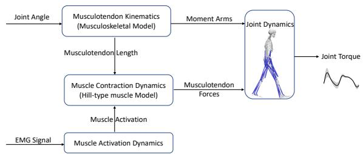
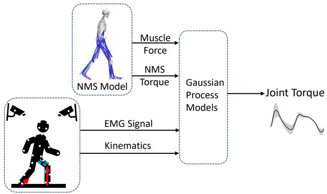
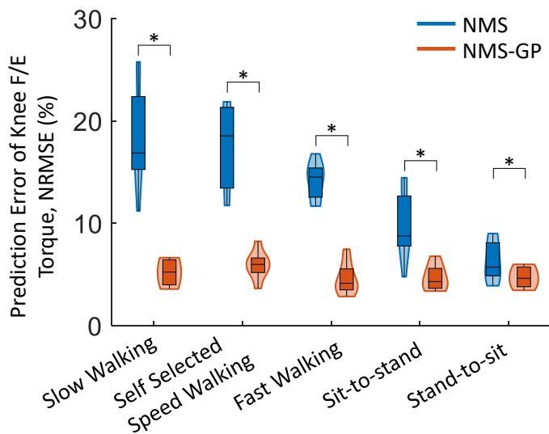
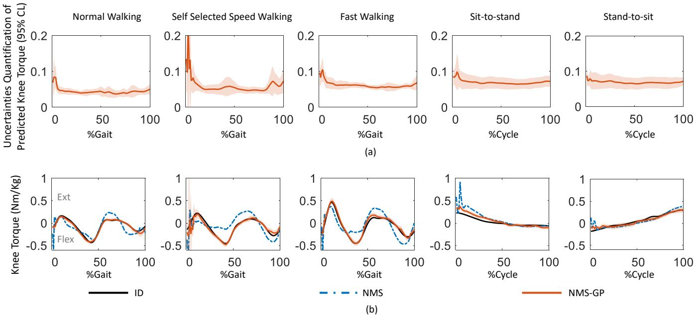

# Knee Joint Torque Prediction with Uncertainties by a Neuromusculoskeletal Solver-informed Gaussian Process Model

Longbin Zhang, Xiaochen Zhang, Xueyu Zhu, Ruoli Wang, and Elena M. Gutierrez-Farewik

Abstract— Research interest in exoskeleton assistance strategies that incorporate the user’s torque capacity is rapidly growing, yet uncertainty in predicted torque capacity can significantly impact the user-exoskeleton interface safety. In this paper, we estimated knee flexion/extension torques by using a neuromusculoskeletal (NMS) solver-informed Gaussian process (NMS-GP) model with muscle electromyography signals and joint kinematics as model inputs. The NMS-GP model combined the NMS and GP models by integrating valuable features from an NMS solver into a GP model. The NMS-GP model was used to predict knee joint torque in daily activities with uncertainty quantification. The activities included slow walking, self-selected speed walking, fast walking, sit-tostand, and stand-to-sit. Model performance, defined as low prediction error between the model’s predicted torque and measured torques from inverse dynamics computations, of both the NMS-GP and NMS models was analyzed. We found that prediction error was significantly lower in NMS-GP models than in NMS models. We observed relatively high uncertainties in the predicted knee torque at the beginning of each movement, particularly in self-selected speed walking. High uncertainties were also found during terminal stance and swing in selfselected speed walking. Compared to other torque prediction methods, the proposed NMS-GP model not only provides an accurate joint torque prediction but also a measure of the uncertainty. Our study showed that the NMS-GP model has a large potential in control strategy design for rehabilitation exoskeletons and to enhance the overall user experience.

## I. INTRODUCTION

Robotic exoskeletons are used more and more often in the rehabilitation of individuals with motor disorders such as stroke, cerebral palsy, and spinal cord injury [1]–[7]. These conditions often cause muscle weakness, coordination impairment, and limited mobility, making it challenging for individuals to perform daily activities. Robotic exoskeletons can provide assistance during rehabilitation training, allowing individuals with motor impairment to perform daily activities and/or exercises that would otherwise be challenging or impossible [8]–[10]. During exoskeleton-assisted rehabilitation training, incorporating users’ biosignals such as electromyography (EMG) into control strategies has gained significant attention, as it actively involves the user and thereby stimulates motor relearning [11], [12]. The strategy of this type of rehabilitation training, called assistance-asneeded control strategies, is to provide assistance only when and where it is needed, thus improving the patient’s ability to perform specific tasks and movements, and has demonstrated potential to improve rehabilitation outcomes [13]–[16]. One common assistance-as-needed strategy estimates the user’s physiological joint torques from EMG signals and uses them as controller input.

EMG-driven neuromusculoskeletal (NMS) model-based methods and machine learning are two popular techniques to predict a user’s physiological joint torques based on muscle excitation signals from EMG sensors [17]–[19]. Generally, NMS models require domain expertise to establish relationships between various variables, for instance, muscle excitation vs. activation, muscle force vs. length, muscle force vs. velocity, and muscle-tendon kinematics, and may involve complex calibration procedures [19]–[22]. On the contrary, machine learning can estimate joint torques without explicitly describing the complex relationships between variables. However, machine learning is generally considered a black-box approach, in that it does not provide understanding of the underlying mechanisms of the physical system. This may make it unreliable when predicting data that lies outside the training distribution, especially in cases where the training data is limited [23]. Physics-based NMS methods and machine learning methods each have their own advantages and disadvantages. We recently proposed a hybrid model that combines physical features from an NMS solver with a standard artificial neural network (ANN) [24] to improve the accuracy of the ANN alone to predict ankle torques during gait and isokinetic motions. We found that the hybrid model had superior performance compared to both the NMS and ANN models, thus highlighting the advantages gained by integrating informative features from the NMS model into an ANN. However, there was one exception to this finding; we observed that our hybrid-ANN model performed worse than the standard ANN during self-selected speed walking. It is possible that the incorporated input features from the NMS model were representative or even misleading due to differences in muscle coordination patterns between calibration and testing motions or uncertainties in EMG input signals. It is thus important to quantify the uncertainty of a model’s predictions, particularly when it is to be used for the control of exoskeletons.

Gaussian processes (GPs) have been shown to be powerful tools for making predictions with uncertainties in a variety of applications, such as joint kinematics prediction [25], weather forecasting [26], and robot motion planning [27]. A GP is a type of probabilistic model that can provide a measure of uncertainty in its predictions [28]. Liang et al.

[25] proposed a GP model to predict knee joint angles during walking and running based on EMG signals. They demonstrated the ability of the GP model to accurately predict knee angles while providing uncertainty information. Similarly, Yun et al. [29] applied a GP model to predict human gait patterns using only body parameters as input. They found the GP model to be a cost-effective and subject-specific method for estimating gait kinematics. The GP model allowed for a comprehensive understanding of the correlation between and uncertainty among anthropometric parameters and gait kinematics. To the best of our knowledge, Gaussian processes have not been applied to predict knee joint torques using measured EMG signals as inputs. However, this appears to be a promising technique for quantifying the uncertainty associated with joint torque prediction.

Our aim was to estimate knee flexion/extension (F/E) torques during different everyday movements by using an NMS solver-informed Gaussian process (NMS-GP) model that incorporates measured muscle electromyography signals and knee joint angles as model inputs. We hypothesized that the NMS-GP model would yield a more accurate knee joint torque prediction than the NMS model alone. A secondary aim was to quantify the model’s uncertainty in predicted knee joint torques during different movements.

## II. METHODS

## A. Data Collection and Processing

Eight able-bodied subjects (sex: 4F/4M; height: 168.1±9.4 cm; weight: 65.2±17.8 kg; age: 29±4 years) were recruited. The Swedish Ethical Review Authority approved this study (Dnr. 2020-02311), and all subjects provided written informed consents. All participants were equipped with sensors for 3D movement capture and asked to perform five different everyday movements, specifically slow walking, normal walking at a self-selected pace, fast walking, sit-to-stand, and stand-to-sit. Each recorded movement was repeated at least ten times.

Surface EMG signals (Myon aktos/Cometa systems, Milan, Italy) of rectus femoris (RF), vastus medialis (VM), vastus lateralis (VL), biceps femoris (BF), semitendinosus (ST), gastrocnemius medialis (GM), and gastrocnemius lateralis (GL) of each participant’s one randomly selected leg were measured at 1000 Hz. The raw EMGs signals were post-processed as follows: they were bandpass filtered (30- 300 Hz), rectified, low pass filtered (6 Hz), and normalized to the maximum EMG value among all movement trials [2], [20], [30].

Marker trajectories were recorded using a 3D motion capture system (100 Hz, V16, Vicon, Oxford, UK), with marker placement according to the CGM2.3 model [31]. Ground reaction forces were measured with three force plates (1000 Hz, AMTI, MA, USA). Kinematics (joint angles) were obtained using an inverse kinematics approach, which involved minimizing the discrepancy between modeled and measured marker trajectories. Inverse dynamics was used to calculate joint torques that satisfy the dynamic equations of motion [32], [33]. A low-pass fourth-order zero-lag Butterworth filter (6 Hz) was used to filter joint kinematics and kinetics [34]–[36].

  
Fig. 1. Schematic illustration of an NMS model structure. The muscle activation dynamics element computes muscle activation based on EMG signals (muscle excitation). The musculotendon kinematics element calculates musculotendon lengths and moment arms. Musculotendon forces are then computed by using the muscle contraction dynamics element and a Hill-type muscle model, with muscle activation and musculotendon lengths as inputs. Finally, the joint dynamics element computes joint torques with musculotendon forces and moment arms as inputs.

  
Fig. 2. Overview of the joint torque estimation using NMS-informed Gaussian process models. The inputs of NMS-informed GP models were augmented with two kinds of features: (1) experimentally measured muscle signals and 3D joint kinematics, and (2) informative physical features, specifically muscle forces and NMS torque, from the underlying NMS solver.

## B. Neuromusculoskeletal Solver-informed Gaussian Process Regression Model

In our study, we used an open-source EMG-informed NMS model developed by Pizzolato et al. [21] consisting of four elements (Fig. 1): muscle activation dynamics, musculotendon kinematics, muscle contraction dynamics, and joint dynamics [37]. The muscle activation dynamics element computes muscle activation based on EMG signals (muscle excitation). The musculotendon kinematics element calculates musculotendon lengths and moment arms. The muscle contraction dynamics element computes musculotendon forces using a Hill-type muscle model with muscle activation and musculotendon lengths as inputs. Finally, the joint dynamics element computes joint torques with musculotendon forces and moment arms as inputs.

The inputs $\mathbf { x } ~ = ~ [ x _ { 1 } , x _ { 2 } , \ldots , x _ { n } ] ^ { T } ( n ~ = ~ 2 1 )$ of NMSinformed GP models were augmented with two types of features (Fig. 1): (1) experimentally measured muscle signals and joint kinematics from a 3D motion capture system, and (2) informative physical features - muscle forces and NMS-based torques, from the underlying NMS solver. These features were used to enhance the accuracy of the model performance by providing more information about the modeled system. The NMS-GP model $f ( \mathbf { x } )$ is characterized by a mean function $\mu ( \mathbf { x } )$ and a covariance function $k ( \mathbf { x } , \mathbf { x ^ { ' } } )$ , as shown in Eq. (1) [38].

$$
f (\mathbf {x}) \sim G P (\mu (\mathbf {x}), k (\mathbf {x}, \mathbf {x} ^ {\prime}))\tag{1}
$$

The mean function $\mu ( \mathbf { x } )$ is used to estimate the expected value of the function at a given input, and can be defined as Eq. (2):

$$
\mu (\mathbf {x}) = E [ f (\mathbf {x}) ]\tag{2}
$$

The covariance function, also known as the kernel function, represents the similarity between two input variables. It is used to estimate the uncertainty of the prediction and is defined as Eq. (3) [39]:

$$
k (\mathbf {x}, \mathbf {x} ^ {\prime}) = E [ (f (\mathbf {x}) - \mu (\mathbf {x})) (f (\mathbf {x} ^ {\prime}) - \mu (\mathbf {x} ^ {\prime})) ]\tag{3}
$$

There are various kernel functions available in the Gaussian process model. One of the most commonly used functions is the radial basis function kernel (RBF), a smooth and infinitely differentiable function that can capture the underlying structure of the data well. It is defined as Eq. (4)

$$
k (\mathbf {x}, \mathbf {x} ^ {\prime}) = \exp (- \frac {| \mathbf {x} - \mathbf {x} ^ {\prime} | ^ {2}}{2 l ^ {2}})\tag{4}
$$

where l is a hyperparameter that controls the length-scale of the kernel, and $| { \bf x } - { \bf x } ^ { \prime } |$ is the Euclidean distance between two inputs x and $\mathbf { x } ^ { \prime } .$

Another popular kernel function is the Matern kernel, which is a generalization of the RBF kernel and is defined as Eq. (5):

$$
k (\mathbf {x}, \mathbf {x} ^ {\prime}) = \frac {2 ^ {1 - \nu}}{\Gamma (\nu)} \left(\frac {\sqrt {2 \nu}}{l} | \mathbf {x} - \mathbf {x} ^ {\prime} |\right) ^ {\nu} K _ {\nu} \left(\frac {\sqrt {2 \nu}}{l} | \mathbf {x} - \mathbf {x} ^ {\prime} |\right)\tag{5}
$$

where $\nu$ is a positive parameter that determines the smoothness of the kernel, $K _ { \nu }$ is the modified Bessel function, $\Gamma ( \nu )$ is the Gamma function, and l is the length-scale parameter that controls the scale of the kernel.

The White Noise Kernel is another popular kernel, used here for modeling the noise in the data, as shown in Eq. (6):

$$
k (\mathbf {x}, \mathbf {x} ^ {\prime}) = \sigma^ {2} \delta (\mathbf {x} - \mathbf {x} ^ {\prime})\tag{6}
$$

where $\sigma ^ { 2 }$ is the noise variance parameter that controls the amplitude of the noise, and $\delta \big ( \mathbf { x } - \mathbf { x } ^ { \prime } \big )$ is the Dirac delta function, which is equal to one when $\textbf { x } = \textbf { x } ^ { \prime }$ and zero otherwise. It ensures that the kernel function is non-zero only at the diagonal of the input space, where $\mathbf { x } = \mathbf { x } ^ { \prime }$

The Linear kernel is another commonly used kernel that models a linear relationship between the inputs and the outputs, as shown in Eq. (7):

$$
k (\mathbf {x}, \mathbf {x} ^ {\prime}) = \sigma^ {2} \mathbf {x} ^ {T} \mathbf {x} ^ {\prime}\tag{7}
$$

where $\sigma ^ { 2 }$ is the variance parameter.

In practice, it is common to combine different kernel functions to improve the performance of a Gaussian process model. This is known as kernel composition and can be achieved by adding or multiplying different kernels together. This allows the model to capture various underlying structures in the data and improve the overall accuracy of the predictions. After experimenting with various kernel functions, we adopted a combination of Matern, White Noise, and Linear kernels in our GP model, based on trial and error testing; this combination produced the most accurate predictions for the data set. The Matern kernel allowed us to capture any underlying non-linear patterns in the data, while the White Noise kernel helped to account for any measurement errors or other sources of uncertainty. The Linear kernel, on the other hand, helped to model the linear relationship between the inputs and outputs.

Gaussian process regression was performed in Python using the GaussianProcessRegressor library and kernel functions from the gaussian process module in the scikit-learn package. During the training process, hyperparameters associated with the GP model, including length scale, signal variance, noise variance, and others, were adjusted to optimize its performance. Specifically, in the Matern kernel, the positive parameter ν was set to 3/2. The length scale was bounded between (0.01, 200) and variance was bounded between $( 1 0 ^ { - 3 } , 1 0 ^ { 5 } )$ . For the White Noise kernel, noise variance was bounded between (0.03, 100) and for the Linear kernel, variance was bounded between $( 1 0 ^ { - 3 } , 1 0 ^ { 5 } )$ ).

## C. Evaluation Protocol

We investigated the accuracy of knee joint torque prediction based on both NMS and NMS-GP models, defined here as the error between predicted torque and measured torques from inverse dynamics, and analyzed the uncertainty quantification by NMS-GP models. The prediction accuracy with uncertainty quantification was evaluated in five cases: $G a i t _ { s l o w } , \ G a i t _ { s e l f } , \ G a i t _ { f a s t } ,$ $\mathit { S i t T o S t a } ,$ and $S t a T o S i t ;$ where a separate NMS-GP model was trained for each movement. In all cases, NMS-GP models were trained using 80% of the recorded data and were subsequently evaluated using the remaining data, whereas NMS models were calibrated using three trials of each movement and tested on the same trials as the NMS-GP testing data.

The torque estimation error of each model was evaluated using the normalized root mean square error (NRMSE) $E _ { N R M S }$ , wherein a low estimation error implies high prediction accuracy. NRMSE was defined as the root mean square error $E _ { R M S }$ (between the predicted and measured torque) divided by the range of observed joint torque from inverse dynamics in corresponding motions:

$$
E _ {R M S} = \sqrt {\frac {1}{N} \sum_ {n = 1} ^ {N} (y _ {p , n} - y _ {n}) ^ {2}}\tag{8}
$$

$$
E _ {N R M S} = \frac {E _ {R M S}}{(y _ {m a x} - y _ {m i n})} \times 100\%\tag{9}
$$

  
Fig. 3. NRMSE of predicted knee joint torque across subjects using NMS and NMS-GP models. The violin plots show the probability distributions of NRMSE using kernel density plots, and the box plots represent the minimum, lower quartile, median, upper quartile, and maximum values of NRMSE in five daily activities. An asterisk (\*) indicates a significant difference between the two models.

where $y _ { n }$ and $y _ { p , n }$ are the measured/actual and predicted torque respectively; $y _ { m i n }$ is the minimum and $y _ { m a x }$ is the maximum measured torque in corresponding movements. Each subject’s NRMSE was calculated, and the median value across eight participants was then determined. Data distribution normality was evaluated using Shapiro-Wilk tests $( p \ < \ 0 . 0 5$ significance level). Pairwise comparisons between NRMSEs of torque estimation obtained from the two approaches were then performed, using paired t-tests for data with a normal distribution or Wilcoxon signed-rank tests for non-normally distributed data $( p < 0 . 0 5 )$ ).

The uncertainty of the predicted torque was quantified by using a 95% confidence level (CL), indicating that there is a 95% probability that the true value of the function being modeled falls within the predicted interval. A high uncertainty value indicates a low confidence in the predicted value.

## III. RESULTS

Overall, compared to NMS models, the NRMSE of knee torque prediction was significantly lower in NMS-GP models $( G a i t _ { s l o w } \colon p < 0 . 0 1 , G a i t _ { s e l f } \colon p < 0 . 0 1 , G a i t _ { f a s t } \colon p <$ $0 . 0 1 , S i t T o S t a \colon p < 0 . 0 1$ , and $S t a T o S i t { : } p = 0 . 0 3 ; \mathrm { F i g . } 3 )$ Similar findings were also observed in the RMSE $( G a i t _ { s l o w } \mathrm { : }$ $\begin{array} { l l l } { p } & { < } & { 0 . 0 1 } \end{array}$ $G a i t _ { s e l f } \colon \ p \ < \ 0 . 0 1$ $G a i t _ { f a s t } \colon p \ < \ 0 . 0 1$ $S i t T o S t a \colon p \ < \ 0 . 0 1$ , and $S t a T o S i t$ $p \ = \ 0 . 0 4 $ ; Fig. 4). Compared to NMS-GP models, the predicted torque with NMS models had a worse agreement with measured torque (Fig. 5 (b)) and relatively high offsets at the beginning of each movement.

Among the five movements, the NRMSE of knee torque prediction in walking movements $( G a i t _ { s l o w } \colon \le \ 1 8 . 3 \% ,$ $G a i t _ { s e l f } \colon \le \ 1 7 . 5 \%$ , and $G a i t _ { f a s t } \colon \leq \ 1 4 . 2 \% )$ was higher than in the other movements using NMS models $\left( S i t T o S t a \colon \right.$ $\leq 9 . 7 \%$ and $S t a T o S i t \colon \leq 7 . 2 \% )$ (Fig. 3). The NRMSEs predicted by NMS-GP models were generally lower in all five movements $( \leq 5 . 9 \% )$ . Similar trends were also observed in the RMSE (Fig. 4).

  
Fig. 4. RMSE of the predicted knee joint torques across subjects using NMS and NMS-GP models. The violin plots show the probability distributions of NRMSE using kernel density plots, and the box plots represent the minimum, lower quartile, median, upper quartile, and maximum values of RMSE during five daily activities. An asterisk (\*) indicates a significant difference between the two models.

It is worth noting that the uncertainties of predicted knee torque were relatively high at the beginning of each movement, particularly in self-selected speed walking (Fig. 5 (a)). High uncertainties were also observed during terminal stance and swing in self-selected speed walking.

## IV. DISCUSSION

We proposed an NMS-GP model to estimate knee flexion/extension torques using measured muscle electromyography signals and joint kinematics. Our results showed that the prediction error was significantly lower in the NMS-GP model than in the traditional NMS model, supporting the hypothesis that integrating features of NMS model into machine learning models can leverage the benefits of the individual model. Additionally, the NMS-GP model quantified uncertainty in torque predictions. The torque prediction uncertainty was relatively high at the beginning of each movement, particularly in self-selected speed walking. High uncertainties were also observed during terminal stance and swing in self-selected speed walking. The ability to not only predict joint torques accurately but also to compute the uncertainties of those predictions has very important potential implications in certain applications, such as ensuring both the efficacy and the safety of exoskeletons. By incorporating these uncertainties into the control strategy, we can better manage risks and ensure a safe and comfortable user-exoskeleton interface.

NMS-GP models with uncertainty quantification were found to accurately predict knee joint torques with relatively low error (RMSE ≤ 0.05 Nm/kg, $\mathrm { N R M S E } \leq 5 . 9 \% )$ , and performed better than conventional NMS models (RMSE ≤ 0.14 Nm/kg, NRMSE ≤ 18.3%). These findings corroborate those from our previous study [22] in which we applied a hybrid NMS-ANN model to predict ankle joint torques during gait and isokinetic motions. In that study, we combined physical features from an NMS model with a standard ANN and found that the NMS-ANN model performed well in most cases, with a few exceptions. However, the hybrid NMS-ANN model was only evaluated at the ankle joint. In this study, we further explored other machine learning models, specifically Gaussian process models that include uncertainty quantification in predictions. We observed that NMS-GP models tend to have high prediction uncertainties at the beginning of each movement. This could be attributed to the physical features adopted from NMS models at the beginning of each movement, where a large offset was also observed. The NMS model requires the neural activation from two previous time steps to compute the muscle neural activation of each musculotendon unit (MTU) [22]. However, this data is not available at the beginning of a cycle. They are instead approximated using EMGs from two previous time steps. This approximation may introduce initial offsets in the predicted torque. Additionally, relatively high uncertainties were observed during terminal stance and terminal swing in self-selected speed walking. This could be attributed to the transition between stance and swing phases of gait, during which different muscle coordination patterns may exist. These periods of high uncertainty should be taken into account in exoskeleton controller design.

  
Fig. 5. (a) Computed uncertainty of predicted knee joint torque by the NMS-GP model across subjects during five daily activities, shown as mean ± 1 standard deviation of all subjects and trials. The prediction uncertainty was quantified with a 95% confidence level (CL, illustrated by colored shade), indicating that there is a 95% probability that the true value of the modelled function falls within the predicted interval. A high uncertainty value indicates low confidence in the predicted value. (b) One example of measured (by inverse dynamics (ID)) and predicted knee flex/extension torques (Nm/kg) with both NMS and NMS-GP models during five daily activities. The shaded area in NMS-GP models illustrates the uncertainties in the expected mean value.

We used only a single machine learning model and NMS model in this study; further research involving other machine learning approaches and NMS models is necessary to generalize our findings. In addition, future studies should focus on applying joint torque prediction with uncertainty quantification in exoskeleton control, which is crucial for achieving realistic implementation. Our approach was tested on gait at different speeds, sit-to-stand, and stand-to-sit movements; further testing and validation are required to determine its applicability in a wider range of activities. Other study limitations are that the subjects recruited were relatively homogeneous in terms of age and overall health status. To generalize these findings to other study populations, it is essential to conduct further research involving a diverse group of subjects with a broader range of ages and neuromuscular functions.

## V. CONCLUSION

In this study, we proposed an NMS-GP model to estimate knee flexion/extension torques using measured muscle electromyography signals and joint kinematics. The NMS-GP model combines the traditional NMS model with modern machine learning techniques that include uncertainty quantification. The proposed NMS-GP model not only offers a higher prediction accuracy but also provides a measure of uncertainty in predictions. This approach can be applied to enhance the performance of rehabilitation exoskeletons and demonstrates great potential for various applications such as exoskeleton control and real-time evaluation of interventions.

[1] Z. Li, Y. Yuan, L. Luo, W. Su, K. Zhao, C. Xu, J. Huang, and M. Pi, “Hybrid brain/muscle signals powered wearable walking exoskeleton enhancing motor ability in climbing stairs activity,” IEEE Transactions on Medical Robotics and Bionics, vol. 1, no. 4, pp. 218–227, 2019.

[2] M. Sartori, D. G. Lloyd, and D. Farina, “Neural data-driven musculoskeletal modeling for personalized neurorehabilitation technologies,” IEEE Transactions on Biomedical Engineering, vol. 63, no. 5, pp. 879–893, 2016.

[3] L. Li, M. J. Foo, J. Chen, K. Y. Tan, J. Cai, R. Swaminathan, K. S. G. Chua, S. K. Wee, C. W. K. Kuah, H. Zhuo et al., “Mobile robotic balance assistant (mrba): a gait assistive and fall intervention robot for daily living,” Journal ofNeuroEngineering and Rehabilitation, vol. 20, no. 1, pp. 1–17, 2023.

[4] L. Luo, M. J. Foo, M. Ramanathan, J. K. Er, C. H. Chiam, L. Li, W. Y. Yau, and W. T. Ang, “Trajectory generation and control of a lower limb exoskeleton for gait assistance,” Journal of Intelligent & Robotic Systems, vol. 106, no. 3, p. 64, 2022.

[5] Z. Li, G. Li, X. Wu, Z. Kan, H. Su, and Y. Liu, “Asymmetric cooperation control of dual-arm exoskeletons using human collaborative manipulation models,” IEEE Transactions on Cybernetics, vol. 52, no. 11, pp. 12 126–12 139, 2021.

[6] S. Yang, N. P. Garg, R. Gao, M. Yuan, B. Noronha, W. T. Ang, and D. Accoto, “Learning-based motion-intention prediction for end-point control of upper-limb-assistive robots,” Sensors, vol. 23, no. 6, p. 2998, 2023.

[7] Z. Li, K. Zhao, L. Zhang, X. Wu, T. Zhang, Q. Li, X. Li, and C.-Y. Su, “Human-in-the-loop control of a wearable lower limb exoskeleton for stable dynamic walking,” IEEE/ASME Transactions on Mechatronics, vol. 26, no. 5, pp. 2700–2711, 2020.

[8] B. Chen, H. Ma, L.-Y. Qin, F. Gao, K.-M. Chan, S.-W. Law, L. Qin, and W.-H. Liao, “Recent developments and challenges of lower extremity exoskeletons,” Journal of Orthopaedic Translation, vol. 5, pp. 26–37, 2016.

[9] Z. Li, B. Huang, Z. Ye, M. Deng, and C. Yang, “Physical human– robot interaction of a robotic exoskeleton by admittance control,” IEEE Transactions on Industrial Electronics, vol. 65, no. 12, pp. 9614–9624, 2018.

[10] M. Zhang, A. McDaid, A. J. Veale, Y. Peng, and S. Q. Xie, “Adaptive trajectory tracking control of a parallel ankle rehabilitation robot with joint-space force distribution,” IEEE Access, vol. 7, pp. 85 812–85 820, 2019.

[11] S. Yao, Y. Zhuang, Z. Li, and R. Song, “Adaptive admittance control for an ankle exoskeleton using an emg-driven musculoskeletal model,” Frontiers in Neurorobotics, vol. 12, pp. 1–12, 2018.

[12] G. Durandau, D. Farina, and M. Sartori, “Robust real-time musculoskeletal modeling driven by electromyograms,” IEEE Transactions on Biomedical Engineering, vol. 65, no. 3, pp. 556–564, 2017.

[13] K. Fujii, T. Abe, S. Kubota, A. Marushima, H. Kawamoto, T. Ueno, A. Matsushita, K. Nakai, K. Saotome, H. Kadone et al., “The voluntary driven exoskeleton hybrid assistive limb (hal) for postoperative training of thoracic ossification of the posterior longitudinal ligament: a case report,” The journal of spinal cord medicine, vol. 40, no. 3, pp. 361– 367, 2017.

[14] L. Marchal-Crespo and D. J. Reinkensmeyer, “Review of control strategies for robotic movement training after neurologic injury,” Journal of Neuroengineering and Rehabilitation, vol. 6, no. 1, pp. 1–15, 2009.

[15] Y. Huang, R. Song, A. Argha, A. V. Savkin, B. G. Celler, and S. W. Su, “Continuous description of human 3d motion intent through switching mechanism,” IEEE Transactions on Neural Systems and Rehabilitation Engineering, vol. 28, no. 1, pp. 277–286, 2019.

[16] S. Y. A. Mounis, N. Z. Azlan, and F. Sado, “Assist-as-needed control strategy for upper-limb rehabilitation based on subject’s functional ability,” Measurement and Control, vol. 52, no. 9-10, pp. 1354–1361, 2019.

[17] C. Pizzolato, D. J. Saxby, D. Palipana, L. E. Diamond, R. S. Barrett, Y. D. Teng, and D. G. Lloyd, “Neuromusculoskeletal modelingbased prostheses for recovery after spinal cord injury,” Frontiers in Neurorobotics, vol. 13, pp. 1–10, 2019.

[18] M. Ezati, B. Ghannadi, and J. McPhee, “A review of simulation methods for human movement dynamics with emphasis on gait,” Multibody System Dynamics, vol. 47, no. 3, pp. 265–292, 2019.

[19] L. Zhang, Z. Li, Y. Hu, C. Smith, E. M. G. Farewik, and R. Wang, “Ankle joint torque estimation using an emg-driven neuromusculoskeletal

model and an artificial neural network model,” IEEE Transactions on Automation Science and Engineering, vol. 18, no. 2, pp. 564–573, 2020.

[20] H. X. Hoang, C. Pizzolato, L. E. Diamond, and D. G. Lloyd, “Subjectspecific calibration of neuromuscular parameters enables neuromusculoskeletal models to estimate physiologically plausible hip joint contact forces in healthy adults,” Journal of Biomechanics, vol. 80, pp. 111–120, 2018.

[21] C. Pizzolato, D. G. Lloyd, M. Sartori, E. Ceseracciu, T. F. Besier, B. J. Fregly, and M. Reggiani, “Ceinms: A toolbox to investigate the influence of different neural control solutions on the prediction of muscle excitation and joint moments during dynamic motor tasks,” Journal of Biomechanics, vol. 48, no. 14, pp. 3929–3936, 2015.

[22] L. Zhang, X. Zhu, E. M. Gutierrez-Farewik, and R. Wang, “Ankle joint torque prediction using an nms solver informed-ann model and transfer learning,” IEEE journal of biomedical and health informatics, vol. 26, no. 12, pp. 5895–5906, 2022.

[23] E. Soleimani and E. Nazerfard, “Cross-subject transfer learning in human activity recognition systems using generative adversarial networks,” Neurocomputing, vol. 426, pp. 26–34, 2021.

[24] L. Zhang, X. Zhu, E. M. G. Farewik, and R. Wang, “Estimation of ankle dynamic joint torque by a neuromusculoskeletal solver-informed nn model,” in 2021 6th IEEE International Conference on Advanced Robotics and Mechatronics (ICARM). IEEE, 2021, pp. 75–80.

[25] J. Liang, Z. Shi, F. Zhu, W. Chen, X. Chen, and Y. Li, “Gaussian process autoregression for joint angle prediction based on semg signals,” Frontiers in Public Health, vol. 9, pp. 1–15, 2021.

[26] N. Chen, Z. Qian, I. T. Nabney, and X. Meng, “Wind power forecasts using gaussian processes and numerical weather prediction,” IEEE Transactions on Power Systems, vol. 29, no. 2, pp. 656–665, 2013.

[27] H. Guo, Z. Meng, Z. Huang, L. W. Kang, Z. Chen, M. Meghjani, M. Ang, and D. Rus, “Safe path planning with gaussian process regulated risk map,” in 2019 IEEE/RSJ International Conference on Intelligent Robots and Systems (IROS). IEEE, 2019, pp. 2044–2051.

[28] J. Maritz, F. Lubbe, and L. Lagrange, “A practical guide to gaussian process regression for energy measurement and verification within the bayesian framework,” Energies, vol. 11, no. 4, pp. 1–12, 2018.

[29] Y. Yun, H.-C. Kim, S. Y. Shin, J. Lee, A. D. Deshpande, and C. Kim, “Statistical method for prediction of gait kinematics with gaussian process regression,” Journal of Biomechanics, vol. 47, no. 1, pp. 186– 192, 2014.

[30] C. Pizzolato, M. Reggiani, L. Modenese, and D. Lloyd, “Real-time inverse kinematics and inverse dynamics for lower limb applications using opensim,” Computer methods in biomechanics and biomedical engineering, vol. 20, no. 4, pp. 436–445, 2017.

[31] F. Leboeuf, R. Baker, A. Barre, J. Reay, R. Jones, and M. Sangeux,´ “The conventional gait model, an open-source implementation that reproduces the past but prepares for the future,” Gait & Posture, vol. 69, pp. 235–241, 2019.

[32] M. G. Pandy, “Computer modeling and simulation of human movement,” Annual Review of Biomedical Engineering, vol. 3, no. 1, pp. 245–273, 2001.

[33] R. Wang, “Biomechanical consequences of gait impairment at the ankle and foot: Injury, malalignment, and co-contraction,” Ph.D. dissertation, KTH Royal Institute of Technology, 2012.

[34] D. A. Winter, H. G. Sidwall, and D. A. Hobson, “Measurement and reduction of noise in kinematics of locomotion,” Journal of Biomechanics, vol. 7, no. 2, pp. 157–159, 1974.

[35] A. Mantoan, C. Pizzolato, M. Sartori, Z. Sawacha, C. Cobelli, and M. Reggiani, “Motonms: A matlab toolbox to process motion data for neuromusculoskeletal modeling and simulation,” Source Code for Biology and Medicine, vol. 10, no. 1, pp. 1–14, 2015.

[36] T. R. Derrick, A. J. van den Bogert, A. Cereatti, R. Dumas, S. Fantozzi, and A. Leardini, “Isb recommendations on the reporting of intersegmental forces and moments during human motion analysis,” Journal of Biomechanics, vol. 99, pp. 1–10, 2020.

[37] M. Sartori, M. Reggiani, D. G. Lloyd, and E. Pagello, “A neuromusculoskeletal model of the human lower limb: Towards emgdriven actuation of multiple joints in powered orthoses,” in 2011 IEEE International Conference on Rehabilitation Robotics. IEEE, 2011, pp. 1–6.

[38] C. E. Rasmussen, Gaussian processes in machine learning. Springer, 2004.

[39] T. Beckers, “An introduction to gaussian process models,” arXiv preprint arXiv:2102.05497, 2021.