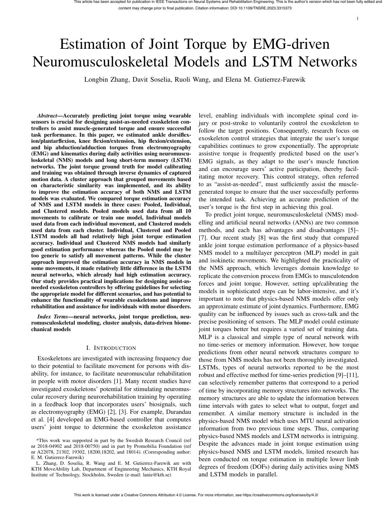
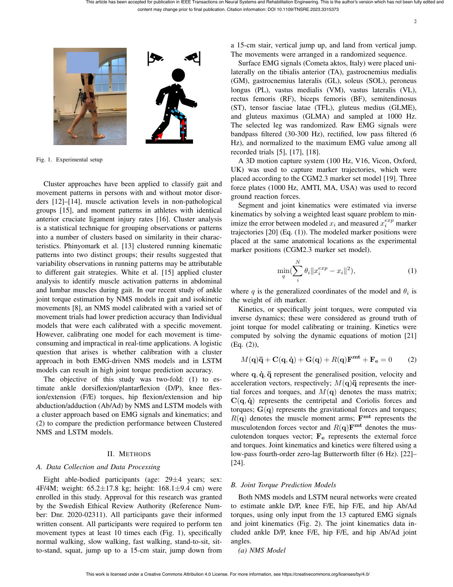
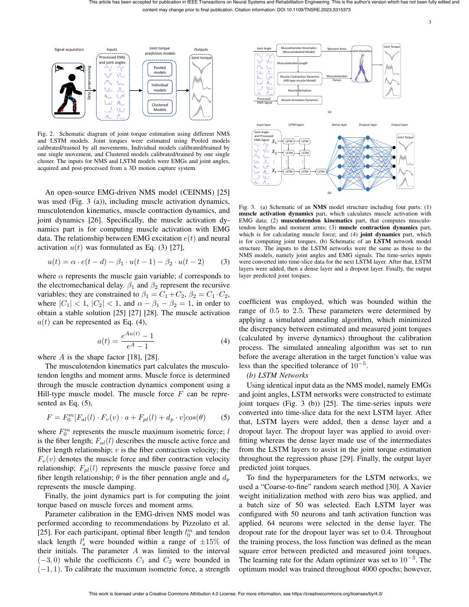
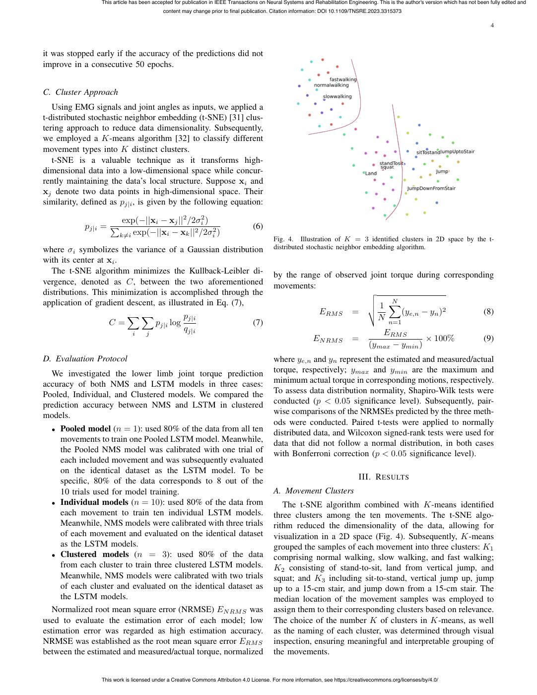
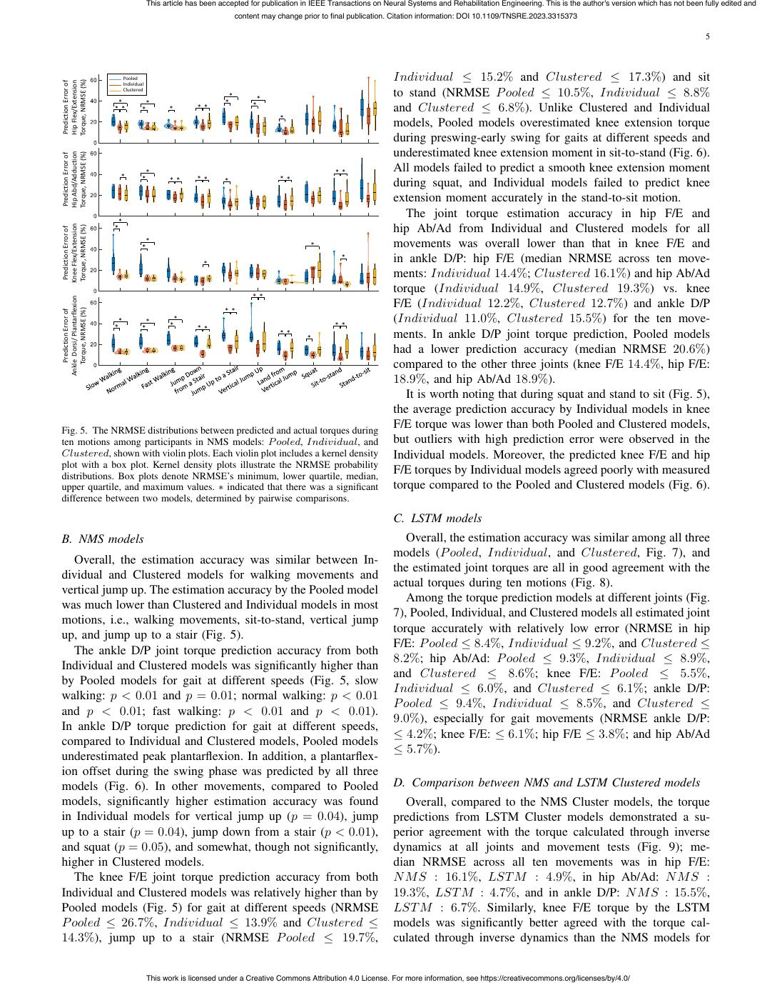
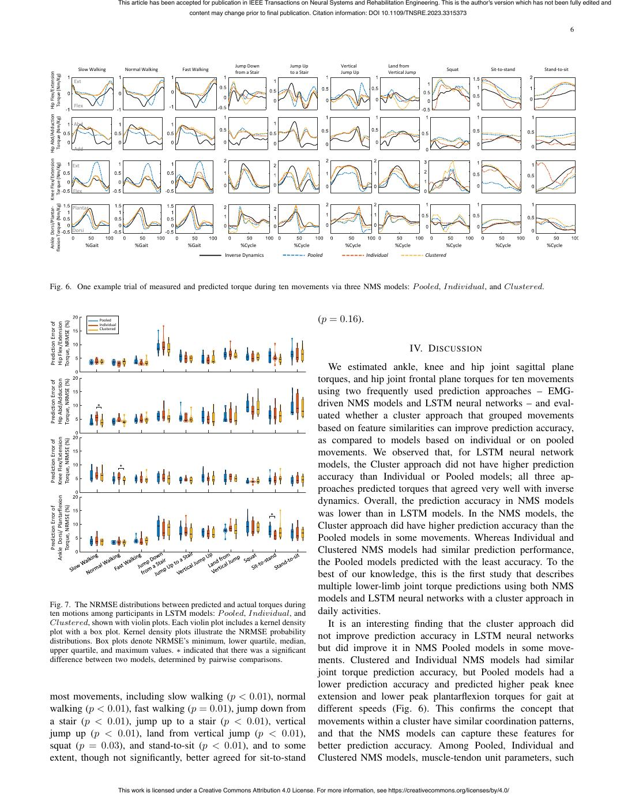
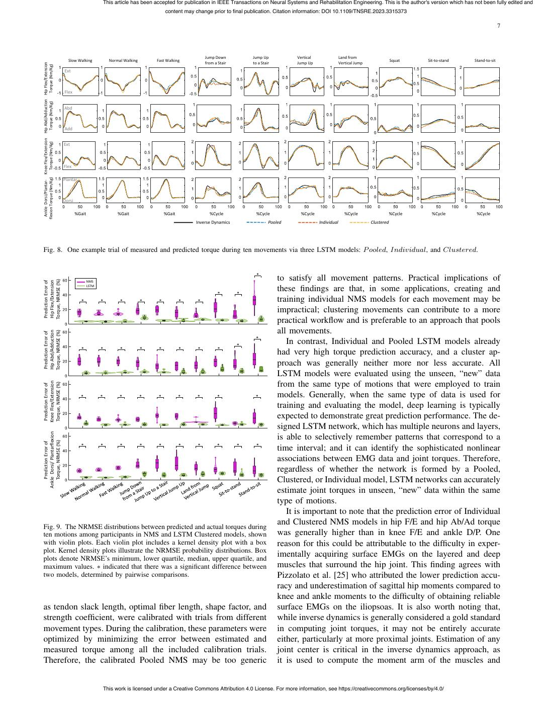
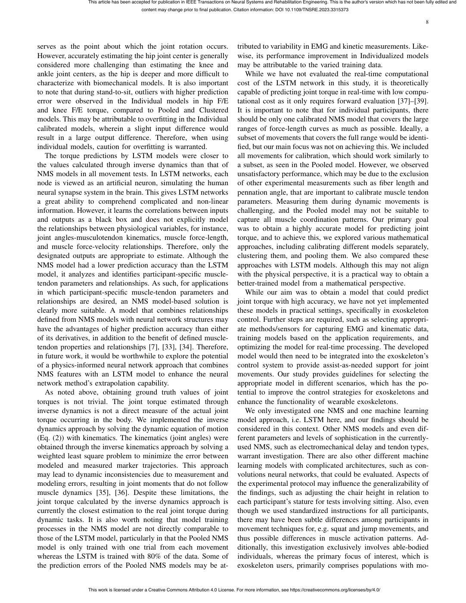
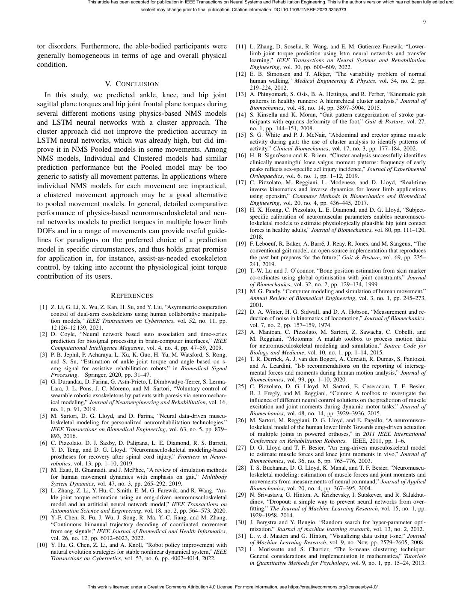
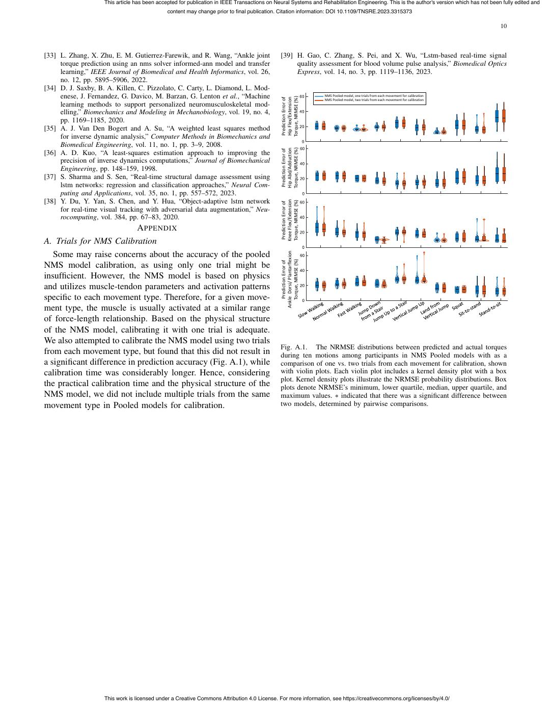

# Zhang2023-TNSRE：肌电驱动 NMS 与 LSTM 的关节力矩估计

> English text extracted from the source PDF; not translated or editorially corrected. Each original PDF page is embedded below as a rendered image so figures, tables, and vector artwork remain visible.

- Source PDF: `Zhang2023-TNSRE：肌电驱动 NMS 与 LSTM 的关节力矩估计.pdf`
- SHA-256: `bbe77a8ceb050f64ea72e78ac73b60857d2582a713a37546752f2adeff004b09`
- Pages: 10
- Extraction: Poppler `pdftotext -layout`; page images rendered with `pdftoppm` (max dimension 1400 px, JPEG quality 76).

## Page 1

English text extracted from page 1

<pre>
This article has been accepted for publication in IEEE Transactions on Neural Systems and Rehabilitation Engineering. This is the author's version which has not been fully edited and
                                             content may change prior to final publication. Citation information: DOI 10.1109/TNSRE.2023.3315373

                                                                                                                                                                                         1

   Estimation of Joint Torque by EMG-driven
Neuromusculoskeletal Models and LSTM Networks
                         Longbin Zhang, Davit Soselia, Ruoli Wang, and Elena M. Gutierrez-Farewik

   Abstract—Accurately predicting joint torque using wearable                               level, enabling individuals with incomplete spinal cord in-
sensors is crucial for designing assist-as-needed exoskeleton con-                          jury or post-stroke to voluntarily control the exoskeleton to
trollers to assist muscle-generated torque and ensure successful                            follow the target positions. Consequently, research focus on
task performance. In this paper, we estimated ankle dorsiflex-
ion/plantarflexion, knee flexion/extension, hip flexion/extension,                          exoskeleton control strategies that integrate the user’s torque
and hip abduction/adduction torques from electromyography                                   capabilities continues to grow exponentially. The appropriate
(EMG) and kinematics during daily activities using neuromuscu-                              assistive torque is frequently predicted based on the user’s
loskeletal (NMS) models and long short-term memory (LSTM)                                   EMG signals, as they adapt to the user’s muscle function
networks. The joint torque ground truth for model calibrating                               and can encourage users’ active participation, thereby facil-
and training was obtained through inverse dynamics of captured
motion data. A cluster approach that grouped movements based                                itating motor recovery. This control strategy, often referred
on characteristic similarity was implemented, and its ability                               to as “assist-as-needed”, must sufficiently assist the muscle-
to improve the estimation accuracy of both NMS and LSTM                                     generated torque to ensure that the user successfully performs
models was evaluated. We compared torque estimation accuracy                                the intended task. Achieving an accurate prediction of the
of NMS and LSTM models in three cases: Pooled, Individual,                                  user’s torque is the first step in achieving this goal.
and Clustered models. Pooled models used data from all 10
movements to calibrate or train one model, Individual models                                   To predict joint torque, neuromusculoskeletal (NMS) mod-
used data from each individual movement, and Clustered models                               elling and artificial neural networks (ANNs) are two common
used data from each cluster. Individual, Clustered and Pooled                               methods, and each has advantages and disadvantages [5]–
LSTM models all had relatively high joint torque estimation                                 [7]. Our recent study [8] was the first study that compared
accuracy. Individual and Clustered NMS models had similarly                                 ankle joint torque estimation performance of a physics-based
good estimation performance whereas the Pooled model may be
too generic to satisfy all movement patterns. While the cluster                             NMS model to a multilayer perceptron (MLP) model in gait
approach improved the estimation accuracy in NMS models in                                  and isokinetic movements. We highlighted the practicality of
some movements, it made relatively little difference in the LSTM                            the NMS approach, which leverages domain knowledge to
neural networks, which already had high estimation accuracy.                                replicate the conversion process from EMGs to musculotendon
Our study provides practical implications for designing assist-as-                          forces and joint torque. However, setting up/calibrating the
needed exoskeleton controllers by offering guidelines for selecting
the appropriate model for different scenarios, and has potential to                         models in sophisticated steps can be labor-intensive, and it’s
enhance the functionality of wearable exoskeletons and improve                              important to note that physics-based NMS models offer only
rehabilitation and assistance for individuals with motor disorders.                         an approximate estimate of joint dynamics. Furthermore, EMG
  Index Terms—neural networks, joint torque prediction, neu-                                quality can be influenced by issues such as cross-talk and the
romusculoskeletal modeling, cluster analysis, data-driven biome-                            precise positioning of sensors. The MLP model could estimate
chanical models                                                                             joint torques better but requires a varied set of training data.
                                                                                            MLP is a classical and simple type of neural network with
                                                                                            no time-series or memory information. However, how torque
                          I. I NTRODUCTION
                                                                                            predictions from other neural network structures compare to
   Exoskeletons are investigated with increasing frequency due                              those from NMS models has not been thoroughly investigated.
to their potential to facilitate movement for persons with dis-                             LSTMs, types of neural networks reported to be the most
ability, for instance, to facilitate neuromuscular rehabilitation                           robust and effective method for time-series prediction [9]–[11],
in people with motor disorders [1]. Many recent studies have                                can selectively remember patterns that correspond to a period
investigated exoskeletons’ potential for stimulating neuromus-                              of time by incorporating memory structures into networks. The
cular recovery during neurorehabilitation training by operating                             memory structures are able to update the information between
in a feedback loop that incorporates users’ biosignals, such                                time intervals with gates to select what to output, forget and
as electromyography (EMG) [2], [3]. For example, Durandau                                   remember. A similar memory structure is included in the
et al. [4] developed an EMG-based controller that computes                                  physics-based NMS model which uses MTU neural activation
users’ joint torque to determine the exoskeleton assistance                                 information from two previous time steps. Thus, comparing
                                                                                            physics-based NMS models and LSTM networks is intriguing.
   *This work was supported in part by the Swedish Research Council (ref
nr 2018-04902 and 2018-00750) and in part by Promobilia Foundation (ref                     Despite the advances made in joint torque estimation using
nr A22078, 21302, 19302, 18200,18202, and 18014). (Corresponding author:                    physics-based NMS and LSTM models, limited research has
E. M. Gutierrez-Farewik)                                                                    been conducted on torque estimation in multiple lower limb
   L. Zhang, D. Soselia, R. Wang and E. M. Gutierrez-Farewik are with
KTH MoveAbility Lab, Department of Engineering Mechanics, KTH Royal                         degrees of freedom (DOFs) during daily activities using NMS
Institute of Technology, Stockholm, Sweden (e-mail: lanie@kth.se)                           and LSTM models in parallel.

                   This work is licensed under a Creative Commons Attribution 4.0 License. For more information, see https://creativecommons.org/licenses/by/4.0/
</pre>

## Page 2

English text extracted from page 2

<pre>
This article has been accepted for publication in IEEE Transactions on Neural Systems and Rehabilitation Engineering. This is the author's version which has not been fully edited and
                                             content may change prior to final publication. Citation information: DOI 10.1109/TNSRE.2023.3315373

                                                                                                                                                                                         2

                                                                                            a 15-cm stair, vertical jump up, and land from vertical jump.
                                                                                            The movements were arranged in a randomized sequence.
                                                                                               Surface EMG signals (Cometa aktos, Italy) were placed uni-
                                                                                            laterally on the tibialis anterior (TA), gastrocnemius medialis
                                                                                            (GM), gastrocnemius lateralis (GL), soleus (SOL), peroneus
                                                                                            longus (PL), vastus medialis (VM), vastus lateralis (VL),
                                                                                            rectus femoris (RF), biceps femoris (BF), semitendinosus
                                                                                            (ST), tensor fasciae latae (TFL), gluteus medius (GLME),
                                                                                            and gluteus maximus (GLMA) and sampled at 1000 Hz.
                                                                                            The selected leg was randomized. Raw EMG signals were
                                                                                            bandpass filtered (30-300 Hz), rectified, low pass filtered (6
                                                                                            Hz), and normalized to the maximum EMG value among all
                                                                                            recorded trials [5], [17], [18].
Fig. 1. Experimental setup                                                                     A 3D motion capture system (100 Hz, V16, Vicon, Oxford,
                                                                                            UK) was used to capture marker trajectories, which were
                                                                                            placed according to the CGM2.3 marker set model [19]. Three
   Cluster approaches have been applied to classify gait and                                force plates (1000 Hz, AMTI, MA, USA) was used to record
movement patterns in persons with and without motor disor-                                  ground reaction forces.
ders [12]–[14], muscle activation levels in non-pathological
                                                                                               Segment and joint kinematics were estimated via inverse
groups [15], and moment patterns in athletes with identical
                                                                                            kinematics by solving a weighted least square problem to min-
anterior cruciate ligament injury rates [16]. Cluster analysis
                                                                                            imize the error between modeled xi and measured xexp i  marker
is a statistical technique for grouping observations or patterns
                                                                                            trajectories [20] (Eq. (1)). The modeled marker positions were
into a number of clusters based on similarity in their charac-
                                                                                            placed at the same anatomical locations as the experimental
teristics. Phinyomark et al. [13] clustered running kinematic
                                                                                            marker positions (CGM2.3 marker set model).
patterns into two distinct groups; their results suggested that
variability observations in running patterns may be attributable                                                        XN

to different gait strategies. White et al. [15] applied cluster                                                     min(   θi ∥xexp
                                                                                                                                i   − xi ∥2 ),                                        (1)
                                                                                                                      q
analysis to identify muscle activation patterns in abdominal                                                                  i

and lumbar muscles during gait. In our recent study of ankle                                where q is the generalized coordinates of the model and θi is
joint torque estimation by NMS models in gait and isokinetic                                the weight of ith marker.
movements [8], an NMS model calibrated with a varied set of                                    Kinetics, or specifically joint torques, were computed via
movement trials had lower prediction accuracy than Individual                               inverse dynamics; these were considered as ground truth of
models that were each calibrated with a specific movement.                                  joint torque for model calibrating or training. Kinetics were
However, calibrating one model for each movement is time-                                   computed by solving the dynamic equations of motion [21]
consuming and impractical in real-time applications. A logistic                             (Eq. (2)),
question that arises is whether calibration with a cluster
approach in both EMG-driven NMS models and in LSTM                                               M (q)q̈ + C(q, q̇) + G(q) + R(q)Fmt + Fe = 0                                         (2)
models can result in high joint torque prediction accuracy.
                                                                                            where q, q̇, q̈ represent the generalised position, velocity and
   The objective of this study was two-fold: (1) to es-
                                                                                            acceleration vectors, respectively; M (q)q̈ represents the iner-
timate ankle dorsiflexion/plantarflexion (D/P), knee flex-
                                                                                            tial forces and torques, and M (q) denotes the mass matrix;
ion/extension (F/E) torques, hip flexion/extension and hip
                                                                                            C(q, q̇) represents the centripetal and Coriolis forces and
abduction/adduction (Ab/Ad) by NMS and LSTM models with
                                                                                            torques; G(q) represents the gravitational forces and torques;
a cluster approach based on EMG signals and kinematics; and
                                                                                            R(q) denotes the muscle moment arms; Fmt represents the
(2) to compare the prediction performance between Clustered
                                                                                            musculotendon forces vector and R(q)Fmt denotes the mus-
NMS and LSTM models.
                                                                                            culotendon torques vector; Fe represents the external force
                                                                                            and torques. Joint kinematics and kinetics were filtered using a
                             II. M ETHODS                                                   low-pass fourth-order zero-lag Butterworth filter (6 Hz). [22]–
                                                                                            [24].
A. Data Collection and Data Processing
   Eight able-bodied participants (age: 29±4 years; sex:
4F/4M; weight: 65.2±17.8 kg; height: 168.1±9.4 cm) were                                     B. Joint Torque Prediction Models
enrolled in this study. Approval for this research was granted                                 Both NMS models and LSTM neural networks were created
by the Swedish Ethical Review Authority (Reference Num-                                     to estimate ankle D/P, knee F/E, hip F/E, and hip Ab/Ad
ber: Dnr. 2020-02311). All participants gave their informed                                 torques, using only input from the 13 captured EMG signals
written consent. All participants were required to perform ten                              and joint kinematics (Fig. 2). The joint kinematics data in-
movement types at least 10 times each (Fig. 1), specifically                                cluded ankle D/P, knee F/E, hip F/E, and hip Ab/Ad joint
normal walking, slow walking, fast walking, stand-to-sit, sit-                              angles.
to-stand, squat, jump up to a 15-cm stair, jump down from                                      (a) NMS Model

                   This work is licensed under a Creative Commons Attribution 4.0 License. For more information, see https://creativecommons.org/licenses/by/4.0/
</pre>

## Page 3

English text extracted from page 3

<pre>
This article has been accepted for publication in IEEE Transactions on Neural Systems and Rehabilitation Engineering. This is the author's version which has not been fully edited and
                                                                   content may change prior to final publication. Citation information: DOI 10.1109/TNSRE.2023.3315373

                                                                                                                                                                                                                                                  3

                                                                                                                                                                                                                         Joint Torque
      Signal acquisition                            Inputs            Joint torque         Outputs                       Joint Angle           Musculotendon Kinematics          Moment Arms
                                                                                                                                                (Musculoskeletal Model)                              Joint Dynamics
                                                                    prediction models
                                                Processed EMG                             Joint torque
                                                and joint angles                                                                             Musculotendon Length

                           Data preprocessing
                                                                        Pooled
                                                                        models
                                                                                                                                              Muscle Contraction Dynamics        Musculotendon
                                                                                                                                               (Hill-type muscle Model)             Forces
                                                                       Individual
                                                                        models                                                                      Muscle Activation

                                                                                                                          Processed            Muscle Activation Dynamics
                                                                                                                          EMG Signal
                                                                       Clustered
                                                                        Models                                                                                                   (a)

                                                                                                                         Input layer                LSTM layers                        Dense layer       Dropout layer        Output layer

                                                                                                                        Joint Angle
Fig. 2. Schematic diagram of joint torque estimation using different NMS                                                and Processed                    ...                                                                       Joint Torque
                                                                                                                        EMG Signal
and LSTM models. Joint torques were estimated using Pooled models                                                                      𝑋1         LSTM         LSTM

calibrated/trained by all movements, Individual models calibrated/trained by
                                                                                                                                       𝑋2         LSTM         LSTM
one single movement, and Clustered models calibrated/trained by one single
cluster. The inputs for NMS and LSTM models were EMGs and joint angles,                                                                ...        ...          ...

acquired and post-processed from a 3D motion capture system.                                                                           𝑋𝑡         LSTM         LSTM       LSTM

                                                                                                                                                                                            ...                 ...

   An open-source EMG-driven NMS model (CEINMS) [25]                                                                                                                             (b)

was used (Fig. 3 (a)), including muscle activation dynamics,
                                                                                                                Fig. 3. (a) Schematic of an NMS model structure including four parts: (1)
musculotendon kinematics, muscle contraction dynamics, and                                                      muscle activation dynamics part, which calculates muscle activation with
joint dynamics [26]. Specifically, the muscle activation dy-                                                    EMG data; (2) musculotendon kinematics part, that computes musculo-
namics part is for computing muscle activation with EMG                                                         tendon lengths and moment arms; (3) muscle contraction dynamics part,
                                                                                                                which is for calculating muscle force; and (4) joint dynamics part, which
data. The relationship between EMG excitation e(t) and neural                                                   is for computing joint torques. (b) Schematic of an LSTM network model
activation u(t) was formulated as Eq. (3) [27],                                                                 structure. The inputs to the LSTM networks were the same as those to the
                                                                                                                NMS models, namely joint angles and EMG signals. The time-series inputs
    u(t) = α · e(t − d) − β1 · u(t − 1) − β2 · u(t − 2)                                                  (3)    were converted into time-slice data for the next LSTM layer. After that, LSTM
                                                                                                                layers were added, then a dense layer and a dropout layer. Finally, the output
where α represents the muscle gain variable; d corresponds to                                                   layer predicted joint torques.
the electromechanical delay. β1 and β2 represent the recursive
variables; they are constrained to β1 = C1 + C2 , β2 = C1 · C2 ,
where |C1 | &lt; 1, |C2 | &lt; 1, and α − β1 − β2 = 1, in order to                                                    coefficient was employed, which was bounded within the
obtain a stable solution [25] [27] [28]. The muscle activation                                                  range of 0.5 to 2.5. These parameters were determined by
a(t) can be represented as Eq. (4),                                                                             applying a simulated annealing algorithm, which minimized
                                                                                                                the discrepancy between estimated and measured joint torques
                          eAu(t) − 1                                                                            (calculated by inverse dynamics) throughout the calibration
                                                a(t) =   (4)
                            eA − 1                                                                              process. The simulated annealing algorithm was set to run
where A is the shape factor [18], [28].                                                                         before the average alteration in the target function’s value was
   The musculotendon kinematics part calculates the musculo-                                                    less than the specified tolerance of 10−5 .
tendon lengths and moment arms. Muscle force is determined                                                          (b) LSTM Networks
through the muscle contraction dynamics component using a                                                           Using identical input data as the NMS model, namely EMGs
Hill-type muscle model. The muscle force F can be repre-                                                        and joint angles, LSTM networks were constructed to estimate
sented as Eq. (5),                                                                                              joint torques (Fig. 3 (b)) [25]. The time-series inputs were
                                                                                                                converted into time-slice data for the next LSTM layer. After
   F = F0m [Fal (l) · Fv (v) · a + Fpl (l) + dp · v]cos(θ)                                               (5)
                                                                                                                that, LSTM layers were added, then a dense layer and a
where F0m represents the muscle maximum isometric force; l                                                      dropout layer. The dropout layer was applied to avoid over-
is the fiber length; Fal (l) describes the muscle active force and                                              fitting whereas the dense layer made use of the intermediates
fiber length relationship; v is the fiber contraction velocity; the                                             from the LSTM layers to assist in the joint torque estimation
Fv (v) denotes the muscle force and fiber contraction velocity                                                  throughout the regression phase [29]. Finally, the output layer
relationship; Fpl (l) represents the muscle passive force and                                                   predicted joint torques.
fiber length relationship; θ is the fiber pennation angle and dp                                                    To find the hyperparameters for the LSTM networks, we
represents the muscle damping.                                                                                  used a “Coarse-to-fine” random search method [30]. A Xavier
   Finally, the joint dynamics part is for computing the joint                                                  weight initialization method with zero bias was applied, and
torque based on muscle forces and moment arms.                                                                  a batch size of 50 was selected. Each LSTM layer was
   Parameter calibration in the EMG-driven NMS model was                                                        configured with 50 neurons and tanh activation function was
performed according to recommendations by Pizzolato et al.                                                      applied. 64 neurons were selected in the dense layer. The
[25]. For each participant, optimal fiber length l0m and tendon                                                 dropout rate for the dropout layer was set to 0.4. Throughout
slack length lst were bounded within a range of ±15% of                                                         the training process, the loss function was defined as the mean
their initials. The parameter A was limited to the interval                                                     square error between predicted and measured joint torques.
(−3, 0) while the coefficients C1 and C2 were bounded in                                                        The learning rate for the Adam optimizer was set to 10−3 . The
(−1, 1). To calibrate the maximum isometric force, a strength                                                   optimum model was trained throughout 4000 epochs; however,

                                  This work is licensed under a Creative Commons Attribution 4.0 License. For more information, see https://creativecommons.org/licenses/by/4.0/
</pre>

## Page 4

English text extracted from page 4

<pre>
This article has been accepted for publication in IEEE Transactions on Neural Systems and Rehabilitation Engineering. This is the author's version which has not been fully edited and
                                           content may change prior to final publication. Citation information: DOI 10.1109/TNSRE.2023.3315373

                                                                                                                                                                                       4

it was stopped early if the accuracy of the predictions did not
improve in a consecutive 50 epochs.

C. Cluster Approach
   Using EMG signals and joint angles as inputs, we applied a
t-distributed stochastic neighbor embedding (t-SNE) [31] clus-
tering approach to reduce data dimensionality. Subsequently,
we employed a K-means algorithm [32] to classify different
movement types into K distinct clusters.
   t-SNE is a valuable technique as it transforms high-
dimensional data into a low-dimensional space while concur-
rently maintaining the data’s local structure. Suppose xi and
xj denote two data points in high-dimensional space. Their
similarity, defined as pj|i , is given by the following equation:

                         exp(−||xi − xj ||2 /2σi2 )
            pj|i = P                          2     2                            (6)
                        k̸=i exp(−||xi − xk || /2σi )
                                                                                          Fig. 4. Illustration of K = 3 identified clusters in 2D space by the t-
where σi symbolizes the variance of a Gaussian distribution                               distributed stochastic neighbor embedding algorithm.
with its center at xi .
   The t-SNE algorithm minimizes the Kullback-Leibler di-                                 by the range of observed joint torque during corresponding
vergence, denoted as C, between the two aforementioned                                    movements:
distributions. This minimization is accomplished through the                                                      v
application of gradient descent, as illustrated in Eq. (7),
                                                                                                                  u
                                                                                                                  u1 X   N
                                                                                                      ERM S = t             (ye,n − yn )2        (8)
                        XX               pj|i                                                                        N n=1
                   C=           pj|i log                    (7)
                         i   j
                                         qj|i                                                                                         ERM S
                                                                                                           EN RM S          =                     × 100%                            (9)
                                                                                                                                   (ymax − ymin )
D. Evaluation Protocol                                                                    where ye,n and yn represent the estimated and measured/actual
  We investigated the lower limb joint torque prediction                                  torque, respectively; ymax and ymin are the maximum and
accuracy of both NMS and LSTM models in three cases:                                      minimum actual torque in corresponding motions, respectively.
Pooled, Individual, and Clustered models. We compared the                                 To assess data distribution normality, Shapiro-Wilk tests were
prediction accuracy between NMS and LSTM in clustered                                     conducted (p &lt; 0.05 significance level). Subsequently, pair-
models.                                                                                   wise comparisons of the NRMSEs predicted by the three meth-
                                                                                          ods were conducted. Paired t-tests were applied to normally
  • Pooled model (n = 1): used 80% of the data from all ten                               distributed data, and Wilcoxon signed-rank tests were used for
    movements to train one Pooled LSTM model. Meanwhile,                                  data that did not follow a normal distribution, in both cases
    the Pooled NMS model was calibrated with one trial of                                 with Bonferroni correction (p &lt; 0.05 significance level).
    each included movement and was subsequently evaluated
    on the identical dataset as the LSTM model. To be
    specific, 80% of the data corresponds to 8 out of the                                                                      III. R ESULTS
    10 trials used for model training.                                                    A. Movement Clusters
  • Individual models (n = 10): used 80% of the data from                                    The t-SNE algorithm combined with K-means identified
    each movement to train ten individual LSTM models.                                    three clusters among the ten movements. The t-SNE algo-
    Meanwhile, NMS models were calibrated with three trials                               rithm reduced the dimensionality of the data, allowing for
    of each movement and evaluated on the identical dataset                               visualization in a 2D space (Fig. 4). Subsequently, K-means
    as the LSTM models.                                                                   grouped the samples of each movement into three clusters: K1
  • Clustered models (n = 3): used 80% of the data                                        comprising normal walking, slow walking, and fast walking;
    from each cluster to train three clustered LSTM models.                               K2 consisting of stand-to-sit, land from vertical jump, and
    Meanwhile, NMS models were calibrated with two trials                                 squat; and K3 including sit-to-stand, vertical jump up, jump
    of each cluster and evaluated on the identical dataset as                             up to a 15-cm stair, and jump down from a 15-cm stair. The
    the LSTM models.                                                                      median location of the movement samples was employed to
   Normalized root mean square error (NRMSE) EN RM S was                                  assign them to their corresponding clusters based on relevance.
used to evaluate the estimation error of each model; low                                  The choice of the number K of clusters in K-means, as well
estimation error was regarded as high estimation accuracy.                                as the naming of each cluster, was determined through visual
NRMSE was established as the root mean square error ERM S                                 inspection, ensuring meaningful and interpretable grouping of
between the estimated and measured/actual torque, normalized                              the movements.

                 This work is licensed under a Creative Commons Attribution 4.0 License. For more information, see https://creativecommons.org/licenses/by/4.0/
</pre>

## Page 5

English text extracted from page 5

<pre>
This article has been accepted for publication in IEEE Transactions on Neural Systems and Rehabilitation Engineering. This is the author's version which has not been fully edited and
                                                                                  content may change prior to final publication. Citation information: DOI 10.1109/TNSRE.2023.3315373

                                                                                                                                                                                                                         5

                                      Pooled                                                                                   Individual ≤ 15.2% and Clustered ≤ 17.3%) and sit
Prediction Error of
                                      Individual
                                      Clustered
                                                                              *            *
                                                                                                                               to stand (NRMSE P ooled ≤ 10.5%, Individual ≤ 8.8%
                               *                                          *
Hip Flex/Extension
                                                   *
                              * *              *         *        * *                  *
                                                                                                                               and Clustered ≤ 6.8%). Unlike Clustered and Individual
                                                                                               *
Torque, NRMSE (%)
                                                                                                                               models, Pooled models overestimated knee extension torque
                                                                                                                               during preswing-early swing for gaits at different speeds and
                                                                                                                               underestimated knee extension moment in sit-to-stand (Fig. 6).
Prediction Error of
                                                   *                                                           * *             All models failed to predict a smooth knee extension moment
Hip Abd/Adduction
                                  *            *                  * *                          * *
                                                          * *             *
                                                                                                                               during squat, and Individual models failed to predict knee
Torque, NRMSE (%)                                                                                                              extension moment accurately in the stand-to-sit motion.
                                                                                                                                  The joint torque estimation accuracy in hip F/E and
                                  *
 Prediction Error of
                              *                                                                                                hip Ab/Ad from Individual and Clustered models for all
                                                   *
                                               *                                                       *                       movements was overall lower than that in knee F/E and
Knee Flex/Extension
                                                                    *
                                                                                                                *              in ankle D/P: hip F/E (median NRMSE across ten move-
Torque, NRMSE (%)                                                                                                              ments: Individual 14.4%; Clustered 16.1%) and hip Ab/Ad
                                                                                                                               torque (Individual 14.9%, Clustered 19.3%) vs. knee
                                                                                       * *

    Prediction Error of                                                   * *
                                                                                                                               F/E (Individual 12.2%, Clustered 12.7%) and ankle D/P
                                  *                *      *
                                                              *
                                                                                                              * *
                                                                                                                               (Individual 11.0%, Clustered 15.5%) for the ten move-
                              *
Ankle Dorsi/ Plantarflexion
                                               *                  * *
                                                                                               * *
                                                                                                       *                       ments. In ankle D/P joint torque prediction, Pooled models
                                                                                                                               had a lower prediction accuracy (median NRMSE 20.6%)
   Torque, NRMSE (%)                                                                                                           compared to the other three joints (knee F/E 14.4%, hip F/E:
                                                                                                                               18.9%, and hip Ab/Ad 18.9%).
                                                                                                                                  It is worth noting that during squat and stand to sit (Fig. 5),
                                                                                                                               the average prediction accuracy by Individual models in knee
Fig. 5. The NRMSE distributions between predicted and actual torques during
                                                                                                                               F/E torque was lower than both Pooled and Clustered models,
ten motions among participants in NMS models: P ooled, Individual, and                                                         but outliers with high prediction error were observed in the
Clustered, shown with violin plots. Each violin plot includes a kernel density                                                 Individual models. Moreover, the predicted knee F/E and hip
plot with a box plot. Kernel density plots illustrate the NRMSE probability
distributions. Box plots denote NRMSE’s minimum, lower quartile, median,
                                                                                                                               F/E torques by Individual models agreed poorly with measured
upper quartile, and maximum values. ∗ indicated that there was a significant                                                   torque compared to the Pooled and Clustered models (Fig. 6).
difference between two models, determined by pairwise comparisons.

                                                                                                                               C. LSTM models
B. NMS models                                                                                                                     Overall, the estimation accuracy was similar among all three
                                                                                                                               models (P ooled, Individual, and Clustered, Fig. 7), and
   Overall, the estimation accuracy was similar between In-
                                                                                                                               the estimated joint torques are all in good agreement with the
dividual and Clustered models for walking movements and
                                                                                                                               actual torques during ten motions (Fig. 8).
vertical jump up. The estimation accuracy by the Pooled model
                                                                                                                                  Among the torque prediction models at different joints (Fig.
was much lower than Clustered and Individual models in most
                                                                                                                               7), Pooled, Individual, and Clustered models all estimated joint
motions, i.e., walking movements, sit-to-stand, vertical jump
                                                                                                                               torque accurately with relatively low error (NRMSE in hip
up, and jump up to a stair (Fig. 5).
                                                                                                                               F/E: P ooled ≤ 8.4%, Individual ≤ 9.2%, and Clustered ≤
   The ankle D/P joint torque prediction accuracy from both
                                                                                                                               8.2%; hip Ab/Ad: P ooled ≤ 9.3%, Individual ≤ 8.9%,
Individual and Clustered models was significantly higher than
                                                                                                                               and Clustered ≤ 8.6%; knee F/E: P ooled ≤ 5.5%,
by Pooled models for gait at different speeds (Fig. 5, slow
                                                                                                                               Individual ≤ 6.0%, and Clustered ≤ 6.1%; ankle D/P:
walking: p &lt; 0.01 and p = 0.01; normal walking: p &lt; 0.01
                                                                                                                               P ooled ≤ 9.4%, Individual ≤ 8.5%, and Clustered ≤
and p &lt; 0.01; fast walking: p &lt; 0.01 and p &lt; 0.01).
                                                                                                                               9.0%), especially for gait movements (NRMSE ankle D/P:
In ankle D/P torque prediction for gait at different speeds,
                                                                                                                               ≤ 4.2%; knee F/E: ≤ 6.1%; hip F/E ≤ 3.8%; and hip Ab/Ad
compared to Individual and Clustered models, Pooled models
                                                                                                                               ≤ 5.7%).
underestimated peak plantarflexion. In addition, a plantarflex-
ion offset during the swing phase was predicted by all three
models (Fig. 6). In other movements, compared to Pooled                                                                        D. Comparison between NMS and LSTM Clustered models
models, significantly higher estimation accuracy was found                                                                        Overall, compared to the NMS Cluster models, the torque
in Individual models for vertical jump up (p = 0.04), jump                                                                     predictions from LSTM Cluster models demonstrated a su-
up to a stair (p = 0.04), jump down from a stair (p &lt; 0.01),                                                                   perior agreement with the torque calculated through inverse
and squat (p = 0.05), and somewhat, though not significantly,                                                                  dynamics at all joints and movement tests (Fig. 9); me-
higher in Clustered models.                                                                                                    dian NRMSE across all ten movements was in hip F/E:
   The knee F/E joint torque prediction accuracy from both                                                                     N M S : 16.1%, LST M : 4.9%, in hip Ab/Ad: N M S :
Individual and Clustered models was relatively higher than by                                                                  19.3%, LST M : 4.7%, and in ankle D/P: N M S : 15.5%,
Pooled models (Fig. 5) for gait at different speeds (NRMSE                                                                     LST M : 6.7%. Similarly, knee F/E torque by the LSTM
P ooled ≤ 26.7%, Individual ≤ 13.9% and Clustered ≤                                                                            models was significantly better agreed with the torque cal-
14.3%), jump up to a stair (NRMSE P ooled ≤ 19.7%,                                                                             culated through inverse dynamics than the NMS models for

                                                   This work is licensed under a Creative Commons Attribution 4.0 License. For more information, see https://creativecommons.org/licenses/by/4.0/
</pre>

## Page 6

English text extracted from page 6

<pre>
This article has been accepted for publication in IEEE Transactions on Neural Systems and Rehabilitation Engineering. This is the author's version which has not been fully edited and
                                                                                                    content may change prior to final publication. Citation information: DOI 10.1109/TNSRE.2023.3315373

                                                                                                                                                                                                                                                      6

                                                                                                                     Jump Down           Jump Up            Vertical                Land from
                                               Slow Walking                   Normal Walking     Fast Walking                                                                                                   Squat   Sit-to-stand   Stand-to-sit
                                                                                                                     from a Stair        to a Stair         Jump Up                 Vertical Jump

Hip Abd/Adduction Hip Flex/Extension
                                             Ext

                                             Flex

  Torque (Nm/Kg)   Torque (Nm/Kg)
                                             Abd

                                             Add

  Ankle Dorsi/Plantar- Knee Flex/Extension
                                             Ext

                                             Flex

                                             Plantar

flexion Torque (Nm/Kg)   Torque (Nm/Kg)
                                             Dorsi

                                                     %Gait                        %Gait            %Gait               %Cycle              %Cycle            %Cycle                    %Cycle               %Cycle        %Cycle        %Cycle
                                                                                                                 Inverse Dynamics                 Pooled               Individual                   Clustered

Fig. 6. One example trial of measured and predicted torque during ten movements via three NMS models: P ooled, Individual, and Clustered.

                                                             Pooled                                                                                   (p = 0.16).
Prediction Error of
                                                             Individual
                                                             Clustered

Hip Flex/Extension
                                                                                                                                                                                              IV. D ISCUSSION
Torque, NRMSE (%)
                                                                                                                                                         We estimated ankle, knee and hip joint sagittal plane
                                                                                                                                                      torques, and hip joint frontal plane torques for ten movements
Prediction Error of
                                                                                                                                                      using two frequently used prediction approaches – EMG-
Hip Abd/Adduction                                        *                                                                                            driven NMS models and LSTM neural networks – and eval-
Torque, NRMSE (%)                                                                                                                                     uated whether a cluster approach that grouped movements
                                                                                                                                                      based on feature similarities can improve prediction accuracy,
 Prediction Error of
                                                                                                                                                      as compared to models based on individual or on pooled
                                                                                                                                                      movements. We observed that, for LSTM neural network
Knee Flex/Extension
                                                                          *                                                                           models, the Cluster approach did not have higher prediction
Torque, NRMSE (%)                                                                                                                                     accuracy than Individual or Pooled models; all three ap-
                                                                                                                                                      proaches predicted torques that agreed very well with inverse
    Prediction Error of
                                                                                                                                                      dynamics. Overall, the prediction accuracy in NMS models
                                                                                                                                    *                 was lower than in LSTM models. In the NMS models, the
Ankle Dorsi/ Plantarflexion
                                                                                                                                                      Cluster approach did have higher prediction accuracy than the
                                                                                                                                                      Pooled models in some movements. Whereas Individual and
   Torque, NRMSE (%)                                                                                                                                  Clustered NMS models had similar prediction performance,
                                                                                                                                                      the Pooled models predicted with the least accuracy. To the
                                                                                                                                                      best of our knowledge, this is the first study that describes
                                                                                                                                                      multiple lower-limb joint torque predictions using both NMS
                                                                                                                                                      models and LSTM neural networks with a cluster approach in
Fig. 7. The NRMSE distributions between predicted and actual torques during
ten motions among participants in LSTM models: P ooled, Individual, and                                                                               daily activities.
Clustered, shown with violin plots. Each violin plot includes a kernel density                                                                           It is an interesting finding that the cluster approach did
plot with a box plot. Kernel density plots illustrate the NRMSE probability
distributions. Box plots denote NRMSE’s minimum, lower quartile, median,
                                                                                                                                                      not improve prediction accuracy in LSTM neural networks
upper quartile, and maximum values. ∗ indicated that there was a significant                                                                          but did improve it in NMS Pooled models in some move-
difference between two models, determined by pairwise comparisons.                                                                                    ments. Clustered and Individual NMS models had similar
                                                                                                                                                      joint torque prediction accuracy, but Pooled models had a
                                                                                                                                                      lower prediction accuracy and predicted higher peak knee
most movements, including slow walking (p &lt; 0.01), normal                                                                                             extension and lower peak plantarflexion torques for gait at
walking (p &lt; 0.01), fast walking (p = 0.01), jump down from                                                                                           different speeds (Fig. 6). This confirms the concept that
a stair (p &lt; 0.01), jump up to a stair (p &lt; 0.01), vertical                                                                                           movements within a cluster have similar coordination patterns,
jump up (p &lt; 0.01), land from vertical jump (p &lt; 0.01),                                                                                               and that the NMS models can capture these features for
squat (p = 0.03), and stand-to-sit (p &lt; 0.01), and to some                                                                                            better prediction accuracy. Among Pooled, Individual and
extent, though not significantly, better agreed for sit-to-stand                                                                                      Clustered NMS models, muscle-tendon unit parameters, such

                                                                          This work is licensed under a Creative Commons Attribution 4.0 License. For more information, see https://creativecommons.org/licenses/by/4.0/
</pre>

## Page 7

English text extracted from page 7

<pre>
This article has been accepted for publication in IEEE Transactions on Neural Systems and Rehabilitation Engineering. This is the author's version which has not been fully edited and
                                                                                                    content may change prior to final publication. Citation information: DOI 10.1109/TNSRE.2023.3315373

                                                                                                                                                                                                                                                    7

                                                                                                                     Jump Down          Jump Up           Vertical                Land from
                                               Slow Walking               Normal Walking       Fast Walking                                                                                                   Squat   Sit-to-stand   Stand-to-sit
                                                                                                                     from a Stair       to a Stair        Jump Up                 Vertical Jump

Hip Abd/Adduction Hip Flex/Extension
                                             Ext

                                             Flex

  Torque (Nm/Kg)   Torque (Nm/Kg)
                                             Abd

                                             Add

  Ankle Dorsi/Plantar- Knee Flex/Extension
                                             Ext

                                             Flex

                                             Plantar

flexion Torque (Nm/Kg)   Torque (Nm/Kg)
                                             Dorsi

                                                     %Gait                    %Gait                 %Gait              %Cycle             %Cycle            %Cycle                   %Cycle               %Cycle        %Cycle        %Cycle
                                                                                                                Inverse Dynamics                 Pooled              Individual                   Clustered

Fig. 8. One example trial of measured and predicted torque during ten movements via three LSTM models: P ooled, Individual, and Clustered.

                                                                                                                                          *
                                                                                                                                                     to satisfy all movement patterns. Practical implications of
Prediction Error of
                                                             NMS
                                                             LSTM

                                                                                                                            *       *
                                                                                                                                                     these findings are that, in some applications, creating and
Hip Flex/Extension                                     *            *          *           *    *           *    *                                   training individual NMS models for each movement may be
Torque, NRMSE (%)
                                                                                                                                                     impractical; clustering movements can contribute to a more
                                                                                                                                                     practical workflow and is preferable to an approach that pools
                                                                                                                                                     all movements.
Prediction Error of                                                                                                                      *
                                                                                                                                    *
                                                                                                                                                        In contrast, Individual and Pooled LSTM models already
Hip Abd/Adduction                                      *            *          *           *    *           *    *          *
                                                                                                                                                     had very high torque prediction accuracy, and a cluster ap-
Torque, NRMSE (%)                                                                                                                                    proach was generally neither more nor less accurate. All
                                                                                                                                                     LSTM models were evaluated using the unseen, “new” data
 Prediction Error of
                                                                                                                                                     from the same type of motions that were employed to train
                                                       *            *          *           *    *           *    *         *             *           models. Generally, when the same type of data is used for
Knee Flex/Extension
                                                                                                                                                     training and evaluating the model, deep learning is typically
Torque, NRMSE (%)                                                                                                                                    expected to demonstrate great prediction performance. The de-
                                                                                                                                                     signed LSTM network, which has multiple neurons and layers,
    Prediction Error of
                                                                                                                                                     is able to selectively remember patterns that correspond to a
                                                       *            *          *           *    *           *    *         *        *     *
                                                                                                                                                     time interval; and it can identify the sophisticated nonlinear
Ankle Dorsi/ Plantarflexion
                                                                                                                                                     associations between EMG data and joint torques. Therefore,
                                                                                                                                                     regardless of whether the network is formed by a Pooled,
   Torque, NRMSE (%)                                                                                                                                 Clustered, or Individual model, LSTM networks can accurately
                                                                                                                                                     estimate joint torques in unseen, “new” data within the same
                                                                                                                                                     type of motions.
                                                                                                                                                        It is important to note that the prediction error of Individual
Fig. 9. The NRMSE distributions between predicted and actual torques during
                                                                                                                                                     and Clustered NMS models in hip F/E and hip Ab/Ad torque
ten motions among participants in NMS and LSTM Clustered models, shown                                                                               was generally higher than in knee F/E and ankle D/P. One
with violin plots. Each violin plot includes a kernel density plot with a box                                                                        reason for this could be attributable to the difficulty in exper-
plot. Kernel density plots illustrate the NRMSE probability distributions. Box
plots denote NRMSE’s minimum, lower quartile, median, upper quartile, and
                                                                                                                                                     imentally acquiring surface EMGs on the layered and deep
maximum values. ∗ indicated that there was a significant difference between                                                                          muscles that surround the hip joint. This finding agrees with
two models, determined by pairwise comparisons.                                                                                                      Pizzolato et al. [25] who attributed the lower prediction accu-
                                                                                                                                                     racy and underestimation of sagittal hip moments compared to
                                                                                                                                                     knee and ankle moments to the difficulty of obtaining reliable
as tendon slack length, optimal fiber length, shape factor, and                                                                                      surface EMGs on the iliopsoas. It is also worth noting that,
strength coefficient, were calibrated with trials from different                                                                                     while inverse dynamics is generally considered a gold standard
movement types. During the calibration, these parameters were                                                                                        in computing joint torques, it may not be entirely accurate
optimized by minimizing the error between estimated and                                                                                              either, particularly at more proximal joints. Estimation of any
measured torque among all the included calibration trials.                                                                                           joint center is critical in the inverse dynamics approach, as
Therefore, the calibrated Pooled NMS may be too generic                                                                                              it is used to compute the moment arm of the muscles and

                                                                        This work is licensed under a Creative Commons Attribution 4.0 License. For more information, see https://creativecommons.org/licenses/by/4.0/
</pre>

## Page 8

English text extracted from page 8

<pre>
This article has been accepted for publication in IEEE Transactions on Neural Systems and Rehabilitation Engineering. This is the author's version which has not been fully edited and
                                           content may change prior to final publication. Citation information: DOI 10.1109/TNSRE.2023.3315373

                                                                                                                                                                                       8

serves as the point about which the joint rotation occurs.                                tributed to variability in EMG and kinetic measurements. Like-
However, accurately estimating the hip joint center is generally                          wise, its performance improvement in Individualized models
considered more challenging than estimating the knee and                                  may be attributable to the varied training data.
ankle joint centers, as the hip is deeper and more difficult to                              While we have not evaluated the real-time computational
characterize with biomechanical models. It is also important                              cost of the LSTM network in this study, it is theoretically
to note that during stand-to-sit, outliers with higher prediction                         capable of predicting joint torque in real-time with low compu-
error were observed in the Individual models in hip F/E                                   tational cost as it only requires forward evaluation [37]–[39].
and knee F/E torque, compared to Pooled and Clustered                                     It is important to note that for individual participants, there
models. This may be attributable to overfitting in the Individual                         should be only one calibrated NMS model that covers the large
calibrated models, wherein a slight input difference would                                ranges of force-length curves as much as possible. Ideally, a
result in a large output difference. Therefore, when using                                subset of movements that covers the full range would be identi-
individual models, caution for overfitting is warranted.                                  fied, but our main focus was not on achieving this. We included
   The torque predictions by LSTM models were closer to                                   all movements for calibration, which should work similarly to
the values calculated through inverse dynamics than that of                               a subset, as seen in the Pooled model. However, we observed
NMS models in all movement tests. In LSTM networks, each                                  unsatisfactory performance, which may be due to the exclusion
node is viewed as an artificial neuron, simulating the human                              of other experimental measurements such as fiber length and
neural synapse system in the brain. This gives LSTM networks                              pennation angle, that are important to calibrate muscle tendon
a great ability to comprehend complicated and non-linear                                  parameters. Measuring them during dynamic movements is
information. However, it learns the correlations between inputs                           challenging, and the Pooled model may not be suitable to
and outputs as a black box and does not explicitly model                                  capture all muscle coordination patterns. Our primary goal
the relationships between physiological variables, for instance,                          was to obtain a highly accurate model for predicting joint
joint angles-musculotendon kinematics, muscle force-length,                               torque, and to achieve this, we explored various mathematical
and muscle force-velocity relationships. Therefore, only the                              approaches, including calibrating different models separately,
designated outputs are appropriate to estimate. Although the                              clustering them, and pooling them. We also compared these
NMS model had a lower prediction accuracy than the LSTM                                   approaches with LSTM models. Although this may not align
model, it analyzes and identifies participant-specific muscle-                            with the physical perspective, it is a practical way to obtain a
tendon parameters and relationships. As such, for applications                            better-trained model from a mathematical perspective.
in which participant-specific muscle-tendon parameters and                                   While our aim was to obtain a model that could predict
relationships are desired, an NMS model-based solution is                                 joint torque with high accuracy, we have not yet implemented
clearly more suitable. A model that combines relationships                                these models in practical settings, specifically in exoskeleton
defined from NMS models with neural network structures may                                control. Further steps are required, such as selecting appropri-
have the advantages of higher prediction accuracy than either                             ate methods/sensors for capturing EMG and kinematic data,
of its derivatives, in addition to the benefit of defined muscle-                         training models based on the application requirements, and
tendon properties and relationships [7], [33], [34]. Therefore,                           optimizing the model for real-time processing. The developed
in future work, it would be worthwhile to explore the potential                           model would then need to be integrated into the exoskeleton’s
of a physics-informed neural network approach that combines                               control system to provide assist-as-needed support for joint
NMS features with an LSTM model to enhance the neural                                     movements. Our study provides guidelines for selecting the
network method’s extrapolation capability.                                                appropriate model in different scenarios, which has the po-
   As noted above, obtaining ground truth values of joint                                 tential to improve the control strategies for exoskeletons and
torques is not trivial. The joint torque estimated through                                enhance the functionality of wearable exoskeletons.
inverse dynamics is not a direct measure of the actual joint                                 We only investigated one NMS and one machine learning
torque occurring in the body. We implemented the inverse                                  model approach, i.e. LSTM here, and our findings should be
dynamics approach by solving the dynamic equation of motion                               considered in this context. Other NMS models and even dif-
(Eq. (2)) with kinematics. The kinematics (joint angles) were                             ferent parameters and levels of sophistication in the currently-
obtained through the inverse kinematics approach by solving a                             used NMS, such as electromechanical delay and tendon types,
weighted least square problem to minimize the error between                               warrant investigation. There are also other different machine
modeled and measured marker trajectories. This approach                                   learning models with complicated architectures, such as con-
may lead to dynamic inconsistencies due to measurement and                                volutions neural networks, that could be evaluated. Aspects of
modeling errors, resulting in joint moments that do not follow                            the experimental protocol may influence the generalizability of
muscle dynamics [35], [36]. Despite these limitations, the                                the findings, such as adjusting the chair height in relation to
joint torque calculated by the inverse dynamics approach is                               each participant’s stature for tests involving sitting. Also, even
currently the closest estimation to the real joint torque during                          though we used standardized instructions for all participants,
dynamic tasks. It is also worth noting that model training                                there may have been subtle differences among participants in
processes in the NMS model are not directly comparable to                                 movement techniques for, e.g. squat and jump movements, and
those of the LSTM model, particularly in that the Pooled NMS                              thus possible differences in muscle activation patterns. Ad-
model is only trained with one trial from each movement                                   ditionally, this investigation exclusively involves able-bodied
whereas the LSTM is trained with 80% of the data. Some of                                 individuals, whereas the primary focus of interest, which is
the prediction errors of the Pooled NMS models may be at-                                 exoskeleton users, primarily comprises populations with mo-

                 This work is licensed under a Creative Commons Attribution 4.0 License. For more information, see https://creativecommons.org/licenses/by/4.0/
</pre>

## Page 9

English text extracted from page 9

<pre>
This article has been accepted for publication in IEEE Transactions on Neural Systems and Rehabilitation Engineering. This is the author's version which has not been fully edited and
                                              content may change prior to final publication. Citation information: DOI 10.1109/TNSRE.2023.3315373

                                                                                                                                                                                          9

tor disorders. Furthermore, the able-bodied participants were                                [11] L. Zhang, D. Soselia, R. Wang, and E. M. Gutierrez-Farewik, “Lower-
generally homogeneous in terms of age and overall physical                                        limb joint torque prediction using lstm neural networks and transfer
                                                                                                  learning,” IEEE Transactions on Neural Systems and Rehabilitation
condition.                                                                                        Engineering, vol. 30, pp. 600–609, 2022.
                                                                                             [12] E. B. Simonsen and T. Alkjær, “The variability problem of normal
                                                                                                  human walking,” Medical Engineering &amp; Physics, vol. 34, no. 2, pp.
                            V. C ONCLUSION                                                        219–224, 2012.
   In this study, we predicted ankle, knee, and hip joint                                    [13] A. Phinyomark, S. Osis, B. A. Hettinga, and R. Ferber, “Kinematic gait
                                                                                                  patterns in healthy runners: A hierarchical cluster analysis,” Journal of
sagittal plane torques and hip joint frontal plane torques during                                 Biomechanics, vol. 48, no. 14, pp. 3897–3904, 2015.
several different motions using physics-based NMS models                                     [14] S. Kinsella and K. Moran, “Gait pattern categorization of stroke par-
and LSTM neural networks with a cluster approach. The                                             ticipants with equinus deformity of the foot,” Gait &amp; Posture, vol. 27,
                                                                                                  no. 1, pp. 144–151, 2008.
cluster approach did not improve the prediction accuracy in                                  [15] S. G. White and P. J. McNair, “Abdominal and erector spinae muscle
LSTM neural networks, which was already high, but did im-                                         activity during gait: the use of cluster analysis to identify patterns of
prove it in NMS Pooled models in some movements. Among                                            activity,” Clinical Biomechanics, vol. 17, no. 3, pp. 177–184, 2002.
                                                                                             [16] H. B. Sigurðsson and K. Briem, “Cluster analysis successfully identifies
NMS models, Individual and Clustered models had similar                                           clinically meaningful knee valgus moment patterns: frequency of early
prediction performance but the Pooled model may be too                                            peaks reflects sex-specific acl injury incidence,” Journal of Experimental
generic to satisfy all movement patterns. In applications where                                   Orthopaedics, vol. 6, no. 1, pp. 1–12, 2019.
                                                                                             [17] C. Pizzolato, M. Reggiani, L. Modenese, and D. Lloyd, “Real-time
individual NMS models for each movement are impractical,                                          inverse kinematics and inverse dynamics for lower limb applications
a clustered movement approach may be a good alternative                                           using opensim,” Computer Methods in Biomechanics and Biomedical
to pooled movement models. In general, detailed comparative                                       Engineering, vol. 20, no. 4, pp. 436–445, 2017.
                                                                                             [18] H. X. Hoang, C. Pizzolato, L. E. Diamond, and D. G. Lloyd, “Subject-
performance of physics-based neuromusculoskeletal and neu-                                        specific calibration of neuromuscular parameters enables neuromuscu-
ral networks models to predict torques in multiple lower limb                                     loskeletal models to estimate physiologically plausible hip joint contact
DOFs and in a range of movements can provide useful guide-                                        forces in healthy adults,” Journal of Biomechanics, vol. 80, pp. 111–120,
                                                                                                  2018.
lines for paradigms on the preferred choice of a prediction                                  [19] F. Leboeuf, R. Baker, A. Barré, J. Reay, R. Jones, and M. Sangeux, “The
model in specific circumstances, and thus holds great promise                                     conventional gait model, an open-source implementation that reproduces
for application in, for instance, assist-as-needed exoskeleton                                    the past but prepares for the future,” Gait &amp; Posture, vol. 69, pp. 235–
                                                                                                  241, 2019.
control, by taking into account the physiological joint torque                               [20] T.-W. Lu and J. O’connor, “Bone position estimation from skin marker
contribution of its users.                                                                        co-ordinates using global optimisation with joint constraints,” Journal
                                                                                                  of Biomechanics, vol. 32, no. 2, pp. 129–134, 1999.
                                                                                             [21] M. G. Pandy, “Computer modeling and simulation of human movement,”
                               R EFERENCES                                                        Annual Review of Biomedical Engineering, vol. 3, no. 1, pp. 245–273,
 [1] Z. Li, G. Li, X. Wu, Z. Kan, H. Su, and Y. Liu, “Asymmetric cooperation                      2001.
     control of dual-arm exoskeletons using human collaborative manipula-                    [22] D. A. Winter, H. G. Sidwall, and D. A. Hobson, “Measurement and re-
     tion models,” IEEE Transactions on Cybernetics, vol. 52, no. 11, pp.                         duction of noise in kinematics of locomotion,” Journal of Biomechanics,
     12 126–12 139, 2021.                                                                         vol. 7, no. 2, pp. 157–159, 1974.
 [2] D. Coyle, “Neural network based auto association and time-series                        [23] A. Mantoan, C. Pizzolato, M. Sartori, Z. Sawacha, C. Cobelli, and
     prediction for biosignal processing in brain-computer interfaces,” IEEE                      M. Reggiani, “Motonms: A matlab toolbox to process motion data
     Computational Intelligence Magazine, vol. 4, no. 4, pp. 47–59, 2009.                         for neuromusculoskeletal modeling and simulation,” Source Code for
 [3] P. B. Jephil, P. Acharaya, L. Xu, K. Guo, H. Yu, M. Watsford, S. Rong,                       Biology and Medicine, vol. 10, no. 1, pp. 1–14, 2015.
     and S. Su, “Estimation of ankle joint torque and angle based on s-                      [24] T. R. Derrick, A. J. van den Bogert, A. Cereatti, R. Dumas, S. Fantozzi,
     emg signal for assistive rehabilitation robots,” in Biomedical Signal                        and A. Leardini, “Isb recommendations on the reporting of interseg-
     Processing. Springer, 2020, pp. 31–47.                                                       mental forces and moments during human motion analysis,” Journal of
 [4] G. Durandau, D. Farina, G. Asín-Prieto, I. Dimbwadyo-Terrer, S. Lerma-                       Biomechanics, vol. 99, pp. 1–10, 2020.
     Lara, J. L. Pons, J. C. Moreno, and M. Sartori, “Voluntary control of                   [25] C. Pizzolato, D. G. Lloyd, M. Sartori, E. Ceseracciu, T. F. Besier,
     wearable robotic exoskeletons by patients with paresis via neuromechan-                      B. J. Fregly, and M. Reggiani, “Ceinms: A toolbox to investigate the
     ical modeling,” Journal of Neuroengineering and Rehabilitation, vol. 16,                     influence of different neural control solutions on the prediction of muscle
     no. 1, p. 91, 2019.                                                                          excitation and joint moments during dynamic motor tasks,” Journal of
 [5] M. Sartori, D. G. Lloyd, and D. Farina, “Neural data-driven muscu-                           Biomechanics, vol. 48, no. 14, pp. 3929–3936, 2015.
     loskeletal modeling for personalized neurorehabilitation technologies,”                 [26] M. Sartori, M. Reggiani, D. G. Lloyd, and E. Pagello, “A neuromuscu-
     IEEE Transactions on Biomedical Engineering, vol. 63, no. 5, pp. 879–                        loskeletal model of the human lower limb: Towards emg-driven actuation
     893, 2016.                                                                                   of multiple joints in powered orthoses,” in 2011 IEEE International
 [6] C. Pizzolato, D. J. Saxby, D. Palipana, L. E. Diamond, R. S. Barrett,                        Conference on Rehabilitation Robotics. IEEE, 2011, pp. 1–6.
     Y. D. Teng, and D. G. Lloyd, “Neuromusculoskeletal modeling-based                       [27] D. G. Lloyd and T. F. Besier, “An emg-driven musculoskeletal model
     prostheses for recovery after spinal cord injury,” Frontiers in Neuro-                       to estimate muscle forces and knee joint moments in vivo,” Journal of
     robotics, vol. 13, pp. 1–10, 2019.                                                           Biomechanics, vol. 36, no. 6, pp. 765–776, 2003.
 [7] M. Ezati, B. Ghannadi, and J. McPhee, “A review of simulation methods                   [28] T. S. Buchanan, D. G. Lloyd, K. Manal, and T. F. Besier, “Neuromuscu-
     for human movement dynamics with emphasis on gait,” Multibody                                loskeletal modeling: estimation of muscle forces and joint moments and
     System Dynamics, vol. 47, no. 3, pp. 265–292, 2019.                                          movements from measurements of neural command,” Journal of Applied
 [8] L. Zhang, Z. Li, Y. Hu, C. Smith, E. M. G. Farewik, and R. Wang, “An-                        Biomechanics, vol. 20, no. 4, pp. 367–395, 2004.
     kle joint torque estimation using an emg-driven neuromusculoskeletal                    [29] N. Srivastava, G. Hinton, A. Krizhevsky, I. Sutskever, and R. Salakhut-
     model and an artificial neural network model,” IEEE Transactions on                          dinov, “Dropout: a simple way to prevent neural networks from over-
     Automation Science and Engineering, vol. 18, no. 2, pp. 564–573, 2020.                       fitting,” The Journal of Machine Learning Research, vol. 15, no. 1, pp.
 [9] Y.-F. Chen, R. Fu, J. Wu, J. Song, R. Ma, Y.-C. Jiang, and M. Zhang,                         1929–1958, 2014.
     “Continuous bimanual trajectory decoding of coordinated movement                        [30] J. Bergstra and Y. Bengio, “Random search for hyper-parameter opti-
     from eeg signals,” IEEE Journal of Biomedical and Health Informatics,                        mization.” Journal of machine learning research, vol. 13, no. 2, 2012.
     vol. 26, no. 12, pp. 6012–6023, 2022.                                                   [31] L. v. d. Maaten and G. Hinton, “Visualizing data using t-sne,” Journal
[10] Y. Hu, G. Chen, Z. Li, and A. Knoll, “Robot policy improvement with                          of Machine Learning Research, vol. 9, no. Nov, pp. 2579–2605, 2008.
     natural evolution strategies for stable nonlinear dynamical system,” IEEE               [32] L. Morissette and S. Chartier, “The k-means clustering technique:
     Transactions on Cybernetics, vol. 53, no. 6, pp. 4002–4014, 2022.                            General considerations and implementation in mathematica,” Tutorials
                                                                                                  in Quantitative Methods for Psychology, vol. 9, no. 1, pp. 15–24, 2013.

                    This work is licensed under a Creative Commons Attribution 4.0 License. For more information, see https://creativecommons.org/licenses/by/4.0/
</pre>

## Page 10

English text extracted from page 10

<pre>
This article has been accepted for publication in IEEE Transactions on Neural Systems and Rehabilitation Engineering. This is the author's version which has not been fully edited and
                                              content may change prior to final publication. Citation information: DOI 10.1109/TNSRE.2023.3315373

                                                                                                                                                                                             10

[33] L. Zhang, X. Zhu, E. M. Gutierrez-Farewik, and R. Wang, “Ankle joint                    [39] H. Gao, C. Zhang, S. Pei, and X. Wu, “Lstm-based real-time signal
     torque prediction using an nms solver informed-ann model and transfer                        quality assessment for blood volume pulse analysis,” Biomedical Optics
     learning,” IEEE Journal of Biomedical and Health Informatics, vol. 26,                       Express, vol. 14, no. 3, pp. 1119–1136, 2023.
     no. 12, pp. 5895–5906, 2022.
[34] D. J. Saxby, B. A. Killen, C. Pizzolato, C. Carty, L. Diamond, L. Mod-
     enese, J. Fernandez, G. Davico, M. Barzan, G. Lenton et al., “Machine                                                 NMS Pooled model, one trials from each movement for calibration

                                                                                             Prediction Error of
                                                                                                                           NMS Pooled model, two trials from each movement for calibration
     learning methods to support personalized neuromusculoskeletal mod-
     elling,” Biomechanics and Modeling in Mechanobiology, vol. 19, no. 4,
                                                                                             Hip Flex/Extension
     pp. 1169–1185, 2020.
                                                                                             Torque, NRMSE (%)
[35] A. J. Van Den Bogert and A. Su, “A weighted least squares method
     for inverse dynamic analysis,” Computer Methods in Biomechanics and
     Biomedical Engineering, vol. 11, no. 1, pp. 3–9, 2008.
[36] A. D. Kuo, “A least-squares estimation approach to improving the                        Prediction Error of
     precision of inverse dynamics computations,” Journal of Biomechanical
     Engineering, pp. 148–159, 1998.                                                         Hip Abd/Adduction
[37] S. Sharma and S. Sen, “Real-time structural damage assessment using
     lstm networks: regression and classification approaches,” Neural Com-                   Torque, NRMSE (%)
     puting and Applications, vol. 35, no. 1, pp. 557–572, 2023.
[38] Y. Du, Y. Yan, S. Chen, and Y. Hua, “Object-adaptive lstm network
                                                                                              Prediction Error of
     for real-time visual tracking with adversarial data augmentation,” Neu-
                                                                                             Knee Flex/Extension
     rocomputing, vol. 384, pp. 67–83, 2020.
                            A PPENDIX
                                                                                             Torque, NRMSE (%)
A. Trials for NMS Calibration

                                                                                                 Prediction Error of
   Some may raise concerns about the accuracy of the pooled
NMS model calibration, as using only one trial might be
                                                                                             Ankle Dorsi/ Plantarflexion
insufficient. However, the NMS model is based on physics
and utilizes muscle-tendon parameters and activation patterns
                                                                                                Torque, NRMSE (%)
specific to each movement type. Therefore, for a given move-
ment type, the muscle is usually activated at a similar range
of force-length relationship. Based on the physical structure
of the NMS model, calibrating it with one trial is adequate.
We also attempted to calibrate the NMS model using two trials
                                                                                             Fig. A.1. The NRMSE distributions between predicted and actual torques
from each movement type, but found that this did not result in                               during ten motions among participants in NMS Pooled models with as a
a significant difference in prediction accuracy (Fig. A.1), while                            comparison of one vs. two trials from each movement for calibration, shown
calibration time was considerably longer. Hence, considering                                 with violin plots. Each violin plot includes a kernel density plot with a box
                                                                                             plot. Kernel density plots illustrate the NRMSE probability distributions. Box
the practical calibration time and the physical structure of the                             plots denote NRMSE’s minimum, lower quartile, median, upper quartile, and
NMS model, we did not include multiple trials from the same                                  maximum values. ∗ indicated that there was a significant difference between
movement type in Pooled models for calibration.                                              two models, determined by pairwise comparisons.

                    This work is licensed under a Creative Commons Attribution 4.0 License. For more information, see https://creativecommons.org/licenses/by/4.0/
</pre>

