# 基于EMG驱动神经肌肉骨骼模型与LSTM网络的关节力矩估计

Longbin Zhang, Davit Soselia, Ruoli Wang, and Elena M. Gutierrez-Farewik

摘要—利用可穿戴传感器准确预测关节力矩，对于设计按需辅助（assist-as-needed）外骨骼控制器以辅助肌肉产生的力矩并确保成功完成任务至关重要。在本文中，我们利用神经肌肉骨骼（neuromusculoskeletal, NMS）模型和长短期记忆（long short-term memory, LSTM）网络，根据日常活动中的表面肌电（electromyography, EMG）和运动学数据估计了踝关节背屈/跖屈、膝关节屈曲/伸展、髋关节屈曲/伸展以及髋关节外展/内收力矩。用于模型校准和训练的关节力矩真值是通过对采集的运动数据进行逆动力学分析获得的。本文采用了一种基于特征相似性对运动进行分组的聚类方法，并评估了其提高 NMS 和 LSTM 模型估计精度的能力。我们在三种情况下比较了 NMS 和 LSTM 模型的力矩估计精度：汇总（Pooled）模型、单独（Individual）模型和聚类（Clustered）模型。Pooled 模型使用来自全部 10 种运动的数据来校准或训练单一模型，Individual 模型使用来自每种单独运动的数据，而 Clustered 模型使用来自每个聚类的数据。Individual、Clustered 和 Pooled LSTM 模型都具有相对较高的关节力矩估计精度。Individual 和 Clustered NMS 模型具有相似的良好估计性能，而 Pooled 模型可能过于泛化而无法满足所有运动模式。尽管聚类方法在某些运动中提高了 NMS 模型的估计精度，但对本已具有高估计精度的 LSTM 神经网络影响相对较小。我们的研究通过为不同场景下选择合适模型提供指导，为设计按需辅助外骨骼控制器提供了实际指导意义，并有望增强可穿戴外骨骼的功能，改善运动障碍患者的康复与辅助。

索引词—神经网络，关节力矩预测，神经肌肉骨骼建模，聚类分析，数据驱动生物力学模型

## I. 引言

外骨骼因其在促进残疾人运动方面的潜力而受到日益广泛的研究，例如促进运动障碍患者的神经肌肉康复 [1]。近期的许多研究通过将肌电图（EMG）等用户生物信号纳入反馈回路中运行，探索了外骨骼在神经康复训练期间促进神经肌肉恢复的潜力 [2], [3]。例如，Durandau et al. [4] 开发了一种基于 EMG 的控制器，该控制器通过计算用户的关节力矩来确定外骨骼的辅助水平，使不完全性脊髓损伤或中风后患者能够主动控制外骨骼以跟踪目标位置。因此，融合用户力矩能力的外骨骼控制策略的研究关注度呈指数级增长。适宜的辅助力矩通常基于用户的 EMG 信号进行预测，因为这些信号能适应用户的肌肉功能并能鼓励用户的积极参与，从而促进运动功能的恢复。这种通常被称为“按需辅助”（assist-as-needed）的控制策略，必须充分辅助肌肉产生的力矩，以确保用户成功完成预期任务。实现对用户力矩的准确预测是达成这一目标的第一步。

为了预测关节力矩，神经肌肉骨骼（neuromusculoskeletal, NMS）建模和人工神经网络（artificial neural networks, ANNs）是两种常用的方法，且各有优缺点 [5]– [7]。我们最近的研究 [8] 是首个在步态和等速运动中对比基于物理的 NMS 模型与多层感知机（multilayer perceptron, MLP）模型对踝关节力矩估计性能的研究。我们强调了 NMS 方法的实用性，该方法利用领域知识重现了从肌电信号（EMGs）到肌腱力及关节力矩的转换过程。然而，通过复杂的步骤建立/校准模型可能非常耗费人力，而且需要注意的是，基于物理的 NMS 模型仅能提供关节动力学的近似估计。此外，EMG 信号质量可能会受到串扰以及传感器精确放置位置等问题的影响。MLP 模型能够更好地估计关节力矩，但需要多样化的训练数据集。MLP 是一种经典的简单神经网络类型，不包含时间序列或记忆信息。然而，其他神经网络结构与 NMS 模型在力矩预测方面的对比尚未得到充分研究。据报道，作为时间序列预测中最鲁棒且有效的方法之一的神经网络——长短期记忆网络（LSTMs）[9]–[11]，可以通过在网络中引入记忆结构来选择性地记住对应于一段时间的模式。该记忆结构能够利用门控机制在时间间隔之间更新信息，以选择输出、遗忘和记忆的内容。基于物理的 NMS 模型中也包含类似的记忆结构，该结构利用了前两个时间步的肌肉-肌腱单元（musculotendon unit, MTU）神经激活信息。因此，对比基于物理的 NMS 模型和 LSTM 网络十分具有吸引力。尽管在使用基于物理的 NMS 和 LSTM 模型进行关节力矩估计方面已取得进展，但在日常活动中并行使用 NMS 和 LSTM 模型进行多个下肢自由度（DOFs）力矩估计的研究仍然有限。

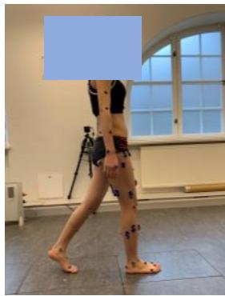

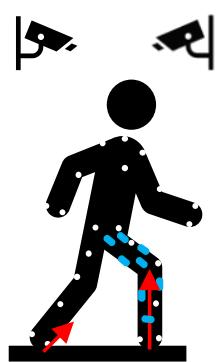  
Fig. 1. 实验设置

聚类方法已被应用于对患有和未患有运动障碍的人群的步态与动作模式进行分类 [12]–[14]、对非病理群体的肌肉激活水平进行分类 [15]，以及对前交叉韧带损伤率相同的运动员的力矩模式进行分类 [16]。聚类分析是一种根据特征相似性将观测值或模式划分为若干个聚类的统计技术。Phinyomark 等人 [13] 将跑步运动学模式聚类为两个不同的类别；他们的结果表明，跑步模式中观察到的变异性可能归因于不同的步态策略。White 等人 [15] 应用聚类分析识别了步态过程中腹部和腰部肌肉的肌肉激活模式。在我们近期关于利用 NMS 模型在步态和等速运动中估计踝关节力矩的研究中 [8]，使用多样化运动试验集校准的 NMS 模型，其预测精度低于分别使用特定运动校准的个体（Individual）模型。然而，为每种动作单独校准一个模型非常耗时，且在实时应用中并不切实际。由此产生的一个逻辑问题是，在 EMG 驱动的 NMS 模型和 LSTM 模型中，采用聚类方法进行校准是否能够获得较高的关节力矩预测精度。

本研究的目标有两个方面：(1) 基于 EMG 信号和运动学，通过基于聚类方法的 NMS 和 LSTM 模型估计踝关节背屈/跖屈（D/P）、膝关节屈曲/伸展（F/E）力矩，以及髋关节屈曲/伸展和髋关节外展/内收（Ab/Ad）力矩；(2) 比较聚类 NMS 模型与 LSTM 模型之间的预测性能。

## II. 方法

## A. 数据采集与数据处理

八名身体健全的受试者（年龄：29±4 岁；性别：4女/4男；体重：65.2±17.8 kg；身高：168.1±9.4 cm）参与了本研究。本研究获得了瑞典伦理审查局（Swedish Ethical Review Authority）的批准（参考编号：Dnr. 2020-02311）。所有受试者均签署了书面知情同意书。所有受试者被要求完成十种动作类型，每种动作至少重复 10 次（图 1），具体包括正常行走、慢速行走、快速行走、由站到坐、由坐到站、深蹲、跳上 15 cm 台阶、跳下 15 cm 台阶、垂直向上跳跃以及垂直跳跃落地。这些动作按随机顺序进行。

表面肌电（Surface EMG）信号传感器（Cometa aktos, Italy）单侧放置于胫骨前肌（tibialis anterior, TA）、腓肠肌内侧头（gastrocnemius medialis, GM）、腓肠肌外侧头（gastrocnemius lateralis, GL）、比目鱼肌（soleus, SOL）、腓骨长肌（peroneus longus, PL）、股内侧肌（vastus medialis, VM）、股外侧肌（vastus lateralis, VL）、股直肌（rectus femoris, RF）、股二头肌（biceps femoris, BF）、半腱肌（semitendinosus, ST）、阔筋膜张肌（tensor fasciae latae, TFL）、臀中肌（gluteus medius, GLME）和臀大肌（gluteus maximus, GLMA），采样频率为 1000 Hz。测试腿的选择为随机。原始 EMG 信号经过带通滤波（30-300 Hz）、整流、低通滤波（6 Hz），并归一化至所有记录试验中的最大 EMG 值 [5], [17], [18]。

使用三维动作捕捉系统（100 Hz, V16, Vicon, Oxford, UK）捕捉标记点轨迹，标记点根据 CGM2.3 标记集模型 [19] 进行贴附。使用三块测力台（1000 Hz, AMTI, MA, USA）记录地面反作用力。

通过逆运动学求解加权最小二乘问题以最小化模型标记点轨迹 $x _ { i }$ 与测量标记点轨迹 $\boldsymbol { x } _ { i } ^ { e x p }$ 之间的误差，从而估计环节和关节运动学 [20]（式 (1)）。模型标记点位置放置在与实验标记点位置相同的解剖位置（CGM2.3 标记集模型）。

$$
\min _ {q} (\sum_ {i} ^ {N} \theta_ {i} \| x _ {i} ^ {e x p} - x _ {i} \| ^ {2}),\tag{1}
$$

其中 $q$ 为模型的广义坐标，$\theta _ { i }$ 为第 $i$ 个标记点的权重。

动力学，具体而言是关节力矩，通过逆动力学计算得到；这些力矩被视为用于模型校准或训练的关节力矩真实值（ground truth）。动力学通过求解动力学运动方程计算得出 [21]（式 (2)），

$$
M (\mathbf {q}) \ddot {\mathbf {q}} + \mathbf {C} (\mathbf {q}, \dot {\mathbf {q}}) + \mathbf {G} (\mathbf {q}) + R (\mathbf {q}) \mathbf {F} ^ {\mathrm{mt}} + \mathbf {F} _ {\mathrm{e}} = 0\tag{2}
$$

其中 ${ \bf q } , \dot { \bf q } ,$ ¨q 分别代表广义位置、速度和加速度向量；$M ( \mathbf { q } ) \ddot { \mathbf { q } }$ 代表惯性力和力矩，且 $M ( \mathbf { q } )$ 表示质量矩阵；$\mathbf { C } ( \mathbf { q } , \dot { \mathbf { q } } )$ 代表向心力和科里奥利力及力矩；$\mathbf G ( \mathbf q )$ 代表重力和力矩；$R ( \mathbf { q } )$ 表示肌肉力臂；$\mathbf { F ^ { m t } }$ 代表肌腱力向量，且 $R ( \mathbf { q } ) \mathbf { F } ^ { \mathbf { m t } }$ 表示肌腱力矩向量；$\mathbf { F _ { e } }$ 代表外力和力矩。关节运动学和动力学数据均使用低通四阶零相位巴特沃斯滤波器（6 Hz）进行滤波 [22]– [24]。

## B. 关节力矩预测模型

构建了 NMS 模型和 LSTM 神经网络，仅使用采集到的 13 路 EMG 信号和关节运动学作为输入，来估计踝关节 D/P（背屈/跖屈）、膝关节 F/E（屈曲/伸展）、髋关节 F/E（屈曲/伸展）以及髋关节 Ab/Ad（外展/内收）力矩（Fig. 2）。关节运动学数据包括踝关节 D/P、膝关节 F/E、髋关节 F/E 以及髋关节 Ab/Ad 关节角度。

(a) NMS 模型

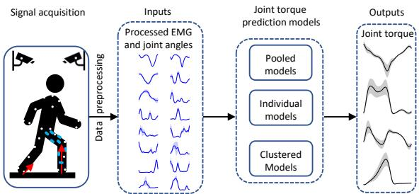  
Fig. 2. 使用不同 NMS 和 LSTM 模型进行关节力矩估计的示意图。关节力矩通过由所有动作校准/训练的汇集（Pooled）模型、由单一动作校准/训练的个体（Individual）模型，以及由单一聚类校准/训练的聚类（Clustered）模型进行估计。NMS 和 LSTM 模型的输入为从 3D 动作捕捉系统中获取并经过后处理的 EMG 信号和关节角度。

使用了一个开源的 EMG 驱动 NMS 模型（CEINMS）[25]（Fig. 3 (a)），其中包括肌肉激活动力学、肌腱运动学、肌肉收缩动力学和关节动力学 [26]。具体而言，肌肉激活动力学部分用于根据 EMG 数据计算肌肉激活度。EMG 兴奋 $e(t)$ 与神经激活度 $u(t)$ 之间的关系表示为公式 (3) [27]：

$$
u (t) = \alpha \cdot e (t - d) - \beta_ {1} \cdot u (t - 1) - \beta_ {2} \cdot u (t - 2)\tag{3}
$$

其中 $\alpha$ 表示肌肉增益变量；$d$ 对应机电延迟。$\beta _ { 1 }$ 和 $\beta _ { 2 }$ 表示递归变量；为了获得稳定解，它们被约束为 $\beta _ { 1 } = C _ { 1 } + C _ { 2 } , \beta _ { 2 } = C _ { 1 } \cdot C _ { 2 }$，其中 $\left| C _ { 1 } \right| < 1 , \left| C _ { 2 } \right| < 1$，且 $\alpha - \beta _ { 1 } - \beta _ { 2 } = 1$ [25] [27] [28]。肌肉激活度 $a(t)$ 可表示为公式 (4)：

$$
a (t) = \frac {e ^ {A u (t)} - 1}{e ^ {A} - 1}\tag{4}
$$

其中 $A$ 为形状因子 [18], [28]。

肌腱运动学部分计算肌腱长度和力臂。肌力通过肌肉收缩动力学部分使用 Hill 型肌肉模型来确定。肌力 $F$ 可表示为公式 (5)：

$$
F = F _ {0} ^ {m} [ F _ {a l} (l) \cdot F _ {v} (v) \cdot a + F _ {p l} (l) + d _ {p} \cdot v ] c o s (\theta)\tag{5}
$$

其中 $F _ { 0 } ^ { m }$ 表示肌肉最大等长肌力；$l$ 为肌纤维长度；$F _ { a l } ( l )$ 描述肌肉主动力与肌纤维长度的关系；$v$ 为肌纤维收缩速度；$F _ { v } ( v )$ 表示肌力与肌纤维收缩速度的关系；$F _ { p l } ( l )$ 表示肌肉被动力与肌纤维长度的关系；$\theta$ 为肌纤维羽状角，$d _ { p }$ 表示肌肉阻尼。

最后，关节动力学部分用于根据肌力和力臂计算关节力矩。

EMG 驱动的 NMS 模型中的参数校准根据 Pizzolato 等人 [25] 的建议进行。对于每位参与者，最佳肌纤维长度 $l _ { 0 } ^ { m }$ 和肌腱松弛长度 $l _ { s } ^ { t }$ 被限制在其初始值的 $\pm 1 5 \%$ 范围内。参数 A 被限制在区间 (−3, 0) 内，而系数 $C _ { 1 }$ 和 $C _ { 2 }$ 被限制在 (−1, 1) 内。为了校准最大等长肌力，采用了强度系数，该系数被限制在 0.5 至 2.5 的范围内。这些参数通过应用模拟退火算法来确定，该算法在整个校准过程中最小化估计关节力矩与测量关节力矩（通过逆动力学计算）之间的差异。模拟退火算法设置为运行至目标函数值的平均变化量小于指定的容差 $1 0 ^ { - 5 }$ 为止。

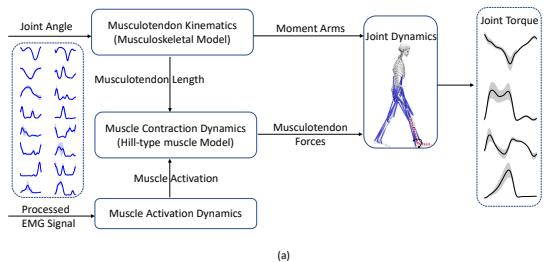

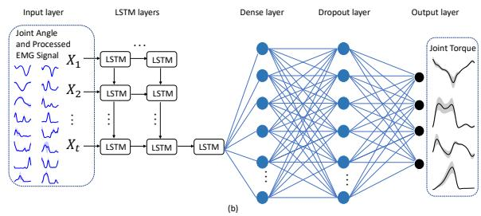  
Fig. 3. (a) 包含四个部分的 NMS 模型结构示意图：(1) 肌肉激活力学部分，利用 EMG 数据计算肌肉激活度；(2) 肌腱运动学部分，计算肌腱长度和力臂；(3) 肌肉收缩动力学部分，用于计算肌肉力；以及 (4) 关节动力学部分，用于计算关节力矩。(b) LSTM 网络模型结构示意图。LSTM 网络的输入与 NMS 模型的输入相同，即关节角度和 EMG 信号。时间序列输入被转换为时间切片数据以供下一 LSTM 层使用。随后添加了 LSTM 层，接着是全连接层（dense layer）和 dropout 层。最后，输出层预测关节力矩。

## (b) LSTM 网络

使用与 NMS 模型相同的输入数据（即 EMG 和关节角度），构建了 LSTM 网络以估计关节力矩 (Fig. 3 (b)) [25]。时间序列输入被转换为时间切片数据以供下一 LSTM 层使用。随后添加了 LSTM 层，接着是全连接层和 dropout 层。应用 dropout 层以避免过拟合，而全连接层则利用 LSTM 层的中间变量在整个回归阶段辅助关节力矩估计 [29]。最后，输出层预测关节力矩。

为了确定 LSTM（长短期记忆网络）的超参数，我们采用了“由粗到细”（Coarse-to-fine）的随机搜索方法 [30]。采用了带零偏置的 Xavier 权重初始化方法，并选择了 50 的批大小（batch size）。每个 LSTM 层配置了 50 个神经元，并应用了 tanh 激活函数。全连接层（dense layer）选择了 64 个神经元。Dropout 层的丢弃率设置为 0.4。在整个训练过程中，损失函数定义为预测关节力矩与测量关节力矩之间的均方误差。Adam 优化器的学习率设置为 $1 0 ^ { - 3 }$。最佳模型训练了 4000 个 epoch；然而，如果预测精度在连续 50 个 epoch 内未得到改善，则会提前终止训练。

## C. 聚类方法

使用 EMG（肌电）信号和关节角度作为输入，我们应用了 t-分布随机邻域嵌入（t-SNE）[31] 聚类方法来降低数据维度。随后，我们使用 K-means 算法 [32] 将不同的动作类型划分为 K 个互不相同的聚类簇。

t-SNE 是一种非常有价值的技术，因为它在将高维数据转换为低维空间的同时保持了数据的局部结构。假设 $\mathbf { x } _ { i }$ 和 $\mathbf { x } _ { j }$ 表示高维空间中的两个数据点。定义为 $p _ { j | i }$ 的它们之间的相似度由以下公式给出：

$$
p _ {j | i} = \frac {\exp (- | | \mathbf {x} _ {i} - \mathbf {x} _ {j} | | ^ {2} / 2 \sigma_ {i} ^ {2})}{\sum_ {k \neq i} \exp (- | | \mathbf {x} _ {i} - \mathbf {x} _ {k} | | ^ {2} / 2 \sigma_ {i} ^ {2})}\tag{6}
$$

其中 $\sigma _ { i }$ 表示以 $\mathbf { x } _ { i }$ 为中心的高斯分布的方差。

t-SNE 算法最小化上述两个分布之间的 Kullback-Leibler 散度（记为 $C ,$）。这种最小化是通过应用梯度下降来实现的，如公式 (7) 所示：

$$
C = \sum_ {i} \sum_ {j} p _ {j | i} \log {\frac {p _ {j | i}}{q _ {j | i}}}\tag{7}
$$

## D. 评估方案

我们在三种情况下研究了 NMS（神经肌肉骨骼）和 LSTM 模型的下肢关节力矩预测精度：汇总（Pooled）、个体（Individual）和聚类（Clustered）模型。我们比较了聚类模型中 NMS 与 LSTM 之间的预测精度。

• 汇总模型（Pooled model，n = 1）：使用来自所有十种动作的 80% 数据来训练一个汇总 LSTM 模型。同时，汇总 NMS 模型使用每种包含动作的一个试验（trial）进行校准，随后在与 LSTM 模型相同的数据集上进行评估。具体而言，80% 的数据对应于用于模型训练的 10 次试验中的 8 次。

• 独立模型（Individual models，$( n = 1 0 )$）：使用每种动作的 80% 数据来训练十个独立的 LSTM 模型。同时，NMS 模型使用每种动作的三次试验进行校准，并在与 LSTM 模型相同的数据集上进行评估。

• 聚类模型（Clustered models，n = 3）：使用每个聚类中 80% 的数据来训练三个聚类 LSTM 模型。同时，使用每个聚类的两次试验对 NMS 模型进行校准，并在与 LSTM 模型相同的数据集上进行评估。

归一化均方根误差（NRMSE）$E _ { N R M S }$ 用于评估每个模型的估计误差；低估计误差被视为高估计精度。NRMSE 确立为估计力矩与测量/实际力矩之间的均方根误差 ERMS，并通过相应运动期间观察到的关节力矩范围进行归一化：

  
Fig. 4. 通过 t-分布随机邻域嵌入算法在二维空间中识别出的 $K \ : = \ : 3$ 个聚类的示意图。

$$
E _ {R M S} = \sqrt {\frac {1}{N} \sum_ {n = 1} ^ {N} (y _ {e , n} - y _ {n}) ^ {2}}\tag{8}
$$

$$
E _ {N R M S} = \frac {E _ {R M S}}{(y _ {m a x} - y _ {m i n})} \times 100\%\tag{9}
$$

其中 $y _ { e , n }$ 和 $y _ { n }$ 分别表示估计力矩和测量/实际力矩；$y _ { m a x }$ 和 $y _ { m i n }$ 分别是相应动作中的最大和最小实际力矩。为了评估数据分布的正态性，进行了 Shapiro-Wilk 检验（显著性水平为 $p < 0 . 0 5$）。随后，对三种方法预测的 NRMSE 进行了成对比较。对符合正态分布的数据应用配对 t 检验，对不服从正态分布的数据采用 Wilcoxon 符号秩检验，两种情况均采用 Bonferroni 校正（显著性水平为 $p < 0 . 0 5$）。

## III. 结果

## A. 运动聚类

结合 K-means 的 t-SNE 算法在十种运动中识别出了三个聚类。t-SNE 算法对数据进行了降维，从而能够在二维空间中进行可视化（Fig. 4）。随后，K-means 将每种运动的样本划分为三个聚类：$K _ { 1 }$ 包含正常行走、慢速行走和快速行走；$K _ { 2 }$ 包含站立到坐下、垂直跳跃落地和深蹲；$K _ { 3 }$ 包括坐下到站立、垂直向上跳跃、向上跳上 15-cm 台阶以及从 15-cm 台阶向下跳。采用运动样本的中位数位置，根据相关性将其分配到相应的聚类中。K-means 中聚类数 K 的选择以及每个聚类的命名均通过视觉检查确定，从而确保了运动分组的合理性与可解释性。

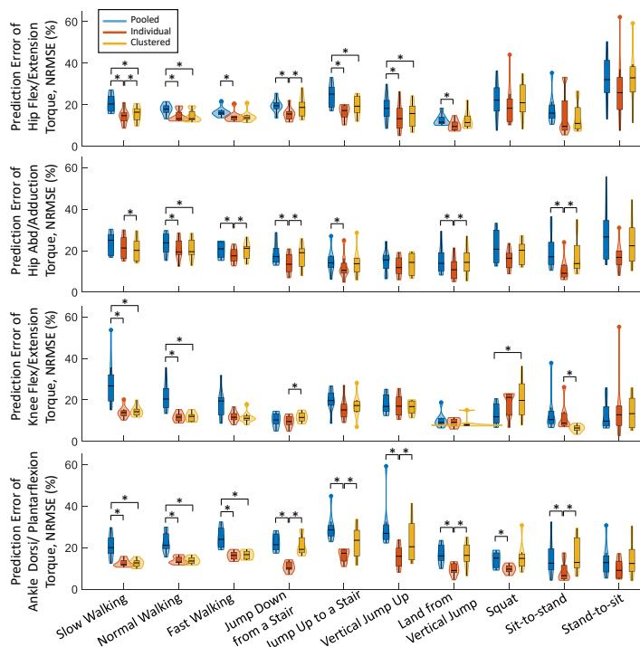  
Fig. 5. 各受试者在十种动作下，NMS 模型（Pooled、Individual 和 Clustered）中预测力矩与实际力矩之间的 NRMSE 分布小提琴图。每个小提琴图均包含一个核密度图和一个箱线图。核密度图展示了 NRMSE 的概率分布。箱线图表示 NRMSE 的最小值、下四分位数、中位数、上四分位数和最大值。∗ 表示两种模型之间存在显著性差异（由成对比较确定）。

## B. NMS 模型

总体而言，在行走动作和垂直纵跳中，Individual 模型与 Clustered 模型的估计精度相近。在大多数动作中，即行走动作、坐立转换、垂直纵跳以及跳上台阶中，Pooled 模型的估计精度远低于 Clustered 和 Individual 模型（Fig. 5）。

在不同速度的步态中，Individual 和 Clustered 模型预测踝关节 D/P 关节力矩的精度均显著高于 Pooled 模型（Fig. 5，慢速行走：$p < 0 . 0 1$ 和 $p = 0 . 0 1$；正常行走：$p < 0 . 0 1$ 和 $p \ < \ 0 . 0 1 ;$；快速行走：$p ~ < ~ 0 . 0 1$ 和 $p ~ < ~ 0 . 0 1 )$。在不同速度步态的踝关节 D/P 力矩预测中，与 Individual 和 Clustered 模型相比，Pooled 模型低估了最大跖屈力矩。此外，三种模型均预测出摆动相期间存在跖屈偏差（Fig. 6）。在其他动作中，与 Pooled 模型相比，Individual 模型在垂直纵跳 $( p = 0 . 0 4 )$、跳上台阶 $( p = 0 . 0 4 )$、跳下台阶 $( p < 0 . 0 1 )$ 以及深蹲 $( p = 0 . 0 5 )$ 中表现出显著更高的估计精度，而 Clustered 模型的精度也有所提高，但差异不显著。

在不同速度的步态（NRMSE $P o o l e d \le 2 6 . 7 \%$，Individual $\leq 1 3 . 9 \%$ 且 Clustered ≤ 14.3%）、跳上台阶（NRMSE P ooled $\leq ~ 1 9 . 7 \%$、Individual $\leq ~ 1 5 . 2 \%$ 且 Clustered $\leq ~ 1 7 . 3 \% )$ 以及坐立转换（NRMSE $P o o l e d \leq 1 0 . 5 \%$、$I n d i v i d u a l \ \leq \ 8 . 8 \%$ 且 $C l u s t e r e d \ \leq \ 6 . 8 \% )$ 中，Individual 和 Clustered 模型预测膝关节 F/E 关节力矩的精度相对均高于 Pooled 模型（Fig. 5）。与 Clustered 和 Individual 模型不同，Pooled 模型在高低不同步速的摆动前期至摆动早期高估了膝关节伸展力矩，并在坐立转换中低估了膝关节伸展力矩（Fig. 6）。所有模型均未能预测出深蹲过程中平滑的膝关节伸展力矩，且 Individual 模型在站坐转换动作中未能准确预测膝关节伸展力矩。

对于所有动作，Individual（个体）模型和 Clustered（聚类）模型在髋关节 F/E 和髋关节 Ab/Ad 上的关节力矩估计精度总体上低于膝关节 F/E 和踝关节 D/P：十种动作下的髋关节 F/E（十种动作的中位数 NRMSE：Individual 为 14.4%；Clustered 为 16.1%）和髋关节 Ab/Ad 力矩（Individual 为 14.9%，Clustered 为 19.3%）与膝关节 F/E（Individual 为 12.2%，Clustered 为 12.7%）和踝关节 D/P（Individual 为 11.0%，Clustered 为 15.5%）相比。在踝关节 D/P 关节力矩预测中，与其他三个关节（膝关节 F/E 为 14.4%，髋关节 F/E 为 18.9%，髋关节 Ab/Ad 为 18.9%）相比，Pooled（汇总）模型的预测精度较低（中位数 NRMSE 为 20.6%）。

值得注意的是，在深蹲和由站至坐动作中（Fig. 5），Individual 模型在膝关节 F/E 力矩上的平均预测精度低于 Pooled 和 Clustered 模型，但在 Individual 模型中观察到了具有较高预测误差的异常值。此外，与 Pooled 和 Clustered 模型相比，Individual 模型预测的膝关节 F/E 和髋关节 F/E 力矩与测量力矩的一致性较差（Fig. 6）。

## C. LSTM 模型

总体而言，所有三种模型（Pooled、Individual 和 Clustered，Fig. 7）的估计精度相似，且在十种动作中估计的关节力矩均与实际力矩吻合良好（Fig. 8）。

在不同关节的力矩预测模型中（Fig. 7），Pooled、Individual 和 Clustered 模型均能以相对较低的误差准确估计关节力矩（髋关节 F/E 的 NRMSE：Pooled $\leq 8 . 4\%$ ，Individual ≤ 9.2%，Clustered ≤ 8.2%；髋关节 Ab/Ad：Pooled $\leq ~ 9 . 3\%$ ，Individual $\leq ~ 8 . 9\%$ ，Clustered $\begin{array} { r l } { \leq } & { { } 8 . 6 \% ; } \end{array}$ 膝关节 F/E：Pooled $\leq ~ 5 . 5\%$ ，Individual $\leq 6 . 0 \% ,$ ，Clustered $\leq 6 . 1 \% ;$ 踝关节 D/P：$P o o l e d \ \leq \ 9 . 4\%$ ，Individual $\leq 8 . 5\%$ ，Clustered ≤ 9.0%），尤其是步态动作（NRMSE 踝关节 D/P：$\leq 4 . 2\%$ ；膝关节 $\mathrm { F / E } \colon \le 6 . 1 \% \ ;$ ；髋关节 $\mathrm { F / E } \leq 3 . 8 \% $ ；髋关节 Ab/Ad $\leq 5 . 7 \% )$。

## D. NMS 与 LSTM Clustered 模型对比

总体而言，与 NMS Clustered 模型相比，LSTM Clustered 模型的力矩预测在所有关节和动作测试中均表现出与逆向动力学计算力矩更优的一致性（Fig. 9）；十种动作的中位数 NRMSE 分别为：髋关节 F/E：NMS 为 16.1%，LSTM 为 4.9%；髋关节 Ab/Ad：NMS 为 19.3%，LSTM 为 4.7%；踝关节 D/P：NMS 为 15.5%，$L S T M : 6 . 7\%$ 。同样，LSTM 模型预测的膝关节 F/E 力矩与逆向动力学计算力矩的一致性显著优于 NMS 模型，对于

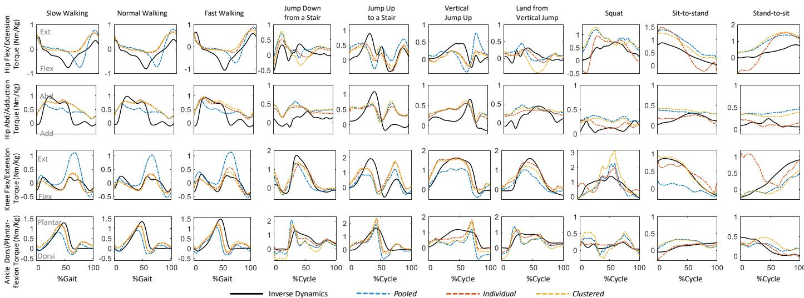  
Fig. 6. 三种 NMS 模型（Pooled、Individual 和 Clustered）在十种动作中测量力矩与预测力矩的一个示例试验。

$$
(p = 0. 1 6).
$$

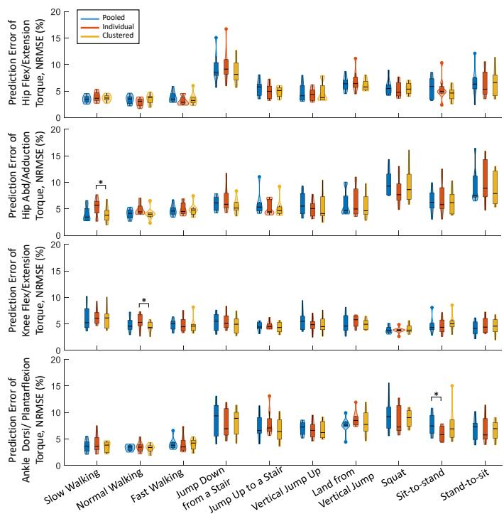  
Fig. 7. 在 LSTM 模型中各受试者十种动作期间预测力矩与实际力矩之间的 NRMSE 分布，以小提琴图展示：汇总（Pooled）、个体（Individual）和聚类（Clustered）。每个小提琴图包含一个核密度图和一个箱线图。核密度图说明了 NRMSE 的概率分布。箱线图表示 NRMSE 的最小值、下四分位数、中位数、上四分位数和最大值。∗ 表示两种模型之间存在显著差异，由成对比较确定。

大多数动作，包括慢速行走 $( p < 0 . 0 1 )$、正常行走 $( p < 0 . 0 1 )$、快速行走 $( p = 0 . 0 1 )$、从台阶跳下 $( p \ < \ 0 . 0 1 )$、跳上台阶 $( p \ < \ 0 . 0 1 )$、垂直向上跳 $( p \ < \ 0 . 0 1 )$、垂直跳落地 $( p \ < \ 0 . 0 1 )$、深蹲 $( p = 0 . 0 3 )$ 以及从站到坐 $( p < 0 . 0 1 )$，并且在一定程度上（尽管不显著）与从坐到站的一致性更好

## IV. 讨论

我们使用两种常用的预测方法——EMG（肌电）驱动的 NMS（神经肌肉骨骼）模型和 LSTM 神经网络——估计了十种动作的踝关节、膝关节和髋关节矢状面力矩，以及髋关节额状面力矩，并评估了与基于单个动作或汇总动作的模型相比，基于特征相似性对动作进行分组的聚类方法是否能够提高预测精度。我们观察到，对于 LSTM 神经网络模型，聚类方法的预测精度并未高于个体模型或汇总模型；这三种方法预测的力矩均与逆动力学结果非常吻合。总体而言，NMS 模型的预测精度低于 LSTM 模型。在 NMS 模型中，聚类方法在某些动作中的预测精度确实高于汇总模型。尽管个体和聚类 NMS 模型的预测性能相似，但汇总模型的预测精度最低。据我们所知，这是首项在日常活动中结合 NMS 模型和 LSTM 神经网络并采用聚类方法来描述多下肢关节力矩预测的研究。

一个有趣的发现是，聚类方法并没有提高 LSTM 神经网络的预测精度，但在某些动作中确实提高了 NMS 汇总模型的预测精度。聚类和个体 NMS 模型具有相似的关节力矩预测精度，但汇总模型的预测精度较低，并且在不同速度的步态中预测出了更高的伸膝峰值力矩和更低的跖屈峰值力矩（Fig. 6）。这证实了同一聚类内的动作具有相似的协调模式，并且 NMS 模型可以捕获这些特征以获得更好预测精度的观点。在汇总、个体和聚类 NMS 模型中，肌腱单元参数，如

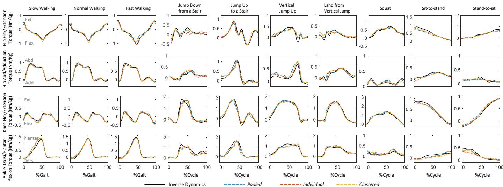

Fig. 8. 通过三种 LSTM 模型（Pooled、Individual 和 Clustered）在十种动作中测量力矩与预测力矩的一个示例试验。  
  
Fig. 9. NMS 和 LSTM Clustered 模型中受试者在十种动作期间预测力矩与实际力矩之间的 NRMSE 分布小提琴图。每个小提琴图均包含一个核密度图和一个箱线图。核密度图展示了 NRMSE 概率分布。箱线图表示 NRMSE 的最小值、下四分位数、中位数、上四分位数和最大值。∗ 表示两种模型之间存在显著性差异（通过成对比较确定）。

如肌腱松弛长度（tendon slack length）、最佳肌纤维长度（optimal fiber length）、形状因子（shape factor）和强度系数（strength coefficient），均使用来自不同动作类型的试验进行校准。在校准过程中，通过最小化所有纳入的校准试验中估计力矩与测量力矩之间的误差来优化这些参数。因此，校准后的 Pooled NMS 可能过于通用，无法满足所有的动作模式。这些发现的实际意义在于，在某些应用中，为每个动作分别创建和训练独立的 NMS 模型可能并不现实；对动作进行聚类有助于构建更实用的工作流程，且优于将所有动作汇合在一起的方法。

相比之下，Individual 和 Pooled LSTM 模型已经具备了非常高的力矩预测精度，而聚类方法通常既没有更高也没有更低的精度。所有 LSTM 模型均使用来自用于训练模型的同类动作的未见“新”数据进行评估。通常，当使用同类型数据进行模型的训练和评估时，深度学习通常有望展现出出色的预测性能。所设计的具有多个神经元和网络层的 LSTM 网络能够选择性地记住对应于某一时间间隔的模式；并且它能够识别 EMG 数据与关节力矩之间复杂的非线性关联。因此，无论网络是由 Pooled、Clustered 还是 Individual 模型构成，LSTM 网络都可以在同类动作的未见“新”数据中准确估计关节力矩。

需要指出的是，Individual 和 Clustered NMS 模型在髋关节 F/E 和髋关节 Ab/Ad 力矩上的预测误差通常高于膝关节 F/E 和踝关节 D/P。造成这一现象的一个原因可能归因于在实验中难以采集髋关节周围分层肌肉和深层肌肉的表面肌电（surface EMGs）。这一发现与 Pizzolato 等人 [25] 的结论一致，他们将与膝关节和踝关节力矩相比矢状面髋关节力矩较低的预测精度和低估现象，归因于难以获取可靠的髂腰肌表面肌电信号。还值得注意的是，尽管逆动力学通常被视为计算关节力矩的金标准，但它也可能并不完全准确，尤其是在更近端的关节处。在逆动力学方法中，对任何关节中心的估计都至关重要，因为它用于计算肌肉的力臂，并作为关节发生旋转的中心点。然而，准确估计髋关节中心通常被认为比估计膝关节和踝关节中心更具挑战性，因为髋关节位置更深，且更难以用生物力学模型进行表征。同样需要注意的是，在站立到坐下（stand-to-sit）过程中，与 Pooled 和 Clustered 模型相比，Individual 模型在髋关节 F/E 和膝关节 F/E 力矩中出现了预测误差更高的异常值。这可能归因于 Individual 校准模型中的过拟合，即微小的输入差异会导致巨大的输出差异。因此，在使用个体模型时，需要警惕过拟合风险。

在所有动作测试中，LSTM 模型预测的力矩相较于 NMS 模型更接近通过逆动力学（inverse dynamics）计算出的数值。在 LSTM 网络中，每个节点都被视为一个人造神经元，用于模拟人脑中的神经突触系统。这赋予了 LSTM 网络理解复杂非线性信息的强大能力。然而，它将输入与输出之间的相关性作为一个黑盒进行学习，并未显式地对生理变量之间的关系进行建模，例如关节角度-肌腱运动学、肌肉力-长度以及肌肉力-速度的关系。因此，该模型仅适用于估计指定的目标输出。尽管 NMS 模型的预测精度低于 LSTM 模型，但它能够分析并辨识受试者特异性的肌腱参数与关系。因此，对于需要受试者特异性肌腱参数及关系的应用场景，基于 NMS 模型的方法显然更为合适。若能将 NMS 模型中定义的关系与神经网络结构相结合，所构建的模型不仅具有已定义的肌腱特性和关系的优势，其预测精度还可能高于两类衍生模型中的任何一种 [7], [33], [34]。因此，在未来的工作中，探索结合 NMS 特征与 LSTM 模型的物理信息神经网络（physics-informed neural network）方法的潜力，以增强神经网络方法的外推能力，将是非常值得研究的方向。

如前所述，获取关节力矩的真实值（ground truth）并非易事。通过逆动力学估计的关节力矩并不是体内实际产生的关节力矩的直接测量值。我们通过利用运动学数据求解动力学运动方程（公式 (2)）来实现逆动力学方法。运动学数据（关节角度）是通过逆向运动学方法获取的，该方法通过求解加权最小二乘问题，以最小化模型标记点轨迹与测量标记点轨迹之间的误差。由于测量和建模误差，该方法可能会导致动力学不一致性，从而产生不符合肌肉动力学的关节力矩 [35], [36]。尽管存在这些局限性，通过逆动力学方法计算出的关节力矩仍是目前动态任务中最接近真实关节力矩的估计值。同样值得注意的是，NMS 模型的模型训练过程与 LSTM 模型并不具有直接可比性，特别是汇合（Pooled）NMS 模型仅使用每种动作的一个试验进行训练，而 LSTM 则使用了 80% 的数据进行训练。Pooled NMS 模型的部分预测误差可能归因于 EMG（肌电）和动力学测量中的变异性。同样地，其在个体化（Individualized）模型中的性能提升也可能归因于多样化的训练数据。

虽然本研究尚未评估 LSTM 网络的实时计算成本，但在理论上它能够以较低的计算成本实时预测关节力矩，因为其仅需要前向推断（forward evaluation）[37]–[39]。值得注意的是，对于单个受试者，应当仅存在一个经过校准的 NMS（神经肌肉骨骼）模型，并尽可能覆盖力-长度曲线的较宽范围。理想情况下，应确定覆盖全范围的动作子集，但我们的主要重点并非实现这一点。我们将所有动作都纳入校准，正如 Pooled 模型所示，其效果应该与子集类似。然而，我们观察到了不尽人意的表现，这可能是由于排除了其他用于校准肌腱参数的重要实验测量数据（如肌纤维长度和羽状角）。在动态运动中测量这些参数极具挑战性，且 Pooled 模型可能不适合捕捉所有的肌肉协同模式。我们的主要目标是获得用于预测关节力矩的高精度模型，为了实现这一目标，我们探索了多种数学方法，包括分别校准不同模型、对其进行聚类以及汇总（pooling）。我们还将这些方法与 LSTM 模型进行了比较。尽管这可能与物理机理视角不完全一致，但从数学角度来看，这是获得训练效果更好的模型的一种实用方法。

尽管我们的目标是获得能够高精度预测关节力矩的模型，但我们尚未在实际场景中（具体指外骨骼控制）应用这些模型。后续仍需开展进一步工作，例如选择合适的方法/传感器来采集 EMG（肌电）和运动学数据、根据应用需求训练模型，以及针对实时处理优化模型。随后，所开发的模型需要集成到外骨骼的控制系统中，从而为关节运动提供按需辅助（assist-as-needed）支持。本研究为在不同场景下选择合适的模型提供了指导原则，有望改进外骨骼的控制策略并提升可穿戴外骨骼的功能。

我们在此仅研究了一种 NMS（神经肌肉骨骼）模型和一种机器学习模型方法（即 LSTM），我们的研究结果应在此背景下进行考量。其他 NMS 模型，甚至当前使用的 NMS 中不同的参数和复杂程度（例如机电延迟和肌腱类型），都值得进一步探究。此外，还可以对具有复杂架构的其他不同机器学习模型（例如卷积神经网络）进行评估。实验方案的某些方面可能会影响研究结果的通用性，例如在涉及坐姿的测试中根据每位参与者的身高调整椅子高度。此外，尽管我们对所有参与者使用了标准化的指导语，但参与者在动作技巧（例如深蹲和跳跃动作）方面可能仍存在细微差异，从而可能导致肌肉激活模式的差异。另外，本研究仅纳入了健全个体，而主要关注的目标群体（即外骨骼使用者）则主要由运动障碍人群组成。再者，健全参与者在年龄和整体身体状况方面普遍具有较高的同质性。

## V. 结论

在本研究中，我们利用基于物理学的 NMS 模型以及结合聚类方法的 LSTM 神经网络，预测了多种不同运动过程中踝关节、膝关节和髋关节矢状面力矩以及髋关节额状面力矩。聚类方法并未提高 LSTM 神经网络的预测精度（其本身已处于较高水平），但在某些运动中确实提高了 NMS 合并（Pooled）模型的精度。在 NMS 模型中，个体化（Individual）模型和聚类（Clustered）模型具有相似的预测性能，但合并模型可能过于通用，无法满足所有的运动模式。在针对每种运动建立独立 NMS 模型不切实际的应用场景中，运动聚类方法可作为合并运动模型的良好替代方案。总体而言，基于物理的神经肌肉骨骼模型与神经网络模型在预测下肢多个自由度（DOFs）及一系列运动中的力矩时的详细对比性能，可为特定情况下预测模型的优选范式提供有价值的指导，因此在通过考虑使用者的生理关节力矩贡献来实现按需辅助外骨骼控制等应用中展现出巨大前景。

## 参考文献

[1] Z. Li, G. Li, X. Wu, Z. Kan, H. Su, and Y. Liu, “Asymmetric cooperation control of dual-arm exoskeletons using human collaborative manipulation models,” IEEE Transactions on Cybernetics, vol. 52, no. 11, pp. 12 126–12 139, 2021.

[2] D. Coyle, “Neural network based auto association and time-series prediction for biosignal processing in brain-computer interfaces,” IEEE Computational Intelligence Magazine, vol. 4, no. 4, pp. 47–59, 2009.

[3] P. B. Jephil, P. Acharaya, L. Xu, K. Guo, H. Yu, M. Watsford, S. Rong, and S. Su, “基于sEMG信号的辅助康复机器人踝关节力矩与角度估计 (Estimation of ankle joint torque and angle based on semg signal for assistive rehabilitation robots),” in Biomedical Signal Processing. Springer, 2020, pp. 31–47.

[4] G. Durandau, D. Farina, G. Asín-Prieto, I. Dimbwadyo-Terrer, S. Lerma-Lara, J. L. Pons, J. C. Moreno, and M. Sartori, “轻瘫患者通过神经力学建模对可穿戴机器人外骨骼的自主控制 (Voluntary control of wearable robotic exoskeletons by patients with paresis via neuromechanical modeling),” Journal of Neuroengineering and Rehabilitation, vol. 16, no. 1, p. 91, 2019.

[5] M. Sartori, D. G. Lloyd, and D. Farina, “面向个性化神经康复技术的神经数据驱动肌肉骨骼建模 (Neural data-driven musculoskeletal modeling for personalized neurorehabilitation technologies),” IEEE Transactions on Biomedical Engineering, vol. 63, no. 5, pp. 879–893, 2016.

[6] C. Pizzolato, D. J. Saxby, D. Palipana, L. E. Diamond, R. S. Barrett, Y. D. Teng, and D. G. Lloyd, “用于脊髓损伤后康复的基于神经肌肉骨骼建模的假肢 (Neuromusculoskeletal modeling-based prostheses for recovery after spinal cord injury),” Frontiers in Neurorobotics, vol. 13, pp. 1–10, 2019.

[7] M. Ezati, B. Ghannadi, and J. McPhee, “人体运动动力学仿真方法综述——重点关注步态 (A review of simulation methods for human movement dynamics with emphasis on gait),” Multibody System Dynamics, vol. 47, no. 3, pp. 265–292, 2019.

[8] L. Zhang, Z. Li, Y. Hu, C. Smith, E. M. G. Farewik, and R. Wang, “基于肌电驱动神经肌肉骨骼模型和人工神经网络模型的踝关节力矩估计 (Ankle joint torque estimation using an emg-driven neuromusculoskeletal model and an artificial neural network model),” IEEE Transactions on Automation Science and Engineering, vol. 18, no. 2, pp. 564–573, 2020.

[9] Y.-F. Chen, R. Fu, J. Wu, J. Song, R. Ma, Y.-C. Jiang, and M. Zhang, “基于脑电信号的协调运动连续双手轨迹解码 (Continuous bimanual trajectory decoding of coordinated movement from eeg signals),” IEEE Journal of Biomedical and Health Informatics, vol. 26, no. 12, pp. 6012–6023, 2022.

[10] Y. Hu, G. Chen, Z. Li, and A. Knoll, “面向稳定非线性动力学系统的自然进化策略机器人策略改进 (Robot policy improvement with natural evolution strategies for stable nonlinear dynamical system),” IEEE Transactions on Cybernetics, vol. 53, no. 6, pp. 4002–4014, 2022.

[11] L. Zhang, D. Soselia, R. Wang, and E. M. Gutierrez-Farewik, “基于LSTM神经网络和迁移学习的下肢关节力矩预测 (Lowerlimb joint torque prediction using lstm neural networks and transfer learning),” IEEE Transactions on Neural Systems and Rehabilitation Engineering, vol. 30, pp. 600–609, 2022.

[12] E. B. Simonsen and T. Alkjær, “正常人行走的变异性问题 (The variability problem of normal human walking),” Medical Engineering & Physics, vol. 34, no. 2, pp. 219–224, 2012.

[13] A. Phinyomark, S. Osis, B. A. Hettinga, and R. Ferber, “健康跑步者的运动学步态模式：层次聚类分析 (Kinematic gait patterns in healthy runners: A hierarchical cluster analysis),” Journal of Biomechanics, vol. 48, no. 14, pp. 3897–3904, 2015.

[14] S. Kinsella and K. Moran, “伴有足部马蹄足畸形的中风受试者的步态模式分类 (Gait pattern categorization of stroke participants with equinus deformity of the foot),” Gait & Posture, vol. 27, no. 1, pp. 144–151, 2008.

[15] S. G. White and P. J. McNair, “步态过程中的腹肌和竖脊肌活动：利用聚类分析识别活动模式 (Abdominal and erector spinae muscle activity during gait: the use of cluster analysis to identify patterns of activity),” Clinical Biomechanics, vol. 17, no. 3, pp. 177–184, 2002.

[16] H. B. Sigurðsson and K. Briem, “Cluster analysis successfully identifies clinically meaningful knee valgus moment patterns: frequency of early peaks reflects sex-specific acl injury incidence,” Journal of Experimental Orthopaedics, vol. 6, no. 1, pp. 1–12, 2019.

[17] C. Pizzolato, M. Reggiani, L. Modenese, and D. Lloyd, “Real-time inverse kinematics and inverse dynamics for lower limb applications using opensim,” Computer Methods in Biomechanics and Biomedical Engineering, vol. 20, no. 4, pp. 436–445, 2017.

[18] H. X. Hoang, C. Pizzolato, L. E. Diamond, and D. G. Lloyd, “Subjectspecific calibration of neuromuscular parameters enables neuromusculoskeletal models to estimate physiologically plausible hip joint contact forces in healthy adults,” Journal of Biomechanics, vol. 80, pp. 111–120, 2018.

[19] F. Leboeuf, R. Baker, A. Barré, J. Reay, R. Jones, and M. Sangeux, “The conventional gait model, an open-source implementation that reproduces the past but prepares for the future,” Gait & Posture, vol. 69, pp. 235– 241, 2019.

[20] T.-W. Lu and J. O’connor, “Bone position estimation from skin marker co-ordinates using global optimisation with joint constraints,” Journal of Biomechanics, vol. 32, no. 2, pp. 129–134, 1999.

[21] M. G. Pandy, “Computer modeling and simulation of human movement,” Annual Review of Biomedical Engineering, vol. 3, no. 1, pp. 245–273, 2001.

[22] D. A. Winter, H. G. Sidwall, and D. A. Hobson, “Measurement and reduction of noise in kinematics of locomotion,” Journal ofBiomechanics, vol. 7, no. 2, pp. 157–159, 1974.

[23] A. Mantoan, C. Pizzolato, M. Sartori, Z. Sawacha, C. Cobelli, and M. Reggiani, “Motonms: A matlab toolbox to process motion data for neuromusculoskeletal modeling and simulation,” Source Code for Biology and Medicine, vol. 10, no. 1, pp. 1–14, 2015.

[24] T. R. Derrick, A. J. van den Bogert, A. Cereatti, R. Dumas, S. Fantozzi, and A. Leardini, “Isb recommendations on the reporting of intersegmental forces and moments during human motion analysis,” Journal of Biomechanics, vol. 99, pp. 1–10, 2020.

[25] C. Pizzolato, D. G. Lloyd, M. Sartori, E. Ceseracciu, T. F. Besier, B. J. Fregly, and M. Reggiani, “Ceinms: A toolbox to investigate the influence of different neural control solutions on the prediction of muscle excitation and joint moments during dynamic motor tasks,” Journal of Biomechanics, vol. 48, no. 14, pp. 3929–3936, 2015.

[26] M. Sartori, M. Reggiani, D. G. Lloyd, and E. Pagello, “A neuromusculoskeletal model of the human lower limb: Towards emg-driven actuation of multiple joints in powered orthoses,” in 2011 IEEE International Conference on Rehabilitation Robotics. IEEE, 2011, pp. 1–6.

[27] D. G. Lloyd and T. F. Besier, “An emg-driven musculoskeletal model to estimate muscle forces and knee joint moments in vivo,” Journal of Biomechanics, vol. 36, no. 6, pp. 765–776, 2003.

[28] T. S. Buchanan, D. G. Lloyd, K. Manal, and T. F. Besier, “Neuromusculoskeletal modeling: estimation of muscle forces and joint moments and movements from measurements of neural command,” Journal ofApplied Biomechanics, vol. 20, no. 4, pp. 367–395, 2004.

[29] N. Srivastava, G. Hinton, A. Krizhevsky, I. Sutskever, and R. Salakhutdinov, “Dropout: a simple way to prevent neural networks from overfitting,” The Journal of Machine Learning Research, vol. 15, no. 1, pp. 1929–1958, 2014.

[30] J. Bergstra and Y. Bengio, “Random search for hyper-parameter optimization.” Journal of machine learning research, vol. 13, no. 2, 2012.

[31] L. v. d. Maaten and G. Hinton, “Visualizing data using t-sne,” Journal of Machine Learning Research, vol. 9, no. Nov, pp. 2579–2605, 2008.

[32] L. Morissette and S. Chartier, “The k-means clustering technique: General considerations and implementation in mathematica,” Tutorials in Quantitative Methods for Psychology, vol. 9, no. 1, pp. 15–24, 2013.

[33] L. Zhang, X. Zhu, E. M. Gutierrez-Farewik, and R. Wang, “Ankle joint torque prediction using an nms solver informed-ann model and transfer learning,” IEEE Journal of Biomedical and Health Informatics, vol. 26, no. 12, pp. 5895–5906, 2022.

[34] D. J. Saxby, B. A. Killen, C. Pizzolato, C. Carty, L. Diamond, L. Modenese, J. Fernandez, G. Davico, M. Barzan, G. Lenton et al., “Machine learning methods to support personalized neuromusculoskeletal modelling,” Biomechanics and Modeling in Mechanobiology, vol. 19, no. 4, pp. 1169–1185, 2020.

[35] A. J. Van Den Bogert and A. Su, “A weighted least squares method for inverse dynamic analysis,” Computer Methods in Biomechanics and Biomedical Engineering, vol. 11, no. 1, pp. 3–9, 2008.

[36] A. D. Kuo, “A least-squares estimation approach to improving the precision of inverse dynamics computations,” Journal of Biomechanical Engineering, pp. 148–159, 1998.

[37] S. Sharma and S. Sen, “Real-time structural damage assessment using lstm networks: regression and classification approaches,” Neural Computing and Applications, vol. 35, no. 1, pp. 557–572, 2023.

[38] Y. Du, Y. Yan, S. Chen, and Y. Hua, “Object-adaptive lstm network for real-time visual tracking with adversarial data augmentation,” Neurocomputing, vol. 384, pp. 67–83, 2020.

## 附录

## A. NMS 校准试验

有人可能会对集中（Pooled）NMS模型校准的准确性提出质疑，因为仅使用一次试验（trial）可能并不充分。然而，NMS模型是基于物理机理的，并利用了特定于每种运动类型的肌腱参数和激活模式。因此，对于给定的运动类型，肌肉通常在力-长度关系的相似范围内被激活。基于NMS模型的物理结构，使用一次试验对其进行校准是足够的。我们还尝试使用每种运动类型的两次试验来校准NMS模型，但发现这并未导致预测精度出现显著差异（Fig. A.1），而校准时间却显著延长。因此，综合考虑实际校准时间以及NMS模型的物理结构，我们没有在用于校准的Pooled模型中纳入来自同一运动类型的多次试验。

[39] H. Gao, C. Zhang, S. Pei, and X. Wu, “Lstm-based real-time signal quality assessment for blood volume pulse analysis,” Biomedical Optics Express, vol. 14, no. 3, pp. 1119–1136, 2023.

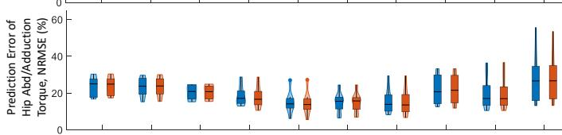

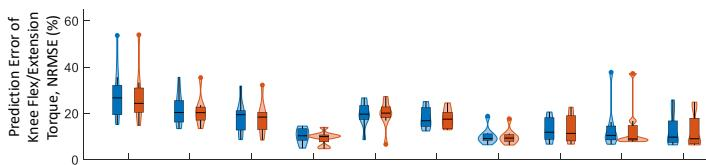  
Fig. A.1. 小提琴图展示了在NMS Pooled模型中，参与者在十种运动过程中预测力矩与实际力矩之间的NRMSE分布，对比了每次运动分别使用一次与两次试验进行校准的结果。每个小提琴图均包含一个核密度图和一个箱线图。核密度图展示了NRMSE的概率分布。箱线图表示NRMSE的最小值、下四分位数、中位数、上四分位数和最大值。∗表示经成对比较确定两种模型之间存在显著差异。