# Zhang2024-TBME：肌电约束与超声信息的肌腱参数估计

> English text extracted from the source PDF; not translated or editorially corrected. Each original PDF page is embedded below as a rendered image so figures, tables, and vector artwork remain visible.

- Source PDF: `Zhang2024-TBME：肌电约束与超声信息的肌腱参数估计.pdf`
- SHA-256: `b5a2dde59358bd09a5d2334b3d0697ebeb0ff5b90e9d6719bcb3a80912a599b6`
- Pages: 12
- Extraction: Poppler `pdftotext -layout`; page images rendered with `pdftoppm` (max dimension 1400 px, JPEG quality 76).

## Page 1

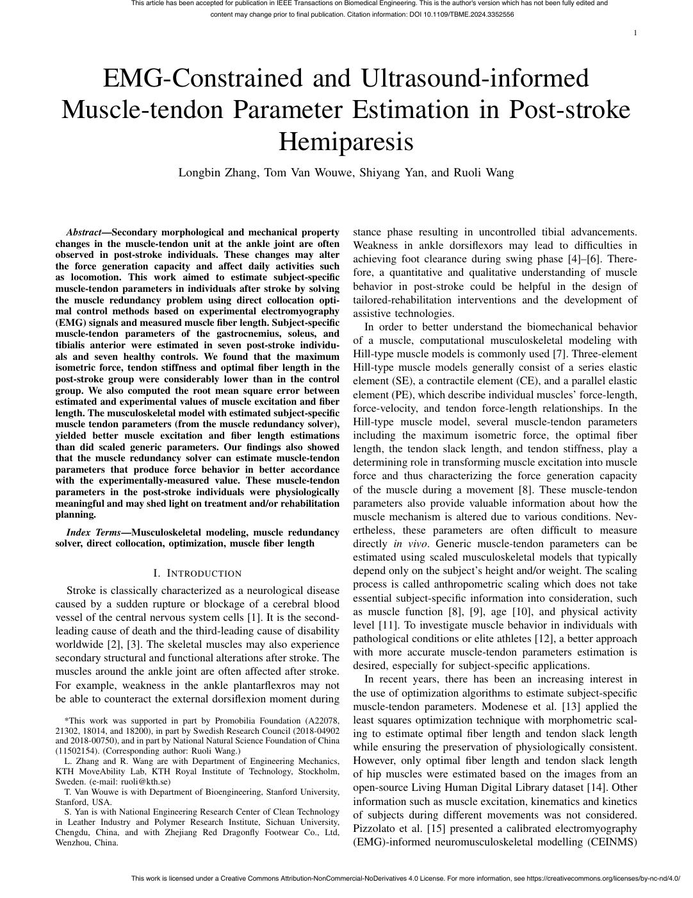

English text extracted from page 1

<pre>
This article has been accepted for publication in IEEE Transactions on Biomedical Engineering. This is the author's version which has not been fully edited and
                                              content may change prior to final publication. Citation information: DOI 10.1109/TBME.2024.3352556

                                                                                                                                                                                      1

   EMG-Constrained and Ultrasound-informed
 Muscle-tendon Parameter Estimation in Post-stroke
                   Hemiparesis
                                   Longbin Zhang, Tom Van Wouwe, Shiyang Yan, and Ruoli Wang

   Abstract—Secondary morphological and mechanical property                                   stance phase resulting in uncontrolled tibial advancements.
changes in the muscle-tendon unit at the ankle joint are often                                Weakness in ankle dorsiflexors may lead to difficulties in
observed in post-stroke individuals. These changes may alter                                  achieving foot clearance during swing phase [4]–[6]. There-
the force generation capacity and affect daily activities such
as locomotion. This work aimed to estimate subject-specific                                   fore, a quantitative and qualitative understanding of muscle
muscle-tendon parameters in individuals after stroke by solving                               behavior in post-stroke could be helpful in the design of
the muscle redundancy problem using direct collocation opti-                                  tailored-rehabilitation interventions and the development of
mal control methods based on experimental electromyography                                    assistive technologies.
(EMG) signals and measured muscle fiber length. Subject-specific                                 In order to better understand the biomechanical behavior
muscle-tendon parameters of the gastrocnemius, soleus, and
tibialis anterior were estimated in seven post-stroke individu-                               of a muscle, computational musculoskeletal modeling with
als and seven healthy controls. We found that the maximum                                     Hill-type muscle models is commonly used [7]. Three-element
isometric force, tendon stiffness and optimal fiber length in the                             Hill-type muscle models generally consist of a series elastic
post-stroke group were considerably lower than in the control                                 element (SE), a contractile element (CE), and a parallel elastic
group. We also computed the root mean square error between                                    element (PE), which describe individual muscles’ force-length,
estimated and experimental values of muscle excitation and fiber
length. The musculoskeletal model with estimated subject-specific                             force-velocity, and tendon force-length relationships. In the
muscle tendon parameters (from the muscle redundancy solver),                                 Hill-type muscle model, several muscle-tendon parameters
yielded better muscle excitation and fiber length estimations                                 including the maximum isometric force, the optimal fiber
than did scaled generic parameters. Our findings also showed                                  length, the tendon slack length, and tendon stiffness, play a
that the muscle redundancy solver can estimate muscle-tendon                                  determining role in transforming muscle excitation into muscle
parameters that produce force behavior in better accordance
with the experimentally-measured value. These muscle-tendon                                   force and thus characterizing the force generation capacity
parameters in the post-stroke individuals were physiologically                                of the muscle during a movement [8]. These muscle-tendon
meaningful and may shed light on treatment and/or rehabilitation                              parameters also provide valuable information about how the
planning.                                                                                     muscle mechanism is altered due to various conditions. Nev-
   Index Terms—Musculoskeletal modeling, muscle redundancy                                    ertheless, these parameters are often difficult to measure
solver, direct collocation, optimization, muscle fiber length                                 directly in vivo. Generic muscle-tendon parameters can be
                                                                                              estimated using scaled musculoskeletal models that typically
                           I. I NTRODUCTION                                                   depend only on the subject’s height and/or weight. The scaling
                                                                                              process is called anthropometric scaling which does not take
   Stroke is classically characterized as a neurological disease
                                                                                              essential subject-specific information into consideration, such
caused by a sudden rupture or blockage of a cerebral blood
                                                                                              as muscle function [8], [9], age [10], and physical activity
vessel of the central nervous system cells [1]. It is the second-
                                                                                              level [11]. To investigate muscle behavior in individuals with
leading cause of death and the third-leading cause of disability
                                                                                              pathological conditions or elite athletes [12], a better approach
worldwide [2], [3]. The skeletal muscles may also experience
                                                                                              with more accurate muscle-tendon parameters estimation is
secondary structural and functional alterations after stroke. The
                                                                                              desired, especially for subject-specific applications.
muscles around the ankle joint are often affected after stroke.
                                                                                                 In recent years, there has been an increasing interest in
For example, weakness in the ankle plantarflexros may not
                                                                                              the use of optimization algorithms to estimate subject-specific
be able to counteract the external dorsiflexion moment during
                                                                                              muscle-tendon parameters. Modenese et al. [13] applied the
  *This work was supported in part by Promobilia Foundation (A22078,                          least squares optimization technique with morphometric scal-
21302, 18014, and 18200), in part by Swedish Research Council (2018-04902                     ing to estimate optimal fiber length and tendon slack length
and 2018-00750), and in part by National Natural Science Foundation of China
(11502154). (Corresponding author: Ruoli Wang.)                                               while ensuring the preservation of physiologically consistent.
  L. Zhang and R. Wang are with Department of Engineering Mechanics,                          However, only optimal fiber length and tendon slack length
KTH MoveAbility Lab, KTH Royal Institute of Technology, Stockholm,                            of hip muscles were estimated based on the images from an
Sweden. (e-mail: ruoli@kth.se)
  T. Van Wouwe is with Department of Bioengineering, Stanford University,                     open-source Living Human Digital Library dataset [14]. Other
Stanford, USA.                                                                                information such as muscle excitation, kinematics and kinetics
  S. Yan is with National Engineering Research Center of Clean Technology                     of subjects during different movements was not considered.
in Leather Industry and Polymer Research Institute, Sichuan University,
Chengdu, China, and with Zhejiang Red Dragonfly Footwear Co., Ltd,                            Pizzolato et al. [15] presented a calibrated electromyography
Wenzhou, China.                                                                               (EMG)-informed neuromusculoskeletal modelling (CEINMS)

                    This work is licensed under a Creative Commons Attribution-NonCommercial-NoDerivatives 4.0 License. For more information, see https://creativecommons.org/licenses/by-nc-nd/4.0/
</pre>

## Page 2

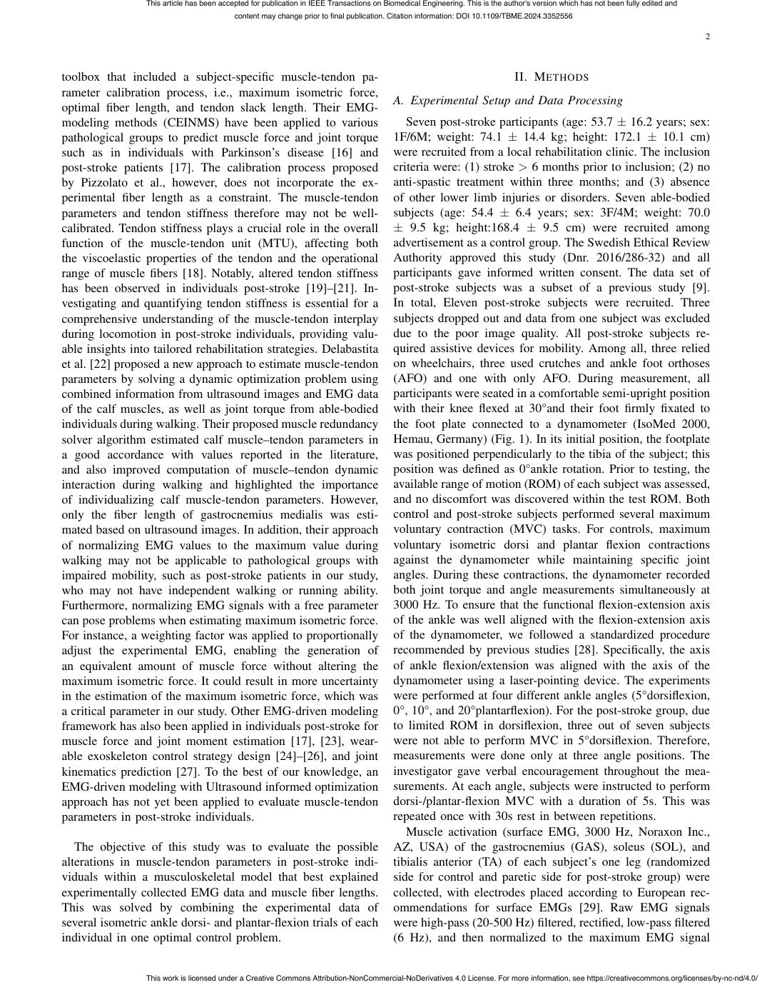

English text extracted from page 2

<pre>
This article has been accepted for publication in IEEE Transactions on Biomedical Engineering. This is the author's version which has not been fully edited and
                                           content may change prior to final publication. Citation information: DOI 10.1109/TBME.2024.3352556

                                                                                                                                                                                   2

toolbox that included a subject-specific muscle-tendon pa-                                                                     II. M ETHODS
rameter calibration process, i.e., maximum isometric force,
                                                                                           A. Experimental Setup and Data Processing
optimal fiber length, and tendon slack length. Their EMG-
modeling methods (CEINMS) have been applied to various                                        Seven post-stroke participants (age: 53.7 ± 16.2 years; sex:
pathological groups to predict muscle force and joint torque                               1F/6M; weight: 74.1 ± 14.4 kg; height: 172.1 ± 10.1 cm)
such as in individuals with Parkinson’s disease [16] and                                   were recruited from a local rehabilitation clinic. The inclusion
post-stroke patients [17]. The calibration process proposed                                criteria were: (1) stroke &gt; 6 months prior to inclusion; (2) no
by Pizzolato et al., however, does not incorporate the ex-                                 anti-spastic treatment within three months; and (3) absence
perimental fiber length as a constraint. The muscle-tendon                                 of other lower limb injuries or disorders. Seven able-bodied
parameters and tendon stiffness therefore may not be well-                                 subjects (age: 54.4 ± 6.4 years; sex: 3F/4M; weight: 70.0
calibrated. Tendon stiffness plays a crucial role in the overall                           ± 9.5 kg; height:168.4 ± 9.5 cm) were recruited among
function of the muscle-tendon unit (MTU), affecting both                                   advertisement as a control group. The Swedish Ethical Review
the viscoelastic properties of the tendon and the operational                              Authority approved this study (Dnr. 2016/286-32) and all
range of muscle fibers [18]. Notably, altered tendon stiffness                             participants gave informed written consent. The data set of
has been observed in individuals post-stroke [19]–[21]. In-                                post-stroke subjects was a subset of a previous study [9].
vestigating and quantifying tendon stiffness is essential for a                            In total, Eleven post-stroke subjects were recruited. Three
comprehensive understanding of the muscle-tendon interplay                                 subjects dropped out and data from one subject was excluded
during locomotion in post-stroke individuals, providing valu-                              due to the poor image quality. All post-stroke subjects re-
able insights into tailored rehabilitation strategies. Delabastita                         quired assistive devices for mobility. Among all, three relied
et al. [22] proposed a new approach to estimate muscle-tendon                              on wheelchairs, three used crutches and ankle foot orthoses
parameters by solving a dynamic optimization problem using                                 (AFO) and one with only AFO. During measurement, all
combined information from ultrasound images and EMG data                                   participants were seated in a comfortable semi-upright position
of the calf muscles, as well as joint torque from able-bodied                              with their knee flexed at 30°and their foot firmly fixated to
individuals during walking. Their proposed muscle redundancy                               the foot plate connected to a dynamometer (IsoMed 2000,
solver algorithm estimated calf muscle–tendon parameters in                                Hemau, Germany) (Fig. 1). In its initial position, the footplate
a good accordance with values reported in the literature,                                  was positioned perpendicularly to the tibia of the subject; this
and also improved computation of muscle–tendon dynamic                                     position was defined as 0°ankle rotation. Prior to testing, the
interaction during walking and highlighted the importance                                  available range of motion (ROM) of each subject was assessed,
of individualizing calf muscle-tendon parameters. However,                                 and no discomfort was discovered within the test ROM. Both
only the fiber length of gastrocnemius medialis was esti-                                  control and post-stroke subjects performed several maximum
mated based on ultrasound images. In addition, their approach                              voluntary contraction (MVC) tasks. For controls, maximum
of normalizing EMG values to the maximum value during                                      voluntary isometric dorsi and plantar flexion contractions
walking may not be applicable to pathological groups with                                  against the dynamometer while maintaining specific joint
impaired mobility, such as post-stroke patients in our study,                              angles. During these contractions, the dynamometer recorded
who may not have independent walking or running ability.                                   both joint torque and angle measurements simultaneously at
Furthermore, normalizing EMG signals with a free parameter                                 3000 Hz. To ensure that the functional flexion-extension axis
can pose problems when estimating maximum isometric force.                                 of the ankle was well aligned with the flexion-extension axis
For instance, a weighting factor was applied to proportionally                             of the dynamometer, we followed a standardized procedure
adjust the experimental EMG, enabling the generation of                                    recommended by previous studies [28]. Specifically, the axis
an equivalent amount of muscle force without altering the                                  of ankle flexion/extension was aligned with the axis of the
maximum isometric force. It could result in more uncertainty                               dynamometer using a laser-pointing device. The experiments
in the estimation of the maximum isometric force, which was                                were performed at four different ankle angles (5°dorsiflexion,
a critical parameter in our study. Other EMG-driven modeling                               0°, 10°, and 20°plantarflexion). For the post-stroke group, due
framework has also been applied in individuals post-stroke for                             to limited ROM in dorsiflexion, three out of seven subjects
muscle force and joint moment estimation [17], [23], wear-                                 were not able to perform MVC in 5°dorsiflexion. Therefore,
able exoskeleton control strategy design [24]–[26], and joint                              measurements were done only at three angle positions. The
kinematics prediction [27]. To the best of our knowledge, an                               investigator gave verbal encouragement throughout the mea-
EMG-driven modeling with Ultrasound informed optimization                                  surements. At each angle, subjects were instructed to perform
approach has not yet been applied to evaluate muscle-tendon                                dorsi-/plantar-flexion MVC with a duration of 5s. This was
parameters in post-stroke individuals.                                                     repeated once with 30s rest in between repetitions.
                                                                                              Muscle activation (surface EMG, 3000 Hz, Noraxon Inc.,
   The objective of this study was to evaluate the possible                                AZ, USA) of the gastrocnemius (GAS), soleus (SOL), and
alterations in muscle-tendon parameters in post-stroke indi-                               tibialis anterior (TA) of each subject’s one leg (randomized
viduals within a musculoskeletal model that best explained                                 side for control and paretic side for post-stroke group) were
experimentally collected EMG data and muscle fiber lengths.                                collected, with electrodes placed according to European rec-
This was solved by combining the experimental data of                                      ommendations for surface EMGs [29]. Raw EMG signals
several isometric ankle dorsi- and plantar-flexion trials of each                          were high-pass (20-500 Hz) filtered, rectified, low-pass filtered
individual in one optimal control problem.                                                 (6 Hz), and then normalized to the maximum EMG signal

                 This work is licensed under a Creative Commons Attribution-NonCommercial-NoDerivatives 4.0 License. For more information, see https://creativecommons.org/licenses/by-nc-nd/4.0/
</pre>

## Page 3

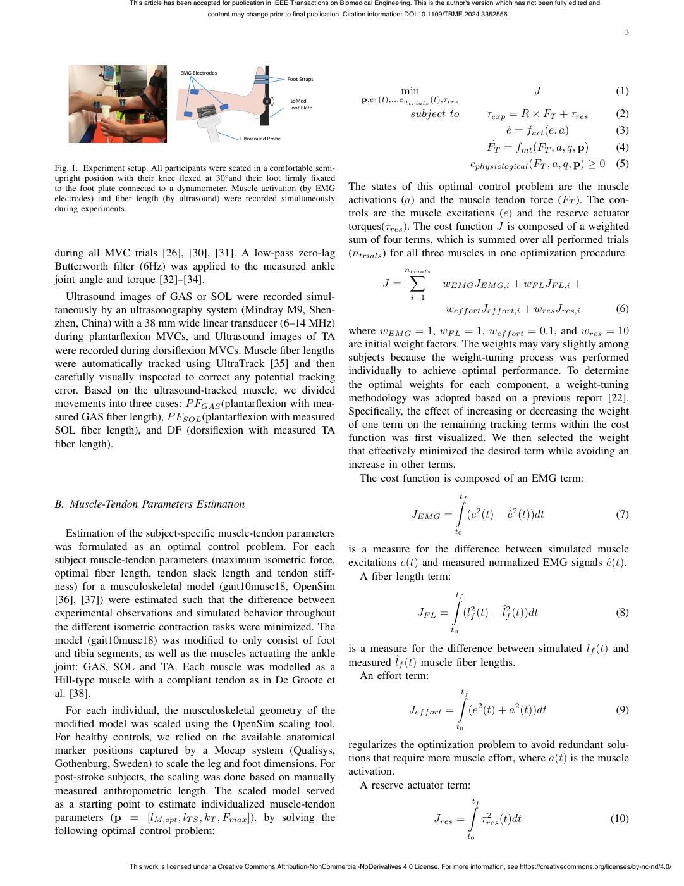

English text extracted from page 3

<pre>
This article has been accepted for publication in IEEE Transactions on Biomedical Engineering. This is the author's version which has not been fully edited and
                                               content may change prior to final publication. Citation information: DOI 10.1109/TBME.2024.3352556

                                                                                                                                                                                         3

                                     EMG Electrodes
                                                                            Foot Straps

                                                                                                               min                                          J                          (1)
                                                                            IsoMed                p,e1 (t),...entrials (t),τres
                                                                            Foot Plate
                                                                                                                  subject to                   τexp = R × FT + τres                    (2)
                                                                                                                                                    ė = fact (e, a)                   (3)
                                                         Ultrasound Probe
                                                                                                                                               F˙T = fmt (FT , a, q, p)                (4)
Fig. 1. Experiment setup. All participants were seated in a comfortable semi-                                                           cphysiological (FT , a, q, p) ≥ 0 (5)
upright position with their knee flexed at 30°and their foot firmly fixated
to the foot plate connected to a dynamometer. Muscle activation (by EMG                       The states of this optimal control problem are the muscle
electrodes) and fiber length (by ultrasound) were recorded simultaneously                     activations (a) and the muscle tendon force (FT ). The con-
during experiments.
                                                                                              trols are the muscle excitations (e) and the reserve actuator
                                                                                              torques(τres ). The cost function J is composed of a weighted
                                                                                              sum of four terms, which is summed over all performed trials
during all MVC trials [26], [30], [31]. A low-pass zero-lag                                   (ntrials ) for all three muscles in one optimization procedure.
Butterworth filter (6Hz) was applied to the measured ankle                                                      nX
                                                                                                                 trials
joint angle and torque [32]–[34].                                                                        J=                  wEM G JEM G,i + wF L JF L,i +
   Ultrasound images of GAS or SOL were recorded simul-                                                            i=1
taneously by an ultrasonography system (Mindray M9, Shen-                                                                     wef f ort Jef f ort,i + wres Jres,i                      (6)
zhen, China) with a 38 mm wide linear transducer (6–14 MHz)
                                                                                              where wEM G = 1, wF L = 1, wef f ort = 0.1, and wres = 10
during plantarflexion MVCs, and Ultrasound images of TA
                                                                                              are initial weight factors. The weights may vary slightly among
were recorded during dorsiflexion MVCs. Muscle fiber lengths
                                                                                              subjects because the weight-tuning process was performed
were automatically tracked using UltraTrack [35] and then
                                                                                              individually to achieve optimal performance. To determine
carefully visually inspected to correct any potential tracking
                                                                                              the optimal weights for each component, a weight-tuning
error. Based on the ultrasound-tracked muscle, we divided
                                                                                              methodology was adopted based on a previous report [22].
movements into three cases: P FGAS (plantarflexion with mea-
                                                                                              Specifically, the effect of increasing or decreasing the weight
sured GAS fiber length), P FSOL (plantarflexion with measured
                                                                                              of one term on the remaining tracking terms within the cost
SOL fiber length), and DF (dorsiflexion with measured TA
                                                                                              function was first visualized. We then selected the weight
fiber length).
                                                                                              that effectively minimized the desired term while avoiding an
                                                                                              increase in other terms.
                                                                                                 The cost function is composed of an EMG term:

B. Muscle-Tendon Parameters Estimation                                                                                            Ztf
                                                                                                                   JEM G =              (e2 (t) − ê2 (t))dt                           (7)
   Estimation of the subject-specific muscle-tendon parameters                                                                   t0

was formulated as an optimal control problem. For each                                        is a measure for the difference between simulated muscle
subject muscle-tendon parameters (maximum isometric force,                                    excitations e(t) and measured normalized EMG signals ê(t).
optimal fiber length, tendon slack length and tendon stiff-                                      A fiber length term:
ness) for a musculoskeletal model (gait10musc18, OpenSim
[36], [37]) were estimated such that the difference between                                                                     Ztf
experimental observations and simulated behavior throughout                                                          JF L =           (lf2 (t) − lˆf2 (t))dt                           (8)
the different isometric contraction tasks were minimized. The                                                                   t0
model (gait10musc18) was modified to only consist of foot
and tibia segments, as well as the muscles actuating the ankle                                is a measure for the difference between simulated lf (t) and
joint: GAS, SOL and TA. Each muscle was modelled as a                                         measured lˆf (t) muscle fiber lengths.
Hill-type muscle with a compliant tendon as in De Groote et                                      An effort term:
al. [38].                                                                                                                         Ztf
   For each individual, the musculoskeletal geometry of the                                                       Jef f ort =           (e2 (t) + a2 (t))dt                            (9)
modified model was scaled using the OpenSim scaling tool.                                                                         t0
For healthy controls, we relied on the available anatomical
                                                                                              regularizes the optimization problem to avoid redundant solu-
marker positions captured by a Mocap system (Qualisys,
                                                                                              tions that require more muscle effort, where a(t) is the muscle
Gothenburg, Sweden) to scale the leg and foot dimensions. For
                                                                                              activation.
post-stroke subjects, the scaling was done based on manually
measured anthropometric length. The scaled model served                                          A reserve actuator term:
as a starting point to estimate individualized muscle-tendon                                                                            Ztf
parameters (p = [lM,opt , lT S , kT , Fmax ]). by solving the                                                                                  2
                                                                                                                          Jres =              τres (t)dt                              (10)
following optimal control problem:                                                                                                      t0

                    This work is licensed under a Creative Commons Attribution-NonCommercial-NoDerivatives 4.0 License. For more information, see https://creativecommons.org/licenses/by-nc-nd/4.0/
</pre>

## Page 4

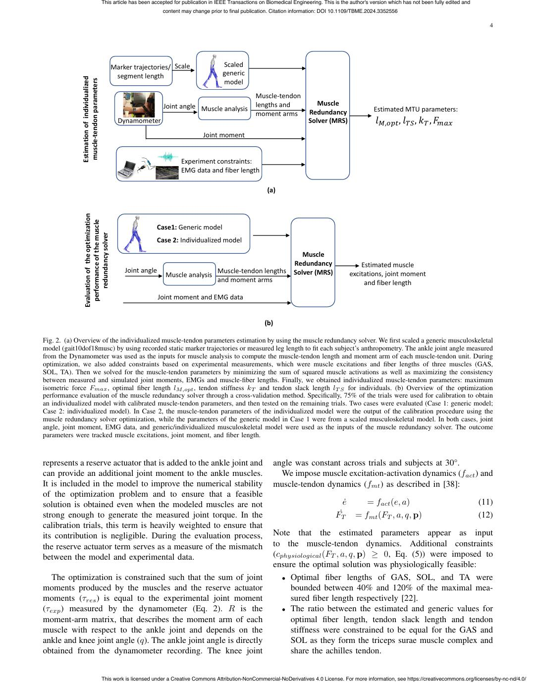

English text extracted from page 4

<pre>
This article has been accepted for publication in IEEE Transactions on Biomedical Engineering. This is the author's version which has not been fully edited and
                                                                       content may change prior to final publication. Citation information: DOI 10.1109/TBME.2024.3352556

                                                                                                                                                                                                                  4

                                                 Marker trajectories/ Scale                      Scaled
                                                  segment length                                 generic

              Estimation of individualized
                                                                                                 model
                                                                                                               Muscle-tendon
                                                                       Joint angle Muscle analysis             lengths and               Muscle
                                                                                                                                      Redundancy                  Estimated MTU parameters:
                                                                                                               moment arms
                                                   Dynamometer                                                                        Solver (MRS)                 𝑙𝑀,𝑜𝑝𝑡 , 𝑙 𝑇𝑆 , 𝑘 𝑇 , 𝐹𝑚𝑎𝑥

               muscle-tendon parameters
                                                                                        Joint moment

                                                                               Experiment constraints:
                                                                               EMG data and fiber length

                                                                                                                    (a)

                Evaluation of the optimization
                                                                    Case1: Generic model
                                                                    Case 2: Individualized model

                  performance of the muscle
                                                                                                                                  Muscle
                                                                                                                               Redundancy                  Estimated muscle
                                                       Joint angle                             Muscle-tendon lengths           Solver (MRS)            excitations, joint moment
                                                                        Muscle analysis
                                                                                               and moment arms                                              and fiber length

                      redundancy solver                              Joint moment and EMG data

                                                                                                                   (b)

Fig. 2. (a) Overview of the individualized muscle-tendon parameters estimation by using the muscle redundancy solver. We first scaled a generic musculoskeletal
model (gait10dof18musc) by using recorded static marker trajectories or measured leg length to fit each subject’s anthropometry. The ankle joint angle measured
from the Dynamometer was used as the inputs for muscle analysis to compute the muscle-tendon length and moment arm of each muscle-tendon unit. During
optimization, we also added constraints based on experimental measurements, which were muscle excitations and fiber lengths of three muscles (GAS,
SOL, TA). Then we solved for the muscle-tendon parameters by minimizing the sum of squared muscle activations as well as maximizing the consistency
between measured and simulated joint moments, EMGs and muscle-fiber lengths. Finally, we obtained individualized muscle-tendon parameters: maximum
isometric force Fmax , optimal fiber length lM,opt , tendon stiffness kT and tendon slack length lT S for individuals. (b) Overview of the optimization
performance evaluation of the muscle redundancy solver through a cross-validation method. Specifically, 75% of the trials were used for calibration to obtain
an individualized model with calibrated muscle-tendon parameters, and then tested on the remaining trials. Two cases were evaluated (Case 1: generic model;
Case 2: individualized model). In Case 2, the muscle-tendon parameters of the individualized model were the output of the calibration procedure using the
muscle redundancy solver optimization, while the parameters of the generic model in Case 1 were from a scaled musculoskeletal model. In both cases, joint
angle, joint moment, EMG data, and generic/individualized musculoskeletal model were used as the inputs of the muscle redundancy solver. The outcome
parameters were tracked muscle excitations, joint moment, and fiber length.

represents a reserve actuator that is added to the ankle joint and                                                       angle was constant across trials and subjects at 30°.
can provide an additional joint moment to the ankle muscles.                                                               We impose muscle excitation-activation dynamics (fact ) and
It is included in the model to improve the numerical stability                                                           muscle-tendon dynamics (fmt ) as described in [38]:
of the optimization problem and to ensure that a feasible
solution is obtained even when the modeled muscles are not                                                                                         ė   = fact (e, a)                                          (11)
strong enough to generate the measured joint torque. In the                                                                                      F˙T = fmt (FT , a, q, p)                                      (12)
calibration trials, this term is heavily weighted to ensure that
its contribution is negligible. During the evaluation process,                                                           Note that the estimated parameters appear as input
the reserve actuator term serves as a measure of the mismatch                                                            to the muscle-tendon dynamics. Additional constraints
between the model and experimental data.                                                                                 (cphysiological (FT , a, q, p) ≥ 0, Eq. (5)) were imposed to
                                                                                                                         ensure the optimal solution was physiologically feasible:
   The optimization is constrained such that the sum of joint                                                               • Optimal fiber lengths of GAS, SOL, and TA were
moments produced by the muscles and the reserve actuator                                                                      bounded between 40% and 120% of the maximal mea-
moments (τres ) is equal to the experimental joint moment                                                                     sured fiber length respectively [22].
(τexp ) measured by the dynamometer (Eq. 2). R is the                                                                       • The ratio between the estimated and generic values for
moment-arm matrix, that describes the moment arm of each                                                                      optimal fiber length, tendon slack length and tendon
muscle with respect to the ankle joint and depends on the                                                                     stiffness were constrained to be equal for the GAS and
ankle and knee joint angle (q). The ankle joint angle is directly                                                             SOL as they form the triceps surae muscle complex and
obtained from the dynamometer recording. The knee joint                                                                       share the achilles tendon.

                                             This work is licensed under a Creative Commons Attribution-NonCommercial-NoDerivatives 4.0 License. For more information, see https://creativecommons.org/licenses/by-nc-nd/4.0/
</pre>

## Page 5

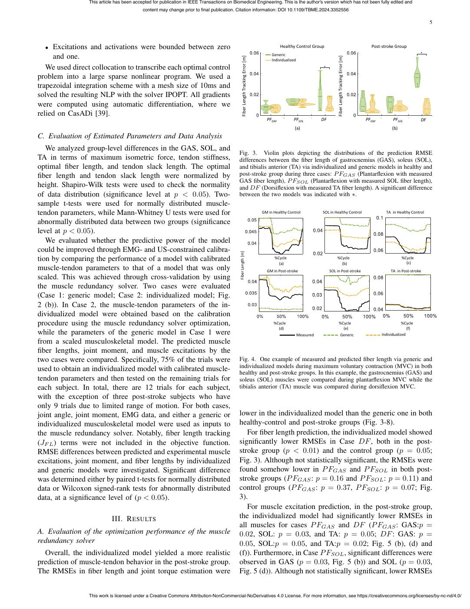

English text extracted from page 5

<pre>
This article has been accepted for publication in IEEE Transactions on Biomedical Engineering. This is the author's version which has not been fully edited and
                                           content may change prior to final publication. Citation information: DOI 10.1109/TBME.2024.3352556

                                                                                                                                                                                                                                                5

  •  Excitations and activations were bounded between zero                                                                                 Healthy Control Group                                                 Post-stroke Group
                                                                                                                                       Generic                                                                                             *
     and one.

                                                                                                Fiber Length Tracking Error [m]                                              Fiber Length Tracking Error [m]
                                                                                                                                       Individualized
   We used direct collocation to transcribe each optimal control                                                                                                   *

problem into a large sparse nonlinear program. We used a
trapezoidal integration scheme with a mesh size of 10ms and
solved the resulting NLP with the solver IPOPT. All gradients
were computed using automatic differentiation, where we
relied on CasADi [39].
                                                                                                                                    PFGM           PFSOL           DF                                          PFGM         PFSOL          DF
                                                                                                                                                    (a)                                                                     (b)
C. Evaluation of Estimated Parameters and Data Analysis
   We analyzed group-level differences in the GAS, SOL, and
                                                                                           Fig. 3. Violin plots depicting the distributions of the prediction RMSE
TA in terms of maximum isometric force, tendon stiffness,                                  differences between the fiber length of gastrocnemius (GAS), soleus (SOL),
optimal fiber length, and tendon slack length. The optimal                                 and tibialis anterior (TA) via individualized and generic models in healthy and
fiber length and tendon slack length were normalized by                                    post-stroke group during three cases: P FGAS (Plantarflexion with measured
                                                                                           GAS fiber length), P FSOL (Plantarflexion with measured SOL fiber length),
height. Shapiro-Wilk tests were used to check the normality                                and DF (Dorsiflexion with measured TA fiber length). A significant difference
of data distribution (significance level at p &lt; 0.05). Two-                                between the two models was indicated with ∗.
sample t-tests were used for normally distributed muscle-
tendon parameters, while Mann-Whitney U tests were used for                                                                       GM in Healthy Control            SOL in Healthy Control                               TA in Healthy Control

abnormally distributed data between two groups (significance
level at p &lt; 0.05).
   We evaluated whether the predictive power of the model
could be improved through EMG- and US-constrained calibra-

                                                                                           Fiber Length [m]
tion by comparing the performance of a model with calibrated                                                                            %Cycle                              %Cycle                                                %Cycle
                                                                                                                                                                                                                                    (c)
                                                                                                                                          (a)                                 (b)
muscle-tendon parameters to that of a model that was only                                                                           GM in Post-stroke                   SOL in Post-stroke                                 TA in Post-stroke
scaled. This was achieved through cross-validation by using
the muscle redundancy solver. Two cases were evaluated
(Case 1: generic model; Case 2: individualized model; Fig.
2 (b)). In Case 2, the muscle-tendon parameters of the in-
dividualized model were obtained based on the calibration
procedure using the muscle redundancy solver optimization,                                                                              %Cycle                                  %Cycle                                            %Cycle
                                                                                                                                          (d)                                     (e)                                                (f)
while the parameters of the generic model in Case 1 were                                                                                                Measured                        Generic                       Individualized
from a scaled musculoskeletal model. The predicted muscle
fiber lengths, joint moment, and muscle excitations by the
two cases were compared. Specifically, 75% of the trials were                              Fig. 4. One example of measured and predicted fiber length via generic and
                                                                                           individualized models during maximum voluntary contraction (MVC) in both
used to obtain an individualized model with calibrated muscle-                             healthy and post-stroke groups. In this example, the gastrocnemius (GAS) and
tendon parameters and then tested on the remaining trials for                              soleus (SOL) muscles were compared during plantarflexion MVC while the
each subject. In total, there are 12 trials for each subject,                              tibialis anterior (TA) muscle was compared during dorsiflexion MVC.
with the exception of three post-stroke subjects who have
only 9 trials due to limited range of motion. For both cases,
joint angle, joint moment, EMG data, and either a generic or                               lower in the individualized model than the generic one in both
individualized musculoskeletal model were used as inputs to                                healthy-control and post-stroke groups (Fig. 3-8).
the muscle redundancy solver. Notably, fiber length tracking                                  For fiber length prediction, the individualized model showed
(JF L ) terms were not included in the objective function.                                 significantly lower RMSEs in Case DF , both in the post-
RMSE differences between predicted and experimental muscle                                 stroke group (p &lt; 0.01) and the control group (p = 0.05;
excitations, joint moment, and fiber lengths by individualized                             Fig. 3). Although not statistically significant, the RMSEs were
and generic models were investigated. Significant difference                               found somehow lower in P FGAS and P FSOL in both post-
was determined either by paired t-tests for normally distributed                           stroke groups (P FGAS : p = 0.16 and P FSOL : p = 0.11) and
data or Wilcoxon signed-rank tests for abnormally distributed                              control groups (P FGAS : p = 0.37, P FSOL : p = 0.07; Fig.
data, at a significance level of (p &lt; 0.05).                                               3).
                                                                                              For muscle excitation prediction, in the post-stroke group,
                            III. R ESULTS                                                  the individualized model had significantly lower RMSEs in
                                                                                           all muscles for cases P FGAS and DF (P FGAS : GAS:p =
A. Evaluation of the optimization performance of the muscle                                0.02, SOL: p = 0.03, and TA: p = 0.05; DF : GAS: p =
redundancy solver                                                                          0.05, SOL:p = 0.05, and TA:p = 0.02; Fig. 5 (b), (d) and
  Overall, the individualized model yielded a more realistic                               (f)). Furthermore, in Case P FSOL , significant differences were
prediction of muscle-tendon behavior in the post-stroke group.                             observed in GAS (p = 0.03, Fig. 5 (b)) and SOL (p = 0.03,
The RMSEs in fiber length and joint torque estimation were                                 Fig. 5 (d)). Although not statistically significant, lower RMSEs

                 This work is licensed under a Creative Commons Attribution-NonCommercial-NoDerivatives 4.0 License. For more information, see https://creativecommons.org/licenses/by-nc-nd/4.0/
</pre>

## Page 6

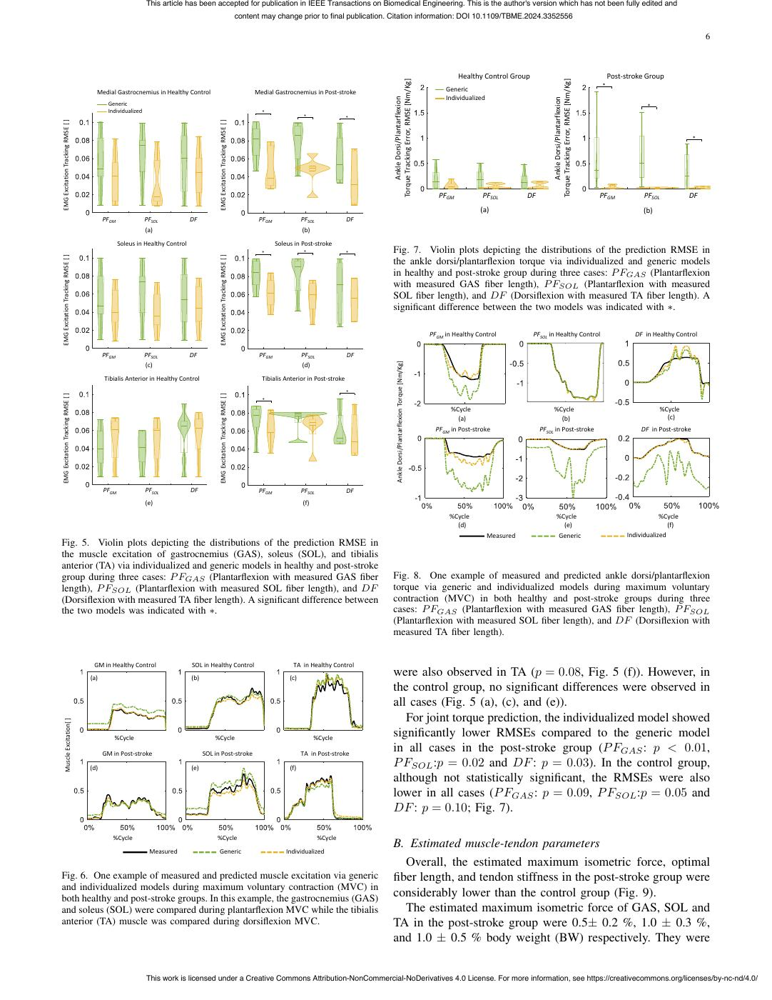

English text extracted from page 6

<pre>
This article has been accepted for publication in IEEE Transactions on Biomedical Engineering. This is the author's version which has not been fully edited and
                                                                                                                           content may change prior to final publication. Citation information: DOI 10.1109/TBME.2024.3352556

                                                                                                                                                                                                                                                                                                                                                 6

                                                                                                                                                                                                                                    Healthy Control Group                                                      Post-stroke Group

                                                                                                                                                                               Ankle Dorsi/Plantarflexion                                                                 Ankle Dorsi/Plantarflexion
                                                                                                                                                                                                                                                                                                           *
                                     Medial Gastrocnemius in Healthy Control                                                    Medial Gastrocnemius in Post-stroke                                                            Generic
                                                                                                                                                                                                                               Individualized
                                          Generic                                                                                                                                                                                                                                                                          *
                                          Individualized                                                                          *
                                                                                                                                                     *               *

EMG Excitation Tracking RMSE [ ]                                                        EMG Excitation Tracking RMSE [ ]
                                                                                                                                                                                                                                                                                                                                             *

                                                                                                                                                                          Torque Tracking Error, RMSE [Nm/Kg]                                                        Torque Tracking Error, RMSE [Nm/Kg]
                                                                                                                                                                                                                             PFGM           PFSOL          DF                                              PFGM           PFSOL          DF
                                                                                                                                                                                                                                           (a)                                                                           (b)
                                         PFGM              PFSOL            DF                                                    PFGM              PFSOL            DF
                                                           (a)                                                                                      (b)
                                                Soleus in Healthy Control                                                                Soleus in Post-stroke
                                                                                                                                  *                  *               *    Fig. 7. Violin plots depicting the distributions of the prediction RMSE in

EMG Excitation Tracking RMSE [ ]                                                        EMG Excitation Tracking RMSE [ ]
                                                                                                                                                                          the ankle dorsi/plantarflexion torque via individualized and generic models
                                                                                                                                                                          in healthy and post-stroke group during three cases: P FGAS (Plantarflexion
                                                                                                                                                                          with measured GAS fiber length), P FSOL (Plantarflexion with measured
                                                                                                                                                                          SOL fiber length), and DF (Dorsiflexion with measured TA fiber length). A
                                                                                                                                                                          significant difference between the two models was indicated with ∗.

                                                                                                                                                                                                                          PFGM in Healthy Control           PFSOL in Healthy Control                                   DF in Healthy Control

                                         PFGM              PFSOL            DF                                                    PFGM              PFSOL            DF

                                                                                                                                                                              Ankle Dorsi/Plantarflexion Torque [Nm/Kg]
                                                           (c)                                                                                      (d)
                                         Tibialis Anterior in Healthy Control                                                     Tibialis Anterior in Post-stroke
                                                                                                                                                                     *

EMG Excitation Tracking RMSE [ ]                                                        EMG Excitation Tracking RMSE [ ]
                                                                                                                                   *

                                                                                                                                                                                                                                 %Cycle                              %Cycle                                                    %Cycle
                                                                                                                                                                                                                                   (a)                                 (b)                                                       (c)
                                                                                                                                                                                                                            PFGM in Post-stroke                 PFSOL in Post-stroke                                     DF in Post-stroke

                                         PFGM              PFSOL            DF                                                    PFGM              PFSOL            DF
                                                           (e)                                                                                      (f)

                                                                                                                                                                                                                                %Cycle                                   %Cycle                                                 %Cycle
                                                                                                                                                                                                                                  (d)                                      (e)                                                     (f)
                                                                                                                                                                                                                                                Measured                      Generic                               Individualized
Fig. 5. Violin plots depicting the distributions of the prediction RMSE in
the muscle excitation of gastrocnemius (GAS), soleus (SOL), and tibialis
anterior (TA) via individualized and generic models in healthy and post-stroke
group during three cases: P FGAS (Plantarflexion with measured GAS fiber                                                                                                  Fig. 8. One example of measured and predicted ankle dorsi/plantarflexion
length), P FSOL (Plantarflexion with measured SOL fiber length), and DF                                                                                                   torque via generic and individualized models during maximum voluntary
(Dorsiflexion with measured TA fiber length). A significant difference between                                                                                            contraction (MVC) in both healthy and post-stroke groups during three
the two models was indicated with ∗.                                                                                                                                      cases: P FGAS (Plantarflexion with measured GAS fiber length), P FSOL
                                                                                                                                                                          (Plantarflexion with measured SOL fiber length), and DF (Dorsiflexion with
                                                                                                                                                                          measured TA fiber length).

                                    GM in Healthy Control                   SOL in Healthy Control                                             TA in Healthy Control
                                   (a)                                      (b)                                                               (c)
                                                                                                                                                                          were also observed in TA (p = 0.08, Fig. 5 (f)). However, in
                                                                                                                                                                          the control group, no significant differences were observed in
                                                                                                                                                                          all cases (Fig. 5 (a), (c), and (e)).
                                                                                                                                                                             For joint torque prediction, the individualized model showed

       Muscle Excitation[ ]
                                             %Cycle                                   %Cycle                                                              %Cycle
                                                                                                                                                                          significantly lower RMSEs compared to the generic model
                                         GM in Post-stroke                        SOL in Post-stroke                                                TA in Post-stroke
                                                                                                                                                                          in all cases in the post-stroke group (P FGAS : p &lt; 0.01,
                                   (d)                                      (e)                                                               (f)
                                                                                                                                                                          P FSOL :p = 0.02 and DF : p = 0.03). In the control group,
                                                                                                                                                                          although not statistically significant, the RMSEs were also
                                                                                                                                                                          lower in all cases (P FGAS : p = 0.09, P FSOL :p = 0.05 and
                                                                                                                                                                          DF : p = 0.10; Fig. 7).

                                            %Cycle                                     %Cycle                                                               %Cycle
                                                                                                                                                                          B. Estimated muscle-tendon parameters
                                                            Measured                    Generic                                              Individualized
                                                                                                                                                                             Overall, the estimated maximum isometric force, optimal
Fig. 6. One example of measured and predicted muscle excitation via generic                                                                                               fiber length, and tendon stiffness in the post-stroke group were
and individualized models during maximum voluntary contraction (MVC) in
both healthy and post-stroke groups. In this example, the gastrocnemius (GAS)
                                                                                                                                                                          considerably lower than the control group (Fig. 9).
and soleus (SOL) were compared during plantarflexion MVC while the tibialis                                                                                                  The estimated maximum isometric force of GAS, SOL and
anterior (TA) muscle was compared during dorsiflexion MVC.                                                                                                                TA in the post-stroke group were 0.5± 0.2 %, 1.0 ± 0.3 %,
                                                                                                                                                                          and 1.0 ± 0.5 % body weight (BW) respectively. They were

                                                           This work is licensed under a Creative Commons Attribution-NonCommercial-NoDerivatives 4.0 License. For more information, see https://creativecommons.org/licenses/by-nc-nd/4.0/
</pre>

## Page 7

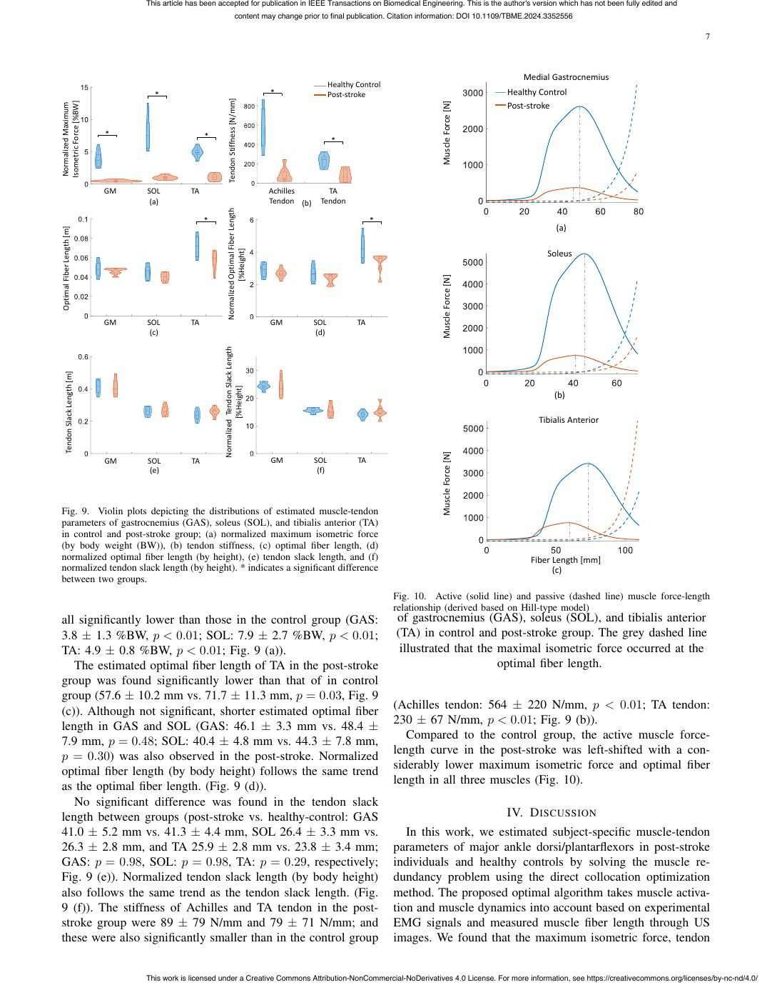

English text extracted from page 7

<pre>
This article has been accepted for publication in IEEE Transactions on Biomedical Engineering. This is the author's version which has not been fully edited and
                                                                                  content may change prior to final publication. Citation information: DOI 10.1109/TBME.2024.3352556

                                                                                                                                                                                                                 7

                                                                                                                                                                           Medial Gastrocnemius
                                                                                                                       Healthy Control
                                        *                                                          *                   Post-stroke                                     Healthy Control

                                                                  Tendon Stiffness [N/mm]
                                                                                                                                                    Muscle Force [N]
 Normalized Maximum
                                                                                                                                                                       Post-stroke

                                 *                      *
                                                                                                                        *

Isometric Force [%BW]

                                 GM   SOL          TA                                              Achilles         TA
                                       (a)                                                         Tendon (b)     Tendon

                                                                 Normalized Optimal Fiber Length
                                                        *                                                                           *
                                                                                                                                                                                   (a)

Optimal Fiber Length [m]
                                                                                                                                                                                 Soleus

                                                                           [%Height]

                                 GM   SOL          TA                                              GM           SOL            TA                   Muscle Force [N]
                                       (c)                                                                       (d)

                                                             Normalized Tendon Slack Length

       Tendon Slack Length [m]
                                                                                                                                                                                  (b)

                                                                       [%Height]
                                                                                                                                                                              Tibialis Anterior

                                                                                                                                                    Muscle Force [N]
                                 GM   SOL          TA                                              GM           SOL            TA
                                       (e)                                                                       (f)

Fig. 9. Violin plots depicting the distributions of estimated muscle-tendon
parameters of gastrocnemius (GAS), soleus (SOL), and tibialis anterior (TA)
in control and post-stroke group; (a) normalized maximum isometric force
(by body weight (BW)), (b) tendon stiffness, (c) optimal fiber length, (d)
normalized optimal fiber length (by height), (e) tendon slack length, and (f)                                                                                               Fiber Length [mm]
normalized tendon slack length (by height). * indicates a significant difference                                                                                                  (c)
between two groups.
                                                                                                                                         Fig. 10. Active (solid line) and passive (dashed line) muscle force-length
                                                                                                                                         relationship (derived based on Hill-type model)
all significantly lower than those in the control group (GAS:                                                                            of gastrocnemius (GAS), soleus (SOL), and tibialis anterior
3.8 ± 1.3 %BW, p &lt; 0.01; SOL: 7.9 ± 2.7 %BW, p &lt; 0.01;                                                                                   (TA) in control and post-stroke group. The grey dashed line
TA: 4.9 ± 0.8 %BW, p &lt; 0.01; Fig. 9 (a)).                                                                                                 illustrated that the maximal isometric force occurred at the
   The estimated optimal fiber length of TA in the post-stroke                                                                                                 optimal fiber length.
group was found significantly lower than that of in control
group (57.6 ± 10.2 mm vs. 71.7 ± 11.3 mm, p = 0.03, Fig. 9
                                                                                                                                         (Achilles tendon: 564 ± 220 N/mm, p &lt; 0.01; TA tendon:
(c)). Although not significant, shorter estimated optimal fiber
                                                                                                                                         230 ± 67 N/mm, p &lt; 0.01; Fig. 9 (b)).
length in GAS and SOL (GAS: 46.1 ± 3.3 mm vs. 48.4 ±
                                                                                                                                            Compared to the control group, the active muscle force-
7.9 mm, p = 0.48; SOL: 40.4 ± 4.8 mm vs. 44.3 ± 7.8 mm,
                                                                                                                                         length curve in the post-stroke was left-shifted with a con-
p = 0.30) was also observed in the post-stroke. Normalized
                                                                                                                                         siderably lower maximum isometric force and optimal fiber
optimal fiber length (by body height) follows the same trend
                                                                                                                                         length in all three muscles (Fig. 10).
as the optimal fiber length. (Fig. 9 (d)).
   No significant difference was found in the tendon slack
length between groups (post-stroke vs. healthy-control: GAS                                                                                                            IV. D ISCUSSION
41.0 ± 5.2 mm vs. 41.3 ± 4.4 mm, SOL 26.4 ± 3.3 mm vs.                                                                                      In this work, we estimated subject-specific muscle-tendon
26.3 ± 2.8 mm, and TA 25.9 ± 2.8 mm vs. 23.8 ± 3.4 mm;                                                                                   parameters of major ankle dorsi/plantarflexors in post-stroke
GAS: p = 0.98, SOL: p = 0.98, TA: p = 0.29, respectively;                                                                                individuals and healthy controls by solving the muscle re-
Fig. 9 (e)). Normalized tendon slack length (by body height)                                                                             dundancy problem using the direct collocation optimization
also follows the same trend as the tendon slack length. (Fig.                                                                            method. The proposed optimal algorithm takes muscle activa-
9 (f)). The stiffness of Achilles and TA tendon in the post-                                                                             tion and muscle dynamics into account based on experimental
stroke group were 89 ± 79 N/mm and 79 ± 71 N/mm; and                                                                                     EMG signals and measured muscle fiber length through US
these were also significantly smaller than in the control group                                                                          images. We found that the maximum isometric force, tendon

                                      This work is licensed under a Creative Commons Attribution-NonCommercial-NoDerivatives 4.0 License. For more information, see https://creativecommons.org/licenses/by-nc-nd/4.0/
</pre>

## Page 8

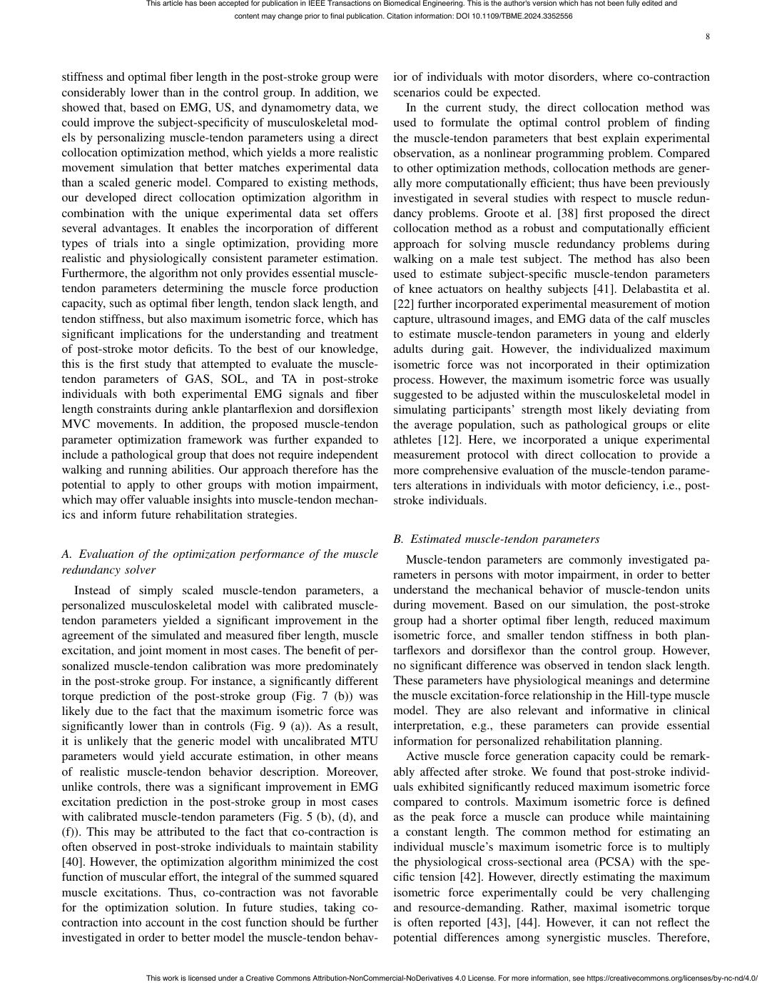

English text extracted from page 8

<pre>
This article has been accepted for publication in IEEE Transactions on Biomedical Engineering. This is the author's version which has not been fully edited and
                                           content may change prior to final publication. Citation information: DOI 10.1109/TBME.2024.3352556

                                                                                                                                                                                   8

stiffness and optimal fiber length in the post-stroke group were                           ior of individuals with motor disorders, where co-contraction
considerably lower than in the control group. In addition, we                              scenarios could be expected.
showed that, based on EMG, US, and dynamometry data, we                                       In the current study, the direct collocation method was
could improve the subject-specificity of musculoskeletal mod-                              used to formulate the optimal control problem of finding
els by personalizing muscle-tendon parameters using a direct                               the muscle-tendon parameters that best explain experimental
collocation optimization method, which yields a more realistic                             observation, as a nonlinear programming problem. Compared
movement simulation that better matches experimental data                                  to other optimization methods, collocation methods are gener-
than a scaled generic model. Compared to existing methods,                                 ally more computationally efficient; thus have been previously
our developed direct collocation optimization algorithm in                                 investigated in several studies with respect to muscle redun-
combination with the unique experimental data set offers                                   dancy problems. Groote et al. [38] first proposed the direct
several advantages. It enables the incorporation of different                              collocation method as a robust and computationally efficient
types of trials into a single optimization, providing more                                 approach for solving muscle redundancy problems during
realistic and physiologically consistent parameter estimation.                             walking on a male test subject. The method has also been
Furthermore, the algorithm not only provides essential muscle-                             used to estimate subject-specific muscle-tendon parameters
tendon parameters determining the muscle force production                                  of knee actuators on healthy subjects [41]. Delabastita et al.
capacity, such as optimal fiber length, tendon slack length, and                           [22] further incorporated experimental measurement of motion
tendon stiffness, but also maximum isometric force, which has                              capture, ultrasound images, and EMG data of the calf muscles
significant implications for the understanding and treatment                               to estimate muscle-tendon parameters in young and elderly
of post-stroke motor deficits. To the best of our knowledge,                               adults during gait. However, the individualized maximum
this is the first study that attempted to evaluate the muscle-                             isometric force was not incorporated in their optimization
tendon parameters of GAS, SOL, and TA in post-stroke                                       process. However, the maximum isometric force was usually
individuals with both experimental EMG signals and fiber                                   suggested to be adjusted within the musculoskeletal model in
length constraints during ankle plantarflexion and dorsiflexion                            simulating participants’ strength most likely deviating from
MVC movements. In addition, the proposed muscle-tendon                                     the average population, such as pathological groups or elite
parameter optimization framework was further expanded to                                   athletes [12]. Here, we incorporated a unique experimental
include a pathological group that does not require independent                             measurement protocol with direct collocation to provide a
walking and running abilities. Our approach therefore has the                              more comprehensive evaluation of the muscle-tendon parame-
potential to apply to other groups with motion impairment,                                 ters alterations in individuals with motor deficiency, i.e., post-
which may offer valuable insights into muscle-tendon mechan-                               stroke individuals.
ics and inform future rehabilitation strategies.
                                                                                           B. Estimated muscle-tendon parameters
A. Evaluation of the optimization performance of the muscle                                   Muscle-tendon parameters are commonly investigated pa-
redundancy solver                                                                          rameters in persons with motor impairment, in order to better
   Instead of simply scaled muscle-tendon parameters, a                                    understand the mechanical behavior of muscle-tendon units
personalized musculoskeletal model with calibrated muscle-                                 during movement. Based on our simulation, the post-stroke
tendon parameters yielded a significant improvement in the                                 group had a shorter optimal fiber length, reduced maximum
agreement of the simulated and measured fiber length, muscle                               isometric force, and smaller tendon stiffness in both plan-
excitation, and joint moment in most cases. The benefit of per-                            tarflexors and dorsiflexor than the control group. However,
sonalized muscle-tendon calibration was more predominately                                 no significant difference was observed in tendon slack length.
in the post-stroke group. For instance, a significantly different                          These parameters have physiological meanings and determine
torque prediction of the post-stroke group (Fig. 7 (b)) was                                the muscle excitation-force relationship in the Hill-type muscle
likely due to the fact that the maximum isometric force was                                model. They are also relevant and informative in clinical
significantly lower than in controls (Fig. 9 (a)). As a result,                            interpretation, e.g., these parameters can provide essential
it is unlikely that the generic model with uncalibrated MTU                                information for personalized rehabilitation planning.
parameters would yield accurate estimation, in other means                                    Active muscle force generation capacity could be remark-
of realistic muscle-tendon behavior description. Moreover,                                 ably affected after stroke. We found that post-stroke individ-
unlike controls, there was a significant improvement in EMG                                uals exhibited significantly reduced maximum isometric force
excitation prediction in the post-stroke group in most cases                               compared to controls. Maximum isometric force is defined
with calibrated muscle-tendon parameters (Fig. 5 (b), (d), and                             as the peak force a muscle can produce while maintaining
(f)). This may be attributed to the fact that co-contraction is                            a constant length. The common method for estimating an
often observed in post-stroke individuals to maintain stability                            individual muscle’s maximum isometric force is to multiply
[40]. However, the optimization algorithm minimized the cost                               the physiological cross-sectional area (PCSA) with the spe-
function of muscular effort, the integral of the summed squared                            cific tension [42]. However, directly estimating the maximum
muscle excitations. Thus, co-contraction was not favorable                                 isometric force experimentally could be very challenging
for the optimization solution. In future studies, taking co-                               and resource-demanding. Rather, maximal isometric torque
contraction into account in the cost function should be further                            is often reported [43], [44]. However, it can not reflect the
investigated in order to better model the muscle-tendon behav-                             potential differences among synergistic muscles. Therefore,

                 This work is licensed under a Creative Commons Attribution-NonCommercial-NoDerivatives 4.0 License. For more information, see https://creativecommons.org/licenses/by-nc-nd/4.0/
</pre>

## Page 9

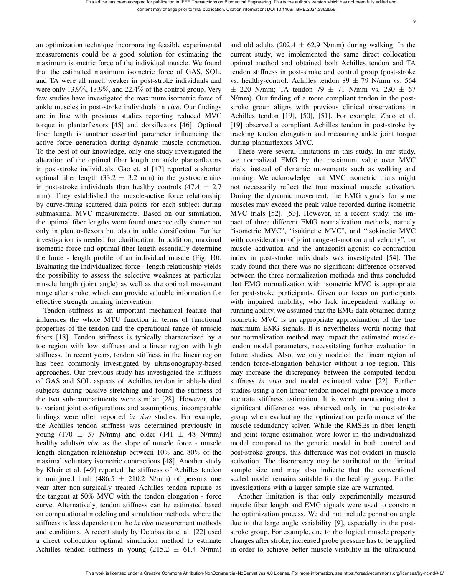

English text extracted from page 9

<pre>
This article has been accepted for publication in IEEE Transactions on Biomedical Engineering. This is the author's version which has not been fully edited and
                                           content may change prior to final publication. Citation information: DOI 10.1109/TBME.2024.3352556

                                                                                                                                                                                   9

an optimization technique incorporating feasible experimental                              and old adults (202.4 ± 62.9 N/mm) during walking. In the
measurements could be a good solution for estimating the                                   current study, we implemented the same direct collocation
maximum isometric force of the individual muscle. We found                                 optimal method and obtained both Achilles tendon and TA
that the estimated maximum isometric force of GAS, SOL,                                    tendon stiffness in post-stroke and control group (post-stroke
and TA were all much weaker in post-stroke individuals and                                 vs. healthy-control: Achilles tendon 89 ± 79 N/mm vs. 564
were only 13.9%, 13.9%, and 22.4% of the control group. Very                               ± 220 N/mm; TA tendon 79 ± 71 N/mm vs. 230 ± 67
few studies have investigated the maximum isometric force of                               N/mm). Our finding of a more compliant tendon in the post-
ankle muscles in post-stroke individuals in vivo. Our findings                             stroke group aligns with previous clinical observations in
are in line with previous studies reporting reduced MVC                                    Achilles tendon [19], [50], [51]. For example, Zhao et al.
torque in plantarflexors [45] and dorsiflexors [46]. Optimal                               [19] observed a compliant Achilles tendon in post-stroke by
fiber length is another essential parameter influencing the                                tracking tendon elongation and measuring ankle joint torque
active force generation during dynamic muscle contraction.                                 during plantarflexors MVC.
To the best of our knowledge, only one study investigated the                                 There were several limitations in this study. In our study,
alteration of the optimal fiber length on ankle plantarflexors                             we normalized EMG by the maximum value over MVC
in post-stroke individuals. Gao et. al [47] reported a shorter                             trials, instead of dynamic movements such as walking and
optimal fiber length (33.2 ± 3.2 mm) in the gastrocnemius                                  running. We acknowledge that MVC isometric trials might
in post-stroke individuals than healthy controls (47.4 ± 2.7                               not necessarily reflect the true maximal muscle activation.
mm). They established the muscle-active force relationship                                 During the dynamic movement, the EMG signals for some
by curve-fitting scattered data points for each subject during                             muscles may exceed the peak value recorded during isometric
submaximal MVC measurements. Based on our simulation,                                      MVC trials [52], [53]. However, in a recent study, the im-
the optimal fiber lengths were found unexpectedly shorter not                              pact of three different EMG normalization methods, namely
only in plantar-flexors but also in ankle dorsiflexion. Further                            “isometric MVC”, “isokinetic MVC”, and “isokinetic MVC
investigation is needed for clarification. In addition, maximal                            with consideration of joint range-of-motion and velocity”, on
isometric force and optimal fiber length essentially determine                             muscle activation and the antagonist-agonist co-contraction
the force - length profile of an individual muscle (Fig. 10).                              index in post-stroke individuals was investigated [54]. The
Evaluating the individualized force - length relationship yields                           study found that there was no significant difference observed
the possibility to assess the selective weakness at particular                             between the three normalization methods and thus concluded
muscle length (joint angle) as well as the optimal movement                                that EMG normalization with isometric MVC is appropriate
range after stroke, which can provide valuable information for                             for post-stroke participants. Given our focus on participants
effective strength training intervention.                                                  with impaired mobility, who lack independent walking or
   Tendon stiffness is an important mechanical feature that                                running ability, we assumed that the EMG data obtained during
influences the whole MTU function in terms of functional                                   isometric MVC is an appropriate approximation of the true
properties of the tendon and the operational range of muscle                               maximum EMG signals. It is nevertheless worth noting that
fibers [18]. Tendon stiffness is typically characterized by a                              our normalization method may impact the estimated muscle-
toe region with low stiffness and a linear region with high                                tendon model parameters, necessitating further evaluation in
stiffness. In recent years, tendon stiffness in the linear region                          future studies. Also, we only modeled the linear region of
has been commonly investigated by ultrasonography-based                                    tendon force-elongation behavior without a toe region. This
approaches. Our previous study has investigated the stiffness                              may increase the discrepancy between the computed tendon
of GAS and SOL aspects of Achilles tendon in able-bodied                                   stiffness in vivo and model estimated value [22]. Further
subjects during passive stretching and found the stiffness of                              studies using a non-linear tendon model might provide a more
the two sub-compartments were similar [28]. However, due                                   accurate stiffness estimation. It is worth mentioning that a
to variant joint configurations and assumptions, incomparable                              significant difference was observed only in the post-stroke
findings were often reported in vivo studies. For example,                                 group when evaluating the optimization performance of the
the Achilles tendon stiffness was determined previously in                                 muscle redundancy solver. While the RMSEs in fiber length
young (170 ± 37 N/mm) and older (141 ± 48 N/mm)                                            and joint torque estimation were lower in the individualized
healthy adultsin vivo as the slope of muscle force - muscle                                model compared to the generic model in both control and
length elongation relationship between 10% and 80% of the                                  post-stroke groups, this difference was not evident in muscle
maximal voluntary isometric contractions [48]. Another study                               activation. The discrepancy may be attributed to the limited
by Khair et al. [49] reported the stiffness of Achilles tendon                             sample size and may also indicate that the conventional
in uninjured limb (486.5 ± 210.2 N/mm) of persons one                                      scaled model remains suitable for the healthy group. Further
year after non-surgically treated Achilles tendon rupture as                               investigations with a larger sample size are warranted.
the tangent at 50% MVC with the tendon elongation - force                                     Another limitation is that only experimentally measured
curve. Alternatively, tendon stiffness can be estimated based                              muscle fiber length and EMG signals were used to constrain
on computational modeling and simulation methods, where the                                the optimization process. We did not include pennation angle
stiffness is less dependent on the in vivo measurement methods                             due to the large angle variability [9], especially in the post-
and conditions. A recent study by Delabastita et al. [22] used                             stroke group. For example, due to rheological muscle property
a direct collocation optimal simulation method to estimate                                 changes after stroke, increased probe pressure has to be applied
Achilles tendon stiffness in young (215.2 ± 61.4 N/mm)                                     in order to achieve better muscle visibility in the ultrasound

                 This work is licensed under a Creative Commons Attribution-NonCommercial-NoDerivatives 4.0 License. For more information, see https://creativecommons.org/licenses/by-nc-nd/4.0/
</pre>

## Page 10

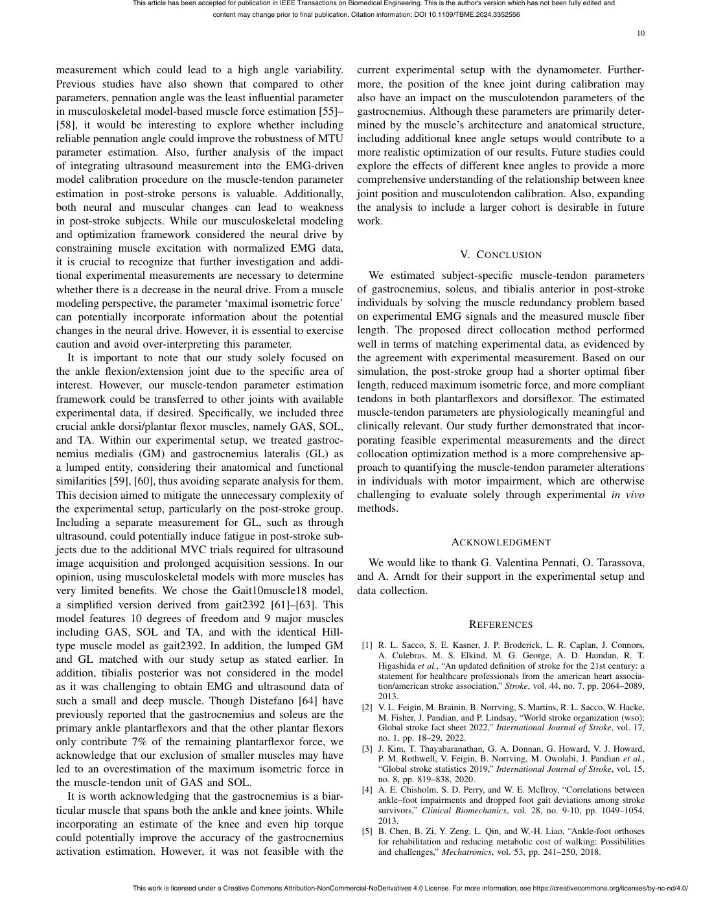

English text extracted from page 10

<pre>
This article has been accepted for publication in IEEE Transactions on Biomedical Engineering. This is the author's version which has not been fully edited and
                                           content may change prior to final publication. Citation information: DOI 10.1109/TBME.2024.3352556

                                                                                                                                                                                   10

measurement which could lead to a high angle variability.                                  current experimental setup with the dynamometer. Further-
Previous studies have also shown that compared to other                                    more, the position of the knee joint during calibration may
parameters, pennation angle was the least influential parameter                            also have an impact on the musculotendon parameters of the
in musculoskeletal model-based muscle force estimation [55]–                               gastrocnemius. Although these parameters are primarily deter-
[58], it would be interesting to explore whether including                                 mined by the muscle’s architecture and anatomical structure,
reliable pennation angle could improve the robustness of MTU                               including additional knee angle setups would contribute to a
parameter estimation. Also, further analysis of the impact                                 more realistic optimization of our results. Future studies could
of integrating ultrasound measurement into the EMG-driven                                  explore the effects of different knee angles to provide a more
model calibration procedure on the muscle-tendon parameter                                 comprehensive understanding of the relationship between knee
estimation in post-stroke persons is valuable. Additionally,                               joint position and musculotendon calibration. Also, expanding
both neural and muscular changes can lead to weakness                                      the analysis to include a larger cohort is desirable in future
in post-stroke subjects. While our musculoskeletal modeling                                work.
and optimization framework considered the neural drive by
constraining muscle excitation with normalized EMG data,
                                                                                                                            V. C ONCLUSION
it is crucial to recognize that further investigation and addi-
tional experimental measurements are necessary to determine                                   We estimated subject-specific muscle-tendon parameters
whether there is a decrease in the neural drive. From a muscle                             of gastrocnemius, soleus, and tibialis anterior in post-stroke
modeling perspective, the parameter ‘maximal isometric force’                              individuals by solving the muscle redundancy problem based
can potentially incorporate information about the potential                                on experimental EMG signals and the measured muscle fiber
changes in the neural drive. However, it is essential to exercise                          length. The proposed direct collocation method performed
caution and avoid over-interpreting this parameter.                                        well in terms of matching experimental data, as evidenced by
   It is important to note that our study solely focused on                                the agreement with experimental measurement. Based on our
the ankle flexion/extension joint due to the specific area of                              simulation, the post-stroke group had a shorter optimal fiber
interest. However, our muscle-tendon parameter estimation                                  length, reduced maximum isometric force, and more compliant
framework could be transferred to other joints with available                              tendons in both plantarflexors and dorsiflexor. The estimated
experimental data, if desired. Specifically, we included three                             muscle-tendon parameters are physiologically meaningful and
crucial ankle dorsi/plantar flexor muscles, namely GAS, SOL,                               clinically relevant. Our study further demonstrated that incor-
and TA. Within our experimental setup, we treated gastroc-                                 porating feasible experimental measurements and the direct
nemius medialis (GM) and gastrocnemius lateralis (GL) as                                   collocation optimization method is a more comprehensive ap-
a lumped entity, considering their anatomical and functional                               proach to quantifying the muscle-tendon parameter alterations
similarities [59], [60], thus avoiding separate analysis for them.                         in individuals with motor impairment, which are otherwise
This decision aimed to mitigate the unnecessary complexity of                              challenging to evaluate solely through experimental in vivo
the experimental setup, particularly on the post-stroke group.                             methods.
Including a separate measurement for GL, such as through
ultrasound, could potentially induce fatigue in post-stroke sub-
                                                                                                                          ACKNOWLEDGMENT
jects due to the additional MVC trials required for ultrasound
image acquisition and prolonged acquisition sessions. In our                                 We would like to thank G. Valentina Pennati, O. Tarassova,
opinion, using musculoskeletal models with more muscles has                                and A. Arndt for their support in the experimental setup and
very limited benefits. We chose the Gait10muscle18 model,                                  data collection.
a simplified version derived from gait2392 [61]–[63]. This
model features 10 degrees of freedom and 9 major muscles
                                                                                                                               R EFERENCES
including GAS, SOL and TA, and with the identical Hill-
type muscle model as gait2392. In addition, the lumped GM                                   [1] R. L. Sacco, S. E. Kasner, J. P. Broderick, L. R. Caplan, J. Connors,
                                                                                                A. Culebras, M. S. Elkind, M. G. George, A. D. Hamdan, R. T.
and GL matched with our study setup as stated earlier. In                                       Higashida et al., “An updated definition of stroke for the 21st century: a
addition, tibialis posterior was not considered in the model                                    statement for healthcare professionals from the american heart associa-
as it was challenging to obtain EMG and ultrasound data of                                      tion/american stroke association,” Stroke, vol. 44, no. 7, pp. 2064–2089,
                                                                                                2013.
such a small and deep muscle. Though Distefano [64] have
                                                                                            [2] V. L. Feigin, M. Brainin, B. Norrving, S. Martins, R. L. Sacco, W. Hacke,
previously reported that the gastrocnemius and soleus are the                                   M. Fisher, J. Pandian, and P. Lindsay, “World stroke organization (wso):
primary ankle plantarflexors and that the other plantar flexors                                 Global stroke fact sheet 2022,” International Journal of Stroke, vol. 17,
only contribute 7% of the remaining plantarflexor force, we                                     no. 1, pp. 18–29, 2022.
                                                                                            [3] J. Kim, T. Thayabaranathan, G. A. Donnan, G. Howard, V. J. Howard,
acknowledge that our exclusion of smaller muscles may have                                      P. M. Rothwell, V. Feigin, B. Norrving, M. Owolabi, J. Pandian et al.,
led to an overestimation of the maximum isometric force in                                      “Global stroke statistics 2019,” International Journal of Stroke, vol. 15,
the muscle-tendon unit of GAS and SOL.                                                          no. 8, pp. 819–838, 2020.
                                                                                            [4] A. E. Chisholm, S. D. Perry, and W. E. McIlroy, “Correlations between
   It is worth acknowledging that the gastrocnemius is a biar-                                  ankle–foot impairments and dropped foot gait deviations among stroke
ticular muscle that spans both the ankle and knee joints. While                                 survivors,” Clinical Biomechanics, vol. 28, no. 9-10, pp. 1049–1054,
incorporating an estimate of the knee and even hip torque                                       2013.
                                                                                            [5] B. Chen, B. Zi, Y. Zeng, L. Qin, and W.-H. Liao, “Ankle-foot orthoses
could potentially improve the accuracy of the gastrocnemius                                     for rehabilitation and reducing metabolic cost of walking: Possibilities
activation estimation. However, it was not feasible with the                                    and challenges,” Mechatronics, vol. 53, pp. 241–250, 2018.

                 This work is licensed under a Creative Commons Attribution-NonCommercial-NoDerivatives 4.0 License. For more information, see https://creativecommons.org/licenses/by-nc-nd/4.0/
</pre>

## Page 11

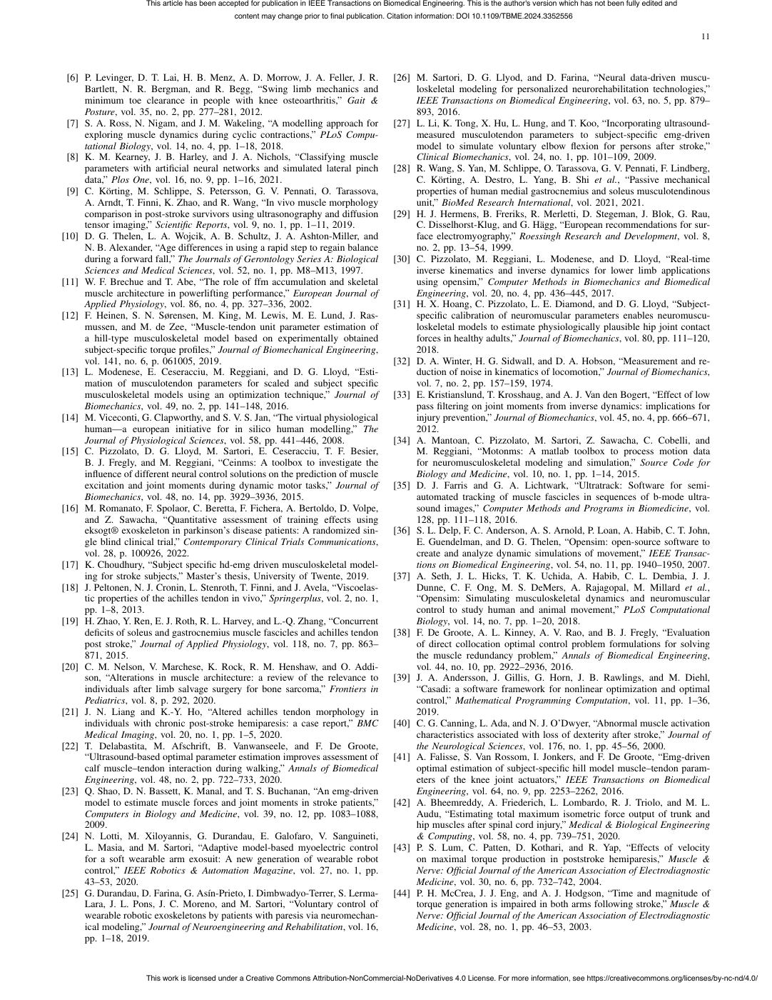

English text extracted from page 11

<pre>
This article has been accepted for publication in IEEE Transactions on Biomedical Engineering. This is the author's version which has not been fully edited and
                                               content may change prior to final publication. Citation information: DOI 10.1109/TBME.2024.3352556

                                                                                                                                                                                       11

 [6] P. Levinger, D. T. Lai, H. B. Menz, A. D. Morrow, J. A. Feller, J. R.                     [26] M. Sartori, D. G. Llyod, and D. Farina, “Neural data-driven muscu-
     Bartlett, N. R. Bergman, and R. Begg, “Swing limb mechanics and                                loskeletal modeling for personalized neurorehabilitation technologies,”
     minimum toe clearance in people with knee osteoarthritis,” Gait &amp;                              IEEE Transactions on Biomedical Engineering, vol. 63, no. 5, pp. 879–
     Posture, vol. 35, no. 2, pp. 277–281, 2012.                                                    893, 2016.
 [7] S. A. Ross, N. Nigam, and J. M. Wakeling, “A modelling approach for                       [27] L. Li, K. Tong, X. Hu, L. Hung, and T. Koo, “Incorporating ultrasound-
     exploring muscle dynamics during cyclic contractions,” PLoS Compu-                             measured musculotendon parameters to subject-specific emg-driven
     tational Biology, vol. 14, no. 4, pp. 1–18, 2018.                                              model to simulate voluntary elbow flexion for persons after stroke,”
 [8] K. M. Kearney, J. B. Harley, and J. A. Nichols, “Classifying muscle                            Clinical Biomechanics, vol. 24, no. 1, pp. 101–109, 2009.
     parameters with artificial neural networks and simulated lateral pinch                    [28] R. Wang, S. Yan, M. Schlippe, O. Tarassova, G. V. Pennati, F. Lindberg,
     data,” Plos One, vol. 16, no. 9, pp. 1–16, 2021.                                               C. Körting, A. Destro, L. Yang, B. Shi et al., “Passive mechanical
 [9] C. Körting, M. Schlippe, S. Petersson, G. V. Pennati, O. Tarassova,                           properties of human medial gastrocnemius and soleus musculotendinous
     A. Arndt, T. Finni, K. Zhao, and R. Wang, “In vivo muscle morphology                           unit,” BioMed Research International, vol. 2021, 2021.
     comparison in post-stroke survivors using ultrasonography and diffusion                   [29] H. J. Hermens, B. Freriks, R. Merletti, D. Stegeman, J. Blok, G. Rau,
     tensor imaging,” Scientific Reports, vol. 9, no. 1, pp. 1–11, 2019.                            C. Disselhorst-Klug, and G. Hägg, “European recommendations for sur-
[10] D. G. Thelen, L. A. Wojcik, A. B. Schultz, J. A. Ashton-Miller, and                            face electromyography,” Roessingh Research and Development, vol. 8,
     N. B. Alexander, “Age differences in using a rapid step to regain balance                      no. 2, pp. 13–54, 1999.
     during a forward fall,” The Journals of Gerontology Series A: Biological                  [30] C. Pizzolato, M. Reggiani, L. Modenese, and D. Lloyd, “Real-time
     Sciences and Medical Sciences, vol. 52, no. 1, pp. M8–M13, 1997.                               inverse kinematics and inverse dynamics for lower limb applications
[11] W. F. Brechue and T. Abe, “The role of ffm accumulation and skeletal                           using opensim,” Computer Methods in Biomechanics and Biomedical
     muscle architecture in powerlifting performance,” European Journal of                          Engineering, vol. 20, no. 4, pp. 436–445, 2017.
     Applied Physiology, vol. 86, no. 4, pp. 327–336, 2002.                                    [31] H. X. Hoang, C. Pizzolato, L. E. Diamond, and D. G. Lloyd, “Subject-
[12] F. Heinen, S. N. Sørensen, M. King, M. Lewis, M. E. Lund, J. Ras-                              specific calibration of neuromuscular parameters enables neuromuscu-
     mussen, and M. de Zee, “Muscle-tendon unit parameter estimation of                             loskeletal models to estimate physiologically plausible hip joint contact
     a hill-type musculoskeletal model based on experimentally obtained                             forces in healthy adults,” Journal of Biomechanics, vol. 80, pp. 111–120,
     subject-specific torque profiles,” Journal of Biomechanical Engineering,                       2018.
     vol. 141, no. 6, p. 061005, 2019.                                                         [32] D. A. Winter, H. G. Sidwall, and D. A. Hobson, “Measurement and re-
[13] L. Modenese, E. Ceseracciu, M. Reggiani, and D. G. Lloyd, “Esti-                               duction of noise in kinematics of locomotion,” Journal of Biomechanics,
     mation of musculotendon parameters for scaled and subject specific                             vol. 7, no. 2, pp. 157–159, 1974.
     musculoskeletal models using an optimization technique,” Journal of                       [33] E. Kristianslund, T. Krosshaug, and A. J. Van den Bogert, “Effect of low
     Biomechanics, vol. 49, no. 2, pp. 141–148, 2016.                                               pass filtering on joint moments from inverse dynamics: implications for
[14] M. Viceconti, G. Clapworthy, and S. V. S. Jan, “The virtual physiological                      injury prevention,” Journal of Biomechanics, vol. 45, no. 4, pp. 666–671,
     human—a european initiative for in silico human modelling,” The                                2012.
     Journal of Physiological Sciences, vol. 58, pp. 441–446, 2008.                            [34] A. Mantoan, C. Pizzolato, M. Sartori, Z. Sawacha, C. Cobelli, and
[15] C. Pizzolato, D. G. Lloyd, M. Sartori, E. Ceseracciu, T. F. Besier,                            M. Reggiani, “Motonms: A matlab toolbox to process motion data
     B. J. Fregly, and M. Reggiani, “Ceinms: A toolbox to investigate the                           for neuromusculoskeletal modeling and simulation,” Source Code for
     influence of different neural control solutions on the prediction of muscle                    Biology and Medicine, vol. 10, no. 1, pp. 1–14, 2015.
     excitation and joint moments during dynamic motor tasks,” Journal of                      [35] D. J. Farris and G. A. Lichtwark, “Ultratrack: Software for semi-
     Biomechanics, vol. 48, no. 14, pp. 3929–3936, 2015.                                            automated tracking of muscle fascicles in sequences of b-mode ultra-
[16] M. Romanato, F. Spolaor, C. Beretta, F. Fichera, A. Bertoldo, D. Volpe,                        sound images,” Computer Methods and Programs in Biomedicine, vol.
     and Z. Sawacha, “Quantitative assessment of training effects using                             128, pp. 111–118, 2016.
     eksogt® exoskeleton in parkinson’s disease patients: A randomized sin-                    [36] S. L. Delp, F. C. Anderson, A. S. Arnold, P. Loan, A. Habib, C. T. John,
     gle blind clinical trial,” Contemporary Clinical Trials Communications,                        E. Guendelman, and D. G. Thelen, “Opensim: open-source software to
     vol. 28, p. 100926, 2022.                                                                      create and analyze dynamic simulations of movement,” IEEE Transac-
[17] K. Choudhury, “Subject specific hd-emg driven musculoskeletal model-                           tions on Biomedical Engineering, vol. 54, no. 11, pp. 1940–1950, 2007.
     ing for stroke subjects,” Master’s thesis, University of Twente, 2019.                    [37] A. Seth, J. L. Hicks, T. K. Uchida, A. Habib, C. L. Dembia, J. J.
[18] J. Peltonen, N. J. Cronin, L. Stenroth, T. Finni, and J. Avela, “Viscoelas-                    Dunne, C. F. Ong, M. S. DeMers, A. Rajagopal, M. Millard et al.,
     tic properties of the achilles tendon in vivo,” Springerplus, vol. 2, no. 1,                   “Opensim: Simulating musculoskeletal dynamics and neuromuscular
     pp. 1–8, 2013.                                                                                 control to study human and animal movement,” PLoS Computational
[19] H. Zhao, Y. Ren, E. J. Roth, R. L. Harvey, and L.-Q. Zhang, “Concurrent                        Biology, vol. 14, no. 7, pp. 1–20, 2018.
     deficits of soleus and gastrocnemius muscle fascicles and achilles tendon                 [38] F. De Groote, A. L. Kinney, A. V. Rao, and B. J. Fregly, “Evaluation
     post stroke,” Journal of Applied Physiology, vol. 118, no. 7, pp. 863–                         of direct collocation optimal control problem formulations for solving
     871, 2015.                                                                                     the muscle redundancy problem,” Annals of Biomedical Engineering,
[20] C. M. Nelson, V. Marchese, K. Rock, R. M. Henshaw, and O. Addi-                                vol. 44, no. 10, pp. 2922–2936, 2016.
     son, “Alterations in muscle architecture: a review of the relevance to                    [39] J. A. Andersson, J. Gillis, G. Horn, J. B. Rawlings, and M. Diehl,
     individuals after limb salvage surgery for bone sarcoma,” Frontiers in                         “Casadi: a software framework for nonlinear optimization and optimal
     Pediatrics, vol. 8, p. 292, 2020.                                                              control,” Mathematical Programming Computation, vol. 11, pp. 1–36,
[21] J. N. Liang and K.-Y. Ho, “Altered achilles tendon morphology in                               2019.
     individuals with chronic post-stroke hemiparesis: a case report,” BMC                     [40] C. G. Canning, L. Ada, and N. J. O’Dwyer, “Abnormal muscle activation
     Medical Imaging, vol. 20, no. 1, pp. 1–5, 2020.                                                characteristics associated with loss of dexterity after stroke,” Journal of
[22] T. Delabastita, M. Afschrift, B. Vanwanseele, and F. De Groote,                                the Neurological Sciences, vol. 176, no. 1, pp. 45–56, 2000.
     “Ultrasound-based optimal parameter estimation improves assessment of                     [41] A. Falisse, S. Van Rossom, I. Jonkers, and F. De Groote, “Emg-driven
     calf muscle–tendon interaction during walking,” Annals of Biomedical                           optimal estimation of subject-specific hill model muscle–tendon param-
     Engineering, vol. 48, no. 2, pp. 722–733, 2020.                                                eters of the knee joint actuators,” IEEE Transactions on Biomedical
[23] Q. Shao, D. N. Bassett, K. Manal, and T. S. Buchanan, “An emg-driven                           Engineering, vol. 64, no. 9, pp. 2253–2262, 2016.
     model to estimate muscle forces and joint moments in stroke patients,”                    [42] A. Bheemreddy, A. Friederich, L. Lombardo, R. J. Triolo, and M. L.
     Computers in Biology and Medicine, vol. 39, no. 12, pp. 1083–1088,                             Audu, “Estimating total maximum isometric force output of trunk and
     2009.                                                                                          hip muscles after spinal cord injury,” Medical &amp; Biological Engineering
[24] N. Lotti, M. Xiloyannis, G. Durandau, E. Galofaro, V. Sanguineti,                              &amp; Computing, vol. 58, no. 4, pp. 739–751, 2020.
     L. Masia, and M. Sartori, “Adaptive model-based myoelectric control                       [43] P. S. Lum, C. Patten, D. Kothari, and R. Yap, “Effects of velocity
     for a soft wearable arm exosuit: A new generation of wearable robot                            on maximal torque production in poststroke hemiparesis,” Muscle &amp;
     control,” IEEE Robotics &amp; Automation Magazine, vol. 27, no. 1, pp.                             Nerve: Official Journal of the American Association of Electrodiagnostic
     43–53, 2020.                                                                                   Medicine, vol. 30, no. 6, pp. 732–742, 2004.
[25] G. Durandau, D. Farina, G. Ası́n-Prieto, I. Dimbwadyo-Terrer, S. Lerma-                   [44] P. H. McCrea, J. J. Eng, and A. J. Hodgson, “Time and magnitude of
     Lara, J. L. Pons, J. C. Moreno, and M. Sartori, “Voluntary control of                          torque generation is impaired in both arms following stroke,” Muscle &amp;
     wearable robotic exoskeletons by patients with paresis via neuromechan-                        Nerve: Official Journal of the American Association of Electrodiagnostic
     ical modeling,” Journal of Neuroengineering and Rehabilitation, vol. 16,                       Medicine, vol. 28, no. 1, pp. 46–53, 2003.
     pp. 1–18, 2019.

                     This work is licensed under a Creative Commons Attribution-NonCommercial-NoDerivatives 4.0 License. For more information, see https://creativecommons.org/licenses/by-nc-nd/4.0/
</pre>

## Page 12

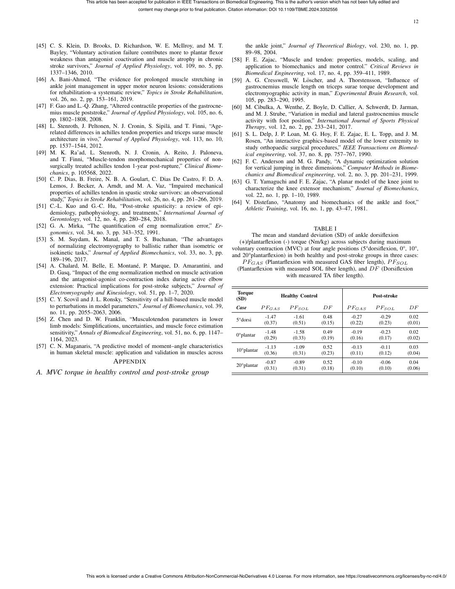

English text extracted from page 12

<pre>
This article has been accepted for publication in IEEE Transactions on Biomedical Engineering. This is the author's version which has not been fully edited and
                                               content may change prior to final publication. Citation information: DOI 10.1109/TBME.2024.3352556

                                                                                                                                                                                         12

[45] C. S. Klein, D. Brooks, D. Richardson, W. E. McIlroy, and M. T.                                the ankle joint,” Journal of Theoretical Biology, vol. 230, no. 1, pp.
     Bayley, “Voluntary activation failure contributes more to plantar flexor                       89–98, 2004.
     weakness than antagonist coactivation and muscle atrophy in chronic                       [58] F. E. Zajac, “Muscle and tendon: properties, models, scaling, and
     stroke survivors,” Journal of Applied Physiology, vol. 109, no. 5, pp.                         application to biomechanics and motor control.” Critical Reviews in
     1337–1346, 2010.                                                                               Biomedical Engineering, vol. 17, no. 4, pp. 359–411, 1989.
[46] A. Bani-Ahmed, “The evidence for prolonged muscle stretching in                           [59] A. G. Cresswell, W. Löscher, and A. Thorstensson, “Influence of
     ankle joint management in upper motor neuron lesions: considerations                           gastrocnemius muscle length on triceps surae torque development and
     for rehabilitation–a systematic review,” Topics in Stroke Rehabilitation,                      electromyographic activity in man,” Experimental Brain Research, vol.
     vol. 26, no. 2, pp. 153–161, 2019.                                                             105, pp. 283–290, 1995.
[47] F. Gao and L.-Q. Zhang, “Altered contractile properties of the gastrocne-                 [60] M. Cibulka, A. Wenthe, Z. Boyle, D. Callier, A. Schwerdt, D. Jarman,
     mius muscle poststroke,” Journal of Applied Physiology, vol. 105, no. 6,                       and M. J. Strube, “Variation in medial and lateral gastrocnemius muscle
     pp. 1802–1808, 2008.                                                                           activity with foot position,” International Journal of Sports Physical
[48] L. Stenroth, J. Peltonen, N. J. Cronin, S. Sipilä, and T. Finni, “Age-                        Therapy, vol. 12, no. 2, pp. 233–241, 2017.
     related differences in achilles tendon properties and triceps surae muscle                [61] S. L. Delp, J. P. Loan, M. G. Hoy, F. E. Zajac, E. L. Topp, and J. M.
     architecture in vivo,” Journal of Applied Physiology, vol. 113, no. 10,                        Rosen, “An interactive graphics-based model of the lower extremity to
     pp. 1537–1544, 2012.                                                                           study orthopaedic surgical procedures,” IEEE Transactions on Biomed-
[49] M. K. Ra’ad, L. Stenroth, N. J. Cronin, A. Reito, J. Paloneva,                                 ical engineering, vol. 37, no. 8, pp. 757–767, 1990.
     and T. Finni, “Muscle-tendon morphomechanical properties of non-                          [62] F. C. Anderson and M. G. Pandy, “A dynamic optimization solution
     surgically treated achilles tendon 1-year post-rupture,” Clinical Biome-                       for vertical jumping in three dimensions,” Computer Methods in Biome-
     chanics, p. 105568, 2022.                                                                      chanics and Biomedical engineering, vol. 2, no. 3, pp. 201–231, 1999.
[50] C. P. Dias, B. Freire, N. B. A. Goulart, C. Dias De Castro, F. D. A.                      [63] G. T. Yamaguchi and F. E. Zajac, “A planar model of the knee joint to
     Lemos, J. Becker, A. Arndt, and M. A. Vaz, “Impaired mechanical                                characterize the knee extensor mechanism,” Journal of Biomechanics,
     properties of achilles tendon in spastic stroke survivors: an observational                    vol. 22, no. 1, pp. 1–10, 1989.
     study,” Topics in Stroke Rehabilitation, vol. 26, no. 4, pp. 261–266, 2019.               [64] V. Distefano, “Anatomy and biomechanics of the ankle and foot,”
[51] C.-L. Kuo and G.-C. Hu, “Post-stroke spasticity: a review of epi-                              Athletic Training, vol. 16, no. 1, pp. 43–47, 1981.
     demiology, pathophysiology, and treatments,” International Journal of
     Gerontology, vol. 12, no. 4, pp. 280–284, 2018.
[52] G. A. Mirka, “The quantification of emg normalization error,” Er-                                                            TABLE I
     gonomics, vol. 34, no. 3, pp. 343–352, 1991.                                                      The mean and standard deviation (SD) of ankle dorsiflexion
[53] S. M. Suydam, K. Manal, and T. S. Buchanan, “The advantages                                  (+)/plantarflexion (-) torque (Nm/kg) across subjects during maximum
     of normalizing electromyography to ballistic rather than isometric or                     voluntary contraction (MVC) at four angle positions (5°dorsiflexion, 0°, 10°,
     isokinetic tasks,” Journal of Applied Biomechanics, vol. 33, no. 3, pp.                   and 20°plantarflexion) in both healthy and post-stroke groups in three cases:
     189–196, 2017.                                                                                P FGAS (Plantarflexion with measured GAS fiber length), P FSOL
[54] A. Chalard, M. Belle, E. Montané, P. Marque, D. Amarantini, and                            (Plantarflexion with measured SOL fiber length), and DF (Dorsiflexion
     D. Gasq, “Impact of the emg normalization method on muscle activation                                            with measured TA fiber length).
     and the antagonist-agonist co-contraction index during active elbow
     extension: Practical implications for post-stroke subjects,” Journal of
     Electromyography and Kinesiology, vol. 51, pp. 1–7, 2020.                                    Torque
                                                                                                                        Healthy Control                               Post-stroke
[55] C. Y. Scovil and J. L. Ronsky, “Sensitivity of a hill-based muscle model                    (SD)
     to perturbations in model parameters,” Journal of Biomechanics, vol. 39,                    Case         P FGAS        P FSOL           DF          P FGAS        P FSOL          DF
     no. 11, pp. 2055–2063, 2006.
                                                                                                               -1.47          -1.61          0.48          -0.27         -0.29          0.02
[56] Z. Chen and D. W. Franklin, “Musculotendon parameters in lower                              5°dorsi
                                                                                                               (0.37)         (0.51)        (0.15)         (0.22)        (0.23)        (0.01)
     limb models: Simplifications, uncertainties, and muscle force estimation
     sensitivity,” Annals of Biomedical Engineering, vol. 51, no. 6, pp. 1147–                                 -1.48          -1.58          0.49          -0.19         -0.23          0.02
                                                                                                 0°plantar
     1164, 2023.                                                                                               (0.29)         (0.33)        (0.19)         (0.16)        (0.17)        (0.02)
[57] C. N. Maganaris, “A predictive model of moment–angle characteristics                                      -1.13          -1.09          0.52          -0.13         -0.11          0.03
                                                                                                 10°plantar
     in human skeletal muscle: application and validation in muscles across                                    (0.36)         (0.31)        (0.23)         (0.11)        (0.12)        (0.04)
                       A PPENDIX                                                                 20°plantar
                                                                                                               -0.87          -0.89          0.52          -0.10         -0.06          0.04
                                                                                                               (0.31)         (0.31)        (0.18)         (0.10)        (0.10)        (0.06)
A. MVC torque in healthy control and post-stroke group

                     This work is licensed under a Creative Commons Attribution-NonCommercial-NoDerivatives 4.0 License. For more information, see https://creativecommons.org/licenses/by-nc-nd/4.0/
</pre>

