# 基于肌电约束与超声信息的卒中后偏瘫肌腱参数估计

Longbin Zhang, Tom Van Wouwe, Shiyang Yan, and Ruoli Wang

摘要—在卒中后患者中，常可观察到踝关节处肌腱单位发生继发性形态学和力学特性的改变。这些变化可能会改变力量生成能力，并影响行走等日常活动。本研究旨在通过基于实验肌电（EMG）信号和实测肌纤维长度，利用直接配置最优控制方法求解肌肉冗余问题，从而估计卒中后患者的个体特异性肌腱参数。我们估计了七名卒中后患者和七名健康对照受试者的腓肠肌、比目鱼肌和胫骨前肌的个体特异性肌腱参数。研究发现，卒中组的最大等长肌力、肌腱刚度以及最优肌纤维长度均显著低于对照组。我们还计算了肌肉兴奋程度和肌纤维长度的估计值与实验值之间的均方根误差。与缩放后的通用参数相比，采用估计的个体特异性肌腱参数（来自肌肉冗余求解器）的肌肉骨骼模型在肌肉兴奋度和肌纤维长度方面获得了更好的估计结果。我们的研究结果还表明，肌肉冗余求解器能够估计出使受力行为与实验测量值更吻合的肌腱参数。卒中后患者的这些肌腱参数具有生理学意义，并可能为治疗和/或康复规划提供参考。

索引词—肌肉骨骼建模，肌肉冗余求解器，直接配置，优化，肌纤维长度

## I. 引言

中风（脑卒中）在临床上被定义为由中枢神经系统细胞的脑血管突然破裂或阻塞引起的神经系统疾病 [1]。它是全球第二大死亡原因和第三大致残原因 [2], [3]。中风后，骨骼肌也可能经历继发性的结构和功能改变。踝关节周围的肌肉在中风后常常受到累及。例如，踝关节跖屈肌无力可能无法抵消支撑相期间的外界背屈力矩，从而导致不受控制的胫骨前移；踝关节背屈肌无力可能导致摆动相期间足部廓清困难 [4]–[6]。因此，定性与定量地理解卒中后的肌肉行为，有助于定制化康复干预措施的设计以及辅助技术的发展。

为了更好地理解肌肉的生物力学行为，常使用基于 Hill 型肌肉模型（Hill-type muscle models）的计算肌肉骨骼建模 [7]。三元素 Hill 型肌肉模型通常由串联弹性元件（series elastic element, SE）、收缩元件（contractile element, CE）以及并联弹性元件（parallel elastic element, PE）组成，它们描述了单个肌肉的力-长度、力-速度以及肌腱力-长度关系。在 Hill 型肌肉模型中，包括最大等长肌力（maximum isometric force）、最佳肌纤维长度（optimal fiber length）、肌腱松弛长度（tendon slack length）和肌腱刚度（tendon stiffness）在内的若干肌-腱参数，在将肌肉兴奋转化为肌肉力、从而表征运动过程中肌肉的发力能力方面起着决定性作用 [8]。这些肌-腱参数还为肌肉机制在不同条件下如何改变提供了有价值的信息。然而，这些参数通常难以在活体（in vivo）中直接测量。通用肌-腱参数可以通过缩放后的肌肉骨骼模型进行估计，该方法通常仅依赖于受试者的身高和/或体重。该缩放过程被称为人体测量学缩放（anthropometric scaling），它未考虑关键的个体特异性信息，例如肌肉功能 [8], [9]、年龄 [10] 和体力活动水平 [11]。为了研究病理状态个体或精英运动员 [12] 的肌肉行为，需要一种能够更精确估计肌-腱参数的更优方法，尤其是在个体特异性应用中。

近年来，利用优化算法估计个体特异性肌-腱参数的研究受到了越来越多的关注。Modenese 等人 [13] 应用带有形态学缩放的最小二乘优化技术来估计最佳肌纤维长度和肌腱松弛长度，同时确保保持生理一致性。然而，该方法仅基于开源 Living Human Digital Library 数据集 [14] 的图像估计了髋关节肌肉的最佳肌纤维长度和肌腱松弛长度。受试者在不同运动过程中的肌肉兴奋、运动学和动力学等其他信息均未被考虑。Pizzolato 等人 [15] 提出了校准的肌电图（EMG）驱动神经肌肉骨骼建模（calibrated electromyography (EMG)-informed neuromusculoskeletal modelling, CEINMS）

工具箱，其中包括针对特定受试者的肌腱参数校准过程，即最大等长肌力、最佳肌纤维长度和肌腱松弛长度。他们的肌电（EMG）建模方法（CEINMS）已被应用于各种病理人群以预测肌肉力和关节力矩，例如帕金森病（Parkinson’s disease）患者 [16] 和脑卒中后（post-stroke）患者 [17]。然而，Pizzolato 等人提出的校准过程并未将实验测得的肌纤维长度作为约束条件纳入其中。因此，肌腱参数和肌腱刚度可能无法得到良好的校准。肌腱刚度在肌腱复合体（muscle-tendon unit, MTU）的整体功能中起着至关重要的作用，它不仅影响肌腱的粘弹性特征，还影响肌纤维的工作范围 [18]。值得注意的是，在脑卒中后患者中已观察到肌腱刚度的改变 [19]–[21]。研究并量化肌腱刚度对于全面理解脑卒中后患者在运动过程中的肌腱相互作用至关重要，能够为量身定制的康复策略提供有价值的见解。Delabastita 等人 [22] 提出了一种新方法，通过结合超声图像和小腿肌肉的 EMG 数据以及健全人在行走过程中的关节力矩来求解动态优化问题，从而估算肌腱参数。他们提出的肌肉冗余求解算法估算的小腿肌腱参数与文献报道的值高度吻合，同时也改进了行走过程中肌腱动态相互作用的计算，并突显了个体化小腿肌腱参数的重要性。然而，他们仅基于超声图像估算了腓肠肌内侧头的肌纤维长度。此外，他们将 EMG 值归一化为行走过程中的最大值的方法可能不适用于行动受损的病理群体，例如本研究中的脑卒中后患者，他们可能不具备独立行走或跑步的能力。此外，在估算最大等长肌力时，使用自由参数对 EMG 信号进行归一化可能会带来问题。例如，应用权重因子按比例调整实验测得的 EMG，使得在不改变最大等长肌力的情况下产生等量的肌肉力。这可能会导致最大等长肌力估算的不确定性增加，而这是我们研究中的一个关键参数。其他 EMG 驱动的建模框架也已应用于脑卒中后患者，用于肌肉力和关节力矩估算 [17], [23]、可穿戴外骨骼控制策略设计 [24]–[26] 以及关节运动学预测 [27]。据我们所知，结合超声引导优化的 EMG 驱动建模方法尚未应用于评估脑卒中后患者的肌腱参数。

本研究旨在利用能够最佳解释实验采集的 EMG 数据和肌纤维长度的肌肉骨骼模型，评估脑卒中后个体肌腱参数的可能改变。该问题通过将每个个体的数次等长踝关节背屈和跖屈试验的实验数据合并到一个最优控制问题中来求解。

## II. 方法

## A. 实验设置与数据处理

从当地一家康复诊所招募了七名中风后受试者（年龄：$5 3 . 7 \pm 1 6 . 2$ 岁；性别：1女/6男；体重：$7 4 . 1 \ \pm \ 1 4 . 4$ kg；身高：$1 7 2 . 1 \pm \ : 1 0 . 1$ cm）。纳入标准为：（1）入组前发生中风 > 6 个月；（2）三个月内未接受过抗痉挛治疗；（3）无其他下肢损伤或疾患。通过广告招募了七名健全受试者作为对照组（年龄：$5 4 . 4 \pm 6 . 4$ 岁；性别：3女/4男；体重：70.0 $\pm \nobreakspace 9 . 5 \nobreakspace$ kg；身高：$1 6 8 . 4 ~ \pm ~ 9 . 5$ cm）。瑞典伦理审查局（Swedish Ethical Review Authority）批准了本研究（Dnr. 2016/286-32），所有受试者均签署了书面知情同意书。中风后受试者的数据集是先前一项研究 [9] 的子集。总共招募了 11 名中风后受试者。其中 3 名受试者中途退出，1 名受试者的数据因图像质量较差而被排除。所有中风后受试者均需要辅助器具以辅助行动。其中，3 人依赖轮椅，3 人使用拐杖和踝足矫形器（AFO），1 人仅使用 AFO。测量期间，所有受试者均保持舒适的半直立坐位，膝关节屈曲 30°，足部牢固固定在与测力计（IsoMed 2000, Hemau, Germany）相连的脚踏板上（Fig. 1）。在初始位置，脚踏板垂直于受试者的胫骨；该位置被定义为 0° 踝关节旋转。测试前评估了每位受试者的可用关节活动度（ROM），在测试 ROM 范围内未发现任何不适。对照组和中风后受试者均进行了若干次最大自主收缩（MVC）任务。对于对照组，在保持特定关节角度的同时对抗测力计进行最大自主等长背屈和跖屈收缩。在这些收缩过程中，测力计以 3000 Hz 的频率同步记录关节扭矩和角度测量值。为确保踝关节的功能性屈伸轴与测力计的屈伸轴对齐良好，我们遵循了先前研究 [28] 推荐的标准化程序。具体而言，使用激光指示装置将踝关节屈/伸轴与测力计轴线对齐。实验在四个不同的踝关节角度下进行（背屈 5°、0°、跖屈 10° 和 20°）。对于中风后组，由于背屈 ROM 受限，七名受试者中有三名无法在背屈 5° 时进行 MVC。因此，仅在三个角度位置进行了测量。研究人员在整个测量过程中给予言语鼓励。在每个角度下，受试者均被指示进行持续 5 秒的背屈/跖屈 MVC。重复进行一次，两次重复之间休息 30 秒。

采集了每位受试者单腿（对照组随机选择一侧，中风后组选择偏瘫侧）腓肠肌（GAS）、比目鱼肌（SOL）和胫骨前肌（TA）的肌肉激活度（表面肌电图，surface EMG，3000 Hz，Noraxon Inc., AZ, USA），电极放置参照欧洲表面肌电图推荐标准 [29]。原始 EMG 信号经高通（20-500 Hz）滤波、整流、低通滤波（6 Hz），随后根据所有 MVC 测试期间的最大 EMG 信号进行归一化 [26], [30], [31]。对测量的踝关节角度和扭矩应用了低通零相位巴特沃斯滤波器（6 Hz）[32]–[34]。

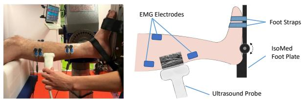  
Fig. 1. 实验设置。所有参与者均以舒适的半直立姿势就坐，膝关节屈曲 30°，足部牢固固定在连接至测力计的踏板上。实验期间同时记录肌肉激活度（通过 EMG 电极）和肌纤维长度（通过超声）。

在跖屈 MVC 期间，使用配备 38 mm 宽线阵换能器（6–14 MHz）的超声成像系统（Mindray M9，深圳，中国）同步记录 GAS 或 SOL 的超声图像；在背屈 MVC 期间记录 TA 的超声图像。使用 UltraTrack [35] 自动追踪肌纤维长度，随后仔细进行目视检查以纠正任何潜在的追踪误差。根据超声追踪的肌肉，我们将动作分为三种情况：$P F _ { G A S }$（测量 GAS 纤维长度的跖屈）、$P F _ { S O L }$（测量 SOL 纤维长度的跖屈）和 DF（测量 TA 纤维长度的背屈）。

## B. 肌腱参数估计

特定受试者的肌腱参数估计被构建为一个最优控制问题。对于每位受试者，肌肉骨骼模型（gait10musc18, OpenSim [36], [37]）的肌腱参数（最大等长肌力、最佳肌纤维长度、肌腱松弛长度和肌腱刚度）均经过估计，以使在不同等长收缩任务中实验观测值与模拟行为之间的差异最小化。该模型（gait10musc18）被修改为仅包含足部和胫骨节段，以及驱动踝关节的肌肉：GAS、SOL 和 TA。每块肌肉均参照 De Groote 等人 [38] 的方法建模为具有顺应性肌腱的 Hill 型肌肉。

对于每个个体，修改后模型的肌肉骨骼几何结构均使用 OpenSim 缩放工具进行缩放。对于健康对照组，我们依靠动作捕捉系统（Mocap，Qualisys，瑞典哥德堡）捕获的可用解剖标记点位置来缩放腿部和足部尺寸。对于中风后受试者，缩放则是基于人工测量的人体测量学长度进行的。缩放后的模型作为初始参考，通过求解以下最优控制问题来估计个体化的肌腱参数 $\textbf { ( p ) } = \ [ l _ { M , o p t } , l _ { T S } , k _ { T } , F _ { m a x } ] )$：

$$
\min _ {\mathbf {p}, e _ {1} (t), \ldots e _ {n _ {t r i a l s}} (t), \tau_ {r e s}}
$$

$$
J\tag{1}
$$

subject to

$$
\tau_ {e x p} = R \times F _ {T} + \tau_ {r e s}\tag{2}
$$

$$
\dot {e} = f _ {a c t} (e, a)\tag{3}
$$

$$
\dot {F _ {T}} = f _ {m t} (F _ {T}, a, q, \mathbf {p})\tag{4}
$$

$$
c _ {p h y s i o l o g i c a l} (F _ {T}, a, q, \mathbf {p}) \geq 0\tag{5}
$$

该最优控制问题的状态量为肌肉激活度 (a) 和肌腱力 $( F _ { T } )$。控制量为肌肉兴奋度 (e) 和储备执行器力矩 $( \tau _ { r e s } )$。代价函数 J 由四项的加权和组成，在单次优化过程中对所有进行的试验 $( n _ { t r i a l s } )$ 中的全部三块肌肉求和。

$$
J = \sum_ {i = 1} ^ {n _ {t r i a l s}} w _ {E M G} J _ {E M G, i} + w _ {F L} J _ {F L, i} + w _ {e f f o r t} J _ {e f f o r t, i} + w _ {r e s} J _ {r e s, i}\tag{6}
$$

其中 $w _ { E M G } = 1 , w _ { F L } = 1 , w _ { e f f o r t } = 0 . 1$ 以及 $w _ { r e s } = 1 0$ 为初始权重因子。由于权重调整过程是针对个体分别进行的以达到最佳性能，因此不同受试者之间的权重可能会略有不同。为了确定每个组成部分的最优权重，参考先前的研究 [22] 采用了一种权重调整方法。具体而言，首先将增加或减少某一项的权重对代价函数中其余跟踪项的影响进行可视化。随后，我们选择了能够有效最小化目标项同时避免其他项增大的权重。

代价函数由一个 EMG 项组成：

$$
J _ {E M G} = \int_ {t _ {0}} ^ {t _ {f}} (e ^ {2} (t) - \hat {e} ^ {2} (t)) d t\tag{7}
$$

该项是模拟肌肉兴奋度 $e ( t )$ 与测量的归一化 EMG 信号 $\hat { e } ( t )$ 之间差异的度量。肌纤维长度项：

$$
J _ {F L} = \int_ {t _ {0}} ^ {t _ {f}} (l _ {f} ^ {2} (t) - \hat {l} _ {f} ^ {2} (t)) d t\tag{8}
$$

是模拟肌纤维长度 $l _ { f } ( t )$ 与测量的肌纤维长度 $\hat { l } _ { f } ( t )$ 之间差异的度量。

努力程度项：

$$
J _ {e f f o r t} = \int_ {t _ {0}} ^ {t _ {f}} (e ^ {2} (t) + a ^ {2} (t)) d t\tag{9}
$$

对优化问题进行正则化，以避免需要更多肌肉用力的冗余解，其中 $a ( t )$ 是肌肉激活度。

储备执行器项：

$$
J _ {r e s} = \int_ {t _ {0}} ^ {t _ {f}} \tau_ {r e s} ^ {2} (t) d t\tag{10}
$$

  
Fig. 2. (a) 使用肌肉冗余求解器进行个体化肌腱参数估计的概述。我们首先通过记录的静态标记点轨迹或测量的腿长缩放通用肌肉骨骼模型（gait10dof18musc），以适应每个受试者的人体测量特征。使用从测力计（Dynamometer）测得的踝关节角度作为肌肉分析的输入，以计算每个肌腱单元的肌腱长度和力臂。在优化过程中，我们还基于实验测量添加了约束，即三块肌肉（GAS、SOL、TA）的肌肉兴奋度和纤维长度。然后，我们通过最小化肌肉激活度平方和以及最大化测量的与模拟的关节力矩、EMG 和肌纤维长度之间的一致性来求解肌腱参数。最后，我们获得了每个个体的个体化肌腱参数：最大等长肌力 $F _ { m a x } ,$ 最佳纤维长度 $l _ { M , o p t }$、肌腱刚度 $k _ { T }$ 和肌腱松弛长度 $l _ { T S }$。(b) 通过交叉验证方法对肌肉冗余求解器的优化性能进行评估的概述。具体而言，75% 的试验用于校准以获得具有校准肌腱参数的个体化模型，然后在剩余试验上进行测试。评估了两种情况（情况 1：通用模型；情况 2：个体化模型）。在情况 2 中，个体化模型的肌腱参数是使用肌肉冗余求解器优化进行校准过程的输出，而情况 1 中通用模型的参数来自缩放的肌肉骨骼模型。在两种情况下，关节角度、关节力矩、EMG 数据以及通用/个体化肌肉骨骼模型均用作肌肉冗余求解器的输入。输出参数为追踪的肌肉兴奋度、关节力矩和纤维长度。

表示添加到踝关节的储备执行器，可为踝关节肌肉提供额外的关节力矩。将其包含在模型中是为了提高优化问题的数值稳定性，并确保即使在建模的肌肉力量不足以产生测得的关节力矩时也能获得可行解。在校准试验中，该项被赋予很大权重，以确保其贡献可以忽略不计。在评估过程中，储备执行器项用作模型与实验数据之间不匹配程度的度量。

该优化问题受到约束，使得肌肉产生的关节力矩与储备执行器力矩 $\left( \tau _ { r e s } \right)$ 之和等于测力计测量的实验关节力矩 $( \tau _ { e x p } )$（公式 2）。R 为力臂矩阵，描述了各肌肉相对于踝关节的力臂，并取决于踝关节和膝关节角度 $( q )$。踝关节角度直接从测力计记录中获取。在所有试验和受试者中，膝关节角度恒定为 $3 0 ^ { \circ }$。

我们施加了如文献 [38] 中所述的肌肉兴奋-激活力学 $( f _ { a c t } )$ 以及肌腱动力学 $( f _ { m t } )$：

$$
\dot {e} \quad = f _ {a c t} (e, a)\tag{11}
$$

$$
{\dot {F _ {T}}} {= f _ {m t} (F _ {T}, a, q, \mathbf {p})}\tag{12}
$$

需要注意的是，估计的参数作为肌腱动力学的输入。施加了额外的约束 $( c _ { p h y s i o l o g i c a l } ( F _ { T } , a , q , \mathbf { p } ) \ \geq \ 0 .$，公式 (5)）以确保最优解在生理上是可行的：

• GAS、SOL 和 TA 的最佳肌纤维长度分别被限制在最大测量肌纤维长度的 40% 到 120% 之间 [22]。

• 估计值与通用值之间的最佳肌纤维长度、肌腱松弛长度和肌腱刚度的比值被约束为在 GAS 和 SOL 中相等，因为它们构成了小腿三头肌肌群并共享跟腱。

(a)

(b)

• 兴奋度和激活度被限制在 0 和 1 之间。

我们使用直接配置法（direct collocation）将每个最优控制问题转化为一个大型稀疏非线性规划问题（NLP）。我们采用了网格尺寸为 10ms 的梯形积分格式，并使用求解器 IPOPT 求解所得的 NLP。所有梯度均基于 CasADi [39] 使用自动微分进行计算。

## C. 估计参数的评估与数据分析

我们在最大等长肌力、肌腱刚度、最佳肌纤维长度和肌腱松弛长度方面分析了 GAS、SOL 和 TA 的组间差异。最佳肌纤维长度和肌腱松弛长度按身高进行了归一化。使用 Shapiro-Wilk 检验来检查数据分布的正态性（显著性水平设为 $p \ < \ 0 . 0 5 )$）。对于正态分布的肌腱参数使用双样本 t 检验，而对于两组之间非正态分布的数据则使用 Mann-Whitney U 检验（显著性水平设为 $p < 0 . 0 5 )$）。

我们通过比较具有校准肌腱参数的模型与仅进行缩放的模型的性能，评估了是否可以通过基于肌电（EMG）和超声（US）约束的校准来提高模型的预测能力。这是通过使用肌肉冗余求解器进行交叉验证来实现的。评估了两种情况（情况 1：通用模型；情况 2：个体化模型；图 2 (b)）。在情况 2 中，个体化模型的肌腱参数是通过使用肌肉冗余求解器优化的校准程序获得的，而情况 1 中通用模型的参数则来自缩放后的肌肉骨骼模型。对比了两种情况预测的肌纤维长度、关节力矩和肌肉激活度。具体而言，针对每位受试者，使用 75% 的试验数据获取具有校准肌腱参数的个体化模型，并在其余试验数据上进行测试。每位受试者总共进行 12 次试验，但有三名脑卒中后受试者由于关节活动度受限仅进行了 9 次试验。在这两种情况下，关节角度、关节力矩、EMG 数据以及通用或个体化肌肉骨骼模型均作为肌肉冗余求解器的输入。值得注意的是，目标函数中未包含肌纤维长度追踪 $( J _ { F L } )$ 项。研究了个体化模型和通用模型在预测与实验肌肉激活度、关节力矩及肌纤维长度之间的 RMSE 差异。显著性差异通过配对 t 检验（针对正态分布数据）或 Wilcoxon 符号秩检验（针对非正态分布数据）进行确定，显著性水平设定为 $( p < 0 . 0 5 )$。

## III. 结果

A. 肌肉冗余求解器优化性能评估

总体而言，个体化模型在脑卒中后组中对肌腱行为的预测更为真实。在健康对照组和脑卒中后组中，个体化模型在肌纤维长度和关节力矩估计方面的 RMSE 均低于通用模型（图 3-8）。

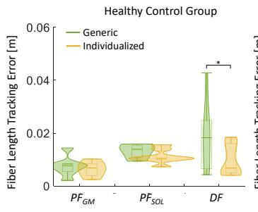

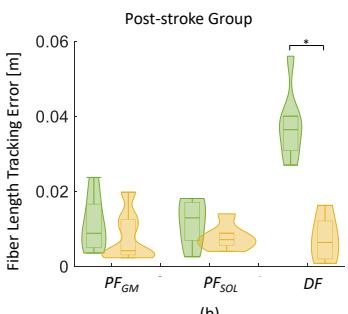

Fig. 3. 小提琴图展示了在健康组和中风后组中，通过个体化模型和通用模型预测腓肠肌（GAS）、比目鱼肌（SOL）和胫骨前肌（TA）肌纤维长度的 RMSE 差异分布，涵盖三种情况：$P F _ { G A S }$（测量 GAS 肌纤维长度的跖屈）、$P F _ { S O L }$（测量 SOL 肌纤维长度的跖屈）和 DF（测量 TA 肌纤维长度的背屈）。两种模型之间的显著性差异用 ∗ 表示。  
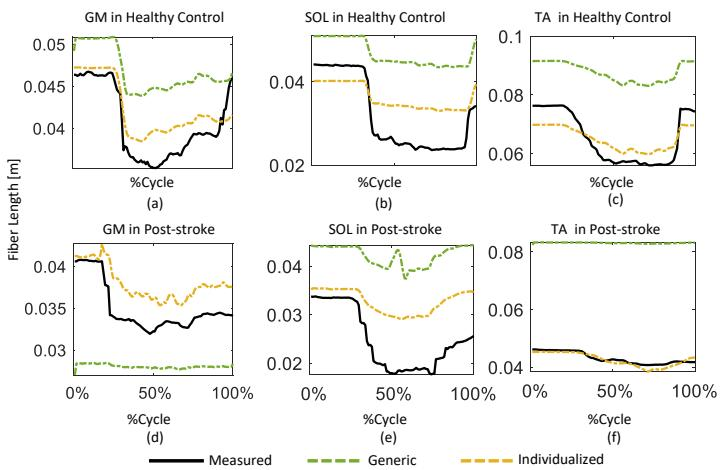  
Fig. 4. 健康组和中风后组在最大自主收缩（MVC）期间，通过通用模型和个体化模型测量及预测肌纤维长度的一个示例。在该示例中，在跖屈 MVC 期间对比了腓肠肌（GAS）和比目鱼肌（SOL），而在背屈 MVC 期间对比了胫骨前肌（TA）。

对于肌纤维长度预测，个体化模型在情况 DF 下表现出显著更低的 RMSE，无论是在中风后组 $( p \ < \ 0 . 0 1 )$ 还是对照组 $( p \ : = \ : 0 . 0 5 ;$ Fig. 3）。尽管未达到统计学显著性，但在中风后组 $( P F _ { G A S } \colon p = 0 . 1 6$ 且 $P F _ { S O L } \colon p = 0 . 1 1 $ 以及对照组 $( P F _ { G A S } \colon p = 0 . 3 7 .$ , P FSOL: $p = 0 . 0 7 ;$ Fig. 3）中，情况 $P F _ { G A S }$ 和 $P F _ { S O L }$ 的 RMSE 均在一定程度上偏低。

对于肌肉兴奋性预测，在中风后组中，对于情况 $P F _ { G A S }$ 和 $D F ~ ( P F _ { G A S } \colon \mathbf { G A S } { \mathrel { : } } p =$ 0.02, SOL: $p = 0 . 0 3$ , 以及 TA: $p = 0 . 0 5$ ; DF: GAS: $p =$ $0 . 0 5 , \ \mathrm { S O L } { : p } \ : = \ : 0 . 0 5$ , 以及 $\mathrm { T A } { : } p = 0 . 0 2$ ; Fig. 5 (b), (d) 和 (f)），个体化模型在所有肌肉中均具有显著更低的 RMSE。此外，在情况 $P F _ { S O L }$ 下，在 GAS $( p = 0 . 0 3$ , Fig. 5 (b)) 和 SOL $( p = 0 . 0 3 ,$ Fig. 5 (d)) 中均观察到了显著性差异。尽管未达到统计学显著性，在 TA $\left( p = 0 . 0 8 , \mathrm { F i g } . \textbf { 5 } ( \mathrm { f } ) \right)$ 中也观察到了较低的 RMSE。然而，在对照组中，所有情况下均未观察到显著性差异 $( \mathrm { F i g . ~ 5 ~ ( a ) , ~ ( c ) } .$ , 和 (e)）。

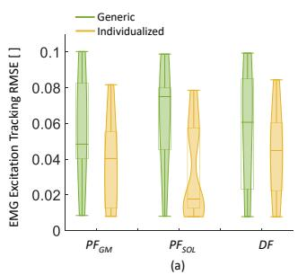

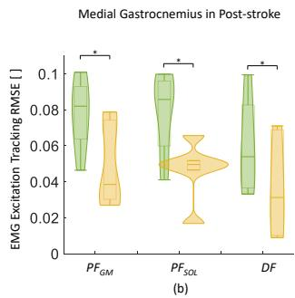

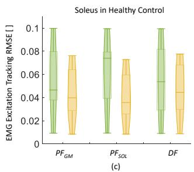

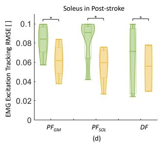

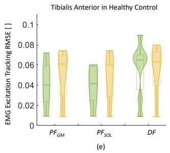

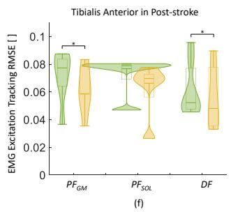  
Fig. 5. 小提琴图展示了在健康组和中风后组中，通过个体化模型和通用模型在三种情况下预测腓肠肌（GAS）、比目鱼肌（SOL）和胫骨前肌（TA）肌肉兴奋度的 RMSE 分布：$P F _ { G A S }$（测量 GAS 肌纤维长度的跖屈）、$P \bar { F _ { S O L } }$（测量 SOL 肌纤维长度的跖屈）和 $D F$（测量 TA 肌纤维长度的背屈）。两种模型之间的显著性差异用 ∗ 表示。

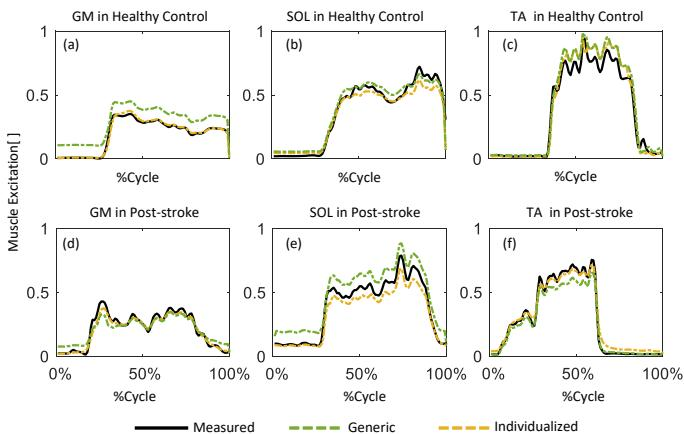  
Fig. 6. 健康组和中风后组在最大自主收缩（MVC）期间，通过通用模型和个体化模型测量和预测肌肉兴奋度的一个示例。在该示例中，在跖屈 MVC 期间对腓肠肌（GAS）和比目鱼肌（SOL）进行了比较，而在背屈 MVC 期间对胫骨前肌（TA）进行了比较。

Fig. 7. 小提琴图展示了在健康组和中风后组中，通过个体化模型和通用模型在三种情况下预测踝关节背屈/跖屈力矩的 RMSE 分布：$P F _ { G A S }$（测量 GAS 肌纤维长度的跖屈）、$P \bar { F } _ { S O L }$（测量 SOL 肌纤维长度的跖屈）和 DF（测量 TA 肌纤维长度的背屈）。两种模型之间的显著性差异用 ∗ 表示。  
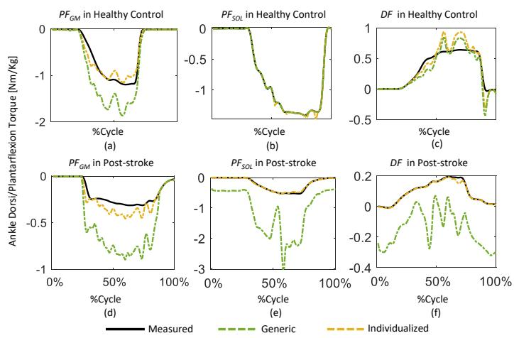  
Fig. 8. 健康组和中风后组在三种情况下最大自主收缩（MVC）期间，通过通用模型和个体化模型测量和预测踝关节背屈/跖屈力矩的一个示例：$P F _ { G A S }$（测量 GAS 肌纤维长度的跖屈）、$P F _ { S O L }$（测量 SOL 肌纤维长度的跖屈）和 $D F$（测量 TA 肌纤维长度的背屈）。

对于关节力矩预测，在中风后组的所有情况下，个体化模型的 RMSE 均显著低于通用模型 $( P F _ { G A S } \colon p \ < \ 0 . 0 1$、$P F _ { S O L } { : } p = 0 . 0 2$ 和 $D F \colon p = 0 . 0 3 )$。在对照组中，尽管在统计学上不显著，但所有情况下的 RMSE 也均较低 $( P F _ { G A S } \colon p = 0 . 0 9 , P F _ { S O L } \colon p = 0 . 0 5$ 和 $D F \colon p = 0 . 1 0 ; \mathrm { { F i g } } . 7 )$。

## B. 估计的肌-腱参数

总体而言，中风后组估计的最大等长肌力、最佳肌纤维长度和肌腱刚度显著低于对照组（Fig. 9）。

脑卒中后组中 GAS、SOL 和 TA 的估计最大等长肌力分别为体重的 $0 . 5 \pm 0 . 2 \ \% , \ 1 . 0 \pm 0 . 3 \ \%$ 和 $1 . 0 \pm 0 . 5 \%$（%BW）。它们均显著低于对照组（$\mathrm { ( G A S ; }$ $3 . 8 \pm 1 . 3$ %BW, $p < 0 . 0 1$ ；SOL: 7.9 ± 2.7 %BW, $p < 0 . 0 1$ $\mathrm { T A } \colon 4 . 9 \pm 0 . 8$ %BW, $p < 0 . 0 1 ;$ 图 9 (a)）。

(a)  
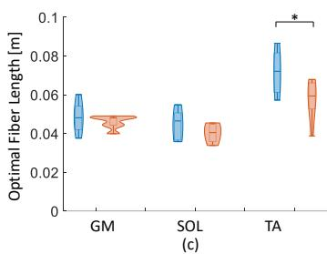

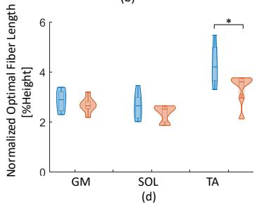

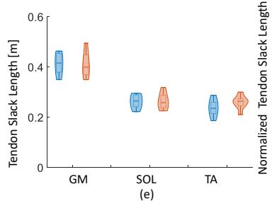

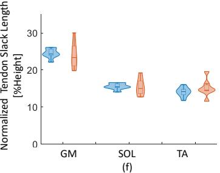  
图 9. 描绘对照组和脑卒中后组腓肠肌（GAS）、比目鱼肌（SOL）和胫骨前肌（TA）估计肌肉-肌腱参数分布的小提琴图；(a) 归一化最大等长肌力（按体重（BW）归一化），(b) 肌腱刚度，(c) 最佳肌纤维长度，(d) 归一化最佳肌纤维长度（按身高归一化），(e) 肌腱松弛长度，以及 (f) 归一化肌腱松弛长度（按身高归一化）。\* 表示两组之间存在显著性差异。

脑卒中后组 TA 的估计最佳肌纤维长度显著低于对照组（$5 7 . 6 \pm 1 0 . 2$ mm 对比 $7 1 . 7 \pm 1 1 . 3$ mm, $p = 0 . 0 3 , \mathrm { F i g }$ . 9 (c)）。尽管不显著，但在脑卒中后患者中也观察到了更短的 GAS 和 SOL 估计最佳肌纤维长度（GAS: $4 6 . 1 \pm 3 . 3$ mm 对比 $4 8 . 4 \pm$ 7.9 mm, $p = 0 . 4 8 ;$ SOL: 40.4 ± 4.8 mm 对比 $4 4 . 3 \pm 7 . 8$ mm, $p = 0 . 3 0$）。归一化最佳肌纤维长度（按身高归一化）与最佳肌纤维长度表现出相同的趋势（图 9 (d)）。

两组之间的肌腱松弛长度未发现显著性差异（脑卒中后组对比健康对照组：GAS 分别为 $4 1 . 0 \pm 5 . 2$ mm 对比 $4 1 . 3 \pm 4 . 4 \ : \mathrm { m m }$ ，SOL 分别为 $2 6 . 4 \pm 3 . 3$ mm 对比 $2 6 . 3 \pm 2 . 8$ mm，TA 分别为 $2 5 . 9 \pm 2 . 8$ mm 对比 $2 3 . 8 \pm 3 . 4$ mm；GAS: $p = 0 . 9 8$ ，SOL: $p = 0 . 9 8$ ，TA: $p = 0 . 2 9$ ；图 9 (e)）。归一化肌腱松弛长度（按身高归一化）也与肌腱松弛长度表现出相同的趋势（图 9 (f)）。脑卒中后组跟腱和 TA 肌腱的刚度分别为 $8 9 \pm 7 9$ N/mm 和 $7 9 \pm 7 1$ N/mm；这些数值也显著小于对照组（跟腱：$5 6 4 \pm 2 2 0$ N/mm, $p < 0 . 0 1$ ；TA 肌腱：$2 3 0 \pm 6 7$ N/mm, $p < 0 . 0 1$ ；图 9 (b)）。

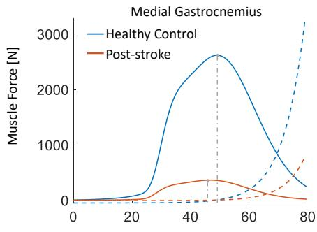  
(a)

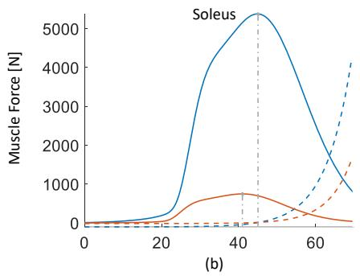

  
Fig. 10. 对照组与脑卒中后组腓肠肌（GAS）、比目鱼肌（SOL）和胫骨前肌（TA）的主动（实线）和被动（虚线）肌肉力-长度关系（基于 Hill 模型推导）。灰色虚线表明最大等长肌力发生在最佳肌纤维长度处。

与对照组相比，脑卒中后组的主动肌肉力-长度曲线发生左移，且全部三块肌肉的最大等长肌力和最佳肌纤维长度均显著降低（Fig. 10）。

## IV. 讨论

在本项工作中，我们通过使用直接配点优化方法（direct collocation optimization method）解决肌肉冗余问题，估计了脑卒中后个体和健康对照组的主要踝关节背屈/跖屈肌的个体特异性肌腱参数。所提出的优化算法基于实验 EMG 信号以及通过超声（US）图像测量的肌纤维长度，考虑了肌肉激活度和肌肉动力学。我们发现，脑卒中后组的最大等长肌力、肌腱刚度以及最佳肌纤维长度均显著低于对照组。此外，我们表明，基于 EMG、超声和肌力测试仪（dynamometry）数据，我们可以通过使用直接配点优化方法对肌腱参数进行个性化设置，从而提高肌肉骨骼模型的个体特异性；与缩放通用模型相比，该方法能产生与实验数据更匹配的、更为逼真的运动仿真。与现有方法相比，我们开发的直接配点优化算法结合独特的实验数据集具有诸多优势。它能够将不同类型的试验纳入单次优化中，从而提供更为真实且生理上一致的参数估计。此外，该算法不仅能提供决定肌肉产力能力的关键肌腱参数（如最佳肌纤维长度、肌腱松弛长度和肌腱刚度），还能提供最大等长肌力，这对理解和治疗脑卒中后运动功能障碍具有重要意义。据我们所知，这是首个尝试在踝关节跖屈和背屈 MVC 运动中，同时利用实验 EMG 信号和肌纤维长度约束来评估脑卒中后个体 GAS、SOL 和 TA 的肌腱参数的研究。此外，所提出的肌腱参数优化框架被进一步拓展至不需要独立行走和跑步能力的病理群体。因此，我们的方法有潜力应用于其他运动障碍群体，这可能为深入了解肌腱力学机制提供有价值的见解，并为未来的康复策略提供指导。

## A. 肌肉冗余求解器优化性能的评估

与仅使用简单缩放的肌腱参数相比，采用校准肌腱参数的个体化肌肉骨骼模型在大多数情况下显著提高了模拟与测量的肌纤维长度、肌肉兴奋度以及关节力矩之间的一致性。个体化肌腱校准的益处在脑卒中后（post-stroke）组中表现得更为显著。例如，脑卒中后组显著不同的力矩预测（Fig. 7 (b)）很可能是由于其最大等长肌力显著低于对照组（Fig. 9 (a)）。因此，具有未校准 MTU 参数的通用模型不太可能给出准确的估计，即无法对真实的肌腱行为进行描述。此外，与对照组不同，在使用校准肌腱参数的大多数情况下，脑卒中后组的 EMG 兴奋度预测均得到了显著改善（Fig. 5 (b)、(d) 和 (f)）。这可能是因为在脑卒中后个体中常观察到共收缩（co-contraction）以维持稳定性 [40]。然而，优化算法最小化了肌肉用力的代价函数，即肌肉兴奋度平方和的积分。因此，共收缩不利于优化求解。在未来的研究中，应进一步探讨在代价函数中考虑共收缩，以便更好地对可能出现共收缩情况的运动障碍个体的肌腱行为进行建模。

在当前研究中，采用直接配置法（direct collocation method）将寻找最能解释实验观察结果的肌腱参数的最优控制问题构建为非线性规划问题。与其他优化方法相比，配置法通常具有更高的计算效率；因此，以往已有若干研究针对肌肉冗余问题对其进行了探讨。Groote 等人 [38] 首次提出将直接配置法作为一种稳健且计算高效的方法，用于解决一名男性受试者行走过程中的肌肉冗余问题。该方法还曾用于估计健康受试者膝关节驱动器的个体特异性肌腱参数 [41]。Delabastita 等人 [22] 进一步结合了动作捕捉、超声图像以及小腿肌肉的 EMG 数据的实验测量，以估计青年人和老年人在步态过程中的肌腱参数。然而，他们的优化过程中并未纳入个体化的最大等长肌力。然而，在模拟极有可能偏离普通人群力量水平的参与者（如病理人群或优秀运动员）时，通常建议在肌骨模型中调整最大等长肌力 [12]。在此，我们将独特的实验测量方案与直接配置法相结合，以更全面地评估存在运动障碍的个体（即卒中后个体）的肌腱参数变化。

## B. 估计的肌腱参数

为了更好地理解运动过程中肌腱单元的力学行为，肌腱参数是运动障碍人群中常被研究的参数。根据我们的模拟结果，与对照组相比，卒中后组在跖屈肌和背屈肌中均表现出更短的最佳肌纤维长度、降低的最大等长肌力以及更小的肌腱刚度。然而，在肌腱松弛长度上未观察到显著差异。这些参数具有生理学意义，并决定了 Hill 型肌肉模型（Hill-type muscle model）中的肌肉兴奋-肌力关系。它们在临床解读中也具有相关性和参考价值，例如，这些参数可为个性化康复规划提供关键信息。

脑卒中后，主动肌力生成能力可能会受到显著影响。我们发现，与对照组相比，脑卒中后个体的最大等长肌力显著降低。最大等长肌力定义为肌肉在保持恒定长度时所能产生的峰值力。估计单块肌肉最大等长肌力的常用方法是将生理横截面积（PCSA）与比肌力相乘 [42]。然而，通过实验直接估计最大等长肌力可能极具挑战性且耗费资源。相反，研究通常报道的是最大等长力矩 [43], [44]。然而，它无法反映协同肌之间的潜在差异。因此，结合可行实验测量的优化技术可能是估计单块肌肉最大等长肌力的良好解决方案。我们发现，在脑卒中后个体中，估计的 GAS、SOL 和 TA 最大等长肌力均明显减弱，仅为对照组的 13.9%、13.9% 和 22.4%。极少有研究在活体（in vivo）中调查脑卒中后个体踝关节肌肉的最大等长肌力。我们的研究结果与以往报道的跖屈肌 [45] 和背屈肌 [46] MVC 力矩降低的研究一致。最佳肌纤维长度是影响动态肌肉收缩期间主动力生成的另一个关键参数。据我们所知，只有一项研究调查了脑卒中后个体踝关节跖屈肌最佳肌纤维长度的改变。Gao 等人 [47] 报道，脑卒中后个体腓肠肌的最佳肌纤维长度（33.2 ± 3.2 mm）短于健康对照组 $( 4 7 . 4 \pm 2 . 7$ mm)。他们通过在次最大 MVC 测量期间对每个受试者的离散数据点进行曲线拟合，建立了肌肉主动力关系。根据我们的模拟，不仅在跖屈肌中，在踝关节背屈肌中也出人意料地发现了更短的最佳肌纤维长度。这需要进一步的研究来予以阐明。此外，最大等长肌力和最佳肌纤维长度从本质上决定了单块肌肉的力-长度特性（Fig. 10）。评估个性化的力-长度关系使得评估特定肌肉长度（关节角度）下的选择性无力以及脑卒中后的最佳运动范围成为可能，这可为有效的力量训练干预提供有价值的信息。

肌腱刚度是一项重要的力学特征，它通过肌腱的功能特性以及肌纤维的工作范围来影响整个 MTU（肌肉-肌腱单元）的功能 [18]。肌腱刚度通常表现为具有低刚度的趾区（toe region）和具有高刚度的线性区。近年来，线性区的肌腱刚度通常通过基于超声的方法进行研究。我们之前的研究探讨了健全受试者在被动拉伸过程中跟腱的 GAS（腓肠肌）和 SOL（比目鱼肌）部分的刚度，并发现这两个亚区的刚度相似 [28]。然而，由于不同的关节构型和假设，活体（in vivo）研究中报道的结论往往不具可比性。例如，先前在年轻（$170 \pm 37$ N/mm）和老年（141 ± 48 N/mm）健康成年人中，活体跟腱刚度被测定为最大自主等长收缩的 10% 至 80% 之间肌力-肌肉伸长量关系的斜率 [48]。Khair 等人 [49] 的另一项研究报道了非手术治疗跟腱断裂一年后患者未受损肢体的跟腱刚度（$486.5 \pm 210.2$ N/mm），该刚度取自 50% MVC（最大自主收缩）时肌腱伸长量-力量曲线的切线。或者，肌腱刚度也可以基于计算建模和仿真方法进行估算，此时刚度对体内测量方法和条件的依赖性较小。Delabastita 等人 [22] 最近的一项研究采用直接配置优化模拟方法估算了年轻成年人（$215.2 \pm 61.4$ N/mm）

和老年人（$202.4 \pm 62.9$ N/mm）在步行过程中的跟腱刚度。在本研究中，我们采用了相同的直接配置优化方法，获得了卒中后组和对照组的跟腱以及 TA（胫骨前肌）肌腱刚度（卒中后组 vs. 健康对照组：跟腱 $89 \pm 79$ N/mm vs. 564 ± 220 N/mm；TA 肌腱 $79 \pm 71$ N/mm vs. $230 \pm 67$ N/mm）。我们关于卒中后组肌腱顺应性更高（更柔软）的发现与以往针对跟腱的临床观察一致 [19], [50], [51]。例如，Zhao 等人 [19] 在跖屈肌 MVC 期间通过追踪肌腱伸长量并测量踝关节力矩，观察到了卒中后顺应性更高的跟腱。

本研究存在若干局限性。在本研究中，我们通过最大自主收缩（Maximum Voluntary Contraction, MVC）试验中的最大值对肌电（EMG）信号进行归一化，而非采用步行和跑步等动态运动。我们承认，等长 MVC 试验可能不一定能反映真实的肌肉最大激活程度。在动态运动过程中，某些肌肉的 EMG 信号可能会超过等长 MVC 试验期间记录的峰值 [52], [53]。然而，在最近的一项研究中，研究人员探讨了三种不同的 EMG 归一化方法（即“等长 MVC”、“等速 $\mathbf { M V } { \boldsymbol { \mathbf { C } } } ^ {  }$”以及“考虑关节活动度和速度的等速 MVC”）对脑卒中后受试者肌肉激活和拮抗肌-主动肌共收缩指数的影响 [54]。该研究发现，这三种归一化方法之间没有观察到显著差异，因此得出结论认为采用等长 MVC 进行 EMG 归一化适用于脑卒中后受试者。鉴于我们的研究重点是行动不便且缺乏独立行走或跑步能力的受试者，我们假设在等长 MVC 期间获得的 EMG 数据是对真实最大 EMG 信号的合理近似。尽管如此，值得注意的是，我们的归一化方法可能会影响估计的肌腱模型参数，有待在未来的研究中进一步评估。此外，我们仅对肌腱力-伸长特性的线性区域进行了建模，未包含趾区（toe region）。这可能会增加体内计算的肌腱刚度与模型估计值之间的差异 [22]。未来使用非线性肌腱模型的研究可能会提供更准确的刚度估计。值得一提的是，在评估肌肉冗余求解器的优化性能时，仅在脑卒中后组中观察到了显著差异。尽管在对照组和脑卒中后组中，个体化模型在肌纤维长度和关节力矩估计方面的 RMSEs 均低于通用模型，但这种差异在肌肉激活中并不明显。该差异可能归因于样本量有限，并且也可能表明传统的缩放模型对于健康人群仍然适用。未来有必要在更大的样本量下开展进一步研究。

另一个局限性是，仅使用了实验测量的肌纤维长度和 EMG 信号来约束优化过程。由于角度变异性较大 [9]，尤其是在中风后组中，我们未将羽状角（pennation angle）纳入考量。例如，由于中风后肌肉流变学特性的改变，在超声测量中必须施加更大的探头压力以获得更好的肌肉可见度，这可能会导致较高的角度变异性。先前的研究也表明，与其他参数相比，羽状角是基于肌肉骨骼模型的肌力估计中影响最小的参数 [55]– [58]，因此探索纳入可靠的羽状角是否能提高 MTU（肌腱单位）参数估计的鲁棒性将是很有意义的。此外，进一步分析将超声测量整合到 EMG 驱动的模型校准程序中对中风后人群肌腱参数估计的影响也是很有价值的。此外，神经和肌肉两方面的变化都会导致中风后受试者的肌无力。尽管我们的肌肉骨骼建模与优化框架通过使用归一化 EMG 数据约束肌肉兴奋来考虑了神经驱动，但必须认识到，要确定神经驱动是否存在下降，仍需要进一步的研究和额外的实验测量。从肌肉建模的角度来看，“最大等长肌力”这一参数可能潜在地包含关于神经驱动潜在变化的信息。然而，必须保持谨慎，避免过度解读该参数。

需要注意的是，由于具体的研究兴趣所在，本研究仅聚焦于踝关节的屈伸运动。然而，如果需要，在具备可用实验数据的情况下，我们的肌腱参数估计框架可以迁移至其他关节。具体而言，我们纳入了三块关键的踝关节背屈/跖屈肌群，即腓肠肌（GAS）、比目鱼肌（SOL）和胫骨前肌（TA）。在我们的实验设置中，考虑到腓肠肌内侧头（GM）和腓肠肌外侧头（GL）在解剖学和功能上的相似性 [59], [60]，我们将它们视为一个集中实体（lumped entity），从而避免了分别对它们进行分析。这一决策旨在降低实验设置不必要的复杂性，尤其是针对脑卒中后受试者群体。如果对 GL 进行单独测量（例如通过超声），由于采集超声图像所需的额外最大自主收缩（MVC）测试以及采集时间的延长，可能会诱发脑卒中后受试者的疲劳。在我们看来，使用包含更多肌肉的肌肉骨骼模型带来的收益非常有限。我们选择了 Gait10muscle18 模型，这是从 gait2392 衍生出的简化版本 [61]–[63]。该模型具有 10 个自由度和 9 块主要肌肉（包括 GAS、SOL 和 TA），并采用了与 gait2392 完全相同的 Hill 型（Hill-type）肌肉模型。此外，如前所述，集总的 GM 和 GL 与我们的研究设置相吻合。另外，模型中未考虑胫骨后肌，因为获取此类较小且深层的肌肉的肌电图（EMG）和超声数据极具挑战性。尽管 Distefano 等人 [64] 此前报道腓肠肌和比目鱼肌是主要的踝关节跖屈肌，而其他跖屈肌仅贡献了其余 7% 的跖屈力量，但我们承认，排除较小的肌肉可能导致高估了 GAS 和 SOL 肌腱单元（muscle-tendon unit）的最大等长肌力。

值得注意的是，腓肠肌是一块跨越踝关节和膝关节的双关节肌。虽然结合对膝关节乃至髋关节力矩的估计可能会提高腓肠肌激活度估计的准确性，但在当前使用测力计的实验设置下是不可行的。此外，校准期间膝关节的位置也可能对腓肠肌的肌腱参数产生影响。尽管这些参数主要由肌肉的形态架构和解剖结构决定，但引入额外的膝关节角度设置将有助于使我们的结果优化更加贴近实际。未来的研究可以探讨不同膝关节角度的影响，以更全面地理解膝关节位置与肌腱校准之间的关系。此外，在未来的工作中，将分析扩大到更大的受试人群队列也是十分必要的。

## V. 结论

我们通过基于实验肌电（EMG）信号和测量的肌纤维长度求解肌肉冗余问题，估计了脑卒中后个体腓肠肌、比目鱼肌和胫骨前肌的受试者特异性肌腱参数。所提出的直接配置法（direct collocation method）在匹配实验数据方面表现良好，与实验测量结果的高度一致性证明了这一点。基于我们的仿真，脑卒中组在跖屈肌和背屈肌中均表现出更短的最佳纤维长度、降低的最大等长肌力以及顺应性更高的肌腱。所估计的肌腱参数具有生理学意义和临床相关性。我们的研究进一步表明，结合可行的实验测量与直接配置优化方法，是一种更为全面的方法，能够量化运动功能障碍个体的肌腱参数改变，而这些改变单纯依靠体内（in vivo）实验方法通常难以评估。

## 致谢

我们衷心感谢 G. Valentina Pennati、O. Tarassova 和 A. Arndt 在实验搭建和数据采集方面给予的支持。

## 参考文献

[1] R. L. Sacco, S. E. Kasner, J. P. Broderick, L. R. Caplan, J. Connors, A. Culebras, M. S. Elkind, M. G. George, A. D. Hamdan, R. T. Higashida et al., “An updated definition of stroke for the 21st century: a statement for healthcare professionals from the american heart association/american stroke association,” Stroke, vol. 44, no. 7, pp. 2064–2089, 2013.

[2] V. L. Feigin, M. Brainin, B. Norrving, S. Martins, R. L. Sacco, W. Hacke, M. Fisher, J. Pandian, and P. Lindsay, “World stroke organization (wso): Global stroke fact sheet 2022,” International Journal of Stroke, vol. 17, no. 1, pp. 18–29, 2022.

[3] J. Kim, T. Thayabaranathan, G. A. Donnan, G. Howard, V. J. Howard, P. M. Rothwell, V. Feigin, B. Norrving, M. Owolabi, J. Pandian et al., “Global stroke statistics 2019,” International Journal of Stroke, vol. 15, no. 8, pp. 819–838, 2020.

[4] A. E. Chisholm, S. D. Perry, and W. E. McIlroy, “Correlations between ankle–foot impairments and dropped foot gait deviations among stroke survivors,” Clinical Biomechanics, vol. 28, no. 9-10, pp. 1049–1054, 2013.

[5] B. Chen, B. Zi, Y. Zeng, L. Qin, and W.-H. Liao, “Ankle-foot orthoses for rehabilitation and reducing metabolic cost of walking: Possibilities and challenges,” Mechatronics, vol. 53, pp. 241–250, 2018.

[6] P. Levinger, D. T. Lai, H. B. Menz, A. D. Morrow, J. A. Feller, J. R. Bartlett, N. R. Bergman, and R. Begg, “Swing limb mechanics and minimum toe clearance in people with knee osteoarthritis,” Gait & Posture, vol. 35, no. 2, pp. 277–281, 2012.

[7] S. A. Ross, N. Nigam, and J. M. Wakeling, “A modelling approach for exploring muscle dynamics during cyclic contractions,” PLoS Computational Biology, vol. 14, no. 4, pp. 1–18, 2018.

[8] K. M. Kearney, J. B. Harley, and J. A. Nichols, “利用人工神经网络和模拟侧捏数据对肌肉参数进行分类,” Plos One, vol. 16, no. 9, pp. 1–16, 2021.

[9] C. Korting, M. Schlippe, S. Petersson, G. V. Pennati, O. Tarassova,¨ A. Arndt, T. Finni, K. Zhao, and R. Wang, “基于超声检查和弥散张量成像的中风后幸存者体内肌肉形态比较,” Scientific Reports, vol. 9, no. 1, pp. 1–11, 2019.

[10] D. G. Thelen, L. A. Wojcik, A. B. Schultz, J. A. Ashton-Miller, and N. B. Alexander, “在前跌倒过程中通过快速迈步恢复平衡的年龄差异,” The Journals of Gerontology Series A: Biological Sciences and Medical Sciences, vol. 52, no. 1, pp. M8–M13, 1997.

[11] W. F. Brechue and T. Abe, “去脂体重积累和骨骼肌构型在力量举表现中的作用,” European Journal of Applied Physiology, vol. 86, no. 4, pp. 327–336, 2002.

[12] F. Heinen, S. N. Sørensen, M. King, M. Lewis, M. E. Lund, J. Rasmussen, and M. de Zee, “基于实验获取的受试者特异性力矩曲线对Hill型肌骨模型的肌腱单元参数估计,” Journal of Biomechanical Engineering, vol. 141, no. 6, p. 061005, 2019.

[13] L. Modenese, E. Ceseracciu, M. Reggiani, and D. G. Lloyd, “利用优化技术对缩放和受试者特异性肌骨模型的肌腱参数进行估计,” Journal of Biomechanics, vol. 49, no. 2, pp. 141–148, 2016.

[14] M. Viceconti, G. Clapworthy, and S. V. S. Jan, “虚拟生理人——一项欧洲计算机人体建模计划,” The Journal of Physiological Sciences, vol. 58, pp. 441–446, 2008.

[15] C. Pizzolato, D. G. Lloyd, M. Sartori, E. Ceseracciu, T. F. Besier, B. J. Fregly, and M. Reggiani, “CEINMS：用于研究动态运动任务中不同神经控制方案对肌肉兴奋和关节力矩预测影响的工具箱,” Journal of Biomechanics, vol. 48, no. 14, pp. 3929–3936, 2015.

[16] M. Romanato, F. Spolaor, C. Beretta, F. Fichera, A. Bertoldo, D. Volpe, and Z. Sawacha, “使用 EksoGT® 外骨骼对帕金森病患者训练效果的定量评估：一项随机单盲临床试验,” Contemporary Clinical Trials Communications, vol. 28, p. 100926, 2022.

[17] K. Choudhury, “针对中风受试者的受试者特异性高密度肌电驱动肌骨建模,” 硕士学位论文, University of Twente（特文特大学）, 2019.

[18] J. Peltonen, N. J. Cronin, L. Stenroth, T. Finni, and J. Avela, “体内跟腱的粘弹性特性,” Springerplus, vol. 2, no. 1, pp. 1–8, 2013.

[19] H. Zhao, Y. Ren, E. J. Roth, R. L. Harvey, and L.-Q. Zhang, “中风后比目鱼肌与腓肠肌肌束及跟腱的并发缺损,” Journal of Applied Physiology, vol. 118, no. 7, pp. 863– 871, 2015.

[20] C. M. Nelson, V. Marchese, K. Rock, R. M. Henshaw, and O. Addison, “Alterations in muscle architecture: a review of the relevance to individuals after limb salvage surgery for bone sarcoma,” Frontiers in Pediatrics, vol. 8, p. 292, 2020.

[21] J. N. Liang and K.-Y. Ho, “Altered achilles tendon morphology in individuals with chronic post-stroke hemiparesis: a case report,” BMC Medical Imaging, vol. 20, no. 1, pp. 1–5, 2020.

[22] T. Delabastita, M. Afschrift, B. Vanwanseele, and F. De Groote, “Ultrasound-based optimal parameter estimation improves assessment of calf muscle–tendon interaction during walking,” Annals of Biomedical Engineering, vol. 48, no. 2, pp. 722–733, 2020.

[23] Q. Shao, D. N. Bassett, K. Manal, and T. S. Buchanan, “An emg-driven model to estimate muscle forces and joint moments in stroke patients,” Computers in Biology and Medicine, vol. 39, no. 12, pp. 1083–1088, 2009.

[24] N. Lotti, M. Xiloyannis, G. Durandau, E. Galofaro, V. Sanguineti, L. Masia, and M. Sartori, “Adaptive model-based myoelectric control for a soft wearable arm exosuit: A new generation of wearable robot control,” IEEE Robotics & Automation Magazine, vol. 27, no. 1, pp. 43–53, 2020.

[25] G. Durandau, D. Farina, G. As´ın-Prieto, I. Dimbwadyo-Terrer, S. Lerma-Lara, J. L. Pons, J. C. Moreno, and M. Sartori, “Voluntary control of wearable robotic exoskeletons by patients with paresis via neuromechanical modeling,” Journal ofNeuroengineering and Rehabilitation, vol. 16, pp. 1–18, 2019.

[26] M. Sartori, D. G. Llyod, and D. Farina, “Neural data-driven musculoskeletal modeling for personalized neurorehabilitation technologies,” IEEE Transactions on Biomedical Engineering, vol. 63, no. 5, pp. 879– 893, 2016.

[27] L. Li, K. Tong, X. Hu, L. Hung, and T. Koo, “Incorporating ultrasoundmeasured musculotendon parameters to subject-specific emg-driven model to simulate voluntary elbow flexion for persons after stroke,” Clinical Biomechanics, vol. 24, no. 1, pp. 101–109, 2009.

[28] R. Wang, S. Yan, M. Schlippe, O. Tarassova, G. V. Pennati, F. Lindberg, C. Korting, A. Destro, L. Yang, B. Shi¨ et al., “Passive mechanical properties of human medial gastrocnemius and soleus musculotendinous unit,” BioMed Research International, vol. 2021, 2021.

[29] H. J. Hermens, B. Freriks, R. Merletti, D. Stegeman, J. Blok, G. Rau, C. Disselhorst-Klug, and G. Hagg, “European recommendations for sur-¨ face electromyography,” Roessingh Research and Development, vol. 8, no. 2, pp. 13–54, 1999.

[30] C. Pizzolato, M. Reggiani, L. Modenese, and D. Lloyd, “Real-time inverse kinematics and inverse dynamics for lower limb applications using opensim,” Computer Methods in Biomechanics and Biomedical Engineering, vol. 20, no. 4, pp. 436–445, 2017.

[31] H. X. Hoang, C. Pizzolato, L. E. Diamond, and D. G. Lloyd, “神经肌肉参数的个体特异性校准使神经肌肉骨骼模型能够估算健康成年人具有生理合理性的髋关节接触力,” Journal of Biomechanics, vol. 80, pp. 111–120, 2018.

[32] D. A. Winter, H. G. Sidwall, and D. A. Hobson, “运动运动学中噪声的测量与降低,” Journal of Biomechanics, vol. 7, no. 2, pp. 157–159, 1974.

[33] E. Kristianslund, T. Krosshaug, and A. J. Van den Bogert, “低通滤波对逆动力学关节力矩的影响：对损伤预防的启示,” Journal of Biomechanics, vol. 45, no. 4, pp. 666–671, 2012.

[34] A. Mantoan, C. Pizzolato, M. Sartori, Z. Sawacha, C. Cobelli, and M. Reggiani, “Motonms：用于处理神经肌肉骨骼建模与仿真运动数据的 MATLAB 工具箱,” Source Code for Biology and Medicine, vol. 10, no. 1, pp. 1–14, 2015.

[35] D. J. Farris and G. A. Lichtwark, “Ultratrack：用于在 B 模超声图像序列中半自动追踪肌束的软件,” Computer Methods and Programs in Biomedicine, vol. 128, pp. 111–118, 2016.

[36] S. L. Delp, F. C. Anderson, A. S. Arnold, P. Loan, A. Habib, C. T. John, E. Guendelman, and D. G. Thelen, “Opensim：用于创建和分析运动动态仿真的开源软件,” IEEE Transactions on Biomedical Engineering, vol. 54, no. 11, pp. 1940–1950, 2007.

[37] A. Seth, J. L. Hicks, T. K. Uchida, A. Habib, C. L. Dembia, J. J. Dunne, C. F. Ong, M. S. DeMers, A. Rajagopal, M. Millard et al., “Opensim：模拟肌肉骨骼动力学和神经肌肉控制以研究人类和动物运动,” PLoS Computational Biology, vol. 14, no. 7, pp. 1–20, 2018.

[38] F. De Groote, A. L. Kinney, A. V. Rao, and B. J. Fregly, “用于解决肌肉冗余问题的直接配点最优控制问题构建形式评估,” Annals of Biomedical Engineering, vol. 44, no. 10, pp. 2922–2936, 2016.

[39] J. A. Andersson, J. Gillis, G. Horn, J. B. Rawlings, and M. Diehl, “Casadi：用于非线性优化和最优控制的软件框架,” Mathematical Programming Computation, vol. 11, pp. 1–36, 2019.

[40] C. G. Canning, L. Ada, and N. J. O’Dwyer, “中风后灵巧度丧失相关的异常肌肉激活特征,” Journal of the Neurological Sciences, vol. 176, no. 1, pp. 45–56, 2000.

[41] A. Falisse, S. Van Rossom, I. Jonkers, and F. De Groote, “基于肌电驱动的膝关节驱动器个体特异性 Hill 模型肌腱参数最优估计,” IEEE Transactions on Biomedical Engineering, vol. 64, no. 9, pp. 2253–2262, 2016.

[42] A. Bheemreddy, A. Friederich, L. Lombardo, R. J. Triolo, and M. L. Audu, “脊髓损伤后躯干和髋部肌肉总最大等长肌力输出的估算,” Medical & Biological Engineering & Computing, vol. 58, no. 4, pp. 739–751, 2020.

[43] P. S. Lum, C. Patten, D. Kothari, and R. Yap, “速度对脑卒中后偏瘫最大力矩产生的影响 (Effects of velocity on maximal torque production in poststroke hemiparesis),” Muscle & Nerve: Official Journal ofthe American Association ofElectrodiagnostic Medicine, vol. 30, no. 6, pp. 732–742, 2004.

[44] P. H. McCrea, J. J. Eng, and A. J. Hodgson, “脑卒中后双臂产生力矩的时间和幅度均受损 (Time and magnitude of torque generation is impaired in both arms following stroke),” Muscle & Nerve: Official Journal ofthe American Association ofElectrodiagnostic Medicine, vol. 28, no. 1, pp. 46–53, 2003.

[45] C. S. Klein, D. Brooks, D. Richardson, W. E. McIlroy, and M. T. Bayley, “在慢性脑卒中患者中，自主激活衰竭相比于拮抗肌共激活和肌肉萎缩对跖屈肌无力的影响更大 (Voluntary activation failure contributes more to plantar flexor weakness than antagonist coactivation and muscle atrophy in chronic stroke survivors),” Journal of Applied Physiology, vol. 109, no. 5, pp. 1337–1346, 2010.

[46] A. Bani-Ahmed, “上运动神经元损伤中踝关节管理中长时间肌肉牵拉的证据：康复考量——系统综述 (The evidence for prolonged muscle stretching in ankle joint management in upper motor neuron lesions: considerations for rehabilitation–a systematic review),” Topics in Stroke Rehabilitation, vol. 26, no. 2, pp. 153–161, 2019.

[47] F. Gao and L.-Q. Zhang, “脑卒中后腓肠肌收缩特性的改变 (Altered contractile properties of the gastrocnemius muscle poststroke),” Journal of Applied Physiology, vol. 105, no. 6, pp. 1802–1808, 2008.

[48] L. Stenroth, J. Peltonen, N. J. Cronin, S. Sipila, and T. Finni, “活体内跟腱特性与小腿三头肌肌构筑的年龄相关性差异 (Age-related differences in achilles tendon properties and triceps surae muscle architecture in vivo),” Journal of Applied Physiology, vol. 113, no. 10, pp. 1537–1544, 2012.

[49] M. K. Ra’ad, L. Stenroth, N. J. Cronin, A. Reito, J. Paloneva, and T. Finni, “非手术治疗跟腱断裂 1 年后的肌腱形态力学特性 (Muscle-tendon morphomechanical properties of nonsurgically treated achilles tendon 1-year post-rupture),” Clinical Biomechanics, p. 105568, 2022.

[50] C. P. Dias, B. Freire, N. B. A. Goulart, C. Dias De Castro, F. D. A. Lemos, J. Becker, A. Arndt, and M. A. Vaz, “痉挛型脑卒中患者跟腱力学特性的受损：一项观察性研究 (Impaired mechanical properties of achilles tendon in spastic stroke survivors: an observational study),” Topics in Stroke Rehabilitation, vol. 26, no. 4, pp. 261–266, 2019.

[51] C.-L. Kuo and G.-C. Hu, “脑卒中后痉挛：流行病学、病理生理学及治疗综述 (Post-stroke spasticity: a review of epidemiology, pathophysiology, and treatments),” International Journal of Gerontology, vol. 12, no. 4, pp. 280–284, 2018.

[52] G. A. Mirka, “肌电归一化误差的量化 (The quantification of emg normalization error),” Ergonomics, vol. 34, no. 3, pp. 343–352, 1991.

[53] S. M. Suydam, K. Manal, and T. S. Buchanan, “肌电图归一化至弹道式任务相比于等长或等速任务的优势 (The advantages of normalizing electromyography to ballistic rather than isometric or isokinetic tasks),” Journal of Applied Biomechanics, vol. 33, no. 3, pp. 189–196, 2017.

[54] A. Chalard, M. Belle, E. Montane, P. Marque, D. Amarantini, and D. Gasq, “肌电归一化方法对主动伸肘过程中肌肉激活及拮抗-主动肌共收缩指数的影响：对脑卒中后患者的实际意义 (Impact of the emg normalization method on muscle activation and the antagonist-agonist co-contraction index during active elbow extension: Practical implications for post-stroke subjects),” Journal of Electromyography and Kinesiology, vol. 51, pp. 1–7, 2020.

[55] C. Y. Scovil and J. L. Ronsky, “Sensitivity of a hill-based muscle model to perturbations in model parameters,” Journal of Biomechanics, vol. 39, no. 11, pp. 2055–2063, 2006.

[56] Z. Chen and D. W. Franklin, “Musculotendon parameters in lower limb models: Simplifications, uncertainties, and muscle force estimation sensitivity,” Annals ofBiomedical Engineering, vol. 51, no. 6, pp. 1147– 1164, 2023.

[57] C. N. Maganaris, “A predictive model of moment–angle characteristics in human skeletal muscle: application and validation in muscles across

## 附录

A. 健康对照组和脑卒中后患者组的 MVC 力矩

the ankle joint,” Journal of Theoretical Biology, vol. 230, no. 1, pp. 89–98, 2004.

[58] F. E. Zajac, “Muscle and tendon: properties, models, scaling, and application to biomechanics and motor control.” Critical Reviews in Biomedical Engineering, vol. 17, no. 4, pp. 359–411, 1989.

[59] A. G. Cresswell, W. Loscher, and A. Thorstensson, “Influence of¨ gastrocnemius muscle length on triceps surae torque development and electromyographic activity in man,” Experimental Brain Research, vol. 105, pp. 283–290, 1995.

[60] M. Cibulka, A. Wenthe, Z. Boyle, D. Callier, A. Schwerdt, D. Jarman, and M. J. Strube, “Variation in medial and lateral gastrocnemius muscle activity with foot position,” International Journal of Sports Physical Therapy, vol. 12, no. 2, pp. 233–241, 2017.

[61] S. L. Delp, J. P. Loan, M. G. Hoy, F. E. Zajac, E. L. Topp, and J. M. Rosen, “An interactive graphics-based model of the lower extremity to study orthopaedic surgical procedures,” IEEE Transactions on Biomedical engineering, vol. 37, no. 8, pp. 757–767, 1990.

[62] F. C. Anderson and M. G. Pandy, “A dynamic optimization solution for vertical jumping in three dimensions,” Computer Methods in Biomechanics and Biomedical engineering, vol. 2, no. 3, pp. 201–231, 1999.

[63] G. T. Yamaguchi and F. E. Zajac, “A planar model of the knee joint to characterize the knee extensor mechanism,” Journal of Biomechanics, vol. 22, no. 1, pp. 1–10, 1989.

[64] V. Distefano, “Anatomy and biomechanics of the ankle and foot,” Athletic Training, vol. 16, no. 1, pp. 43–47, 1981.

## TABLE I

在三种情况下：$P F _ { G A S }$（测量 GAS 肌纤维长度时的跖屈）、$P F _ { S O L }$（测量 SOL 肌纤维长度时的跖屈）和 DF（测量 TA 肌纤维长度时的背屈），健康组和脑卒中后患者组受试者在四个角度位置（背屈 5°、0°、跖屈 10° 和 20°）进行最大自主收缩（MVC）时踝关节背屈 (+)/跖屈 (-) 力矩（Nm/kg）的均值和标准差（SD）。

<table><tr><td rowspan="2">力矩 (SD) 情况</td><td colspan="3">健康对照组</td><td colspan="3">脑卒中后</td></tr><tr><td> $PF_{GAS}$ </td><td> $PF_{SOL}$ </td><td>DF</td><td> $PF_{GAS}$ </td><td> $PF_{SOL}$ </td><td>DF</td></tr><tr><td>背屈 5°</td><td>-1.47(0.37)</td><td>-1.61(0.51)</td><td>0.48(0.15)</td><td>-0.27(0.22)</td><td>-0.29(0.23)</td><td>0.02(0.01)</td></tr><tr><td>跖屈 0°</td><td>-1.48(0.29)</td><td>-1.58(0.33)</td><td>0.49(0.19)</td><td>-0.19(0.16)</td><td>-0.23(0.17)</td><td>0.02(0.02)</td></tr><tr><td>跖屈 10°</td><td>-1.13(0.36)</td><td>-1.09(0.31)</td><td>0.52(0.23)</td><td>-0.13(0.11)</td><td>-0.11(0.12)</td><td>0.03(0.04)</td></tr><tr><td>跖屈 20°</td><td>-0.87(0.31)</td><td>-0.89(0.31)</td><td>0.52(0.18)</td><td>-0.10(0.10)</td><td>-0.06(0.10)</td><td>0.04(0.06)</td></tr></table>