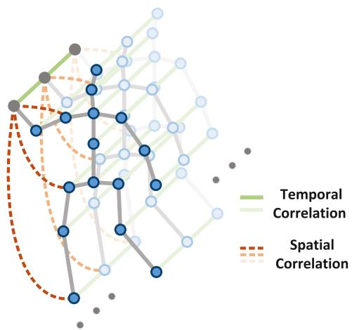
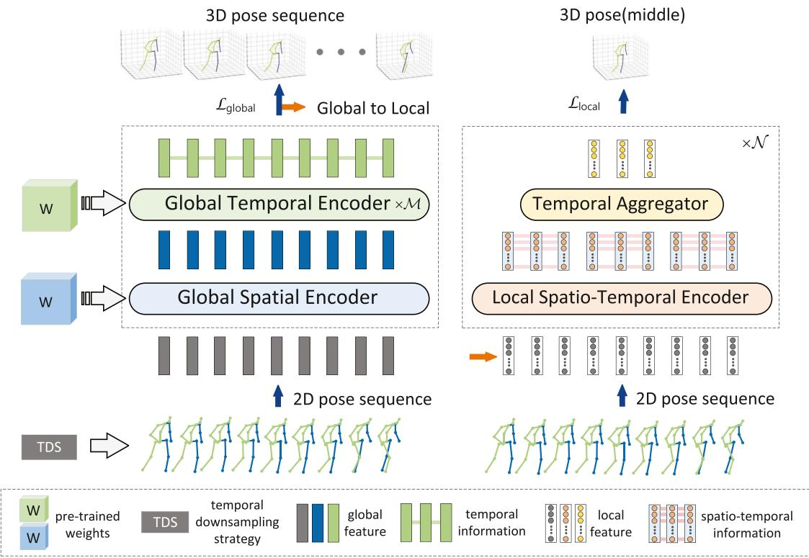
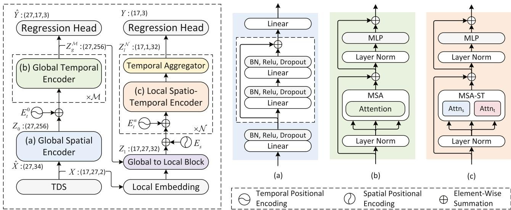
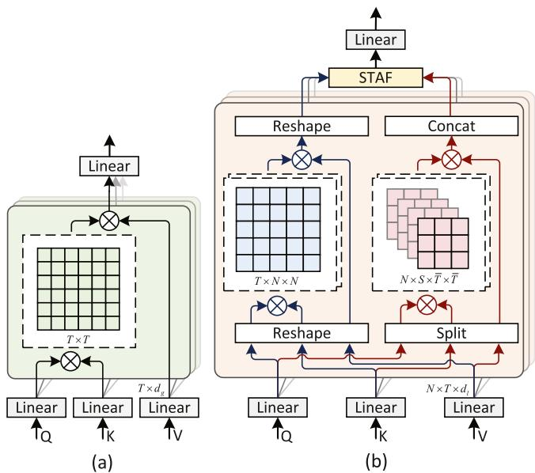
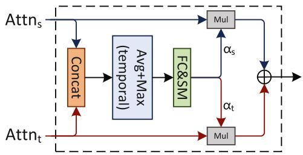
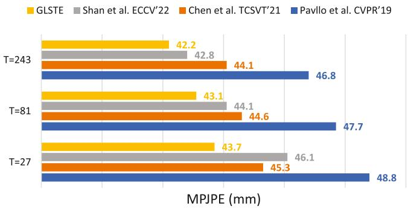
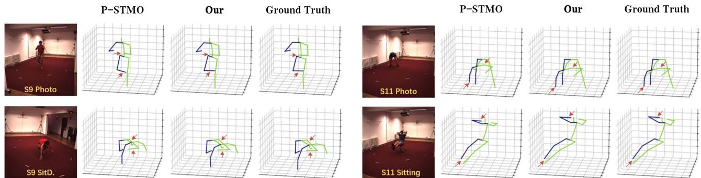

# Global and Local Spatio-Temporal Encoder for 3D Human Pose Estimation

Yong Wang , Hongbo Kang , Doudou Wu , Wenming Yang , Senior Member, IEEE, and Longbin Zhang , Member, IEEE

Abstract—Transformers have been used for 3D human pose estimation with excellent performance; however, most transformers focus on encoding the global spatio-temporal correlation of all joints in the human body and there are few studies on the local Spatio-temporal correlation of each joint in the human body. In this article, we propose a Global and Local Spatio-Temporal Encoder (GLSTE) to model the Spatio-temporal correlation. Specifically, a Global Spatial Encoder (GSE) and a Global Temporal Encoder (GTE) are constructed to capture the global spatial information of all joints in a single frame and the global temporal information of all frames, respectively. A Local Spatio-Temporal Encoder (LSTE) is constructed to capture the spatial and temporal information of each joint in the local N frames. Furthermore, we propose a parallel attention module with weight sharing to better incorporate spatial and temporal information into each node simultaneously. Extensive experiments show that GLSTE outperforms state-of-the-art methods with fewer parameters and less computational overhead on two challenging datasets: Human3.6 M and MPI-INF-3DHP. Especially in the evaluation of Human3.6 M dataset, the results of our method with 27 frames as input are better than the vast majority of recent SOTA methods with 81 and 243 frames as input, which indicates that the model can learn more useful information with smaller inputs.

Index Terms—3D Human pose estimation, transformer, spatiotemporal encoder, parallel attention.

## I. INTRODUCTION

M ONOCULAR 3D human pose estimation is to estimatethe 3D joint position of the human body through images the 3D joint position of the human body through images or videos. Similar to tasks such as 2D human pose estimation [1], [2] and person re-identification [3], [4], [5], this is a longstanding and challenging task in computer vision. Its applications include human computer interaction [6], action recognition [7], [8], [9], augmented reality (AR), virtual reality (VR) [10], medical assistance, attracting a lot of attention in recent years. Existing works are generally divided into 1) directly inferring a 3D human pose from a 2D image or video frame, 2) inferring 2D pose from monocular images or videos by any off-the-shelf 2D pose estimators, and then inferring 3D human pose from estimated 2D pose through 2D to 3D lifting pipeline. The superior performance of the state-of-the-art 2D pose detector makes the 2D-to-3D lifting [11], [12], [13] even better. However, since multiple 3D poses may correspond to almost identical 2D projections, even the slightest change in joint position and appearance can affect the prediction results in this case.

In order to alleviate this problem, video can provide temporal information to improve 3 d human pose estimation (3DHPE) accuracy and robustness, instead of estimating 3D human poses from monocular images. Some recent methods [12], [14], [15], [16] have been proposed to improve the 3D pose prediction for the current (middle) frame by aggregating 2D pose sequence information from multiple frames, which can obtain a more accurate 3D representation and reduce the uncertainty from 2D to 3D. Our work falls under this category of methods. Transformer [17] is developed for exploiting long-range dependencies and achieves tremendous success in natural language processing [18], [19] and computer vision [20], [21], [22], [23]. The global correlation of long input sequences can be clearly captured due to the self-attention mechanism of the transformer. It is a particularly suitable architecture for sequential data problems, and a natural extension to the fundamental vision task of 3DHPE.

In this article, the recent works [14], [15], [16] of Transformer in 3DHPE has been investigated. PoseFormer, proposed by Zheng et al. [14], uses Transformer’s self-attention mechanism to describe spatial dependencies between joints in each frame and temporal dependencies between frames in a sequence. However, due to the similarity of the human pose in the adjacent frames in the video, there is a lot of redundant information in the whole time series and it requires large computational resources. Furthermore, poseformer ignores local contexts, but the use of local information is critical in computer vision tasks. To solve the above problems, Li et al. [15] proposed to model the long-term dependence relationship (global temporal correlation) of all joints in the human body through VTE [17] and then to model the local temporal correlation through STE to gradually reduce the sequence length. But they acquire spatial information by a single fc layer, which has insufficient representation capability. With this in mind, Shan et al. [16] proposed P-STMO to capture the global spatial information of all joints in a single frame through an MLP block. At the same time, it adopts the temporal downsampling strategy and pre-training technology to reduce the training difficulty of the model. Since the joints of the human body are connected to each other, and the motion of the torso affects other joints, it is necessary to combine the global motion information of the human body and the local motion information of each joint to model the human pose. However, the above methods aggregate all joints together and capture the temporal context of the whole body without considering the motion differences of each joint, which leads to insufficient learning of local spatio-temporal correlation (see Fig. 1). To improve this, we believe that modeling the global and local spatio-temporal correlations are more suitable for the 2D to 3D lifting tasks in video.

  
Fig. 1. Illustration of local spatio-temporal correlation. In the spatio-temporal graph of a skeleton sequence, gray nodes are body joints fused with local spatiotemporal information. Temporal correlation refers to the temporal information of the same joint between local frames (e.g. 3 frames), and spatial correlation refers to the spatial information between each joint in each frame.

Motivated by the above, in this work, we propose a new 3D pose estimation method, called Global and Local Spatio-Temporal Encoder (GLSTE) as shown in Fig. 2. This model predicts the 3D joint position of the middle frame from the estimated 2D pose sequence in the monocular video. We adopt the same two-stage training method as [16]: 1) In the pre-training stage, is to train the global part, Global Spatial Encoder (GSE) and Global Temporal Encoder (GTE), and learn the 2D spatio-temporal correlation and inherent global features by reconstructing the 2D poses of randomly mask some frames and some 2Djoints, which gave the model a favorable initialization. 2) In the fine-tuning stage, we load the pre-trained weights into GSE and GTE, then train the whole model, and output 3D joint positions at the full sequence scale and single target frame scale. In addition, in order to alleviate the problem of data redundancy and enlarging the temporal receptive field, the 2D pose as input in both stages adopts the temporal downsampling strategy (TDS) [16].

The proposed GLSTE is a global-to-local architecture that captures global and local information separately through different modules. The global information in this article refers to the spatio-temporal correlation of all joints of the human body in all frames. According to [14], [16], we also sequentially model from spatial to temporal with modules of GSE and GTE. For GSE, we use a simple but effective fully connected residual network to integrate all joints information in each frame to simulate global spatial correlation. For GTE, we use the vanilla Transformer encoder [17], which takes spatial information of each frame as a patch to simulate global temporal correlation. According to our observation, the motion of each joint of the human body is different, and the relationship of the same joint in local several frames is more obvious. Therefore, the local information in this article refers to the spatio-temporal correlation of the same joint in local N frames. In order to better capture local information, in LSTE, we propose a multi-head spatial and temporal self-attention (MSA-ST) with parallel attention module to simulate local spatio-temporal correlation, and we design a spatial and temporal attention fusion block (STAF) to fuse the two attention. Since the task is to predict the 3D human pose of the middle frame, we design a temporal aggregator (TA) to continuously aggregate local information through multi-layer information learning to obtain the final 3D pose.

Our contributions are summarized as follows:

\- Our proposed novel global-to-local 3D human pose estimation architecture, named GLSTE, efficiently infers 3D poses from 2D joint positions by modeling global and local spatio-temporal correlations.

\- In our LSTE, we innovatively propose a MSA-ST module with parallel attention with weight sharing to model local spatio-temporal correlation, where spatial and temporal attention are fused through the STAF module.

Our method achieves state-of-the-art performance on two benchmarks with fewer parameters and smaller computational budgets than alternative methods, and model can learn more useful information with smaller inputs.

## II. RELATED WORK

## A. 3D Human Pose Estimation

3D human pose estimation can be divided into direct estimation approaches and 2D to 3D lifting approaches. The direct estimation methods infer the 3D human pose from 2D images without intermediately estimating 2D human pose representation, e.g. [24], [25], [26], [27]. The 2D-3D lifting approaches firstly estimate the 2D human pose, and then infer 3D human pose from the intermediately estimated 2D human pose. Due to the rapid development of 2d human pose estimation algorithms [1], [2], the second approach also brings better performance. Martinez et al. [11] proposed a fully connected residual network to accomplish the 2D-to-3D HPE task. In some subsequent works [28], [29], [30] also try to generate accurate 3D pose estimates from underlying 2D keypoints.Despite this, generating accurate 3D poses from a single image is still an ill-posed problem. Recent works [31], [32], [33] utilized temporal information from video to improve the accuracy and robustness of 3D HPE.

  
Fig. 2. Overview of our proposed global and local spatio-temporal encoder (GLSTE), the input is a 2D pose sequence after temporal downsampling strategy (TDS) and the outputs are 3D joint positions at both the full sequence scale and single target frame scale. The model needs to be loaded with pre-trained weights before fine-tuning. In our model, the global feature obtains the spatial information of all joints through global spatial encoder (GSE), and then obtains temporal information of the entire frames through global temporal encoder (GTE). The local feature obtains the spato-temporal information of each joint in the local frames through local spatio-temporal encoder (LSTE), and the local features are aggregated and new local features are generated by temporal aggregator (TA).

Hossain et al. [34] proposed a seq-to-seq network consisting of Long Short-Term Memory (LSTM) unit with layer-normalized. Pavllo et al. [12] proposed a network based on dilated temporal convolutions for regressing 3D poses from continuous 2D sequences. Chen et al. [35] proposed a network to predict bone direction and bone length to ensure the temporal consistency of human anatomy in videos. Liu et al. [36] proposed an attentional mechanism to adaptively identify the important frames and tensor outputs of each deep neural network layer to obtain better estimates. Wang et al. [33] proposed a U-shaped graph convolution network (GCN) to capture both short-term and long-term motion information. Hu et al. [37] further proposed a spatial-temporal conditional directed graph convolution to leverage varying non-local dependence of different poses by representing the human skeleton as a directed graph.

Most of these works are based on traditional neural network structures such as LSTM, CNN and GCN. However, these methods still have some limitations in capturing long-term dependencies. In this article, we propose to use transformer with better global correlation to model global temporal correlation. In addition, we also improve the self-attention mechanism of transformer to better capture local spatio-temporal correlation.

## B. Self-Attention and Transformer

Lately, transformer [17] has been widely concerned in various fields. Thus, many methods [38], [39], [40], [41] have been proposed to solve visual tasks using self-attention mechanism. Vision Transformer (ViT) [21], the pioneering work has directly applied the Transformer [17] architecture to image classification. DeiT [42] further extended ViT by employing a novel distillation method. DETR [22] is proposed for object detection and panoramic segmentation. There are also many works based on transformer for 3D human pose estimation [43], [44], [45]. Poseforme [14] uses pure ViT model to capture the relationship between human joints and the global dependencies across frames in the entire temporal sequence, but it ignores local information of temporal. Strided Transformer [15] incorporates local temporal context into standard Transformer. On the basis of the former, P-STMO [16] strengthens the modeling of global spatial information, and proposes a temporal downsampling strategy to alleviate data redundancy and a two-stage training method to reduce the difficulty of model training, which also achieves better results. However, the above methods aggregate all joints together and capture the temporal context of the whole body without considering the motion differences of each joint. This results in shortcomings in learning local spatio-temporal information. By combining different self-attention mechanisms we designed, our approach can simultaneously consider both the global spatio-temporal relationships within the human body and the local spatio-temporal relationships of each joint across multiple local frames. Since we account for the motion of each joint, we can more comprehensively capture information and achieve better performance and generalization capabilities.

  
Fig. 3. Instantiation of GLSTE for 3D pose estimation. We sample 27 frames by TDS as input. The tensor dimensions are enclosed in parentheses. In the globa modules are modeled for all joints, that is, (27,34) denotes 27 frames and input dimensions of 34 (2D coordinates of 17 joints). In the local modules are modeled for each joint separately, that is, (17,27,2) denotes 17 joints, 27 frames, and the input dimension of each joint is 2. (a) Global spatial encoder. (b) Global tempora encoder. (c) Local spatio-temporal encoder.

## III. PROPOSED METHOD

The overview of the proposed GLSTE is depicted in Fig. 2. This is a global-to-local architecture with dual-channel input and output, and we use the two stages of pre-training and fine-tuning to optimize the model, suggested by [16]. In the first stage, the global part (GSE and GTE) of GLSTE model is pre-trained by solving the masked pose modeling task in a self-supervised manner, and the main purpose is to recover the 2D pose sequence from the damaged 2D pose to learn 2D spatio-temporal correlation and inherent global features. In the second stage, we fine-tune the entire model by loading the pre-trained weights of the global part. In this stage, the global part is first used to model the global spatio-temporal information and supervised by the full sequence scale to enforce temporal smoothing. The local embedding module then guides the projection from global to local. Finally, the output of the middle frame is obtained through local part (LSTE and TA), which is supervised by a single object frame scale to produce more accurate estimates. In both stages, 2D human pose coordinates after temporal downsampling by TDS are used as input sequence $\hat { P } \in \overset { \star } { \mathbb { R } } ^ { T \times N \times 2 }$ , where T is the number of frames, N is the number of joints of each 2D pose, and 2 indicates joint coordinates (x,y) in 2D space. The detailed architecture of GLSTE is illustrated in Fig. 3. The input sequence will go through GSE, GTE, LSTE and TA to obtain the final output. The details of these modules are described in the following subsections.

## A. Preliminary

In this section, we introduce some background on Transformers [17], including a multi-head self-attention (MSA) and a multi-layer perceptron (MLP).

MSA: The scaled dot-product attention is a single attention head of the MSA. It implicitly associates input patches in the form of attention scores. The input is a query matrix Q, key matrix K and value matrix $V . ~ Q , K , V \in \mathbb { R } ^ { n \times d _ { m } }$ , where n is the number of input patches, and $d _ { m }$ is the dimension of each patch. The scaled dot-product attention is defined as follows:

$$
A t t e n t i o n (Q, K, V) = s o f t m a x \left(\frac {Q K ^ {T}}{\sqrt {d _ {m}}}\right) V\tag{1}
$$

The MSA splits the query, key and value into multiple heads, and then applies scaled dot-product attention to each head. The output of MSA is concatenated and projected to obtain the final output.

MLP: The MLP consists of two linear transformations with a ReLU activation in between, and is defined as follows:

$$
M L P (x) = R e L U \left(x W _ {1} + b _ {1}\right) W _ {2} + b _ {2}\tag{2}
$$

where $W _ { 1 } \in \mathbb { R } ^ { d _ { m } \times d _ { f } } , W _ { 2 } \in \mathbb { R } ^ { d _ { f } \times d _ { m } } , b _ { 1 } \in \mathbb { R } ^ { d _ { f } }$ and $b _ { 2 } \in \mathbb { R } ^ { d _ { m } }$ are parameter matrices. $d _ { f }$ is the dimension of the intermediate layer.

## B. Global Spatial Encoder

The purpose of GSE is to fusion the spatial information of all joints of the human body into a single frame, which needs to learn enough spatial information from 2D poses and map to higher dimensions. Martinez et al. [11] proposed the use of fully connected residual network to model the spatial information of a single pose, which is also applicable to the fusion of global spatial information in this article. The global spatial information of each frame can be obtained by independently input each 2D pose in the sequence, as shown in Fig. 3(a). Meanwhile, GSE also played the role of Global embedding. The 2-dimensional coordinates of all joints in each frame of the 2D pose sequence P are merged as input $\hat { X } \in \mathbb { R } ^ { T \times ( N . 2 ) }$ , and through the linear layer of GSE, the spatial information of each frame is embedded into the high-dimensional feature $Z _ { 0 } \in \mathbb { R } ^ { T \times d _ { g } }$ , where $d _ { g }$ is the intermediate dimension of the global modules, so as to obtain a set of potential features as the input of GTE. The features of each frame are treated as an individual token.

  
Fig. 4. (a) The multi-head self-attention (MSA) in global temporal encoder (GTE). (b) The multi-head spatial and temporal self-attention (MSA-ST) in local spatio-temporal encoder (LSTE), where the left is $A t t n _ { s }$ and the right is $A t t n _ { t }$ The dashed box is the attention map matrix.

## C. Global Temporal Encoder

We have simulated the global spatial information of each frame by GSE, but the long-term temporal information of the entire sequence is still missing. Thus, we design a global temporal encoder, as shown in Fig. 3(b). The global temporal encoder is a transformer encoder [17] and composed of M layers. The trainable temporal position embedding $\mathbf { \bar { \mathcal { E } } } _ { t } ^ { 0 } \in \mathbb { R } ^ { T \times d _ { g } }$ is used before the first layer of the encoder, which can be formulate as follows:

$$
Z _ {g} ^ {0} = Z _ {0} + E _ {t} ^ {0}\tag{3}
$$

The global temporal encoder is applied to the input $Z _ { g } ^ { 0 } \in$ $\mathbb { R } ^ { T \times d _ { g } }$ to obtain the output $Z _ { g } ^ { \mathcal { M } } \in \mathbb { R } ^ { T \times d _ { g } }$ as follows:

$$
\hat {Z} _ {g} ^ {m} = M S A (L N (Z _ {g} ^ {m - 1})) + Z _ {g} ^ {m - 1}\tag{4}
$$

$$
Z _ {g} ^ {m} = M L P (L N (\hat {Z} _ {g} ^ {m})) + \hat {Z} _ {g} ^ {m}\tag{5}
$$

where $m = 1 , 2 , \ldots , M , L N ( \cdot )$ is the layer normalization [46]. $M S A$ in GTE as shown in Fig. 4(a), and the matrix size of its attention map is $T \times T$ . The above formulas can be expressed by using a function $G T E ( \cdot )$ as follows:

$$
Z _ {g} ^ {m} = G T E (Z _ {g} ^ {m - 1})\tag{6}
$$

## D. Global-to-Local

Since the output of global part (GSE and GTE) cannot be directly utilized in local part (LSTE and TA), we propose a

Global-to-Local Block (GLB) to deal with global feature $Z _ { g } ^ { \mathcal { M } } \in$ $\mathbb { R } ^ { N \times d _ { g } }$ . Given that global feature is the feature for merging all nodes and local feature is feature for a single node, our GLB implements global to local operation by projecting and splitting, which is defined as follows:

$$
Z _ {g} ^ {\mathcal {M}} \stackrel {{P r o j \& S p l i t}} {{\longrightarrow}} \hat {Z} _ {1} \in \mathbb {R} ^ {N \times T \times d _ {l}}\tag{7}
$$

The spatio-temporal channels of 2D pose sequence $P$ are exchanged to obtain the input $\boldsymbol { X } \in \mathbb { R } ^ { N \times T \times 2 }$ of the local embedding. Then, the local embedding module maps the twodimensional features of each node to a higher dimension d by linear projection. This process also guides the projecting of GLB from global to local by combining with $\hat { Z } _ { 1 }$ , which is defined as follows:

$$
Z _ {1} = [ \dots ; x _ {i, j} E; \dots ] + \hat {Z} _ {1}\tag{8}
$$

where $x _ { i , j }$ denotes the i-th node of the $j \mathrm { - t h }$ frame of X and $i = 1 , 2 , \ldots , N , \ j = 1 , 2 , \ldots , T , \ E \in \mathbb { R } ^ { 2 \times d _ { l } }$ is the parameter matrix of the local embedding.

## E. Local Spatio-Temporal Encoder

According to our observation, the motions of each joint of the human body are different, the same joint relationship in the local frames is more obvious. Therefore, we design LSTE (see Fig. 3(c)) to model the spatio-temporal correlation of each joint in the local frames. In $\mathrm { L S T E } ,$ we innovatively propose a MSA-ST with parallel attention module to simulate local spatio-temporal correlation, and we design a spatial and temporal attention fusion block (STAF) to fuse the two attention. In this section, $d _ { l }$ is the intermediate dimension of the local modules (LSTE and TA).

Multi-head Spatio-Temporal Self-Attention (MSA-ST): In MSA-ST, the main is the weight-sharing cascade attention module, as shown in Fig. 4(b), and it contains spatial attention $( A t t n _ { s } )$ and temporal attention $( A t t n _ { t } )$ . The three mapped learnable matrices $\bar { Q _ { * } } , K , V \in \mathbb { R } ^ { N \times T \times d _ { l } }$ are shared by the two attentions, but need to be changed accordingly, $Q _ { s } , K _ { s } , V _ { s }$ are obtained by swapping spatial and temporal dimensions, and $Q _ { t } , K _ { t } , V _ { t }$ are obtained by dividing the complete sequence $T$ into S sequences with local frames number ${ \bar { T } } ,$ , as follows:

$$
\{Q, K, V \} \stackrel {{R e s h a p e}} {{\longrightarrow}} \left\{Q _ {s}, K _ {s}, V _ {s} \right\} \in \mathbb {R} ^ {T \times N \times d _ {l}}\tag{9}
$$

$$
\{Q, K, V \} \stackrel {S p l i t} {\longrightarrow} \{Q _ {t}, K _ {t}, V _ {t} \} \in \mathbb {R} ^ {N \times S \times \bar {T} \times d _ {l}}\tag{10}
$$

The spatial attention $A t t n _ { s }$ is used to simulate the spatial relationship between each joint in a single frame, and the temporal attention $A t t n _ { t }$ is used to simulate the temporal relationship between the same joints in local T¯ frames. The $A t t n _ { s }$ and $A t t n _ { t }$ are calculated as follows:

$$
\operatorname{Attn} _ {s} (Q, K, V) = \text { Reshape } (\text { Attention } (Q _ {s}, K _ {s}, V _ {s}))\tag{11}
$$

$$
A t t n _ {t} (Q, K, V) = C o n c a t (A t t e n t i o n (Q _ {t}, K _ {t}, V _ {t}))\tag{12}
$$

where Attention(·) is the scaled dot-product attention in (1). The matrix size of the attention map of Attns and Attnt are $T \times N \times N$ and $N \times S \times { \bar { T } } \times { \bar { T } }$ , respectively. Suppose that the MSA-ST has h heads and the MSA-ST operation is simply achieved by concatenating all heads as follows:

  
Fig. 5. Proposed spatial and temporal attention fusion(STAF) module, which is used to fuse the spatial and temporal attention.

$$
M S A - S T = \mathcal {F} (C o n c a t (A t t n _ {s} ^ {i} (\cdot), C o n c a t (A t t n _ {t} ^ {i} (\cdot))) \cdot W\tag{13}
$$

where $i = 1 , 2 , . . . , h , W \in \mathbb { R } ^ { d _ { l } \times d _ { l } }$ is a learnable matrix, $\mathcal F ( \cdot )$ is a fusion function in $( 1 7 )$ , and $A t t n _ { s } ^ { i } ( \cdot ) , A t t n _ { t } ^ { i } ( \cdot )$ are the i-th head of $A t t n _ { s } ( \cdot ) , A t t n _ { t } ( \cdot )$ respectively.

Spatial and Temporal Attention Fusion (STAF): With the aim of better integrating the two branch information of $A t t n _ { s }$ and $A t t n _ { t }$ , instead of simple summation, we design the STAF to dynamically adjust spatial and temporal attention information, as shown in Fig. 5. We first concatenate $A t t n _ { s }$ and $A t t n _ { t }$ in the feature channel, and the resulting dimension is $\mathbb { R } ^ { N \times T \times ( 2 \cdot d _ { l } ) }$ ). The Average pooling and Max pooling operations are used to compress the temporal dimension of the input features. This process generates two features of dimension $\mathbb { R } ^ { \mathbf { \lambda } _ { N \times 1 \times ( 2 \cdot d _ { l } ) } ^ { \mathbf { \lambda } _ { N \times 1 } ^ { \star } \times ( 2 \cdot d _ { l } ) } }$ , and combines the average and maximum features by adding them. Finally, the fully connected network and sigmoid operation are performed to produce the weights $\alpha _ { s } , \alpha _ { t } \in \overline { { \mathbb { R } ^ { N \times 1 \times \bar { d } _ { l } } } }$ . The fusion of Attns and $A t t n _ { t }$ is defined as follows:

$$
f _ {c a t} = C o n c a t (A t t n _ {s}, A t t n _ {t})\tag{14}
$$

$$
f _ {a v g + m a x} = F C (A v g P o o l (f _ {c a t}) + M a x P o o l (f _ {c a t}))\tag{15}
$$

$$
\alpha_ {s}, \alpha_ {t} = S p l i t (S i g m o i d (f _ {a v g + m a x}))\tag{16}
$$

$$
\mathcal {F} (A t t n _ {s}, A t t n _ {t}) = \alpha_ {s} \cdot A t t n _ {s} + \alpha_ {t} \cdot A t t n _ {t}\tag{17}
$$

Network Structure ofLSTE: The input $Z _ { 1 }$ ofLSTE is obtained by global to local projection, in (7) and (8). In order to locate the spatial position of a patch, we add positional encodings to inject sequence information into the input, namely spatial positional encoding $E _ { s } \in \mathbb { R } ^ { N \times 1 \times d _ { l } }$ . It is a trainable sequence matrix that is added to the input and can be expressed as follows:

$$
Z _ {l} ^ {0} = Z _ {1} + E _ {s}\tag{18}
$$

The network structure of LSTE as shown in Fig. 3(c). The local spatio-temporal encoder and temporal aggregator (in Section III-F) combine to model local features and consist of $\mathcal { N }$ layers. The temporal dimension changes for each layer, so the model is prefixed with trainable temporal position embeddings before each layer, and the first temporal position embedding is $E _ { t } ^ { 1 } \in \mathbb { R } ^ { 1 \times T \times d _ { l } }$ , after which the temporal embedding of each layer changes with the temporal dimension to change T. This process is applied to the input $Z _ { l } ^ { 0 } \in \mathbb { R } ^ { N \times T \times d _ { l } }$ to obtain the output $Z _ { l } ^ { \mathcal { N } } \in \mathbb { R } ^ { N \times 1 \times d _ { l } }$ as follows:

$$
\hat {Z} _ {l} ^ {n} = Z _ {l} ^ {n - 1} + E _ {t} ^ {n}\tag{19}
$$

$$
\hat {Z} _ {l} ^ {n} = M S A - S T (L N (\hat {Z} _ {l} ^ {n})) + \hat {Z} _ {l} ^ {n}\tag{20}
$$

$$
\hat {Z} _ {l} ^ {n} = M L P (L N (\hat {Z} _ {l} ^ {n})) + \hat {Z} _ {l} ^ {n}\tag{21}
$$

$$
Z _ {l} ^ {n} = T A (\hat {Z} _ {l} ^ {n}, \bar {T} _ {n})\tag{22}
$$

where $n = 1 , 2 , . . . , \mathcal { N } , T A ( \cdot )$ is the temporal aggregator, $\bar { T } _ { n }$ is the number of local frames in n layer, $E _ { t } ^ { n }$ denotes the temporal position embedding before the n-th layer. The above formulas can be expressed as follows:

$$
Z _ {l} ^ {n} = T A (L S T E (Z _ {l} ^ {n - 1} + E _ {t} ^ {n}), \bar {T} _ {n})\tag{23}
$$

## F. Temporal Aggregator

This work is a task of regressing a single frame (middle frame) from the whole sequence. If the temporal sequence is only learned without aggregation, the model will get a lot of redundant information and increase the computational overhead. Therefore, we propose a temporal aggregator to better regress the 3D pose of the intermediate frame and aggregate the local information. Specifically, we aggregate the temporal information of each node separately through a 1D convolution, and the temporal sequence of the input changes from $T$ to $S _ { \ i }$ , where $T$ and S denote the number of complete sequences of the current layer and the number of sequences after the current layer has been divided, respectively. The above method can be expressed as a function $T \bar { A ( \cdot , T ) } , \bar { \bar { T } }$ is the number of local frames of the divided sequences in current layer, and we need to use it in conjunction with LSTE as shown in (23).

## G. Regression Head

Since we use a sequence of frames to predict the 3D pose of the center frame, supervising only a single pose will lose the smoothness of time. Thus we impose an additional temporal smoothness constraint by adding a regression head from the output of GTE during training and obtain the full sequence prediction output $\hat { Y } \in \breve { \mathbb { R } ^ { T \times N \times 3 } }$ of 3D pose sequences. Lastly, a regression head is added to the output of LSTE to obtain the prediction output $\boldsymbol { Y } \in \mathbb { R } ^ { N \times 3 }$ of middle frame’s 3D joint locations.

## H. Loss Function

Since the output of GTE is the feature information of all frames, we need to supervise the full sequence scale to achieve temporal consistency on the sequence. Therefore we adopt the sequence loss [15] to minimize the errors between predictions and ground truths:

$$
\mathcal {L} _ {\text { global }} = \frac {1}{N \cdot T} \sum_ {i = 1} ^ {N} \sum_ {j = 1} ^ {T} \| P _ {i, j} - \hat {Y} _ {i, j} \| _ {2}\tag{24}
$$

where $\hat { Y } _ { i , j }$ and $P _ { i , j }$ represent the sequence of estimated and ground truth 3D positions of joint i at frame j, respectively.

Given that LSTE models local frames and TA aggregates temporal information to finally obtain the characteristics of intermediate frames, we must supervise a single pose. We apply the standard Mean Per Joint Position Error (MPJPE) loss to minimize the error between the predicted and ground truth pose as:

$$
\mathcal {L} _ {\text { local }} = \frac {1}{N} \sum_ {i = 1} ^ {N} \| P _ {i} - Y _ {i} \| _ {2}\tag{25}
$$

where $Y _ { i }$ and $P _ { i }$ are the middle frame’s estimated and ground truth 3D positions of i-th joint in the current pose respectively.

The network is trained in an end-to-end manner, the final loss function $\mathcal { L }$ is defined as:

$$
\mathcal {L} = \lambda_ {g} \mathcal {L} _ {g l o b a l} + \lambda_ {l} \mathcal {L} _ {l o c a l}\tag{26}
$$

where $\lambda _ { g }$ and $\lambda _ { l }$ are weighting factors.

## IV. EXPERIMENT

## A. Datasets and Evaluation Protocols

We evaluate the proposed model on two 3D human pose estimation datasets: Human3.6M [47] and MPI-INF-3DHP [48].

Human3.6 M is a widely used dataset for 3D human pose estimation. It contains 3.6 million video frames and the corresponding 3D human pose annotations. The dataset consists of 15 different activities of 11 actors captured by four cameras with different views. Following the same strategy of the previous methods [12], [14], [16], [44], the model is trained on five subjects (S1, S5, S6, S7, S8) and evaluated on two subjects (S9, S11) on a 17-joint skeleton. We use the most commonly used evaluation metrics (MPJPE and PMPJPE). MPJPE (i.e. Protocol 1) is to measure the mean Euclidean distance between predicted and ground-truth joint positions without any transformation. P-MPJPE (i.e. Protocol 2) is the MPJPE after aligning the predicted 3D pose with the ground-truth using a rigid transformation.

MPI-INF-3DHP is a challenging dataset for both indoor and outdoor scenarios. It recorded 8 activities performed by 8 actors from 14 camera views, containing three scenes: green screen, non-green screen, and outdoor. Following the Setting in [14], [33], we report metrics of MPJPE, Percentage of Correct Keypoint (PCK) within 150 mm range, and Area Under Curve (AUC) for a range of PCK thresholds as evaluation metrics in our experiments.

## B. Implementation Details

We implement our proposed approach with Pytorch [52]. The training and testing were performed on a single GeForce GTX 3090 GPU. We use two stages of pre-training [16] and fine-tuning to train the model. In both stages, we use Adam optimizer [53] to train the model for 80 epochs, with initial learning rates of 1e-4 and 7e-4, respectively, and the decay factor of each epoch was 0.97. Set the batch size to 256. We use horizontal flip as data augmentation in training and testing. Following [12], the cascaded pyramid network (CPN) [1] is used for Human3.6 M and the 2D ground-truth poses are used for MPI-INF-3DHP.

  
Fig. 6. MPJPE metric comparison under different input frames on the Human3.6 M test.

In our experiments, the proposed GLSTE, dimensions $d _ { g } =$ 256 and $d _ { l } = 3 2$ , and multi-attention heads $h = 8 .$ . The temporal downsampling rate [16] of TDS is 9 at $T = 9 , 2 7$ and 3 at $T =$ 81, 243. For GTE, the layer M = 3 at T = 9, 27, 81, and $\mathcal { M } = 4$ at $T = 2 4 3$ . For LSTE, when T = 9, 27, 81, 243 the number of local frames T¯ of each layer is set to (3, 3), (3, 3, 3), (3, 3, 3, 3) and (9, 9, 3) respectively. The weight factors $\lambda _ { g }$ and $\lambda _ { l }$ of the loss function are set to 1.

## C. Comparison With State-of-the-Art Methods

Results on Human3.6 M: We compare our GLSTE with previous state-of-the-art methods on the Human3.6 m dataset. We use CPN [1] as a 2D keypoint detector and then train our network on the detected 2D pose sequences. As shown in Table I, the performance of our model at 243 frames is shown. Our method performed well in protocol 1 (42.2 mm), protocol 2 (33.8 mm). We also train our model using the same refining module as [15], [16], [31], [33]. It achieves 41.9 mm under protocol 1, outperforming all other methods.

As shown in Table II, our method achieves the best results (27.9 mm in MPJPE) when using ground true 2D poses as input, which outperforms all other methods. And the detection results of our method are better than previous work except Directions action, which also proves the robustness of our model.

In Table III, we report a comparison with state-of-the-art methods for different input frames (T) in terms of the total number of parameters and the estimated floating-point operations (FLOPs) per frame, and the performance of the model. It can be seen that our method has the least number of parameters but the best performance. Compared with the method based on the fully convolutional architecture [12], [35], the method based on the Transformer architecture [16] is more effective, and our method outperforms methods that also use pre-training and downsampling strategies [16]. It is worth noting that the performance of our model in 27 frames, with 43.7 mm MPJPE, exceeds the results of Shan et al. [16] in 81 frames and Chen et al. [35] in 243 frames, and our param and FLOPs are far less than them. Meanwhile, Fig. 6 also shows the comparison of MPJPE metrics under different input frames in the table.

TABLE I  
QUANTITATIVE COMPARISON WITH THE STATE-OF-THE-ART METHODS ON HUMAN3.6 M UNDER PROTOCOL 1 AND PROTOCOL 2, USING DETECTED 2D POSES FROM CASCADED PYRAMID NETWORK (CPN) [1]

<table><tr><td>Protocol 1(CPN)</td><td>Dir.</td><td>Disc.</td><td>Eat</td><td>Greet</td><td>Phone</td><td>Photo</td><td>Pose</td><td>Pur.</td><td>Sit</td><td>SitD.</td><td>Smoke</td><td>Wait</td><td>WalkD.</td><td>Walk</td><td>WalkT.</td><td>Avg</td></tr><tr><td>Pavllo et al. [12] CVPR&#x27;19 (T=243)</td><td>45.2</td><td>46.7</td><td>43.3</td><td>45.6</td><td>48.1</td><td>55.1</td><td>44.6</td><td>44.3</td><td>57.3</td><td>65.8</td><td>47.1</td><td>44.0</td><td>49.0</td><td>32.8</td><td>33.9</td><td>46.8</td></tr><tr><td>Xu et al. [49] CVPR&#x27;20 (T=9)</td><td>37.4</td><td>43.5</td><td>42.7</td><td>42.7</td><td>46.6</td><td>59.7</td><td>41.3</td><td>45.1</td><td>52.7</td><td>60.2</td><td>45.8</td><td>43.1</td><td>47.7</td><td>33.7</td><td>37.1</td><td>45.6</td></tr><tr><td>Liu et al. [36] CVPR&#x27;20 (T=243)</td><td>41.8</td><td>44.8</td><td>41.1</td><td>44.9</td><td>47.4</td><td>54.1</td><td>43.4</td><td>42.2</td><td>56.2</td><td>63.6</td><td>45.3</td><td>43.5</td><td>45.3</td><td>31.3</td><td>32.2</td><td>45.1</td></tr><tr><td>Zeng et al. [50] ECCV&#x27;20 (T=243)</td><td>46.6</td><td>47.1</td><td>43.9</td><td>41.6</td><td>45.8</td><td>49.6</td><td>46.5</td><td>40.0</td><td>53.4</td><td>61.1</td><td>46.1</td><td>42.6</td><td>43.1</td><td>31.5</td><td>32.6</td><td>44.8</td></tr><tr><td>Zeng et al. [51] ICCV&#x27;21 (T=9)</td><td>-</td><td>-</td><td>-</td><td>-</td><td>-</td><td>-</td><td>-</td><td>-</td><td>-</td><td>-</td><td>-</td><td>-</td><td>-</td><td>-</td><td>-</td><td>45.7</td></tr><tr><td>Zheng et al. [14] ICCV&#x27;21 (T=81)</td><td>41.5</td><td>44.8</td><td>39.8</td><td>42.5</td><td>46.5</td><td>51.6</td><td>42.1</td><td>42.0</td><td>53.3</td><td>60.7</td><td>45.5</td><td>43.3</td><td>46.1</td><td>31.8</td><td>32.2</td><td>44.3</td></tr><tr><td>Chen et al. [35] TCSVT&#x27;21 (T=243)</td><td>41.4</td><td>43.5</td><td>40.1</td><td>42.9</td><td>46.6</td><td>51.9</td><td>41.7</td><td>42.3</td><td>53.9</td><td>60.2</td><td>45.4</td><td>41.7</td><td>46.0</td><td>31.5</td><td>32.7</td><td>44.1</td></tr><tr><td>Li et al. [15] TMM&#x27;22 (T=351)</td><td>39.9</td><td>43.4</td><td>40.0</td><td>40.9</td><td>46.4</td><td>50.6</td><td>42.1</td><td>39.8</td><td>55.8</td><td>61.6</td><td>44.9</td><td>43.3</td><td>44.9</td><td>29.9</td><td>30.3</td><td>43.6</td></tr><tr><td>Li et al. [44] CVPR&#x27;22 (T=351)</td><td>39.2</td><td>43.1</td><td>40.1</td><td>40.9</td><td>44.9</td><td>51.2</td><td>40.6</td><td>41.3</td><td>53.5</td><td>60.3</td><td>43.7</td><td>41.1</td><td>43.8</td><td>29.8</td><td>30.6</td><td>43.0</td></tr><tr><td>Shan et al. [16] ECCV&#x27;22 (T=243)</td><td>38.9</td><td>42.7</td><td>40.4</td><td>41.1</td><td>45.6</td><td>49.7</td><td>40.9</td><td>39.9</td><td>55.5</td><td>59.4</td><td>44.9</td><td>42.2</td><td>42.7</td><td>29.4</td><td>29.4</td><td>42.8</td></tr><tr><td>Shan et al. [16] ECCV&#x27;22 (T=243)(*)</td><td>38.4</td><td>42.1</td><td>39.8</td><td>40.2</td><td>45.2</td><td>48.9</td><td>40.4</td><td>38.3</td><td>53.8</td><td>57.3</td><td>43.9</td><td>41.6</td><td>42.2</td><td>29.3</td><td>29.3</td><td>42.1</td></tr><tr><td>GLSTE (T =243)</td><td>39.2</td><td>42.3</td><td>39.6</td><td>41.0</td><td>44.0</td><td>49.6</td><td>41.0</td><td>39.9</td><td>53.2</td><td>59.2</td><td>43.2</td><td>41.2</td><td>42.1</td><td>29.0</td><td>29.2</td><td>42.2</td></tr><tr><td>GLSTE (T =243)(*)</td><td>38.1</td><td>41.7</td><td>39.1</td><td>39.5</td><td>43.7</td><td>49.7</td><td>40.4</td><td>39.7</td><td>54.2</td><td>58.7</td><td>42.8</td><td>42.1</td><td>42.0</td><td>28.7</td><td>28.5</td><td>41.9</td></tr><tr><td colspan="17"></td></tr><tr><td>Protocol 2(CPN)</td><td>Dir.</td><td>Disc.</td><td>Eat</td><td>Greet</td><td>Phone</td><td>Photo</td><td>Pose</td><td>Pur.</td><td>Sit</td><td>SitD.</td><td>Smoke</td><td>Wait</td><td>WalkD.</td><td>Walk</td><td>WalkT.</td><td>Avg</td></tr><tr><td>Pavllo et al. [12] CVPR&#x27;19 (T=243)</td><td>34.1</td><td>36.1</td><td>34.4</td><td>37.2</td><td>36.4</td><td>42.2</td><td>34.4</td><td>33.6</td><td>45.0</td><td>52.5</td><td>37.4</td><td>33.8</td><td>37.8</td><td>25.6</td><td>27.3</td><td>36.5</td></tr><tr><td>Xu et al. [49] CVPR&#x27;20 (T=9)</td><td>31.0</td><td>34.8</td><td>34.7</td><td>34.4</td><td>36.2</td><td>43.9</td><td>31.6</td><td>33.5</td><td>42.3</td><td>49.0</td><td>37.1</td><td>33.0</td><td>39.1</td><td>26.9</td><td>31.9</td><td>36.2</td></tr><tr><td>Wang et al. [33] ECCV&#x27;20 (T=96)</td><td>32.9</td><td>35.2</td><td>35.6</td><td>34.4</td><td>36.4</td><td>42.7</td><td>31.2</td><td>32.5</td><td>45.6</td><td>50.2</td><td>37.3</td><td>32.8</td><td>36.3</td><td>26.0</td><td>23.9</td><td>35.5</td></tr><tr><td>Liu et al. [36] CVPR&#x27;20 (T=243)</td><td>32.3</td><td>35.2</td><td>33.3</td><td>35.8</td><td>35.9</td><td>41.5</td><td>33.2</td><td>32.7</td><td>44.6</td><td>50.9</td><td>37.0</td><td>32.4</td><td>37.0</td><td>25.2</td><td>27.2</td><td>35.6</td></tr><tr><td>Chen et al. [35] TCSVT&#x27;21 (T=243)</td><td>33.1</td><td>35.3</td><td>33.4</td><td>35.9</td><td>36.1</td><td>41.7</td><td>32.8</td><td>33.3</td><td>42.6</td><td>49.4</td><td>37.0</td><td>32.7</td><td>36.5</td><td>25.5</td><td>27.9</td><td>35.6</td></tr><tr><td>Zheng et al. [14] ICCV&#x27;21 (T=81)</td><td>32.5</td><td>34.8</td><td>32.6</td><td>34.6</td><td>35.3</td><td>39.5</td><td>32.1</td><td>32.0</td><td>42.8</td><td>48.5</td><td>34.8</td><td>32.4</td><td>35.3</td><td>24.5</td><td>26.0</td><td>34.6</td></tr><tr><td>Li et al. [15] TMM&#x27;22 (T=351)</td><td>32.0</td><td>35.6</td><td>32.6</td><td>35.1</td><td>35.8</td><td>40.9</td><td>33.2</td><td>31.2</td><td>44.7</td><td>48.9</td><td>36.7</td><td>33.9</td><td>35.2</td><td>23.7</td><td>25.1</td><td>34.9</td></tr><tr><td>Shan et al. [16] ECCV&#x27;22 (T=243)</td><td>31.3</td><td>35.2</td><td>32.9</td><td>33.9</td><td>35.4</td><td>39.3</td><td>32.5</td><td>31.5</td><td>44.6</td><td>48.2</td><td>36.3</td><td>32.9</td><td>34.4</td><td>23.8</td><td>23.9</td><td>34.4</td></tr><tr><td>GLSTE (T =243)</td><td>30.8</td><td>34.6</td><td>32.4</td><td>32.9</td><td>34.0</td><td>39.5</td><td>31.5</td><td>31.0</td><td>44.2</td><td>48.7</td><td>35.2</td><td>32.4</td><td>33.5</td><td>23.1</td><td>23.5</td><td>33.8</td></tr></table>

(\*) uses the refining module proposed in [31]. the best result is shown in bold, and the second-best result is underlined.

TABLE II  
QUANTITATIVE COMPARISONS OF MPJPE IN MILLIMETER ON HUMAN3.6 M UNDER PROTOCOL 1, USING GROUND TRUTH (GT) 2D JOINT LOCATIONS AS INPUT

<table><tr><td>Protocol 1(GT)</td><td>Dir.</td><td>Disc.</td><td>Eat</td><td>Greet</td><td>Phone</td><td>Photo</td><td>Pose</td><td>Pur.</td><td>Sit</td><td>SitD.</td><td>Smoke</td><td>Wait</td><td>WalkD.</td><td>Walk</td><td>WalkT.</td><td>Avg</td></tr><tr><td>Pavllo et al. [12] CVPR&#x27;19 (T=243)</td><td>35.2</td><td>40.2</td><td>32.7</td><td>35.7</td><td>38.2</td><td>45.5</td><td>40.6</td><td>36.1</td><td>48.8</td><td>47.3</td><td>37.8</td><td>39.7</td><td>38.7</td><td>27.8</td><td>29.5</td><td>37.8</td></tr><tr><td>Liu et al. [36] CVPR&#x27;20 (T=243)</td><td>34.5</td><td>37.1</td><td>33.6</td><td>34.2</td><td>32.9</td><td>37.1</td><td>39.6</td><td>35.8</td><td>40.7</td><td>41.4</td><td>33.0</td><td>33.8</td><td>33.0</td><td>26.6</td><td>26.9</td><td>34.7</td></tr><tr><td>Zeng et al. [50] ECCV&#x27;20 (T=243)</td><td>34.8</td><td>32.1</td><td>28.5</td><td>30.7</td><td>31.4</td><td>36.9</td><td>35.6</td><td>30.5</td><td>38.9</td><td>40.5</td><td>32.5</td><td>31.0</td><td>29.9</td><td>22.5</td><td>24.5</td><td>32.0</td></tr><tr><td>Zheng et al. [14] ICCV&#x27;21 (T=81)</td><td>30.0</td><td>33.6</td><td>29.9</td><td>31.0</td><td>30.2</td><td>33.3</td><td>34.8</td><td>31.4</td><td>37.8</td><td>38.6</td><td>31.7</td><td>31.5</td><td>29.0</td><td>23.3</td><td>23.1</td><td>31.3</td></tr><tr><td>Shan et al. [54] MM&#x27;21 (T=243)</td><td>29.5</td><td>30.8</td><td>28.8</td><td>29.1</td><td>30.7</td><td>35.2</td><td>31.7</td><td>27.8</td><td>34.5</td><td>36.0</td><td>30.3</td><td>29.4</td><td>28.9</td><td>24.1</td><td>24.7</td><td>30.1</td></tr><tr><td>Li et al. [44] CVPR&#x27;22 (T=351)</td><td>27.7</td><td>32.1</td><td>29.1</td><td>28.9</td><td>30.0</td><td>33.9</td><td>33.0</td><td>31.2</td><td>37.0</td><td>39.3</td><td>30.0</td><td>31.0</td><td>29.4</td><td>22.2</td><td>23.0</td><td>30.5</td></tr><tr><td>Shan et al. [16] ECCV&#x27;22 (T=243)</td><td>28.5</td><td>30.1</td><td>28.6</td><td>27.9</td><td>29.8</td><td>33.2</td><td>31.3</td><td>27.8</td><td>36.0</td><td>37.4</td><td>29.7</td><td>29.5</td><td>28.1</td><td>21.0</td><td>21.0</td><td>29.3</td></tr><tr><td>GLSTE (T =243)</td><td>27.8</td><td>29.5</td><td>27.1</td><td>26.5</td><td>27.4</td><td>31.0</td><td>30.8</td><td>27.5</td><td>31.9</td><td>35.0</td><td>28.2</td><td>28.5</td><td>27.0</td><td>20.3</td><td>20.3</td><td>27.9</td></tr></table>

The best result is shown in bold, and the second-best result is underlined.

TABLE III  
QUANTITATIVE COMPARISON OF STATE-OF-THE-ART METHODS WITH DIFFERENT INPUT FRAMES ON THE HUMAN3.6 M DATASET

<table><tr><td>Method</td><td>T</td><td>Param (M)</td><td>FLOPs(M)</td><td>MPJPE↓</td></tr><tr><td>Pavllo et al. [12]</td><td>27</td><td>8.56</td><td>17.09</td><td>48.8</td></tr><tr><td>Pavllo et al. [12]</td><td>81</td><td>12.75</td><td>25.48</td><td>47.7</td></tr><tr><td>Pavllo et al. [12]</td><td>243</td><td>16.95</td><td>33.87</td><td>46.8</td></tr><tr><td>Chen et al. [35]</td><td>27</td><td>31.88</td><td>61.7</td><td>45.3</td></tr><tr><td>Chen et al. [35]</td><td>81</td><td>45.53</td><td>88.9</td><td>44.6</td></tr><tr><td>Chen et al. [35]</td><td>243</td><td>59.18</td><td>116</td><td>44.1</td></tr><tr><td>Shan et al. [16]</td><td>27</td><td>4.6</td><td>81.6</td><td>46.1</td></tr><tr><td>Shan et al. [16]</td><td>81</td><td>5.4</td><td>246.5</td><td>44.1</td></tr><tr><td>Shan et al. [16]</td><td>243</td><td>6.7</td><td>868.5</td><td>42.8</td></tr><tr><td>GLSTE(T=9)</td><td>9</td><td>2.43</td><td>23.4</td><td>46.1</td></tr><tr><td>GLSTE(T=27)</td><td>27</td><td>2.44</td><td>70.7</td><td>43.7</td></tr><tr><td>GLSTE(T=81)</td><td>81</td><td>2.46</td><td>213.3</td><td>43.1</td></tr><tr><td>GLSTE(T=243)</td><td>243</td><td>2.98</td><td>754.1</td><td>42.2</td></tr></table>

The mpjpe metric and number of parameters are reported. The input 2D pose is detected by cpn [1]

Results on MPI-INF-3DHP: To evaluate the generalization ability of the proposed model, Table IV reports the quantitative results of GLSTE with other methods on MPI-INF-3DHP. Following [14], [33], [37], we use a 2D pose sequence of 81 frames as input due to the shorter sequence length of this dataset compared to Human3.6 m. The table shows that our method again achieves state-of-the-art performance on all three evaluation metrics (PCK, AUC and MPJPE). It emphasizes the effectiveness of our GLSTE in improving performance in outdoor scenes.

TABLE IV  
RESULTS ON MPI-INF-3DHP UNDER THREE EVALUATION METRICS

<table><tr><td>Method</td><td>PCK↑</td><td>AUC↑</td><td>MPJPE↓</td></tr><tr><td>Mehta et al. [48] 3DV&#x27;17 (T=1)</td><td>75.7</td><td>39.3</td><td>117.6</td></tr><tr><td>Lin et al. [55] BMVC&#x27;19 (T=25)</td><td>83.6</td><td>51.4</td><td>79.8</td></tr><tr><td>Wang et al. [33] ECCV&#x27;20 (T=96)</td><td>86.9</td><td>62.1</td><td>68.1</td></tr><tr><td>Zheng et al. [14] ICCV&#x27;21 (T=9)</td><td>88.6</td><td>56.4</td><td>77.1</td></tr><tr><td>Hu et al. [37] MM&#x27;21 (T =96)</td><td>97.9</td><td>69.5</td><td>42.5</td></tr><tr><td>Li et al. [44] CVPR&#x27;22 (T=351)</td><td>93.8</td><td>63.3</td><td>58.0</td></tr><tr><td>Zhang et al. [43] CVPR&#x27;22 (T=27)</td><td>94.4</td><td>66.5</td><td>54.9</td></tr><tr><td>Shan et al. [16] ECCV&#x27;22 (T =81)</td><td>97.9</td><td>75.8</td><td>32.2</td></tr><tr><td>GLSTE(T=81)</td><td>98.2</td><td>79.0</td><td>27.4</td></tr></table>

Qualitative Results: We provide a visual comparison between the 3D estimated pose and the ground truth. We evaluate GLSTE on Human3.6 M test sets S9 and S11 using three challenging actions (Photo, Sitting, and SittingDown). Compared with the state-of-the-art method [16], as shown in Fig. 7, the proposed method achieves more accurate predictions.

  
Fig. 7. Qualitative comparison between our method (GLSTE) and [16] with the photo, sitting down, and sitting actions on Human3.6 M. The red arrow points to where our method has better results.

TABLE V  
ABLATION STUDY ON DIFFERENT COMPONENTS IN GLSTE

<table><tr><td>Method</td><td>GSE</td><td>GTE</td><td>LSTE</td><td>TA</td><td>Params(M)</td><td>FLOPs(M)</td><td>MPJPE↓</td></tr><tr><td rowspan="4">Baseline</td><td>✓</td><td>✘</td><td>✘</td><td>✘</td><td>0.70</td><td>18.74</td><td>51.8</td></tr><tr><td>✘</td><td>✓</td><td>✘</td><td>✘</td><td>1.61</td><td>43.11</td><td>47.0</td></tr><tr><td>✓</td><td>✓</td><td>✘</td><td>✘</td><td>2.28</td><td>61.20</td><td>45.1</td></tr><tr><td>✓</td><td>✓</td><td>✓</td><td>✘</td><td>2.44</td><td>76.55</td><td>47.5</td></tr><tr><td>GLSTE*</td><td>✓</td><td>✓</td><td>✓</td><td>✓</td><td>2.44</td><td>70.76</td><td>44.8</td></tr><tr><td>GLSTE(Ours)</td><td>✓</td><td>✓</td><td>✓</td><td>✓</td><td>2.44</td><td>70.78</td><td>43.7</td></tr></table>

The evaluation is performed on human3.6 m (protocol 1) using detected 2D pose as input. here,\*means that the global to local connection is by direct projecting

## D. Ablation Study

To verify the effectiveness of the proposed model, we perform various ablation experiments. The ablation studies were performed on the Human3.6 m dataset under Protocol 1, and we selected 27 frames as input. We both adopt the pre-training and downsampling strategies in the experiments, where the downsampled rate is 9.

Model Components: We verify the contribution of different modules in GLSTE model as shown in Table V. The network consisting of only GSE reaches 51.8 mm under MPJPE. To evaluate the effect of GTE, we use a transformer as the backbone and produced 47.0 mm results. After combining GSE and GTE, MPJPE is reduced to 45.1 mm. However, by assembling GSE, GTE and LSTE, the final MPJPE is increased to 47.5 mm. The possible reason is that the network learns a large amount of redundant temporal information, so the model cannot get the intermediate frame well. Therefore, we add TA module after LSTE of each layer to obtain the proposed GLSTE model, and achieve 43.7 mm under MPJPE, and our computing cost are reduced (FLOPs from 76.55 to 70.78).

We also evaluate different methods of global-to-local connectivity. Compared with the simple direct projecting method (GLSTE∗), as shown in the table, our GLSTE can obtain smaller MPJPE by guiding the projection of global-to-local through the Local Embedding module, which indicates that our connection method is effective.

Model Hyperparameters: We explore various hyperparameter combinations to find the optimal network architecture in Table VI. $d _ { g }$ represents the intermediate dimension at the global spatial encoder (GSE) and the global temporal encoder (GTE), and d represents the intermediate dimension at the local spatiotemporal encoder (LSTE). With the increase of $d _ { g }$ , the number of parameters and the amount of calculation also increase exponentially, and MPJPE does not achieve better results. However, the increase of $d _ { l }$ has little effect on the number of parameters and computation. In our model, $d _ { g } = 2 5 6$ and $d _ { l } = 3 2$ are the best hyperparameter setups, and the number of parameters and computing cost are also relatively low.

TABLE VI  
ABLATION STUDY ON THE HYPERPARAMETERS OF OUR MODEL ON HUMAN3.6 M UNDER PROTOCOL 1

<table><tr><td> $d_g$ </td><td> $d_l$ </td><td>Params(M)</td><td>FLOPs(M)</td><td>MPJPE↓</td></tr><tr><td>256</td><td>16</td><td>2.35</td><td>64.57</td><td>44.5</td></tr><tr><td>256</td><td>32</td><td>2.44</td><td>70.78</td><td>43.7</td></tr><tr><td>256</td><td>64</td><td>2.70</td><td>91.67</td><td>44.0</td></tr><tr><td>512</td><td>16</td><td>7.57</td><td>205.50</td><td>44.2</td></tr><tr><td>512</td><td>32</td><td>7.73</td><td>213.59</td><td>44.4</td></tr><tr><td>512</td><td>64</td><td>8.13</td><td>238.23</td><td>51.7</td></tr></table>

The global dimension $d _ { g }$ is the intermediate dimension of GSE and GTE, the local dimensions d1 is the intermediate dimension of lste.

TABLE VII  
ABLATION STUDY ON DIFFERENT LOCAL FRAMES CONFIGURATIONS IN EACH LAYER

<table><tr><td>T</td><td> $\mathcal{N}$ </td><td>Local frames</td><td>MPJPE↓</td></tr><tr><td>27</td><td>3</td><td>(3, 3, 3)</td><td>43.7</td></tr><tr><td>27</td><td>2</td><td>(9, 3)</td><td>44.0</td></tr><tr><td>27</td><td>2</td><td>(3, 9)</td><td>44.3</td></tr><tr><td>27</td><td>1</td><td>(27)</td><td>55.1</td></tr></table>

T is the entire time series length of the input and N is the number of layers of the lste. The evaluation is performed on human3.6 m under protocol 1.

Local Frames of Each Layer: Table VII demonstrates the effect of different local frame configurations on the performance of the model. Since the LSTE module simulates the spatio-temporal correlation of a single node in local frames, each layer of LSTE can be configured by different local frames. Because the TA module performs temporal aggregation and merges local information after each layer of LSTE, we should make sure that the product of the number of local frames in each layer equals the total number of time series. There are four configurations for 27 frames, among which MPJPE is the largest when the number of local frames in each layer is (27). The possible reason is that the network simulates the spatio-temporal information of a single node between all frames, and the long-distance temporal information cannot play a positive role for the current node, so the result is not ideal. When the number of local frames per layer is (3, 3, 3), it is the best configuration, and the MPJPE is 43.7 mm.

TABLE VIII  
ABLATION STUDY ON DIFFERENT MSA DESIGNS OF LSTE

<table><tr><td>Attention</td><td>Params(M)</td><td>FLOPs(M)</td><td>MPJPE↓</td></tr><tr><td> $Attn_{t}$ </td><td>2.43</td><td>70.58</td><td>45.0</td></tr><tr><td> $Attn_{s}$ </td><td>2.43</td><td>70.58</td><td>44.0</td></tr><tr><td> $Attn_{s} + Attn_{t}$ </td><td>2.43</td><td>70.58</td><td>44.1</td></tr><tr><td> $\mathcal{F}(Attn_{s}, Attn_{t})$ </td><td>2.44</td><td>70.78</td><td>43.7</td></tr></table>

F denotes the use of staf to fuse Attns and Attn.

Different MSA Designs of LSTE: In Table VIII, we conduct experiments to verify the effect of different MSA designs on the proposed model. Without the spatio-temporal attention fusion module (STAF), the number of parameters and calculation of the model are unchanged, because the weights of spatial attention $( A t t n _ { s } )$ and temporal attention $( A t t n _ { t } )$ are shared, that is, the size of the weights will not change. The MPJPE of the model is 44.0 mm when there is only spatial attention in the multi-head attention module, and the MPJPE of the model is 45.0 mm when there is only temporal attention.These two strategies already outperform the results of [16], proving the effectiveness of the two modules. In order to obtain better results, we propose two fusion methods. The first method directly adds $A t t n _ { s }$ and $A t t n _ { t }$ elements, and its MPJPE is 44.1 mm, which is not as great as the module that only uses spatial attention. The second method uses STAF module for fusion, and its MPJPE is 43.7 mm, which is 0.4 mm higher than the former method with a slight increase in the number of parameters and calculation. This is because STAF can dynamically adjust the spatio-temporal attention information through the maximum and average features of each joint in the time series.

## V. CONCLUSION

In this article, we propose a Global and Local Spatio-Temporal Encoder for 3D human pose estimation from monocular videos with a parallel attention module. Our results show that the proposed encoder can better capture the global spatiotemporal information of all joints of the human body and the local spatio-temporal information of different body joints on two popular public 3D pose datasets: Human3.6 M and MPI-INF-3DHP, with fewer parameters and less computational overhead. Specifically, our model achieves state-of the-art performance while more useful information is obtained with smaller input frames. The proposed algorithm holds great promise in applications such as human computer interaction and virtual reality.

## REFERENCES

[1] Y. Chen et al., “Cascaded pyramid network for multi-person pose estimation,” in Proc. IEEE Conf. Comput. Vis. Pattern Recognit., 2018, pp. 7103–7112.

[2] K. Sun, B. Xiao, D. Liu, and J. Wang, “Deep high-resolution representation learning for human pose estimation,” in Proc. IEEE/CVF Conf. Comput. Vis. Pattern Recognit., 2019, pp. 5693–5703.

[3] L. Wu et al., “Deep coattention-based comparator for relative representation learning in person re-identification,” IEEE Trans. Neural Netw. Learn. Syst., vol. 32, no. 2, pp. 722–735, Feb. 2021.

[4] L. Wu et al., “Pseudo-pair based self-similarity learning for unsupervised person re-identification,” IEEE Trans. Image Process., vol. 31, pp. 4803–4816, 2022.

[5] L. Wu, Y. Wang, L. Shao, and M. Wang, “3-D PersonVLAD: Learning deep global representations for video-based person reidentification,” IEEE Trans. Neural Netw. Learn. Syst., vol. 30, no. 11, pp. 3347–3359, Nov. 2019.

[6] J. Preece et al. Human-Computer Interaction. Boston, MA, USA: Addison-Wesley, 1994.

[7] M. Liu, H. Liu, and C. Chen, “Enhanced skeleton visualization for view invariant human action recognition,” Pattern Recognit., vol. 68, pp. 346–362, 2017.

[8] M. Liu and J. Yuan, “Recognizing human actions as the evolution of pose estimation maps,” in Proc. IEEE Conf. Comput. Vis. Pattern Recognit., 2018, pp. 1159–1168.

[9] P. Wang, W. Li, Z. Gao, C. Tang, and P. O. Ogunbona, “Depth pooling based large-scale 3-D action recognition with convolutional neural networks,” IEEE Trans. Multimedia, vol. 20, no. 5, pp. 1051–1061, May 2018.

[10] D. Mehta et al., “VNect: Real-time 3D human pose estimation with a single RGB camera,” ACM Trans. Graph., vol. 36, no. 4, pp. 1–14, 2017.

[11] J. Martinez, R. Hossain, J. Romero, and J. J. Little, “A simple yet effective baseline for 3D human pose estimation,” in Proc. IEEE Int. Conf. Comput. Vis., 2017, pp. 2640–2649.

[12] D. Pavllo, C. Feichtenhofer, D. Grangier, and M. Auli, “3D human pose estimation in video with temporal convolutions and semi-supervised training,” in Proc. IEEE/CVF Conf. Comput. Vis. Pattern Recognit., 2019, pp. 7753–7762.

[13] G. Hua, W. Li, Q. Zhang, R. Ding, and H. Liu, “Weakly-supervised 3d human pose estimation with cross-view u-shaped graph convolutional network,” IEEE Trans. Multimedia, pp. 1832–1843, 2022.

[14] C. Zheng et al., “3D human pose estimation with spatial and temporal transformers,” in Proc. IEEE/CVF Int. Conf. Comput. Vis., 2021, pp. 11656–11665.

[15] W. Li et al., “Exploiting temporal contexts with strided transformer for 3D human pose estimation,” IEEE Trans. Multimedia, vol. 25, pp. 1282–1293, 2023.

[16] W. Shan et al., “P-STMO: Pre-trained spatial temporal many-to-one model for 3D human pose estimation,” inProc. Eur. Conf. Comput. Vis.2022, pp. 461–478.

[17] A. Vaswani et al., “Attention is all you need,” in Proc. Annu. Conf. Neural Inf. Process. Syst., vol. 30, 2017, pp. 5998–6008.

[18] Y. Tay, M. Dehghani, D. Bahri, and D. Metzler, “Efficient transformers: A survey,” ACM Comput. Surv., vol. 55, pp. 1–28, 2020.

[19] Z. Dai, G. Lai, Y. Yang, and Q. Le, “Funnel-transformer: Filtering out sequential redundancy for efficient language processing,” in Proc. Annu. Conf. Neural Inf. Process. Syst., 2020, pp. 4271–4282.

[20] K. Han et al., “A survey on visual transformer,” IEEE Trans. Pattern Anal. Mach. Intell., vol. 45, no. 1, pp. 87–110, 2022.

[21] A. Dosovitskiy et al., “An image is worth 16x16 words: Transformers for image recognition at scale,” in Proc. Int. Conf. Learn. Representations, 2021. [Online]. Available: https://openreview.net/forum?id=YicbFdNTTy

[22] N. Carion et al., “End-to-end object detection with transformers,” in Proc. Eur. Conf. Comput. Vis., 2020, pp. 213–229.

[23] H. Bao, L. Dong, and F. Wei, “BEiT: BERT pre-training of image transformers,” in Proc. Int. Conf. Learn. Representations, 2022. [Online]. Available: https://openreview.net/forum?id=p-BhZSz59o4

[24] G. Pavlakos, X. Zhou, K. G. Derpanis, and K. Daniilidis, “Coarse-to-fine volumetric prediction for single-image 3D human pose,” in Proc. IEEE Conf. Comput. Vis. Pattern Recognit., 2017, pp. 7025–7034.

[25] X. Sun, B. Xiao, F. Wei, S. Liang, and Y. Wei, “Integral human pose regression,” in Proc. Eur. Conf. Comput. Vis., 2018, pp. 529–545.

[26] L. Zhao, X. Peng, Y. Tian, M. Kapadia, and D. N. Metaxas, “Semantic graph convolutional networks for 3D human pose regression,” in Proc. IEEE/CVF Conf. Comput. Vis. Pattern Recognit., 2019, pp. 3425–3435.

[27] J. Liu et al., “Feature boosting network for 3D pose estimation,” IEEE Trans. Pattern Anal. Mach. Intell., vol. 42, no. 2, pp. 494–501, Feb. 2020.

[28] B. Wandt and B. Rosenhahn, “RepNet: Weakly supervised training of an adversarial reprojection network for 3D human pose estimation,” in Proc. IEEE/CVF Conf. Comput. Vis. Pattern Recognit., 2019, pp. 7782–7791.

[29] C. Li and G. H. Lee, “Generating multiple hypotheses for 3D human pose estimation with mixture density network,” in Proc. IEEE/CVF Conf. Comput. Vis. Pattern Recognit., 2019, pp. 9887–9895.

[30] W. Li, H. Liu, T. Guo, H. Tang, and R. Ding, “GraphMLP: A graph MLPlike architecture for 3D human pose estimation,” 2022, arXiv:2206.06420.

[31] Y. Cai et al., “Exploiting spatial-temporal relationships for 3D pose estimation via graph convolutional networks,” in Proc. IEEE/CVF Int. Conf. Comput. Vis., 2019, pp. 2272–2281.

[32] Y. Cheng, B. Yang, B. Wang, W. Yan, and R. T. Tan, “Occlusion-aware networks for 3D human pose estimation in video,” in Proc. IEEE/CVF Int. Conf. Comput. Vis., 2019, pp. 723–732.

[33] J. Wang, S. Yan, Y. Xiong, and D. Lin, “Motion guided 3D pose estimation from videos,” in Proc. Eur. Conf. Comput. Vis., 2020, pp. 764–780.

[34] M. R. I. Hossain and J. J. Little, “Exploiting temporal information for 3D human pose estimation,” in Proc. Eur. Conf. Comput. Vis., 2018, pp. 68–84.

[35] T. Chen et al., “Anatomy-aware 3D human pose estimation with bonebased pose decomposition,” IEEE Trans. Circuits Syst. Video Technol., vol. 32, no. 1, pp. 198–209, Jan. 2022.

[36] R. Liu et al., “Attention mechanism exploits temporal contexts: Real-time 3D human pose reconstruction,” in Proc. IEEE/CVF Conf. Comput. Vis. Pattern Recognit., 2020, pp. 5064–5073.

[37] W. Hu, C. Zhang, F. Zhan, L. Zhang, and T.-T. Wong, “Conditional directed graph convolution for 3D human pose estimation,” in Proc. 29th ACM Int. Conf. Multimedia, 2021, pp. 602–611.

[38] L. Yuan et al., “Tokens-to-token ViT: Training vision transformers from scratch on ImageNet,” in Proc. IEEE/CVF Int. Conf. Comput. Vis., 2021, pp. 558–567.

[39] X. Chu, B. Zhang, Z. Tian, X. Wang, and C. Shen, “Do we really need explicit position encodings for vision transformers,” in Proc. 11th Int. Conf. Learn. Representations, 2023. [Online]. Available: https://openreview.net/ forum?id=3KWnuT-R1bh

[40] K. Han et al., “Transformer in transformer,” in Proc. Annu. Conf. Neural Inf. Process. Syst., 2021, pp. 15908–15919.

[41] W. Wang et al., “Pyramid vision transformer: A versatile backbone for dense prediction without convolutions,” in Proc. IEEE/CVF Int. Conf. Comput. Vis., 2021, pp. 568–578.

[42] H. Touvron et al., “Training data-efficient image transformers & distillation through attention,” in Proc. Int. Conf. Mach. Learn., 2021, pp. 10347–10357.

[43] J. Zhang, Z. Tu, J. Yang, Y. Chen, and J. Yuan, “MixSTE: Seq2seq mixed spatio-temporal encoder for 3D human pose estimation in video,” in Proc. IEEE/CVF Conf. Comput. Vis. Pattern Recognit., 2022, pp. 13232–13242.

[44] W. Li, H. Liu, H. Tang, P. Wang, and L. V. Gool, “MHFormer: Multihypothesis transformer for 3D human pose estimation,” in Proc. IEEE/CVF Conf. Comput. Vis. Pattern Recognit., 2022, pp. 13147–13156.

[45] M. Hassanin, A. Khamiss, M. Bennamoun, F. Boussaid, and I. Radwan, “CrossFormer: Cross spatio-temporal transformer for 3D human pose estimation,” 2022, arXiv:2203.13387.

[46] J. L. Ba, J. R. Kiros, and G. E. Hinton, “Layer normalization,” 2016, arXiv:1607.06450.

[47] C. Ionescu, D. Papava, V. Olaru, and C. Sminchisescu, “Human3.6M: Large scale datasets and predictive methods for 3D human sensing in natural environments,” IEEE Trans. Pattern Anal. Mach. Intell., vol. 36, no. 7, pp. 1325–1339, Jul. 2014.

[48] D. Mehta et al., “Monocular 3D human pose estimation in the wild using improved CNN supervision,” in Proc. IEEE Int. Conf. 3D Vis., 2017, pp. 506–516.

[49] J. Xu et al., “Deep kinematics analysis for monocular 3D human pose estimation,” in Proc. IEEE/CVF Conf. Comput. Vis. Pattern Recognit., 2020, pp. 899–908.

[50] A. Zeng et al., “SRNet: Improving generalization in 3D human pose estimation with a split-and-recombine approach,” in Proc. 16th Eur. Conf. Comput. Vis., 2020, pp. 507–523.

[51] A. Zeng et al., “Learning skeletal graph neural networks for hard 3D pose estimation,” in Proc. IEEE/CVF Int. Conf. Comput. Vis., 2021, pp. 11436–11445.

[52] A. Paszke et al., “PyTorch: An imperative style, high-performance deep learning library,” in Proc. Annu. Conf. Neural Inf. Process. Syst., vol. 32, pp. 8024–8035, 2019.

[53] D. P. Kingma and J. Ba, “Adam: A method for stochastic optimization,” in Proc. 3rd Int. Conf. Learn. Representations, San Diego, CA, USA, May 7-9, 2015.

[54] W. Shan, H. Lu, S. Wang, X. Zhang, and W. Gao, “Improving robustness and accuracy via relative information encoding in 3D human pose estimation,” in Proc. 29th ACM Int. Conf. Multimedia, 2021, pp. 3446–3454.

[55] J. Lin and G. H. Lee, “Trajectory space factorization for deep video-based 3D human pose estimation,” BMVC, 2019.