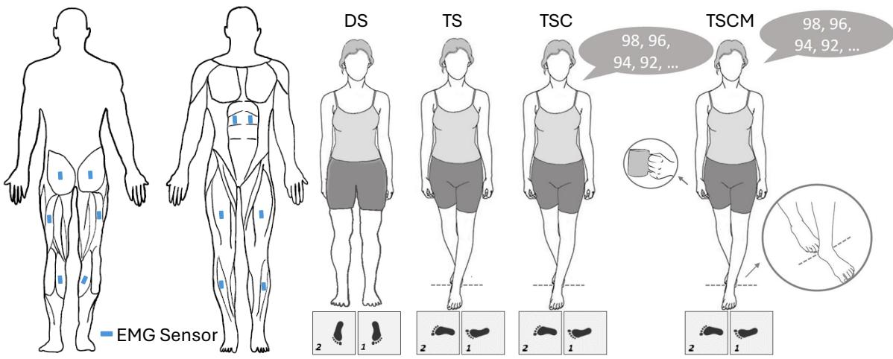
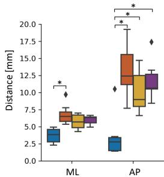
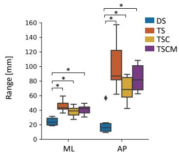
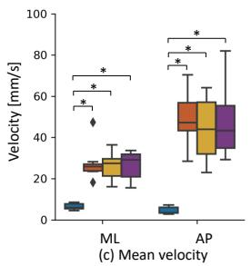
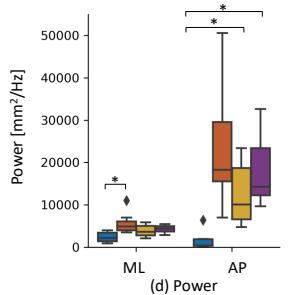
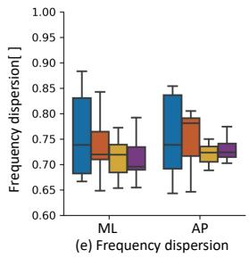
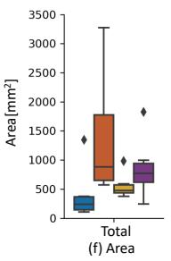
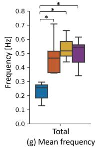
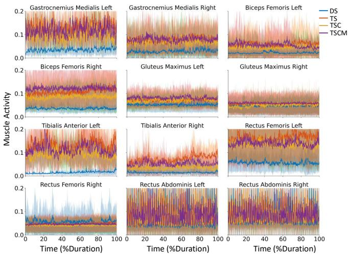
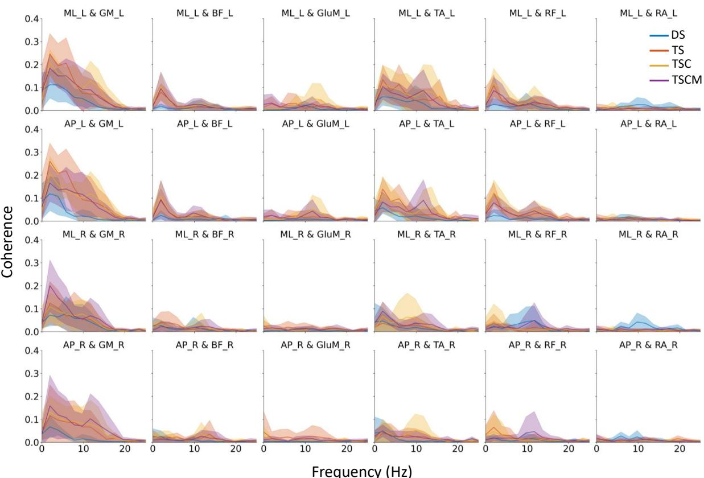

# Muscle Activation and Postural Sway in Response to Task Complexity: A Study of Balance Control in Older Adults

Longbin Zhang1,2,3, Ananda Sidarta2, Yu Chin Lim2, Carol Er2, Xiaoyue Yan2,3, Tsung-Lin Wu2,3, and Wei Tech Ang2,3

Abstract— In this study, we investigate muscle activation patterns and postural sway in older adults across different stance conditions with varying challenges. Muscle activity from lower limb and trunk muscles was recorded in seven older adults during four stance tasks: double stance, tandem stance, tandem stance with a cognitive task, and tandem stance with combined cognitive and motor tasks (TSCM). We analyzed CoP (centre of pressure) features, EMG (electromyography) patterns, and the coherence between EMG-CoP, to gain insights into neuromuscular coordination and balance control. Our findings indicate that task complexity significantly impacts postural stability, with tandem stances—particularly TSCM—leading to increased instability along the anterior-posterior axis. Key stabilizing muscles, such as the gastrocnemius medialis and tibialis anterior, showed heightened activation and strong EMG-CoP coherence under complex tasks, highlighting their essential role in counteracting gravitational forces to maintain balance. A lateral asymmetry in muscle activation was also observed, with left-side muscles consistently showing greater activity than right-side counterparts, suggesting lateralized contributions to postural control. These results emphasize the importance of specific muscles for stability in challenging postural tasks and may offer valuable insights for designing targeted interventions, including robotic rehabilitation systems and assistive technologies, to enhance balance and reduce fall risk in older adults.

## I. INTRODUCTION

Postural control is a complex function that involves maintaining the vertical projection of the center of gravity within the base of support, ensuring stability during both static and dynamic activities [1]. Falls, the most severe consequence of postural control disorders, pose a significant threat to the independence of older adults and are an escalating public health concern, often resulting in severe injuries, diminished quality of life, and reduced mobility [2]–[4]. This highlights the critical need to study postural control in this population. Maintaining postural control requires intricate coordination between the sensory systems (visual, vestibular, and proprioceptive), the central nervous system, and the musculoskeletal system [5]. Kinematic measures such as the base of support (BoS), center of mass (CoM), and center of pressure (CoP) are crucial for evaluating postural control, with the CoP frequently acting as a key indicator. [6]. Recently, growing interest has focused on exploring the neural mechanisms underlying postural control using tools like electroencephalography and electromyography (EMG), which provide valuable insights into cortical and muscular activities involved in maintaining stability [3], [7]. Understanding these processes is crucial for diagnosing and treating balance disorders and enhancing assistive technologies such as neuroprosthetics and rehabilitation robotics.

EMG-CoP coherence has been studied in older adults to assess how muscle strength affects balance. Skeparianos et al. [8] found that stronger ankle muscles, particularly plantar flexors and dorsiflexors, are associated with reduced postural sway, especially in challenging stances such as tandem and one-legged standing. Sozzi et al. [9] further examined leg muscle activity during tandem stance and highlighted that while the soleus muscle maintains upright posture with tonic activity, the tibialis anterior and peroneus longus muscles contribute to balance control through reciprocal actions in the medio-lateral direction. Their findings suggest that muscular strength and coordination are critical for maintaining postural stability in older adults. These studies highlight the importance of muscular-postural sway coherence in understanding postural control in older adults, suggesting the potential for training interventions, particularly given the differences in athletes. Indirectly, such a measure may reflect the balance ability of older adults while doing tasks of varying complexity. Therefore, it is essential to investigate muscular-postural sway coherence in older adults during balance tasks.

Cognitive decline, a natural consequence of aging, further complicates balance control by impairing memory, attention, decision-making, and executive functions, all of which are crucial for daily activities [10]. Cognition plays a vital role in postural control by integrating sensory information, facilitating decision-making, and enabling motor planning, allowing older adults to assess risks, maintain attention, and adapt movements based on past experiences. Increased cognitive load, such as when multitasking, can compromise balance. Effective cognitive processes are thus essential for maintaining stability and preventing falls [11].While many studies have examined interventions to slow cognitive decline, limited research has explored how muscular-postural sway coherence interacts during dual-task activities that combine cognitive and motor demands. Understanding how cognitive and motor tasks jointly influence balance control is vital for identifying early markers of decline and developing interventions to maintain stability in older adults.

  
Fig. 1. Experimental setup for assessing stance stability. Electromyography signals were recorded from lower limb and trunk muscles along with center of pressure data during four stance tasks: double-leg stance (DS), tandem stance (TS), tandem stance with a cognitive task (TSC), and tandem stance with combined cognitive and motor tasks (TSCM).

The objective of this study is to examine how different stance tasks with varying difficulty impact muscle activation patterns, postural sway characteristics, and EMG-CoP coherence in older adults. This involves analyzing the role of lower limb and trunk muscles, as well as center of pressure features, across different stance conditions that include cognitive and motor demands.

## II. METHODS

## A. Experimental Setup

Seven sedentary older adults (sex: 2F/5M; age: 64.7 ± 4.0 years; weight: $6 2 . 3 \pm 1 1 . 3$ kg; height: 163.7 ± 9.2 cm) were recruited. All participants provided informed written consent. Data collection was conducted at the Rehabilitation Research Institute of Singapore, with the study approved by the Nanyang Technological University Institutional Review Board (IRB-2022-382). Participants were instructed to perform a series of static balance tasks, comprising doubleleg stance (DS), tandem stance (TS), tandem stance with a cognitive task (TSC), and tandem stance with both cognitive and motor tasks (TSCM), with a pseudorandomized sequence across participants. In all tasks, participants had to maintain an upright steady posture as much as possible, with eyes open looking at a fixation cross in front of them. They stood with each foot occupying a force platform (9260AA6, Kistler Instruments AG, Winterthur, Switzerland) embedded underneath the ground. The force platforms recorded the timevarying CoP of the participants with a sampling frequency of 2000 Hz. All participants were right-hand and right-leg dominant.

In the DS task, participants were asked to stand quietly and maintain their posture for 60 s. During the TS task, the individual stood in a tandem position, i.e. their dominant foot was positioned in front of the other, with both feet pointing forward, and arms resting at their sides. Each foot was placed on each square (Fig. 1). The TSC task was essentially a tandem stance with an additional memory test.

Here, they were asked to do a tandem stance as before, while memorizing a series of numbers presented to them throughout the task. After the task completion, they had to verbally recall the numbers presented earlier. Finally, in the TSCM, participants were asked to do TSC with an additional motor task in the form of holding a cup filled with water with the dominant hand. The TS, TSC, and TSCM consisted of 2 repetitions of 40 s each, and the average of the results was used for representation. A short demonstration was given by the experimenter and each participant was allowed to practice the posture once. All participants were able to complete every task within the required duration.

EMG recordings were obtained using 12 wireless surface EMG electrodes (Cometa Systems, Italy). After appropriate skin preparation, electrodes were placed bilaterally on the muscle bellies of eight muscle groups, aligned parallel to the direction of muscle fibers. The muscle groups tested included the Gastrocnemius Medialis (GM), biceps femoris (BF), gluteus maximus (GluM), tibialis anterior (TA), rectus femoris (RF), and Rectus Abdominis (RA). EMG signals were recorded at a sampling frequency of 2000 Hz. Electrode placement was conducted following SENIAM (Surface EMG for Non-Invasive Assessment of Muscles) project recommendations. The EMG data were band-pass filtered (5–400 Hz) to isolate relevant frequencies, and then rectified using full wave rectification, a process that has been shown to enhance information about the temporal patterns of grouped motor unit firing [12]. To obtain the muscle activation envelope, the rectified EMG was further low-pass filtered at 6 Hz and normalized to the maximum EMG value across all movement trials [13]–[15].

## B. CoP Sway Features

The anterior-posterior (AP) and mediolateral (ML) CoP signals, derived from force and moment data, were lowpass filtered at 15 Hz using a fourth-order, zero-phase lag Butterworth filter. We then calculated the CoP area and mean frequency for the whole body, as well as the mean distance, the range of maximum deviation, mean velocity in AP and ML directions, and power frequency dispersion in both directions [16]. These CoP features were analyzed and compared across all tasks. Shapiro-Wilk tests were applied to assess the normality of CoP features. For group comparisons, paired ttests were used for features with normal distributions, while Wilcoxon signed-rank tests were applied for non-normally distributed features. Statistical significance was determined at $p < 0 . 0 5$ with Bonferroni correction applied for multiple comparisons.

## C. EMG-CoP Muscular-postural Sway Coherence

To assess the coherence between EMG signals and CoP sway, we calculated the EMG-CoP coherence for each muscle with respect to the postural sway of the corresponding foot. For example, coherence between the GM on the left side was analyzed in relation to the CoP of the left foot across the frequency spectrum. Coherence, a measure of the linear association between two signals across frequencies, was calculated using the following formula:

$$
C o h _ {S 1, S 2} (f) = \frac {| P _ {S 1 , S 2} (f) | ^ {2}}{| P _ {S 1} (f) | \times | P _ {S 2} (f) |}\tag{1}
$$

$$
P _ {S 1, S 2} (f) = \frac {1}{n} \sum_ {i = 1} ^ {n} S 1 _ {i} (f) \cdot S 2 _ {i} ^ {*} (f)\tag{2}
$$

where $C o h _ { S 1 , S 2 } ( f )$ represents the coherence between EMG (S1) and CoP (S2) at frequency $f \colon P _ { S 1 , S 2 } ( f )$ is the crossspectrum density of the signal, $P _ { S 1 } ( f )$ and $P _ { S 2 } ( f )$ are the auto-spectral densities of the EMG and CoP signals, respectively. Coherence values are normalized and bounded between 0 and 1, where a value of 1 indicates a perfect correlation between EMG and CoP at a given frequency, and a value of 0 indicates no correlation.

## III. RESULTS

## A. CoP sway measures

In the ML direction, the mean distance significantly increased in TS compared to DS $( p ~ < ~ 0 . 0 1 )$ . In the AP direction, the mean distance was significantly higher in TS $( p = 0 . 0 3 )$ , TSC $( p = 0 . 0 2 )$ , and TSCM $( p = 0 . 0 2 )$ than in DS. Additionally, mean distance values in the AP direction were larger than those in the ML direction across TS, TSC, and TSCM (Fig. 2).

The range, defined as the distance between maximum deviations, was significantly greater in TS, TSC, and TSCM compared to DS in both the ML and AP directions (all $p \ < \ 0 . 0 1 )$ . Notably, the range values in the AP direction exceeded those in the ML direction across TS, TSC, and TSCM.

Similarly, in mean velocity, the data showed significantly higher values in TS, TSC, and TSCM than in DS for both directions. Mean velocity in the AP direction was also consistently higher than in the ML direction across these stances. Compared to DS, power in the AP direction was significantly higher in TSC $( p = 0 . 0 4 )$ and TSCM $( p = 0 . 0 2 )$ , and was also elevated, though not significantly, in TS $( p \ : = \ : 0 . 0 6 )$ In the ML direction, power was significantly greater in TS compared to DS $( p = 0 . 0 3 )$ . Additionally, power magnitude in the AP direction was consistently larger than in the ML direction across TS, TSC, and TSCM.

  
(a) Mean distance

  
(b) Distance between maximum deviation

  
(d) Power

  
Fig. 2. Center of pressure (CoP) features for all subjects across four tasks: DS (double stance), TS (tandem stance), TSC (tandem stance with cognitive task), and TSCM (tandem stance with cognitive and motor tasks). The features displayed are: (a) mean distance in anterior-posterior (AP) and mediolateral (ML) directions, (b) range of maximum deviation in ML and AP, (c) mean velocity in ML and AP, (d) power in ML and AP, (e) frequency dispersion in ML and AP, (f) area, and (g) mean frequency. Asterisks (\*) indicate statistically significant differences between the two groups, determined using paired t-tests for normally distributed data or Wilcoxon signed-rank tests for non-normally distributed data, with Bonferroni correction applied.

The area was larger in TS, TSC, and TSCM compared to DS. Interestingly, the sway area in TSC and TSCM was lower than in TS. The mean frequency of postural sway was significantly higher in TS, TSC, and TSCM compared to DS (All $p < 0 . 0 1 )$ ). Furthermore, mean frequency followed an ascending pattern, with TSC being higher than TS and TSCM being higher than TSC. No significant differences were observed in frequency dispersion across the stance conditions.

  
Fig. 3. Muscle activities (normalized to maximal value across all trials) across all subjects for four tasks: DS (Double Stance), TS (Tandem Stance), TSC (Tandem Stance with Cognitive Task), and TSCM (Tandem Stance with Cognitive and Motor Tasks). Results were presented as mean ± standard deviation for each muscle across all subjects.

## B. Muscle patterns

Muscle activity patterns were generally similar across the TS, TSC, and TSCM conditions in the GM, TA and BF on both the left and right sides, as well as in the RF and GluM on the left side. However, these muscles exhibited notably higher activity in the TSCM condition compared to the DS condition (Fig.3).

Differences in muscle activity across conditions were minimal in the RF and GluM on the right side and the RA on both sides, with only slight variations observed across the conditions.

An asymmetry in muscle activity was also observed, where the left-side muscles—particularly the GM, TA, and RF—exhibited higher activity levels than their counterparts on the right side under the TS, TSC, and TSCM conditions.

## C. EMG-CoP muscular-postural sway Coherence

The EMG-CoP coherence of lower limb muscles was found up to around 20 Hz across all tasks: DS, TS, TSC, and TSCM. Among the muscles, the GM consistently demonstrated the highest coherence with CoP, followed by the TA and RF (Fig. 4).

In the GM, coherence with CoP was generally higher in the TS, TSC, and TSCM conditions compared to DS. On the left side, coherence was highest in TSCM compared to TS and TSC, whereas on the right side, coherence in TSCM was lower than in TS and TSC. Coherence of BF and GluM with CoP was slightly higher on the left side compared to the right. Minimal coherence was observed in the RA across all tasks.

## IV. DISCUSSION

In this study, we explored the relationship between postural sway, activation patterns of lower limb and trunk muscles, and EMG-CoP coherence in older adults during various stance tasks: double stance, tandem stance, tandem stance with a cognitive task, and tandem stance with combined cognitive and motor tasks. Our findings revealed that postural sway measures—including mean distance, range, mean velocity, sway area, and mean frequency—were generally higher in TS, TSC, and TSCM compared to DS, reflecting the increased challenge of maintaining stability on a narrow base of support. In line with this increase in sway, muscle activity in most lower limb muscles was also elevated in TS, TSC, and TSCM relative to DS, suggesting greater neuromuscular demand to stabilize the body under more challenging conditions. Furthermore, EMG-CoP coherence analysis indicated that lower limb muscles exhibited coherence with CoP up to around 20 Hz across all tasks, with the GM demonstrating the highest coherence. This suggests that the GM plays a key role in coordinating muscular responses to maintain postural stability. These findings provide valuable insights into the roles of different muscles in stabilizing posture under varied conditions and emphasize the potential importance of taskspecific muscle activation for postural control. Such insights could inform injury prevention strategies and rehabilitation programs by identifying muscles that are crucial for maintaining balance, particularly under challenging conditions like narrow stances or multitasking.

Task complexity and stance type substantially influence postural control, leading to increased instability and more frequent postural adjustments, particularly along the AP axis. However, no significant effect of concurrent motor or cognitive tasks on balance parameters was observed. Both mean distance and range increase notably in TS, TSC, and TSCM tasks, particularly in the AP direction, suggesting that tandem positioning, with its restricted base of support, presents greater stability challenges along this axis. Similarly, mean velocity rises across TS, TSC, and TSCM, indicating a heightened need for postural corrections as task demands increase. The higher power in the AP direction under TSC and TSCM further highlights the additional balance control demands imposed by complex task conditions. Interestingly, while sway area peaks in TS, it slightly decreases in TSC and TSCM, suggesting that additional tasks may lead to a more concentrated, yet still broad, sway pattern. The lack of a significant effect of concurrent motor or cognitive tasks on balance parameters is consistent with the findings of Xu et al. [17], who examined balance ability and prefrontal cortex activation under single- and dual-task conditions. Their results similarly indicate that dual-tasking does not significantly impact balance performance in healthy older adults, suggesting that balance control may operate implicitly, even when additional cognitive tasks are introduced. This aligns with the Task Prioritization Model [18], which posits that as postural threat increases, older adults prioritize postural stability over cognitive performance. We acknowledge that the small sample size may limit the ability to detect finer differences among TS, TSC, and TSCM. Further research with larger cohorts is necessary to confirm these trends and explore potential subtleties in task-dependent balance control mechanisms.

  
Fig. 4. Coherence between electromyography (EMG) and center of pressure (CoP) data across all subjects for four tasks: Double Stance (DS), Tandem Stance (TS), Tandem Stance with Cognitive Task (TSC), and Tandem Stance with Cognitive and Motor Tasks (TSCM). Results were presented as mean ± standard deviation across all subjects. $M L _ { L }$ and M $\scriptstyle \sum _ { R }$ represent the mediolateral directions of CoP on the left and right sides, respectively; similarly, $A P _ { L }$ and $A P _ { R }$ indicated the anteroposterior directions. Muscle activity was represented by $G M _ { L }$ and $G M _ { R }$ for Gastrocnemius Medialis on the left and right sides, and corresponding labels for Biceps Femoris (BF), Gluteus Maximus (GluM), Tibialis Anterior (TA), Rectus Femoris (RF), and Rectus Abdominis (RA).

Muscle activity levels vary with task complexity, with greater engagement noted in the TSCM condition compared to DS, especially in the GM, TA, and BF on both sides and in the left RF and GluM. This pattern indicates that more complex tasks requiring both cognitive and motor coordination (TSCM) demand increased muscle activation to maintain postural stability. The minimal differences in activity across conditions in the bilateral RA, along with the low EMG-CoP coherence, suggest that the RA may be less responsive to changes in task complexity. The moderately high normalized values observed in the bilateral RA may be attributed to normalization relative to the maximum value across all trials, as RA activity remained generally low and stable. Additionally, asymmetry in muscle activity was observed, with left-side muscles (non-dominant leg), particularly the GM, TA, and RF, showing consistently higher activation than their right-side counterparts during TS, TSC, and TSCM. This asymmetry may reflect inherent lateral dominance or compensatory strategies, suggesting that the non-dominant side plays a more active role in stabilizing posture under complex conditions, such as tandem stance. These findings are consistent with Sozzi et al. [9], who reported higher EMG activity in the non-dominant leg, indicating that it serves as the primary stabilizer in tandem stance, thereby assuming a

greater postural load.

A notable coupling between muscle activation and postural sway was observed, especially in the GM, with coherence up to approximately 20 Hz across all tasks. In a related study, Watanabe et al. [12] investigated the coordination of plantar flexor muscles—specifically the medial and lateral gastrocnemius and soleus—and their relationship with postural stability during bipedal and unipedal stances, finding coherence levels up to about 10 Hz in elderly adults. Our study expands upon this by including additional muscles to provide a more comprehensive analysis of the relationship between muscular activation and postural sway coherence. In this study, the GM displayed the highest EMG-CoP coherence among the lower limb muscles, underscoring its critical role in postural adjustments. This finding aligns with previous research suggesting that the gastrocnemius is a primary contributor to modulating AP sway, particularly during challenging balance tasks [19]–[21]. Both the GM and TA demonstrated higher coherence levels than other muscles, indicating their prominent involvement in stabilizing posture under increased task demands. This is consistent with studies that reported elevated EMG amplitudes in the GM and TA compared to the RF and BF across balance tasks. The greater activation in the ankle muscles may be due to the reliance on an ankle strategy to counteract gravitational torque in an upright stance, an essential mechanism in maintaining balance [22]–[24]. Notably, a task-related asymmetry emerges in the GM, with left-side coherence peaking in TSCM, while right-side coherence is lower in TSCM than in TS and TSC, suggesting potential lateralized differences in muscle-sway coordination under high task demands. Other muscles, like BF and GluM, exhibit slightly higher coherence on the left side, pointing to a subtle lateral asymmetry in postural sway synchronization, while the RA shows minimal coherence across all tasks, indicating a limited role in postural sway regulation. These findings suggest that while GM is central to postural control across tasks, asymmetric coherence patterns may reflect compensatory strategies or task-specific muscle contributions to stability.

## V. CONCLUSION

We investigated how different stance tasks affect postural sway, lower limb and trunk muscle activation, and EMG-CoP coherence in older adults, highlighting the distinct roles of muscle activation patterns and muscle-postural sway coherence in maintaining balance under varying levels of task complexity. The findings indicate that tandem stances, especially when coupled with cognitive and motor tasks (TSCM), significantly challenge postural stability, demanding higher activation in key stabilizing muscles like the GM and TA. These muscles, particularly the GM, demonstrated high coherence with CoP sway, reflecting their importance in counteracting gravitational forces and stabilizing posture. Notable asymmetries were observed, with left-side muscles showing heightened activation, suggesting lateralized contributions to balance. The lack of differences in sway with the additional cognitive task may suggest that balance control is implicit. The coherence analysis further underscores the reliance on the ankle strategy for AP sway control, particularly under challenging conditions. Together, these results emphasize the critical contributions of specific muscles in stabilizing posture, particularly in complex tasks, offering insights for targeted interventions and training focused on enhancing balance in populations at risk of instability.

## REFERENCES

[1] T. Paillard, “Effects of general and local fatigue on postural control: a review,” Neuroscience & Biobehavioral Reviews, vol. 36, no. 1, pp. 162–176, 2012.

[2] G. C. Ang, S. L. Low, and C. H. How, “Approach to falls among the elderly in the community,” Singapore Medical Journal, vol. 61, no. 3, p. 116, 2020.

[3] S. A. Stehle, R. Aubonnet, M. Hassan, M. Recenti, D. Jacob, H. Petersen, and P. Gargiulo, “Predicting postural control adaptation measuring eeg, emg, and center of pressure changes: Biovrsea paradigm,” Frontiers in Human Neuroscience, vol. 16, pp. 1–12, 2022.

[4] N. B. Alexander, “Postural control in older adults,” American Geriatrics Society, vol. 42, no. 1, pp. 93–108, 1994.

[5] J. Wang, Y. Li, G.-Y. Yang, and K. Jin, “Age-related dysfunction in balance: a comprehensive review of causes, consequences, and interventions,” Aging and Disease, 2024.

[6] S. L. Pavao, A. N. dos Santos, M. H. Woollacott, and N. A. C. F. ˜ Rocha, “Assessment of postural control in children with cerebral palsy: a review,” Research in Developmental Disabilities, vol. 34, no. 5, pp. 1367–1375, 2013.

[7] A. Hua, G. Wang, J. Bai, Z. Hao, J. Liu, J. Meng, and J. Wang, “Nonlinear dynamics of postural control system under visual-vestibular habituation balance practice: evidence from eeg, emg and center of pressure signals,” Frontiers in Human Neuroscience, vol. 18, pp. 1– 10, 2024.

[8] A. Skeparianos, I. G. Amiridis, P. Violaris, Z. Tsampalaki, T. M. Kannas, C. Sahinis, K. Salonikidis, F. Negro, V. Hatzitaki, and R. M. Enoka, “Association between ankle muscle strength and postural sway in older adults,” Journal of Physical Education and Sport, vol. 23, no. 10, pp. 2592–2600, 2023.

[9] S. Sozzi, J.-L. Honeine, M.-C. Do, and M. Schieppati, “Leg muscle activity during tandem stance and the control of body balance in the frontal plane,” Clinical Neurophysiology, vol. 124, no. 6, pp. 1175– 1186, 2013.

[10] J. G. van Uffelen, M. J. C. A. Paw, M. Hopman-Rock, and W. van Mechelen, “The effects of exercise on cognition in older adults with and without cognitive decline: a systematic review,” Clinical Journal of Sport Medicine, vol. 18, no. 6, pp. 486–500, 2008.

[11] K. Hauer, M. Pfisterer, C. Weber, N. Wezler, M. Kliegel, and P. Oster, “Cognitive impairment decreases postural control during dual tasks in geriatric patients with a history of severe falls,” Journal of the American Geriatrics Society, vol. 51, no. 11, pp. 1638–1644, 2003.

[12] T. Watanabe, K. Saito, K. Ishida, S. Tanabe, and I. Nojima, “Coordination of plantar flexor muscles during bipedal and unipedal stances in young and elderly adults,” Experimental Brain Research, vol. 236, pp. 1229–1239, 2018.

[13] C. Pizzolato, M. Reggiani, L. Modenese, and D. Lloyd, “Real-time inverse kinematics and inverse dynamics for lower limb applications using opensim,” Computer Methods in Biomechanics and Biomedical Engineering, vol. 20, no. 4, pp. 436–445, 2017.

[14] L. Zhang, Z. Li, Y. Hu, C. Smith, E. M. G. Farewik, and R. Wang, “Ankle joint torque estimation using an emg-driven neuromusculoskeletal model and an artificial neural network model,” IEEE Transactions on Automation Science and Engineering, 2020.

[15] L. Zhang, D. Soselia, R. Wang, and E. M. Gutierrez-Farewik, “Lowerlimb joint torque prediction using lstm neural networks and transfer learning,” IEEE Transactions on Neural Systems and Rehabilitation Engineering, vol. 30, pp. 600–609, 2022.

[16] F. Quijoux, A. Nicola¨ı, I. Chairi, I. Bargiotas, D. Ricard, A. Yelnik, L. Oudre, F. Bertin-Hugault, P.-P. Vidal, N. Vayatis et al., “A review of center of pressure (cop) variables to quantify standing balance in elderly people: Algorithms and open-access code,” Physiological reports, vol. 9, no. 22, pp. 1–32, 2021.

[17] G. Xu, M. Zhou, Y. Chen, Q. Song, W. Sun, and J. Wang, “Brain activation during standing balance control in dual-task paradigm and its correlation among older adults with mild cognitive impairment: a fnirs study,” BMC Geriatrics, vol. 24, no. 1, pp. 1–11, 2024.

[18] M. Lacour, L. Bernard-Demanze, and M. Dumitrescu, “Posture control, aging, and attention resources: models and posture-analysis methods,” Neurophysiologie Clinique/Clinical Neurophysiology, vol. 38, no. 6, pp. 411–421, 2008.

[19] L. Li-Liang and C. Fu-Chen, “Effects of kinesio taping on static balance performance and muscle activity in children with developmental coordination disorder: a single-group pretest-posttest study,” Journal of Rehabilitation mMedicine, vol. 55, 2023.

[20] F. Borg, M. Finell, I. Hakala, and M. Herrala, “Analyzing gastrocnemius emg-activity and sway data from quiet and perturbed standing,” Journal ofElectromyography and Kinesiology, vol. 17, no. 5, pp. 622– 634, 2007.

[21] I. D. Loram, C. N. Maganaris, and M. Lakie, “Paradoxical muscle movement in human standing,” The Journal of Physiology, vol. 556, no. 3, pp. 683–689, 2004.

[22] D. B. Murillo, R. S. Solana, F. J. Vera-Garcia, N. G. Fuertes, and F. J. Moreno, “Effect of increasing difficulty in standing balance tasks with visual feedback on postural sway and emg: complexity and performance,” Human Movement Science, vol. 31, no. 5, pp. 1224– 1237, 2012.

[23] D. A. Winter, A. E. Patla, F. Prince, M. Ishac, and K. Gielo-Perczak, “Stiffness control of balance in quiet standing,” Journal of Neurophysiology, vol. 80, no. 3, pp. 1211–1221, 1998.

[24] D. A. Winter, A. E. Patla, S. Rietdyk, and M. G. Ishac, “Ankle muscle stiffness in the control of balance during quiet standing,” Journal of Neurophysiology, vol. 85, no. 6, pp. 2630–2633, 2001.