# 迈向临床应用：结合无标记动作捕捉与机器学习的增强型定时起立-行走测试用于平衡与步态评估

Longbin Zhang , Ananda Sidarta , Tsung-Lin Wu , Prayook Jatesiktat , Hao Wang, Lei Li, Patrick Wai-Hang Kwong , Aoyang Long, Xiangyu Long, and Wei Tech Ang , Member, IEEE

摘要—平衡与步态障碍是导致老年人跌倒的关键因素。用于评估跌倒风险的传统临床量表（如伯格平衡量表（Berg Balance Scale, BBS））往往具有主观性、耗时长，且无法评估步态表现。虽然存在耗时更短的评估方法，如定时起立-行走（Timed Up and Go, TUG）测试，但大多数临床医生仅关注其完成时间。本研究旨在通过结合无标记动作捕捉（MoCap）系统与机器学习模型来增强传统 TUG 测试，从而开发一个快速、低成本且自动化的平衡功能评估与综合步态分析框架。我们总共纳入了 70 名根据 BBS 评分具有不同程度跌倒风险的参与者的 TUG 数据集。我们利用来自 MoCap 系统的数据将 TUG 测试自动分割为五个阶段，并从这些阶段中提取了特征。随后对这些特征进行了分析，以确定能够显著区分高跌倒风险组和低跌倒风险组的特征。利用识别出的特征，测试了多种机器学习模型以估算 BBS 评分。从无标记 MoCap 系统中获取的标记点被用于详细的步态分析，并比较了无标记方法与基于标记的方法之间的下肢运动学数据。我们的研究结果表明，具有高跌倒风险的个体完成时间更长、动作执行速度更低，且下肢关节活动度更小。在所测试的机器学习模型中，随机森林（random forest）在预测 BBS 评分方面表现最佳（RMSE: 0.98, R2: 0.94）。此外，我们的无标记 MoCap 系统展现出与最先进系统相当的精度，且无需粘贴标记点或传感器。这些发现有助于开发一种快速、客观的老年人平衡与步态评估工具，提供量化数据以改善筛查和干预规划。

关键词—伯格平衡量表（Berg balance scale），步态分析，运动学，机器学习，无标记动作捕捉系统。

## I. 引言

跌倒（FALL）被定义为“意外失去平衡导致身体停留在地面、地板或其他较低水平面上”[1]。老年人跌倒是一个全球性的健康与社会挑战。根据世界卫生组织（World Health Organization）的数据，65岁及以上的老年人中每年约有三分之一经历跌倒[2]。此外，这些跌倒中约有 30% 会导致中度至重度损伤，例如骨折和头部创伤，并带来长期且衰弱性的影响。跌倒可能导致住院、行动能力下降、生活质量降低以及随之而来的独立生活能力丧失，从而给医疗保健系统带来沉重的经济负担。老年人跌倒的原因是多方面且复杂的。其中，平衡功能和步态表现是跌倒风险的关键指标。我们提出了理想的平衡与步态评估工具应具备的要求，即测试必须快速、准确且全面，能够深入探查平衡与移动功能。评估结果不仅能识别出跌倒风险增加的老年人，还能作为制定早期且量身定制的干预措施以降低其易跌倒性的基础[3], [4]。

在临床实践中，伯格平衡量表（Berg Balance Scale, BBS）和计时起立-行走（Timed Up and Go, TUG）测试被广泛用于评估个体的平衡功能 [5], [6], [7], [8], [9]。由于 BBS 全面评估了包括静态和动态平衡在内的多个维度的姿势控制，它通常被视为评估平衡的“金标准”。它由 14 项任务组成，旨在评估个体在不同活动中维持稳定性的能力。每项任务的评分范围为 0 至 4 分（其中 0 分表示无法完成任务，4 分表示执行顺畅）。BBS 总分最高可达 56 分，临床上 BBS 得分低于 50 分通常表明存在较高的跌倒风险 [10], [11], [12]。尽管其应用广泛且严谨，但该评估过程耗时较长，完整流程大约需要 30 分钟 [8], [9]。此外，BBS 并未直接评估步态表现。相比之下，TUG 测试是一种更快捷、更简便的替代方案，它测量完成一系列功能性动作所需的时间：从椅子上站起、行走、转身并重新坐下。通过结合平衡和移动能力的相关要素，TUG 以更短的时间和最少的设备提供了有关跌倒风险的重要见解。重要的是，多项研究已表明 TUG 与 BBS 评分之间存在高度相关性 [13], [14], [15]，这表明 TUG 测试可以作为预测 BBS 结果的实用替代指标，同时提供了一种更快捷的选择。然而，由于 TUG 依赖于临床医生的判断和环境条件，其可靠性可能会有所波动 [16]。此外，文献中使用 TUG 区分低跌倒风险和高跌倒风险个体的阈值差异很大，从 10 秒到 25 秒不等 [17], [18], [19]。鉴于这些挑战，人们对创新的、技术驱动的解决方案的需求日益增长，以提高平衡功能评估的客观性和效率。将自动化方法整合到 TUG 测试中，不仅可以测量完成时间，还可以从 TUG 动作的每个环节中提取各种运动学参数，这些环节与 BBS 测试的大多数组成部分（如坐位平衡、坐起、站立到坐下以及转身）具有高度重叠，从而增强其效用，进而弥合平衡与步态评估中简便性与全面性之间的差距。

临床步态分析常用于深入了解行动能力、稳定性和功能表现 [20], [21], [22], [23]。与年轻人相比，老年人在行走时需要更强的运动控制来维持稳定性，这使得步态障碍成为跌倒最强的预测指标之一。既往研究已将特定步态参数的变化（如步幅、步速和变异性）确定为跌倒的独立危险因素。这些细微的步态变化通常难以通过肉眼观察察觉，因此需要借助客观且精确的分析工具 [24]。尽管步态分析具有高精度，但传统上依赖于基于标记点的三维动作捕捉（MoCap）系统，该系统存在显著的局限性，例如粘贴反光标记点过程耗时、需要专业操作人员，以及标记点可能会对自然运动产生干扰 [25]。虽然可穿戴传感器也广泛应用于平衡功能预测和步态分析 [8]，但其佩戴位置会引入不确定性，造成不适并影响自然运动 [9]。因此，对快速、无创且用户友好的替代方案的需求日益增加，以克服这些挑战。

近年来，无标记动作捕捉（markerless MoCap）系统改变了运动分析领域，能够在不需要实体标记点或传感器的情况下提供对人体运动的精确评估 [25]。在这些系统中，OpenPose 可以检测 25 个二维人体关键点用于基础运动分析，但无法直接确定身体节段的方向，对远端关节的精度有限，并且在存在遮挡或复杂环境中表现不佳 [26], [27]。OpenCap 通过引入在大型 MoCap 数据集上训练的长短期记忆网络（Long Short-Term Memory networks）对此进行了改进，以推断并用 43 个详细的解剖学标记点“增强”这些稀疏关键点。然而，由于这些标记点是通过推断而非直接从用户的图像中提取的，它们可能会引入朝向训练数据中平均运动模式的偏差。这限制了系统的泛化能力，特别是对于具有独特或病理性运动特征的个体 [28]。另一个值得注意的系统 Theia3D，通过使用标注解剖学生物标志物的定制数据集，并缩放铰接多体模型以匹配三维空间中受试者特定的标志物，从用户的视频数据中预测三维关节位置 [29]。然而，它依赖于专有标志物并且仅输出关节中心，从而限制了标志物检测的精度以及全身节段方向的分析。相比之下，我们最近的研究整合了解剖学先验和数据驱动方法，以从多视角 RGB 视频中捕捉人体运动 [30]。该无标记系统使用 RRIS40 数据集进行训练，该数据集使用了从基于标记点的动作捕捉投影得出的 40 个表面解剖学标志物的二维标注，具有像素级精度。通过多视角加权三角测量，该系统预测三维标记点位置的平均误差为 13.23mm。与 Theia3D 不同，我们的系统直接输出对应于骨骼标志物的虚拟标记点位置，这有利于应用数十年来发展成熟的生物力学公式。这种独特的能力使得能够从运动数据中全面推导参数，从而增强了生物力学分析。因此，产生了一个问题：集成无标记 MoCap 系统和机器学习的增强型 TUG 测试是否能够在高精度有效预测 BBS 评分的同时，全面提供步态和平衡分析。

我们的目标有两个方面：(1) 评估在使用无标记 MoCap 系统的 TUG 行走阶段期间，与基于标记点的 MoCap 系统相比，下肢关节运动学的一致性；(2) 通过实施集成无标记 MoCap 系统和机器学习技术的增强型 TUG 测试，为老年人开发一个定量平衡评估框架。该框架旨在估计 BBS 评分，并同时提供包括时空参数和关节运动学在内的全面步态分析。

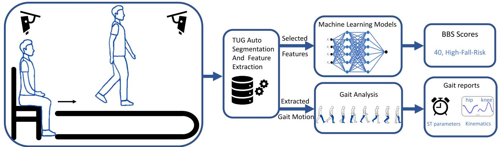  
Fig. 1. 基于无标记动作捕捉系统和机器学习的增强型 TUG 测试平衡与步态评估框架示意图。该系统能够预测 BBS 评分，并同时提供包括时空（ST）参数和关节运动学在内的全面步态分析。

## II. 方法

我们开发了一个用于平衡功能评估和步态分析的定量框架，该框架采用增强型 TUG 测试（Timed Up and Go，起立-行走计时测试），结合了无标记动作捕捉（MoCap）系统和机器学习技术（Fig. 1）。TUG 动作由 3D 无标记 MoCap 系统记录。利用 TUG 自动分割方法，我们获得了 TUG 测试期间选定的特征和运动轨迹。然后将这些特征用作机器学习模型的输入，以预测更被广泛公认为“金标准”的 BBS（Berg Balance Scale，伯格平衡量表）结果。从运动轨迹中提取行走动作，并进行包括时空参数和关节运动学在内的步态分析。研究结果包括三个部分：(1) 从高跌倒风险组和低跌倒风险组中提取的 TUG 特征；(2) 使用常用回归机器学习模型的 BBS 预测性能；(3) 比较基于标记和无标记 MoCap 系统捕获的下肢关节运动学的初步研究。

## A. 实验设置

在这项多中心研究中，我们纳入了来自三个部分的 70 名参与者：来自 Rehabilitation Research Institute of Singapore（新加坡康复研究院）的 44 名健全受试者（年龄：45.8 20.0 岁；性别：26女/18男；体重：$6 0 . 6 \pm 1 2 . 5$ kg；身高：163.7 10.0 cm；经 Nanyang Technological University Institutional Review Board 批准，IRB-2022-382）；来自 Hong Kong Polytechnic University（香港理工大学）的 7 名中风后患者（年龄：$6 5 . 6 \pm 5 . 6$ 岁；性别：3女/4男；体重：$5 7 . 9 \pm 5 . 1$ kg；身高：167.4 4.1 cm；经 Human Subjects Ethics Subcommittee of Hong Kong Polytechnic University 批准，HSEARS20210715003-01）；以及来自 Guangdong China-Singapore Intelligent Rehabilitation Institute（广东中新智能康复研究院）的 19 名患有膝骨关节炎的老年人（年龄：62.3  9.2 岁；性别：17女/2男；体重：$5 7 . 4 \pm 9 . 7$ kg；身高：$1 5 6 . 3 \pm 1 0 . 0 \mathrm { c m } )$；经 Foshan Jianxiang Nursing Home Medical Ethics Committee 批准，IRB-2023-02）。这些参与者被指导在 3D MoCap 系统内完成 TUG 动作。所有参与者均能按照指导人员的指示完成实验流程，并通过签署知情同意书自愿同意参与本研究。

所有 BBS 评估均由一名专业物理治疗师完成。

在香港使用 Vicon（200Hz）系统记录 TUG 试验，在佛山使用 OptiTrack（200Hz）系统进行记录。在新加坡，TUG 试验由基于标记点的 Miqus M3 Qualisys（200Hz）系统和一套无标记点动作捕捉（MoCap）系统 [30] 同时记录。该无标记点 MoCap 系统包含 8 台摄像机，利用计算机视觉自动捕获人体运动的 3D 数据。该系统可通过从多摄像机系统捕获的视频中自动提取每个虚拟解剖标记点的 2D 位置并进行三角测量，从而获取运动学数据。所有试验均在无标记点系统的捕捉空间内进行。

在每次试验中，参与者重复进行 3 次 TUG。在每次重复中，他们最初坐在高度可调的椅子上，使膝关节呈 90 度角。收到实验人员的提示后，参与者起立并向地面上标出的一条线行走 3 米的距离。他们被要求在保证安全的前提下尽可能快地行走。越过该线后，参与者进行 180 度转身返回椅子。回到椅子处后，他们需要重新坐下，该次重复即视为完成。实验人员继续提示参与者进行后续的重复测试。如果出现抢跑或未能遵守要求的 TUG 规范，则重新进行该次测试。

## B. TUG Segmentation

我们将 TUG 分割为五个阶段：坐到站、向前行走、转向、返回行走以及站到坐（图 2(a)）。

\- 坐到站阶段：放置在 C7 颈椎上的标记点用于检测坐到站阶段的开始和站立事件。当受试者开始站立时，C7 标记点在垂直 Z 方向上的运动从静止转变为运动状态，这被检测为开始事件。站立后，C7 标记点在 Z 方向上的高度停止上升，这被检测为站立事件（图 2(b)）。

(a) TUG 各阶段分割概览

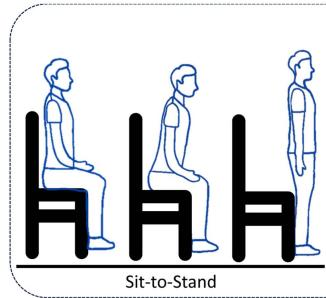  
(b) C7 标记点垂直位置

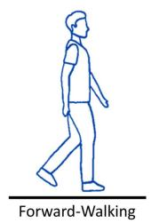

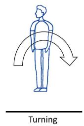  
(c) 前后方向上足部标记点相对于骨盆的位置

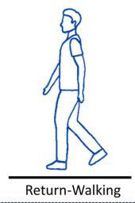  
(d) 骨盆旋转角度

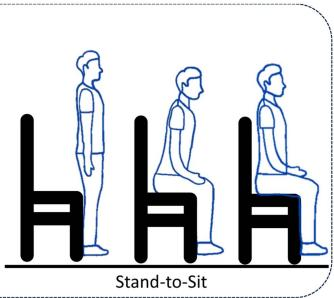  
(e) C7 标记点垂直位置

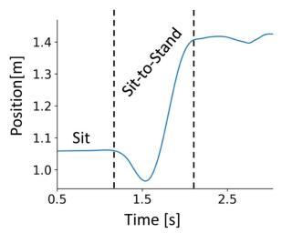

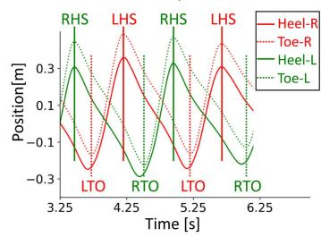

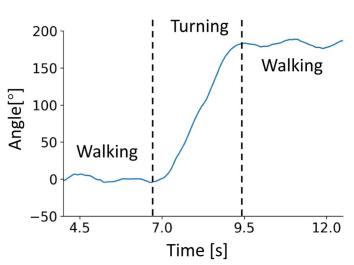

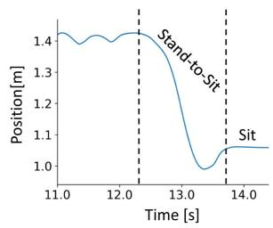  
Fig. 2. TUG 阶段划分方法示意图。(a) TUG 各阶段概述：起立、向前行走、转身、返回行走和坐下。(b) 使用 C7 标志点的垂直 Z 方向位置进行起立阶段划分。(c) 使用足跟和足尖标志点相对于骨盆坐标系在前后方向上的位置检测足跟着地和足尖离地步态事件。(d) 使用骨盆旋转角进行转身阶段划分。(e) 使用 C7 标志点的垂直 Z 方向位置进行坐下阶段划分。

\- 向前行走阶段：从椅子上站起后，受试者行走 3 米并转身。步态周期中的足跟着地（右足跟着地，RHS；左足跟着地，LHS）和足尖离地（右足尖离地，RTO；左足尖离地，LTO）步态事件是通过足跟和足尖标志点相对于骨盆坐标系在前后方向上的位置检测的（Fig. 2(c)）[31]。

\- 转身阶段：转身时，身体旋转约 180 度。转身阶段的开始和结束是在身体开始旋转和完成旋转时检测到的。使用骨盆旋转角对该阶段进行划分（Fig. 2(d)）。

\- 返回行走阶段：转身后，受试者往回走 3 米回到 TUG 测试的起点。步态周期的检测方法与向前行走阶段相同。

\- 坐下阶段：与起立阶段类似，当 C7 标志点在 Z 方向开始下降时检测到站立事件，当 C7 标志点在 Z 方向下降后位置趋于稳定时检测到坐下事件（Fig. 2(e)）。

## C. 特征提取

基于从 TUG 测试中提取的五个阶段，我们选择了以下参数：

\- 总时长及各阶段的时长。共提取了 6 个特征。

\- 起立和坐下的最大垂直速度。共提取了 2 个特征。

\- 转身阶段的若干特征，包括转身步数（转身过程中行走的步数）、转身宽度（转身开始和转身结束时骨盆位置之间的欧氏距离）、转身弧长（转身过程中骨盆运动曲线路径的长度）以及转身速度（转身弧长除以转身时间）。共提取了 4 个特征。

- 从每侧腿的步态周期、跨步和单步中提取的步态时空特征，包括步速、步频、跨步长、步长、步时、步宽，以及步态周期时间、支撑相时间、摆动相时间、首次双支撑时间、末次双支撑时间、总双支撑时间，以及它们相对于步态周期时间的比例。此外，还计算了这些左右腿特征的平均值、比率和步态对称性指数。共提取了 85 个特征。步态特征是从 TUG 测试的前进和返回步行阶段中提取的。

- 从下肢关节提取的步态运动学特征，包括髋关节屈曲/伸展（F/E）、膝关节屈曲/伸展以及踝关节背屈/跖屈（D/P）的最小值、最大值和活动度（ROM）。由此提取了 18 个特征。

总计从三次重复的 TUG 测试中提取了 115 个特征。步态时空和运动学特征在所有重复测试的步态周期中取平均值，而其余特征则在各次重复测试间取平均值。

## D. Machine Learning Models/Regression Models

采用线性回归（LR）、最小绝对收缩和选择算子回归（Lasso）、随机森林（RF）、梯度提升决策树（GBDT）、极限梯度提升（XGBoost）、k-近邻回归（KNN）以及支持向量回归（SVR），利用所选特征来估计 BBS 评分。选择这些模型是为了同时涵盖线性和非线性方法，确保对不同建模范式进行全面评估，且其选择依据还源于文献中类似研究的频繁应用 [8], [32]。

LR 是一种用于建模目标变量与一个或多个自变量之间关系的线性方法。其目标函数表示为：

$$
F _ {o b j} = \frac {1}{n} \sum_ {i = 1} ^ {n} (y _ {i} - \hat {y} _ {i}) ^ {2}\tag{1}
$$

其中 $y _ { i }$ 和 $\hat { y } _ { i }$ 分别是真实值和预测值，$n$ 是样本数量。

Lasso 回归作为线性回归的一种变体，通过将次要系数收缩至零来自动选择特征，这使其在处理大量特征并仅选择相关特征时非常有效。其目标函数可写为：

$$
F _ {o b j} = \frac {1}{2 n} \sum_ {i = 1} ^ {n} (y _ {i} - \hat {y} _ {i}) ^ {2} + \alpha \sum_ {j = 1} ^ {p} | \beta_ {j} |\tag{2}
$$

其中 $p$ 是特征数量，$\beta _ { j }$ 是特征 $j$ 的系数，$\alpha$ 是正则化参数。

RF 是一种集成方法，通过构建多棵决策树并结合其预测结果，有效地对输入与目标变量之间的非线性关系进行建模。每棵决策树根据输入特征将数据集划分为更小、更可预测的子集，其中内部节点代表基于特征的决策，叶节点代表结果或预测。与单棵决策树相比，RF 通过集成平均减少了过拟合，并提高了预测精度。另一方面，GBDT 也是一种集成方法，但它是顺序构建树的。每棵新树都会纠正先前训练的树所犯的错误，这与使用数据随机样本独立训练每棵树的 $\mathrm { R F , }$ 不同。XGBoost 是一种具有更强正则化形式的梯度提升方法，它通过结合高级正则化技术来增强模型的泛化能力。XGBoost 的目标函数可以写为：

$$
F _ {o b j} = \sum_ {i = 1} ^ {n} L (y _ {i}, \hat {y} _ {i}) + \sum_ {k = 1} ^ {K} \Omega (f _ {k})\tag{3}
$$

其中 $L$ 是衡量真实目标值 $y _ { i }$ 与预测值 ${ \hat { y } } _ { i }$ 之间差异的损失函数；$\Omega$ 是惩罚模型复杂度的正则化项；$f _ { k }$ 表示集成中的单个决策树。

KNN 回归通过寻找与给定输入最接近的 K 个数据点并对其目标值求平均来进行预测。在数学上，回归中新数据点 $x$ 的预测值 $\hat { y }$ 由下式给出：

$$
\hat {y} = \frac {1}{k} \sum_ {i = 1} ^ {k} y _ {i}\tag{4}
$$

其中 $y _ { i }$ 表示与 x 最近的第 $i _ { t h }$ 个邻居的目标值，k 是要考虑的邻居数量。

SVR 是用于回归分析的支持向量机（Support Vector Machines）的一种变体。其目标是找到一个最优超平面，在保持预测值周围最大间隔（$\epsilon$-不敏感管道）的同时最好地拟合数据。目标函数表述如下：

$$
F _ {\mathrm{obj}} = \left(\frac {1}{2} \| w \| ^ {2} + C \sum_ {i = 1} ^ {n} (\zeta_ {i} + \zeta_ {i} ^ {*})\right)\tag{5}
$$

约束条件为：$y _ { i } - w ^ { T } \phi ( x _ { i } ) - b \leq \epsilon + \zeta _ { i } , \ w ^ { T } \phi ( x _ { i } ) + b - y _ { i } \leq$ $\boldsymbol { \epsilon } + \boldsymbol { \zeta } _ { i } ^ { * }$，且 $\zeta _ { i } , \zeta _ { i } ^ { * } \geq 0$。其中 w 为权重向量，b 为偏置项，$\phi ( x _ { i } )$ 为特征映射函数，$\zeta _ { i }$ 和 $\zeta _ { i } ^ { * }$ 为松弛变量，$\epsilon$ 为容差边界，C 为误差的惩罚参数。

## E. 特征选择

使用 50 分的分界值将受试者分为两组 [10], [11], [12]。BBS 评分 > 50 的参与者被归为跌倒低风险个体，而评分 $\leq 5 0$ 的参与者被归为跌倒高风险个体。该分类得出了 55 名跌倒低风险个体和 15 名跌倒高风险个体。跌倒高风险组包括 7 名中风后老年个体和 8 名患有膝骨关节炎的老年个体。

为了评估 TUG 特征的正态性，采用了 Shapiro-Wilk 检验。随后，分别使用双样本 t 检验和 Mann-Whitney U 检验对正态分布和非正态分布特征在跌倒高风险组与低风险组之间进行比较。当 $p < 0 . 0 5$ 时，统计结果被视为具有显著性。为了优化特征集，通过相关性分析识别了冗余特征。具体而言，相关系数超过 90% 的特征对被视为冗余。在每对特征中，保留在跌倒高风险组与低风险组之间表现出最显著统计学差异（即最低的 p 值）的特征，以确保选择与分析最相关的特征 [32], [33]。

## F. 评估方案

我们评估了以下机器学习模型的 BBS 评分预测精度：LR、Lasso、RF、GBDT、XGBoost、KNN 和 SVR。数据按 80% 训练集和 20% 测试集进行划分。为降低过拟合风险，进行了五折交叉验证，这是一种广泛用于确保对模型泛化能力进行全面评估的方法 [34]。均方根误差（RMSE）、平均绝对误差（MAE）和决定系数 $( R ^ { 2 } )$ 用于评估每个模型的估计性能。较低的 RMSE 和 MAE 表示较高的预测精度。$R ^ { 2 }$ 返回介于 0 和 1 之间的值，用于衡量实际 BBS 评分的变异性中有多少可由模型预测来解释。值为 0 表示没有解释力，而值为 1 则表示模型完美解释了实际 BBS 评分的所有变异性。

在 TUG 试验中提取了 18 名受试者在行走期间的数据，同步采集了基于标记点和无标记点的数据以供分析。分析了使用基于标记点和无标记点 MoCap 系统计算出的髋关节、膝关节和踝关节运动学的 RMSE 和组内相关系数（ICC）。

(j) 步态运动学指标  
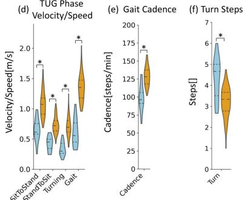  
(c) 步态周期时间占比

## III. 结果

## A. TUG 特征

我们从每次 TUG 测试中提取了 115 个特征。总体而言，在高跌倒风险组和低跌倒风险组之间，大多数特征均存在显著差异，包括与总时长和各阶段时长、最大垂直速度、转向阶段、步态时空参数以及步态运动学相关的特征（Fig. 3）。然而，在步态对称比和步宽方面未观察到显著差异。

在持续时间方面，高跌倒风险组表现出更长的 TUG 总时间、各阶段更长的持续时间以及各步态阶段更长的时间（均 $p < 0 . 0 1$ ，Fig. 3(a), (b)）。关于步态周期时间占比，高跌倒风险组在支撑相时间、初始双支撑（ID）时间、终端双支撑（TD）时间以及总双支撑时间占比上均具有更高的数值（均 $p < 0 . 0 1$ ，Fig. 3(c)）。

在速度/速率表现方面，高跌倒风险组在坐起、转向、行走和站立坐下阶段的速度/速率较低，且步频也较低（均 $p <$ 0.01，Fig. 3(d), (e)）。此外，高跌倒风险组在转向阶段迈出的步数更多（$p < 0 . 0 1$ ，Fig. 3(f)）。在行走和转向过程中，该组的转向宽度、转向弧长、跨步长和步长也更小（均 $p < 0 . 0 1 )$ ）。然而，在步宽方面未观察到显著差异（$p = 0 . 3 7$ Fig. 3(g)）。

关于步态对称性特征，在所有步态对称比中均未观察到显著差异（Fig. 3(h)）。然而，除初始和终端双支撑时间及其占比以及跨步长之外，大多数步态对称指数特征均表现出显著差异（Fig. 3(i)）。

在步态运动学指标中，高跌倒风险组在髋关节 F/E、膝关节 F/E 和踝关节 D/P 的活动范围显著更小，且最小值显著更高（均 $p < 0 . 0 1 )$ 。在最大髋关节 F/E 方面未观察到显著差异（左侧：$p = 0 . 8 2$ 右侧：$p = 0 . 3 8 , \mathrm { F i g } . 3 ( \mathrm { j } ) )$ 。

在去除冗余特征后，我们保留了 28 个最佳特征，包括坐起时间、转向时间、站立坐下时间、坐起最大垂直速度、转向步数、转向宽度、转向弧长、左右侧支撑相时间占比、左右侧摆动相时间占比、右侧初始双支撑时间占比、右侧终端双支撑时间占比、右侧步速、平均终端双支撑时间、双支撑时间不对称指数、步速不对称指数、步频、步频不对称指数、步宽不对称指数、右髋 F/E 活动范围、左右膝 F/E 活动范围及最小值、左踝 D/P 活动范围及最小值以及右踝 D/P 最大值。这些特征作为构建用于预测 BBS 分数的回归模型的输入。

## B. BBS 分数预测

总体而言，所有回归模型均具有较高的预测精度（$\mathrm { R M S E } \le 1 . 6 2 $，MAE 1.38，$R ^ { 2 } \ge 0 . 8 2$，Fig. 4）。在这些

高跌倒风险组

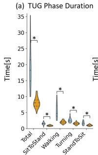  
低跌倒风险组

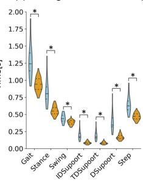

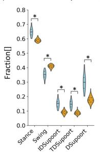  
(g) 宽度与长度指标

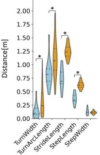

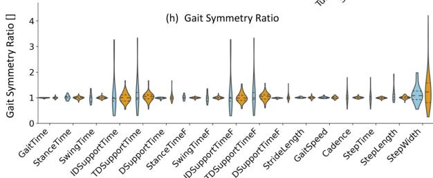

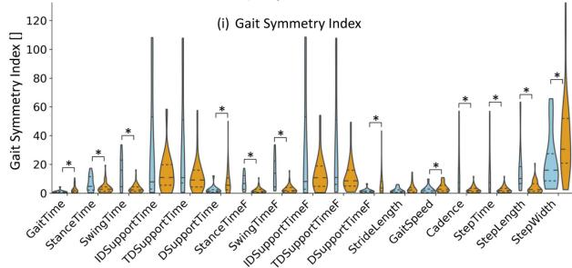

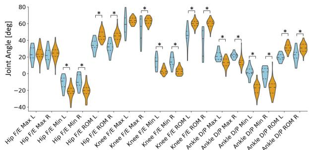  
Fig. 3. 高跌倒风险组与低跌倒风险组之间的特征分布。特征包括 (a) TUG 阶段持续时间、(b) 步态阶段持续时间、(c) 步态阶段占步态周期总时间的比例、(d) TUG 阶段速度/速率、(e) 步频、(f) 转身步数、(g) 宽度与长度指标、(h) 步态对称比率、(i) 步态对称指数，以及 (j) 步态运动学指标（髋关节、膝关节和踝关节的最小值、最大值和活动范围）。表示两组之间存在显著差异，采用针对正态分布数据的双样本 t 检验或针对非正态分布数据的 Mann-Whitney U 检验确定。

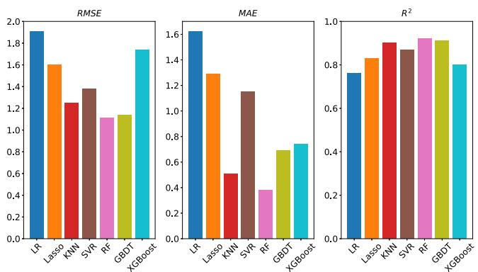  
Fig. 4. 机器学习模型预测的 BBS 评分与实际 BBS 评分之间的均方根误差（RMSE）、平均绝对误差（MAE）和决定系数（R2）。

模型中，RF、GBDT 和 KNN 表现出较低的预测误差和较高的解释力。相比之下，LR 和 XGBoost 则表现出较高的预测误差和较低的解释力。

具体而言，观察到 LR 具有最高的预测误差（RMSE 和 MAE 均最高）以及较低的解释力 $R ^ { 2 }$。Lasso 和 SVR 表现出相似的预测性能，与 LR 相比，其预测误差有所改善且解释力更高。

RF 展现出预测性能的进一步提升，在所有模型中具有最低的 MAE（RMSE: 0.98, MAE: 0.38, $R ^ { 2 } \mathbf { i }$ : 0.94）。GBDT 表现出与 RF 相似的预测性能，而 XGBoost 则表现出更高的预测误差和更低的解释力。

## C. 无标记与基于标记的 MoCap 运动学对比

总体而言，由无标记系统获得的下肢运动学表现出与基于标记的系统相似的模式（平均 RMSE：5.06°，Fig. 5）。髋关节 F/E 在整个步态周期中表现出伸展偏移，而膝关节 F/E 也显示出类似的伸展偏移。与髋关节 F/E（平均 RMSE：9.14°，标准差 (STD)：3.55°，ICC：0.99）和膝关节 F/E（平均 RMSE：7.72°，STD：2.45°，ICC：0.99）相比，无标记系统测量的踝关节 D/P 与基于标记的系统显示出良好的一致性（平均 RMSE：3.03°，标准差 (STD)：1.26°，ICC：0.98）。

## IV. 讨论

我们通过利用无标记动作捕捉（MoCap）系统和机器学习模型来增强传统的 TUG 测试，提出了一种用于平衡功能评估和步态分析的定量框架，无需使用传感器。与主要依赖完成时间的传统 TUG 测试相比，该系统提供了更多具有临床相关性的结果度量。此外，我们的系统还能预测 BBS 评分，并提供包括时空参数和关节运动学在内的步态分析。与金标准 BBS 相比，我们的系统更具时间效率，显著减少了临床医生的时间消耗，评估通常在 5 分钟内完成。它还消除了对专业临床医生的需求，使其更易于获取且更具成本效益，便于广泛应用。我们发现，跌倒高风险个体的完成时间更长、执行速度更慢，且下肢关节的活动范围有所减小。在测试的机器学习模型中，随机森林（Random Forest）在预测 BBS 评分方面表现出最高的准确性。此外，我们的无标记 MoCap 系统的准确性与当前最先进的系统相当。通过利用这一综合评估框架，治疗师可以制定量身定制的干预方案，精准针对稳定性改善、风险降低和整体活动能力提升。

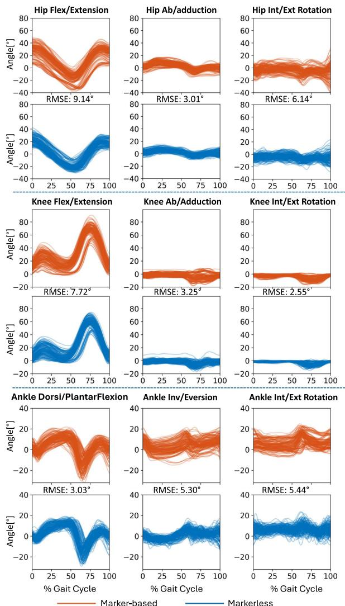  
Fig. 5. 由无标记和基于标记的动作捕捉系统从 18 名受试者中测得的跨越 163 个步态周期的下肢关节运动学。每个关节角度图中均内嵌了步态周期内的平均 RMSE 值。

具有高跌倒风险的个体表现出更长的 TUG 总时间、各阶段持续时间更长以及各步态时相的时间更长。这一发现与 Kim 等人 [4] 的研究一致，该研究使用基于 Kinect 相机的测试套件来评估老年人的跌倒风险。他们发现转弯时间显著增加，但总完成时间没有显著差异。他们将此归因于 Kinect 可追踪范围的限制，导致 TUG 步行距离（2 米）比原版的 3 米更短，从而降低了其预测能力。此外，Microsoft 于 2017 年 10 月停产 Kinect V2 相机可能会影响其评估系统在其他环境中的可复现性。相比之下，我们的系统提供了更全面的信息，包括 BBS（伯格平衡量表）评分和步态分析。我们还观察到步态过程中跨步长、步长、步频和步速更短，以及步态时间和步时间更长，这与 Dubois 等人 [17] 的研究结果一致，他们报告了显著更短的步长、步时间、步频和步速。他们未发现转弯步数和转弯宽度存在显著差异，这可能与参与者的转弯习惯有关。在我们的研究中，我们未发现步宽存在显著差异，这可能是由于参与者在涉及转弯的 TUG 测试期间的行走习惯所致。与他们的研究相比，我们的方法提供了额外的信息，包括 BBS 评分以及涵盖下肢关节运动学的详细步态分析。在高跌倒风险组中，大多数步态对称性指数特征表现出显著差异。然而，在所有步态对称性比率中均未观察到显著差异。这可能是因为步态对称性比率不如步态对称性指数敏感。

机器学习模型在预测 BBS 评分方面能够提供较高的准确性。即使是使用从 TUG 测试中提取的特征的线性回归模型，也展现出良好的预测准确性（RMSE: 1.62, MAE: 1.38, R2: 0.82）。非线性模型（如 RF）则表现出极佳的预测准确性（MAE: 0.38）。这与 Lin 等人 [8] 的研究结果一致，他们应用了包括 Bagging 回归、KNN、Lasso、LR、RF、Ridge 回归和 SVR 在内的多种机器学习模型，利用来自 IMU 传感器的特征预测 BBS 评分。他们同样发现 RF 模型的 MAE 最低（MAE: 1.19）。类似地，Badura 等人 [35] 使用五个 IMU 实现了 1.47 的 MAE，这表明我们模型的准确性达到了预期标准。在我们的研究中，RF 和 GBDT 表现出相似的预测性能，因为两者都是能够对非线性关系进行建模的集成方法。然而，XGBoost 的预测性能略差。其超参数（包括提升轮数、学习率、树的最大深度和正则化项）均使用网格搜索进行了调优。该模型次优的表现可能是由于数据集规模有限，从而限制了其充分从数据中学习的能力。

我们的系统展示了与最先进技术相当的准确性，其下肢运动学表现出与基于标记点的系统相似的模式和活动范围。平均 RMSE 小于 9.14◦，与 Theia3D 相当。在最近一项同时使用基于标记点和 Theia 无标记点 MoCap 系统研究 30 名健全成年人步态运动学的研究 [36] 中，平均 RMSE 小于 13.2◦，各关节的 RMSE 值如下：髋关节 F/E: 11◦，髋关节外展/内收（Ab/Ad）: 2.6◦，髋关节内旋/外旋（I/E R）: 6.9◦，膝关节 F/E: 3.3◦，膝关节 Ab/Ad: 3.2◦，膝关节 I/E R: 13.2◦，踝关节 D/P: 6.7◦，踝关节内翻/外翻（I/E）: 8◦，以及踝关节 I/E R: 11.6◦。我们的系统在踝关节上表现出更好的预测准确性（踝关节 D/P: 3.03◦，I/E: 5.30◦，以及 I/E R: 5.44◦），但在膝关节 F/E: 7.72◦ 和膝关节 Ab/Ad: 3.25◦ 上的预测较差，不过在膝关节 I/E R: 2.55◦ 方面表现更好。两个系统在髋关节上均表现出显著误差（髋关节 F/E: 9.14◦，Ab/Ad: 3.01◦，I/E R: 6.14◦），这可能是由于难以预测骨盆节段的位置所致。在我们的系统中，膝关节角度的计算也依赖于骨盆上的标记点，导致了略高的 RMSE。无标记点 MoCap 系统中略小的标准差（Fig. 5）可能是由于机器学习模型旨在最小化预测误差的训练过程。这一过程可能内在地使输出更接近训练数据中的平均模式，从而降低了变异性。相比之下，基于标记点的系统更容易受到标记点放置误差所带来的变异性的影响。

在这项概念验证研究中，由于我们在新加坡能够招募到的受试者数量有限，特征是从基于标记点和无标记点的 MoCap 系统中提取的。该无标记点系统是在一个基于标记点的数据集上进行训练的，该数据集遵循相同的标记点集和标记点放置协议，并包含200多名执行各种活动的受试者。该数据集是历时五年收集的以亚洲人群为中心的运动数据库的一部分 [37]。对两个系统之间下肢关节运动学的比较显示出相似的模式和运动范围，支持了我们方法的可靠性。基于这一证据，我们预计两个系统之间的预测性能差异极小。尽管如此，仍需要更大样本量的进一步研究，以增强无标记点 MoCap 系统的鲁棒性并拓宽其适用性。

我们承认，老年人跌倒的原因多样且复杂，需要采用多维度的方法来评估跌倒风险因素。尽管我们的研究重点关注可干预的身体因素，提供了平衡功能评估和详细的步态分析，但它并未涵盖跌倒风险因素的全部范围，例如认知能力。此外，一些研究表明 BBS 和 TUG 测试对跌倒风险的预测性能有限，尽管它们作为临床工具被广泛应用，但并不建议作为独立预测指标使用 [5], [38]。在本研究中，鉴于平衡功能和步态在应对可干预风险因素中的关键作用，我们的主要目标是开发一个用于平衡功能评估和全面步态分析的快速、低成本且自动化的框架。该框架将广泛使用的 TUG 测试与先进的无标记点 MoCap 技术及机器学习技术相结合。然而，未来的研究应考虑纳入更广泛的因素，以建立更全面的跌倒风险评估与预防方法。

本研究中使用的步态事件检测方法由 Zeni 等人 [31] 提出，这是一种广泛采用的方法，依赖于相对于骨盆坐标系的足跟和足尖标记点。选择该方法是因为它非常适合我们的数据集，其中大多数参与者都表现出清晰的足跟着地和足尖离地事件。我们承认，其他替代方法（例如 Ghoussayni 等人 [39] 提出的速度阈值法）可能会提供额外的见解。在未来的研究中可以对这些替代方法进行探索，特别是在分析不同的受试人群时。

## V. 结论

在本研究中，我们开发了一种结合无标记点动作捕捉（MoCap）系统和机器学习模型的增强型 TUG（定时起立-行走）测试。我们的系统首次在以高准确度预测 BBS（伯格平衡量表）评分的同时，提供了包括时空参数和关节运动学在内的全面步态分析，相比传统 TUG 提供了更多具有临床相关性的结果。这些丰富的信息使临床医生能够更深入地了解下肢病理特征。在对高跌倒风险组与低跌倒风险组的对比中，我们观察到具有高跌倒风险的个体完成时间更长、运动速度更低，且下肢关节的活动度更小。在所测试的机器学习模型中，随机森林（Random Forest）在预测 BBS 评分方面表现出更优越的性能。此外，我们的无标记点 MoCap 系统展现出了与最先进系统相当的准确度，且无需粘贴标记点或佩戴传感器。通过将无标记点 MoCap 技术与现有的平衡功能评估相结合，本研究为推进老年人跌倒预防策略作出了贡献。它提供了一种用于评估平衡功能和进行全面步态分析的创新定量方法，有助于实现早期识别与及时干预。

## ACKNOWLEDGMENT

作者感谢 Nanyang Technological University (NTU)、Agency for Science Technology and Research (A\*STAR)、National Healthcare Group (NHG) 以及中国 Jian Xiang Hospital Group 的赞助支持。作者还感谢来自 Ability Data 研究支持团队的人力协助。

## REFERENCES

[1] A. A. Zecevic, A. W. Salmoni, M. Speechley, and A. A. Vandervoort, “Defining a fall and reasons for falling: Comparisons among the views of seniors, health care providers, and the research literature,” Gerontologist, vol. 46, no. 3, pp. 367–376, 2006.

[2] World Health Organization Ageing and L. C. Unit, WHO Global Report on Falls Prevention in Older Age. Geneva, Switzerland: World Health Organization, 2008.

[3] B. R. Greene, S. J. Redmond, and B. Caulfield, “Fall risk assessment through automatic combination of clinical fall risk factors and body-worn sensor data,” IEEE J. Biomed. Health Inform., vol. 21, no. 3, pp. 725–731, May 2017.

[4] T. Kim, X. Yu, and S. Xiong, “A multifactorial fall risk assessment system for older people utilizing a low-cost, markerless microsoft kinect,” Ergonomics, vol. 67, no. 1, pp. 50–68, 2023.

[5] C. Lima, N. Ricci, E. Nogueira, and M. R. Perracini, “The berg balance scale as a clinical screening tool to predict fall risk in older adults: A systematic review,” Physiotherapy, vol. 104, no. 4, pp. 383–394, 2018.

[6] B. R. Greene, A. O’Donovan, R. Romero-Ortuno, L. Cogan, C. N. Scanaill, and R. A. Kenny, “Quantitative falls risk assessment using the timed up and go test,” IEEE Trans. Biomed. Eng., vol. 57, no. 12, pp. 2918–2926, Dec. 2010.

[7] N. Eichler, S. Raz, A. Toledano-Shubi, D. Livne, I. Shimshoni, and H. Hel-Or, “Automatic and efficient fall risk assessment based on machine learning,” Sensors, vol. 22, no. 4, 2022, Art. no. 1557.

[8] B.-S. Lin, Z. Zhang, C.-W. Peng, C.-C. Lin, C.-H. Lin, and B.-S. Lin, “Automatic assessment system based on IMUs and machine learning for predicting berg balance scale,” IEEE Sensors J., vol. 22, no. 20, pp. 19919–19930, Oct. 2022.

[9] H. Similä, J. Mäntyjärvi, J. Merilahti, M. Lindholm, and M. Ermes, “Accelerometry-based berg balance scale score estimation,” IEEE J. Biomed. Health Inform., vol. 18, no. 4, pp. 1114–1121, Jul. 2014.

[10] M. M. Lusardi et al., “Determining risk of falls in community dwelling older adults: A systematic review and meta-analysis using posttest probability,” J. Geriatr. Phys. Ther., vol. 40, no. 1, pp. 1–36, 2017.

[11] X. Wang et al., “Identifying sensors-based parameters associated with fal risk in community-dwelling older adults: An investigation and interpretation of discriminatory parameters,” BMC Geriatrics, vol. 24, no. 1, 2024, Art. no. 125.

[12] A. Demircio˘glu, Ü. K. ¸Sahin, and S. Acaröz, “Discriminative ability of the four balance measures for previous fall experience in Turkish communitydwelling older adults,” J. Aging Phys. Activity, vol. 30, no. 6, pp. 980–986, 2022.

[13] V. Benavent-Caballer et al., “Physical factors underlying the timed “up and go” test in older adults,” Geriatr. Nurs., vol. 37, no. 2, pp. 122–127, 2016.

[14] A. H. Alghadir, E. S. Al-Eisa, S. Anwer, and B. Sarkar, “Reliability, validity, and responsiveness of three scales for measuring balance in patients with chronic stroke,” BMC Neurol., vol. 18, 2018, Art. no. 141.

[15] H. Leger, R. Tittle, S. Dowdell, and C. Thompson, “Comparison of the validity of the timed up and go test (TUG) and activities-specific balance confidence questionnaire (ABC) to the ‘gold standard’ Berg balance scale (BBS) in assessing fall risk in the elderly population,” J. Rehabil. Pract. Res., vol. 3, no. 2, 2022, Art. no. 133.

[16] D. Podsiadlo and S. Richardson, “The timed “up & go”: A test of basic functional mobility for frail elderly persons,” J. Amer. Geriatrics Soc., vol. 39, no. 2, pp. 142–148, 1991.

[17] A. Dubois, T. Bihl, and J.-P. Bresciani, “Automating the timed up and go test using a depth camera,” Sensors, vol. 18, no. 1, 2017, Art. no. 14.

[18] A. Shumway-Cook, S. Brauer, and M. Woollacott, “Predicting the probability for falls in community-dwelling older adults using the timed up & go test,” Phys. Ther., vol. 80, no. 9, pp. 896–903, 2000.

[19] K. Okumiya et al., “The timed “up & go” test is a useful predictor of falls in community-dwelling older people,” J. Amer. Geriatrics Soc., vol. 46, no. 7, pp. 928–929, 1998.

[20] I. Bautmans, B. Jansen, B. Van Keymolen, and T. Mets, “基于3D加速度计的步态分析结果按年龄和跌倒风险划分的可靠性及临床相关性,” Gait Posture, vol. 33, no. 3, pp. 366–372, 2011.

[21] B. E. Maki, “老年人的步态变化：跌倒的预测指标还是恐惧的表现？,” J. Amer. Geriatrics Soc., vol. 45, no. 3, pp. 313–320, 1997.

[22] J. M. Hausdorff, H. K. Edelberg, S. L. Mitchell, A. L. Goldberger, and J. Y. Wei, “社区跌倒老年人步态不稳的加剧,” Arch. Phys. Med. Rehabil., vol. 78, no. 3, pp. 278–283, 1997.

[23] J. W. Pan et al., “通过运动分析揭示中风步态异常，所见远超肉眼：一项病例对照研究,” Front. Neurosci., vol. 18, 2024, Art. no. 1425183.

[24] S. A. Bridenbaugh and R. W. Kressig, “实验室综述：步态分析在老年人行动能力与跌倒预防中的作用,” Gerontology, vol. 57, no. 3, pp. 256–264, 2011.

[25] L. Mündermann, S. Corazza, and T. P. Andriacchi, “面向生物力学应用的人体运动捕捉方法的发展历程：走向无标记动作捕捉,” J. Neuroeng. Rehabil., vol. 3, 2006, Art. no. 6.

[26] Z. Cao, T. Simon, S.-E. Wei, and Y. Sheikh, “基于部分亲和字段的实时多人2D姿态估计,” in Proc. IEEE Conf. Comput. Vis. Pattern Recognit., 2017, pp. 7291–7299.

[27] L. Needham et al., “全自动无标记动作捕捉工作流的开发与评估,” J. Biomech., vol. 144, 2022, Art. no. 111338.

[28] S. D. Uhlrich et al., “OpenCap：基于智能手机视频的人体运动动力学,” PLoS Comput. Biol., vol. 19, no. 10, 2023, Art. no. e1011462.

[29] R. M. Kanko et al., “利用基于深度学习算法的无标记动作捕捉系统评估时空步态参数,” J. Biomech., vol. 122, 2021, Art. no. 110414.

[30] P. Jatesiktat, G. M. Lim, W. S. Lim, and W. T. Ang, “解剖标记驱动的三维无标记人体运动捕捉,” IEEE J. Biomed. Health Inform., 2024, early access, Jul. 9, 2014, doi: 10.1109/JBHI.2024.3424869.

[31] J. Zeni Jr., J. Richards, and J. Higginson, “利用运动学数据确定跑步机和地面行走期间步态事件的两种简易方法,” Gait Posture, vol. 27, no. 4, pp. 710–714, 2008.

[32] M. Seifallahi, A. H. Mehraban, J. E. Galvin, and B. Ghoraani, “基于 Kinect V.2 相机与机器学习全面分析计时起立-行走测试以检测阿尔茨海默病,” IEEE Trans. Neural Syst. Rehabil. Eng., vol. 30, pp. 1589–1600, 2022.

[33] H. Niroumand, M. Zain, and M. Jamil, “用于施工方法与建筑评估数据集比较的统计方法,” Procedia-Social Behav. Sci., vol. 89, pp. 218–221, 2013.

[34] J. M. Kernbach and V. E. Staartjes, “基于机器学习的临床预测模型基础：第二部分——泛化与过拟合,” in Proc. Conf. Mach. Learn. Clin. Neurosci.: Found. Appl., 2022, pp. 15–21.

[35] P. Badura and E. Pietka, “基于加速度信号的伯格平衡量表自动评估系统,” Biomed. Signal Process. Control, vol. 24, pp. 114–119, 2016.

[36] R. M. Kanko, E. K. Laende, E. M. Davis, W. S. Selbie, and K. J. Deluzio, “基于标记和无标记动作捕捉的步态运动学同步评估,” J. Biomech., vol. 127, 2021, Art. no. 110665.

[37] P. Liang et al., “一个以亚洲人为核心记录日常生活活动的人体运动数据库,” Sci. Data, vol. 7, no. 1, 2020, Art. no. 290.

[38] D. Matsumoto, T. Fujita, R. Kasahara, K. Tsuchiya, and K. Iokawa, “识别脑卒中后跌倒风险的筛查截断值：一项范围综述,” J. Rehabil. Med., vol. 56, 2024, Art. no. 40560.

[39] S. Ghoussayni, C. Stevens, S. Durham, and D. Ewins, “一种用于检测步态事件和时间区间的简易自动化方法的评估与验证,” Gait Posture, vol. 20, no. 3, pp. 266–272, 2004.