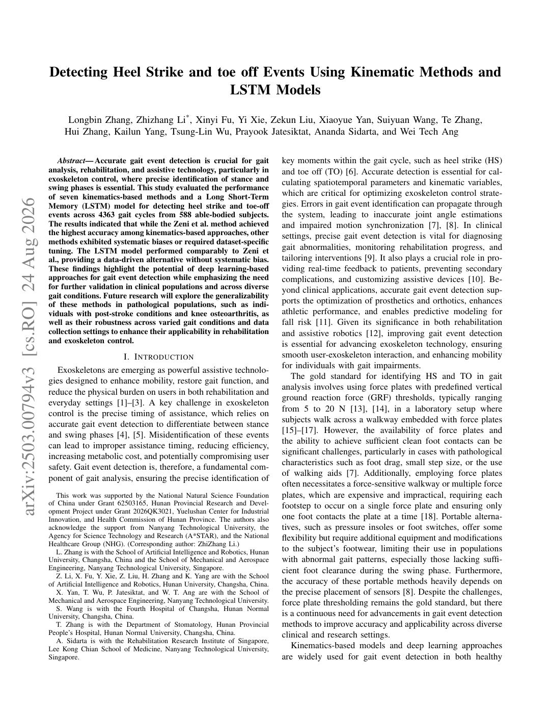
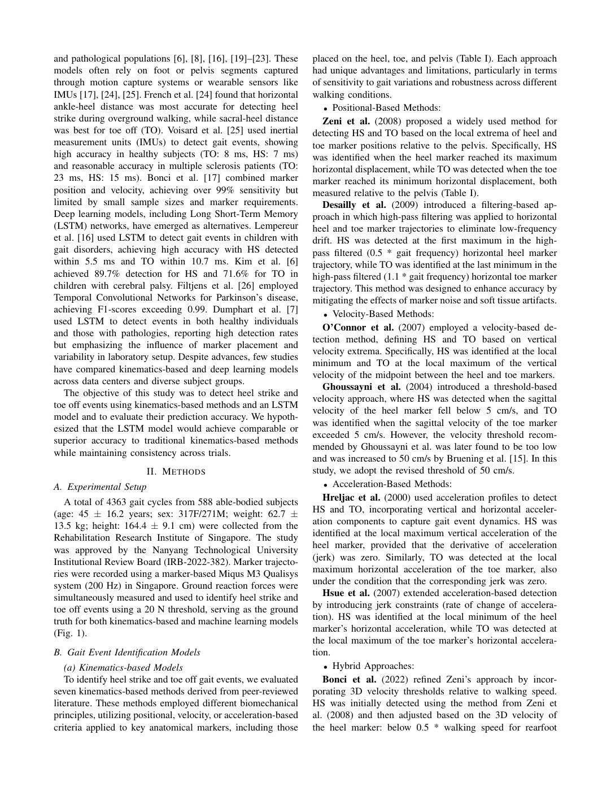
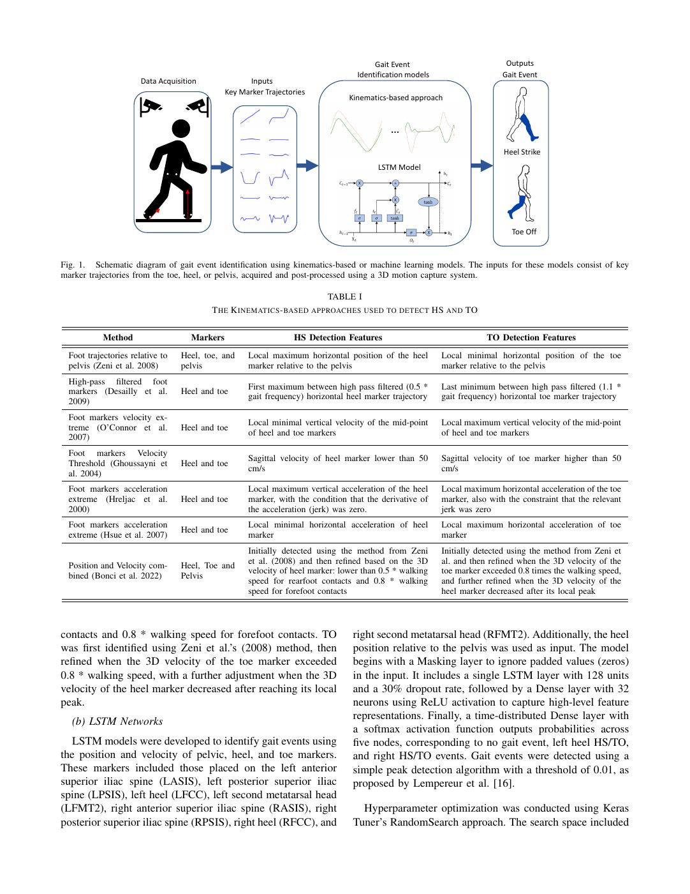
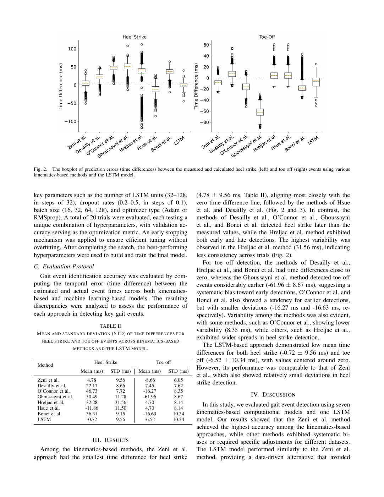
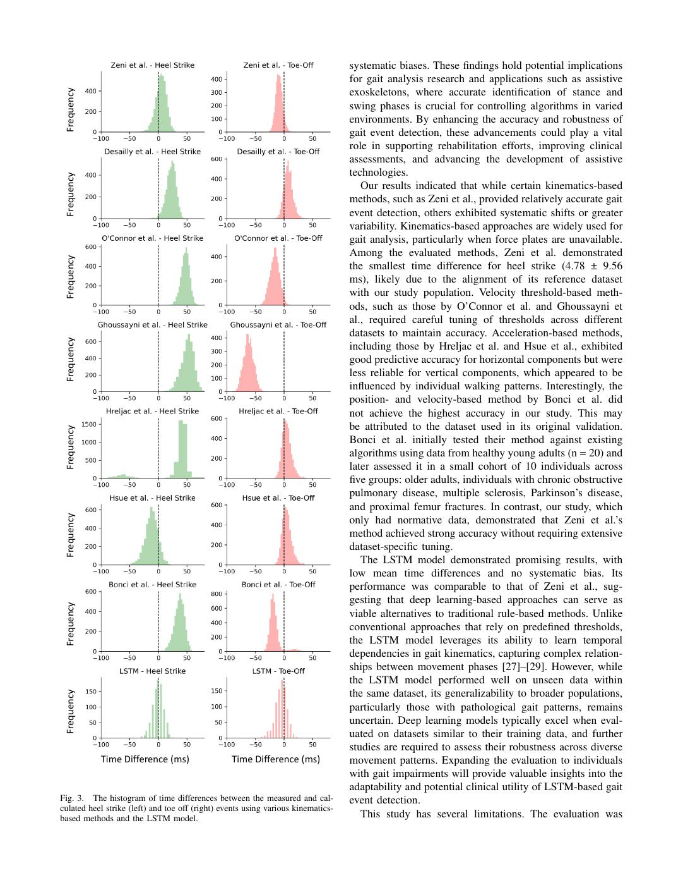
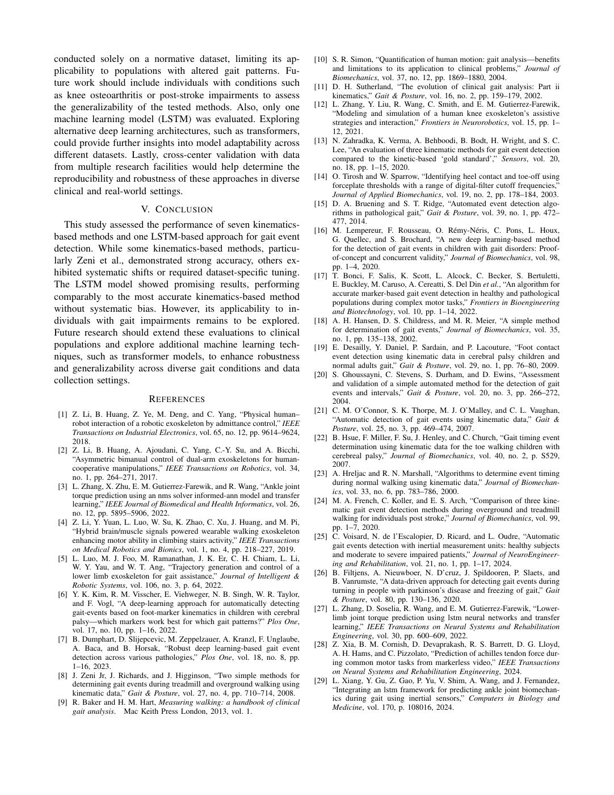

# Zhang2025-arXiv：运动学与LSTM的足跟触地离地事件检测

> English text extracted from the source PDF; not translated or editorially corrected. Each original PDF page is embedded below as a rendered image so figures, tables, and vector artwork remain visible.

- Source PDF: `Zhang2025-arXiv：运动学与LSTM的足跟触地离地事件检测.pdf`
- SHA-256: `7c6124232675e047fb2dda6c2038fb79e532553114ca17d3c3647abb4a9e5210`
- Pages: 6
- Extraction: Poppler `pdftotext -layout`; page images rendered with `pdftoppm` (max dimension 1400 px, JPEG quality 76).

## Page 1

English text extracted from page 1

<pre>
Detecting Heel Strike and toe off Events Using Kinematic Methods and
                                                                     LSTM Models
                                               Longbin Zhang, Zhizhang Li* , Xinyi Fu, Yi Xie, Zekun Liu, Xiaoyue Yan, Suiyuan Wang, Te Zhang,
                                              Hui Zhang, Kailun Yang, Tsung-Lin Wu, Prayook Jatesiktat, Ananda Sidarta, and Wei Tech Ang

                                            Abstract— Accurate gait event detection is crucial for gait                  key moments within the gait cycle, such as heel strike (HS)
                                         analysis, rehabilitation, and assistive technology, particularly in             and toe off (TO) [6]. Accurate detection is essential for cal-
                                         exoskeleton control, where precise identification of stance and                 culating spatiotemporal parameters and kinematic variables,
                                         swing phases is essential. This study evaluated the performance
                                         of seven kinematics-based methods and a Long Short-Term                         which are critical for optimizing exoskeleton control strate-

arXiv:2503.00794v3 [cs.RO] 24 Aug 2026
                                         Memory (LSTM) model for detecting heel strike and toe-off                       gies. Errors in gait event identification can propagate through
                                         events across 4363 gait cycles from 588 able-bodied subjects.                   the system, leading to inaccurate joint angle estimations
                                         The results indicated that while the Zeni et al. method achieved                and impaired motion synchronization [7], [8]. In clinical
                                         the highest accuracy among kinematics-based approaches, other                   settings, precise gait event detection is vital for diagnosing
                                         methods exhibited systematic biases or required dataset-specific
                                         tuning. The LSTM model performed comparably to Zeni et                          gait abnormalities, monitoring rehabilitation progress, and
                                         al., providing a data-driven alternative without systematic bias.               tailoring interventions [9]. It also plays a crucial role in pro-
                                         These findings highlight the potential of deep learning-based                   viding real-time feedback to patients, preventing secondary
                                         approaches for gait event detection while emphasizing the need                  complications, and customizing assistive devices [10]. Be-
                                         for further validation in clinical populations and across diverse               yond clinical applications, accurate gait event detection sup-
                                         gait conditions. Future research will explore the generalizability
                                         of these methods in pathological populations, such as indi-                     ports the optimization of prosthetics and orthotics, enhances
                                         viduals with post-stroke conditions and knee osteoarthritis, as                 athletic performance, and enables predictive modeling for
                                         well as their robustness across varied gait conditions and data                 fall risk [11]. Given its significance in both rehabilitation
                                         collection settings to enhance their applicability in rehabilitation            and assistive robotics [12], improving gait event detection
                                         and exoskeleton control.                                                        is essential for advancing exoskeleton technology, ensuring
                                                                   I. I NTRODUCTION                                      smooth user-exoskeleton interaction, and enhancing mobility
                                                                                                                         for individuals with gait impairments.
                                            Exoskeletons are emerging as powerful assistive technolo-
                                                                                                                            The gold standard for identifying HS and TO in gait
                                         gies designed to enhance mobility, restore gait function, and
                                                                                                                         analysis involves using force plates with predefined vertical
                                         reduce the physical burden on users in both rehabilitation and
                                                                                                                         ground reaction force (GRF) thresholds, typically ranging
                                         everyday settings [1]–[3]. A key challenge in exoskeleton
                                                                                                                         from 5 to 20 N [13], [14], in a laboratory setup where
                                         control is the precise timing of assistance, which relies on
                                                                                                                         subjects walk across a walkway embedded with force plates
                                         accurate gait event detection to differentiate between stance
                                                                                                                         [15]–[17]. However, the availability of force plates and
                                         and swing phases [4], [5]. Misidentification of these events
                                                                                                                         the ability to achieve sufficient clean foot contacts can be
                                         can lead to improper assistance timing, reducing efficiency,
                                                                                                                         significant challenges, particularly in cases with pathological
                                         increasing metabolic cost, and potentially compromising user
                                                                                                                         characteristics such as foot drag, small step size, or the use
                                         safety. Gait event detection is, therefore, a fundamental com-
                                                                                                                         of walking aids [7]. Additionally, employing force plates
                                         ponent of gait analysis, ensuring the precise identification of
                                                                                                                         often necessitates a force-sensitive walkway or multiple force
                                            This work was supported by the National Natural Science Foundation           plates, which are expensive and impractical, requiring each
                                         of China under Grant 62503165, Hunan Provincial Research and Devel-             footstep to occur on a single force plate and ensuring only
                                         opment Project under Grant 2026QK3021, Yuelushan Center for Industrial
                                         Innovation, and Health Commission of Hunan Province. The authors also           one foot contacts the plate at a time [18]. Portable alterna-
                                         acknowledge the support from Nanyang Technological University, the              tives, such as pressure insoles or foot switches, offer some
                                         Agency for Science Technology and Research (A*STAR), and the National           flexibility but require additional equipment and modifications
                                         Healthcare Group (NHG). (Corresponding author: ZhiZhang Li.)
                                            L. Zhang is with the School of Artificial Intelligence and Robotics, Hunan   to the subject’s footwear, limiting their use in populations
                                         University, Changsha, China and the School of Mechanical and Aerospace          with abnormal gait patterns, especially those lacking suffi-
                                         Engineering, Nanyang Technological University, Singapore.                       cient foot clearance during the swing phase. Furthermore,
                                            Z. Li, X. Fu, Y. Xie, Z. Liu, H. Zhang and K. Yang are with the School
                                         of Artificial Intelligence and Robotics, Hunan University, Changsha, China.     the accuracy of these portable methods heavily depends on
                                            X. Yan, T. Wu, P. Jatesiktat, and W. T. Ang are with the School of           the precise placement of sensors [8]. Despite the challenges,
                                         Mechanical and Aerospace Engineering, Nanyang Technological University.         force plate thresholding remains the gold standard, but there
                                            S. Wang is with the Fourth Hospital of Changsha, Hunan Normal
                                         University, Changsha, China.                                                    is a continuous need for advancements in gait event detection
                                            T. Zhang is with the Department of Stomatology, Hunan Provincial             methods to improve accuracy and applicability across diverse
                                         People’s Hospital, Hunan Normal University, Changsha, China.                    clinical and research settings.
                                            A. Sidarta is with the Rehabilitation Research Institute of Singapore,
                                         Lee Kong Chian School of Medicine, Nanyang Technological University,               Kinematics-based models and deep learning approaches
                                         Singapore.                                                                      are widely used for gait event detection in both healthy
</pre>

## Page 2

English text extracted from page 2

<pre>
and pathological populations [6], [8], [16], [19]–[23]. These       placed on the heel, toe, and pelvis (Table I). Each approach
models often rely on foot or pelvis segments captured               had unique advantages and limitations, particularly in terms
through motion capture systems or wearable sensors like             of sensitivity to gait variations and robustness across different
IMUs [17], [24], [25]. French et al. [24] found that horizontal     walking conditions.
ankle-heel distance was most accurate for detecting heel               • Positional-Based Methods:
strike during overground walking, while sacral-heel distance           Zeni et al. (2008) proposed a widely used method for
was best for toe off (TO). Voisard et al. [25] used inertial        detecting HS and TO based on the local extrema of heel and
measurement units (IMUs) to detect gait events, showing             toe marker positions relative to the pelvis. Specifically, HS
high accuracy in healthy subjects (TO: 8 ms, HS: 7 ms)              was identified when the heel marker reached its maximum
and reasonable accuracy in multiple sclerosis patients (TO:         horizontal displacement, while TO was detected when the toe
23 ms, HS: 15 ms). Bonci et al. [17] combined marker                marker reached its minimum horizontal displacement, both
position and velocity, achieving over 99% sensitivity but           measured relative to the pelvis (Table I).
limited by small sample sizes and marker requirements.                 Desailly et al. (2009) introduced a filtering-based ap-
Deep learning models, including Long Short-Term Memory              proach in which high-pass filtering was applied to horizontal
(LSTM) networks, have emerged as alternatives. Lempereur            heel and toe marker trajectories to eliminate low-frequency
et al. [16] used LSTM to detect gait events in children with        drift. HS was detected at the first maximum in the high-
gait disorders, achieving high accuracy with HS detected            pass filtered (0.5 * gait frequency) horizontal heel marker
within 5.5 ms and TO within 10.7 ms. Kim et al. [6]                 trajectory, while TO was identified at the last minimum in the
achieved 89.7% detection for HS and 71.6% for TO in                 high-pass filtered (1.1 * gait frequency) horizontal toe marker
children with cerebral palsy. Filtjens et al. [26] employed         trajectory. This method was designed to enhance accuracy by
Temporal Convolutional Networks for Parkinson’s disease,            mitigating the effects of marker noise and soft tissue artifacts.
achieving F1-scores exceeding 0.99. Dumphart et al. [7]                • Velocity-Based Methods:
used LSTM to detect events in both healthy individuals
                                                                       O’Connor et al. (2007) employed a velocity-based de-
and those with pathologies, reporting high detection rates
                                                                    tection method, defining HS and TO based on vertical
but emphasizing the influence of marker placement and
                                                                    velocity extrema. Specifically, HS was identified at the local
variability in laboratory setup. Despite advances, few studies
                                                                    minimum and TO at the local maximum of the vertical
have compared kinematics-based and deep learning models
                                                                    velocity of the midpoint between the heel and toe markers.
across data centers and diverse subject groups.
                                                                       Ghoussayni et al. (2004) introduced a threshold-based
   The objective of this study was to detect heel strike and
                                                                    velocity approach, where HS was detected when the sagittal
toe off events using kinematics-based methods and an LSTM
                                                                    velocity of the heel marker fell below 5 cm/s, and TO
model and to evaluate their prediction accuracy. We hypoth-
                                                                    was identified when the sagittal velocity of the toe marker
esized that the LSTM model would achieve comparable or
                                                                    exceeded 5 cm/s. However, the velocity threshold recom-
superior accuracy to traditional kinematics-based methods
                                                                    mended by Ghoussayni et al. was later found to be too low
while maintaining consistency across trials.
                                                                    and was increased to 50 cm/s by Bruening et al. [15]. In this
                        II. M ETHODS                                study, we adopt the revised threshold of 50 cm/s.
A. Experimental Setup                                                  • Acceleration-Based Methods:

   A total of 4363 gait cycles from 588 able-bodied subjects           Hreljac et al. (2000) used acceleration profiles to detect
(age: 45 ± 16.2 years; sex: 317F/271M; weight: 62.7 ±               HS and TO, incorporating vertical and horizontal acceler-
13.5 kg; height: 164.4 ± 9.1 cm) were collected from the            ation components to capture gait event dynamics. HS was
Rehabilitation Research Institute of Singapore. The study           identified at the local maximum vertical acceleration of the
was approved by the Nanyang Technological University                heel marker, provided that the derivative of acceleration
Institutional Review Board (IRB-2022-382). Marker trajecto-         (jerk) was zero. Similarly, TO was detected at the local
ries were recorded using a marker-based Miqus M3 Qualisys           maximum horizontal acceleration of the toe marker, also
system (200 Hz) in Singapore. Ground reaction forces were           under the condition that the corresponding jerk was zero.
simultaneously measured and used to identify heel strike and           Hsue et al. (2007) extended acceleration-based detection
toe off events using a 20 N threshold, serving as the ground        by introducing jerk constraints (rate of change of accelera-
truth for both kinematics-based and machine learning models         tion). HS was identified at the local minimum of the heel
(Fig. 1).                                                           marker’s horizontal acceleration, while TO was detected at
                                                                    the local maximum of the toe marker’s horizontal accelera-
B. Gait Event Identification Models                                 tion.
   (a) Kinematics-based Models                                         • Hybrid Approaches:
   To identify heel strike and toe off gait events, we evaluated       Bonci et al. (2022) refined Zeni’s approach by incor-
seven kinematics-based methods derived from peer-reviewed           porating 3D velocity thresholds relative to walking speed.
literature. These methods employed different biomechanical          HS was initially detected using the method from Zeni et
principles, utilizing positional, velocity, or acceleration-based   al. (2008) and then adjusted based on the 3D velocity of
criteria applied to key anatomical markers, including those         the heel marker: below 0.5 * walking speed for rearfoot
</pre>

## Page 3

English text extracted from page 3

<pre>
Gait Event                          Outputs
                                                                                  Identification models                   Gait Event
                       Data Acquisition              Inputs
                                               Key Marker Trajectories
                                                                                Kinematics-based approach

                                                                                           …
                                                                                                                           Heel Strike
                                                                                        LSTM Model

                                                                                                                             Toe Off

Fig. 1. Schematic diagram of gait event identification using kinematics-based or machine learning models. The inputs for these models consist of key
marker trajectories from the toe, heel, or pelvis, acquired and post-processed using a 3D motion capture system.

                                                                          TABLE I
                                          T HE K INEMATICS - BASED APPROACHES USED TO DETECT HS AND TO

            Method                   Markers                      HS Detection Features                               TO Detection Features

  Foot trajectories relative to   Heel, toe, and     Local maximum horizontal position of the heel        Local minimal horizontal position of the toe
  pelvis (Zeni et al. 2008)       pelvis             marker relative to the pelvis                        marker relative to the pelvis
  High-pass filtered foot
                                                     First maximum between high pass filtered (0.5 *      Last minimum between high pass filtered (1.1 *
  markers (Desailly et al.        Heel and toe
                                                     gait frequency) horizontal heel marker trajectory    gait frequency) horizontal toe marker trajectory
  2009)
  Foot markers velocity ex-
                                                     Local minimal vertical velocity of the mid-point     Local maximum vertical velocity of the mid-point
  treme (O’Connor et al.          Heel and toe
                                                     of heel and toe markers                              of heel and toe markers
  2007)
  Foot markers Velocity
                                                     Sagittal velocity of heel marker lower than 50       Sagittal velocity of toe marker higher than 50
  Threshold (Ghoussayni et        Heel and toe
                                                     cm/s                                                 cm/s
  al. 2004)
  Foot markers acceleration                          Local maximum vertical acceleration of the heel      Local maximum horizontal acceleration of the toe
  extreme (Hreljac et al.         Heel and toe       marker, with the condition that the derivative of    marker, also with the constraint that the relevant
  2000)                                              the acceleration (jerk) was zero.                    jerk was zero
  Foot markers acceleration                          Local minimal horizontal acceleration of heel        Local maximum horizontal acceleration of toe
                                  Heel and toe
  extreme (Hsue et al. 2007)                         marker                                               marker
                                                     Initially detected using the method from Zeni        Initially detected using the method from Zeni et
                                                     et al. (2008) and then refined based on the 3D       al. and then refined when the 3D velocity of the
  Position and Velocity com-      Heel, Toe and
                                                     velocity of heel marker: lower than 0.5 * walking    toe marker exceeded 0.8 times the walking speed,
  bined (Bonci et al. 2022)       Pelvis
                                                     speed for rearfoot contacts and 0.8 * walking        and further refined when the 3D velocity of the
                                                     speed for forefoot contacts                          heel marker decreased after its local peak

contacts and 0.8 * walking speed for forefoot contacts. TO                       right second metatarsal head (RFMT2). Additionally, the heel
was first identified using Zeni et al.’s (2008) method, then                     position relative to the pelvis was used as input. The model
refined when the 3D velocity of the toe marker exceeded                          begins with a Masking layer to ignore padded values (zeros)
0.8 * walking speed, with a further adjustment when the 3D                       in the input. It includes a single LSTM layer with 128 units
velocity of the heel marker decreased after reaching its local                   and a 30% dropout rate, followed by a Dense layer with 32
peak.                                                                            neurons using ReLU activation to capture high-level feature
                                                                                 representations. Finally, a time-distributed Dense layer with
   (b) LSTM Networks
                                                                                 a softmax activation function outputs probabilities across
   LSTM models were developed to identify gait events using                      five nodes, corresponding to no gait event, left heel HS/TO,
the position and velocity of pelvic, heel, and toe markers.                      and right HS/TO events. Gait events were detected using a
These markers included those placed on the left anterior                         simple peak detection algorithm with a threshold of 0.01, as
superior iliac spine (LASIS), left posterior superior iliac                      proposed by Lempereur et al. [16].
spine (LPSIS), left heel (LFCC), left second metatarsal head
(LFMT2), right anterior superior iliac spine (RASIS), right                        Hyperparameter optimization was conducted using Keras
posterior superior iliac spine (RPSIS), right heel (RFCC), and                   Tuner’s RandomSearch approach. The search space included
</pre>

## Page 4

English text extracted from page 4

<pre>
Fig. 2. The boxplot of prediction errors (time differences) between the measured and calculated heel strike (left) and toe off (right) events using various
kinematics-based methods and the LSTM model.

key parameters such as the number of LSTM units (32–128,                        (4.78 ± 9.56 ms, Table II), aligning most closely with the
in steps of 32), dropout rates (0.2–0.5, in steps of 0.1),                      zero time difference line, followed by the methods of Hsue
batch size (16, 32, 64, 128), and optimizer type (Adam or                       et al. and Desailly et al. (Fig. 2 and 3). In contrast, the
RMSprop). A total of 20 trials were evaluated, each testing a                   methods of Desailly et al., O’Connor et al., Ghoussayni
unique combination of hyperparameters, with validation ac-                      et al., and Bonci et al. detected heel strike later than the
curacy serving as the optimization metric. An early stopping                    measured values, while the Hreljac et al. method exhibited
mechanism was applied to ensure efficient tuning without                        both early and late detections. The highest variability was
overfitting. After completing the search, the best-performing                   observed in the Hreljac et al. method (31.56 ms), indicating
hyperparameters were used to build and train the final model.                   less consistency across trials (Fig. 2).
                                                                                   For toe off detection, the methods of Desailly et al.,
C. Evaluation Protocol
                                                                                Hreljac et al., and Bonci et al. had time differences close to
   Gait event identification accuracy was evaluated by com-                     zero, whereas the Ghoussayni et al. method detected toe off
puting the temporal error (time difference) between the                         events considerably earlier (-61.96 ± 8.67 ms), suggesting a
estimated and actual event times across both kinematics-                        systematic bias toward early detections. O’Connor et al. and
based and machine learning-based models. The resulting                          Bonci et al. also showed a tendency for earlier detections,
discrepancies were analyzed to assess the performance of                        but with smaller deviations (-16.27 ms and -16.63 ms, re-
each approach in detecting key gait events.                                     spectively). Variability among the methods was also evident,
                           TABLE II
                                                                                with some methods, such as O’Connor et al., showing lower
 M EAN AND STANDARD DEVIATION (STD) OF TIME DIFFERENCES FOR
                                                                                variability (8.35 ms), while others, such as Hreljac et al.,
   HEEL STRIKE AND TOE OFF EVENTS ACROSS KINEMATICS - BASED
                                                                                exhibited wider spreads in heel strike detection.
                   METHODS AND THE LSTM MODEL .
                                                                                   The LSTM-based approach demonstrated low mean time
                                                                                differences for both heel strike (-0.72 ± 9.56 ms) and toe
                             Heel Strike                      Toe off           off (-6.52 ± 10.34 ms), with values centered around zero.
 Method
                                                                                However, its performance was comparable to that of Zeni
                      Mean (ms)      STD (ms)      Mean (ms)       STD (ms)
                                                                                et al., which also showed relatively small deviations in heel
 Zeni et al.               4.78        9.56           -8.66              6.05
 Desailly et al.          22.17        8.66           7.45               7.62
                                                                                strike detection.
 O’Connor et al.          46.73        7.72          -16.27              8.35
 Ghoussayni et al.        50.49        11.28         -61.96              8.67                             IV. D ISCUSSION
 Hreljac et al.           32.28        31.56          4.70               8.14     In this study, we evaluated gait event detection using seven
 Hsue et al.             -11.86        11.50          4.70               8.14
 Bonci et al.             36.31        9.15          -16.63             10.34   kinematics-based computational models and one LSTM
 LSTM                     -0.72        9.56           -6.52             10.34   model. Our results showed that the Zeni et al. method
                                                                                achieved the highest accuracy among the kinematics-based
                                                                                approaches, while other methods exhibited systematic bi-
                            III. R ESULTS                                       ases or required specific adjustments for different datasets.
  Among the kinematics-based methods, the Zeni et al.                           The LSTM model performed similarly to the Zeni et al.
approach had the smallest time difference for heel strike                       method, providing a data-driven alternative that avoided
</pre>

## Page 5

English text extracted from page 5

<pre>
systematic biases. These findings hold potential implications
                                                                                  for gait analysis research and applications such as assistive

 Frequency
                                                                                  exoskeletons, where accurate identification of stance and
                                                                                  swing phases is crucial for controlling algorithms in varied
                                                                                  environments. By enhancing the accuracy and robustness of
                                                                                  gait event detection, these advancements could play a vital
                                                                                  role in supporting rehabilitation efforts, improving clinical
                                                                                  assessments, and advancing the development of assistive
                                                                                  technologies.

 Frequency
                                                                                     Our results indicated that while certain kinematics-based
                                                                                  methods, such as Zeni et al., provided relatively accurate gait
                                                                                  event detection, others exhibited systematic shifts or greater
                                                                                  variability. Kinematics-based approaches are widely used for
                                                                                  gait analysis, particularly when force plates are unavailable.
                                                                                  Among the evaluated methods, Zeni et al. demonstrated

 Frequency
                                                                                  the smallest time difference for heel strike (4.78 ± 9.56
                                                                                  ms), likely due to the alignment of its reference dataset
                                                                                  with our study population. Velocity threshold-based meth-
                                                                                  ods, such as those by O’Connor et al. and Ghoussayni et
                                                                                  al., required careful tuning of thresholds across different
                                                                                  datasets to maintain accuracy. Acceleration-based methods,

 Frequency
                                                                                  including those by Hreljac et al. and Hsue et al., exhibited
                                                                                  good predictive accuracy for horizontal components but were
                                                                                  less reliable for vertical components, which appeared to be
                                                                                  influenced by individual walking patterns. Interestingly, the
                                                                                  position- and velocity-based method by Bonci et al. did
                                                                                  not achieve the highest accuracy in our study. This may
                                                                                  be attributed to the dataset used in its original validation.

 Frequency
                                                                                  Bonci et al. initially tested their method against existing
                                                                                  algorithms using data from healthy young adults (n = 20) and
                                                                                  later assessed it in a small cohort of 10 individuals across
                                                                                  five groups: older adults, individuals with chronic obstructive
                                                                                  pulmonary disease, multiple sclerosis, Parkinson’s disease,
                                                                                  and proximal femur fractures. In contrast, our study, which

 Frequency
                                                                                  only had normative data, demonstrated that Zeni et al.’s
                                                                                  method achieved strong accuracy without requiring extensive
                                                                                  dataset-specific tuning.
                                                                                     The LSTM model demonstrated promising results, with
                                                                                  low mean time differences and no systematic bias. Its
                                                                                  performance was comparable to that of Zeni et al., sug-
                                                                                  gesting that deep learning-based approaches can serve as

 Frequency
                                                                                  viable alternatives to traditional rule-based methods. Unlike
                                                                                  conventional approaches that rely on predefined thresholds,
                                                                                  the LSTM model leverages its ability to learn temporal
                                                                                  dependencies in gait kinematics, capturing complex relation-
                                                                                  ships between movement phases [27]–[29]. However, while
                                                                                  the LSTM model performed well on unseen data within
                                                                                  the same dataset, its generalizability to broader populations,

 Frequency
                                                                                  particularly those with pathological gait patterns, remains
                                                                                  uncertain. Deep learning models typically excel when eval-
                                                                                  uated on datasets similar to their training data, and further
                                                                                  studies are required to assess their robustness across diverse
             Time Difference (ms)                Time Difference (ms)             movement patterns. Expanding the evaluation to individuals
                                                                                  with gait impairments will provide valuable insights into the
                                                                                  adaptability and potential clinical utility of LSTM-based gait
Fig. 3. The histogram of time differences between the measured and cal-           event detection.
culated heel strike (left) and toe off (right) events using various kinematics-
based methods and the LSTM model.                                                    This study has several limitations. The evaluation was
</pre>

## Page 6

English text extracted from page 6

<pre>
conducted solely on a normative dataset, limiting its ap-                      [10] S. R. Simon, “Quantification of human motion: gait analysis—benefits
plicability to populations with altered gait patterns. Fu-                          and limitations to its application to clinical problems,” Journal of
                                                                                    Biomechanics, vol. 37, no. 12, pp. 1869–1880, 2004.
ture work should include individuals with conditions such                      [11] D. H. Sutherland, “The evolution of clinical gait analysis: Part ii
as knee osteoarthritis or post-stroke impairments to assess                         kinematics,” Gait &amp; Posture, vol. 16, no. 2, pp. 159–179, 2002.
the generalizability of the tested methods. Also, only one                     [12] L. Zhang, Y. Liu, R. Wang, C. Smith, and E. M. Gutierrez-Farewik,
                                                                                    “Modeling and simulation of a human knee exoskeleton’s assistive
machine learning model (LSTM) was evaluated. Exploring                              strategies and interaction,” Frontiers in Neurorobotics, vol. 15, pp. 1–
alternative deep learning architectures, such as transformers,                      12, 2021.
could provide further insights into model adaptability across                  [13] N. Zahradka, K. Verma, A. Behboodi, B. Bodt, H. Wright, and S. C.
                                                                                    Lee, “An evaluation of three kinematic methods for gait event detection
different datasets. Lastly, cross-center validation with data                       compared to the kinetic-based ‘gold standard’,” Sensors, vol. 20,
from multiple research facilities would help determine the                          no. 18, pp. 1–15, 2020.
reproducibility and robustness of these approaches in diverse                  [14] O. Tirosh and W. Sparrow, “Identifying heel contact and toe-off using
                                                                                    forceplate thresholds with a range of digital-filter cutoff frequencies,”
clinical and real-world settings.                                                   Journal of Applied Biomechanics, vol. 19, no. 2, pp. 178–184, 2003.
                                                                               [15] D. A. Bruening and S. T. Ridge, “Automated event detection algo-
                          V. C ONCLUSION                                            rithms in pathological gait,” Gait &amp; Posture, vol. 39, no. 1, pp. 472–
   This study assessed the performance of seven kinematics-                         477, 2014.
                                                                               [16] M. Lempereur, F. Rousseau, O. Rémy-Néris, C. Pons, L. Houx,
based methods and one LSTM-based approach for gait event                            G. Quellec, and S. Brochard, “A new deep learning-based method
detection. While some kinematics-based methods, particu-                            for the detection of gait events in children with gait disorders: Proof-
larly Zeni et al., demonstrated strong accuracy, others ex-                         of-concept and concurrent validity,” Journal of Biomechanics, vol. 98,
                                                                                    pp. 1–4, 2020.
hibited systematic shifts or required dataset-specific tuning.                 [17] T. Bonci, F. Salis, K. Scott, L. Alcock, C. Becker, S. Bertuletti,
The LSTM model showed promising results, performing                                 E. Buckley, M. Caruso, A. Cereatti, S. Del Din et al., “An algorithm for
comparably to the most accurate kinematics-based method                             accurate marker-based gait event detection in healthy and pathological
                                                                                    populations during complex motor tasks,” Frontiers in Bioengineering
without systematic bias. However, its applicability to in-                          and Biotechnology, vol. 10, pp. 1–14, 2022.
dividuals with gait impairments remains to be explored.                        [18] A. H. Hansen, D. S. Childress, and M. R. Meier, “A simple method
Future research should extend these evaluations to clinical                         for determination of gait events,” Journal of Biomechanics, vol. 35,
                                                                                    no. 1, pp. 135–138, 2002.
populations and explore additional machine learning tech-                      [19] E. Desailly, Y. Daniel, P. Sardain, and P. Lacouture, “Foot contact
niques, such as transformer models, to enhance robustness                           event detection using kinematic data in cerebral palsy children and
and generalizability across diverse gait conditions and data                        normal adults gait,” Gait &amp; Posture, vol. 29, no. 1, pp. 76–80, 2009.
                                                                               [20] S. Ghoussayni, C. Stevens, S. Durham, and D. Ewins, “Assessment
collection settings.                                                                and validation of a simple automated method for the detection of gait
                                                                                    events and intervals,” Gait &amp; Posture, vol. 20, no. 3, pp. 266–272,
                             R EFERENCES                                            2004.
 [1] Z. Li, B. Huang, Z. Ye, M. Deng, and C. Yang, “Physical human–            [21] C. M. O’Connor, S. K. Thorpe, M. J. O’Malley, and C. L. Vaughan,
     robot interaction of a robotic exoskeleton by admittance control,” IEEE        “Automatic detection of gait events using kinematic data,” Gait &amp;
     Transactions on Industrial Electronics, vol. 65, no. 12, pp. 9614–9624,        Posture, vol. 25, no. 3, pp. 469–474, 2007.
     2018.                                                                     [22] B. Hsue, F. Miller, F. Su, J. Henley, and C. Church, “Gait timing event
 [2] Z. Li, B. Huang, A. Ajoudani, C. Yang, C.-Y. Su, and A. Bicchi,                determination using kinematic data for the toe walking children with
     “Asymmetric bimanual control of dual-arm exoskeletons for human-               cerebreal palsy,” Journal of Biomechanics, vol. 40, no. 2, p. S529,
     cooperative manipulations,” IEEE Transactions on Robotics, vol. 34,            2007.
     no. 1, pp. 264–271, 2017.                                                 [23] A. Hreljac and R. N. Marshall, “Algorithms to determine event timing
 [3] L. Zhang, X. Zhu, E. M. Gutierrez-Farewik, and R. Wang, “Ankle joint           during normal walking using kinematic data,” Journal of Biomechan-
     torque prediction using an nms solver informed-ann model and transfer          ics, vol. 33, no. 6, pp. 783–786, 2000.
     learning,” IEEE Journal of Biomedical and Health Informatics, vol. 26,    [24] M. A. French, C. Koller, and E. S. Arch, “Comparison of three kine-
     no. 12, pp. 5895–5906, 2022.                                                   matic gait event detection methods during overground and treadmill
 [4] Z. Li, Y. Yuan, L. Luo, W. Su, K. Zhao, C. Xu, J. Huang, and M. Pi,            walking for individuals post stroke,” Journal of Biomechanics, vol. 99,
     “Hybrid brain/muscle signals powered wearable walking exoskeleton              pp. 1–7, 2020.
     enhancing motor ability in climbing stairs activity,” IEEE Transactions   [25] C. Voisard, N. de l’Escalopier, D. Ricard, and L. Oudre, “Automatic
     on Medical Robotics and Bionics, vol. 1, no. 4, pp. 218–227, 2019.             gait events detection with inertial measurement units: healthy subjects
 [5] L. Luo, M. J. Foo, M. Ramanathan, J. K. Er, C. H. Chiam, L. Li,                and moderate to severe impaired patients,” Journal of NeuroEngineer-
     W. Y. Yau, and W. T. Ang, “Trajectory generation and control of a              ing and Rehabilitation, vol. 21, no. 1, pp. 1–17, 2024.
     lower limb exoskeleton for gait assistance,” Journal of Intelligent &amp;     [26] B. Filtjens, A. Nieuwboer, N. D’cruz, J. Spildooren, P. Slaets, and
     Robotic Systems, vol. 106, no. 3, p. 64, 2022.                                 B. Vanrumste, “A data-driven approach for detecting gait events during
 [6] Y. K. Kim, R. M. Visscher, E. Viehweger, N. B. Singh, W. R. Taylor,            turning in people with parkinson’s disease and freezing of gait,” Gait
     and F. Vogl, “A deep-learning approach for automatically detecting             &amp; Posture, vol. 80, pp. 130–136, 2020.
     gait-events based on foot-marker kinematics in children with cerebral     [27] L. Zhang, D. Soselia, R. Wang, and E. M. Gutierrez-Farewik, “Lower-
     palsy—which markers work best for which gait patterns?” Plos One,              limb joint torque prediction using lstm neural networks and transfer
     vol. 17, no. 10, pp. 1–16, 2022.                                               learning,” IEEE Transactions on Neural Systems and Rehabilitation
 [7] B. Dumphart, D. Slijepcevic, M. Zeppelzauer, A. Kranzl, F. Unglaube,           Engineering, vol. 30, pp. 600–609, 2022.
     A. Baca, and B. Horsak, “Robust deep learning-based gait event            [28] Z. Xia, B. M. Cornish, D. Devaprakash, R. S. Barrett, D. G. Lloyd,
     detection across various pathologies,” Plos One, vol. 18, no. 8, pp.           A. H. Hams, and C. Pizzolato, “Prediction of achilles tendon force dur-
     1–16, 2023.                                                                    ing common motor tasks from markerless video,” IEEE Transactions
 [8] J. Zeni Jr, J. Richards, and J. Higginson, “Two simple methods for             on Neural Systems and Rehabilitation Engineering, 2024.
     determining gait events during treadmill and overground walking using     [29] L. Xiang, Y. Gu, Z. Gao, P. Yu, V. Shim, A. Wang, and J. Fernandez,
     kinematic data,” Gait &amp; Posture, vol. 27, no. 4, pp. 710–714, 2008.            “Integrating an lstm framework for predicting ankle joint biomechan-
 [9] R. Baker and H. M. Hart, Measuring walking: a handbook of clinical             ics during gait using inertial sensors,” Computers in Biology and
     gait analysis. Mac Keith Press London, 2013, vol. 1.                           Medicine, vol. 170, p. 108016, 2024.
</pre>

