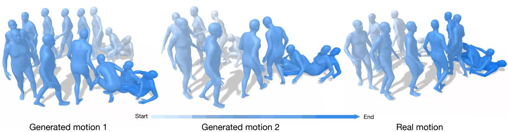
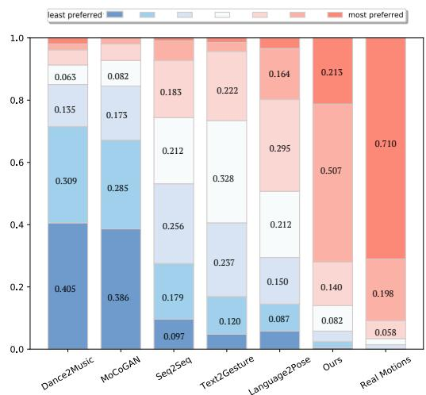

# Generating Diverse and Natural 3D Human Motions from Text

Chuan Guo

Shihao Zou

Xinxin Zuo

Sen Wang

Wei Ji

Xingyu Li

Li Cheng University of Alberta {cguo2, szou2,wji3,xingyu,lcheng5}@ualberta.ca

  
Figure 1. Taken as input the text description, “the figure rises from a lying position and walks in a counterclockwise circle, and then lays back down the ground”, our approach generates multiple distinct 3D human motions (e.g. the left and middle panels) that are faithful to the prescribed textual content. The real motion is also presented at the right panel for reference.

## Abstract

Automated generation of 3D human motions from text is a challenging problem. The generated motions are expected to be sufficiently diverse to explore the text-grounded motion space, and more importantly, accurately depicting the content in prescribed text descriptions. Here we tackle this problem with a two-stage approach: text2length sampling and text2motion generation. Text2length involves sampling from the learned distribution function of motion lengths conditioned on the input text. This is followed by our text2motion module using temporal variational autoencoder to synthesize a diverse set of human motions of the sampled lengths. Instead of directly engaging with pose sequences, we propose motion snippet code as our internal motion representation, which captures local semantic motion contexts and is empirically shown tofacilitate the generation ofplausible motionsfaithful to the input text. Moreover, a large-scale dataset of scripted 3D Human motions, HumanML3D, is constructed, consisting of 14,616 motion clips and 44,970 text descriptions.

## 1. Introduction

Given a short textual description of a character’s movement as for example, an excerpt from a novel or a script, we are capable of visualizing the motions in our minds or even in drawings. The question is, how to automate this process by a machine, or in paraphrase, to generate realistic 3D human motions from text? This is the problem we tackle with in this paper. As illustrated in Fig. 1, given the input feed of “thefigure risesfrom a lying position and walks in a counterclockwise circle, and then lays back down the ground”, our goal is to generate a diverse set of plausible 3D human motion dynamics following precisely the action types, directions, speeds, timing and styles as prescribed by the text.This automation process could bring a broad range of application impacts in AR/VR content creation, gaming, robotics, and human-machine interaction, to name a few.

Meanwhile, existing efforts in generating 3D human motions from descriptions [1, 4, 21, 32, 44] are sporadic and the results are far from being satisfactory. Several common shortfalls are observed: the input text is usually one short sentence; the task is invariably formulated as deterministic sequence-to-sequence generation, with the synthesized motions tending to be stationary and lifeless; moreover, the generated motions are restricted to have the same length; finally, the sole dataset relied on by existing methods, KIT Motion-Language (KIT-ML) [31], consists of only 3,010 motion sequences focusing on locomotion actions. In particular, there are three inherit challenges yet to be addressed.

First, motions generated from text by the same model are expected to possess variable lengths. Second, there are usually multiple ways for a character to behave following the same textual description. Third, from natural language perspective, the input descriptions may have a wide range of forms, from being short & simple to very long & complex.

To address the aforementioned shortfalls and challenges, we propose a two-stage pipeline consisting of text2length sampling and text2motion generation. Text2length estimates the distribution function of visual motion length grounded on the input text. The role of text2motion is to generate distinct 3D motions from the input text and the sampled motion length; this is realized by engaging the temporal variational autoencoder (VAE) framework in its triplet form of prior, posterior, and generator networks; moreover, motion snippet code is introduced as the internal representation in VAE code and throughout our pipeline to characterize the temporal motion semantics, with its role empirically examined in later ablation studies. Finally, a dedicated dataset (HumanML3D) is constructed, consisting of 44,970 textual descriptions for 14,616 3D human motions. It covers a wide range of action types including but not limited to locomotive actions. Empirical evaluations on both HumanML3D and KIT-ML datasets demonstrate the superior performance of our approach over existing methods.

Our key contributions are summarized as follows. First, our work is to our knowledge the first in stochastically generating 3D motions from text, capable of generating diverse 3D human motions of variable lengths that are realisticlooking and faithful to the text input. Second, our approach is flexible to work with input text ranging from simple to complex forms. This is made possible by the text2length & text2motion modules, and the proposed motion snippet codes that are to be detailed in later sections. Finally, a large-scale human motion dataset is constructed. It contains a wide range of actions, with each motion sequence paired with three textual descriptions.

## 2. Related Work

3D Human Motion Generation. There are several prior efforts in synthesizing 2D or 3D human motions based on action category, or from modalities including audio and text. To be based on action category, an one-hot condition vector is often engaged in synthesizing pose sequences. In this space, [5, 43] both apply a two-stage generative adversarial network (GAN) framework to progressively extend the partial motion sequence with newly generated poses; the work of [45] instead models the spatiotemporal structures of human dynamics with a GCN-based GAN; meanwhile, VAE modelling and transformer architecture are promoted by [11, 12, 29] to incorporate temporal dependencies. In terms of audio signal input, as audio is temporally aligned with its motion output, a common strategy is to employ a temporal sliding-window in translating the acoustic feature representation (e.g. MFCC) to individual human poses using recurrent neural networks (RNNs). In [35], a Bi-Directional LSTM network is adopted to generate upper body gestures from speech input. Similar LSTM-type models are also examined by [34] to predict upper body dynamics from piano and violin recital audios, and in [36] to capture the music-to-dance mapping. Recent works start to address the stochastic nature of human dynamics grounded on audio signals. [17] employs a hybrid model of VAE and GAN to produce non-deterministic human dancing movements from music. The work of [14] further supports longterm music-to-dance generation with curriculum training.

Translating text description to human motion is an emerging topic. Prior efforts such as [10, 21, 32, 44] resort to classical encoder-decoder RNN models, while it is proposed in [1] to learn a joint embedding space between natural language and 3D human dynamics. [10] considers the hierarchical pose structure as well as utilizing a pose discriminator. These methods however bear undesirable issues, as being deterministic one-to-one processes with fixed motion length. In contrary, aiming at these issues, our learned model is shown capable of generating stochastic, one-to-many sequence mappings of variable lengths.

Video Generation, and Text-based Video Generation. On generating videos, deep generative models such as GANs and VAEs have been the most popular choice. For example, a recurrent structured GAN is presented in MoCo-GAN [38] to separately model stationary pixels and dynamic motions. This is followed by [37] to incorporate contrastive learning. [8] leverages a VAE with RNN architecture to stochastically predict future frames based on the historical video sequence, which is further extended in [42] to synthesize videos with prescribed start and end frames.

Text-to-video generation is relatively new. To address such task, GAN frameworks have been recruited in several efforts including [20] and [25]. This is followed by [6], where an attention mechanism is additionally engaged to align local video regions with words in text. Moreover, both short-time and long-term cross-domain attentive vectors are utilized in [24] as the inputs to a VAE framework.

Video Captioning. The topic of our work might be considered as an inverse problem of motion captioning or more broadly, video captioning. Thus it makes sense to also mention this line of research. Early efforts such as [16] often resort to predefined sentence templates containing handcrafted linguistic rules involving restricted categories of action and object. This has been fundamentally changed in the deep learning era, where we witness significant performance boosts by adopting a variety of powerful techniques including RNNs [30,40], transformer [18], attentive context modeling [41], memory network [28, 46], GANs [26], and reinforcement learning [19, 27].

  
Figure 2. Approach overview. (a) As a preprocessing step, a dedicated motion autoencoder is trained on our training motion data to encode a motion sequence into a stream of motion snippet codes, which then could be decoded back into motions. (b) Our training pipeline. Through text encoder, the attentive word features $\mathbf { \Psi } ( \mathbf { w } _ { a t t } )$ are used by VAE networks as illustrated in Fig. 3. The triplet structure of temporal VAE involving the prior, posterior, and generator networks is employed to process the motion snippet codes $( \mathbf { c } _ { s } )$ and the reconstructed ones $( \hat { \mathbf { c } } _ { s } ) .$ . This leads to the loss terms evaluating the reconstructed pose sequence $( \mathcal { L } _ { r e c } ^ { m o t } )$ and the reconstructed code sequence $( \mathcal { L } _ { r e c } ^ { c o d e } )$ ), respectively. Due to lack of space, some key ingredients are deferred to be presented in Fig. 3. (c) Our inference pipeline. From the input text, text2length module is activated to sample an intended motion length. Text features extracted through the text encoder are then fed to the prior network, yielding a prior distribution. Generator samples latent vectors from the prior distribution and produces a series of motion snippet codes $( \hat { \mathbf { c } } _ { s } ) .$ The pose sequence is finally obtained by decoding the snippet codes from the motion decoder pre-trained in (a).

Language and 3D Human Motion Data. KIT Motion-Language Dataset [31] is to date the only available dataset comprising both 3D human motions and their textual descriptions, which consists of 3,911 motion sequences & 6,278 sentences, and is focused on locomotion movements. Moreover, there are a number of existing datasets of 3D motion captured human motions, such as CMU Mocap [7], Human3.6M [15], MoVi [9] and BABEL [33], in the form of everyday actions and sports movements. However, none of them possesses language descriptions of the motions.

## 3. Our Approach

From a text description of M words, $X = ( x _ { 1 } , . . . , x _ { M } ) .$ our goal is to generate a 3D pose sequence, $\begin{array} { r l } { P } & { { } = } \end{array}$ $\left( \mathbf { p } _ { 1 } , . . . , \mathbf { p } _ { T ^ { \prime } } \right)$ , with its length $T ^ { \prime }$ determined at test time. As shown in Fig. 2, we start by a preprocessing step to train a motion autoencoder. This is followed by settling a reasonable motion length from text (Sec. 3.2), and subsequently synthesizing motions conditioned on the input text and the sampled motion length (Sec. 3.3), by introducing an internal motion representation – motion snippet codes (Sec. 3.1).

## 3.1. Motion Autoencoder

As the preprocessing step described in Fig. 2(a), an encoder E transforms the pose sequence $P = \left( \mathbf { p } _ { 1 } , . . . , \mathbf { p } _ { T ^ { \prime } } \right)$ to a motion snippet code sequence, $C _ { s } ~ = ~ \left( \mathbf { c } _ { s } ^ { 1 } , . . . , \mathbf { c } _ { s } ^ { T } \right)$ achieved by applying 1-D convolutions over temporal line; $\hat { P }$ is then reconstructed with a deconvolutional decoder, D. Mathematically, this process is formulated as

$$
C _ {s} = \mathrm{E} (P), \hat {P} = \mathrm{D} (C _ {s}).\tag{1}
$$

To avoid foot sliding, our decoder D additionally predict foot contacts at each frame which are not given to the encoder E. It is also necessary to constrain the snippet code values and the differences of consecutive codes to encourage sparsity and temporal smoothness. The final objective function becomes

$$
\mathcal {L} _ {E, D} = \sum_ {t ^ {\prime}} \| \hat {\mathbf {p}} _ {t ^ {\prime}} - \mathbf {p} _ {t ^ {\prime}} \| _ {1} + \lambda_ {s p r} \sum_ {t} \| \mathbf {c} _ {s} ^ {t} \| _ {1} + \lambda_ {s m t} \sum_ {t} \| \mathbf {c} _ {s} ^ {t} - \mathbf {c} _ {s} ^ {t - 1} \| _ {1}.\tag{2}
$$

The autoencoder consists of two-layer convolutions with filter size of 4 and stride 2, whose structure is detailed in supplementary file. As a result, a motion snippet code $\mathbf { c } _ { s } ^ { t }$ has a 8-frame receptive field, amounting to around 0.5 second for 20 frame-per-second (fps) pose streaming; it also leads to a more compact internal code sequence with $\begin{array} { r l } { T } & { { } = } & { \frac { T ^ { \prime } } { 4 } } \end{array}$ . Compared to individual poses, snippet code captures temporal semantic information that is crucial in smooth and faithful motion generation.

  
Figure 3. Structure of our temporal VAE for text2motion generation: (a) generator $\mathrm { F } _ { \theta } ^ { t } ,$ and (b) posterior network $\mathrm { F } _ { \phi } ^ { t }$ . Prior network $\mathrm { F } _ { \phi } ^ { t }$ has the same architecture as $\mathrm { F } _ { \phi } ^ { t }$ except different inputs.

## 3.2. Text2length Sampling

As shown in Fig. 2(c), the purpose of our text2length sampling module is to approximate the probability distribution of discrete motion length T conditioned on text, such that at inference stage, a discrete time length $T$ can be obtained by sampling from this learned distribution function, $p ( T | x _ { 1 } , . . . , x _ { M } )$ given an input text. This module thus enables our approach in generating motions of distinct lengths.

This is a typical density estimation problem with many practical options, among them we adopt the neural network scheme of pixelCNN [39]. Since a motion sequence is internally represented in our work as a series of snippet codes, our aim specifically boils to deciding the length of snippet codes. In inference, a text encoder extracts sentence-level features from the input text, which are then fed into an MLP layer with softmax activation, producing a multinomial distribution over discrete length indices $\{ 1 , 2 , . . . , T _ { m a x } \}$ . Here an increment of 1 corresponds to 4 pose frames, and setting $T _ { m a x } = 5 0$ corresponds to 200 frames, amounting to 10 seconds for a 20 fps video. Its training objective is defined by the cross entropy loss.

## 3.3. Text2motion Generation

Our text2motion generator contains a text encoder, and a temporal VAE model consisting a triplet networks of generator ${ \mathrm { ~ } } \operatorname { F } _ { \theta } .$ , posterior $\mathrm { F } _ { \phi }$ and prior $\mathrm { F } _ { \psi } ,$ , as in Fig. 2(b). The text encoder extracts both the word-level $\mathbf { w } _ { 1 : M }$ and sentencelevel s features from input text; our VAE generates motion snippet codes $\mathbf { c } _ { s } ^ { 1 : T }$ one by one with a recurrent architecture: at time t, our posterior network $\mathrm { F } _ { \phi }$ approximates the posterior distribution $q _ { \phi } \left( \mathbf { z } _ { t } | \mathbf { c } _ { s } ^ { 1 : t } , \mathbf { c } \right)$ conditioned on partial code sequence $\mathbf { c } _ { s } ^ { 1 : t }$ as well as word and sentence features $\mathbf { c } ~ = ~ ( \mathbf { w } _ { 1 : M } , \mathbf { s } , \ldots )$ . Instead of relating the posterior distribution to a prior normal distribution $\mathsf { \bar { N } } ( 0 , \bar { I } )$ as used by the literature, here it is related to a learned prior distribution $p _ { \psi } ( \mathbf { z } _ { t } | \mathbf { c } _ { s } ^ { 1 : t - 1 } , \mathbf { c } )$ , which is obtained by our prior network $\mathrm { F } _ { \psi }$ , based on the previous state $\mathbf { c } _ { s } ^ { 1 : t - \bar { 1 } }$ and conditions c. Overall, our VAE is trained by maximizing the following variational lower bound,

$$
\begin{array}{l} \log p (C _ {s}) \geq \sum_ {t = 1} ^ {T} \left[ \mathbb {E} _ {q _ {\phi} (\mathbf {z} _ {t} | \mathbf {c} _ {s} ^ {1: t}, \mathbf {c})} \log p _ {\theta} (\mathbf {c} _ {s} ^ {t} | \mathbf {c} _ {s} ^ {1: t - 1}, \mathbf {z} _ {1: t}, \mathbf {c}) \right. \\ \left. - \lambda_ {K L} D _ {\mathrm{KL}} \left(q _ {\phi} (\mathbf {z} _ {t} | \mathbf {c} _ {s} ^ {1: t}, \mathbf {c}) \| p _ {\psi} (\mathbf {z} _ {t} | \mathbf {c} _ {s} ^ {1: t - 1}, \mathbf {c})\right) \right]. \end{array}\tag{3}
$$

The first term is to reduce reconstruction error $\mathcal { L } _ { r e c } { , }$ , while the second term penalizes the KL-divergence $\mathcal { L } _ { K L }$ between the posterior and the prior distributions.

Text Encoder. In addition to the word embeddings, we propose to incorporate the part-of-speech (POS) tags of words into text encoder. POS tag explicitly indicates the word categories, thus facilitates the localization of important words in a sentence. Furthermore, as in Fig. 2(b), an external dictionary is manually constructed to collect motion-related words and categorize them into four types: direction, body part, object and action. These one-hot word tags are fed into an embedding layer and added to word embedding vectors. Our text encoder is realized in the form of bidirectional GRUs, which take these embedding vectors as inputs and produces both sentence feature s and word features $\mathbb { W } 1 { : } M$ .The former provides global contextual information and is used to initialize the hidden units of VAE; the latter serves as partial inputs at each time step in the form of local word attention, to be discussed next. The practical structure of text encoder is detailed in supplementary file.

Local Word Attention $( \mathrm { F } _ { a t t } )$ . Attentions assigned to each word may vary in the process of predicting motions from text. This is addressed by our local word attention unit $\mathrm { F } _ { a t t }$ that engages and interacts word features $\mathrm { w } _ { 1 : M }$ with motion context memory hθ (i.e. generator hidden unit) as depicted in Fig. 3. The process of local word attention can be described as

$$
\begin{array}{c} \mathbf {Q} = \mathbf {h} _ {\theta} ^ {t - 1} \mathbf {W} ^ {Q}, \mathbf {K} = \mathbf {w} _ {1: M} \mathbf {W} ^ {K}, \mathbf {V} = \mathbf {w} _ {1: M} \mathbf {W} ^ {V}, \\ \mathbf {w} _ {a t t} ^ {t} = \text {softmax} \left(\frac {\mathbf {Q K} ^ {T}}{\sqrt {d _ {a t t}}}\right) \mathbf {V}, \end{array}\tag{4}
$$

where $\mathbf { W } ^ { K } , \mathbf { W } ^ { V } \in \mathbb { R } ^ { d _ { w } \times d _ { a t t } }$ and $\mathbf { W } ^ { Q } \in \mathbb { R } ^ { d _ { h } \times d _ { a t t } }$ are trainable weights, with $d _ { h } , d _ { w }$ and $d _ { a t t }$ the number of channels in generator hidden unit $\mathbf { h } _ { \theta } ^ { t - 1 }$ , word features $\mathrm { w } _ { 1 : M }$ and attentive layer respectively. $\mathbf { w } _ { a t t } ^ { t }$ is the multi-modal attentive vector obtained as time t.

Time-to-Arrival Positional Encoding. In generating motions of variable lengths, it is important to aware where we are and howfar to go. This motivates us to encode the timeto-arrival information T−t with positional encoding at each time step, as in Fig. 3. It is formulated as

$$
\begin{array}{c} \mathrm{PE} _ {T - t, 2 i} = \sin \left(\frac {T - t}{1 0 0 0 0 ^ {\frac {2 i}{d}}}\right), \\ \mathrm{PE} _ {T - t, 2 i + 1} = \cos \left(\frac {T - t}{1 0 0 0 0 ^ {\frac {2 i}{d}}}\right), \end{array}\tag{5}
$$

where the second subscript of the vector PE denotes the dimension index; d is the dimensionality of input embedding. Architecture of Temporal VAE. Fig. 2(b) illustrates the overall architecture of our temporal VAE for text2motion generation; this is followed by Fig. 3, which brings a zoomin view of the generator and posterior network structures.

At time t, word features first interacts with generator memory unit $h _ { \theta } ^ { t - 1 }$ to yield the attentive vector $\mathbf { w } _ { a t t } ^ { t } .$ . Now concatenating the present and previous snippet codes $( \mathbf { c } _ { s } ^ { t }$ & $\mathbf { c } _ { s } ^ { t - 1 } )$ , and the attentive vector $\mathbf { w } _ { a t t } ^ { t }$ to form an input vector, which is fed into a multi-layer perceptron (MLP); its output is summed with time-to-arrival positional encoding $\mathrm { P E } _ { T - t } ,$ which then passes through a GRU layer to produce the posterior distribution $\mathcal { N } ( \mu _ { \phi } ( t ) , \sigma _ { \phi } ( t ) )$ . Yielding prior distribution $\mathcal { N } ( \mu _ { \psi } ( t ) , \sigma _ { \psi } ( t ) )$ follows the same process, except not taking $\mathbf { c } _ { s } ^ { t }$ as input. In training, the generator learns to reconstruct current snippet code $\hat { \mathbf { c } } _ { s } ^ { t }$ from the input of $\mathbf { c } _ { s } ^ { t - 1 }$ $\mathbf { w } _ { a t t } ^ { t } .$ , and a noise vector $\mathbf { z } _ { t }$ sampled from the posterior distribution. In testing, as the $\mathbf { c } _ { s } ^ { t }$ from real data is unavailable, $\mathbf { z } _ { t }$ is instead sampled from the estimated prior distribution $p _ { \psi } ( \mathbf { z } _ { t } | \mathbf { c } _ { s } ^ { 1 : t - 1 }$ , c) (Fig. 2(c)). Finally, the output pose sequence $\hat { \bf p } _ { 1 : T ^ { \prime } }$ is produced by decoding the internal snippet code sequence $\mathbf { c } _ { s } ^ { 1 : T }$ with the pre-trained motion decoder D (Sec. 3.1). In text2motion, motion decoder D is fine-tuned with the rest networks. Detailed structure of networks are provided in the supplementary file.

Final Objective. Our final objective function for text2motion generation becomes

$$
\begin{array}{c} \mathcal {L} = \mathcal {L} _ {r e c} ^ {c o d e} + \lambda_ {m o t} \mathcal {L} _ {r e c} ^ {m o t} + \lambda_ {K L} \mathcal {L} _ {K L}, \quad \text { with } \\ \mathcal {L} _ {r e c} ^ {c o d e} = \sum_ {t} \| \hat {\mathbf {c}} _ {s} ^ {t} - \mathbf {c} _ {s} ^ {t} \| _ {1}, \\ \mathcal {L} _ {r e c} ^ {m o t} = \sum_ {t ^ {\prime}} \| \hat {\mathbf {p}} _ {t ^ {\prime}} - \mathbf {p} _ {t ^ {\prime}} \| _ {1}, \\ \mathcal {L} _ {K L} = \sum_ {t} \mathrm{KL} (\mathcal {N} (\mu_ {\phi} (t), \sigma_ {\phi} (t)) \| \mathcal {N} (\mu_ {\psi} (t), \sigma_ {\psi} (t))) \end{array}\tag{6}
$$

Training Scheme. To address the variable length sequenceto-sequence generation task, our training process utilizes both curriculum learning [3] and scheduled sampling [2] strategies, as follows. Starting from aiming to generate first $T _ { c u r }$ snippet codes in sequence, we optimize our model on training data that owns snippet code lengths equal or longer than $T _ { c u r }$ . As long as the reconstruction loss on the validation starts raising, then we move on to the next stage by appending one more snippet code in the target sequence ; the complexity of the task is progressively increased at every stage till the maximum time step $T _ { m a x }$ of prediction is reached (i.e, $T _ { c u r } = T _ { m a x } )$ . In addition, to bridge the gap of training and inference for sequence prediction, teacher forcing is applied for the entire target snippet code sequence $\mathbf { c } _ { s } ^ { 1 : T }$ with probability of $p _ { t f }$ , which means the ground-truth snippet code is taken as input for the generation at next step.

<table><tr><td>Dataset</td><td>#Motions</td><td>#texts</td><td>Duration</td><td>Vocab.</td></tr><tr><td>HumanML3D</td><td>14,616</td><td>44,970</td><td>28.59h</td><td>5,371</td></tr><tr><td>KIT-ML [31]</td><td>3,911</td><td>6,278</td><td>10.33h</td><td>1,623</td></tr></table>

Table 1. Comparisons of 3D human motion-language datasets.

Accordingly, the generated snippet code will instead serve as the input with probability $1 - p _ { t f }$ . As a boundary condition, $\mathbf { c } _ { s } ^ { 0 }$ is a constant vector that encodes mean poses using motion encoder E.

## 4. Our HumanML3D Dataset

Our HumanML3D dataset originates from a amalgamation of motion sequences from the HumanAct12 [12] and AMASS [23] datasets, two large-scale datasets of 3D human motion captures that are publicly accessible. They contains motions from a variety of human actions, such as daily activities (e.g., ’walking’, ’jumping’), sports (e.g, ’swimming’, ’karate’), acrobatics (e.g, ’cartwheel’) and artistry (e.g, ’dancing’). Unfortunately, these datasets come without textual descriptions of the motions.

Several processing steps take place for data normalization, as follows. Motions are scaled to 20 FPS, and those longer than 10 seconds are randomly cropped to 10-second ones; they are then retargeted to a default human skeletal template and properly rotated to face $Z +$ direction initially. This is followed by a textual annotation process via the Amazon Mechanical Turk (AMT), where native Englishspeaking turkers with average work approval rating above 92% are hired and asked to describe a motion with at least 5 words. We collect 3 text descriptions for each motion clip from distinct workers. A manual postprocessing step ensues to filter away abnormal textual descriptions.

As a result, our HumanML3D dataset becomes to our knowledge the largest and most diverse collection of scripted human motions, consisting of 14,616 motions and 44,970 descriptions composed by 5,371 distinct words. The total length of motions amounts to 28.59 hours, in which the average motion length is 7.1 seconds. The minimum and maximum duration are 2s and 10s respectively. In terms of the textual descriptions, their average and median lengths are 12 and 10, respectively. A tabular comparison of our HumanML3D versus the only existing motion-text dataset, KIT Motion-Language [31] is presented in Table 1.

## 5. Experiments

Empirical evaluations are carried on both the in-house HumanML3D and KIT-ML [31] datasets. We augment both datasets by mirroring motions and properly replacing certain keywords in the descriptions (e.g. ’left’→ ’right’). Both datasets are split to training, test and validation sets with 0.8 : 0.15 : 0.05 ratio. In training, all motions are trimmed such that numbers of frames are multiples of 4. We apply the same pose processing steps as in [13].

<table><tr><td rowspan="2">Methods</td><td colspan="3">R Precision↑</td><td rowspan="2">FID↓</td><td rowspan="2">MultiModal Dist↓</td><td rowspan="2">Diversity→</td><td rowspan="2">MultiModality↑</td></tr><tr><td>Top 1</td><td>Top 2</td><td>Top 3</td></tr><tr><td>Real motions</td><td> $0.511^{\pm .003}$ </td><td> $0.703^{\pm .003}$ </td><td> $0.797^{\pm .002}$ </td><td> $0.002^{\pm .000}$ </td><td> $2.974^{\pm .008}$ </td><td> $9.503^{\pm .065}$ </td><td>-</td></tr><tr><td>Seq2Seq [21]</td><td> $0.180^{\pm .002}$ </td><td> $0.300^{\pm .002}$ </td><td> $0.396^{\pm .002}$ </td><td> $11.75^{\pm .035}$ </td><td> $5.529^{\pm .007}$ </td><td> $6.223^{\pm .061}$ </td><td>-</td></tr><tr><td>Language2Pose [1]</td><td> $0.246^{\pm .002}$ </td><td> $0.387^{\pm .002}$ </td><td> $0.486^{\pm .002}$ </td><td> $11.02^{\pm .046}$ </td><td> $5.296^{\pm .008}$ </td><td> $7.676^{\pm .058}$ </td><td>-</td></tr><tr><td>Text2Gesture [4]</td><td> $0.165^{\pm .001}$ </td><td> $0.267^{\pm .002}$ </td><td> $0.345^{\pm .002}$ </td><td> $7.664^{\pm .030}$ </td><td> $6.030^{\pm .008}$ </td><td> $6.409^{\pm .071}$ </td><td>-</td></tr><tr><td>MoCoGAN [38]</td><td> $0.037^{\pm .000}$ </td><td> $0.072^{\pm .001}$ </td><td> $0.106^{\pm .001}$ </td><td> $94.41^{\pm .021}$ </td><td> $9.643^{\pm .006}$ </td><td> $0.462^{\pm .008}$ </td><td> $0.019^{\pm .000}$ </td></tr><tr><td>Dance2Music [17]</td><td> $0.033^{\pm .000}$ </td><td> $0.065^{\pm .001}$ </td><td> $0.097^{\pm .001}$ </td><td> $66.98^{\pm .016}$ </td><td> $8.116^{\pm .006}$ </td><td> $0.725^{\pm .011}$ </td><td> $0.043^{\pm .001}$ </td></tr><tr><td>Ours w/ real length</td><td> $0.457^{\pm .002}$ </td><td> $0.639^{\pm .003}$ </td><td> $0.740^{\pm .003}$ </td><td> $1.067^{\pm .002}$ </td><td> $3.340^{\pm .008}$ </td><td> $9.188^{\pm .002}$ </td><td> $2.090^{\pm .083}$ </td></tr><tr><td>Ours</td><td> $0.455^{\pm .003}$ </td><td> $0.636^{\pm .003}$ </td><td> $0.736^{\pm .002}$ </td><td> $1.087^{\pm .021}$ </td><td> $3.347^{\pm .008}$ </td><td> $9.175^{\pm .083}$ </td><td> $2.219^{\pm .074}$ </td></tr></table>

Table 2. Quantitative evaluation on the HumanML3D test set. All baselines directly use real motion lengths, while our approach (Ours) instead resorts to the sequence length sampled from the text2length module. ± indicates 95% confidence interval, and → means the closer to Real motions the better. Bold face indicates the best result, while underscore refers to the second best.

<table><tr><td rowspan="2">Methods</td><td colspan="3">R Precision↑</td><td rowspan="2">FID↓</td><td rowspan="2">MultiModal Dist↓</td><td rowspan="2">Diversity→</td><td rowspan="2">MultiModality↑</td></tr><tr><td>Top 1</td><td>Top 2</td><td>Top 3</td></tr><tr><td>Real motions</td><td> $0.424^{\pm .005}$ </td><td> $0.649^{\pm .006}$ </td><td> $0.779^{\pm .006}$ </td><td> $0.031^{\pm .004}$ </td><td> $2.788^{\pm .012}$ </td><td> $11.08^{\pm .097}$ </td><td>-</td></tr><tr><td>Seq2Seq [21]</td><td> $0.103^{\pm .003}$ </td><td> $0.178^{\pm .005}$ </td><td> $0.241^{\pm .006}$ </td><td> $24.86^{\pm .348}$ </td><td> $7.960^{\pm .031}$ </td><td> $6.744^{\pm .106}$ </td><td>-</td></tr><tr><td>Language2Pose [1]</td><td> $0.221^{\pm .005}$ </td><td> $0.373^{\pm .004}$ </td><td> $0.483^{\pm .005}$ </td><td> $6.545^{\pm .072}$ </td><td> $5.147^{\pm .030}$ </td><td> $9.073^{\pm .100}$ </td><td>-</td></tr><tr><td>Text2Gesture [4]</td><td> $0.156^{\pm .004}$ </td><td> $0.255^{\pm .004}$ </td><td> $0.338^{\pm .005}$ </td><td> $12.12^{\pm .183}$ </td><td> $6.964^{\pm .029}$ </td><td> $9.334^{\pm .079}$ </td><td>-</td></tr><tr><td>MoCoGAN [38]</td><td> $0.022^{\pm .002}$ </td><td> $0.042^{\pm .003}$ </td><td> $0.063^{\pm .003}$ </td><td> $82.69^{\pm .242}$ </td><td> $10.47^{\pm .012}$ </td><td> $3.091^{\pm .043}$ </td><td> $0.250^{\pm .009}$ </td></tr><tr><td>Dance2Music [17]</td><td> $0.031^{\pm .002}$ </td><td> $0.058^{\pm .002}$ </td><td> $0.086^{\pm .003}$ </td><td> $115.4^{\pm .240}$ </td><td> $10.40^{\pm .016}$ </td><td> $0.241^{\pm .004}$ </td><td> $0.062^{\pm .002}$ </td></tr><tr><td>Ours w/ real length</td><td> $0.370^{\pm .005}$ </td><td> $0.569^{\pm .007}$ </td><td> $0.693^{\pm .007}$ </td><td> $2.770^{\pm .109}$ </td><td> $3.401^{\pm .008}$ </td><td> $10.91^{\pm .119}$ </td><td> $1.482^{\pm .065}$ </td></tr><tr><td>Ours</td><td> $0.361^{\pm .006}$ </td><td> $0.559^{\pm .007}$ </td><td> $0.681^{\pm .007}$ </td><td> $3.022^{\pm .107}$ </td><td> $3.488^{\pm .028}$ </td><td> $10.72^{\pm .145}$ </td><td> $2.052^{\pm .107}$ </td></tr></table>

Table 3. Quantitative evaluation on the KIT-ML test set. All baselines directly use real motion lengths, while our approach (Ours) instead resorts to the sequence length sampled from the text2length module. ± indicates 95% confidence interval, and → means the closer to the real motion the better.

Pose Representation. A pose p in our work is defined by a tuple of $( \dot { r } ^ { a } , \dot { r } ^ { x } , \dot { r } ^ { z } , r ^ { y } , \mathbf { j } ^ { p } , \mathbf { j } ^ { v } , \mathbf { j } ^ { r } , \mathbf { c } ^ { f } )$ , where $\therefore a \in$ R is root angular velocity along Y-axis; $( \dot { r } ^ { x } , \dot { r } ^ { z } \in \mathbb { R } )$ are root linear velocities on XZ-plane; $r ^ { y } \in \mathbb { R }$ is root height; $\mathbf { j } ^ { p } \in \mathbb { R } ^ { 3 j } , \mathbf { j } ^ { v } \in \mathbb { R } ^ { 3 j }$ and $\mathbf { j } ^ { r } \in \mathbb { R } ^ { 6 j }$ are the local joints positions, velocities and rotations in root space, with j denoting the number of joints; $\mathbf { c } ^ { f } \in \mathbb { R } ^ { 4 }$ is binary features obtained by thresholding the heel and toe joint velocities to emphasize the foot ground contacts. In particular, the 6D continuous rotation representation of [47] is adopted. Motions in HumanML3D dataset follows the skeleton structure of SMPL [22] with 22 joints. Poses have 21 joints in KIT-ML. Implementation details are provided in appendix file.

## 5.1. Experiment Results

cific textual and motion feature extractor are relegated to the supplementary file due to space limit. In addition, the R-precision and MultiModal distance are proposed in this work as complementary metrics, as follows. Consider Rprecision: for each generated motion, its ground-truth text description and 31 randomly selected mismatched descriptions from the test set form a description pool. This is followed by calculating and ranking the Euclidean distances between the motion feature and the text feature of each description in the pool. We then count the average accuracy at top-1, top-2 and top-3 places. The ground truth entry falling into the top-k candidates is treated as successful retrieval, otherwise it fails. Meanwhile, MultiModal distance is computed as the average Euclidean distance between the motion feature of each generated motion and the text feature of its corresponding description in test set.

## 5.1.1 Evaluation Metrics and Baselines

Evaluation Metrics from [12] are adopted here, which include Frechet Inception Distance (FID), diversity and multimodality. For quantitative evaluation, a motion feature extractor and text feature extractor is trained under contrastive loss to produce geometrically close feature vectors for matched text-motion pairs, and vice versa. Further explanations of aforementioned metrics as well as the spe-

Baseline Methods. We compare our work to three stateof-the-art methods: Seq2Seq [21], Language2Pose [1] and Text2Gesture [4]. As with all existing methods, they are deterministic methods. Considering the stochastic nature of our task, we adapt two non-deterministic methods from related fields for more fair and thorough evaluations: MoCo-GAN [38] and Dance2Music [17]. The former is widely used for conditioned video synthesis, and the latter produces 2D dancing motion sequences from audio signals. Proper changes are made to allow these methods generat-

Figure 4. Visual results of our approach vs. those of Language2Pose [1]. Given each input description, we show two generated motions from our approach, and one motion from Language2Pose (since it is a deterministic method). As our generated motions are of variable length, only key frames from each sequence are displayed. The complete clips are in the demo video. More results are in the supplementary file.  
  
Figure 5. Quantitative evaluation of user preference among the generated motions. For each comparison method, a color bar (from blue to red) indicates the percentage of its preference levels (from least to most preferred).

ing 3D motions from text.

## 5.1.2 Quantitative Evaluation

Table 2 and Table 3 present the quantitative results on HumanML3D and KIT-ML datasets, respectively. For fair comparison, each experiment is repeated 20 times, and a statistical interval with 95% confidence is reported. Since all baseline methods directly use the ground-truth motion length in generating a new motion, for fair comparison, we also consider a variant of our approach by removing the text2length sampling module (i.e. ours w/ real length).

The high R precision of real motions evidences the reliability of the proposed R-precision metric, which sets a upper performance limit for all methods. Overall, we have the following observations from Table 2 and Table 3. First, our approach clearly outperform all comparison methods by a significant margin, over all metrics and on both datasets. Seq2Seq [21] and Text2Gesture [4] directly map textual data to human dynamics by their neural machine translation architecture of encoder-decoder and transformer; they however find difficulty in retaining the sense of realistic motions during their processes. This results in low motion-based text retrieval precision, and high FID values. Language2Pose [1] performs better on generation quality by incorporating a co-embedding space, yet the results are very far from real motions. The motions generated by non-deterministic methods of MoCoGAN [38] and Dance2Music [36] are unfortunately of severely low quality, as manifested by their low diversity and multimodality scores – a result of being unfaithful to the input text. On the contrary, the variant of our approach directly using real motion length (Ours w/ real length) achieves the optimal performance on almost all metrics. Our default approach that uses text2length sampling (Ours) possesses a comparable performance in R-precision and FID scores, yet it is more capable of synthesizing diverse motions, as reflected especially in the diversity & multimodality scores.

User Study In addition to the aforementioned objective evaluations, a Crowd-sourced subjective evaluation via Amazon Mechanical Turk is conducted concerning the visual perceptual quality of the generated motions. For each comparison method, motions are generated using 50 descriptions randomly selected from the test set. For each description, the results of different methods are shown to 5 AMT users, who are asked to rank their preference over these motions based on the motion realism and the magnitude they are aligned to the intended text descriptions. Only AMT users with master recognition are considered.

<table><tr><td rowspan="2">Methods</td><td colspan="3">R Precision↑</td><td rowspan="2">FID↓</td></tr><tr><td>Top 1</td><td>Top 2</td><td>Top 3</td></tr><tr><td>Ours</td><td> $0.455^{\pm .003}$ </td><td> $0.636^{\pm .003}$ </td><td> $0.736^{\pm .002}$ </td><td> $1.087^{\pm .021}$ </td></tr><tr><td>w/o SnC</td><td> $0.370^{\pm .002}$ </td><td> $0.538^{\pm .003}$ </td><td> $0.642^{\pm .003}$ </td><td> $1.200^{\pm .027}$ </td></tr><tr><td>w/o Att</td><td> $0.396^{\pm .002}$ </td><td> $0.570^{\pm .002}$ </td><td> $0.674^{\pm .003}$ </td><td> $1.833^{\pm .032}$ </td></tr><tr><td>w/o PoS</td><td> $0.443^{\pm .003}$ </td><td> $0.622^{\pm .003}$ </td><td> $0.723^{\pm .003}$ </td><td> $1.157^{\pm .016}$ </td></tr><tr><td>w/o PoE</td><td> $0.444^{\pm .005}$ </td><td> $0.627^{\pm .003}$ </td><td> $0.729^{\pm .002}$ </td><td> $1.229^{\pm .020}$ </td></tr></table>

Table 4. Ablation study on the HumanML3D dataset, with SnC denoting motion snippet code, Att the local word attention, PoS the Part-of-Speech tag, and PoE the Positional Encoding.

The preference results are shown in Fig. 5. Overall our approach is most preferred by the users; meanwhile, two non-deterministic methods are least preferred, as their motions exhibit severely distortions; Seq2Seq and Text2Gesture gain comparably more positive scores from users; Language2Pose becomes the second most preferred. Moreover, a significant portion (around 72%) of motions generated by our approach are considered at top-2 by users, i.e. being on par with or only next to the real human motions. This user study brings strong evidence of our approach capable of synthesizing visually realistic motions.

## 5.1.3 Qualitative Evaluation

Fig. 4 displays qualitative comparisons of our approach vs. Language2Pose [1], the best-performing baseline. Motions from other comparison methods are too distorted to be rendered with the SMPL human shapes [22]. Language2Pose sometimes captures partial concepts (e.g., sit down) in the input text. It however fails to understand the global textual information. Moreover, the generated motions tend to be frozen after a short while. In contrast, our approach is capable of generating visually appealing motions which accurately reflect the fine details in text descriptions, in terms of the gesture, actions, body parts and timing. Furthermore, from the same input text, our generated motions are sufficiently diverse. More results are presented in the appendix.

## 5.1.4 Ablation Analysis, Text2length Results, Failure Cases and Limitations

Table 4 quantifies the effects of different components in our approach on HumanML3D dataset. A sharp drop of performance is observed when snippet code (i.e. SnC) or word attentions (i.e. Att) is removed, with a decreasing R-Precision of over 6%. On the contrary, the influence of positional encoding (i.e. PoE) and part-of-speech (i.e. POS) are relatively less significant, given a drop of R-precision around 2%. In Fig. 6, a visual comparison of synthesized motions from ours, ours w/o SnC, and ours w/o Att from the same input text is shown. While snippet codes are not

A man is bent on the ground appears to be tying his shoe then stands up and bring his right hand to his face.

  
Figure 6. Visual comparison of motion results generated by ours, ours w/o SnC, and our w/o Att, all provided with the same description. Refer to supplementary file for more examples.

applied, the resulting motion appears to be visually plausible and context-aware at the beginning; it however fails to faithfully follow the text description as time goes on. This may be attributed to the lack of characterization in temporal dependencies. Similar phenomenon is observed in motions from ours w/o word attentions. On the other hand, the result of our approach aligns sufficiently with the textual concepts throughout. Due to space limit, we relegate further ablation results to the supplementary video, the empirical results of the learned length distribution by text2length, failure cases and discussion of limitations to the supplementary file.

## 6. Conclusion and Outlook

Our paper looks into an emerging research problem of generating 3D human motions grounded on natural language descriptions, where we especially emphasize on diverse and natural motion generation. It leads to our twostage pipeline, where the text2length module sampled from the estimated motion length distribution given text description; the text2motion module generates motions of sampled motion length from input text, accomplished by our temporal VAE. A large-scale human motion-language dataset is constructed, with the expectation of facilitating the development and evaluation of new methods in the community. Extensive quantitative and qualitative experiments demonstrate the effectiveness of our approach. Future plan includes investigation of ways to simplify the set of evaluation metrics, and the inverse way of our task, motion captioning.

## ACKNOWLEDGEMENTS

This research was partly supported by the University of Alberta Start-up Grant, the UAHJIC Grants, and the NSERC Discovery Grants (No. RGPIN-2019-04575)

## References

[1] Chaitanya Ahuja and Louis-Philippe Morency. Language2pose: Natural language grounded pose forecasting. In International Conference on 3D Vision (3DV), pages 719– 728. IEEE, 2019. 1, 2, 6, 7, 8

[2] Samy Bengio, Oriol Vinyals, Navdeep Jaitly, and Noam Shazeer. Scheduled sampling for sequence prediction with recurrent neural networks. page 1171–1179, 2015. 5

[3] Yoshua Bengio, Jer´ ome Louradour, Ronan Collobert, and Ja-ˆ son Weston. Curriculum learning. In Proceedings of the 26th annual International Conference on Machine Learning, pages 41–48, 2009. 5

[4] Uttaran Bhattacharya, Nicholas Rewkowski, Abhishek Banerjee, Pooja Guhan, Aniket Bera, and Dinesh Manocha. Text2gestures: A transformer-based network for generating emotive body gestures for virtual agents. In IEEE Virtual Reality and 3D User Interfaces (VR), pages 1–10. IEEE, 2021. 1, 6, 7

[5] Haoye Cai, Chunyan Bai, Yu-Wing Tai, and Chi-Keung Tang. Deep video generation, prediction and completion of human action sequences. In Proceedings of the European Conference on Computer Vision (ECCV), pages 366–382, 2018. 2

[6] Qi Chen, Qi Wu, Jian Chen, Qingyao Wu, Anton van den Hengel, and Mingkui Tan. Scripted video generation with a bottom-up generative adversarial network. IEEE Transactions on Image Processing, 29:7454–7467, 2020. 2

[7] CMU. Cmu graphics lab motion capture database. 2003. 3

[8] Emily Denton and Rob Fergus. Stochastic video generation with a learned prior. In International Conference on Machine Learning, pages 1174–1183. PMLR, 2018. 2

[9] Saeed Ghorbani, Kimia Mahdaviani, Anne Thaler, Konrad Kording, Douglas James Cook, Gunnar Blohm, and Nikolaus F Troje. Movi: A large multipurpose motion and video dataset. arXiv preprint arXiv:2003.01888, 2020. 3

[10] Anindita Ghosh, Noshaba Cheema, Cennet Oguz, Christian Theobalt, and Philipp Slusallek. Synthesis of compositional animations from textual descriptions. arXiv preprint arXiv:2103.14675, 2021. 2

[11] Chuan Guo, Xinxin Zuo, Sen Wang, Xinshuang Liu, Shihao Zou, Minglun Gong, and Li Cheng. Action2video: Generating videos of human 3d actions. International Journal of Computer Vision, pages 1–31, 2022. 2

[12] Chuan Guo, Xinxin Zuo, Sen Wang, Shihao Zou, Qingyao Sun, Annan Deng, Minglun Gong, and Li Cheng. Action2motion: Conditioned generation of 3d human motions. In Proceedings of the 28th ACM International Conference on Multimedia, pages 2021–2029, 2020. 2, 5, 6

[13] Daniel Holden, Taku Komura, and Jun Saito. Phasefunctioned neural networks for character control. ACM Transactions on Graphics (TOG), 36(4):1–13, 2017. 6

[14] Ruozi Huang, Huang Hu, Wei Wu, Kei Sawada, Mi Zhang, and Daxin Jiang. Dance revolution: Long-term dance generation with music via curriculum learning. In International Conference on Learning Representations (ICLR), 2021. 2

[15] Catalin Ionescu, Dragos Papava, Vlad Olaru, and Cristian Sminchisescu. Human3. 6m: Large scale datasets and pre-

dictive methods for 3d human sensing in natural environments. IEEE transactions on pattern analysis and machine intelligence, 36(7):1325–1339, 2013. 3

[16] Atsuhiro Kojima, Takeshi Tamura, and Kunio Fukunaga. Natural language description of human activities from video images based on concept hierarchy of actions. International Journal ofComputer Vision, 50(2):171–184, 2002. 2

[17] Hsin-Ying Lee, Xiaodong Yang, Ming-Yu Liu, Ting-Chun Wang, Yu-Ding Lu, Ming-Hsuan Yang, and Jan Kautz. Dancing to music. In Proceedings of the 33rd International Conference on Neural Information Processing Systems, 2019. 2, 6

[18] Jie Lei, Liwei Wang, Yelong Shen, Dong Yu, Tamara L Berg, and Mohit Bansal. Mart: Memory-augmented recurrent transformer for coherent video paragraph captioning. arXiv preprint arXiv:2005.05402, 2020. 2

[19] Lijun Li and Boqing Gong. End-to-end video captioning with multitask reinforcement learning. In 2019 IEEE Winter Conference on Applications of Computer Vision (WACV), pages 339–348. IEEE, 2019. 2

[20] Yitong Li, Martin Min, Dinghan Shen, David Carlson, and Lawrence Carin. Video generation from text. In Proceedings ofthe AAAI Conference on Artificial Intelligence, volume 32, 2018. 2

[21] Angela S Lin, Lemeng Wu, Rodolfo Corona, Kevin Tai, Qixing Huang, and Raymond J Mooney. Generating animated videos of human activities from natural language descriptions. Learning, 2018:1, 2018. 1, 2, 6, 7

[22] Matthew Loper, Naureen Mahmood, Javier Romero, Gerard Pons-Moll, and Michael J Black. Smpl: A skinned multiperson linear model. ACM transactions on graphics (TOG), 34(6):1–16, 2015. 6, 8

[23] Naureen Mahmood, Nima Ghorbani, Nikolaus F Troje, Gerard Pons-Moll, and Michael J Black. Amass: Archive of motion capture as surface shapes. In Proceedings of the IEEE/CVF International Conference on Computer Vision, pages 5442–5451, 2019. 5

[24] Tanya Marwah, Gaurav Mittal, and Vineeth N Balasubramanian. Attentive semantic video generation using captions. In Proceedings of the IEEE International Conference on Computer Vision, pages 1426–1434, 2017. 2

[25] Yingwei Pan, Zhaofan Qiu, Ting Yao, Houqiang Li, and Tao Mei. To create what you tell: Generating videos from captions. In Proceedings of the 25th ACM international conference on Multimedia, pages 1789–1798, 2017. 2

[26] Jae Sung Park, Marcus Rohrbach, Trevor Darrell, and Anna Rohrbach. Adversarial inference for multi-sentence video description. In Proceedings of the IEEE/CVF Conference on Computer Vision and Pattern Recognition, pages 6598– 6608, 2019. 2

[27] Ramakanth Pasunuru and Mohit Bansal. Reinforced video captioning with entailment rewards. arXiv preprint arXiv:1708.02300, 2017. 2

[28] Wenjie Pei, Jiyuan Zhang, Xiangrong Wang, Lei Ke, Xiaoyong Shen, and Yu-Wing Tai. Memory-attended recurrent network for video captioning. In Proceedings ofthe IEEE/CVF Conference on Computer Vision and Pattern Recognition, pages 8347–8356, 2019. 2

[29] Mathis Petrovich, Michael J Black, and Gul Varol. Action-¨ conditioned 3d human motion synthesis with transformer vae. 2021. 2

[30] Yongri Piao, Wei Ji, Jingjing Li, Miao Zhang, and Huchuan Lu. Depth-induced multi-scale recurrent attention network for saliency detection. In ICCV, pages 7254–7263, 2019. 2

[31] Matthias Plappert, Christian Mandery, and Tamim Asfour. The kit motion-language dataset. Big data, 4(4):236–252, 2016. 1, 3, 5

[32] Matthias Plappert, Christian Mandery, and Tamim Asfour. Learning a bidirectional mapping between human wholebody motion and natural language using deep recurrent neural networks. Robotics andAutonomous Systems, 109:13–26, 2018. 1, 2

[33] Abhinanda R Punnakkal, Arjun Chandrasekaran, Nikos Athanasiou, Alejandra Quiros-Ramirez, and Michael J Black. Babel: Bodies, action and behavior with english labels. In Proceedings of the IEEE/CVF Conference on Computer Vision and Pattern Recognition, pages 722–731, 2021. 3

[34] Eli Shlizerman, Lucio Dery, Hayden Schoen, and Ira Kemelmacher-Shlizerman. Audio to body dynamics. In Proceedings of the IEEE Conference on Computer Vision and Pattern Recognition, pages 7574–7583, 2018. 2

[35] Kenta Takeuchi, Dai Hasegawa, Shinichi Shirakawa, Naoshi Kaneko, Hiroshi Sakuta, and Kazuhiko Sumi. Speech-togesture generation: A challenge in deep learning approach with bi-directional lstm. In Proceedings of the 5th International Conference on Human Agent Interaction, pages 365– 369, 2017. 2

[36] Taoran Tang, Jia Jia, and Hanyang Mao. Dance with melody: An lstm-autoencoder approach to music-oriented dance synthesis. In Proceedings of the 26th ACM international conference on Multimedia, pages 1598–1606, 2018. 2, 7

[37] Yu Tian, Jian Ren, Menglei Chai, Kyle Olszewski, Xi Peng, Dimitris N Metaxas, and Sergey Tulyakov. A good image generator is what you need for high-resolution video synthesis. arXiv preprint arXiv:2104.15069, 2021. 2

[38] Sergey Tulyakov, Ming-Yu Liu, Xiaodong Yang, and Jan Kautz. Mocogan: Decomposing motion and content for video generation. In Proceedings ofthe IEEE conference on computer vision and pattern recognition, pages 1526–1535, 2018. 2, 6, 7

[39] Aaron Van Oord, Nal Kalchbrenner, and Koray Kavukcuoglu. Pixel recurrent neural networks. In International Conference on Machine Learning, pages 1747–1756. PMLR, 2016. 4

[40] Subhashini Venugopalan, Marcus Rohrbach, Jeffrey Donahue, Raymond Mooney, Trevor Darrell, and Kate Saenko. Sequence to sequence-video to text. In Proceedings of the IEEE international conference on computer vision, pages 4534–4542, 2015. 2

[41] Limin Wang, Yuanjun Xiong, Zhe Wang, Yu Qiao, Dahua Lin, Xiaoou Tang, and Luc Van Gool. Temporal segment networks: Towards good practices for deep action recognition. In European conference on computer vision, pages 20–36. Springer, 2016. 2

[42] Tsun-Hsuan Wang, Yen-Chi Cheng, Chieh Hubert Lin, Hwann-Tzong Chen, and Min Sun. Point-to-point video generation. In Proceedings ofthe IEEE/CVF International Conference on Computer Vision, pages 10491–10500, 2019. 2

[43] Zhenyi Wang, Ping Yu, Yang Zhao, Ruiyi Zhang, Yufan Zhou, Junsong Yuan, and Changyou Chen. Learning diverse stochastic human-action generators by learning smooth latent transitions. In Proceedings of the AAAI Conference on Artificial Intelligence, volume 34, pages 12281–12288, 2020. 2

[44] Tatsuro Yamada, Hiroyuki Matsunaga, and Tetsuya Ogata. Paired recurrent autoencoders for bidirectional translation between robot actions and linguistic descriptions. IEEE Robotics and Automation Letters, 3(4):3441–3448, 2018. 1, 2

[45] Ping Yu, Yang Zhao, Chunyuan Li, Junsong Yuan, and Changyou Chen. Structure-aware human-action generation. In European Conference on Computer Vision, pages 18–34. Springer, 2020. 2

[46] Miao Zhang, Jingjing Li, Wei Ji, Yongri Piao, and Huchuan Lu. Memory-oriented decoder for light field salient object detection. In NeurIPS, pages 896–906, 2019. 2

[47] Yi Zhou, Connelly Barnes, Jingwan Lu, Jimei Yang, and Hao Li. On the continuity of rotation representations in neural networks. In Proceedings of the IEEE/CVF Conference on Computer Vision and Pattern Recognition, pages 5745– 5753, 2019. 6