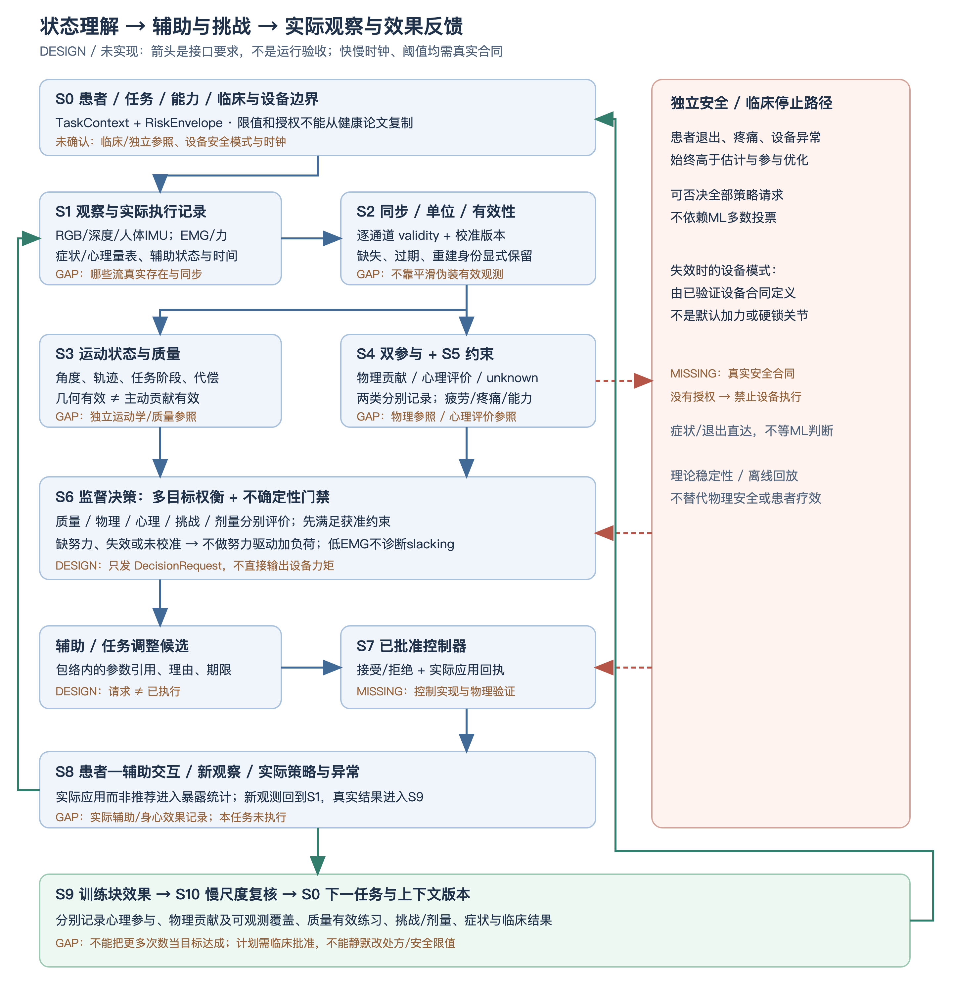

# 完整链路方案：把“看懂”连到辅助、挑战和效果反馈

## 结论与交付边界

**可以形成有文献依据的设计链路，不能称为已经运行或临床验证的系统。** 连通的整合反例包括Song_wrist（2013）、ALP2025、MPC-AAN、TFS2025，以及新补原件的肌协同/静动态校准/臂手导纳、表现混合控制、RL联合难度和虚拟肩模型AAN；这不是本项目首次把理解与辅助相连。

本方案明确两个反馈层：任务内的状态—辅助反馈，以及任务/训练块结束后的质量、努力、剂量—训练计划反馈。三种时间尺度不指定经验频率：底层伺服按设备原有合同；状态/监督按同步和延迟预算；训练计划按任务/训练块调整。实际频率、稳定性和安全模式均为缺失条件，不能从单一论文的推理耗时推系统实时性。

本次只交付**链路定义、接口与验证计划**。没有实现估计器、控制器、设备连接或离线回放程序；没有采集患者、执行控制或复做外部实验。

本图以已取得整合论文中的**机器人辅助条件分支**为主要例子，不是用户已经指定机器人/AAN，也不是唯一辅助方式。非机器人任务反馈中，S7可为临床批准的任务调整执行责任方，S8仍需真实执行/训练暴露记录；机械安全合同只适用于有设备的分支。只有运动学资料可先评价质量，不足以证明物理贡献；心理参与已确认与物理贡献分别评价，独立心理参照见[补核](心理参与补核.md)，不强制把所有参与等同EMG/力。

## 状态怎样影响辅助，又怎样反馈回来

图中的箭头是待验证的接口，不是实测运行轨迹。所有节点为DESIGN；条件缺失为GAP/MISSING。独立安全路径不能被参与估计或优化目标覆盖。

## 目标：有效主动练习，不是无条件最大负荷

文献定义及人群边界见[研究范围与指标](研究范围与指标.md)。目标拆开记录，不把一个总分当真值：

| 目标 | 可测量量与条件 | 冲突及处理 |
|---|---|---|
| 患者物理主动贡献 | 经校准EMG、主动功/力矩或交互力代理；必须说明被动组织、机器人和共收缩的混杂；心理参与另记 | 减少辅助可能增加努力，也可能造成失败/代偿；低EMG不等于不愿参与 |
| 训练挑战/强度 | 相对能力的任务要求、相对负荷、感知努力；能力参照与安全归一化须有协议 | 增加阻力、速度、目标高度不是等价调节；高挑战可能降低有效练习和体验 |
| 剂量 | 有效运动时间、次数、训练频率、疗程；分别记录质量覆盖和努力可观测覆盖 | 更多完成次数可能只是更多机器人代做；增加时间不保证临床收益 |
| 运动质量与安全约束 | 与任务和病程相符的代偿/质量判断、疼痛/疲劳、设备边界、退出权 | 不是所有代偿都应一律禁止；阈值必须来自临床/设备合同，不由本文臆定 |

**不采用“辅助最少＝参与最多＝强度最大”的单一优化目标。** 先在已批准能力/质量/安全可行域内比较主动贡献和有效练习，报告二者权衡；能力与参考未知时不能自动加难度。Lang2016只操纵数量而非频率/强度；2026额外时长综述的低确定性也不能变成个人处方。

## 逐环节职责、来源、衔接与验证

以下“可复用”指方法/测量思路可参考，不代表代码、标定参数或临床阈值能直接复制。[逐篇对照表](文献对照表.md)及[原文定位](文献对照_原文定位.json)是来源；ID可直接在两文件中查找。接口的字段合同集中在[接口定义](链路接口定义.md)，验证编号集中在[验证计划](链路验证计划.md)。

| 节点 | 职责及输入 → 输出 | 文献依据/可复用部分 | 缺失条件与反馈去向 | 如何验证 |
|---|---|---|---|---|
| S0 任务与边界 | 疾病/病程、关节、任务、能力、临床/设备授权 → `TaskContext`、`RiskEnvelope` | L-c8f6fc7d的SCI试验与Song_wrist（2013）卒中不能混用；L-f7650ef4的目标高度结果说明任务条件重要 | MISSING：患者/任务、既有外部协议、ROM/力/剂量边界及设备安全模式；约束全部后续节点 | V0：材料身份、授权、适用域及临床限值来源；缺项不得进入设备模式 |
| S1 观察与记录 | RGB/深度或人体IMU；如存在EMG/力及机器人状态；症状/退出、心理量表/行为记录的版本及任务窗 → `ObservationPacket` | L-e3829d23视觉运动学；Song_wrist（2013）肌电；ALP2025 EMG/压力 | GAP：真实可用流、时钟、标定、原始/模型重建区分；接收S8实际执行后的新观察 | V1：时间对齐、单位/坐标、原始数据追溯；相机本体IMU不是人体姿态 |
| S2 同步与质量 | 数据、上下文、同步和标定记录 → `ValidityPacket` | L-e3829d23/L-e35abf95测量有效性提示；这里的统一门禁是方案，不冒称论文已经这样实现 | GAP：丢失、延迟和质量界限；向S3/S4输出各通道有效性，不用平滑替代缺失值 | V1/V2：缺流、乱序、超时、坐标/版本不匹配的负对照 |
| S3 运动状态与质量 | 有效几何/惯性输入、任务 → `KinematicQualityState` | L-e35abf95临床运动学评价；L-f696c42b/L-ee97e567代偿；L-9dda282a单目工作空间 | GAP：本项目三维与角度独立参考、病程适用标签；输出给S6和S9，不能单独产生努力结论 | V3：独立角度误差、一致性、任务分层质量及跨患者验证 |
| S4 双参与与可观测性 | 有效EMG/力/模型参照及任务后心理量表/独立行为记录 → `EffortEstimate`与`PsychologicalEngagementState`；分别可观测或未知 | Song_wrist/ALP/TFS物理代理；VAAN静态MVC传感器校准、TRO/TBCAS运动学力标签、TIE静动态目标须分开；Psy2014 IMI与Psy2022偏好/表现 | GAP：独立物理参照、心理量表/行为参照及混杂分离；心理慢尺度记录不伪装每帧；输出S6/S9 | V4：物理误差/区间和心理版本/参照效度分别验证；不能拿模型自己或完成次数当两类真值 |
| S5 疲劳、症状与能力变化 | 主观症状/退出、临床量表、有效生理/运动代理 → `ConstraintState` | L-06083b29疲劳与运动学；Song_load健康人负荷/fNIRS；L-c8f6fc7d小样本安全观察 | MISSING：患者疲劳/痛阈值、能力更新依据；代理未知保留不确定；安全事件优先送设备/临床停止路径 | V5：事件参考及漏报、提前量、负对照；健康人倒U不能定患者阈值 |
| S6 监督与决策门禁 | S3–S5、有效性、授权/边界、校准证据 → `DecisionRequest`及理由 | L-561c1bd5 MPC多目标；L-d70787db表现型辅助；ALP2025/TFS2025估计到控制先例；RL2026原Eq9–12动态权衡；TBME/TBCAS/TRO已有工程守卫 | GAP：校准与风险合同；未校准分数/缺努力/心理低分不能触发增阻或减助力；输出只到S7，不直接给力矩 | V6：不确定/过期/疼痛/任务变化的决策表；接受风险—覆盖率，而非只看平均预测误差 |
| S7 已批准控制与独立安全 | 请求、临床允许包络、设备合同 → 已应用/拒绝及`AppliedPolicyReceipt` | TFS2025变量阻抗、L-561c1bd5 MPC等可作基线；理论稳定性不替代物理验证 | MISSING：实际控制器/急停/失效安全模式；独立边界可否决全部请求；不得把旧增益直接用于患者 | V7：将来需设备责任方的延迟、饱和、被动性/稳定性及安全验证；本次不执行 |
| S8 患者—辅助交互 | 实际应用策略、患者/设备 → 新传感流、事件、真实辅助日志 | Song_wrist（2013）、ALP2025、TFS2025已有实际闭环；人群和装置分别适用 | MISSING：本项目运行/外部材料；实际日志回到S1，并送S9；不能把候选请求当执行事实 | V7/V8：实际应用回执、端到端同步、事件日志；回放不能证明物理闭环安全 |
| S9 任务/训练块效果 | 物理贡献/质量实测与心理量表/行为参照、实际辅助、症状/完成 → `TrainingBlockOutcome` | L-c8f6fc7d同时有机器人/临床指标；dose_review2026剂量综述；L-caa2314e临床试验 | GAP：有效练习定义与真实条件；质量有效、物理贡献/可观测覆盖、心理分量表/缺失率、总剂量分别统计；送S10 | V8：分母/覆盖率、条件及患者划分、组间比较；过程改善不等于功能收益 |
| S10 慢尺度计划/复核 | S9、能力/症状变化、随访/临床反馈 → 下一任务候选及新上下文版本 | ALP2025说明执行时间适配已存在；RL2026原PDF Eq11–12/Fig3已核难度更新，见七篇原件补核；Lang2016说明数量不等于强度；长期处方仍需独立临床依据 | MISSING：外部临床/随访材料；先经临床批准再更新S0，不能在线偷改模型和风险界限 | V8/V9：现有材料可回顾核对；新的患者干预须另立授权任务；疗效/迁移需合适试验 |

## 为什么这些箭头具有依据，而不是拼接即创新

- **Song_wrist（2013）**：归一化肌电连续影响辅助力矩，辅助/阻抗又影响运动与EMG；16名慢性卒中、20次训练，无平行随机对照。说明存在闭环，不能证明本方案优效。
- **ALP2025**：EMG/压力经参与模型校准，调整任务执行时间，运行于阻抗框架。模型训练5名健康参与者，控制比较两组各5人；不能写成患者主动贡献真值或所有阻抗参数自动优化。
- **TFS2025**：神经模糊肌骨估计生理力矩→变量阻抗AAN→新交互数据；3名健康参与者。作者接受稿、理论稳定性及模糊隶属度均不等于患者临床安全或校准概率。
- **L-561c1bd5 MPC-AAN**：努力/表现进入多目标预测辅助，包含slacking研究动机；原文p.14明确单名健康参与者及合成profile。不能宣称已经解决真实患者疲劳/偷懒区分。
- **L-c8f6fc7d Frullo2017**：17名SCI入组、14完成，balanced平行组；无FMA组间显著优势与部分机器人指标变化须分开。p.9无伤害/过度疲劳不良事件仅是该小样本观察。

这些来源支持“估计/表现可影响辅助并形成观察反馈”，但**视觉质量、努力不确定性、疲劳、慢尺度挑战和临床效果在本项目的联合接口及验证仍未连通**。这里定义的是如何连接、什么条件才可连接，不是证明所有文献已经覆盖全部节点。

## 搭建清单：先复用外部成果，再决定缺口

1. **既有外部材料已核**：固定commit5192efe的1人25试次工程记录已读；用户确认只有已给资料，不再索取入口或额外索引。D0–D4是研究可验证条件，不是隐含可补数据或新采集/复跑请求；不足项保留MISSING。
2. **冻结条件与输入合同**：明确哪一条信号来自实测，哪一条是模型重建，哪些关节/角度已经独立验证；物理与心理参照分别核，不用肩肘参与提示/计数代替心理投入。缺主动贡献参照则S4输出不可观测，其他运动质量研究仍可推进。
3. **选择最小可核对基线**：固定辅助/表现型AAN/ALP式时间适配等，按实际装置与合法可用实现决定；不是先锁3DCNN-TF、JEV或某一控制器。
4. **对照接口并检查反馈**：要求实际应用回执；未应用请求不能进入“治疗暴露”统计。症状、安全与设备异常独立于估计链路。
5. **先验证测量，再验证决策**：独立参照、校准、跨患者划分、负对照、数据漂移和缺失覆盖；现有材料不足的项按GAP登记。
6. **再讨论方向与实验许可**：控制收益/长期疗效需要适当证据；新的实施或人体实验不在本任务授权内，不由此清单自动启动。

## 当前缺失与可继续范围

| 缺失 | 影响 | 当前处理 |
|---|---|---|
| 具体患者、任务、临床/设备安全合同 | 不能实例化阈值、控制频率或处方 | 条件化设计；与老师裁定，不宣称闭环验收 |
| [外部GitHub分支已读](外部实验分支核对.md)，但独立参照/身心评价/实际辅助仍不足 | 可复用工程字段，不足以核患者角度、双参与和干预效果 | 固定commit5192efe与工程资料限定；独立参照/实际辅助条件仍MISSING，不再请求额外索引或复做 |
| 7篇原件缺口已解 | 校准/力参考、控制/守卫、人群及阴性项已核，排除更多泛化差异；不补出本项目数据条件 | [64段原件机制补核](补取七篇_原件机制与候选裁剪.md)，当前0待下载，创新定案仍未完成 |

新原件映射：TRO/TBCAS的EMG—导纳与TIE姿态/分阶段校准支持S1/S4/S7的已有连通，但训练参考类型不同；VAAN的MVC传感器校准与踝患者案例不自动迁移到上肢；TBME限制模式、Shoulder模型期望力矩/在线刚度及RL原Fig3/Eq9–12支持S6/S7/S10已有先例。具体页码、参照和失败边界在七篇补核与主定位，不能移植参数或当独立贡献/心理真值。

整合反例足以否定“连接模块本身即新”；当前有条件设计仍未运行，原件补齐不替代独立双参与参照、实际辅助反馈与创新定案。
