文章

# 一种用于从 sEMG 和 IMU 数据解码下肢坐立动作的双任务改进 Transformer 框架 †

Xiaoyun Wang 1, Changhe Zhang 2, Zidong Yu 1, Yuan Liu 3 and Chao Deng 1,\*

1 School of Mechanical Science and Engineering, Huazhong University of Science and Technology（华中科技大学机械科学与工程学院）, Wuhan 430074, China

2 School of Electrical and Information Engineering, Zhengzhou University（郑州大学电气与信息工程学院）, Zhengzhou 450001, China

3 Department of Engineering, University of Cambridge（剑桥大学工程系）, Cambridge CB2 1PZ, UK

\* 通讯作者：dengchao@hust.edu.cn

本文是我们发表于以下会议的论文的扩展版本：Wang, X.; Zhang, C.; Yu, Z. Exploration of Lower Limb Multi-Intent Recognition based on Improved Transformer during Sit-to-Stand Movements. In Proceedings of the 2025 10th International Conference on Automation, Control and Robotics Engineering (CACRE), Wuxi, China, 16–19 July 2025; pp. 306–310, htps://doi.org/10.1109/CACRE66141.2025.11119620.

## 摘要

学术编辑：Dan Zhang

收稿日期：2025年9月19日 修改日期：2025年10月13日 接受日期：2025年10月14日 发表日期：2025年10月16日

引用：Wang, X.; Zhang, C.; Yu, Z.; Liu, Y.; Deng, C. A Dual-Task Improved Transformer Framework for Decoding Lower Limb Sit-to-Stand Movement from sEMG and IMU Data. Machines 2025, 13, 953. htps://doi.org/10.3390/ machines13100953

版权：© 2025 作者所有。许可方 MDPI，瑞士巴塞尔。本文是一篇根据知识共享署名（Creative Commons Attribution, CC BY）许可协议条款和条件分发的开放获取文章（htps://creativecommons.org/license s/by/4.0/）。

外骨骼辅助康复领域的最新进展突显了通过深度学习进行下肢运动意图识别的重要性。然而，离散运动相位分类与连续实时关节运动学估计通常被作为独立任务处理，从而在动态运动过程中导致时间不对齐或助力延迟。为解决这一问题，本研究提出了 iTransformer-DTL，这是一种采用改进 Transformer 的双任务学习（Dual-Task Learning, DTL）框架，旨在端到端识别运动模式并预测坐立转换过程中的关节轨迹。所提出的 iTransformer-DTL 采用可学习查询机制和非自回归解码方法，能够一次性生成完整的输出序列，而不依赖于任何先前生成的元素。该框架已在包含 7 名健康受试者和 7 名中风患者的下肢运动数据集上进行了测试。实验结果表明，所提出的框架在双任务中均取得了令人满意的性能。在健康组中获得了 3.84° 的平均角度预测平均绝对误差（Mean Absolute Error, MAE）和 99.42% 的分类准确率，而在中风组中获得了 4.62° 的 MAE 和 99.01% 的准确率。这些结果表明，iTransformer-DTL 能够为自适应康复外骨骼控制器提供支持，从而增强人机交互。

关键词：下肢运动意图识别；外骨骼控制；双任务学习；Transformer；可学习查询

## 1. 引言

中风引起的运动功能障碍会严重损害患者进行日常生活活动的能力，例如坐、站和行走 [1]。临床研究表明，康复训练有助于重建运动神经通路，改善甚至恢复下肢运动功能 [2]。外骨骼辅助康复训练（Exoskeleton-Assisted Rehabilitation Training, EART）近年来受到了广泛关注 [3]，因为其能够减轻物理治疗师的工作负担，并显著提高患者的运动能力。

关键的 EART 方法可分为被动训练和主动康复训练（Active Rehabilitation Training, ART）。在前一种训练模式中，外骨骼在早期阶段驱动患肢沿着预定义的运动轨迹运动，使患者在没有主动运动意图的情况下进行被动训练，如采用示教模式的 LLR-Ro 所示 [4]。相比之下，ART 促进了患者的主动参与，对提升康复效果至关重要。例如，阻抗控制策略和按需辅助（assist-as-needed）[5] 方法鼓励自主参与，从而支持肌肉功能的恢复。在实际康复场景中，ART 需要精确检测受试者的运动意图 [6]，从而能够动态调整控制参数以提高患者的自主参与度。

运动意图的精确识别对于有效的 ART 至关重要。目前，针对下肢运动意图识别（Lower Limb Motion Intent Recognition, LLMIR）[7] 的研究主要集中在两种方法上：(1) 离散运动模式识别（Discrete Motion Pattern Recognition, DMPR），其触发外骨骼中的多种控制策略，包括运动模式识别和运动相位划分；(2) 连续运动意图预测（Continuous Motion Intent Prediction, CMIP），其将实时预测值转化为对控制参数的调整，具体包括运动学参数（如关节角度、角速度）和动力学参数（如力矩、刚度），以实现个性化和自适应控制。

用于 LLMIR 研究的信号大致可分为两类：(1) 物理信号，通过角度传感器、加速度计和力传感器等测量设备采集，具有高信噪比和强抗干扰能力，能够提供准确的运动信息。然而，由于这些设备固有的测量延迟，它们无法在运动发生前进行预测。(2) 生物电信号，例如表面肌电（surface electromyography, sEMG）信号，可从皮肤表面无创获取，并反映肌肉活动水平和运动模式 [8]。尽管这些信号能够实现运动预测，但它们可能会受到肌肉疲劳、体毛和出汗等生理因素的影响。为了解决这些问题，越来越多的研究致力于通过深度学习技术动态融合这两种信号 [9]。有研究开发了一种时空嵌入长短期记忆（Long Short-Term Memory, LSTM）网络模型 [10]，以解决稀疏序列数据和次优数据推理的问题，从而显著提高了意图识别的精度。提出了一种带有注意力机制的卷积神经网络-双向 LSTM 混合模型（CNN-BiLSTM），用于从不同信号源提取和融合特征以进行膝关节轨迹预测 [11]。引入了一种并行图神经网络（Graph Neural Network, GNN）用于融合图级别和领域知识，从而提高了模型的准确性和鲁棒性 [12]。

事实上，以往的方法 [10–12] 通常侧重于单一识别任务。然而，ART（主动康复训练）中外骨骼的先进控制策略通常需要同时兼顾 DMPR（离散运动模式识别）和 CMIP（连续运动意图预测）。例如，受试者自适应控制方案需要识别运动模式并预测关节轨迹，而按需辅助控制方案则需要同时执行运动模式辨识和关节力矩预测 [7,8]。因此，多任务学习框架是一种有效的解决方案。通过共享某些模型参数并利用不同任务之间的相似性或互补性，该框架提高了模型的泛化能力和学习效率，尤其是在数据有限的情况下 [13]。Gautam 等人引入了一种长期循环卷积网络（long-term recurrent convolution network），用于对下肢运动进行分类并预测相应的膝关节角度以进行临床评估 [14]。Xue 和 Lai 建立了一种基于 CNN 的下肢多意图预测方法，用于内在和外在控制 [15]。Wang 等人开发了一种用于角度和步态相位预测的多分支神经网络 [16]，Li 等人提出了一种基于 Transformer 的多任务模型，用于识别运动模式并预测肌肉力 [17]。

尽管以往的研究取得了这些显著进展，但仍存在一些不可忽视的挑战。CNN 通常受制于短程依赖性，因为特征提取是通过局部感受野进行的，序列中距离较远的事件会被忽略。RNN 在处理长序列时面临挑战，因为它们按顺序更新隐藏状态，每个新状态和输出都依赖于前一个状态和当前输入，这阻碍了它们建模长期依赖关系的能力。作为一种解决方案，Transformer 通过利用多头自注意力机制（multi-head self-attention mechanism），成功捕获了长序列中复杂的长程依赖关系。然而，传统的 Transformer 架构依赖自回归解码方法 [18] 来生成高质量文本，这意味着每次仅生成一个输出，每个新生成的词都会被重新输入以用于下一个输出，直到达到终止信号。由于每个词的生成都依赖于前一个词，因此该过程中存在顺序依赖性，导致输出速度较慢。

考虑到上述局限性——具体而言，即离散与连续意图估计的分离以及传统 Transformer 中自回归解码效率低下的问题——本研究提出了一种端到端的双任务 LLMIR 方法，该方法能够从融合的 sEMG 和 IMU 信号数据中同步解码连续和离散的下肢运动意图。主要贡献总结如下：

(1) 提出了一种基于表面肌电（sEMG）信号与运动学数据融合的双任务学习框架，用于识别坐立转换（STS）运动过程中的下肢运动意图，通过共享特征表征实现了多种任务的高效并行学习。

(2) 构建了一种采用改进 Transformer 架构的双任务学习框架（iTransformer-DTL），以同时执行分类与预测任务。该框架结合了可学习查询机制，能够有效地从上下文表征中提取信息，并直接一次性解码整个序列，显著提高了生成效率。

(3) 该模型在从健康受试者和中风患者采集的下肢坐立转换运动数据集上进行了有效的实验验证。

本文其余部分的结构安排如下：第 2 节介绍理论背景，第 3 节阐述本文提出的方法，第 4 节讨论实验结果，第 5 节对全文进行总结。

## 2. 理论背景

## 2.1. STS 运动分割

STS 转换是日常生活活动中关键的下肢功能性动作之一，在中风后会受到影响，导致康复困难。因此，研究 STS 运动对于制定有效的康复策略以恢复独立行动能力至关重要。特别是在外骨骼控制领域，准确识别 STS 阶段对于确定助力水平至关重要。本研究所采用的 STS 运动事件检测和阶段分割基于已有文献 [9,19]。

如图 1 所示，STS 事件的时间节点是利用运动学数据确定的，由五个连续事件来表征 STS 运动：STS 起始（E0）、离座起始（E1）、动量传递完成（E2）、稳定开始（E3）以及 STS 终止（E4）。E0 定义为躯干绝对角速度超过峰峰值（PP）5% 的时刻，而 E4 则定义为其降低至该阈值以下的时刻。E1 对应髋关节角度达到最大值的时刻，E2 对应踝关节最大背屈时刻，E3 对应膝关节角度从其在 STS 终止时的数值减小 $1 0 ^ { \circ }$ 的时刻。

  
Figure 1. STS 运动划分为五个阶段：前屈动量（E0–E1）、动量传递（E1–E2）、伸展（E2–E3）以及稳定（E3–E4）。事件 E1 至 E5 由躯干（θT）、髋关节（θH）、膝关节（θK）和踝关节（θA）的角度位移及角速度阈值定义。

基于这些事件标记，STS（坐立）转换过程被划分为四个阶段：(1) 屈曲动量（flexion momentum, FM）阶段，始于动作开始，包括躯干和骨盆的前屈，结束于离座；(2) 动量转移（momentum transfer, MT）阶段，从离座开始跨越至踝关节最大背屈；(3) 伸展（extension, ET）阶段，在踝关节最大背屈后立即开始，并持续到髋关节伸展停止；以及 (4) 稳定（stabilization, STA）阶段，始于达到髋关节完全伸展，终止于稳定的直立姿势。

## 2.2. 传统的 Transformer 网络

与 RNN 相比，Transformer 在处理序列数据中的长距离依赖关系方面表现更佳。它由一个编码器和一个解码器组成：编码器将输入序列转换为捕获上下文信息的隐藏表示，而解码器则根据这些表示生成输出序列。如图 Figure 2 所示，每个编码器由两个子模块组成。第一个子模块由多头注意力（multi-head attention, MHA）层和“Add & Norm”操作（即残差连接和层归一化）组成。第二个子模块包括一个前馈层和另一个“Add & Norm”操作。堆叠多个编码器可以有效提升模型的整体性能。

作为 Transformer 的核心，MHA 机制的工作原理如下。设 n 表示时间步，d 表示特征维度，X∈ℝn×d 表示输入数据。应用一组位置编码以获得查询矩阵（Q）、键矩阵（K）和值矩阵（V）；W 为权重矩阵。第 i 个头的注意力系数可以计算如下：

$$
\operatorname{head} _ {i} = \operatorname{Attention} \left(\mathbf {Q} _ {i}, \mathbf {K} _ {i}, \mathbf {V} _ {i}\right) = \operatorname{Softmax} \left(\mathbf {Q} _ {i} \mathbf {K} _ {i} ^ {\mathrm{T}} / \sqrt {d _ {k}}\right) \mathbf {V} _ {i}.\tag{1}
$$

随后，MHA 的输出可以表示如下：

$$
\text { Multi - head } (\mathbf {Q}, \mathbf {K}, \mathbf {V}) = \text { Concatenation } (\text { head } _ {1}, \dots , \text { head } _ {H}) \mathbf {W}  .\tag{2}
$$

每个解码器由三个子模块组成：(1) 带有“加与归一化”（Add & Norm）操作的掩蔽 MHA（多头注意力）层，利用包含负无穷的上三角矩阵来掩蔽未来信息，确保每个位置仅能访问先验信息；(2) 带有“加与归一化”操作的编码器-解码器 MHA 层，其中解码器的输出作为查询（query），编码器的输出作为键（key）和值（value），使解码器在生成每个输出时能够利用输入序列的信息；以及 (3) 前馈层和“加与归一化”操作。在模型推理过程中，解码器的目标序列向右平移，使得每个符号在生成时只能访问其前驱符号。随后，嵌入后的输入序列通过解码器的三个子模块进行处理，这些子模块利用线性层和 Softmax 层生成目标输出的概率分布，以用于序列预测。因此，传统的 Transformer 具有自回归特性——即每一步的输出都将依赖于前一步的生成结果，从而逐步生成目标序列。

  
Figure 2. 传统 Transformer 结构中编码器、解码器及推理机制的示意图。

## 3. 方法

## 3.1. 数据集

采用包含健康受试者和中风患者的自定义数据集进行进一步实验验证，详细的受试者人口统计学特征见 Table 1。具体而言，该数据集包含了来自 7 名健康受试者（记为 HS1–HS7）和 7 名中风患者（记为 PS1–PS7）的信息。本研究已获得华中科技大学同济医学院伦理委员会的批准（批准文号：[2020] S296-1）。所有参与者在入组前均签署了书面知情同意书。如图 Figure 3 所示，数据采集系统包括配备嵌入式 IMU 的无线 Ultimu EMG 系统（Noraxon USA Inc., Scotsdale, AZ, USA）以及运行 MR3.10 myoMUS-CLETM 软件的智能笔记本电脑。双极 sEMG 电极间隔 20 mm 放置，并与肌纤维平行排列，皮肤使用酒精湿巾清洁以尽量减小阻抗。将 7 个 IMU 传感器贴附在受试者的骨盆、双侧大腿、小腿和足部。指导每位受试者在没有任何协助的情况下，在高度可调的椅子上执行约 10 次坐站转换任务。从双侧 16 块下肢肌肉记录 sEMG 数据（每侧 8 块肌肉：包括 RF、VM、VL、BF、SEM、UTA、MG 和

SOL）采样率为 2 kHz，同时使用 IMU 系统以 200 Hz 的采样率同步采集运动学数据。值得一提的是，基于使用 MR3 软件 [20] 生成的同步视觉动画，排除了异常状态和静息状态下的 sEMG 数据。Figure 4 显示了 16 通道 sEMG 信号和 21 通道运动学信号的原始数据。

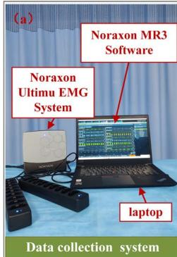

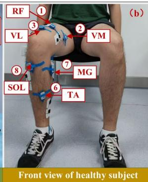

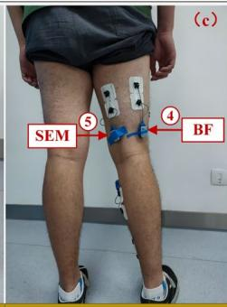

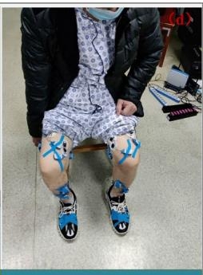

Figure 3. 实验装置：(a) 数据采集系统；(b) 健康受试者传感器放置前视图；(c) 健康受试者传感器放置后视图；(d) 脑卒中患者前视图。  
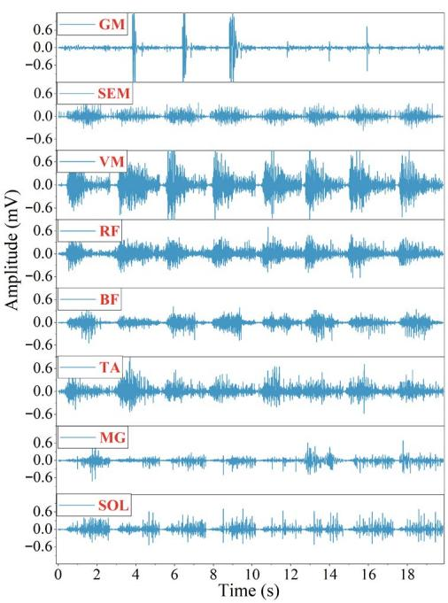

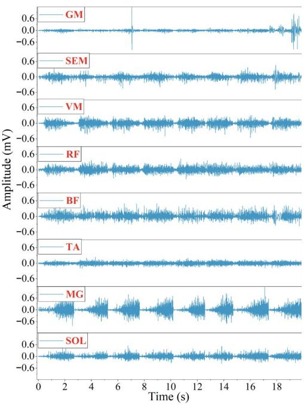

(a)  
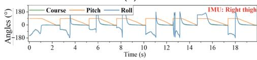

(c)  

(e)  
  
(g)

(b)  

(d)  
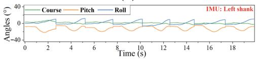

(f)  
  
(h)

  
(j)  
Figure 4. 受试者 PS4 在 STS 运动过程中的原始 sEMG 和运动学数据：(a,b) 分别展示双侧下肢 sEMG 信号（分别为右侧健康腿和左侧偏瘫腿）；(c–i) 分别显示右大腿、左大腿、右小腿、左小腿、右脚、左脚和骨盆的运动学信号；(j) 显示关节角度和标记事件。

Table 1. 受试者的基本信息。

<table><tr><td>受试者</td><td>男/女</td><td>年龄 (岁)</td><td>身高 (cm)</td><td>体重 (kg)</td><td>受试者</td><td>男/女</td><td>年龄 (岁)</td><td>身高 (cm)</td><td>体重 (kg)</td><td>瘫痪侧</td><td>FMA-LE 评分</td></tr><tr><td> $HS_1$ </td><td>M</td><td>26</td><td>181</td><td>75</td><td> $PS_1$ </td><td>M</td><td>45</td><td>175</td><td>70</td><td>R</td><td>14</td></tr><tr><td> $HS_2$ </td><td>M</td><td>22</td><td>183</td><td>72</td><td> $PS_2$ </td><td>F</td><td>54</td><td>160</td><td>60</td><td>R</td><td>10</td></tr><tr><td> $HS_3$ </td><td>M</td><td>23</td><td>180</td><td>85</td><td> $PS_3$ </td><td>M</td><td>53</td><td>176</td><td>73</td><td>R</td><td>14</td></tr><tr><td> $HS_4$ </td><td>M</td><td>21</td><td>178</td><td>72</td><td> $PS_4$ </td><td>M</td><td>49</td><td>173</td><td>66</td><td>L</td><td>12</td></tr><tr><td> $HS_5$ </td><td>M</td><td>21</td><td>185</td><td>80</td><td> $PS_5$ </td><td>M</td><td>47</td><td>170</td><td>64</td><td>R</td><td>12</td></tr><tr><td> $HS_6$ </td><td>M</td><td>20</td><td>175</td><td>72</td><td> $PS_6$ </td><td>M</td><td>45</td><td>168</td><td>62</td><td>L</td><td>16</td></tr><tr><td> $HS_7$ </td><td>M</td><td>24</td><td>168</td><td>62</td><td> $PS_7$ </td><td>F</td><td>33</td><td>160</td><td>40</td><td>R</td><td>12</td></tr><tr><td>均值 ± 标准差</td><td>/</td><td>22.4 ± 1.9</td><td>178.6 ± 5.3</td><td>74.0 ± 6.1</td><td>均值 ± 标准差</td><td>/</td><td>46.6 ± 6.5</td><td>168.9 ± 6.2</td><td>62.1 ± 9.9</td><td>/</td><td>12.9 ± 1.8</td></tr></table>

Sub（受试者）；M/F（男性/女性）；R/L（右腿/左腿）；Std（标准差）。

## 3.2. 数据预处理

## 3.2.1. 重采样与滤波

记录的 sEMG 信号使用 4 阶 Butterworth 滤波器在 20 Hz 至 450 Hz 之间进行带通滤波，并应用零相位正反向滤波以防止相位失真。同时在 60 Hz 处应用了陷波滤波器（−3 dB 带宽：4 Hz），以在抑制工频干扰的同时保留附近的频谱内容。对于 IMU 信号，应用了截止频率为 25 Hz 的 6 阶 Butterworth 低通滤波器。为了同步数据，sEMG 和 IMU 数据被重采样至统一的采样率（例如 1000 Hz）。

## 3.2.2. 数据归一化

为了提高模型收敛性，对重采样后的 sEMG 和 IMU 信号应用了正负一归一化技术，将其缩放至 [−1, 1] 范围。然而，训练数据和测试数据在角度标签上存在差异，这种归一化方法可能会在反归一化过程中导致误差。因此，考虑到下肢关节角度的周期性特征，可以通过除以 π 将角度数据归一化至 [−1, 1]。

## 3.2.3. 样本分割

使用重叠窗口方法对数据集进行分割，以有效捕获时间特征 [21]。鉴于每个 STS（坐立转换）阶段的持续时间较短，窗口长度分别设置为 32/48/64/80/96 ms，重叠窗口为 16 ms。例如，时间间隔 (0, 32] 内的归一化数据对应于 STS 阶段，而关节角度标签定义为 (32, 32 + PL] ms，其中 PL 为预测长度（predicted length），初始设置为 16 ms。该设置允许使用前 32 ms 的输入数据来预测接下来的 16 ms 内的关节角度变化。此外，如果一个窗口跨越了两个阶段，则该数据将被丢弃，以防止在阶段转换期间产生歧义。

## 3.2.4. 数据集划分

在 STS 双任务中，随机选取 80% 的样本作为训练集，其余 20% 指定为测试集。此外，从训练集中随机抽取 10% 作为验证集，以调整超参数并选择最佳模型配置，旨在确保模型性能达到最优，而不过度依赖训练数据。为了减少随机变量的影响，每位参与者均进行了五次独立实验，每次实验使用不同的随机种子。

## 3.3. 网络结构设计

如图 Figure 5 所示，iTransformer-DTL 网络由输入层、编码器与解码器、可学习查询（learnable query）、分类器和预测器组成。所构建模型的参数配置如 Table 2 所示。详细描述如下：

## (1) 输入层

所提出模型的输入格式由批次大小（batch size）、序列长度（sequence length）和通道数（channels）组成。sEMG 和 IMU 信号沿通道维度进行拼接以形成输入数据，随后由输入嵌入层和位置编码层进行处理。

## (2) 编码器

编码器由 N 个堆叠的编码器层组成。MHA（多头注意力）模块的总输出维度等于单头输出维度乘以头数。通常，前馈网络的中间层维度选取为隐藏维度的倍数，通常是四倍。

## (3) 解码器

解码器由 N 个解码器层组成。需要注意的是，解码器的输入维度应与编码器的输入维度保持一致。在交叉注意力模块中，K（键，key）和 V（值，value）来自编码器的输出，而 LQ（查询，query）则获取自解码器的当前输入。

## (4) 可学习查询（Learnable Query, LQ）

LQ 是一个可训练向量，初始化为带有位置编码的随机向量，并在训练过程中进行优化。与传统的自回归模型不同，LQ 提供了一种新的解码机制，可直接与编码器的输出进行交互，从而提取特定于任务的特征。这种交互提供了更灵活的解码器输入，能够根据任务目标实现动态输出调整，并显著缩短推理时间。

## (5) 分类器

编码器的输出沿序列长度方向求平均，然后输入到全连接层中，该层使用 softmax 函数生成运动类别。

## (6) 预测器

解码器的输出经过 dropout 层和全连接层以生成预测的角度。

在该模型中，可学习向量与目标序列具有相同的长度，且使用无需掩码（masking）的标准多头注意力（Multi-Head Attention, MHA）机制来计算位置关系，因为来自不同位置的所有可学习向量都可以同时参与计算。经过处理的可学习向量取代了传统解码器中逐步生成的输入序列，直接作为交叉多头注意力（cross-MHA）模块的查询（query），因此可以一次性生成整个目标序列，而无需逐步预测。与自回归方法相比，所描述的非自回归方法在保持生成质量的同时，提升了推理速度和训练效率，使其适用于各种序列预测和文本生成应用。

  
Figure 5. 设计的 iTransformer-DTL 的模型结构。

Table 2. 构建模型的详细参数。

<table><tr><td>参数描述</td><td>设置</td><td>参数描述</td><td>设置</td></tr><tr><td>序列长度/预测长度</td><td>32/16</td><td>Dropout</td><td>0.2</td></tr><tr><td>输出类别数</td><td>4</td><td>解码器层数</td><td>2</td></tr><tr><td>总通道数</td><td>37</td><td>解码器输入维度</td><td>64</td></tr><tr><td>编码器层数</td><td>2</td><td>解码器 MHA 输出维度</td><td>16</td></tr><tr><td>编码器输入维度</td><td>64</td><td>解码器 MHA 头数</td><td>4</td></tr><tr><td>编码器 MHA 输出维度</td><td>16</td><td>解码器交叉 MHA 输出维度</td><td>16</td></tr><tr><td>编码器 MHA 头数</td><td>4</td><td>解码器交叉 MHA 头数</td><td>4</td></tr><tr><td>编码器最后一个线性层中间维度</td><td>128</td><td>解码器最后一个线性层中间维度</td><td>128</td></tr></table>

## 3.4. 损失函数

通常，多类型 DMPR 任务使用交叉熵（Cross-Entropy, CE）作为损失函数，其定义如下：

$$
L _ {C E} = - \frac {1}{N _ {s}} \sum_ {i = 1} ^ {N _ {s}} \sum_ {j = 1} ^ {N _ {c}} y _ {i j} \log (p _ {i j}), \text {   where   } \sum_ {j = 1} ^ {N _ {c}} p _ {i j} = 1.\tag{3}
$$

其中 $N _ { s }$ 和 $N _ { c }$ 分别表示样本总数和类别数；$p _ { i j }$ 表示第 $i$ 个样本属于类别 $j$ 的预测概率，取值范围为 0 到 1，且每个样本在所有类别上的概率之和等于 1；$y_{ij}$ 表示真实标签 $y _ i$ 的独热（one-hot）表示，当样本属于类别 $j$ 时 $y_{ij}$ 等于 1，否则为 0。

此外，对于 CMIP 任务，通常选择均方误差（Mean Squared Error, MSE）作为损失函数，其定义如下：

$$
L _ {M S E} = - \frac {1}{N _ {s}} \sum_ {i = 1} ^ {N _ {s}} \left(\theta_ {i} - \hat {\theta} _ {i}\right).\tag{4}
$$

为了在训练过程中平衡分类损失和回归损失，引入了缩放因子 $\alpha$ 来调整 MSE 的权重。总训练损失定义如下：

$$
L _ {L o s s} = L _ {C E} + \alpha L _ {M S E}.\tag{5}
$$

在本研究中，参考 [22]，$\alpha$ 初步设置为 0.01。

## 3.5. 训练设置与评估指标

优化过程采用 Adam 算法，批大小（batch size）为 32，最大训练轮数（epochs）为 100。初始学习率设置为 0.001，并应用 Multi-StepLR 方法，里程碑（milestones）设为 [60, 80, 100]，衰减因子为 $0 . 0 1 \sqrt { 0 . 1 }$。此外，采用早停（early stopping）机制以提高训练效率，即如果验证损失在连续 20 轮内下降未达到至少 0.0001，训练将提前终止。

在动作识别和角度预测的双重任务中，分类性能采用准确率（Accuracy）、F1 分数（F1-score）和混淆矩阵等指标进行评估。对于角度预测性能，评估指标包括平均绝对误差（Mean Absolute Error, MAE）和决定系数（Coefficient of Determination, R2），如下所示：

$$
A c c u r a c y = \left(\sum_ {i = 1} ^ {N _ {c}} \frac {T P _ {i}}{T P _ {i} + F P _ {i}}\right) / N _ {c},\tag{6}
$$

$$
\text { Recall } = \left(\sum_ {i = 1} ^ {N _ {c}} \frac {T P _ {i}}{T P _ {i} + F N _ {i}}\right),\tag{7}
$$

$$
F 1 - s c o r e = \frac {2 \times \text { Accuracy } \times \text { Recall }}{\text { Accuracy } + \text { Recall }},\tag{8}
$$

$$
M A E = \sqrt {\frac {1}{N _ {s}} \sum_ {i = 1} ^ {N _ {s}} \left| \theta_ {i} - \hat {\theta} _ {i} \right|},\tag{9}
$$

$$
R ^ {2} = 1 - \frac {\sum_ {i = 1} ^ {N _ {s}} \left(\theta_ {i} - \hat {\theta} _ {i}\right) ^ {2}}{\sum_ {i = 1} ^ {N _ {s}} \left(\theta_ {i} - N _ {s} ^ {- 1} \sum_ {i = 1} ^ {N _ {s}} \theta_ {i}\right) ^ {2}},\tag{10}
$$

其中 $T P , T N , F P ,$ 和 FN 分别代表分类结果中的真正例（true positives）、真负例（true negatives）、假正例（false positives）和假负例（false negatives）；$\theta _ { i }$ 和 $\widehat { \theta } _ { i }$ 分别表示实际角度和预测角度。

所有实验均在一台配备 AMD Ryzen 7 5800H CPU（3.20 GHz）、具有 8 GB 显存的 NVIDIA GeForce RTX 3060Ti GPU 以及 16 GB RAM 的笔记本电脑上进行，所使用的软件环境为（Python 3.9，PyTorch 1.13.0）。

## 4. 结果与讨论

## 4.1. 识别结果

首先，iTransformer 模型的训练过程如图 $6$ 所示，这表明该模型在健康受试者和中风受试者身上均表现出快速且稳定的收敛性。

  
(a)

  
(b)  
Figure 6. 模型分别在 HS3 和 PS3 上训练期间的 (a,b) 准确率、$\mathrm { R } ^ { 2 }$ 分数和总损失值。

此外，图 7 分别展示了 iTransformer-DTL 针对受试者 HS4 和 $\mathrm { P S } _ { 4 }$ 的分类结果混淆矩阵以及膝关节角度预测。如图 $^ { 7 } \mathsf { a } , \mathsf { b }$ 所示，HS4 中 FM 类别的所有真实样本均被准确分类，达到了 100% 的准确率。其他类别也表现出高准确率和极少的误分类。各阶段持续时间较短以及相邻阶段在特征空间中的数据相似性可能会造成类别边界不清晰，从而导致偶发的误分类。受试者 HS4 和 PS4 的关节角度测试结果如图 7c,d 所示（采用反归一化处理且未进行数据打乱）。

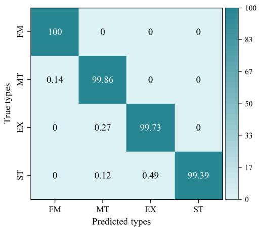  
(a)

  
(b)

  
(c)

  
(d)  
Figure 7. 实验结果：(a,b) 分别为受试者 HS4 和 PS4 在 STS 阶段分类测试结果的归一化混淆矩阵；(c,d) 分别为受试者 HS4 和 PS4 的角度预测结果。

随后，利用每位受试者的数据进行了实验验证，以评估所提出模型的性能。健康受试者和中风患者在五次重复实验中的测试结果如图 8 所示。

如图 8 所示，(1) 健康个体的 STS 阶段分类准确率在 98.93% (HS2) 到 99.84% (HS6) 之间，而在中风患者中，该指标在 97.86% (PS6) 到 99.72% (PS7) 之间波动；(2) 健康受试者的平均准确率、F1 分数（F1-score）和召回率（recall）分别为 99.42%、98.71% 和 98.89%，相比之下患者分别为 99.01%、97.93% 和 98.11%；(3) 在 STS 角度预测方面，健康受试者的 R2 值在 97.49% (HS7) 到 99.26% (HS3) 之间，患者则在 96.51% (PS4) 到 98.52% (PS6) 之间；(4) 健康受试者的平均 MAE 为 3.84°，患者为 4.62°，平均 R2 值分别为 98.31% 和 97.45%。

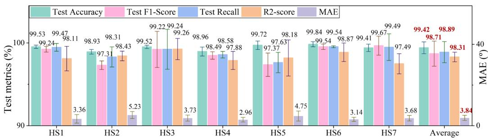

(a)  
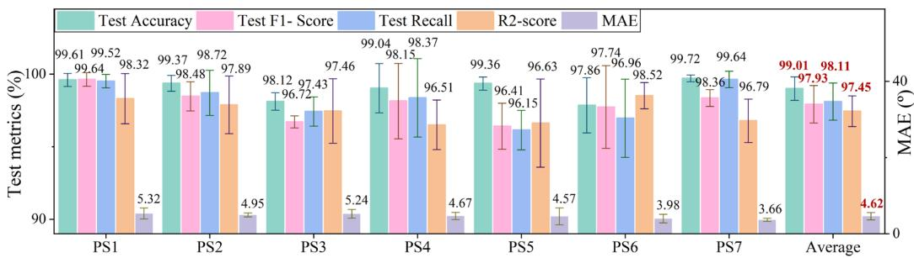  
(b)  
Figure 8. 所提出方法在 (a) 健康组和 (b) 患者组中每位受试者进行五次重复试验的实验结果，包含运动识别任务（准确率、F1 分数、召回率）和关节角度预测任务（R2、MAE）的性能指标。

这些结果表明，所提出的模型在不同受试者群体的双重任务中均表现出有效性，平均识别准确率达到 99% 以上，R2 值超过 97%。

## 4.2. 消融实验

所提出的框架首先通过与几种广泛使用的深度学习模型进行对比来进行评估，包括 BERT、不含 LQ 的传统 Transformer 模型、卷积神经网络（Convolutional Neural Network, CNN）[23]、MobileNet [24]、长短期记忆网络（Long Short-Term Memory Network, LSTM）[10] 以及门控循环单元（Gated Recurrent Unit, GRU）[25]。所有模型均使用与所提框架相同的预处理多模态输入和窗口大小进行训练和测试。为了确保公平对比，所有模型都应用了相同的损失函数和学习率调度方案。对比结果（包括参数量（Number of Parameters, NPs）、乘加运算次数（Multiply–Accumulate Operations, MACs）和推理时间（inference time, IT，100 次实验运行的平均时间）等模型复杂度指标）如 Table 3 所示。

Table 3. 不同模型的性能评估。

<table><tr><td>模型</td><td>准确率 (%)</td><td>F1分数 (%)</td><td>召回率 (%)</td><td>R2得分 (%)</td><td>MAE (°)</td><td>NPs</td><td>MACs</td><td>IT (ms)</td></tr><tr><td>CNN</td><td>97.48 ± 0.81</td><td>96.15 ± 1.89</td><td>96.49 ± 1.69</td><td>91.79 ± 2.84</td><td>6.05 ± 1.29</td><td>2,387,140</td><td>332,037,120</td><td>34.13</td></tr><tr><td>MobileNet</td><td>97.33 ± 0.83</td><td>95.75 ± 1.64</td><td>96.22 ± 1.52</td><td>90.98 ± 2.79</td><td>6.39 ± 1.57</td><td>2,370,830</td><td>226,246,656</td><td>32.71</td></tr><tr><td>LSTM</td><td>97.01 ± 1.17</td><td>95.13 ± 2.74</td><td>95.61 ± 2.45</td><td>94.12 ± 2.55</td><td>5.873 ± 1.37</td><td>259,396</td><td>170,278,912</td><td>31.20</td></tr><tr><td>GRU</td><td>97.23 ± 0.65</td><td>95.73 ± 1.73</td><td>96.13 ± 1.54</td><td>94.31 ± 2.45</td><td>5.54 ± 1.13</td><td>204,996</td><td>150,307,968</td><td>29.91</td></tr><tr><td>BERT</td><td>96.78 ± 1.49</td><td>95.21 ± 2.50</td><td>95.49 ± 2.69</td><td>94.01 ± 2.37</td><td>5.63 ± 1.34</td><td>268,214</td><td>141,582,592</td><td>38.83</td></tr><tr><td>Transformer</td><td>97.21 ± 0.84</td><td>95.97 ± 1.56</td><td>96.13 ± 1.48</td><td>94.76 ± 2.09</td><td>5.16 ± 1.15</td><td>312,190</td><td>353,863,552</td><td>43.64</td></tr><tr><td>iTransformer-DTL</td><td>99.22 ± 0.76</td><td>98.17 ± 1.41</td><td>98.50 ± 1.28</td><td>97.88 ± 2.21</td><td>4.23 ± 1.11</td><td>170,376</td><td>130,228,224</td><td>29.61</td></tr></table>

结果表明：(1) 结合了 LQ 机制的 iTransformer-DTL 性能优于 BERT 和传统 Transformer 模型。(2) CNN 和 MobileNet 展现出较强的特征提取能力，在 STS 分类任务中表现良好。然而，这两个模型在角度预测任务上表现不佳，这可能是由于它们的架构更适合分类而非回归任务。(3) 在角度预测方面，iTransformer-DTL、Transformer、GRU 和 LSTM 的表现优于 CNN 和 MobileNet。(4) 在双任务综合性能方面，iTransformer-DTL 展现出最高的整体性能，其次是 Transformer、GRU 和 LSTM。(5) iTransformer-DTL 以其简洁性脱颖而出，具有最少的参数量和 MACs，以及最短的推理时间和最快的计算速度。这些发现证实了所提出框架的有效性和优越性，该框架在没有显著增加计算复杂度的情况下，成功解决了 STS 分类和角度预测两项任务。

## 4.3. 与最先进方法的对比

此外，还将所提出的模型与包括 KNN [26]、RF [27] 和 SVM [28] 在内的多种机器学习分类器进行了评估对比。Table 4 给出了该模型性能的对比分析，重点阐述了在受试者类型、信号类型以及模型性能方面的异同。

总体而言，该主题的大多数研究都侧重于使用健康受试者进行实验验证，以确保模型在标准条件下的可靠性和有效性。此外，许多机器学习研究往往仅依赖单一类型的传感器数据，例如表面肌电（sEMG）或运动学信号。然而，随着多模态数据融合需求的不断增长，越来越多的研究开始利用深度学习方法来处理各类传感器数据，并跨多个维度分析信息。此外，所提出的模型在动作识别和关节轨迹预测方面均优于 1D-RSCN 和 LCRN 模型。

Table 4. 与最先进模型的对比结果。

<table><tr><td>模型</td><td>准确率 (%)</td><td>MAE (°)</td><td>参考文献</td></tr><tr><td>KNN</td><td>96.66</td><td>/</td><td>[26]</td></tr><tr><td>SVM</td><td>99.63</td><td>/</td><td>[28]</td></tr><tr><td>RF</td><td>99.17</td><td>/</td><td>[27]</td></tr><tr><td>CNN-GRU</td><td>99.11</td><td>4.82 ± 1.24</td><td>[29]</td></tr><tr><td>CNN-BiLSTM</td><td>99.02</td><td>4.77 ± 1.18</td><td>[30]</td></tr><tr><td>1D-RSCN</td><td>91.66 ± 0.78</td><td>5.25 ± 1.22</td><td>[15]</td></tr><tr><td>LCRN</td><td>97.01 ± 1.25</td><td>8.65 ± 1.34</td><td>[14]</td></tr><tr><td>本文模型</td><td>99.22 ± 0.76</td><td>4.23 ± 1.11</td><td>/</td></tr></table>

## 4.4. 窗口长度对模型性能的影响

本小节分析了使用重叠滑动窗口技术进行数据集分割的影响。滑动窗口长度分别设置为 32、48、64、80 和 96 以获取不同的样本子集。在窗口长度固定为 32 的情况下，预测长度分别设置为 16、32、48、64、80 和 96。模型在最优配置下进行了评估，相应结果如图 Figure 9 所示。

从 Figure 9a,b 可以得出以下结论：(1) 更大的窗口尺寸有助于融合更多的上下文信息，从而增强模型捕获长期依赖关系的能力。然而，这一优势也伴随着权衡——窗口尺寸的增加会导致训练期间更高的计算开销，包括更长的训练时间以及更高的资源消耗（例如内存占用）。(2) 随着预测长度的增加，模型的性能变化极小。这种稳定性可归因于模型在单次推理步骤中生成整个输出序列的固有设计。具体而言，基于 LQ 的解码机制实现了输出序列的并行处理，将模型性能与预测长度解耦，从而缓解了在更长预测期下通常会出现的性能退化。此外，当综合考虑超过 99% 的预测准确率以及可靠的角度预测结果时，确定预测长度为 16 是最优选择。

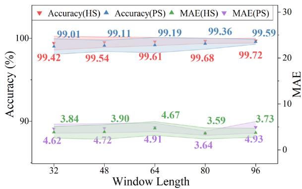  
(a)

  
(b)  
Figure 9. 在不同样本子集上使用最佳模型的实验结果：(a) 健康受试者与患者受试者在不同窗口长度下的准确率和 MAE；(b) 不同预测长度下的结果。

## 4.5. 损失函数中比例因子 α 的影响

评估了公式 (5) 中比例因子 α 对模型性能的影响，结果如图 Figure 10 所示，展示了 α 在 0.001 到 100 之间变化时准确率和 MAE 的均值与标准差。对这些结果的详细分析表明，α 的变化对模型的分类和预测能力均产生不可忽视的影响。值得注意的是，当 α 设为 0.01 时，模型达到了最优性能，表现为最高的准确率和最低的 MAE。显然，微调该参数对于平衡这些潜在机制至关重要，从而最终提升模型的整体性能。

  
Figure 10. 所有受试者在不同比例因子下的准确率与 MAE。

## 4.6. STS 动作中健康与异常受试者的对比

Figure 11 展示了利用双腿数据对健康和异常受试者进行事件检测的结果。

  
(a)

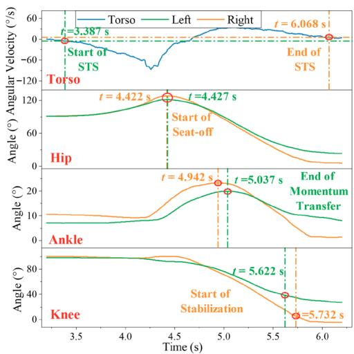  
(b)  
Figure 11. 双腿首次 STS 动作的事件检测结果：(a) 受试者 HS4；(b) 受试者 PS4。

如图 Figure 11 所示，健康个体完成一次 STS 动作的速度快于中风患者，HS4 和 $\mathrm { P S } _ { 4 }$ 的完成时间分别为 1.66 s 和 2.68 s。在健康个体中，双下肢在整个 STS 动作过程中的屈伸角度基本一致，仅存在微不足道的时间差异。双腿之间踝关节角度的差异是由脚部未对齐引起的。

相比之下，伴有单侧下肢运动功能障碍的中风患者在患侧肢体与健侧肢体之间的屈伸角度表现出不一致。事件发生的时间也存在差异，患侧肢体的反应更为迟缓，尤其是在 E2 和 E3 之间。在 PS4 中，健康右腿的检测时间分别为 4.942 和 5.622，而患侧左腿为 5.037 和 5.732。

这些发现突出了在设计外骨骼控制和人机交互系统时，考虑中风患者肢体运动的不对称性和时序差异的重要性。这种考量可以提高系统的适应性，并在康复过程中提供个性化的运动辅助。

## 5. 结论

本研究提出了一种改进的基于 Transformer 的深度学习框架，用于在起立（STS）运动过程中利用 sEMG 和 IMU 信号同时识别运动模式并预测关节轨迹。所提出的 iTransformer-DTL 模型融合了可学习查询（learnable query）和非自回归（non-autoregressive）方法，能够在模型推理过程中直接解码完整输出序列，从而显著提升了计算效率。来自 HS-PS 数据集的评估结果表明，所提出的框架在健康受试者和中风患者的运动识别与角度预测方面均表现良好，且在双任务学习中优于现有的最先进深度学习模型。该方法可应用于镜像康复治疗中，通过对健侧肢体运动意图的实时识别，实现向患侧肢体同步施加时间对齐且相位自适应的助力矩。该框架在日常生活活动（如起立转换）所必需的任务中，对康复外骨骼的实时控制具有广阔的应用前景，能够实现更加灵活高效的人机交互。

尽管取得了这些具有前景的结果，但仍有若干局限性值得进一步研究：

(1) 目前可学习查询是随机初始化的，这对于所有任务或受试者而言可能并非最优。未来的工作将探索结合任务先验信息或基于解剖学指导的初始化策略，以提高收敛速度和模型性能。

(2) 当前框架是在受试者内（intra-subject）设定下进行评估的；其跨个体的泛化能力——特别是在不同损伤程度的患者之间——仍然有限。我们计划引入跨受试者迁移学习或领域自适应技术，以提高在实际临床部署中的鲁棒性。

(3) 该系统依赖相对较多的 sEMG 通道，这增加了硬件复杂度和成本。后续工作将重点关注通道选择或传感器精简方法，以开发出适用于实际康复环境的轻量化、低成本版本。

作者贡献（Author Contributions）：概念构思，X.W. 与 C.Z.；方法学，X.W.；软件，C.Z.；验证，Z.Y.；形式分析，Y.L.；调查研究，Y.L.；数据整理，C.Z.；撰写—初稿准备，X.W.；撰写—审阅与编辑，X.W.；可视化，Z.Y.；监督，C.D.；项目管理，C.D.；资金获取，C.D.。所有作者均已阅读并同意手稿的最终发表版本。

资助（Funding）：本项工作由国家自然科学基金（National Natural Science Foundation of China）资助，项目批准号为 52450259 和 52575113。

机构审查委员会声明（Institutional Review Board Statement）：本研究于 2021 年 1 月 27 日获得华中科技大学同济医学院伦理委员会批准（批准号：[2020] S296-1）。

知情同意声明：本研究中所有参与的受试者均已签署知情同意书。

数据可用性声明：本研究中的数据可在 htps://github.com/Xiaoy-Wang/Code-V1.0-of-multi-task-DL-2025 获取（访问日期：2025年9月19日）。

利益冲突：作者声明不存在利益冲突。

## 参考文献

1. Arene, N.; Hidler, J. Understanding Motor Impairment in the Paretic Lower Limb after a Stroke: A Review of the Literature. Top. Stroke Rehabil. 2009, 16, 346–356. htps://doi.org/10.1310/tsr1605-346.

2. Chen, J.-C. Progress in Sensorimotor Rehabilitative Physical Therapy Programs for Stroke Patients. World J. Clin. Cases 2014, 2, 316. htps://doi.org/10.12998/wjcc.v2.i8.316.

3. Morone, G.; Iosa, M.; Calabrò, R.S.; Cerasa, A.; Paolucci, S.; Antonucci, G.; Ciancarelli, I. Robot- and Technology-Boosting Neu roplasticity-Dependent Motor-Cognitive Functional Recovery: Looking towards the Future of Neurorehabilitation. Brain Sci 2023, 13, 12–14. htps://doi.org/10.3390/brainsci13121687.

4. Feng, Y.; Wang, H.; Lu, T.; Vladareanuv, V.; Li, Q.; Zhao, C. Teaching Training Method of a Lower Limb Rehabilitation Robot. Int. J. Adv. Robot. Syst. 2016, 13, 57. htps://doi.org/10.5772/62445.

5. Banala, S.K.; Kim, S.H.; Agrawal, S.K.; Scholz, J.P. Robot Assisted Gait Training with Active Leg Exoskeleton (ALEX). In Proceedings of the 2nd Biennial IEEE/RAS-EMBS International Conference on Biomedical Robotics and Biomechatronics, BioRob 2008, Scotsdale, AZ, USA, 19–22 October 2008; Volume 17, pp. 653–658. htps://doi.org/10.1109/BIOROB.2008.4762885

6. Baud, R.; Manzoori, A.R.; Ijspeert, A.; Bouri, M. Review of Control Strategies for Lower-Limb Exoskeletons to Assist Gait. J. Neuroeng. Rehabil. 2021, 18, 119. htps://doi.org/10.1186/s12984-021-00906-3.

7. Zhang, Y.P.; Cao, G.Z.; Li, L.L.; Diao, D.F. Interactive Control of Lower Limb Exoskeleton Robots: A Review. IEEE Sens. J. 2024, 24, 5759–5784. htps://doi.org/10.1109/JSEN.2024.3352005.

8. Su, D.; Hu, Z.; Wu, J.; Shang, P.; Luo, Z. Review of Adaptive Control for Stroke Lower Limb Exoskeleton Rehabilitation Robot Based on Motion Intention Recognition. Front. Neurorobot. 2023, 17, 1186175. htps://doi.org/10.3389/fnbot.2023.1186175.

9. Zhang, C.; Yu, Z.; Wang, X.; Chen, Z.J.; Deng, C.; Xie, S.Q. Exploration of Deep Learning-Driven Multimodal Information Fusion Frameworks and Their Application in Lower Limb Motion Recognition. Biomed. Signal Process. Control 2024, 96, 106551. htps://doi.org/10.1016/j.bspc.2024.106551.

10. Zhang, P.; Zhang, J.; Chen, Y.; Jia, J.; Elsabbagh, A. Research on Human-Machine Synergy Control Method of Lower Limb Exoskeleton Based on Multi-Sensor Fusion Information. IEEE Sens. J. 2024, 24, 35346–35358. htps://doi.org/10.1109/JSEN.2024.3399697.

11. Wang, X.; Zhang, C.; Yu, Z.; Deng, C. Decoding of Lower Limb Continuous Movement Intention from Multi-Channel SEMG and Design of Adaptive Exoskeleton Controller. Biomed. Signal Process. Control 2024, 94, 106245. htps://doi.org/10.1016/j.bspc.2024.106245.

12. Zhang, C.; Yu, Z.; Wang, X.; Chen, Z.J.; Deng, C. Temporal-Constrained Parallel Graph Neural Networks for Recognizing Motion Paterns and Gait Phases in Class-Imbalanced Scenarios. Eng. Appl. Artif. Intell. 2025, 143, 110106. htps://doi.org/10.1016/j.engappai.2025.110106.

13. Wang, E.; Chen, X.; Li, Y.; Fu, Z.; Huang, J. Lower Limb Motion Intent Recognition Based on Sensor Fusion and Fuzzy Multitask Learning. IEEE Trans. Fuzzy Syst. 2024, 32, 2903–2914. htps://doi.org/10.1109/TFUZZ.2024.3364382.

14. Gautam, A.; Panwar, M.; Biswas, D.; Acharyya, A. MyoNet: A Transfer-Learning-Based LRCN for Lower Limb Movement Recognition and Knee Joint Angle Prediction for Remote Monitoring of Rehabilitation Progress from SEMG. IEEE J. Transl. Eng Health Med. 2020, 8, 2100310. htps://doi.org/10.1109/JTEHM.2020.2972523.

15. Xue, J.; Lai, K.W.C. Continuous Lower Limb Multi-Intent Prediction for Electromyography-Driven Intrinsic and Extrinsic Control. Adv. Intell. Syst. 2024, 6, 2300318. htps://doi.org/10.1002/aisy.202300318.

16. Wang, X.; Dong, D.; Chi, X.; Wang, S.; Miao, Y.; An, M.; Gavrilov, A.I. SEMG-Based Consecutive Estimation of Human Lower Limb Movement by Using Multi-Branch Neural Network. Biomed. Signal Process. Control 2021, 68, 102781. htps://doi.org/10.1016/j.bspc.2021.102781.

17. Li, X.; Zhang, X.; Zhang, L.; Chen, X.; Zhou, P. A Transformer-Based Multi-Task Learning Framework for Myoelectric Patern Recognition Supporting Muscle Force Estimation. IEEE Trans. Neural Syst. Rehabil. Eng. 2023, 31, 3255–3264. htps://doi.org/10.1109/TNSRE.2023.3298797.

18. Sun, Z.; Li, Z.; Wang, H.; He, D.; Lin, Z.; Deng, Z.H. Fast Structured Decoding for Sequence Models. Adv. Neural Inf. Process. Syst. 2019, 32, 3016–3026.

19. Norman-Gerum, V.; McPhee, J. Comprehensive Description of Sit-to-Stand Motions Using Force and Angle Data. J. Biomech. 2020, 112, 110046. htps://doi.org/10.1016/j.jbiomech.2020.110046.

20. Li, Y.A.; Chen, Z.J.; He, C.; Wei, X.P.; Xia, N.; Gu, M.H.; Xiong, C.H.; Zhang, Q.; Kesar, T.M.; Huang, X.L.; et al. Exoskeleton-Assisted Sit-to-Stand Training Improves Lower-Limb Function Through Modifications of Muscle Synergies in Subacute Stroke Survivors. IEEE Trans. Neural Syst. Rehabil. Eng. 2023, 31, 3095–3105. htps://doi.org/10.1109/TNSRE.2023.3297737.

21. Al-Quraishi, M.S.; Elamvazuthi, I.; Tang, T.B.; Al-Qurishi, M.; Parasuraman, S.; Borboni, A. Multimodal Fusion Approach Based on EEG and EMG Signals for Lower Limb Movement Recognition. IEEE Sens. J. 2021, 21, 27640–27650. htps://doi.org/10.1109/JSEN.2021.3119074.

22. Wang, X.; Zhang, C.; Yu, Z. 坐立转换过程中基于改进 Transformer 的下肢多意图识别探索（Exploration of Lower Limb Multi-Intent Recognition based on Improved Transformer during Sit to-Stand Movements）. In Proceedings of the 2025 10th International Conference on Automation, Control and Robotics Engineering (CACRE), Wuxi, China, 16–19 July 2025; pp. 306–310. htps://doi.org/10.1109/CACRE66141.2025.11119620

23. Su, B.Y.; Wang, J.; Liu, S.Q.; Sheng, M.; Jiang, J.; Xiang, K. 基于惯性测量单元与智能下肢假肢的 CNN 意图识别方法（A Cnn-Based Method for Intent Recognition Using Inertial Measurement Units and Intelligent Lower Limb Prosthesis）. IEEE Trans. Neural Syst. Rehabil. Eng. 2019, 27, 1032–1042. htps://doi.org/10.1109/TNSRE.2019.2909585.

24. Howard, A.; Sandler, M.; Chen, B.; Wang, W.; Chen, L.C.; Tan, M.; Chu, G.; Vasudevan, V.; Zhu, Y.; Pang, R.; et al. 寻找 MobileNetV3（Searching for MobileNetV3）. In Proceedings of the IEEE International Conference on Computer Vision 2019, Seoul, Republic of Korea, 27 October–2 November 2019; pp. 1314–1324. htps://doi.org/10.1109/ICCV.2019.00140.

25. Xia, Y.; Li, J.; Yang, D.; Wei, W. 基于复合网络模型的下肢外骨骼步态相位分类（Gait Phase Classification of Lower Limb Exoskeleton Based on a Compound Network Model）. Symmetry 2023, 15, 163. htps://doi.org/10.3390/sym15010163.

26. Zhang, Y.; Wang, X.; Xiu, H.; Ren, L.; Han, Y.; Ma, Y.; Chen, W.; Wei, G.; Ren, L. 基于动力膝关节假肢最小特征集改进 KNN 算法的意图识别优化系统（An Optimization System for Intent Recognition Based on an Improved KNN Algorithm with Minimal Feature Set for Powered Knee Prosthesis）. J. Bionic Eng. 2023, 20, 2619– 2632. htps://doi.org/10.1007/s42235-023-00419-w.

27. Cai, C.; Yang, C.; Lu, S.; Gao, G.; Na, J. 基于融合随机森林算法的人体动作模式识别（Human Motion Patern Recognition Based on the Fused Random Forest Algorithm）. Meas. J. Int. Meas. Confed. 2023, 222, 113540. htps://doi.org/10.1016/j.measurement.2023.113540.

28. Wei, C.; Wang, H.; Lu, Y.; Hu, F.; Feng, N.; Zhou, B.; Jiang, D.; Wang, Z. 基于经验模态分解与 K 近邻熵估计器利用表面肌电信号识别下肢运动（Recognition of Lower Limb Movements Using Empirical Mode Decomposition and K-Nearest Neighbor Entropy Estimator with Surface Electromyogram Signals）. Biomed. Signal Process. Control 2022, 71, 103198. htps://doi.org/10.1016/j.bspc.2021.103198.

29. Yang, Y.; Tao, Q.; Li, S.; Fan, S. 基于肌电信号结合迁移学习的双分支深度学习框架用于下肢运动分类与关节角度估计（EMG-Based Dual-Branch Deep Learning Framework with Transfer Learning for Lower Limb Motion Classification and Joint Angle Estimation）. Concurr. Comput. Pract. Exp. 2025, 37, e70263. htps://doi.org/10.1002/cpe.70263

30. Han, J.; Wang, H.; Tian, Y. 基于 SEMG 和 IMU 数据角度预测的外骨骼辅助康复无模型控制策略（SEMG and IMU Data-Based Angle Prediction-Based Model-Free Control Strategy for Exoskeleton-Assisted Rehabilitation）. IEEE Sens. J. 2024, 24, 41496–41507. htps://doi.org/10.1109/JSEN.2024.3486443.

免责声明/出版商注：所有出版物中包含的陈述、观点和数据仅代表个人作者和撰稿人的观点，并不代表 MDPI 和/或编辑的观点。MDPI 和/或编辑对于内容中提及的任何想法、方法、说明或产品所导致的任何人身伤害或财产损失概不承担责任。