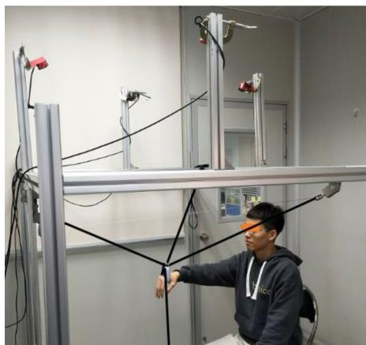
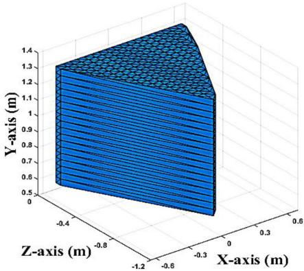
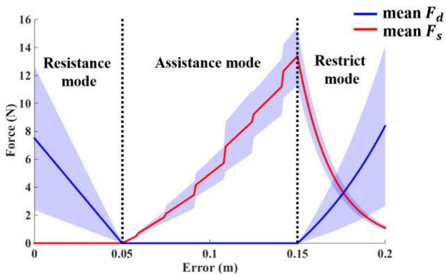
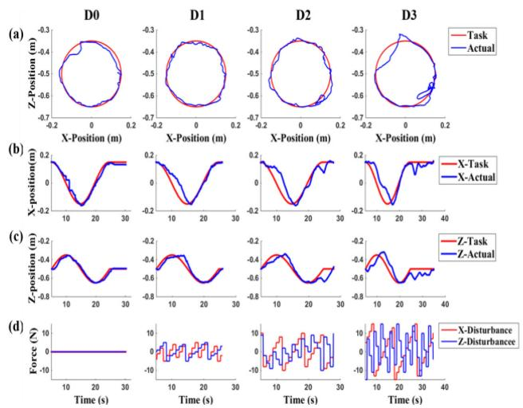
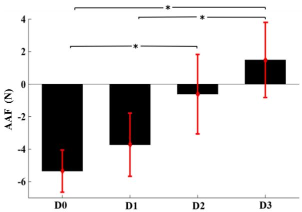
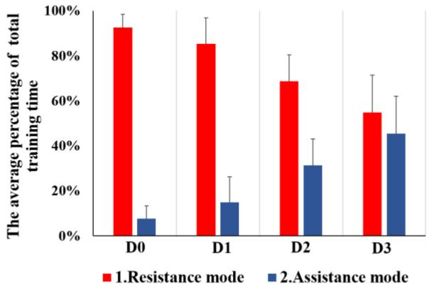

# 基于运动表现的绳驱动上肢康复机器人混合控制

Xianming Li , Qianqian Yang , and Rong Song , Senior Member, IEEE

摘要—脑卒中患者因不同程度的功能障碍而具有各异的康复需求。为了满足此类需求，本文提出了一种用于绳驱动上肢康复机器人（CDULRR）的基于运动表现的混合控制策略。该控制器包含三种工作模式，即阻力模式、助力模式和限制模式，由于跟踪误差是表征运动表现的常用指标，控制器通过跟踪误差在各模式间进行切换。在阻力模式下，向受试者提供与实际速度方向相反的适当阻尼力。在助力模式下，采用基于模糊逻辑调节刚度系数的方法，为受试者提供适度助力以协助运动。在限制模式下，再次施加阻尼力以限制运动范围并确保安全性。为验证该控制器的有效性，10名健康受试者开展了包含不同干扰的任务导向型实验。实验结果表明，该控制器能够根据受试者的运动表现自适应调整工作模式。研究发现，随着干扰增加导致运动表现下降，机器人在训练中提供了更多助力。阻尼力与刚度系数的自适应调节使控制器能够诱导受试者产生更多的主动发力。

索引词—脑卒中，上肢康复，绳驱动机器人，按需辅助控制。

## I. 引言

三分之二的患者存在不同程度的运动障碍，影响其日常生活活动（ADL）。康复训练通过在悉心指导下进行充分的重复性练习，可帮助患者重获运动功能 [2]。传统的康复治疗属于劳动密集型工作，而康复机器人能够提供针对性强且高重复性的训练。此外，临床结果已证实，机器人辅助康复训练对恢复运动功能具有积极效果 [3], [4]。

机械结构在机器人辅助康复训练中起着至关重要的作用。在过去的几十年中，大量具有不同机械结构类型的机器人被应用于上肢康复训练，它们可分为具有单一连杆和驱动关节序列的串联机器人（serial robots），以及具有多条运动链连接末端执行器的并联机器人（parallel robots）[5]。在串联机器人中，一些末端牵引式机器人如 MIT-MANUS [6]、MIME [7] 和 ARC-MIME [8] 已成功应用于临床上肢治疗。此外，还开发了诸如 ARMin [9]、RUPERT [10] 和 CADEN-7 [11] 等外骨骼机器人来辅助上肢关节。这些串联机器人能够为患者提供充足的支撑。在现有的并联机器人中，CUBE [12]、PARM [13] 和一款并联肩部外骨骼机器人 [14] 被设计用于康复训练。并联机器人相比串联机器人具有一些优势，例如运动控制精度高以及结构简单。

绳索驱动康复机器人（Cable-driven rehabilitation robots, CDRRs）作为一种并联机器人，由绳索驱动并将电机置于远离末端执行器的位置 [15]。这类机器人具有工作空间大、惯量低和柔顺结构等先进特性。NeReBot 采用三根绳索开发，用于卒中后上肢康复 [16]。Sophia-3 是一种平面绳索驱动设备，具有可移动滑轮组，使机器人能够实现显著的力输出能力 [17]。D. Cafolla 等人设计了一种绳索驱动并联机器人 CUBE，用于临床和家庭训练 [12]。这种末端执行器结构具有易于设置和适用于不同患者的优点，但对手臂关节的控制有限。为了辅助整个手臂，人们设计了一些绳索驱动的手臂外骨骼机器人，例如 CAREX [18] 和 CAREX-7 [19]。

康复机器人的控制策略对其性能同样起着关键作用。一些控制器，如阻抗控制 [6]、比例-积分-微分（PID）控制 [20]、滑模控制器 [21]，已被用于康复机器人以辅助肢体并在患者处于或多或少被动的模式下完成预设轨迹。基于感觉运动整合理论（sensorimotor integration theory），患者的主动参与被认为是促进运动功能恢复的关键因素 [22]。按需辅助（assist-as-needed, AAN）控制策略能够促进患者的主动努力，且机器人仅在患者需要时才提供辅助 [23]。Teramae 等人设计了一种基于 EMG（肌电图）模型预测控制的新型 AAN 控制器 [24]，其中 EMG 信号用于估计人体主动力矩。因此，完成任务所需的力可以得到保证，且跟踪误差最终可以稳定在相对较低的值，但这可能会导致训练懈怠，特别是对于轻度或中度残疾的患者。

需要指出的是，训练误差可能是影响人类运动学习的关键因素。Patton 等人发现，在涉及 18 名中风幸存者的实验中，与协助受试者减少误差的疗法相比，误差放大疗法（error-enhancing therapy）恢复了显著的后效 [25]。因此，控制器应能够容忍一定程度的训练误差，以促进患者的运动再学习。Wu 等人提出了一种基于最小干预的定参数导纳控制器，其中包括基于跟踪误差的三种控制模式 [26]。然而，固定的机器人辅助水平并不能适用于所有患者，控制器应能够根据患者的运动表现来调整辅助水平。此外，基于表现的控制器在绳驱动康复机器人（cable-driven rehabilitation robots, CDRRs）中的应用较少。由于处于不同运动损伤程度和康复阶段的患者需要针对个体的训练任务和主动参与，本研究针对绳驱动上肢康复机器人（cable-driven upper-limb rehabilitation robot, CDULRR）提出了一种基于表现的混合控制方法，该方法能够根据患者的运动表现切换训练模式，以促进患者的主动努力。此外，在辅助模式下设计了一种新型自适应模糊逻辑调节器，以自适应且动态地修改机器人辅助水平，从而避免患者对机器人辅助产生依赖。

本文结构安排如下。首先，介绍了 CDULRR 的结构、运动学、动力学和工作空间分析。其次，提出了一种基于表现的混合控制方法。第三，通过 10 名健康受试者的实验对控制器的性能进行了评估。最后，给出了本项工作的讨论与结论。

## II. 材料与方法

## A. 机械结构与建模

一个 n 自由度（n-DOF）绳驱动平台至少需要 n + 1 根具有正张力的线缆才能完全约束该系统 [27]。现已开发出一款 3-DOF CDULRR（Fig. 1），用于中风后上肢偏瘫受试者的康复训练。采用由四个红外相机组成的动作捕捉系统来获取末端执行器的位置。根据四台电机的协同运行，改变每根线缆的长度以调整末端执行器的空间位置。

CDULRR 的笛卡尔坐标系建立如 Fig. 2 所示。CDULRR 的长、宽、高分别为 1.30 m、1.14 m 和 1.52 m。末端执行器被假定为质点平台，坐标原点 O 为 A 和 B 的中点。接着在动力学分析方面，动力学方程可建立为

Fig. 1. 绳驱上肢康复机器人（CDULRR）的机械结构。  
  
Fig. 2. CDULRR 的笛卡尔坐标系。

参考 [28]：

$$
M (\boldsymbol {p}) \ddot {\boldsymbol {p}} + C (\boldsymbol {p}, \dot {\boldsymbol {p}}) \dot {\boldsymbol {p}} + G (\boldsymbol {p}) = \boldsymbol {u} + \boldsymbol {d},\tag{1}
$$

其中 $M ( p )$ 为惯性矩阵，$C ( p , \dot { p } )$ 为科氏力及向心力项矩阵，$G()$ 表示重力项，$\boldsymbol{u}$ 表示外加力，$\boldsymbol{d}$ 表示扰动。$\boldsymbol{u}$ 可以表示为

$$
\left\{ \begin{array}{l} \boldsymbol {u} = \boldsymbol {F} _ {c} + \boldsymbol {F} _ {h} \\ \boldsymbol {F} _ {c} = \boldsymbol {J} ^ {T} \boldsymbol {T} \end{array} \right.,\tag{2}
$$

其中 ${ \cal F } _ { c } ~ \in ~ { \bf R } ^ { 3 }$ 表示四根绳索施加的实际力，${ \cal F } _ { h } ~ \in ~ { \bf R } ^ { 3 }$ 表示受试者施加的主动力。$\pmb { T } = [ t _ { 1 } t _ { 2 } t _ { 3 } t _ { 4 } ] ^ { \mathrm { T } }$，且 $t _ { i } ~ ( t _ { i } \geq 0 )$ 表示第 $i$ 根绳索的拉力，由绳索上的四个 S 型拉力传感器（HSTL-BLSM，北京华控兴业科技有限公司，中国）测量。$\boldsymbol{J} ^ {T}$ 作为雅可比矩阵，可写为

$$
\boldsymbol {J} ^ {\boldsymbol {T}} = \left[ \begin{array}{c c c c} \boldsymbol {w} _ {1} & \boldsymbol {w} _ {2} & \boldsymbol {w} _ {3} & \boldsymbol {w} _ {4} \end{array} \right] ^ {\boldsymbol {T}},\tag{3}
$$

其中 ${ \pmb w } _ { i }$ 为沿第 $i$ 根绳索的单位向量。

此外，工作空间是绳驱机器人另一个不可忽视的问题。先前的研究给出了几种工作空间求解方案，本研究主要聚焦于力可行工作空间（WFW）解法 [29]。参考文献 [30]–[32] 提供了解决该问题的一些可行方法。为了使每根绳索在张紧状态下工作，(1) 可写为

TABLE I 用于 WFW 分析仿真的参数

<table><tr><td>参数</td><td>数值</td></tr><tr><td>m</td><td>0.25 kg</td></tr><tr><td>g</td><td>9.8 m/kg</td></tr><tr><td> $W_E$ </td><td>[0; -2.45; 0]</td></tr><tr><td> $t_{imin}$ </td><td>2 N</td></tr><tr><td> $t_{imax}$ </td><td>2 N</td></tr></table>

  
Fig. 3. CDULRR 的力可行工作空间（WFW）。

$$
\boldsymbol {W} _ {\boldsymbol {E}} = - \boldsymbol {J} ^ {T} \boldsymbol {T} (\forall \boldsymbol {t} _ {i} \in [ \boldsymbol {t} _ {i \min}, \boldsymbol {t} _ {i \max} ]),\tag{4}
$$

其中 $W _ { E }$ 表示外力之和。我们对该问题的求解主要参考了文献 [30]、[31]。在本文中，我们通过将工作空间问题转化为如下线性规划问题来进行求解：

$$
\min | | \boldsymbol {T} | | = \sum_ {i = 1} ^ {n} t _ {i}\tag{5}
$$

满足

$$
\text {s.t.} \left\{ \begin{array}{l} W _ {e} = - J ^ {T} T \\ T _ {m i n} \leq T \leq T _ {m a x} \end{array} \right.,\tag{6}
$$

其中 $n$ 为绳索数量。若某一姿态在该最优条件下存在可行解，则该姿态属于工作空间。表 I（Table I）中列出了 WFW 仿真中的一些具体参数，其中 $m$ 为末端执行器的质量，$g$ 为重力常数。CDULRR 的 WFW 仿真结果如图 3（Fig. 3）所示。

## B. 控制律

图 4（Fig. 4）展示了基于性能的混合控制策略的总体结构。具有不同训练需求的患者需要不同的训练模式。因此，有必要设计合理有效的模式以促进康复训练。

共有三种模式，通过轨迹跟踪误差进行切换 [26]，如图 5（Fig. 5）所示。当跟踪误差较小时，机器人工作在阻力模式。在此模式下，受试者被认为具有完成任务的充分能力。随后机器人施加阻力以增加训练难度，这需要受试者在训练中投入努力。当跟踪误差较大时，选择助力模式。在这种情况下，受试者无法独立完成任务。因此，有必要提供一些积极的助力，以防止受试者因表现不佳而丧失信心。然而在某些情况下，如果误差变得过大，机器人将工作在限制模式。在这些情况下，应考虑采取一些保护措施以防止受试者受伤。

在训练过程中，受试者可以对末端执行器施加主动力 $\mathbf { } F _ { h }$ 以完成轨迹跟踪。考虑到末端执行器的质量和加速度较小，参考公式 (2)，$\mathbf { } F _ { h }$ 被计算为 ${ \mathrm { a s } } - \mathbf { { \cal F } } _ { c }$。轨迹跟踪误差 $e$ 可以使用动作捕捉系统计算。基于该跟踪误差，控制器将选择适当的模式以在末端执行器上提供机器人作用力 $\boldsymbol { F } _ { r }$。然后，末端执行器的期望位置 $P _ { d }$ 可通过导纳控制推导如下：

$$
\boldsymbol {P} _ {d} = \left(\boldsymbol {F} _ {h} + \boldsymbol {F} _ {r}\right) \cdot \left(M _ {d} s ^ {2} + B _ {d} s + D _ {d}\right) ^ {- 1},\tag{7}
$$

其中 $M _ { d } , B _ { d }$ 和 ${ \cal D } _ { d } ~ \in ~ { \cal R } ^ { 3 }$ 分别为导纳滤波器的惯性矩阵、阻尼矩阵和刚度矩阵。换言之，机器人作用力与人力根据导纳关系共同决定 $P _ { d }$。最后，采用比例微分（PD）控制来跟踪 $P _ { d }$。此外，模式设计的详细内容将在接下来的三个部分中给出。

1) 阻力模式：轨迹跟踪误差 e 可定义为

$$
e = \left\| \boldsymbol {P} _ {\boldsymbol {t}} - \boldsymbol {P} _ {\boldsymbol {a}} \right\| _ {2},\tag{8}
$$

其中 $P _ { a }$ 为末端执行器的实际位置，$P _ { t }$ 为期望训练位置。当 $e \in [ 0 , r _ { R } ]$ 时，CDULRR 工作在阻力模式下。阻力定义为与末端执行器实际速度 $V _ { a }$ 方向相反的阻尼力 $\mathbf { \nabla } _ { F _ { d } }$。此外，助力定义为从实际位置指向期望训练位置的刚度力 ${ \boldsymbol { F } } _ { s }$。在阻力模式下，${ \boldsymbol { F } } _ { s }$ 和 $\mathbf { \nabla } _ { F _ { d } }$ 可通过下式计算：

$$
\left\{ \begin{array}{l} \boldsymbol {F} _ {d} = - \frac {\boldsymbol {K} _ {d} \cdot (\boldsymbol {r} _ {R} - e)}{\boldsymbol {r} _ {R}} \cdot \boldsymbol {V} _ {a}, \text {   if   } \mathbf {e} \in [ 0, \boldsymbol {r} _ {R} ], \\ \boldsymbol {F} _ {s} = 0 \end{array} \right.\tag{9}
$$

其中 $K _ { d }$ 为 $\phantom { - } 1 3 \times 3$ 正对角阻尼矩阵。值得注意的是，在相同速度下，阻尼力随着误差的增大而减小，这表明随着受试者运动能力的下降，其所受到的阻力也随之减小。

2) 助力模式：在偏差继续增大且 $e \in ( r _ { R } , r _ { A } ]$ 的情况下，系统采用助力模式。阻尼力和助力可定义如下：

$$
\left\{ \begin{array}{l} \boldsymbol {F} _ {d} = 0 \\ \boldsymbol {F} _ {s} = \boldsymbol {K} _ {s} \cdot (\boldsymbol {e} - \boldsymbol {r} _ {R}) \cdot \boldsymbol {n} \end{array} , \text {   if   } \mathbf {e} \in [ \boldsymbol {r} _ {R}, \boldsymbol {r} _ {A} ], \right.\tag{10}
$$

$$
n = \frac {P _ {t} - P _ {a}}{e},\tag{11}
$$

  
Fig. 4. 总体控制结构。

  
Fig. 5. 三种训练模式。

其中 $\pmb { K } _ { s }$ 为 $3 \times 3$ 正对角刚度矩阵，n 表示 $\pmb { F } _ { s }$ 从 $P _ { a }$ 指向 $P _ { t }$ 的方向。

较大的刚度系数可以在相同的误差水平下提供较高的 $\boldsymbol { F } _ { s }$ 值。然而，使用固定参数无法满足根据不同情况进行个性化调节的需求。在本研究中，采用双输入单输出的模糊逻辑调节器来调整刚度系数，这可以有效应对系统的不确定性和时变特性。误差 e 及其变化率 ec 被视为输入，刚度系数的增量 $\Delta K _ { s } ,$ 被视为输出。模糊集由三角形隶属度函数定义，包括 NB（负大）、NM（负中）、NS（负小）、ZO（零）、PS（正小）、PM（正中）和 PB（正大）。基于实验的先验经验，推理规则制定如 Table II 所示。我们在辅助模式下对跟踪性能与受试者的主动用力之间进行了权衡。如果误差趋于减小，则应使用较小的刚度系数，以诱发受试者这种主动且正确的用力。相反，随着误差趋于增大，应采用较大的刚度系数，以帮助受试者有效减小跟踪误差。在去模糊化过程中，$\Delta K _ { s }$ 通过面积重心（COA）法计算。最后，刚度系数矩阵 $\pmb { K } _ { s }$ 更新如下：

TABLE II 推理规则表

<table><tr><td> $\frac{e}{ec}$ </td><td>ZO</td><td>PS</td><td>PM</td><td>PB</td></tr><tr><td>NB</td><td>ZO</td><td>ZO</td><td>ZO</td><td>PS</td></tr><tr><td>NM</td><td>ZO</td><td>ZO</td><td>PS</td><td>PM</td></tr><tr><td>NS</td><td>ZO</td><td>PS</td><td>PM</td><td>PB</td></tr><tr><td>Z</td><td>ZO</td><td>PS</td><td>PM</td><td>PB</td></tr><tr><td>PS</td><td>ZO</td><td>PS</td><td>PB</td><td>PB</td></tr><tr><td>PM</td><td>PS</td><td>PM</td><td>PB</td><td>PB</td></tr><tr><td>PB</td><td>PS</td><td>PM</td><td>PB</td><td>PB</td></tr></table>

$$
\pmb {K} _ {s} = \pmb {K} _ {s m i n} + \Delta \pmb {K} _ {s},\tag{12}
$$

其中 $K _ { s m i n }$ 由 $K _ { s } .$ 中各元素的预设最小值组成。需要注意的是，缩放阻尼力或刚度力有不同的方法，因为阻尼力取决于速度，而刚度力取决于位置。

3) 限制模式：当误差大于 $r _ { A } .$ 时，选择限制模式。如果受试者在机器人的辅助下仍无法减小跟踪误差，我们认为训练难度过大，应停止并调整训练。

在这种情况下，再次施加阻尼力 $F _ { d }$ 以限制运动。为防止模式切换时的突变，刚度力 $\boldsymbol { F } _ { s }$ 应按指数规律衰减至零。$F _ { d }$ 和 $\boldsymbol { F } _ { s }$ 可表示如下：

$$
\begin{array}{r l} & {\left\{ \begin{array}{l} \boldsymbol {F} _ {\boldsymbol {d}} = - \boldsymbol {K} _ {\boldsymbol {d}} \cdot \boldsymbol {V} _ {\boldsymbol {a}} \cdot \exp \left[ \gamma_ {d} \cdot (e - r _ {A}) \right] \\ \boldsymbol {F}, _ {S} = \boldsymbol {K} _ {\text {slast}} \cdot (r _ {A} - r _ {R}) \cdot \boldsymbol {n} \cdot \exp \left[ \gamma_ {s} \cdot (r _ {A} - e) \right] \end{array} \right.} \\ & {\qquad \text {if} \mathbf {e} \in (\boldsymbol {r} _ {\boldsymbol {A}}, + \infty),} \end{array}\tag{13}
$$

  
Fig. 6. 力设计分析的仿真计算结果。

TABLE III  
用于力设计分析的仿真参数

<table><tr><td>参数</td><td>数值</td></tr><tr><td> $r_R$ </td><td>0.05 m</td></tr><tr><td> $r_A$ </td><td>0.15 m</td></tr><tr><td> $K_d$ </td><td>diag[300,300,300](Ns/m)</td></tr><tr><td> $K_{smin}$ </td><td>diag[40,40,40] (N/m)</td></tr><tr><td> $γ_d$ </td><td>15</td></tr><tr><td> $γ_s$ </td><td>50</td></tr></table>

其中 $K _ { s l a s t }$ 是助力模式下最后更新的刚度矩阵，$\gamma _ { d } ~ ( \gamma _ { d } > 0 )$ 和 $\gamma _ { s } \left( \gamma _ { s } > 0 \right)$ 分别表示阻尼调节常数和刚度调节常数。机器人力 $\boldsymbol { F } _ { r }$ 可通过下式计算得到：

$$
\boldsymbol {F} _ {r} = \boldsymbol {F} _ {d} + \boldsymbol {F} _ {S}\tag{14}
$$

## III. 实验设置

这些实验的目的是观察本研究所设计的混合控制器如何根据不同的运动表现水平调整工作模式。

实验招募了10名无神经损伤史的健康受试者[6名男性和4名女性，年龄（均值(M) 25.3岁，标准差(SD) 4.22），身高（M 1.67 m，SD 4.78），体重（M 61.3 kg，SD 7.32）]。本研究获得了广东省工伤康复中心（Guangdong work Injury Rehabilitation Center）伦理委员会的批准。所有受试者均签署了书面知情同意书。

各模式的切换由轨迹跟踪误差触发。为了评估上述三种模式中是否存在力突变，进行了仿真，部分关键参数设置如 Table III 所示。用于区分模式的半径定义基于先前的实验。同样地，在仿真中速度值设置为 0 m/s 至 0.05 m/s，步长为 0.01 m/s。

受试者被要求在水平面（即 CDULRR 的 XZ 平面）内主动画圆。在此情况下，初始高度等于 1.05 m。基于 CDULRR 的 WFW，我们设计了一个半径为 0.15 m、中心坐标为 (0, 0.15, 0.5) 的圆形训练轨迹。图 7(a) 表明训练空间完全包含在机器人的 WFW 内部。受试者面前的电脑屏幕上提供了末端执行器的目标位置和实际位置的视觉反馈，如图 7(b) 所示。在实验中，受试者被要求跟随目标滑块，该滑块被设计为在期望轨迹上缓慢移动。

  
(a)

  
Fig. 7. 训练任务设计。(a) CDULRR 在 1.05 m 高度处的 WFW。(b) 圆形训练轨迹。

TABLE IV  
四组实验的设计

<table><tr><td>组别</td><td>扰动力幅值</td></tr><tr><td>D0</td><td>0 N</td></tr><tr><td>D1</td><td>随机 (-5 N, 5 N)</td></tr><tr><td>D2</td><td>随机 (-10 N, 10 N)</td></tr><tr><td>D3</td><td>随机 (-15 N, 15 N)</td></tr></table>

通常情况下，健康受试者在此类训练中表现良好，机器人几乎完全在阻力模式下工作。为了验证控制器不同工作模式的效果，在训练过程中对受试者施加了不同程度的扰动，以降低其运动表现。在本研究中，设计了四种具有不同扰动力的任务，如 Table IV 所示。在每个任务中，沿 X 轴和 Z 轴施加频率为 1 HZ 的扰动力，其幅值设置为不同的随机值。

实验前，受试者可以完成一些简单任务，直到熟悉 CDULRR 的使用。实验开始时，任务被随机分配给受试者，即 D0、D1、D2、D3。受试者被要求尽最大努力跟随目标，且不会被告知他们正在完成哪一组实验。每个任务结束后，参与者将休息 2 分钟。软件中的力保护算法用于将线缆拉力限制在安全范围内。在紧急情况下，可通过急停按钮立即停止整个系统以确保安全。

在实验中，采集了末端执行器的运动学数据以及四根线缆的拉力。为了评估运动表现，计算了实际位置与目标位置之间的平均绝对误差（mean absolute error, MAE），其定义如下：

$$
M A E = \frac {1}{N} \sum_ {j = 1} ^ {N} \| P _ {a} (j) - P _ {t} (j) \| _ {2},\tag{15}
$$

  
Fig. 8. 一名健康受试者执行四项任务时的轨迹跟踪性能和扰动力。(a) XZ 平面内的画圆结果。(b) X 方向的轨迹跟踪效果。(c) Z 方向的轨迹跟踪效果。(d) X 和 Z 方向上的扰动。

其中 N 为每项任务中的采样点数。

为了分析 CDULRR 提供的辅助作用，平均辅助力（AAF）定义如下：

$$
\boldsymbol {A} \boldsymbol {A} \boldsymbol {F} = \frac {1}{N} \sum_ {j = 1} ^ {N} \left(\left\| \boldsymbol {F} _ {\boldsymbol {s}} (\boldsymbol {j}) \right\| _ {2} - \left\| \boldsymbol {F} _ {\boldsymbol {d}} (\boldsymbol {j}) \right\| _ {2}\right).\tag{16}
$$

在此，我们将阻尼力的值定义为负，将刚度力的值定义为正。负的 AAF 表示机器人施加的力更多地以阻尼力的形式存在，而正值则表明力更多地以刚度力的形式存在。AAF 越小，表明受试者的运动表现越好。

为了确定四种扰动力设置对十名受试者的平均 MAE 和 AAF 的影响，由于样本量较小，采用了 Kruskal-Wallis 检验。显著性水平设定为 $\mathrm { P } < 0 . 0 5$。若主效应显著，我们采用 Wilcoxon 符号秩检验作为事后检验，用于 D0-D3 之间的多重比较。采用 Bonferroni 校正来调整显著性水平，将其除以进行的 6 次检验 $( \mathrm { P } < 0 . 0 0 8 )$。

## IV. 结果

实验的控制器参数如 Table III 所示。参考 [33]，导纳参数设置为 $M _ { d } = \ d i a g [ 0 , 0 , 0 ] ( \mathrm { N s ^ { 2 } / m } ) , \ B _ { d } = \ d i a g [ 8 0 , 8 0 , 8 0 ] ( \mathrm { N s / m } )$ 以及 $D _ { d } = \ d i a g [ 0 , 0 , 0 ] \mathrm { ( N / m ) }$。

为了评估模式设计，根据公式 (9)-(13)，CDULRR 提供的力的均值和标准差（SD）如 Fig. 6 所示。在不同模式切换时未出现力的突变。阻尼力和刚度力的幅值均可在实验开始前根据具体情况进行调整。

Fig. 8(a) 展示了在 XZ 平面内画圆的结果。Fig. 8(b)–(c) 展示了在 X 轴和 Z 轴上的滑块跟踪效果。在 D0、D1、D2、D3 中，实际位置与目标位置之间平均绝对误差（MAE）的均值和标准差（SD）分别为 $0 . 0 2 \pm 0 . 0 1 2$ m、$0 . 0 4 \pm 0 . 0 3 3 \mathrm { m } , 0 . 0 6 \pm 0 . 0 4 3 \mathrm { m } , 0 . 7 1 \pm 0 . 0 3 9 \mathrm { m }$。Fig. 8(d) 展示了不同扰动实验中的随机扰动力。在 D0 中，受试者使实际滑块保持接近目标滑块。在其他三组中，实际滑块与目标滑块之间的误差随着扰动力的增大而增加。MAE 标准差的增加也表明较大的扰动降低了受试者的运动性能。Fig. 9(a)–(b) 展示了实验中阻尼力和刚度力随跟踪误差变化的响应情况。D0、D1、D2 和 D3 中的 AAF 分别为 3.182 N、1.542 N、1.863 N 和 4.884 N。

  
Fig. 9. 随着跟踪误差的变化，一名受试者在实验中控制器进行助力调节的结果。(a) 跟踪误差 e 的变化。(b) 阻尼力 $F _ { d }$ 和刚度力 $F _ { s }$ 的变化。(c) 刚度系数 $K _ { s } .$ 的变化。

Fig. 9 展示了控制器如何在三种模式之间切换。当误差小于 0.05 m 时，机器人工作在阻力模式，仅提供阻尼力 $F _ { d } .$。在这种情况下，受试者需要付出更多努力来完成滑块跟踪任务。当误差在 0.05 m 到 0.15 m 之间时，选择助力模式，并且仅提供刚度力 $F _ { s }$ 以协助受试者减小跟踪误差。Fig. 9(c) 显示了刚度系数 $K _ { s }$ 的变化，该系数通过模糊逻辑整定器（fuzzy logic tuner）进行调节。如图 Fig. 9(a) 所示，在 D2 中 24.85 秒时误差大于 0.15 m，此时阻尼力和刚度力同时存在，这表明机器人工作在限制模式。

Kruskal-Wallis 检验的结果表明，四组中不同的扰动力设置对十名健康受试者的平均 MAE 和平均 AAF 均有显著影响（二者均满足 $\mathrm { { P } < 0 . 0 0 1 ) }$）。如图 10 所示，从 D0 组到 D3 组，平均 MAE 分别为 $0 . 0 2 5 \pm 0 . 0 0 5 \mathrm { { \ m } , \ 0 . 0 3 2 \pm 0 . 0 0 8 \mathrm { { \ m } , \ 0 . 0 4 5 \pm } }$ 0.009 m 和 $0 . 0 5 5 \pm 0 . 0 1 0$ m；如图 11 所示，平均 AAF 分别为 -5.349 1.229 N、3.727 $\pm 1 . 8 4 4 \mathrm { N } , - 0 . 6 1 5 \pm 2 . 3 1 8 \mathrm { N } \mathrm { a n d } 1 . 4 8 8 \pm 2 . 1 9 5 \mathrm { N }$。事后检验表明，在 D2、D3 与 D0 之间，以及 D3 与 D1 之间，平均 MAE 和平均 AAF 均存在显著增加（Wilcoxon 符号秩检验，Bonferroni 校正后 $\mathrm { { P } < 0 . 0 0 8 }$）。这表明在一定程度上，扰动越大，健康受试者的运动表现越差，机器人提供的辅助力也就越多。

  
Fig. 10. 十名健康受试者的平均 MAE。∗P < 0.008（Bonferroni 校正）。

  
Fig. 11. 十名健康受试者的平均 AAF。$^ { * } \mathsf { P } < 0 . 0 0 8$（Bonferroni 校正）。

  
Fig. 12. 四组中机器人工作在各模式下的总训练时间平均百分比。

图 12 显示了四组中机器人工作在各个模式下的总时间平均百分比。由于限制模式下的平均时间百分比几乎为零，因此未在图 12 中显示。从 D0 组到 D3 组，在阻力模式下工作的平均时间百分比分别为 $9 2 . 4 8 \% \pm 0 . 0 5 8 5 , 8 5 . 2 3 \% \pm 0 . 1 1 4 8 , 6 8 . 6 4 \% \pm 0 . 1 1 6 9 , 5 4 . 6$ 66% $\pm \ 0 . 1 6 7 2$。从 D0 组到 D3 组，在辅助模式下工作的平均时间百分比分别为 $7 . 5 2 \% \pm 0 . 0 5 8 5$ $1 4 . 7 7 \% \pm 0 . 1 1 4 8 , 3 1 . 3 6 \% \pm 0 . 1 1 6 9 , 4 5 . 3 4 \% \pm 0 . 1 6 7 2$，这表明运动表现越差，机器人在辅助模式下花费的时间就越多。

## V. 讨论

本研究设计了一种具有四索结构的 CDULRR（索驱动上肢康复机器人）用于上肢康复训练。本研究所提出的基于运动表现的混合控制包括三种不同的训练模式，这些模式通过跟踪误差进行切换，以在确保安全的同时激发受试者的主动参与。利用 CDULRR 进行了一系列扰动实验，以验证该控制策略的性能。

使用绳索驱动机器人进行上肢康复训练此前已在 [16]、[34] 中有所报道，并且采用了包含三根绳索的绳索悬挂式结构。基于一个 $n$ 自由度（$n$-DOF）绳索驱动平台至少需要 $n + 1$ 根绳索才能完全约束该系统 [17], [27]，这种悬挂式结构属于欠约束系统，必须依赖上肢的自重来在所有绳索中维持正张力，尤其是在向上运动期间 [35]。我们的 CDULRR 通过增加一根向下的绳索构成四绳完全约束结构，克服了这些局限，该结构可利用冗余绳索在各绳索中设定所需的正张力分布 [36]。另一种采用八根绳索的 6 自由度（6-DOF）CDRR 则需要复杂的控制器来分配期望张力 [37]，且绳索之间的干涉往往会阻碍康复训练中的有效工作空间。在我们 CDULRR 的这种四绳结构中，在降低控制复杂性与获得大工作空间之间做出了权衡。

传统的 AAN 控制器具有减少运动误差的作用，并可能导致患者（尤其是轻度或中度残疾患者）产生怠工（slacking）现象 [23], [24]。运动学习的研究强调，误差是在康复训练中驱动人体运动再学习的关键信号 [25], [38]。在本研究中，当误差小于 $r _ { R }$ 时，表明受试者能够很好地完成任务，机器人工作在阻力模式而非辅助模式，以提供阻尼力增加训练难度并避免怠工。许多研究报告指出，这种阻力型训练可以帮助卒中后患者改善运动功能 [39]–[41]。此外，所提出的控制器在辅助模式下采用模糊逻辑调节器（fuzzy logic tuner）来调整刚度系数，这与以往研究中具有固定刚度系数的刚度力不同 [26], [42], [43]。由于患者的残疾程度因人而异，固定系数无法满足康复训练的实际需求，而我们的控制器可以通过模糊逻辑调节器根据误差及其变化率来调整刚度系数。模糊逻辑调节器不需要建立精确的数学模型，可以利用人类的实践经验和类人的模糊推理能力作为机器人控制的智能调节方法 [44]。它已被广泛应用于康复机器人的控制中 [45]–[47]，但其中大部分仅旨在提高受外部扰动时的轨迹跟踪能力。与以往设计的模糊逻辑调节器不同，本研究在辅助模式下设计了一种新型模糊逻辑调节器，以自适应、动态地调整机器人辅助水平，从而避免患者对机器人辅助产生依赖。一旦跟踪误差及其变化率减小，就会选择较小的刚度系数来降低辅助水平，从而诱导受试者付出这种主动且正确的努力。

为了评估控制器的性能，施加了不同程度的额外扰动来模拟不同运动功能障碍程度的患者。随着扰动的增加，平均辅助力（AAF）以及在辅助模式下的训练时间的增加，表明残疾程度更严重的患者需要机器人提供更多的辅助。当患者恢复了一定的运动功能并在训练中表现良好时，机器人可以从辅助模式切换到阻力模式，并提供更大的阻力以避免训练怠工。当运动超出预定义范围时，机器人切换到限制模式以确保安全。此外，平均绝对误差（MAE）、AAF 和训练时间可用于运动功能康复的临床评估。

在本研究中，存在一些需要在未来加以改进的局限性。本研究中使用的绳驱机器人的缺点包括由于缆绳变形可能导致的末端执行器不精确，以及工作空间内的缆绳干涉问题，这些问题应分别通过采用高刚度缆绳和优化缆绳分布来改善。此外，人体主动力的测量应通过在末端执行器上构建三维力传感器来进一步完善。在利用随机扰动模拟中风损伤的情况下，应设计更好的模拟方案，例如在追踪圆周时无法在特定方向上提供手部作用力。此外，为了推进所开发的机器人及其控制器的临床应用，应基于长期的患者实验开展进一步研究。

## VI. 结论

中风后患者在不同的康复阶段具有多样化的康复需求。为了满足这些需求并促进主动康复，本文将基于运动表现的混合控制应用于具有四绳顺应结构的绳驱机器人中。实验结果表明，该控制器能够根据受试者的运动表现调整训练模式。在阻力模式下，当受试者在任务中表现良好时，我们的控制器能够提供适当的阻尼力以避免出现懈怠。此外，在辅助模式中设计了模糊逻辑调节器，以自适应且动态地调整机器人辅助水平，从而避免患者对机器人辅助产生依赖。此外，限制模式可以防止受试者因误差过大而受伤。CDULRR及其评估参数在临床康复训练中展现出了巨大的应用潜力。

## REFERENCES

[1] A. G. Thrift et al., “Global stroke statistics,” Int. J. Stroke, vol. 9, no. 1, pp. 6–18, Jan. 2013.

[2] G. Kwakkel, “Impact of intensity of practice after stroke: Issues for consideration,” Disability Rehabil., vol. 28, nos. 13/14, pp. 823–830, Jul. 2006.

[3] A. C. Lo et al., “Robot-assisted therapy for long-term upper-limb impairment after stroke,” New England J. Med., vol. 362, no. 19, pp. 1772–1783, Apr. 2010.

[4] G. Kwakkel et al., “Effects of robot-assisted therapy on upper limb recovery after stroke: A systematic review,” Neurorehabil. Neural Repair, vol. 22, no. 2, pp. 111–124, Aug. 2008.

[5] P. Maciejasz et al., “A survey on robotic devices for upper limb rehabilitation,” J. Neuroeng. Rehabil., vol. 11, no. 1, pp. 1–29, Jan. 2014.

[6] H. I. Krebs et al., “Robot-aided neurorehabilitation,” IEEE Trans. Rehabil. Eng., vol. 6, no. 1, pp. 75–87, Mar. 1998.

[7] C. G. Burgar et al., “Development of robots for rehabilitation therapy: The Palo Alto VA/Stanford experience,” J. Rehabil. Res. Develop., vol. 37, no. 6, pp. 663–673, Nov. 2000.

[8] R. M. Mahoney et al., “Robotic stroke therapy assistant,” Robotica, vol. 21, no. 1, pp. 33–44, Jan./Feb. 2003.

[9] T. Nef 等, “ARMin——用于中风康复的外骨骼机器人,” IFMBE Proc., vol. 25, no. 9, pp. 127–130, Apr. 2009.

[10] J. Huang, X. Tu, 和 J. He, “用于临床和家庭治疗的 RUPERT 可穿戴上肢外骨骼机器人的设计与评估,” IEEE Trans. Syst., Man, Cybern., vol. 46, no. 7, pp. 926–935, Jul. 2016.

[11] J. C. Perry 等, “上肢动力外骨骼设计,” IEEE/ASME Trans. Mechatronics, vol. 12, no. 4, pp. 408–417, Aug. 2007.

[12] D. Cafolla, M. Russo, 和 G. Carbone, “CUBE：一种用于肢体康复的绳驱动设备,” J. Bionic Eng., vol. 16, no. 3, pp. 492–502, May. 2019.

[13] H. Guang 等, “PARM 的动力学建模与交互性能：一种面向中风后患者采用阻抗控制的并联上肢康复机器人,” J. Healthcare Eng., vol. 2018, no. 1, pp. 1–11, Apr. 2018.

[14] H.-C. Hsieh 等, “用于自适应和安全机器人肩部康复的并联驱动外骨骼设计,” IEEE/ASME Trans. Mechatronics, vol. 22, no. 5, pp. 2034–2045, Oct. 2017.

[15] S. Masiero 等, “急性中风后上肢的机器人辅助康复,” Arch. Physical Med. Rehabil., vol. 88, no. 2, pp. 142–149, Feb. 2007.

[16] R. Giulio 等, “用于神经康复的线驱动机器人的设计、实现和临床试验,” IEEE Trans. Neural Syst. Rehabil. Eng., vol. 15, no. 4, pp. 560–569, Dec. 2007.

[17] D. Zanotto 等, “Sophia-3：具有倾斜工作平面的半自适应绳驱动康复设备,” IEEE Trans. Robot., vol. 30, no. 4, pp. 974–979, Aug. 2014.

[18] Y. Mao 和 S. K. Agrawal, “用于神经康复的绳驱动手臂外骨骼（CAREX）设计,” IEEE Trans. Robot., vol. 28, no. 4, pp. 922–931, Aug. 2012.

[19] C. Xiang 等, “7自由度绳驱动手臂外骨骼（CAREX-7）的设计及用于灵巧运动训练或辅助的控制器,” IEEE/ASME Trans. Mechatronics, vol. 22, no. 1, p. 1, 2016.

[20] M. K. Joyo 等, “用于上肢康复机器人的优化比例-积分-微分控制器,” Electron., vol. 8, no. 8, pp. 826–852, Aug. 2019.

[21] N. Jie 等, “带有非线性扰动观测器的线驱动上肢康复机器人滑模跟踪控制,” Front. Neurol., vol. 8, p. 646, Dec. 2017.

[22] J. H. Cauraugh 等, “中风后的慢性运动功能障碍：通过肌电图触发的神经肌肉刺激恢复腕部和手指伸展,” Stroke, vol. 31, no. 6, pp. 1360–1364, Jun. 2000.

[23] E. T. Wolbrecht 等, “优化基于模型的顺应性机器人辅助以促进神经康复,” IEEE Trans. Neural Syst. Rehabil. Eng., vol. 16, no. 3, pp. 286–297, Jun. 2008.

[24] T. Teramae 等, “基于 EMG 的物理人机交互模型预测控制：在按需辅助控制中的应用,” IEEE Robot. Automat. Lett., vol. 3, no. 1, pp. 210–217, Jan. 2017.

[25] J. L. Patton et al., “Evaluation of robotic training forces that either enhance or reduce error in chronic hemiparetic stroke survivors,” Exp. Brain Res., vol. 168, no. 3, pp. 368–383, Jan. 2006.

[26] Q. Wu, X. Wang, B. Chen, and H. Wu, “Development of a minimalintervention-based admittance control strategy for upper extremity rehabilitation exoskeleton,” IEEE Trans. Syst. Man Cybern. Syst., vol. 48, no. 6, pp. 1005–1016, Jun. 2018.

[27] S. K. Mustafa and S. K. Agrawal, “On the force-closure analysis of n-DOF cable-driven open chains based on reciprocal screw theory,” IEEE Trans. Robot., vol. 28, no. 1, pp. 22–31, Feb. 2012.

[28] B. Zi et al., “Dynamic modeling and active control of a cable-suspended parallel robot,” Mechatronics, vol. 18, no. 1, pp. 1–12, Feb. 2008.

[29] A. T. Riechel and I. Ebert-Uphoff, “Force-feasible workspace analysis for underconstrained, point-mass cable robots,” in Proc. IEEE Int. Conf. Robot. Automat., 2004, pp. 4956–4962.

[30] P. Bosscher, A. T. Riechel, and I. Ebert-Uphoff, “Wrench-feasible workspace generation for cable-driven robots,” IEEE Trans. Robot., vol. 22, no. 5, pp. 890–902, Oct. 2006.

[31] M. Gouttefarde, D. Daney, and J. Merlet, “Interval-analysis-based determination of the wrench-feasible workspace of parallel cable-driven robots,” IEEE Trans. Robot., vol. 27, no. 1, pp. 1–13, Feb. 2011.

[32] M. Gouttefarde and C. M. Gosselin, “Analysis of the wrench-closure workspace of planar parallel cable-driven mechanisms,” IEEE Trans. Robot., vol. 22, no. 3, pp. 434–445, Jun. 2006.

[33] T. K. Arbuckle, “Velocity-control performance with a fingertip controlled admittance-type haptic device,” Diss. Theses Gradworks, vol. 1, no. 1, pp. 1–60, Dec. 2012.

[34] G. Rosati et al., “Design of a new 5 DOF wire-based robot for rehabilitation,” in Proc. Int. Conf. Rehabil. Robot., 2005, pp. 430–433.

[35] G. Boschetti et al., “Cable failure operation strategy for a rehabilitation cable-driven robot,” Robotics, vol. 8, no. 1, p. 17, Aug. 2018.

[36] O. Bo and W. Shang, “Rapid optimization of tension distribution for cabledriven parallel manipulators with redundant cables,” Chin. J. Mech. Eng., vol. 29, no. 2, pp. 231–238, Nov. 2016.

[37] D. Mayhew et al., “Development of the MACARM - a novel cable robot for upper limb neurorehabilitation,” in Proc. Int. Conf. Rehabil. Robot., 2016, pp. 299–302.

[38] J. L. Emken and D. J. Reinkensmeyer, “Robot-enhanced motor learning: Accelerating internal model formation during locomotion by transient dynamic amplification,” IEEE Trans. Neural Syst. Rehabil. Eng., vol. 13, no. 1, pp. 33–39, Mar. 2005.

[39] A. Weiss et al., “High intensity strength training improves strength and functional performance after stroke,” Amer. J. Phys. Med. Rehabil., vol. 79, no. 4, pp. 369–376, Jul.-Aug. 2000.

[40] M. M. Ouellette et al., “High-intensity resistance training improves muscle strength, self-reported function, and disability in long-term stroke survivors,” Stroke, vol. 35, no. 6, Jun. 2004, Art. no. 1404.

[41] C. Patten et al., “Combined functional task practice and dynamic high intensity resistance training promotes recovery of upper-extremity motor function in post-stroke hemiparesis: A case study,” J. Neurologic Phys. Ther., vol. 30, no. 3, pp. 99–115, Sep. 2006.

[42] S. K. Banala et al., “Robot assisted gait training with active leg exoskeleton (ALEX),” IEEE Trans. Neural Syst. Rehabil. Eng., vol. 17, no. 1, pp. 2–8, Feb. 2009.

[43] A. Duschau-Wicke et al., “Path control: A method for patient-cooperative robot-aided gait rehabilitation,” IEEE Trans. Neural Syst. Rehabil. Eng., vol. 18, no. 1, pp. 38–48, Feb. 2010.

[44] J. Yang et al., “Adaptive control with a fuzzy tuner for cable-based rehabilitation robot,” Int. J. Control, Automat. Syst., vol. 14, no. 3, pp. 865–875, Jun. 2016.

[45] J. Bai et al., “A novel backstepping adaptive impedance control for an upper limb rehabilitation robot,” Comput. Elect. Eng., vol. 80, 2019, doi: 10.1016/j.compeleceng.2019.106465.

[46] Y. Bouteraa et al., “A fuzzy logic architecture for rehabilitation robotic systems,” Int. J. Comput. Commun. Control, vol. 15, no. 4, 2020, doi: 10.15837/ijccc.2020.4.3814.

[47] M. S. Ju et al., “A rehabilitation robot with force-position hybrid fuzzy controller: Hybrid fuzzy control of rehabilitation robot,” IEEE Trans. Neural Syst. Rehabil. Eng., vol. 13, no. 3, pp. 349–358, Sep. 2005.