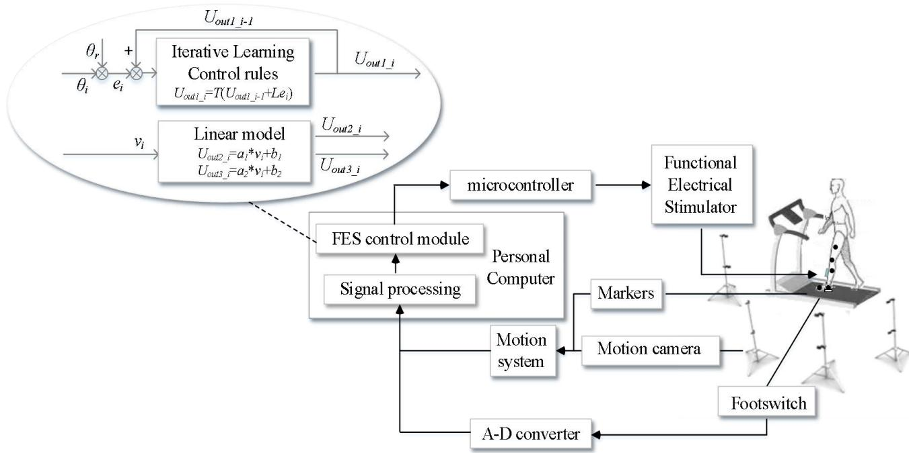
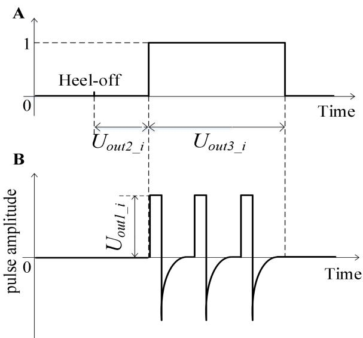
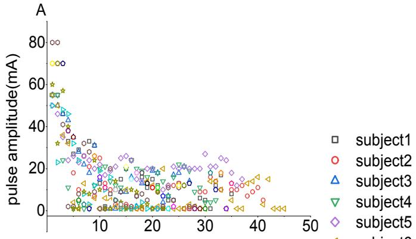
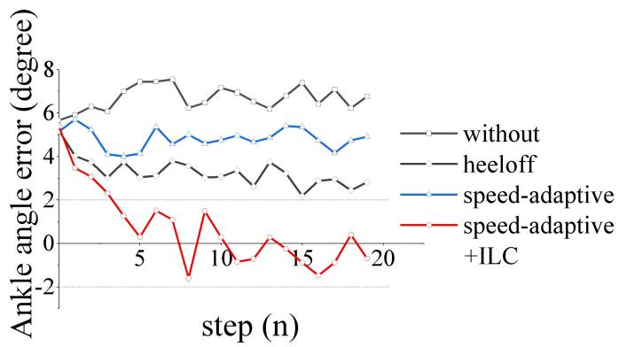
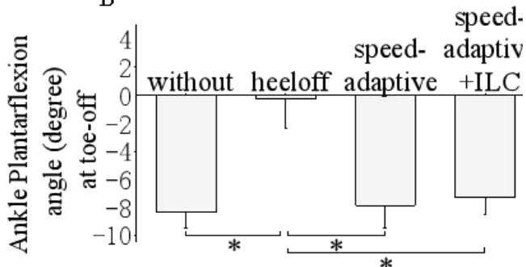

# Iterative Adjustment of Stimulation Timing and Intensity During FES-assisted Treadmill Walking for Patients after Stroke

Chao Jiang #, Manxu Zheng #, Yingqi Li, Xiaoyun Wang, Le Li and Rong Song \*, SeniorMember, IEEE

Abstract—Functional electric stimulation (FES) is a common intervention to correct foot drop for patients after stroke. Due to the disturbances from internal time-varying muscle characteristics under electrical stimulation and external environmental uncertainties, most of the existing FES system used pre-set stimulation parameters and cannot achieve good gait performances during FES-assisted walking. Therefore, an adaptive FES control system, which used the iterative learning control to adjust the stimulation intensity based on kinematic data and a linear model to modulate the stimulation timing based on walking speed during FES-assisted treadmill walking, was designed and tested on ten patients with foot drop after stroke. In order to examine its orthotic effects, the kinematic data of the patients using the proposed control strategy were collected and compared with the data of the same patients walking using other three FES control strategies, including (1) constant pre-set stimulation intensity and timing, (2) constant pre-set stimulation intensity with speed-adaptive stimulation timing and (3) walking without FES intervention. The error between the maximum ankle dorsiflexion angle during swing phase and the target angle using the proposed control strategy was the smallest among the four conditions. Moreover, there was no significant difference in the ankle plantar flexion angle at the toe-off event and the maximum knee flexion angle during swing phase between the proposed control strategy and walking without FES. In summary, the proposed control strategy can improve FES-assisted walking performances through adaptive modulation of stimulation timing and intensity when coping with variation, and may have good potential in clinic.

Index Terms—Functional electrical stimulation (FES), foot drop,iterative learning control (ILC), treadmill

## I. INTRODUCTION

TROKE has become the third leading cause of disability in the world [1]. About 60% of stroke survivors suffer from disability and 20% of them have foot drop [2], an impaired motor function in the lower extremities [3]. The maximum ankle dorsiflexion angle during swing phase of healthy individuals is 4.9° [4], while the angle of patients after stroke is often smaller, which sometimes makes them unable to clear the toes off the ground [5], and cause compensations from other joints like steppage or hip hiking gait [6].

Functional electrical stimulation (FES) is a common intervention to correct foot drop by generating electrical pulses to induce muscle contractions [7]. A typical closed-loop FES system consists of sensors, a controller and a stimulation unit [5]. The sensors, such as inertial measurement unit, footswitch or motion capture system, provide information to the controller [8]. The controller determines stimulation parameters for the stimulation unit based on the information from the sensors [9]. The stimulation unit then delivers stimulation pulses to the muscle tissue to induce muscle contraction for correcting foot drop. The stimulation unit could be surface or implanted stimulators with single or multiple channels. FES was first introduced by Liberson et al.in the 1960s [10], when the FES was delivered to the tibialis anterior (TA) muscle to correct foot drop. However, there are still several important challenges left, especially, the need for adaptive FES control architecture [5]. The FES control architecture adjusts the stimulation timing [11, 12] and intensity [13-18] of electrical pulses, and the placement of electrode to find optimal location [18].

Many previous studies designed their control architecture using open-loop controller, which is a feed forward controller with preset parameters and without feedback information from sensors [19, 20]. In these studies, preset stimulation parameters, such as the stimulation intensity, are used in every gait cycle to correct foot drop. The preset stimulation parameters cannot compensate the disturbances caused by the time-varying muscle characteristics under stimulation and environmental uncertainties. In contrast, the closed-loop controllers can track a preset target, such as a desired ankle joint angle, and compensate the effects caused by internal and external disturbances [5], which makes it suitable to account for the nonlinear, time-varying response of stimulated muscles [9]. There has been a number of studies using different types of closed-loop controllers, and better orthotic effects were found when using closed-loop controllers than those using open-loop controllers during FES-assisted treadmill walking [9, 21]. Chen et al.modulated the stimulation timing of FES adaptively by establishing a linear model between the muscle activation and walking speed, which resulted that not only the ankle dorsiflexion angle was increased, but also the ankle plantar flexion angle remained acceptable [12]. Sabut et al. utilized foot pressure signals to control the stimulation intensity, which corrected foot drop to certain limited extent, but they only tested their systems on a healthy subject [13]. Chen et al.used electromyographic signals to adjust the stimulation intensity, which was found to be beneficial [14]. Thomas et al. controlled the stimulation pulse waveform to correct undesired foot drop in the sagittal and frontal plane by using an Iterative Learning Control (ILC) control, which resulted in the error angles of the foot plantar/dorsiflexion and eversion/inversion to reduce quickly [15-17].

Although both stimulation timing and intensity are important for FES-assisted rehabilitation training, most of previous studies only control one of them. To simultaneously regulate both stimulation timing and intensity, our previous study used a linear model and a fuzzy logic controller, respectively. The results were promising as the average output ankle dorsiflexion angle were increased to a satisfactory average level, while the plantar flexion was consistent with that in walking without FES condition [22]. However, one limitation was that the error between the actual ankle angle and the target angle of each individual step did not reach convergence which might be due to the characteristic of the fuzzy logic algorithm [23]. This convergence limitation may be solved by an ILC controller. The ILC can update control parameters using data from previous trials which makes it able to respond to internal and external disturbances in the system [24-26]. The stable tracking performance of ILC has been seen in two previous studies where it was used to regulate stimulation intensity [15-18, 27, 28].

In order to realize stable FES-assisted treadmill walking, this study developed an adaptive FES control system to simultaneously regulate the stimulation intensity and timing and applied ILC control to solve the above mentioned convergence problem. The designed system was tested on patients with foot drop after stroke and evaluated by knee and ankle kinematics. For comparison, kinematic data of those patients were also collected using three other control architectures during treadmill walking.

## II. METHODS

## A. Subjects

10 participants who had a stroke (8 males and 2 females, Table I), and who had foot drop as defined by a medical doctor, were recruited. The FMA-L, Fugl-meyer motor assessment of lower limb, was conducted by physical therapists in the hospital. The inclusion criteria were that the patients after stroke had the ability to walk on a treadmill independently, and continuously, at least 2 minutes, and the patients should older than 18, younger than 70. In addition, there would be sufficient passive ankle dorsiflexion range of motion to enable the paretic ankle joint to reach at least $4 . 9 ^ { \circ }$ of ankle dorsiflexion with the knee flexed at 90°. Before participating in the experiment, all subjects were informed of the experimental protocol and signed a written informed consent. This study was approved by the Ethics Committee of the Guangdong Work Injury Rehabilitation Center.

## B. Experimental protocol

Before the experiment, the subjects were instructed to walk on a treadmill while holding onto the handrails to find their most comfortable speed [29]. The standing ankle angle was measured in the sagittal plane, which was set as the neutral dorsiflexion/plantarflexion angle (0°) [30]. The positive values of the ankle angle represent ankle dorsiflexion; the negative values represent ankle plantarflexion. During the experiment, the subjects walked in four conditions: walking without FES (without), with FES triggered by heel-off event (heeloff), with FES which stimulation timing was decided by a speed-adaptive model (speed-adaptive) [22], and with FES which stimulation timing was decided by the speed-adaptive model and which stimulation intensity was controlled by ILC (speed-adaptive+ILC). The maximum stimulation intensity was set as the intensity to achieve $4 . 9 ^ { \circ }$ of ankle dorsiflexion when the subjects were seated. If the subjects felt uncomfortable before they can reach $4 . 9 ^ { \circ }$ , then the maximum tolerated stimulation intensity would be used as the maximum stimulation intensity, which was typically used in many previous studies [14,29,31]. In the heeloff condition, the stimulation intensity was set as a constant which equaled to the maximum stimulation intensity, and the FES was triggered and terminated by the heel-off and heel-strike events detected by a footswitch, respectively [28]. In the speed-adaptive condition, the stimulation intensity was set the same as that in the heeloff condition, but the stimulation timing were decided by the established linear model and current walking speed [12]. In the speed-adaptive+ILC condition, the stimulation intensity was regulated according to the ILC rules, and would not exceed the maximum stimulation intensity. The stimulation timing was the same as that in the speed-adaptive condition. Participants performed one walking trail for each of the four conditions, with the order of conditions being randomized. In each trial,the subjects walked two minutes in one condition. There was a two-minute rest between each pair of successive trials to avoid muscle fatigue.

DEMOGRAPHIC AND CLINICAL INFORMATION ABOUT THE SUBJECTS AFTER STROKE  
TABLE I

<table><tr><td>No</td><td>SEX</td><td>Age</td><td>Lesion side</td><td>Months after stroke</td><td>FMA-L</td></tr><tr><td>1</td><td>M</td><td>68</td><td>L</td><td>9</td><td>21/34</td></tr><tr><td>2</td><td>M</td><td>51</td><td>L</td><td>11</td><td>29/34</td></tr><tr><td>3</td><td>M</td><td>32</td><td>L</td><td>8</td><td>28/34</td></tr><tr><td>4</td><td>F</td><td>28</td><td>R</td><td>13</td><td>20/34</td></tr><tr><td>5</td><td>M</td><td>64</td><td>R</td><td>14</td><td>27/34</td></tr><tr><td>6</td><td>M</td><td>52</td><td>R</td><td>10</td><td>30/34</td></tr><tr><td>7</td><td>M</td><td>40</td><td>R</td><td>9</td><td>32/34</td></tr><tr><td>8</td><td>M</td><td>48</td><td>R</td><td>12</td><td>26/34</td></tr><tr><td>9</td><td>F</td><td>56</td><td>R</td><td>18</td><td>31/34</td></tr><tr><td>10</td><td>M</td><td>44</td><td>L</td><td>8</td><td>32/34</td></tr><tr><td>avg</td><td>-</td><td>48.3</td><td>-</td><td>11.2</td><td>27.6/34</td></tr><tr><td>std</td><td>-</td><td>12.8</td><td>-</td><td>3.1</td><td>4.2/34</td></tr></table>

M-male, F-female, L-left, R-right, FMA - Fugl-meyer motor assessment for lower limb

  
Fig. 1. The schematic of the FES combined treadmill system. In the circle block is the proposed controller for the control of ankle joint movement. $\theta _ { i \cdot }$ the maximum ankle dorsiflexion angle of step $i ; ~ \theta _ { r } .$ the reference angle; ei: error signals between target and actual joint angle of step $i ; U _ { o u t I \_ I } :$ output intensity of step $i _ { \ r { i } } { \cdot } U _ { o u t I \_ i - I } { \cdot }$ output intensity of step $i  – I ; T \colon$ the constraint function; L: the proportional learning gain;vi: walking speed of step $i ; a _ { I } , b _ { I } , a _ { 2 } , b _ { 2 } ;$ the parameters of the linear model; $U _ { o u t 2 \_ i }$ : the time interval between the heel-off event and the trigger time of $\mathrm { \Delta \cdot } _ { \mathrm { F E S ; } } U _ { o u t 3 \_ i } \mathrm { \Delta \cdot }$ the duration time of FES.

## C. The structure of system

The structure of the FES rehabilitation system is presented in Fig. 1. The system consisted of a treadmill (G6425-F3, Beistegui Hermanos, Spain), a micro-controller (STC89C52, Amtel, USA), a functional electrical stimulator (P2-9632, Faisco, China), a motion capture system (OptiTrack, NaturalPoint, USA), a footswitch (B-201, Tekscan, USA) and a 16-channel A-D converter (PCIe-6341, National Instrument, Texas, USA). The footswitch was placed under the hind foot to record the heel-off and heel-strike event during walking. The information was transmitted to a personal computer through the A-D converter at a sampling rate of 100Hz. To obtain the kinematic data during walking, there were five 12-mm spherical reflective markers attached to the subject’s lower limb (Fig.1). Five markers from top to bottom were placed on the following anatomical reference locations: the mid-thigh, directly lateral to the estimated average axis of rotation of the knee joint, the midshank, lateral malleolus, and the space between the second and third metatarsal heads [32]. The four infrared cameras in the motion capture system detected the three-dimensional coordinate trajectory of the markers at a sampling rate of 100Hz. Both signals from the AD-converter and the motion capture system were collected and processed by the signal processing module in the personal computer. In this module, the ankle dorsiflexion/plantarflexion angle, knee flexion angle, and walking speed were calculated by the signals of the markers based on a three-segment rigid body model of the lower extremity [32]. Based on the previous linear model between muscle activation and walking speed [12], the FES control module used the walking speed and event state signals from the signal processing module as input signals, then output the time interval between heel-off event and trigger time $( U _ { o u t 2 } )$ and duration $( U _ { o u t 3 } )$ . The ILC rules used the kinematic signals from signal processing module, the target signal and the previous output signal to calculate the current output intensity $( U _ { o u t I } )$ . Finally, through two surface electrical stimulation electrodes (M2223, 3M, USA), the stimulator generated the stimulation current to the TA according to $U _ { o u t I } , \ U _ { o u t 2 }$ and $U _ { o u t 3 }$ (Fig.2). The stimulation intensity ranged from 0 to 120 mA. The pulse width and the stimulation frequency were 390μs and 40Hz, respectively. The stimulation profile was biphasic.

## D. Control strategy

The stimulation timing was decided by the linear models, whose inputs were the walking event state signal detected by the footswitch and the walking speed calculated from the average horizontal coordinate variation of the marker on the toe in previous five steps [33, 34]. The relative motion between the centre of mass of the participant and the treadmill was not considered in this study.

The output $U _ { o u t 2 \_ i }$ and $U _ { o u t 3 \_ i }$ determined the stimulation timing of step i. When footswitch detected the heel-off event of step $i ,$ after a linear speed-adaptive time interval $U _ { o u t 2 \_ i ; }$ , the stimulation was triggered. And after another linear speed-adaptive duration time $U _ { o u t 3 \_ i ; }$ , the stimulation is terminated [12]. The two linear models were

$$
U _ {o u t 2 \_ i} = - 1 1 1. 7 ^ {*} v _ {i} + 4 1 6. 9\tag{1}
$$

$$
U _ {o u t 3 i} = - 2 1 3. 2 ^ {*} v _ {i} + 8 7 7. 7\tag{2}
$$

The unit of $U _ { o u t 2 \_ i }$ and $U _ { o u t 3 \_ i }$ was second, and the unit of v was meters per second. In this study, the stimulator output the stimulation current during the duration time $U _ { o u t 3 \_ i }$ as shown in Fig. 2.

The target angle of the ankle dorsiflexion during swing phase was set as 4 $. 9 ^ { \circ } \left[ 4 \right]$ . The ILC rules are as follows:

$$
U _ {o u t 1 \_ i} = \left\{ \begin{array}{c c} \bar {u} & \text {if} U _ {o u t 1 \_ i - l} + L e _ {i} > \bar {u} \\ U _ {o u t 1 \_ i - l} + L e _ {i} & \text {if} 0 \leq U _ {o u t 1 \_ i - l} + L e _ {i} \leq \bar {u} \\ 0 & \text {if} U _ {o u t 1 \_ i - l} + L e _ {i} <   0 \end{array} \right.\tag{,(3}
$$

where $e _ { i }$ is the error between the actual maximum ankle dorsiflexion angle during swing phase and the target angle of step $i ; U _ { o u t I }$ i is the output stimulation intensity of step $i ,$ $U _ { o u t I \_ i - I }$ is the output stimulation intensity of step $i { - } I _ { ; }$ , the initial intensity of the first step is the maximum stimulation intensity, the $L$ is a constant, which is obtained

by experience on healthy subjects [25], the $u$ is the maximum stimulation intensity.

## E. Data analysis

A second-order, zero-phase, low-pass Butterworth filter with a cutoff frequency of 15Hz was employed to filter the kinematic data. The maximum ankle dorsiflexion angle during swing phase, the ankle plantar flexion angle at the toe-off event and the maximum knee flexion angle during swing phase were calculated and averaged across 40-50 successive steps in each trial [21].

The Kolmogorov-Smirnov test was used to assess the above-mentioned variables to ensure normality. Then, a one-way analysis of the variance with repeated measures was conducted on all the data to analyze the influence of conditions (without, heeloff, speed-adaptive,and speed-adaptive+ILC) on the above-mentioned variables with a Bonferroni Post hoc.. The level of significance was set at 0.05. The statistical analyses were performed by SPSS 19 (SPSS, Inc., Chicago, IL, USA).

  
Fig. 2. (A) stimulation timing schematic in one stride, 0 represents no output stimulation current; 1represents the stimulator outputs stimulation current; $U _ { o u t 2 \_ i }$ i is the time interval between the heel-off event and the trigger time of FES determined by the linear model of step i(equation (1)); $\bar { U _ { o u t 3 } }$ i is the duration time of FES determined by the other linear model of step i(equation (2)); (B) the biphasic pulse profile is the stimulation current the stimulator output to the TA ; the pulse amplitude is decided by the $U _ { o u t I _ { - } }$ i which is calculated by the ILC controller of step i(equation (3)); the pulse width and frequency are 390μsand 40Hz which are constant in the experiment. Note: Figure not drawn to scale.

## III. RESULTS

Fig.3A and Fig.3B show the actual output stimulation intensity and the error between the actual maximum ankle dorsiflexion angle during swing phase and the target angle of each successive step when subject2 performed FES-assisted treadmill walking in the speed-adaptive+ILC condition, respectively. The average output stimulation intensity was20.2mA, 70mA, 70mA and 0mA in the speed-adaptive+ILC, speed-adaptive, heeloff and without conditions, respectively. In the beginning of the trial, both the error and the intensity were relatively large. And the error between the maximum ankle dorsiflexion angle and the target angle decreased to less than $2 ^ { \circ }$ after approximately five steps.

Fig.4 shows the error between the actual maximum ankle dorsiflexion angle during swing phase and the target angle when subject2 performed FES-assisted treadmill walking in the four conditions. The mean  standard deviation of the error were $6 . 7 ^ { \circ } \ : \pm \ : 0 . 6 ^ { \circ } , \ : 3 . 3 ^ { \circ } \ : \pm \ : 0 . 7 ^ { \circ }$ 2 $4 . 8 ^ { \circ } ~ \pm ~ 0 . 5 ^ { \circ } , ~ 0 . 6 ^ { \circ } ~ \pm ~ 1 . 7 ^ { \circ }$ in the without, heeloff, speed-adaptive and speed-adaptive+ILC conditions. The mean error in the speed-adaptive+ILC condition was the smallest among the four conditions (p<0.05).

  
A

  
Fig. 3. (A)the actual output stimulation intensity and (B) the error between the actual maximum ankle dorsiflexion during swing phase and the target angle o each successive step when the ten subjects performed FES-assisted treadmill walking in the speed-adaptive+ILC conditions.

Fig.5 presents the mean ankle dorsiflexion/plantarflexion and knee flexion angles in a normalized gait cycle (starting from heel-strike event) of subject2 in the four conditions.

Fig.6A presents the average maximum ankle dorsiflexion angle during swing phase of the 10 subjects in the four condition. The average maximum ankle dorsiflexion angle were -5.1°, 1.2°, 1.7° and $3 . 9 ^ { \circ }$ in the without, heeloff, speed-adaptive and speed-adaptive+ILC conditions, respectively. The average maximum ankle dorsiflexion angle in the without condition was significantly smaller than that in each of the other three conditions (P<0.05), while the average maximum ankle dorsiflexion angle in speed-adaptive+ILC condition was significantly larger than that in each of the other three conditions (P<0.05). The average maximum ankle dorsiflexion angle in the heeloff condition was significantly larger than that in the speed-adaptive condition (P<0.05). Fig.6B presents the peak ankle plantar flexion angle at the toe-off event of the 10 subjects in the four conditions. The average peak ankle plantar flexion angle were $- 8 . 3 ^ { \circ } , \ - 0 . 3 ^ { \circ } , \ - 7 . 8 ^ { \circ }$ and $\cdot 7 . 3 ^ { \circ }$ in the without, heeloff, speed-adaptive and speed-adaptive+ILC conditions, respectively. The average peak ankle plantar flexion angle in the heeloff condition was significantly smaller than that in each of the other three conditions (P<0.05). No significant differences were found between each two of the other three walking conditions (P<0.05). Fig. 6C presents the peak knee flexion angle during swing phase of the 10 subjects in the four conditions. The average peak knee flexion angle were $3 4 . 9 ^ { \circ } , 3 2 . 2 ^ { \circ } , 3 4 . 5 ^ { \circ }$ and $3 5 . 2 ^ { \circ }$ in without, heeloff, speed-adaptive and speed-adaptive+ILC conditions, respectively. The average peak knee flexion angle in the heeloff condition was significantly smaller than that in each of the other three conditions (P<0.05). No significant differences were found in knee flexion angle between each two of the other three walking conditions (P<0.05).

  
Fig. 4. The error between the actual maximum ankle dorsiflexion angle during swing phase and the target angle when subject2performed FES-assisted treadmill walking in the without, heeloff, speed-adaptive, and speed-adaptive+ILC conditions.

  
Fig. 5. The (A) ankle plantarflexion/dorsiflexion and (B) knee flexion angles in a gait cycle ofsubject2 and a healthy subject. The vertical dashed lines presents the heel-off (left) and the toe-off event (right).

B  

  
Fig. 6. (A) maximum ankle dorsiflexion angles during swing phase, (B) ankle plantar flexion angles at toe-off event and (C) maximum knee flexion angles during swing phase for 10 subjects after stroke. \*Significant difference (P < 0.05).

## IV. DISCUSSION

In this study, a new adaptively controlled FES system was established, which regulated the stimulation timing and intensity using a linear model and an ILC controller, respectively. The maximum ankle dorsiflexion angle during the swing phase, the ankle plantar flexion angle at the toe-off event and the maximum knee flexion angle during swing phase were analyzed to evaluate the orthotic effects in the proposed speed-adaptive+ILC condition compared with those in the without, heeloff, and speed-adaptive conditions.

In normal gaits, the interval between the activation of TA and the heel-off event and the duration from activation to termination of TA is related to the walking speed [35]. The stimulation timing of FES were set more physiologically appropriately in the speed-adaptive condition than those in the heeloff condition [12, 22]. This study confirmed this finding that both of the ankle plantar flexion angle at the toe-off event and the maximum knee flexion angle during the swing phase increased in the speed-adaptive and speed-adaptive+ILC conditions in comparison with that in the heeloff condition. The decreased maximum knee flexion angle during swing phase was related to the decreased ankle plantar flexion angle at the toe-off event in the heeloff condition. This can be explained by the fact that, in the heeloff condition, the FES was triggered and terminated by the heel-off and heel-strike events [10], respectively, which has long been criticized for decreasing forward propulsive force [29]. Instead of triggered by the heel-off event, the stimulation timing in speed-adaptive+ILC condition was set the same as that in the speed-adaptive condition, which has been proven to be a more appropriate stimulation timing [12]. Both the ankle plantar flexion and maximum knee flexion angles in the speed-adaptive and speed-adaptive+ILC conditions were found to be consistent with those walking without FES as shown in Fig.6. Therefore, it can be found that the proposed speed-adaptive+ILC control can produce similar natural FES-assisted walking to the previous study using only the speed-adaptive control [12].

However, the maximum ankle dorsiflexion angle in the speed-adaptive condition were smaller than that in the heeloff condition, which indicated that only regulating the stimulation timing was not enough. Therefore, the iterative adjustment of the stimulation intensity from cycle to cycle in the speed-adaptive+ILC condition was necessary. It was found that the maximum ankle dorsiflexion angle during swing phase was improved with speed-adaptive+ILC compared to speed-adaptive alone. The stimulation intensity of the speed-adaptive+ILC were smaller than those in the speed-adaptive and heeloff conditions, which might imply that minimum assistance was provided from the FES induced muscle contraction in this condition. Since ankle dorsiflexion resulted from both the patients voluntary muscle contraction and the FES induced muscle contraction, the speed-adaptive+ILC can promote muscle voluntary contraction, which is consistent with a previous statement [24]. In the speed-adaptive+ILC condition, the output FES intensity could be updated for each new step based on previous steps, which ensured the response to the disturbances from internal time-varying muscle characteristics under electrical stimulation and external environmental uncertainties in the system [24]. Moreover, the smaller stimulation intensity in the speed-adaptive+ILC condition in comparison with those in the speed-adaptive and heeloff conditions may be effective to avoid muscle fatigue, since overlarge intensity can cause exaggerated foot lift during swing phase which leads to rapid muscle fatigue [21]. In previous study, ILC control was also found to reduce the stimulation intensity [15].

The proposed speed-adaptive+ILC condition achieved the most stable maximum ankle dorsiflexion angle during swing phase among the four conditions indicated by the error converged to $0 ^ { \circ }$ after five steps and could remained close to $0 ^ { \circ }$ in the following steps by the continuous adaptive adjustment of the stimulation intensity. By contrast, in the other three conditions, the errors did not converge to $0 ^ { \circ }$

Despite the merits using speed-adaptive+ILC, there were still some limitations in this study. FES-assisted treadmill walking with different walking speeds were not included in this study. Future research will be conducted to analyze the orthotic effects of the proposed control architecture with changing speeds. Secondly, in the experiment, only the three joint angles were used to evaluate the performance of the FES-assisted walking. More evaluation indexes, such as the anterior ground reaction force,will be included in future studies. Thirdly, foot eversion/inversion will also be considered in the next stage.

## V. CONCLUSION

A FES system was proposed which used a linear model and ILC to control the stimulation timing and intensity, respectively. The proposed control architecture in this study was able to produce a stable and better orthotic effects for foot drop patients during FES-assisted treadmill walking compared to the three other conditions. The proposed control can improve FES-assisted walking performance, and may have good potential in clinic.

## ACKNOWLEDGMENT

The authors thanks the Key Laboratory of Sensing Technology and Biomedical Instrument of Guangdong Province, Guangdong Work Injury Rehabilitation Center, and the stroke rehabilitation teams of the First Affiliated Hospital of Sun Yat-sen University. We also very appreciate the enthusiastic participation of persons who were engaged in this study.

## REFERENCES

[1] W. Johnson, O. Onuma, M. Owolabi, and S. Sachdev, "Stroke: a global response is needed,"Bulletin of the World Health Organization, vol. 94, pp. 634-634A, 2016.

[2] C. A. Johnson, J. H. Burridge, P. W. Strike, D. E. Wood, and I. D. Swain, "The effect of combined use of botulinum toxin type A and functional electric stimulation in the treatment of spastic drop foot after stroke: a preliminary investigation,"Archives ofphysical medicine and rehabilitation, vol. 85, pp. 902-909, 2004.

[3] N. Neckel, M. Pelliccio, D. Nichols, and J. Hidler, "Quantification of functional weakness and abnormal synergy patterns in the lower limb of individuals with chronic stroke,"Journal of neuroengineering and rehabilitation, vol. 3, p. 17, 2006.

[4] A. Arifin, T. Watanabe, and N. Hoshimiya, "Fuzzy controller for cycle-to-cycle control of swing phase of FES-induced hemiplegic gait: a computer simulation in two-joints control," in Proceedings of the 25th Annual International Conference of the IEEE Engineering in Medicine and Biology Society (IEEE Cat. No. 03CH37439), 2003, pp. 1519-1522.

[5] P. Melo, M. Silva, J. Martins, and D. Newman, "Technical developments of functional electrical stimulation to correct drop

foot: Sensing, actuation and control strategies,"Clinical Biomechanics, vol. 30, pp. 101-113, 2015.

R. Don, M. Serrao, P. Vinci, A. Ranavolo, A. Cacchio, F. Ioppolo, et al., "Foot drop and plantar flexion failure determine different gait strategies in Charcot-Marie-Tooth patients,"Clinical biomechanics, vol. 22, pp. 905-916, 2007.

[7] H. Ring, I. Treger, L. Gruendlinger, and J. M. Hausdorff, "Neuroprosthesis for footdrop compared with an ankle-foot orthosis: effects on postural control during walking,"Journal of stroke and cerebrovascular diseases, vol. 18, pp. 41-47, 2009.

[8] G. Zouridakis, Biomedical technology and devices handbook: CRC press, 2003.

[9] C. Lynch and M. Popovic, "Closed-loop control for FES: Past work and future directions," in 10th Annual Conference of the International FES Society, 2005, pp. 2-4.

[10] W. T. Liberson, H. J. Holmquest, D. Scot, and M. Dow, "Functional electrotherapy: stimulation of the peroneal nerve synchronized with the swing phase of the gait of hemiplegic patients,"Am JPhys Med Rehabil, vol. 42, p. 101, 1961.

[11] E. G. Spaich, M. F. Bøg, E. Erkocevic, A. Smidstrup, O. K. Andersen, and J. F. Nielsen, "Gait orthosis lokomat combined with functional electrical stimulation for foot drop correction: a feasibility study," in Replace, Repair, Restore, Relieve–Bridging Clinical and Engineering Solutions in Neurorehabilitation, ed: Springer, 2014, pp. 751-757.

[12] G. Chen, L. Ma, R. Song, L. Li, X. Wang, and K. Tong, "Speed-adaptive control of functional electrical stimulation for dropfoot correction,"Journal of neuroengineering and rehabilitation, vol. 15, p. 98, 2018.

[13] S. K. Sabut, R. Kumar, and M. Mahadevappa, "Design of an insole embedded foot pressure sensor controlled FES system for foot drop in stroke patients," in 2010 International Conference on Systems in Medicine and Biology, 2010, pp. 237-241.

[14] W.-L. Chen, S. Chen, C. Chen, C. Chou, Y. Shih, Y. Chen, et al., "Patient-driven loop control for ambulation function restoration in a non-invasive functional electrical stimulation system,"Disability and rehabilitation, vol. 32, pp. 65-71, 2010.

[15] T. Seel, M. Valtin, C. Werner, and T. Schauer, "Multivariable control of foot motion during gait by peroneal nerve stimulation via two skin electrodes,"IFAC-PapersOnLine, vol. 48, pp. 315-320, 2015.

[16] T. Seel, D. Laidig, M. Valtin, C. Werner, J. Raisch, and T. Schauer, "Feedback control of foot eversion in the adaptive peroneal stimulator," in 22nd Mediterranean Conference on Control and Automation, 2014, pp. 1482-1487.

[17] T. Seel, C. Werner, and T. Schauer, "The adaptive drop foot stimulator–Multivariable learning control of foot pitch and roll motion in paretic gait,"Medical engineering & physics, vol. 38, pp. 1205-1213, 2016.

[18] M. Valtin, T. Seel, J. Raisch, and T. Schauer, "Iterative learning control of drop foot stimulation with array electrodes for selective muscle activation,"IFAC Proceedings Volumes, vol. 47, pp. 6587-6592, 2014.

[19] G. M. Lyons, T. Sinkjær, J. H. Burridge, and D. J. Wilcox, "A review of portable FES-based neural orthoses for the correction of drop foot,"IEEE Transactions on neural systems and rehabilitation engineering, vol. 10, pp. 260-279, 2002.

[20] R. Perumal, T. Kesar, A. Wexler, and S. Binder-Macleod, "Novel FES system to stimulate both dorsi-and plantar-flexor muscles during stroke gait," in 12th Annual Conference of the International FES Society, 2007.

[21] C. L. Lynch and M. R. Popovic, "Functional electrical stimulation,"IEEE control systems magazine, vol. 28, pp. 40-50, 2008.

[22] G. Chen, Z. Shen, Y. Zhuang, X. Wang, and R. Song, "intensity-and Duration-adaptive Functional electrical stimulation Using Fuzzy logic control and a linear Model for Dropfoot correction,"Frontiers in neurology, vol. 9, p. 165, 2018.

[23] K. Yin, M. Pang, K. Xiang, J. Chen, and S. Zhou, "Fuzzy iterative learning control strategy for powered ankle prosthesis,"International Journal of Intelligent Robotics and Applications, vol. 2, pp. 122-131, 2018.

[24] C. T. Freeman, E. Rogers, A.-M. Hughes, J. H. Burridge, and K. L. Meadmore, "Iterative learning control in health care: Electrical stimulation and robotic-assisted upper-limb stroke

rehabilitation,"IEEE Control Systems Magazine, vol. 32, pp. 18-43, 2012.

[25] S. Arimoto, S. Kawamura, and F. Miyazaki, "Bettering operation of robots by learning,"Journal of Robotic systems, vol. 1, pp. 123-140, 1984.

[26] P. Müller, C. Balligand, T. Seel, and T. Schauer, "Iterative learning control and system identification of the antagonistic knee muscle complex during gait using functional electrical stimulation,"IFAC-PapersOnLine, vol. 50, pp. 8786-8791, 2017.

[27] H. Nahrstaedt, T. Schauer, R. Shalaby, S. Hesse, and J. Raisch, "Automatic Control of a Drop‐Foot Stimulator Based on Angle Measurement Using Bioimpedance,"Artificial organs, vol. 32, pp. 649-654, 2008.

[28] I. Pappas, T. Keller, S. Mangold, M. R. Popovic, V. Dietz, and M. Morari, "A reliable gyroscope-based gait-phase detection sensor embedded in a shoe insole," in Sensors, IEEE, 2002.

[29] T. M. Kesar, R. Perumal, A. Jancosko, D. S. Reisman, K. S. Rudolph, J. S. Higginson, et al., "Novel patterns of functional electrical stimulation have an immediate effect on dorsiflexor muscle function during gait for people poststroke,"Physical therapy, vol. 90, pp. 55-66, 2010.

[30] G. Wu, S. Siegler, P. Allard, C. Kirtley, A. Leardini, D. Rosenbaum, et al., "ISB recommendation on definitions of joint coordinate system of various joints for the reporting of human joint motion--part I: ankle, hip, and spine. International Society of Biomechanics,"Journal of Biomechanics, vol. 35, pp. 543-548, 2002.

[31] T. Seel, C. Werner, J. Raisch, and T. Schauer, "Iterative learning control of a drop foot neuroprosthesis—Generating physiological foot motion in paretic gait by automatic feedback control,"Control Engineering Practice, vol. 48, pp. 87-97, 2016.

[32] M. P. Kadaba, H. K. Ramakrishnan, and M. E. Wootten, "Measurement of lower extremity kinematics during level walking,"Journal of Orthopaedic Research, vol. 8, pp. 383-92, 1990.

[33] J. Zeni Jr, J. Richards, and J. Higginson, "Two simple methods for determining gait events during treadmill and overground walking using kinematic data,"Gait & posture, vol. 27, pp. 710-714, 2008.

[34] Y.-H. Lee, S. Y. Yong, S. H. Kim, J. H. Kim, J. M. Shinn, Y. Kim, et al., "Functional electrical stimulation to ankle dorsiflexor and plantarflexor using single foot switch in patients with hemiplegia from hemorrhagic stroke,"Annals of rehabilitation medicine, vol. 38, p. 310, 2014.

[35] C. C. Monaghan, R. W. J. B. M. Van, and P. H. Veltink, "Control of triceps surae stimulation based on shank orientation using a uniaxial gyroscope during gait,"Medical & Biological Engineering & Computing, vol. 47, pp. 1181-1188, 2009.