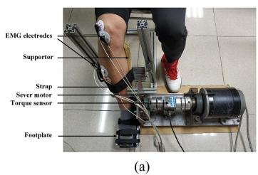
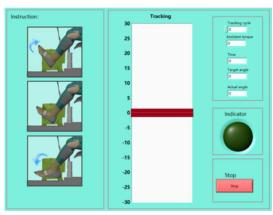
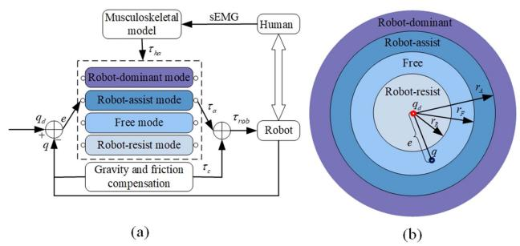
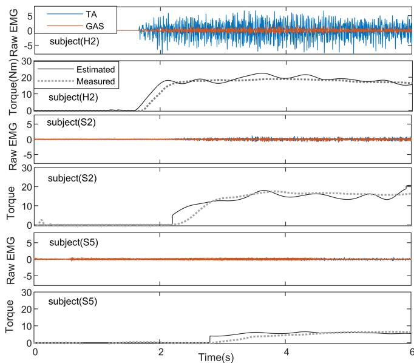
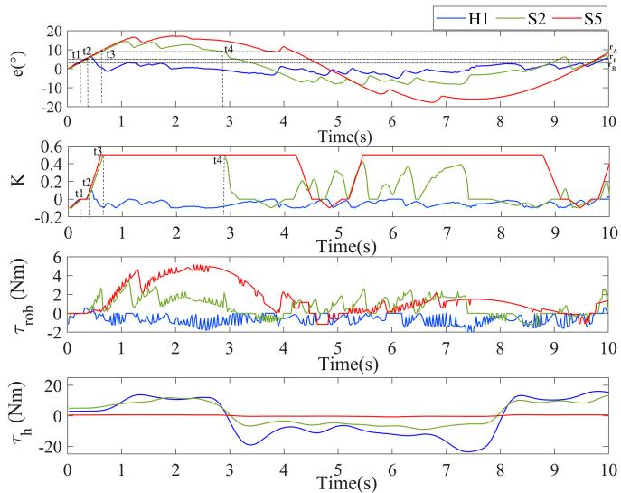
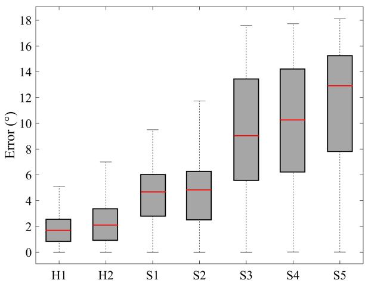
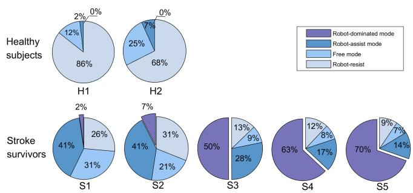
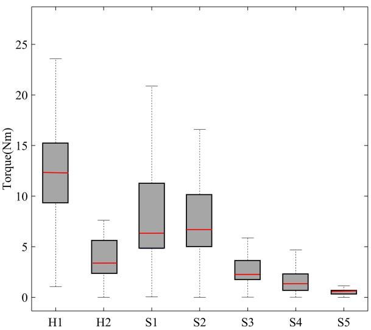

# 踝关节助力康复机器人的自主按需辅助控制器

Renyu Yang , Zhihang Shen, Yueling Lyu, Yu Zhuang, Le Li , and Rong Song , Senior Member, IEEE

摘要—目的：尽管现有的按需辅助（Assist-as-Needed, AAN）控制器被设计用于根据患者的运动表现来调整机器人辅助力，但它们忽略了患者的主动参与。本研究为踝关节康复机器人提出了一种兼顾运动表现和主动参与的自主按需辅助（Voluntary AAN, VAAN）控制器。方法：根据人机协同运动的轨迹跟踪误差，控制器可在四种工作模式之间切换，包括机器人阻抗、自由、机器人辅助和机器人主导模式。为了反映患者的主动参与，通过肌电（EMG）驱动的肌肉骨骼模型估计踝关节的自主力矩。在机器人阻抗、自由和机器人辅助模式下的控制力矩由踝关节自主力矩乘以辅助比例决定，以鼓励受试者主动参与，而在机器人主导模式下则提供刚性力矩。该控制器在踝关节康复机器人上对 2 名健康受试者和 5 名中风患者进行了评估，以探究其对中风患者的临床影响。结果：实验结果表明，随着患者残疾程度的增加，轨迹跟踪误差增大，人主导时间的比例和踝关节自主力矩减小。此外，结果表明所提出的 VAAN 控制器比以往研究取得了更高的人体贡献率。结论：所提出的 VAAN 控制器能够使工作模式自适应运动表现，并促进受试者主动参与。意义：基于其表现，所提出的 VAAN 控制器在机器人辅助康复中具有应用潜力。

索引词—主动参与，踝关节康复机器人，人机协同，表现自适应，自主力矩。

## I. 引言

超过 80% 的中风患者可能会遭受偏瘫运动功能障碍，并给家庭带来巨大负担 [1], [2]。康复训练可以帮助患者恢复受损肢体的功能性使用 [3]。康复机器人可以为患者提供重复性、可持续且定制化的康复训练，以促进运动功能的恢复 [4]。因此，研究人员设计了多种康复机器人，例如用于上肢康复的 7-DOF CAREX [5]、用于手部康复的 Rutgers [6]、用于下肢康复的 ReWalk [7]、用于踝关节康复的机器人辅助 AFO [8] 等。

控制策略对于使机器人能够适应不同运动功能障碍程度的患者至关重要。对于重度功能障碍患者，可以采用比例-积分-微分（PID，proportion integration differentiation）控制策略等轨迹跟踪控制策略，以辅助患者肢体跟踪预设轨迹 [9]。此类轨迹跟踪控制策略通常为患者提供一致的引导，而未考虑人机交互，因此提出了阻抗控制策略，通过设置合适的阻抗参数增益来实现机器人与患者之间的顺应性行为 [10]。对于较轻度损伤的患者，已开发出配重平衡辅助（counterbalancing assistance）以在步态训练中支撑肢体重量 [11]。对于轻微损伤的患者，当患者的运动轨迹接近期望轨迹时，在上肢康复外骨骼中使用阻尼力 [12]。上述控制策略存在的问题在于，它们没有考虑不同运动功能障碍程度患者的运动表现。按需辅助（AAN，Assist-as-needed）控制器被提出来根据运动表现为患者提供完成动作所需的最小机器人辅助 [13]。Pehlivan 等人采用了一种 AAN 控制器，并引入了反馈增益修正算法，根据患者的运动表现计算必要的辅助力 [14]。力场控制策略被定义为根据患者的运动表现来调节辅助力 [2]，

(b)

[15]。多模态控制策略已被证实可用于实现康复机器人的 AAN 控制器 [16], [17]。

在康复训练过程中应鼓励患者主动参与，以实现神经肌肉的快速恢复 [18], [19], [20]。大多数控制策略基于人机物理交互来提取运动意图 [21]。与人机交互力矩相比，肌电（EMG，electromyography）信号可能是反映运动意图的更好方式，因为它们包含丰富的肌肉活动信息，并拥有成熟且快速的无创采集技术 [22]。Krebs 等人提出了一种 EMG 触发控制器，仅当患者的 EMG 值达到特定阈值时才触发机器人辅助 [23]。但该方法无法实现基于 EMG 的连续控制，部分研究通过建立线性 [24], [25] 或非线性 [26] 物理模型来关联机器人辅助与 EMG 值，从而解决了这一问题。EMG 驱动的 Hill 型肌肉骨骼模型（一种非线性物理模型）被用于反映主动参与度，因为它们能够根据生理学和解剖学机制高精度地估计自主力矩 [27]。

虽然一些按需辅助（AAN）控制器能够根据不同运动功能障碍程度患者的运动表现提供辅助 [13], [14], [15], [16], [17]，但它们忽略了患者的主动参与。肌电（EMG）信号此前已被用于估计人体主动力矩并反映其运动意图，但在文献 [19], [28], [29] 中采用了固定的辅助比例，无法实现 AAN 控制器。虽然文献 [30], [31] 中利用 EMG 信号来估计人体主动力矩，但在其研究中，AAN 控制器仅用于根据协作跟踪性能来补偿人体力矩输出，而未在机器人辅助模式下促进受试者的主动参与，且未在中风患者中进行验证。据我们所知，将实现 AAN 控制器与促进患者主动参与相结合是至关重要的，但在以往的研究中尚属空白。在本文中，我们提出了一种新型的主动按需辅助（VAAN）控制器，它既能适应患者的运动表现，又能促进其主动参与。首先，根据人机协作运动的轨迹跟踪误差，该控制器被设计在四种工作模式（机器人阻抗、自由、机器人辅助和机器人主导模式）之间切换，以使其适应运动表现。其次，为了反映受试者的主动参与，踝关节的主动力矩通过 EMG 驱动的肌肉骨骼模型进行估计，并且四种工作模式之间的差异由辅助比例的不同取值来确定。

## II. 系统描述

踝关节康复机器人如图 1(a) 所示，由铝制脚踏板、带光电编码器的交流伺服电机（DM1B-045G, Yokogawa, Japan）、电机驱动器（UB1DG3, Yokogawa, Japan）、电机控制器（GTS-400-PV(G)-PCI, Googoltech, Hong Kong）、力矩传感器（AKC-205，中国航天科技集团公司第七〇一研究所，China）、数据采集设备（USB-6341 DAQ 卡, National Instruments, USA）以及运行 LabVIEW（National Instruments, USA）软件的个人计算机（PC）组成。力矩传感器的两端分别连接到脚踏板和伺服电机。EMG 电极和八通道 EMG 放大器用于采集受试者的 EMG 信号。该机器人在矢状面上具有一个自由度（DOF）（跖屈/背屈）。图 1(b) 展示了用户界面，该界面为受试者提供视觉反馈。为确保康复训练期间每位受试者的安全，脚踏板周围设置了两个机械限位器以限制角度范围，并在软件程序中限制了伺服电机的输出力矩。

Fig. 1. (a) 踝关节康复系统照片。(b) 用户界面。  
  
Fig. 2. (a) 踝关节康复系统控制框图。(b) 控制模式。

## III. 控制策略

整体控制框图如图 2(a) 所示。机器人的输出力矩 $\tau _ { r o b }$ 由 $\tau _ { a }$ 和 $\tau _ { c }$ 组成。$\tau _ { a }$ 为控制力矩，$\tau _ { c }$ 为针对足底板重力和摩擦力的补偿力矩，其中摩擦力采用了广泛使用的摩擦力矩模型 [32]。根据轨迹跟踪误差，控制器在四种工作模式之间进行切换，包括机器人阻力模式、自由模式、机器人助力模式和机器人主导模式，如图 2(b) 所示。前三种控制模式为人主导模式，其中 $\tau _ { a }$ 由踝关节主动力矩 $\tau _ { h a }$ 乘以助力比率 $K$ 决定。踝关节主动力矩 $\tau _ { h a }$ 通过肌电（EMG）驱动的 Hill 型肌肉骨骼模型进行估计，该模型能够检测患者的运动意图 [28]。而在机器人主导模式下，$\tau _ { a }$ 则是基于轨迹跟踪误差的刚性力矩。

## A. 控制模式

轨迹跟踪误差表示为

$$
e = q _ {d} - q\tag{1}
$$

其中 $q _ { d }$ 为期望角度，$q$ 为实际角度。

为了体现受试者的主动参与，在机器人阻力、自由和机器人助力模式下，$\tau _ { a }$ 为踝关节主动力矩 $\tau _ { h a }$ 与助力比率 K 的乘积。K 在机器人阻力、自由和机器人助力模式下分别取负值、0 和正值。K 的幅值由运动表现决定，将在后文进行设计。在这三种控制模式下，$\tau _ { a }$ 的值定义为：

$$
\tau_ {a} = K \tau_ {h a}, | e | \leq r _ {A}\tag{2}
$$

其中 $r _ { A }$ 为阈值。

1) 机器人阻力模式：当 $| e | \le r _ { R }$ 时，控制器切换至机器人阻力模式，其中 r 为阈值。控制器判断受试者在踝关节运动中表现完美。可以给予适当的阻力来训练其肌肉力量。此时：

$$
K = - K _ {r}, \quad | e | \leq r _ {R}\tag{3}
$$

其中 $K _ { r }$ 为阻力比率，可根据轨迹跟踪误差进行自适应调节。$K _ { r }$ 的自适应调节通过遗忘因子实现，并通过以下迭代方程计算得出：

$$
K _ {r _ {i}} = f _ {g} K _ {r _ {i - 1}} + (1 - f _ {g}) K _ {r, e}\tag{4}
$$

$$
K _ {r, e} = (r _ {R} - | e |) K _ {r, \mathrm{max}} / r _ {R}\tag{5}
$$

其中 $K _ { r _ { i } }$ 和 $K _ { r _ { i - 1 } }$ 分别是第 k 次和第 $k - 1$ 次迭代时的阻力比值，$f _ { g } \mathrm { i s }$ 为遗忘因子，表示第 $k - 1$ 次迭代时的阻力比对第 k 次的贡献，$K _ { r , e }$ 是轨迹跟踪误差对 $K _ { r _ { i } }$ 的贡献，而 $K _ { r , \mathrm { m a x } }$ 是阻力比的最大值。根据 (4) 和 (5)，$K _ { r }$ 随轨迹跟踪误差的减小而增大，反之亦然。

2) 自由模式（Free Mode）：当 $r _ { R } < | e | \leq r _ { F }$ 时，控制器切换到自由模式，其中 $r _ { F }$ 为阈值。此时判定受试者表现良好，可以自行完成运动。在这种情况下，机器人不施加任何干预，K 设置为 0。

$$
K = 0, r _ {R} <   | e | \leq r _ {F}\tag{6}
$$

3) 机器人辅助模式（Robot-Assist Mode）：当 $r _ { F } < | e | \le r _ { A }$ 时，控制器将切换到机器人辅助模式。在这种情况下，判定受试者的运动表现较差，需要适当的辅助来完成运动。

$$
K = K _ {a}, r _ {F} <   | e | \leq r _ {A}\tag{7}
$$

其中 $K _ { a }$ 为辅助比，可根据轨迹跟踪误差进行自适应调整。$K _ { a }$ 的自适应通过遗忘因子实现，并通过以下迭代方程获得：

$$
K _ {a _ {i}} = f _ {g} K _ {a _ {i - 1}} + (1 - f _ {g}) K _ {a, e}\tag{8}
$$

$$
K _ {a, e} = (r _ {A} - | e |) K _ {a, \max} / (r _ {A} - r _ {F})\tag{9}
$$

其中 $K _ { a _ { i } }$ 和 $K _ { a _ { i - 1 } }$ 分别是第 k 次和第 $k - 1$ 次迭代时的辅助比值，$K _ { a , \epsilon }$ e 是轨迹跟踪误差对 $K _ { a _ { i } }$ 的贡献，而 $K _ { a , \mathrm { m a x } }$ 是辅助比的最大值。根据 (8) 和 (9)，若轨迹跟踪误差增大，则 $K _ { a }$ 将增大，反之亦然。

4) 机器人主导模式（Robot-Dominant Mode）：当 $| e | > r _ { A }$ 时，轨迹跟踪误差变得非常大，控制器将切换到机器人主导模式。在这种情况下，受试者的运动表现被判定为异常，控制器提供刚性力矩以确保受试者的安全：

$$
\tau_ {a} = K \left(\left| e \right| - r _ {A}\right), \quad \left| e \right| > r _ {A}\tag{10}
$$

其中 K 设置为 0.5。

## B. Hill-Type Musculoskeletal Model（Hill 型肌骨模型）

在本研究中，采用 Hill 型肌骨模型来估计受试者在康复训练过程中的实时踝关节自主力矩。该模型的输入为受试者的 EMG 信号和踝关节角度，输出为踝关节自主力矩。该模型由四部分组成：肌肉激活模型、肌骨几何模型、基于 Hill 的肌-腱模型以及踝关节动力学模型 [33]。

1) 在肌肉激活模型中，首先放大 EMG 信号，并利用最大自主收缩（MVC）水平进行归一化。然后，利用全波整流和 2 Hz 带通二阶巴特沃斯（Butterworth）滤波器获取处理后的 EMG 信号包络 $e ( t )$。基于 $e ( t )$，神经激活 $u ( t )$ 可表示如下 [34]：

$$
u (t) = 0. 9 4 8 6 e (t - d) + 0. 0 5 2 u (t - 1) - 0. 0 0 0 6 2 7 u (t - 2)\tag{11}
$$

其中机电延迟（EMD）d 设为 80 ms [35]。参考 [36]，肌肉激活 $\alpha ( t )$ 可通过以下模型获得：

$$
\left\{ \begin{array}{l} \alpha (t) = a _ {1} \ln \left(a _ {2} u (t) + 1\right), 0 \leq u (t) <   u _ {0} \\ \alpha (t) = a _ {3} u (t) + a _ {4}, u _ {0} \leq u (t) <   1 \end{array} \right.\tag{12}
$$

其中 $( u _ { 0 } , \ a _ { 0 } )$ 是曲线的节点，可表示如下：

$$
\left\{ \begin{array}{l} u _ {0} = 0. 3 0 8 5 - A \cos 4 5 ^ {\circ} \\ \alpha_ {0} = 0. 3 0 8 5 + A \sin 4 5 ^ {\circ} \end{array} \right.\tag{13}
$$

参考 [19]，(12) 式中的系数 $a _ { 1 } , \ a _ { 2 } , a _ { 3 } , a _ { 4 }$ 在模型标定过程中由 A 确定。

2) 在肌肉骨骼几何模型中，肌腱单位长度 $l _ { m t }$ 和肌腱单位力矩臂 $r _ { m t } .$ 使用以下公式计算 [37]：

$$
l _ {m t} = \sqrt {\left[ \left| \overrightarrow {O A} \right| ^ {2} + \left| \overrightarrow {O B} \right| ^ {2} - 2 \left| \overrightarrow {O A} \right| * \left| \overrightarrow {O B} \right| * \cos (q) \right]}\tag{14}
$$

$$
r _ {m t} = \partial l _ {m t} / \partial q\tag{15}
$$

其中 $| { \overrightarrow { O A } } |$ 表示肌腱起点与相应关节中心之间的长度，$| \overrightarrow { O B } |$ 表示肌腱止点与相应关节中心之间的长度。q 代表踝关节角度。

3) 基于 Hill 的肌腱模型由收缩元（CE）、被动元（PE）和肌腱组成。肌腱单位产生的力 $F _ { m t }$ 可通过下式获得

TABLE I  
受试者基本信息

<table><tr><td>受试者</td><td>性别</td><td>年龄 (YEAR)</td><td>身高 (M)</td><td>体重 (KG)</td><td>偏瘫侧</td><td>FMA-LE 评分</td></tr><tr><td>H1</td><td>男</td><td>24</td><td>1.73</td><td>65</td><td>右</td><td>32</td></tr><tr><td>H2</td><td>女</td><td>24</td><td>1.66</td><td>62</td><td>右</td><td>32</td></tr><tr><td>S1</td><td>男</td><td>40</td><td>1.67</td><td>63</td><td>右</td><td>29</td></tr><tr><td>S2</td><td>男</td><td>45</td><td>1.62</td><td>60</td><td>左</td><td>26</td></tr><tr><td>S3</td><td>男</td><td>50</td><td>1.61</td><td>62</td><td>右</td><td>20</td></tr><tr><td>S4</td><td>男</td><td>70</td><td>1.60</td><td>52</td><td>左</td><td>18</td></tr><tr><td>S5</td><td>男</td><td>53</td><td>1.65</td><td>76</td><td>右</td><td>16</td></tr></table>

FMA-LE 评分：下肢 Fugl-Meyer 评定量表（lower-extremity Fugl-Meyer Assessment）评分（0 = 完全损伤，$3 2 = { \tt n o }$ 无损伤）

使用以下公式：

$$
F _ {m t} = \left(F _ {c e} + F _ {p e}\right) \cos \phi\tag{16}
$$

其中 $F _ { c e }$ 和 $F _ { p e }$ 分别表示由收缩元（CE）和并联弹性元（PE）产生的力。φ 表示羽状角。$F _ { c e }$ 与 α(t) 相关。

4) 主动力矩 $\tau _ { h a } ,$ 可在踝关节动力学模型中通过以下公式获得 [38]：

$$
\tau_ {h a} = \sum (r _ {m t, i} \times F _ {m t, i})\tag{17}
$$

其中 $r _ { m t , \ i }$ 和 $F _ { m t , \ i }$ 分别为第 i 个肌腱单元（muscle-tendon unit）的力臂与力。$\tau _ { h a }$ 为背屈力矩或跖屈力矩，取决于期望轨迹。且背屈方向定义为正方向

$$
\tau_ {h a} = \left\{ \begin{array}{l} \tau_ {\text { dorsiflexion }}, \dot {q} \geq 0 \\ \tau_ {\text { plantarflexion }}, \dot {q} <   0 \end{array} \right.\tag{18}
$$

在校准方面，Hill 型肌肉骨骼模型（Hill-type musculoskeletal model）中的未定参数（例如形状系数 A、肌腱松弛长度 $l _ { s t } ( m )$ 以及最大等长肌力）是通过在最大自主收缩（MVC）实验中最小化 (19) 式来确定的 [38]。

$$
E r = \frac {1}{s} \sum_ {i = 0} ^ {s} \left(\tau_ {h a} (i) - \tau_ {m} (i)\right) ^ {2}\tag{19}
$$

其中 $\tau _ { m } ( i )$ 和 s 分别为力矩传感器在第 i 次采样时测得的实际关节力矩以及本次 MVC 实验中的总样本数。其余未定参数 $( | \overrightarrow { O A } | , | \overrightarrow { O B } | )$ 参考 OpenSim（美国斯坦福国家生物医学计算中心，National Institutes of Health for Biomedical Computation, Stanford, USA）进行设定。对于每位受试者，在实验前均对肌肉骨骼模型进行校准，以获取校准后的模型参数 [19]。

## IV. 实验与评估参数

## A. 实验

为了验证所提出控制策略的性能，在两名无神经损伤病史的健康受试者（H1 和 H2）以及五名中风患者（S1 至 S5）身上进行了实验。中风患者的入选标准包括：1）患者被诊断为由于单侧脑损伤引起的偏瘫；2）患侧

TABLE II  
各受试者肌电驱动 Hill 型肌肉骨骼模型的标定参数

<table><tr><td rowspan="2">受试者</td><td colspan="3">TA</td><td colspan="3">GAS</td></tr><tr><td>A</td><td> $l_{st}(m)$ </td><td> $F_{mx}(N)$ </td><td>A</td><td> $l_{st}(m)$ </td><td> $F_{mx}(N)$ </td></tr><tr><td>H1</td><td>0.06</td><td>0.2346</td><td>638.44</td><td>0.06</td><td>0.3850</td><td>169.14</td></tr><tr><td>H2</td><td>0.06</td><td>0.2321</td><td>394.11</td><td>0.06</td><td>0.5984</td><td>120.48</td></tr><tr><td>S1</td><td>0.06</td><td>0.2346</td><td>566.67</td><td>0.06</td><td>0.3850</td><td>101.58</td></tr><tr><td>S2</td><td>0.06</td><td>0.2346</td><td>299.94</td><td>0.06</td><td>0.3850</td><td>100.00</td></tr><tr><td>S3</td><td>0.06</td><td>0.2389</td><td>233.33</td><td>0.06</td><td>0.2326</td><td>28.77</td></tr><tr><td>S4</td><td>0.06</td><td>0.2346</td><td>80.00</td><td>0.06</td><td>0.3850</td><td>50.00</td></tr><tr><td>S5</td><td>0.06</td><td>0.2300</td><td>152.67</td><td>0.06</td><td>0.3850</td><td>119.75</td></tr></table>

$\overline { { \mathrm { A } } } { } { } ; $ 肌电至激活度模型中的非线性形状因子；$l _ { s t } \dot { \mathrm { : } }$ 肌腱松弛长度；$F _ { m x } ;$ : 最大等长肌力

胫骨前肌（TA）和腓肠肌（GAS）的自主 EMG 信号应当可测，且非自主 EMG 干扰相对较小；3）患者无视觉空间、认知或注意力缺陷。这些受试者的基本信息列于 Table I。采用了下肢 Fugl-Meyer 评定量表（FMA-LE，0 = 完全损伤，32 = 无损伤），S1 至 S5 的 FMA-LE 评分依次递减。本研究获得了广东省工伤康复中心（Guangdong Work Injury Rehabilitation Center）伦理委员会的批准。所有实验过程均严格按照《赫尔辛基宣言》（Declaration of Helsinki）进行，所有参与者在测试前均签署了知情同意书。

实验主要包括三个部分：MVC 实验、控制参数调节以及人机协同运动实验。首先，受试者舒适地坐在椅子上。其偏瘫侧足部用绑带固定在踏板上，踏板与地面垂直。随后将 EMG 电极贴附于受试者的 TA 和 GAS 上。受试者面前放置有一台带有用户界面的显示器，用于显示期望的和实际的踝关节角度，如图 Fig. 1(b) 所示。

1) 进行了最大自主收缩（MVC）实验以校准肌电驱动肌肉骨骼模型的参数。受试者被要求在踝关节分别固定在 $9 0 ^ { \circ }$ 背屈和 $1 2 0 ^ { \circ }$ 跖屈时，尽可能最大程度地激活其胫骨前肌（TA）和腓肠肌（GAS）。每个角度的校准重复进行三次，每次试验持续 5 s，且为了防止肌肉疲劳，两次试验之间设置了 1 分钟的休息时间。在实验过程中同时采集关节力矩和 EMG 信号，并使用公式 (19) 在 MATLAB 程序中进行校准存储 [28]。校准结果列于表 II 中。

表 III 控制参数

<table><tr><td>参数</td><td>数值</td></tr><tr><td> $r_{R}$ </td><td> $3^{\circ}$ </td></tr><tr><td> $r_{F}$ </td><td> $5^{\circ}$ </td></tr><tr><td> $r_{A}$ </td><td> $9^{\circ}$ </td></tr><tr><td> $K_{r,max}$ </td><td>0.1</td></tr><tr><td> $K_{a,max}$ </td><td>0.5</td></tr></table>

2) 工作区域的划分和助力比 K 应进行适当设计，以迎合不同残疾程度的受试者。所设计的控制器应为轻度损伤患者提供较少的机器人助力甚至阻力，并为重度损伤患者提供更多的助力。在参考了研究 [12]、[13]、[14] 并对受试者 H1 进行了测试试验后，控制参数调整如表 III 所示。

3) 在人机协作运动实验中，受试者被要求尝试用其踝关节跟踪期望角度。期望轨迹为幅度为 $2 5 ^ { \circ }$、频率为 0.1 Hz、持续 30 秒的正弦轨迹。每位受试者被要求执行该运动三次，并在每次运动之间休息 30 秒。角度、力矩和 EMG 信号由数据采集卡（DAQ 卡）以 1000Hz 的采样频率进行采集。

## B. 评估参数

均方根误差（RMSE）用于评估受试者的轨迹跟踪性能：

$$
R M S E = \sqrt {\sum_ {i = 1} ^ {N} e ^ {2} (i) / N}\tag{20}
$$

其中 $e ( i )$ 和 N 分别表示人机协作运动实验中第 i 个采样时刻的轨迹跟踪误差以及总采样数。

人主导时间的比例由下式给出：

$$
P _ {h d} = t _ {h d} / t _ {t o t a l} \times 100\tag{21}
$$

其中 $t _ { h d }$ 为控制器处于人主导模式的时间，$t _ { t o t a l }$ 为总实验时间。

$\tau _ { h a }$ 的均方根（RMS）分别用于量化四种工作模式下人体的自主力矩输出。各工作模式的指标定义如下：

$$
R M S _ {\tau_ {h a}} = \sqrt {\sum_ {i = 1} ^ {w _ {j}} \tau_ {h a} ^ {2} (i) / w _ {j}}\tag{22}
$$

其中 $w _ { j } ~ ( j = 1 , 2 , 3 , 4 )$ 分别表示机器人阻抗（robot-resist）、自由（free）、机器人辅助（robot-assist）和机器人主导（robot-dominant）模式下的数据点总数，$\tau _ { h a } ( i )$ 表示相应工作模式下 $\tau _ { h a }$ 的第 $i$ 个数据点。类似地，分别使用 $\tau _ { r o b }$ 的 RMS 来量化四种工作模式下的机器人力矩输出。$\tau _ { r o b }$ 由 $\tau _ { a }$ 和 $\tau _ { c }$ 组成，在机器人阻抗模式下，$\tau _ { a }$ 的方向始终与 $\tau _ { h a }$ 相反，而 $\tau _ { c }$ 的方向与 $\tau _ { h a }$ 相同。考虑到力矩的方向，机器人阻抗模式下 $\tau _ { r o b }$ 的 RMS 定义为

  
Fig. 3. 踝关节置于 90° 时，H2、S2 和 S5 的原始 EMG 信号以及利用 EMG 驱动肌骨模型估计的 MVC 踝关节力矩。

$$
R M S _ {\tau_ {r o b}} = - \sqrt {\sum_ {i = 1} ^ {w _ {1}} \tau_ {a} ^ {2} (i) / w _ {1}} + \sqrt {\sum_ {i = 1} ^ {w _ {1}} \tau_ {c} ^ {2} (i) / w _ {1}}\tag{23}
$$

而在自由、机器人辅助和机器人主导模式下，$\tau _ { a }$ 的方向始终与 $\tau _ { h a }$ 相同，因此在这些工作模式下 $\tau _ { r o b }$ 的 RMS 定义为

$$
R M S _ {\tau_ {r o b}} = \sqrt {\sum_ {i = 1} ^ {w _ {j}} \tau_ {a} ^ {2} (i) / w _ {j}} + \sqrt {\sum_ {i = 1} ^ {w _ {j}} \tau_ {c} ^ {2} (i) / w _ {j}}\tag{24}
$$

其中 $\tau _ { a } ( i )$ 和 $\tau _ { c } ( i )$ 分别表示相应工作模式下 $\tau _ { a }$ 和 $\tau _ { c }$ 的第 $i$ 个数据点；且 $j = 2 , 3 , 4$。

四种工作模式下的人体贡献率用于评估患者的主动参与度 [30], [31], [39]：

$$
R _ {h} = R M S _ {\tau_ {h a}} / \left(R M S _ {\tau_ {h a}} + R M S _ {\tau_ {r o b}}\right)\tag{25}
$$

$R _ { h }$ 表示人体贡献占运动全部贡献的百分比：较高的 $R _ { h }$ 表明受试者在运动过程中保持了更高水平的主动参与度，反之亦然 [39]。

## V. 结果

图 3 展示了在 MVC 实验中踝关节处于 $9 0 ^ { \circ }$ 位置时，H2、S2 和 S5 的人体力矩估计精度，每位受试者的力矩估计误差均处于较低水平。前 10 秒内 H1、S2 和 S5 的轨迹跟踪误差、K、$\tau _ { r o b }$ 和 $\tau _ { h a }$ 如图 4 所示，其中正值的 $\tau _ { r o b }$ 和 K 表示助力力矩，负值的 $\tau _ { r o b }$ 和 $K$ 表示阻力力矩。控制器根据轨迹跟踪误差切换至相应的工作模式。以 S2 为例，在 $t \in [ t _ { 0 } , t _ { 1 } )$ 期间，$| e | \leq r _ { R }$，K 和 $\tau _ { r o b }$ 为负值，控制器处于机器人阻力模式；在 $t \in [ t _ { 1 } , t _ { 2 } )$ 期间，$r _ { R } < | e | \leq r _ { F }$，K 和 $\tau _ { r o b }$ 为 0，这意味着控制器切换到了自由模式；在 $t \in [ t _ { 2 } , t _ { 3 } )$ 期间，$r _ { F } < | e | \leq r _ { A }$，K 和 $\tau _ { r o b }$ 为正值，控制器切换到了机器人助力模式；在 $t \in [ t _ { 3 } , t _ { 4 } )$ 期间，$| e | > r _ { A }$，控制器切换到了机器人主导模式。控制器为具有不同轨迹跟踪误差的受试者提供了合适的工作模式。图 4 反映出 H1 的误差最小，控制器大部分时间切换至机器人阻力模式。S2 的误差大于 H1，控制器大部分时间处于人体主导模式。S5 的误差最大，控制器主要切换至机器人主导模式。

  
Fig. 4. 前 10 秒内 H1、S2 和 S5 的轨迹跟踪误差、$K$、$\tau _ { r o b }$ 以及 $\tau _ { h a }$。$\tau _ { r o b }$ 的符号根据 $\tau _ { r o b }$ 的类型定义（助力为正，阻力为负）。$\tau _ { h a }$ 的符号根据 q˙ 定义。

除工作模式外，机器人的输出力矩还取决于 K 和 $\tau _ { h a }$。从图 4 可以看出，K 能够根据轨迹跟踪误差自适应调整。具体而言，$K _ { r }$ 和 $K _ { a }$ 随着轨迹跟踪误差的增大而增大。此外，在 $t \in [ t _ { 2 } , t _ { 3 } )$ 期间，S2 和 S5 的 $K _ { a }$ 相近，但 S2 的助力力矩大于 S5。其原因在于 S2 具有更大的 $\tau _ { h a }$，这将在图 4 和图 7 中展示。

受试者的轨迹跟踪误差如图 5 和表 IV 所示。可以看出，健康受试者（H1 和 H2）能够很好地跟踪期望轨迹，轨迹跟踪误差的均方根误差（RMSE）小于 $3 ^ { \circ }$，低于患者的误差。在患者中，S1 和 S2 表现较好，RMSE 小于 $5 . 6 ^ { \circ }$。而其他患者（S3、S4 和 S5）难以完成运动任务，导致较大的误差，RMSE 大于 $1 0 ^ { \circ }$。可以观察到，随着 FMA-LE 评分的降低，受试者的轨迹跟踪误差增大。

  
Fig. 5. 箱线图展示了 2 名健康受试者和 5 名中风康复者轨迹跟踪误差幅度的中位数（红线）、四分位距（箱体）以及最小值和最大值（触须线）。

TABLE IV  
人机协作运动实验的统计结果

<table><tr><td>受试者</td><td>RMSE(°)</td><td> $P_{hd}$ (%)</td><td> $RMS_{\tau_{ha}}$ (Nm)</td></tr><tr><td>H1</td><td>2.18</td><td>100</td><td>13.14</td></tr><tr><td>H2</td><td>2.82</td><td>100</td><td>4.36</td></tr><tr><td>S1</td><td>4.95</td><td>97.67</td><td>9.86</td></tr><tr><td>S2</td><td>5.57</td><td>92.54</td><td>8.39</td></tr><tr><td>S3</td><td>10.26</td><td>49.97</td><td>2.97</td></tr><tr><td>S4</td><td>11.08</td><td>37.01</td><td>2.05</td></tr><tr><td>S5</td><td>12.26</td><td>30.38</td><td>0.55</td></tr></table>

  
Fig. 6. 2 名健康受试者和 5 名中风康复者各工作模式的时间占比。

图 6 和表 IV 显示了受试者的人主导时间占比 $P _ { h d }$。可以看出，健康受试者的抗阻模式时间占比超过 60%，这意味着他们在大部分时间内克服机器人阻力完成了期望运动。健康受试者的 $P _ { h d }$ 为 100%，控制器始终处于人主导模式。S1 和 S2 的抗阻模式与自由模式时间占比超过 50%，他们在没有机器人辅助的情况下完成了运动。S1 和 S2 的 $P _ { h d }$ 超过 90%，而其他患者的 $P _ { h d }$ 小于 50%。控制器大多切换至机器人主导模式并提供辅助

  
Fig. 7. 箱线图展示了 2 名健康受试者和 5 名中风康复者主动力矩幅度的中位数（红线）、四分位距（箱体）以及最小值和最大值（触须线）。

TABLE V  
所提方法下各受试者在四种工作模式中的人体贡献率及其平均值

<table><tr><td rowspan="2">控制模式</td><td colspan="3">人主导</td><td rowspan="2">机器人主导</td><td rowspan="2">所有模式</td></tr><tr><td>机器人阻抗</td><td>自由</td><td>机器人辅助</td></tr><tr><td>H1</td><td>1.04</td><td>0.96</td><td>0.96</td><td>--</td><td>1.03</td></tr><tr><td>H2</td><td>0.90</td><td>0.90</td><td>0.89</td><td>--</td><td>0.90</td></tr><tr><td>S1</td><td>1.01</td><td>0.95</td><td>0.86</td><td>0.72</td><td>0.92</td></tr><tr><td>S2</td><td>1.03</td><td>0.94</td><td>0.87</td><td>0.67</td><td>0.92</td></tr><tr><td>S3</td><td>0.90</td><td>0.81</td><td>0.69</td><td>0.51</td><td>0.64</td></tr><tr><td>S4</td><td>0.78</td><td>0.78</td><td>0.68</td><td>0.36</td><td>0.50</td></tr><tr><td>S5</td><td>0.43</td><td>0.39</td><td>0.37</td><td>0.14</td><td>0.22</td></tr><tr><td>平均值</td><td>0.87</td><td>0.82</td><td>0.76</td><td>0.48</td><td>0.73</td></tr></table>

（-- 表示该受试者未切换至这些工作模式）

S4 和 S5，其 $P _ { h d }$ 小于 40%。可以看出，受试者的 $P _ { h d }$ 随着 FMA-LE 评分的降低而减小。

图 7 和表 IV 展示了受试者的踝关节自主力矩 $\tau _ { h a }$。健康受试者的踝关节自主力矩基本上大于患者。患者 S1 和 S2 具有较大的踝关节力矩，甚至大于 H2。除 H2 外，受试者的 $R M S _ { \tau _ { h a } }$ 随着 FMA-LE 评分的降低而减小。

表 V 给出了两名健康受试者和五名中风患者在四种工作模式下的人体贡献率 $R _ { h }$。如表 V 所示，$R _ { h }$ 的平均值按机器人阻抗模式 > 自由模式 > 机器人辅助模式 > 机器人主导模式的顺序递减。从表 V 的最后一列可以看出，在运动过程中，除 S5 外，所有健康受试者和大多数中风患者的 $R _ { h }$ 均高于 0.5。中风患者的 $R _ { h }$ 随着 FMA-LE 评分的增加而增加。为了更好地展示所提出的 VAAN 控制器的优势，将我们的方法与来自 [30] 的公认基于肌电（EMG）的 AAN 控制器进行了比较，该控制器与本研究在人主导模式下具有鼓励患者自主运动的共同目标。本研究与 [30] 在人主导模式下的平均 $R _ { h }$ 和 RMSE 如表 VI 所示。结果表明，尽管出现了稍大的跟踪误差，但所提出的 VAAN 控制器实现了比 [30] 更高的 $R _ { h }$。

TABLE VI  
本研究与 [30] 在人主导模式下的平均人体贡献率与平均跟踪误差

<table><tr><td rowspan="2">方法</td><td colspan="2">健康受试者</td><td colspan="2">患者</td></tr><tr><td> $R_h$ </td><td>RMSE (°)</td><td> $R_h$ </td><td>RMSE (°)</td></tr><tr><td>本文方法</td><td>0.97</td><td>2.5</td><td>0.76</td><td>5.20</td></tr><tr><td>文献 [30] 的结果</td><td>0.74</td><td>0.86</td><td>--</td><td>--</td></tr></table>

（“--”表示该参考文献中无对应结果）

## VI. 讨论

## A. 主动参与度

有证据表明，患者在康复训练过程中的主动参与能够促进神经可塑性和运动恢复 [42]。在本文中，我们开发了一种 VAAN 控制器，通过以下设计实现了在运动过程中保持患者高水平主动参与的目的。首先，利用肌电（EMG）驱动的肌肉骨骼模型估计踝关节的自主力矩，以明确反映运动意图。其次，机器人在人主导模式下的输出力矩被设计为与受试者的自主力矩成正比，此时机器人如同受试者自主控制下的附加肌肉。尽管跟踪误差可能会受到受试者不同残疾程度的影响，但这种设计将他们的自主努力融入了控制回路中，并使他们意识到自身努力的重要性，从而激励他们积极努力以提高运动表现 [43]。相比之下，传统 AAN 控制器的机器人助力与患者自主力矩之间往往呈现互补关系 [30], [31], [40], [41], [44]。当受试者付出的努力较少时，这些控制器将承担完成运动所需的大部分体力；即使受试者完全不施加任何力矩，控制器仍试图将轨迹跟踪误差维持在较小范围内 [13], [45], [46]。在这些研究中，运动表现的提高主要依赖于机器人的助力，而在我们的研究中，则主要依赖于人做出更多的努力。$R _ { h }$ 的提升表明，与以往的研究相比，本文提出的 VAAN 控制器能够保持更高水平的主动参与度。

## B. 性能自适应控制策略

实验表明，对于轻度功能障碍患者的过度辅助以及重度功能障碍患者的辅助不足都可能抑制运动功能的恢复 [13], [47]。为了适应患者的需求，本研究提出的 VAAN 控制器可以通过调节辅助比例在四种工作模式之间进行切换。对于轻度功能障碍患者或健康受试者（S1、S2、H1 和 H2），VAAN 控制器切换至机器人抗阻模式或自由模式，以增加训练难度并避免产生惰性。在自由模式下 $R _ { h }$ 值接近 1，在机器人抗阻模式下甚至大于 1，这表明他们主要依靠自身努力完成预期运动，甚至需要克服机器人的阻力。许多研究报告指出，此类自由模式或机器人抗阻模式训练有助于卒中后患者改善运动功能 [48], [49], [50]。对于重度功能障碍患者，VAAN 控制器切换至机器人辅助模式或机器人主导模式，因为提供充足辅助的训练可以避免任务失败进而避免患者产生挫折感，增加辅助对于完成运动任务可能是必要的 [47]。与文献 [41], [51], [52] 针对不同康复阶段设计每种工作模式具有固定控制参数的多模式控制策略不同，所提出的 VAAN 控制器更具自适应性，不仅可以根据每位患者的运动障碍程度和康复阶段匹配最适合的工作模式，还可以随着时间的推移，根据患者的运动表现实时在线调节辅助比例，从而为其量身定制机器人辅助。辅助比例不仅用于适应患者的运动表现，还与其主动参与度相关。尽管文献 [19], [20], [28], [29] 此前曾建议使用肌电驱动的肌骨模型来估计患者的主动力矩并反映其主动参与度，但这些研究采用了固定的辅助比例，这意味着患者的主动参与水平无法自适应其障碍程度和运动表现。相比之下，所提出的 VAAN 控制器通过遗忘因子根据轨迹跟踪误差动态调整辅助比例，在提供最佳挑战与提升运动表现之间取得了平衡，从而最大程度地提高运动功能恢复的几率 [53]。

## C. 局限性与未来工作

本研究存在的局限性可归纳为以下三个方面。首先，脑卒中患者的一些不自主运动（如痉挛）可能会污染自主 EMG 信号，并干扰所提方法的效果。未来将考虑减少此类污染的解决方案。其次，本研究中控制策略和肌肉骨骼模型中的参数可能均非最优。未来，控制参数可进一步优化以表征患者的个体化特征，并可通过静态和动态校准为 EMG 驱动的肌肉骨骼模型获取一组基于生理学的参数。最后，尽管实验结果在有限数量的受试者中验证了所提方法的可行性，但该方法的实质性康复效益仍需通过对更多受试者和长期训练的进一步研究予以确认。

## VII. 结论

本研究提出了一种用于踝关节康复机器人的自主 AAN（按需辅助）控制器，旨在适应患者的运动表现并促进其主动参与。通过 EMG 驱动的肌肉骨骼模型估算踝关节的自主力矩以反映患者的主动参与度，并利用由患者运动表现决定的辅助比例在四种工作模式之间切换控制策略。该控制器的可行性已通过脑卒中患者的实验得到验证，具有应用于临床康复的潜力。

## 参考文献

[1] G. S. Collaborators et al., “Global, regional, and national burden of stroke, 1990–2016: A systematic analysis for the global burden of disease stud 2016,” Lancet Neurol., vol. 18, no. 5, pp. 439–458, 2019.

[2] S. K. Banala et al., “Novel gait adaptation and neuromotor training results using an active leg exoskeleton,” IEEE/ASME Trans. Mechatronics, vol. 15, no. 2, pp. 216–225, Apr. 2010.

[3] W. R. Probosz et al., “A multimedia holistic rehabilitation method for patients after stroke,” Cyberpsychol Behav., vol. 12, 2009, Art. no. 2.

[4] J. F. Veneman et al., “Design and evaluation of the LOPES exoskeleton robot for interactive gait rehabilitation,” IEEE Trans. Neural Syst. Rehabil. Eng., vol. 15, no. 5, pp. 379–386, Sep. 2007.

[5] Y. Mao and S. K. Agrawal, “Design of a cable-driven arm exoskeleton (CAREX) for neural rehabilitation,” IEEE Trans. Robot., vol. 28, no. 4, pp. 922–931, Aug. 2012.

[6] S. Ito et al., “A design of fine motion assist equipment for disabled hand in robotic rehabilitation system,” J. Franklin Inst.-Eng. Appl. Math., vol. 348, no. 1, pp. 79–89, 2009.

[7] A. Esquenazi et al., “The Rewalk powered exoskeleton to restore ambulatory function to individuals with thoracic-level motor-complete spina cord injury,” Amer. J. Phys. Med. Rehabil., vol. 91, no. 11, pp. 911–921, Sep. 2012.

[8] L. F. Yeung et al., “Randomized controlled trial of robot-assisted gait training with dorsiflexion assistance on chronic stroke patients wearing ankle-foot-orthosis,” J. Neuroengineering Rehabil., vol. 15, no. 51, pp. 1–12, 2018.

[9] W. Meng et al., “Recent development of mechanisms and control strategies for robot-assisted lower limb rehabilitation,” Mechatronics, vol. 31, pp. 132–145, 2015.

[10] S. Chiaverini, B. Siciliano, and L. Villani, “A survey of robot interaction control schemes with experimental comparison,” IEEE/ASME Trans. Mechatronics, vol. 4, no. 3, pp. 273–285, Sep. 1999.

[11] L. Marchal-Crespo and D. J. Reinkensmeyer, “Review of control strategies for robotic movement training after neurologic injury,” J. Neuroengineering Rehabil., vol. 6, no. 20, pp. 1–15, 2009.

[12] Q. Wu et al., “Development of a minimal-intervention-based admittance control strategy for upper extremity rehabilitation exoskeleton,” IEEE Trans. Syst., Man, Cybern.: Syst., vol. 48, no. 6, pp. 1005–1016, Jun. 2018.

[13] E. T. Wolbrecht et al., “Optimizing compliant, model-based robotic assistance to promote neurorehabilitation,” IEEE Trans. Neural Syst. Rehabil. Eng., vol. 16, no. 3, pp. 286–297, Jun. 2008.

[14] A. U. Pehlivan, F. Sergi, and M. K. O’Malley, “A subject-adaptive controller for wrist robotic rehabilitation,” IEEE/ASME Trans. Mechatronics, vol. 20, no. 3, pp. 1338–1350, Jun. 2015.

[15] S. K. Banala et al., “Robot assisted gait training with active leg exoskeleton (ALEX),” IEEE Trans. Neural Syst. Rehabil. Eng., vol. 17, no. 1, pp. 2–8, Feb. 2009.

[16] X. Li et al., “Multi-modal control scheme for rehabilitation robotic exoskeletons,” Int. J. Robot. Res., vol. 36, no. 5–7, pp. 759–777, 2017.

[17] X. M. Li, Q. Yang, and R. Song, “Performance-Based hybrid control of a cable-driven upper-limb rehabilitation robot,” IEEE Trans. Biomed. Eng., vol. 68, no. 4, pp. 1351–1359, Apr. 2021.

[18] J. A. Kleim and T. A. Jones, “Principles of experience-dependent neura plasticity: Implications for rehabilitation after brain damage,” J. Speech Lang. Hear. Res., vol. 51, no. 1, pp. S225–S239, 2008.

[19] D. Ao, R. Song, and J. Gao, “Movement performance of human-robot cooperation control based on EMG-Driven hill-type and proportional models for an ankle power-assist exoskeleton robot,” IEEE Trans. Neura Syst. Rehabil. Eng., vol. 25, no. 8, pp. 1125–1134, Aug. 2017.

[20] S. Yao et al., “Adaptive admittance control for an ankle exoskeleton using an EMG-Driven musculoskeletal model,” Front. Neurorobot., vol. 12, 2018, Art. no. 16.

[21] Y. Li and S. S. Ge, “Human–robot collaboration based on motion intention estimation,” IEEE/ASME Trans. Mechatronics, vol. 19, no. 3, pp. 1007–1014, Jun. 2014.

[22] F. Hug et al., “Electromechanical delay in biceps brachii assessed by ultrafast ultrasonography,” Muscle Nerve, vol. 43, pp. 441–443, 2011.

[23] H. I. Krebs et al., “康复机器人：基于表现的渐进式机器人辅助治疗,” Auton. Robot., vol. 15, pp. 7–20, 2003.

[24] R. Song et al., “中风患者机器人辅助手臂训练中采用连续肌电信号的助力控制器,” IEEE Trans. Neural Syst. Rehabil. Eng., vol. 16, no. 4, pp. 371–379, Aug. 2008.

[25] T. Lenzi et al., “基于意图的动力外骨骼肌电控制,” IEEE Trans. Biomed. Eng., vol. 59, no. 8, pp. 2180–2190, Aug. 2012.

[26] S. Kwon, Y. Kim, and J. Kim, “基于表面肌电的肘部助力运动稳定性分析,” IEEE Trans. Biomed. Eng., vol. 61, no. 4, pp. 1134–1142, Apr. 2014.

[27] Q. Shao et al., “用于估算中风患者肌力和关节力矩的肌电驱动模型,” Comput. Biol. Med., vol. 39, pp. 1083–1088, 2009.

[28] Y. Zhuang et al., “基于肌电驱动肌肉骨骼模型的导纳控制改善人机同步性,” IEEE Trans. Ind. Inform., vol. 15, no. 2, pp. 1211–1218, Feb. 2019.

[29] Y. Zhuang et al., “健全人与中风康复者采用基于肌电的导纳控制方案对踝关节外骨骼的主动控制,” IEEE Trans. Biomed. Eng., vol. 68, no. 2, pp. 695–705, Feb. 2021.

[30] T. Teramae, T. Noda, and J. Morimoto, “用于物理人机交互的基于肌电的模型预测控制：在按需辅助控制中的应用,” IEEE Robot. Autom. Lett., vol. 3, no. 1, pp. 210–217, Jan. 2018.

[31] C. Caulcrick et al., “以人为中心的下肢机器人助力的模型预测控制,” IEEE Trans. Med. Robot. Bionics, vol. 3, no. 4, pp. 980–991, Nov. 2021.

[32] J. J. Craig, 《机器人学导论：力学与控制》（Introduction to Robotics: Mechanics and Control）. Boston, U.K.: Addison-Wesley, 1986.

[33] T. S. Buchanan et al., “神经肌肉骨骼建模：通过神经指令测量估算肌力、关节力矩与运动,” J. Appl. Biomech., vol. 20, pp. 367–395, 2004.

[34] D. G. Lloyd and T. F. Besier, “用于体内估算肌力与膝关节力矩的肌电驱动肌肉骨骼模型,” J. Biomech., vol. 36, pp. 765–776, 2003.

[35] D. G. Lloyd and T. S. Buchanan, “静态任务下人体膝关节肌肉与软组织间负荷分担的模型,” J. Biomech. Eng., vol. 118, pp. 367–376, 1996.

[36] K. Manal and T. S. Buchanan, “单参数神经激活至肌肉激活模型：利用肌电图估算等长关节力矩,” J. Biomech., vol. 36, pp. 1197–1202, 2003.

[37] K. N. An et al., “肌肉走向与力臂的测定,” J. Biomech. Eng., vol. 106, pp. 280–282, 1984.

[38] C. Fleischer and G. Hommel, “利用肌电图的人-外骨骼接口,” IEEE Trans. Robot., vol. 24, no. 4, pp. 872–882, Aug. 2008.

[39] M. Guidali et al., “机器人辅助治疗中评估患者的参与度,” J. Rehabil. Res. Develop., vol. 50, no. 3, pp. 379–394, 2013.

[40] S. - H. Chen et al., “Assistive control system for upper limb rehabilitation robot（上肢康复机器人的辅助控制系统）,” IEEE Trans. Neural Syst. Rehabil. Eng., vol. 24, no. 11, pp. 1199–1209, Nov. 2016.

[41] M. M. Zhang et al., “Adaptive patient-cooperative control of a compliant ankle rehabilitation robot (CARR) with enhanced training safety（具备增强训练安全性的柔顺踝关节康复机器人自适应患者协作控制）,” IEEE Trans. Ind. Electron., vol. 65, no. 2, pp. 1398–1407, Feb. 2018.

[42] K. Kawahira et al., “Effects of intensive repetition of a new facilitation technique on motor functional recovery of the hemiplegic upper limb and hand（新型易化技术的高强度重复对偏瘫上肢及手部运动功能康复的影响）,” Brain Inj., vol. 24, pp. 1202–1213, 2010.

[43] A. C. Koenig and R. Riener, “The human in the loop（人在回路）,” in Neurorehabilitation Technology, D. J. Reinkensmeyer and V. Dietz Eds. Cham, Switzerland: Springer Int. Publishing, 2016, pp. 161–181.

[44] S. Hussain, S. Q. Xie, and P. K. Jamwal, “Adaptive impedance control of a robotic orthosis for gait rehabilitation（用于步态康复的机器人矫形器自适应阻抗控制）,” IEEE Trans. Cybern., vol. 43, no. 3, pp. 1025–1034, Jun. 2013.

[45] P. Agarwal and A. D. Deshpande, “Subject-specific assist-as-needed controllers for a hand exoskeleton for rehabilitation（面向康复手部外骨骼的特定受试者按需辅助控制器）,” IEEE Robot. Autom. Lett., vol. 3, no. 1, pp. 508–515, Jan. 2018.

[46] A. U. Pehlivan, D. P. Losey, and M. K. O’Malley, “Minimal assist-asneeded controller for upper limb robotic rehabilitation（上肢机器人康复的最小按需辅助控制器）,” IEEE Trans. Robot., vol. 32, no. 1, pp. 113–124, Feb. 2016.

[47] J. B. Rowe et al., “Robotic assistance for training finger movement using a Hebbian model: A randomized controlled trial（基于赫布模型训练手指运动的机器人辅助：一项随机对照试验）,” Neurorehabilitation Neural Repair, vol. 31, pp. 769–780, 2017.

[48] K. D. Fitle, A. U. Pehlivan, and M. K. O’Malley, “A robotic exoskeleton for rehabilitation and assessment of the upper limb following incomplete spinal cord injury（用于不完全脊髓损伤后上肢康复与评估的机器人外骨骼）,” in Proc. IEEE Int. Conf. Robot. Autom., 2015, pp. 4960–4966.

[49] M. M. Ouellette et al., “High-intensity resistance training improves muscle strength, self-reported function, and disability in long-term stroke survivors（高强度抗阻训练改善长期脑卒中幸存者的肌肉力量、自我报告功能和残疾状况）,” Stroke, vol. 35, no. 6, 2004, Art. no. 1404.

[50] C. Patten et al., “Combined functional task practice and dynamic high intensity resistance training promotes recovery of upper-extremity motor function in post-stroke hemiparesis: A case study（功能性任务练习结合动态高强度抗阻训练促进脑卒中后偏瘫上肢运动功能恢复：个案研究）,” J. Neurol. Phys. Ther., vol. 30, no. 3, pp. 99–115, 2006.

[51] M. Dong et al., “A new ankle robotic system enabling whole-stage compliance rehabilitation training（一种实现全阶段柔顺康复训练的新型踝关节机器人系统）,” IEEE/ASME Trans. Mechatronics, vol. 26, no. 3, pp. 1490–1500, Jun. 2021.

[52] J. A. Saglia et al., “Control strategies for patient-assisted training using the ankle rehabilitation robot (ARBOT)（使用踝关节康复机器人进行患者辅助训练的控制策略）,” IEEE/ASME Trans. Mechatronics, vol. 18, no. 6, pp. 1799–1808, Dec. 2013.

[53] L. C. Luo et al., “A greedy assist-as-needed controller for upper limb rehabilitation（面向肢体康复的贪婪按需辅助控制器）,” IEEE Trans. Neural Netw. Learn. Syst., vol. 30, no. 11, pp. 3433–3443, Nov. 2019.